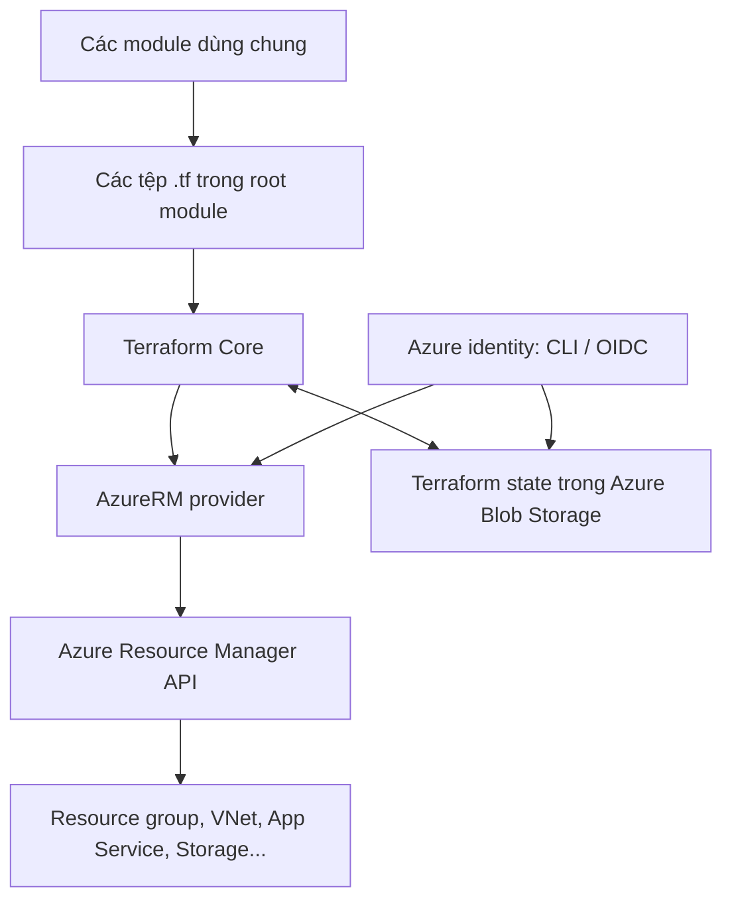
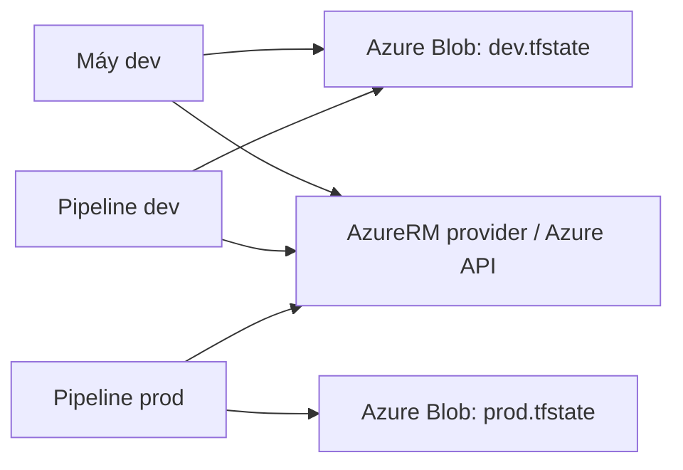
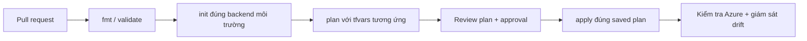

# Terraform Azure provider và tổ chức cấu hình

## 1. Vì sao cần Terraform khi làm việc với Azure?

Trong Microsoft Azure, một hệ thống ứng dụng có thể gồm **subscription**, **resource group**, virtual network, subnet, App Service, storage account, cơ sở dữ liệu, Key Vault và các thành phần giám sát. Tạo thủ công từng tài nguyên trên Azure Portal giúp thử nghiệm nhanh, nhưng khi cần triển khai lại cùng kiến trúc ở development, staging và production, việc thao tác thủ công dễ dẫn đến sai lệch cấu hình và khó truy vết ai đã thay đổi gì.

**Terraform** là công cụ Infrastructure as Code (IaC) khai báo hạ tầng bằng ngôn ngữ HCL (HashiCorp Configuration Language). Nhóm phát triển mô tả **trạng thái mong muốn** của tài nguyên trong tệp `.tf`; Terraform so sánh cấu hình này với trạng thái đang quản lý và tài nguyên thực, lập kế hoạch thay đổi rồi gọi API của Azure để thực hiện. Cấu hình có thể được review qua pull request, tái sử dụng bằng module và kiểm thử trong pipeline.

Bài học thuộc chương **Hạ tầng dưới dạng mã** của lộ trình khám phá hệ sinh thái Azure: từ subscription, resource group và Microsoft Entra ID đến mạng, tính toán, lưu trữ, dữ liệu, bảo vệ, giám sát và kiểm soát chi phí. Trọng tâm ở đây là **Terraform AzureRM provider** và **cách tổ chức cấu hình Terraform** để nhiều môi trường dùng chung định nghĩa hạ tầng mà vẫn có trạng thái, quyền truy cập và tham số riêng.

### Mục tiêu học tập

Hoàn thành bài này, bạn có thể:

1. Giải thích vai trò của Terraform Core, provider AzureRM, state, backend, resource, data source và module.
2. Viết cấu hình Terraform cấp root để tạo resource group, virtual network và subnet trên Azure.
3. Khai báo và kiểm soát phiên bản provider; phân biệt `terraform init`, `validate`, `plan` và `apply`.
4. Thiết kế thư mục root module, module dùng chung và cấu hình cho `dev`, `stg`, `prod`.
5. Lưu Terraform state từ xa trên Azure Blob Storage và phân biệt quyền truy cập state với quyền triển khai tài nguyên.
6. Dùng Azure CLI hoặc workload identity federation để xác thực mà không đưa client secret vào Git.
7. Nhận diện drift, sự cố state, khác biệt giữa môi trường và các lỗi tổ chức cấu hình thường gặp.

## 2. Thành phần của một dự án Terraform trên Azure



| Thành phần | Chức năng | Ví dụ |
| --- | --- | --- |
| Terraform Core | Đọc HCL, tạo dependency graph, lập và thực thi kế hoạch | `terraform plan` |
| Provider | Plugin chuyển các loại tài nguyên Terraform thành thao tác với API của dịch vụ | `hashicorp/azurerm` |
| Resource | Tài nguyên Terraform tạo hoặc quản lý | `azurerm_resource_group`, `azurerm_virtual_network` |
| Data source | Đọc thông tin của tài nguyên đã tồn tại mà không sở hữu vòng đời của nó | `data "azurerm_resource_group" ...` |
| Variable | Tham số hóa cấu hình | `var.environment`, `var.location` |
| Local value | Giá trị tính toán để dùng lại trong module | `local.common_tags` |
| Output | Xuất thông tin hữu ích cho người dùng hoặc module gọi | `output "subnet_id"` |
| Module | Nhóm resource, variable và output thành một thành phần tái sử dụng | `modules/network` |
| State | Ánh xạ đối tượng Terraform với đối tượng thật và lưu metadata quản lý | `terraform.tfstate` trong Azure Blob |
| Backend | Cách Terraform lưu và truy xuất state | Backend `azurerm` |

**Điểm phân biệt quan trọng:** `azurerm` trong `required_providers` là **provider** thao tác với tài nguyên Azure; `azurerm` trong `backend` là **backend lưu state trên Azure Blob Storage**. Chúng có tên giống nhau nhưng được cấu hình, khởi tạo và xác thực theo hai cơ chế riêng.

### Terraform, AzureRM và AzAPI

AzureRM provider cung cấp schema HCL có kiểu rõ ràng cho nhiều dịch vụ Azure, ví dụ `azurerm_linux_web_app` hoặc `azurerm_virtual_network`. Khi một loại tài nguyên hoặc thuộc tính Azure mới chưa được AzureRM hỗ trợ như mong muốn, nhóm có thể đánh giá **AzAPI provider** để làm việc với Azure Resource Manager API trực tiếp hơn. Không tự động dùng AzAPI cho mọi tài nguyên: ưu tiên cách có schema, vòng đời và khả năng kiểm soát phù hợp với yêu cầu thực tế.

Terraform và Azure Bicep/ARM templates đều mô tả tài nguyên dưới dạng mã. Terraform dùng state riêng để quản lý ánh xạ và thay đổi; Bicep được Azure Resource Manager xử lý theo cơ chế triển khai của Azure. Việc chọn công cụ phụ thuộc hệ sinh thái hiện có, quy trình vận hành và phạm vi đa cloud.

## 3. Chuẩn bị: quyền Azure, công cụ và tài nguyên ví dụ

Giả sử nhóm đang triển khai hạ tầng cho ứng dụng `orders-api` ở subscription dành cho development:

| Thuộc tính | Giá trị minh họa |
| --- | --- |
| Project | `orders` |
| Environment | `dev` |
| Azure region | `southeastasia` |
| Resource group | `rg-orders-dev` |
| Virtual network | `vnet-orders-dev` |
| VNet CIDR | `10.30.0.0/16` |
| Application subnet | `10.30.1.0/24` |

Các tên và địa chỉ này chỉ phục vụ minh họa. Trước khi áp dụng, cần kiểm tra chính sách đặt tên, IP không trùng với mạng kết nối, quota, region được phép sử dụng và ngân sách của tổ chức.

Máy thực hành cần cài **Terraform CLI**, **Azure CLI** và một tài khoản Azure được cấp quyền phù hợp trên subscription/resource group. Tại máy cá nhân:

```bash
terraform version
az version
az login
az account list --output table
az account set --subscription "<subscription-id>"
az account show --query "{name:name,id:id,tenantId:tenantId}" --output table
```

Lệnh `az login` mở quy trình đăng nhập tương tác. Quyền đăng nhập Azure không đồng nghĩa với quyền tạo resource group hoặc chỉnh sửa mạng; những thao tác đó cần role Azure RBAC tương ứng. Không sử dụng quyền `Owner` cấp subscription chỉ để thực hành nếu phạm vi nhỏ hơn đã đủ.

Ở môi trường CI/CD, ưu tiên **workload identity federation/OIDC** hoặc danh tính phù hợp của agent thay cho mật khẩu service principal dài hạn. Không commit token, `client_secret`, private key hoặc tệp thông tin xác thực vào repository.

## 4. Root module tối thiểu với AzureRM provider

Trong Terraform, **root module** là thư mục mà bạn chạy lệnh Terraform. Các tệp `.tf` trong cùng một thư mục tạo thành **một cấu hình logic**, không được chạy độc lập theo tên file. Terraform có thể đọc định nghĩa trong nhiều tệp, nhưng resource tham chiếu lẫn nhau thông qua tên trong HCL, không qua thứ tự tên tệp.

Một dự án nhỏ có thể bắt đầu như sau:

```text
infra/
├── versions.tf
├── providers.tf
├── variables.tf
├── locals.tf
├── main.tf
├── outputs.tf
├── terraform.tfvars.example
└── .terraform.lock.hcl      # được sinh sau terraform init, nên commit
```

### `versions.tf`: yêu cầu Terraform và AzureRM

```hcl
terraform {
  required_version = ">= 1.6.0"

  required_providers {
    azurerm = {
      source  = "hashicorp/azurerm"
      version = "~> 4.0"
    }
  }
}
```

`source` xác định nhà phát hành và tên provider trên Terraform Registry. Ràng buộc `~> 4.0` trong ví dụ cho phép phiên bản `4.x` tương thích với ràng buộc, nhưng chưa mở sang major `5.x`. Đây là **lựa chọn phiên bản dành cho ví dụ**, không phải tuyên bố phiên bản mới nhất. Khi áp dụng dự án thật, cần chọn dòng provider đã kiểm thử, kiểm tra release notes và nâng cấp có kiểm soát.

Tệp **`.terraform.lock.hcl`** ghi lại phiên bản provider đã được giải quyết và checksum của gói provider. Nên commit tệp này để local và CI dùng cùng dependency. Lệnh `terraform init -upgrade` có thể chọn phiên bản mới thỏa ràng buộc; cần review diff của lock file và kiểm tra kế hoạch trước khi merge.

### `providers.tf`: chọn subscription

```hcl
provider "azurerm" {
  features {}
  subscription_id = var.subscription_id
}
```

`features {}` là khối cấu hình provider AzureRM. `subscription_id` buộc provider nhắm đúng subscription; với AzureRM 4.x, hãy cung cấp giá trị này một cách tường minh hoặc qua cơ chế biến môi trường hỗ trợ. ID là định danh, không phải secret; thông tin đăng nhập vẫn phải đi qua Azure CLI, OIDC hoặc cơ chế được phép khác.

Một dự án có thể khai báo nhiều provider, nhưng **không đặt khóa/mật khẩu trực tiếp trong `provider` block**. Provider chịu trách nhiệm kết nối API Azure; backend lưu state có thể yêu cầu quyền và cấu hình xác thực riêng.

### `variables.tf`: hợp đồng đầu vào

```hcl
variable "subscription_id" {
  description = "Azure subscription ID cho môi trường mục tiêu"
  type        = string
}

variable "project" {
  description = "Tên ngắn dùng trong quy ước đặt tên tài nguyên"
  type        = string
  default     = "orders"
}

variable "environment" {
  description = "Môi trường triển khai"
  type        = string

  validation {
    condition     = contains(["dev", "stg", "prod"], var.environment)
    error_message = "environment phải là dev, stg hoặc prod."
  }
}

variable "location" {
  description = "Azure region cho các tài nguyên"
  type        = string
}

variable "vnet_cidr" {
  description = "CIDR của virtual network"
  type        = string
}

variable "app_subnet_cidr" {
  description = "CIDR của subnet ứng dụng"
  type        = string
}
```

Khai báo `type`, `description`, `validation` giúp người gọi hiểu và kiểm soát đầu vào. Một `default` chỉ nên là giá trị an toàn có thể áp dụng chung; các giá trị theo môi trường nên lấy từ tệp biến riêng hoặc pipeline.

### `locals.tf`: giá trị dẫn xuất và tag dùng chung

```hcl
locals {
  name_suffix = "${var.project}-${var.environment}"

  common_tags = {
    project     = var.project
    environment = var.environment
    managed_by  = "terraform"
  }
}
```

`locals` phù hợp với giá trị tính từ biến đã nhập, ví dụ hậu tố tên hoặc nhãn chi phí. Nó không tạo một kênh bảo vệ secret; giá trị nhạy cảm vẫn phải được xử lý riêng.

### `main.tf`: tạo resource group, VNet và subnet

```hcl
resource "azurerm_resource_group" "main" {
  name     = "rg-${local.name_suffix}"
  location = var.location
  tags     = local.common_tags
}

resource "azurerm_virtual_network" "main" {
  name                = "vnet-${local.name_suffix}"
  location            = azurerm_resource_group.main.location
  resource_group_name = azurerm_resource_group.main.name
  address_space       = [var.vnet_cidr]
  tags                = local.common_tags
}

resource "azurerm_subnet" "app" {
  name                 = "snet-app"
  resource_group_name  = azurerm_resource_group.main.name
  virtual_network_name = azurerm_virtual_network.main.name
  address_prefixes     = [var.app_subnet_cidr]
}
```

Định danh như `azurerm_resource_group.main` hoặc `azurerm_virtual_network.main` là **địa chỉ trong Terraform state**, còn thuộc tính `name` là **tên thực tế trên Azure**. Khi tham chiếu `azurerm_resource_group.main.name`, Terraform nhận biết dependency và sắp thứ tự tạo tài nguyên phù hợp. Đừng phụ thuộc vào thứ tự các khối trong file để quyết định thứ tự triển khai.

### `outputs.tf`: công bố thông tin sau triển khai

```hcl
output "resource_group_name" {
  description = "Resource group được Terraform quản lý"
  value       = azurerm_resource_group.main.name
}

output "vnet_id" {
  description = "Azure resource ID của virtual network"
  value       = azurerm_virtual_network.main.id
}

output "app_subnet_id" {
  description = "Azure resource ID của application subnet"
  value       = azurerm_subnet.app.id
}
```

Output là API của root module cho người sử dụng hoặc pipeline. Không xuất mật khẩu, token hay connection string qua output trừ khi có yêu cầu thực sự và đã áp dụng cách bảo vệ phù hợp. Đánh dấu output `sensitive = true` chỉ giúp che giá trị khỏi một số màn hình CLI; nó **không xóa giá trị đó khỏi state**.

### `terraform.tfvars.example`: mẫu tham số

```hcl
subscription_id = "00000000-0000-0000-0000-000000000000"
project          = "orders"
environment      = "dev"
location         = "southeastasia"
vnet_cidr        = "10.30.0.0/16"
app_subnet_cidr  = "10.30.1.0/24"
```

Khi chạy thực tế, thay subscription ID giả bằng ID thực của bạn. Tệp ví dụ có thể commit vì không chứa credential. Nếu tạo `terraform.tfvars` cục bộ có secret, phải loại khỏi Git; tốt hơn là tránh truyền secret vào Terraform khi dịch vụ Azure có thể lấy secret bằng managed identity hoặc Key Vault reference.

## 5. Vòng đời làm việc với Terraform

Trong thư mục `infra`, sau khi tạo cấu hình ở mục 4 và điền biến cho môi trường thử nghiệm:

```bash
# Chỉ dùng cho cấu hình chưa khai báo remote backend ở mục 6
terraform init

# Chuẩn hóa format và kiểm tra cú pháp/schema
terraform fmt -recursive
terraform validate

# Xem các thay đổi dự kiến trước khi thực hiện
terraform plan -var-file="terraform.tfvars"

# Áp dụng sau khi đọc kỹ plan
terraform apply -var-file="terraform.tfvars"

# Xem output; so sánh state với Azure
terraform output
terraform state list
```

| Lệnh | Ý nghĩa | Lưu ý |
| --- | --- | --- |
| `terraform init` | Tải provider/module và khởi tạo backend | Chạy lại khi thay provider, module hoặc backend |
| `terraform fmt` | Định dạng tệp HCL | Dùng `terraform fmt -check -recursive` trong CI |
| `terraform validate` | Kiểm tra cấu hình Terraform về cú pháp và tính nhất quán | Không xác nhận quyền Azure, quota hoặc mọi giá trị runtime |
| `terraform plan` | Đề xuất hành động tạo, sửa, thay thế, xóa | Đọc phần `-/+` và các cảnh báo trước khi duyệt |
| `terraform apply` | Thực thi kế hoạch | Yêu cầu quyền ghi phù hợp; có thể phát sinh chi phí |
| `terraform output` | Đọc output trong state | Tránh in output nhạy cảm vào log |
| `terraform state list` | Liệt kê các đối tượng Terraform quản lý | Không tự ý sửa state thủ công |
| `terraform destroy` | Lập và thực thi việc xóa các tài nguyên được quản lý | Chỉ chạy khi biết rõ tác động và đã được phê duyệt |

**Plan không phải cam kết rằng hệ thống sẽ không thay đổi bên ngoài** trong khoảng giữa `plan` và `apply`. Đối với production, pipeline nên tạo một **saved plan** và áp dụng đúng file kế hoạch đã được duyệt:

```bash
terraform plan -var-file="environments/prod.tfvars" -out="prod.tfplan"
terraform apply "prod.tfplan"
```

Tệp `.tfplan` có thể chứa giá trị nhạy cảm và thông tin cấu hình backend; phải bảo vệ artifact, phân quyền đọc và giới hạn thời gian lưu. Không lưu nó công khai hoặc commit vào Git. Khi có thay đổi từ bên ngoài sau lúc plan, cần tạo plan mới và review thay vì cố gắng dùng kế hoạch cũ.

### Cách đọc một plan

Terraform hiển thị các ký hiệu thường gặp:

```text
  + create
  ~ update in-place
  - destroy
  -/+ destroy and then create replacement
  +/- create replacement and then destroy
```

Một thay đổi location, tên hoặc thuộc tính bất biến của tài nguyên Azure có thể buộc thay thế resource. Nếu plan định xóa subnet, network hoặc storage đang được ứng dụng sử dụng, phải xác định phạm vi tác động và phương án chuyển đổi trước khi apply. Không sử dụng `-auto-approve` như cách bỏ qua bước kiểm tra ở production.

## 6. Terraform state và backend Azure Blob Storage

**Terraform state** lưu mối liên hệ giữa resource trong cấu hình và resource thực; có thể chứa resource ID, thuộc tính, thông tin cấu hình nhạy cảm và metadata khác. Khi nhiều người cùng chạy Terraform, state đặt trên máy cá nhân sẽ khó đồng bộ và dễ ghi đè. Với Azure, backend **`azurerm`** thường dùng Azure Blob Storage để tập trung state và sử dụng cơ chế khóa blob lease khi thao tác.



Một state nên có **đúng một luồng ghi tại một thời điểm**. Terraform backend hỗ trợ locking giúp tránh nhiều thao tác state đồng thời, nhưng không thay thế quy trình phê duyệt hay phân quyền cloud. Không dùng `-lock=false` để “vượt” lỗi khóa khi có pipeline khác đang chạy.

### Điều kiện tiên quyết: bootstrap state storage

Trước khi `terraform init` với remote backend, cần có **resource group, storage account và blob container dành cho state**. Những tài nguyên này phải được tạo trước bằng một bước bootstrap được kiểm soát (ví dụ thao tác qua Azure CLI hoặc dự án Terraform bootstrap riêng), vì backend phải tồn tại trước khi root module khởi tạo.

Gợi ý bố trí:

```text
rg-tfstate-shared
└── st<ten-duy-nhat>           # Storage account name thực tế phải hợp lệ và duy nhất
    └── tfstate               # Blob container
        ├── orders/dev/infra.tfstate
        ├── orders/stg/infra.tfstate
        └── orders/prod/infra.tfstate
```

Đối với môi trường production có yêu cầu bảo vệ cao, có thể tách storage account, subscription hoặc ranh giới quyền thay vì chỉ dùng các key khác nhau trong cùng một container. Storage account nên bật bảo vệ truy cập, mã hóa, kiểm soát mạng, logging/monitoring và cơ chế phục hồi phù hợp với chính sách tổ chức; thiết lập versioning/soft delete giúp hỗ trợ phục hồi state khi có sự cố.

### Khai báo backend

Thêm vào `versions.tf` trong root module:

```hcl
terraform {
  required_version = ">= 1.6.0"

  required_providers {
    azurerm = {
      source  = "hashicorp/azurerm"
      version = "~> 4.0"
    }
  }

  backend "azurerm" {}
}
```

Đây là **phiên bản thay thế hoàn chỉnh** cho `terraform { ... }` ở mục 4 sau khi chuyển sang remote backend. Không khai báo hai khối `terraform` xung đột hoặc hai backend trong cùng root module.

Tạo tệp không nhạy cảm `environments/dev.backend.hcl`:

```hcl
resource_group_name  = "rg-tfstate-shared"
storage_account_name = "stordersiacexample"
container_name       = "tfstate"
key                  = "orders/dev/infra.tfstate"
use_azuread_auth     = true
```

Trong ví dụ, tên storage account chỉ là placeholder: cần thay bằng tên đã tạo thực tế, phù hợp quy tắc đặt tên của Azure. Thuộc tính `use_azuread_auth = true` cho phép backend sử dụng xác thực Microsoft Entra ID tới Blob Storage. Danh tính chạy Terraform cần quyền **data plane** phù hợp, chẳng hạn `Storage Blob Data Contributor` ở phạm vi state container; quyền `Contributor` trên resource group dành cho tài nguyên ứng dụng là một khái niệm khác và không mặc nhiên thay cho quyền đọc/ghi blob.

Khởi tạo:

```bash
terraform init -backend-config="environments/dev.backend.hcl"
terraform plan -var-file="environments/dev.tfvars"
```

Backend được xử lý trong giai đoạn `init`, **không tham chiếu trực tiếp được `var.environment` hoặc `local.name_suffix`** bên trong cấu hình backend. Vì vậy, dùng file `*.backend.hcl` hoặc tham số backend riêng theo môi trường. Các giá trị backend nhạy cảm nếu đưa qua `-backend-config` có thể được lưu trong `.terraform` hoặc plan; hãy ưu tiên OIDC/CLI, biến môi trường và identity thay vì đưa bí mật vào file backend.

Khi đổi từ local sang remote state, Terraform có thể yêu cầu xác nhận migration. Trước khi di chuyển, cần biết state hiện tại thuộc môi trường nào, tạo bản sao lưu được bảo vệ, bảo đảm các job khác đã dừng ghi và kiểm tra kết quả bằng `terraform state list` sau khi di chuyển.

## 7. Tổ chức cấu hình cho nhiều môi trường

Sau khi ứng dụng phát triển từ ví dụ nhỏ thành nhiều môi trường, nên tách **module hạ tầng dùng chung** với **root configuration đại diện cho phạm vi triển khai**.

Một cấu trúc dễ bắt đầu:

```text
infra/
├── versions.tf
├── providers.tf
├── variables.tf
├── locals.tf
├── main.tf
├── outputs.tf
├── .terraform.lock.hcl
├── environments/
│   ├── dev.tfvars
│   ├── dev.backend.hcl
│   ├── stg.tfvars
│   ├── stg.backend.hcl
│   ├── prod.tfvars
│   └── prod.backend.hcl
└── modules/
    └── network/
        ├── main.tf
        ├── variables.tf
        └── outputs.tf
```

Các tệp `*.tfvars` chỉ chứa giá trị cấu hình không nhạy cảm. Secret, nếu bắt buộc truyền vào Terraform, nên đến từ cơ chế secret an toàn của pipeline, không nằm trong repository.

Ví dụ `environments/dev.tfvars`:

```hcl
subscription_id = "00000000-0000-0000-0000-000000000000"
project          = "orders"
environment      = "dev"
location         = "southeastasia"
vnet_cidr        = "10.30.0.0/16"
app_subnet_cidr  = "10.30.1.0/24"
```

Với staging và production, thay subscription ID, environment và các CIDR theo thiết kế mạng. Không dùng lại CIDR tùy tiện nếu các mạng sẽ kết nối bằng peering, VPN hoặc ExpressRoute.

### Một root, nhiều tfvars hay nhiều root?

| Cách làm | Khi phù hợp | Giới hạn cần chú ý |
| --- | --- | --- |
| Một root, các `*.tfvars` và backend key riêng | Hạ tầng các môi trường tương tự, nhóm nhỏ | Dễ nhầm file biến/backend khi chạy thủ công; bắt buộc kiểm tra cặp môi trường |
| Nhiều root (`live/dev`, `live/prod`) gọi cùng module | Cần quyền, state, pipeline và chu kỳ triển khai khác nhau | Có lặp phần khai báo module ở root, đổi lại ranh giới rõ hơn |
| Terraform workspaces | Nhiều state có cùng backend và cấu hình phù hợp với mô hình workspace | Workspace không tạo ranh giới phân quyền hay bảo mật độc lập |

Không có một layout duy nhất phù hợp mọi nhóm. Khi production ở subscription riêng, có cổng duyệt riêng và khác lịch triển khai, **nhiều root gọi chung module** thường dễ quản trị hơn. Cấu trúc một root + tfvars trong bài này nhằm minh họa nguyên lý, nhưng pipeline vẫn phải đảm bảo đúng backend và đúng file biến cho từng môi trường.

## 8. Tách VNet thành module tái sử dụng

Giả sử phần mạng được dùng trong nhiều hệ thống. Ta chuyển hai resource VNet và subnet ở mục 4 vào `modules/network`, giữ resource group ở root.

**`modules/network/variables.tf`**

```hcl
variable "name" {
  type = string
}

variable "resource_group_name" {
  type = string
}

variable "location" {
  type = string
}

variable "address_space" {
  type = string
}

variable "app_subnet_prefix" {
  type = string
}

variable "tags" {
  type    = map(string)
  default = {}
}
```

**`modules/network/main.tf`**

```hcl
resource "azurerm_virtual_network" "this" {
  name                = var.name
  location            = var.location
  resource_group_name = var.resource_group_name
  address_space       = [var.address_space]
  tags                = var.tags
}

resource "azurerm_subnet" "app" {
  name                 = "snet-app"
  resource_group_name  = var.resource_group_name
  virtual_network_name = azurerm_virtual_network.this.name
  address_prefixes     = [var.app_subnet_prefix]
}
```

**`modules/network/outputs.tf`**

```hcl
output "vnet_id" {
  value = azurerm_virtual_network.this.id
}

output "app_subnet_id" {
  value = azurerm_subnet.app.id
}
```

Ở **`main.tf` của root**, **thay thế** phần VNet và subnet cũ bằng module:

```hcl
resource "azurerm_resource_group" "main" {
  name     = "rg-${local.name_suffix}"
  location = var.location
  tags     = local.common_tags
}

module "network" {
  source = "./modules/network"

  name                = "vnet-${local.name_suffix}"
  resource_group_name = azurerm_resource_group.main.name
  location            = azurerm_resource_group.main.location
  address_space       = var.vnet_cidr
  app_subnet_prefix   = var.app_subnet_cidr
  tags                = local.common_tags
}
```

Trong **`outputs.tf` của root**, thay output mạng bằng:

```hcl
output "vnet_id" {
  value = module.network.vnet_id
}

output "app_subnet_id" {
  value = module.network.app_subnet_id
}
```

Giữ lại output `resource_group_name` đã có ở mục 4. Khi nâng cấp module, **không giữ đồng thời resource VNet/subnet cũ và resource mới cùng tạo một tài nguyên Azure**, vì Terraform sẽ coi chúng là các địa chỉ khác nhau.

### Lưu ý khi refactor hạ tầng đã tồn tại

Nếu VNet và subnet đã được Terraform quản lý ở root, chuyển chúng vào module làm đổi **địa chỉ trong state**. Để Terraform hiểu đây là cùng tài nguyên, có thể dùng `moved` block ở root:

```hcl
moved {
  from = azurerm_virtual_network.main
  to   = module.network.azurerm_virtual_network.this
}

moved {
  from = azurerm_subnet.app
  to   = module.network.azurerm_subnet.app
}
```

Đặt `moved` block trong một đợt thay đổi có review, chạy `terraform plan` và xác nhận kế hoạch chỉ di chuyển địa chỉ state thay vì xóa/tạo lại mạng. Nếu state hoặc cấu hình thực tế khác với ví dụ, không áp dụng máy móc. `moved` xử lý việc đổi địa chỉ đối tượng đã được quản lý; **`import`** phục vụ đưa một tài nguyên Azure đang tồn tại nhưng chưa được Terraform quản lý vào state.

### Nguyên tắc thiết kế module

Một module tốt có interface ngắn gọn và rõ ràng: input `type`, `description`, validation cần thiết; output hữu ích cho người gọi; cách đặt tên/tags thống nhất; không hard-code subscription, tenant hay secret. Module dùng chung nên không khai báo backend riêng: **backend thuộc về root**. Root sẽ truyền provider đã cấu hình cho module.

Nếu các module được chia sẻ qua Git/Registry, ghim `source` và `version` hoặc Git ref phù hợp, review thay đổi trước khi nâng cấp. Module nằm trong đường dẫn local như `./modules/network` dùng ngay phiên bản trong cùng commit.

## 9. Provider alias khi làm việc với nhiều subscription

Một tổ chức Azure thường có subscription riêng cho mạng trung tâm, môi trường dev và production. Terraform hỗ trợ **provider configurations có alias** để một root làm việc với nhiều subscription khi cần.

```hcl
# Provider mặc định cho subscription ứng dụng
provider "azurerm" {
  features {}
  subscription_id = var.subscription_id
}

# Provider có tên "shared" cho subscription tài nguyên dùng chung
provider "azurerm" {
  alias           = "shared"
  features {}
  subscription_id = var.shared_subscription_id
}

data "azurerm_resource_group" "shared" {
  provider = azurerm.shared
  name     = var.shared_resource_group_name
}
```

Ví dụ mở rộng này giả định root đã khai báo thêm hai input `shared_subscription_id` và `shared_resource_group_name`. Data source chỉ đọc resource group dùng chung; nó không tạo resource group mới.

Khi gọi module muốn chuyển sang provider `shared`:

```hcl
module "shared_network" {
  source = "./modules/network"

  providers = {
    azurerm = azurerm.shared
  }

  name                = "vnet-shared"
  resource_group_name = data.azurerm_resource_group.shared.name
  location            = data.azurerm_resource_group.shared.location
  address_space       = "10.40.0.0/16"
  app_subnet_prefix   = "10.40.1.0/24"
  tags                = { managed_by = "terraform" }
}
```

Đây là **biến thể độc lập của thiết kế root**, không phải khối cần thêm vào bản demo dev ngay lập tức. Với cấu hình trên, provider mặc định bên trong module sẽ nhận `azurerm.shared` qua mapping `providers`. Nếu chính module cần tham chiếu trực tiếp một alias khác bằng `provider = azurerm.<alias>`, phải khai báo `configuration_aliases` trong `required_providers` của module và truyền mapping tương ứng.

**Alias không cấp thêm quyền Azure.** Danh tính chạy Terraform phải được Microsoft Entra ID xác thực và Azure RBAC cấp quyền phù hợp ở từng subscription. Đối với ranh giới tổ chức quan trọng, cân nhắc tách state/root và identity thay vì dùng một root có thể ghi trên mọi subscription.

## 10. Bảo mật danh tính, state và secret

Terraform có ít nhất hai đường truy cập cần quản lý:

1. **Backend identity** cần đọc/ghi và khóa blob state.
2. **Provider identity** cần gọi Azure Resource Manager để đọc/thay đổi tài nguyên được quản lý.

Hai đường có thể dùng cùng hoặc khác identity tùy kiến trúc, nhưng quyền cần được đánh giá **riêng**. Khả năng đọc state có thể làm lộ nội dung nhạy cảm, ngay cả khi người đọc không có quyền quản lý chính resource trên Azure.

### Xác thực không cần client secret lưu lâu dài

- **Phát triển cục bộ:** đăng nhập Azure CLI bằng `az login`, chọn đúng subscription, cấu hình quyền Azure RBAC và quyền blob backend.
- **Azure DevOps:** dùng Azure Resource Manager service connection dựa trên workload identity federation nếu có thể; xác minh phiên bản Terraform task/wrapper hoặc script CLI hỗ trợ truyền danh tính cho provider/backend.
- **GitHub Actions:** cấp `permissions: id-token: write`, cấu hình federated credential trong Microsoft Entra ID giới hạn đúng repository, branch hoặc environment, và truyền các tham số cần thiết cho AzureRM provider/backend.

Đối với thiết lập OIDC của AzureRM trong CI/CD, các biến như sau thường liên quan:

```bash
export ARM_USE_OIDC=true
export ARM_CLIENT_ID="<federated-application-client-id>"
export ARM_TENANT_ID="<entra-tenant-id>"
export ARM_SUBSCRIPTION_ID="<azure-subscription-id>"
```

Khối này **chỉ minh họa tên biến cấu hình**, chưa phải một pipeline OIDC hoàn chỉnh: runner vẫn phải được nền tảng CI/CD cấp OIDC token, cấu hình federated credential khớp chính xác issuer/subject/audience và bảo đảm backend sử dụng cơ chế xác thực được hỗ trợ (ví dụ `use_oidc` cùng `use_azuread_auth` khi thích hợp). Với root có `subscription_id = var.subscription_id`, vẫn cần truyền biến Terraform `subscription_id` tương ứng, hoặc điều chỉnh cấu hình provider nhất quán với cách lấy subscription ID đã chọn.

Không nên lưu client secret hay access key của storage account vào `terraform.tfvars`, `backend.hcl` hoặc pipeline YAML. Đừng cho rằng `sensitive = true` làm dữ liệu biến mất khỏi state: nhiều giá trị nhạy cảm của resource/data source vẫn được lưu. Khi ứng dụng cần mật khẩu runtime, ưu tiên **Azure Key Vault + managed identity/Key Vault reference** để Terraform khai báo tham chiếu và quyền, còn ứng dụng đọc secret khi chạy.

### Quyền và bảo vệ state

| Kiểm soát | Ý nghĩa |
| --- | --- |
| Azure RBAC tối thiểu | Pipeline dev không có quyền thay đổi production |
| Role data-plane cho Blob | Chỉ identity cần thiết được đọc/ghi state container |
| OIDC/workload federation | Hạn chế phải tạo và xoay vòng secret dài hạn |
| Separate state keys / accounts | Hạn chế lỗi triển khai nhầm và giảm phạm vi ảnh hưởng |
| Encryption, network rules, logging | Bảo vệ state khi lưu và truy cập |
| Blob versioning/soft delete và backup | Hỗ trợ điều tra, khôi phục sau lỗi ghi/xóa |
| Branch protection và plan approval | Ngăn sửa hạ tầng không qua review |

Không bao giờ in `terraform state pull` hoặc nội dung file plan vào log công khai. Một người có quyền tải state/plan vẫn có thể xem các giá trị được che trên terminal, tùy cách resource lưu thuộc tính.

## 11. Tổ chức pipeline CI/CD cho Terraform

Quy trình tham khảo:



Một pipeline có thể chạy `fmt` và kiểm tra tĩnh trên pull request; với plan cần truy cập Azure/state, chỉ cho phép workflow đáng tin cậy có identity và quyền đúng scope. Apply production nên chạy từ branch/tag được bảo vệ, sau phê duyệt của người có trách nhiệm.

Ví dụ trình tự shell cho **môi trường dev**, sau khi CI đã được cấp danh tính Azure và state storage đã tồn tại:

```bash
set -euo pipefail

terraform fmt -check -recursive
terraform init \
  -backend-config="environments/dev.backend.hcl" \
  -input=false
terraform validate

terraform plan \
  -var-file="environments/dev.tfvars" \
  -out="dev.tfplan" \
  -input=false

# Bước apply phải nằm sau checkpoint duyệt và dùng đúng plan.
terraform apply -input=false "dev.tfplan"
```

Ở pipeline thật, lưu plan bằng artifact có quyền truy cập giới hạn, chạy apply từ đúng commit và đúng environment, tránh tạo lại plan không được review. State lock ngăn hai apply đồng thời trên cùng key, còn môi trường production nên có thêm kiểm soát concurrency và quyền duyệt.

**Lưu ý quan trọng:** Nếu chuyển qua `prod`, phải đổi **cả** backend config và `tfvars`, đồng thời dùng danh tính có quyền production. Chỉ đổi `environment = "prod"` trong tfvars trong khi backend vẫn trỏ vào state dev có thể dẫn tới kế hoạch sửa/xóa sai tài nguyên. Với một working directory dùng nhiều backend, khởi tạo lại có kiểm soát và kiểm tra metadata backend; CI nên dùng working directory sạch cho mỗi môi trường.

## 12. Drift, import và những lỗi cấu hình thường gặp

**Configuration drift** xuất hiện khi tài nguyên Azure bị thay đổi ngoài Terraform, chẳng hạn kỹ sư chỉnh địa chỉ mạng trên Portal hoặc chính sách tự động thay tag. `terraform plan` thực hiện refresh để so sánh và có thể đề xuất đưa hạ tầng về cấu hình đã khai báo. Đọc kỹ vì có trường hợp thay đổi ngoài Terraform là chủ ý và cần cập nhật HCL trước khi apply.

Nếu resource Azure đã tồn tại nhưng chưa có trong state, không tạo lại cùng tên. Sau khi viết `resource` phù hợp, có thể dùng `import` block:

```hcl
import {
  to = azurerm_resource_group.main
  id = "/subscriptions/<subscription-id>/resourceGroups/rg-orders-dev"
}
```

Giá trị `id` cần thay bằng resource ID thật. Chạy `terraform plan` để xác nhận kết quả import và các thuộc tính đã khai báo. Việc import ánh xạ đối tượng vào state không tự tạo ra HCL hoàn chỉnh, cũng không bảo đảm cấu hình hiện tại đã bao phủ đầy đủ mọi thuộc tính.

| Vấn đề | Nguyên nhân phổ biến | Hướng xử lý |
| --- | --- | --- |
| `terraform init` lỗi backend | State storage chưa tồn tại, thiếu quyền blob hoặc sai endpoint | Kiểm tra bootstrap, RBAC data plane và network |
| `plan` yêu cầu `subscription_id` | Input Terraform chưa truyền cho provider | Cấp biến đúng subscription, kiểm tra environment |
| Provider lỗi `AuthorizationFailed` | Danh tính thiếu Azure RBAC trên scope tài nguyên | Kiểm tra role assignment đúng subscription/RG/resource |
| Provider lỗi tải/phiên bản | Ràng buộc phiên bản xung đột, lock file cũ, network proxy | Review constraint và chạy `init` có kiểm soát |
| Plan định tạo lại VNet sau khi chuyển module | Đổi địa chỉ resource trong state | Dùng `moved` block và review plan |
| Plan nhắm nhầm môi trường | Backend và tfvars không cùng môi trường | Buộc cặp backend/vars, tách working directory và identity |
| State bị khóa | Pipeline trước vẫn chạy hoặc lock chưa giải phóng | Xác minh owner/phiên chạy trước khi xử lý lock |
| `sensitive` vẫn xuất hiện trong state | Thuộc tính nhạy cảm được provider lưu | Bảo vệ state, loại bỏ secret khỏi IaC nếu có thể |
| Drift lặp lại liên tục | Nhiều hệ thống cùng thay một thuộc tính | Xác định một nguồn quản lý, sửa thiết kế quyền và cấu hình |

Lệnh `terraform state rm`, `terraform import`, `terraform force-unlock` và các thao tác đổi backend/state có thể gây mất đồng bộ khi dùng sai. Chỉ thực hiện khi đã hiểu object đang được quản lý, có bản sao lưu state và đã khóa thao tác ghi của pipeline khác.

## 13. Thực hành có hướng dẫn

**Bài tập:** triển khai một resource group, VNet và subnet cho `orders-api` ở môi trường development, sau đó chuyển VNet/subnet thành module tái sử dụng và cấu hình state từ xa.

1. **Chuẩn bị Azure và CLI.** Xác định subscription dev, region hợp lệ và quyền tạo resource group/network. Chạy `az login`, `az account show` để kiểm tra identity.
2. **Viết root module.** Tạo `versions.tf`, `providers.tf`, `variables.tf`, `locals.tf`, `main.tf`, `outputs.tf` theo mục 4. Tạo `terraform.tfvars` cục bộ từ tệp ví dụ, thay subscription ID giả và kiểm tra CIDR.
3. **Kiểm tra cấu hình.** Chạy `terraform init`, `terraform fmt -check -recursive`, `terraform validate` và `terraform plan`. Đối chiếu số resource dự kiến: một resource group, một VNet, một subnet.
4. **Apply ở dev.** Đọc plan, chạy `terraform apply`, xác minh trên Azure Portal/CLI và đọc `terraform output`. Ghi lại resource ID để đối chiếu sau.
5. **Refactor thành module.** Đưa VNet và subnet vào `modules/network`, khai báo các input/output theo mục 8; thêm `moved` blocks tương ứng. Chạy `terraform plan` và xác minh Terraform nhận diện việc di chuyển state, không dự định thay thế tài nguyên đang hoạt động.
6. **Thiết lập remote backend.** Tạo state storage bằng quy trình bootstrap riêng, thiết lập RBAC và `environments/dev.backend.hcl`. Chuyển state sang backend `azurerm` theo hướng dẫn migration. Xác nhận state được lưu đúng key và pipeline có quyền truy cập phù hợp.
7. **Kiểm thử thay đổi an toàn.** Sửa một tag không nhạy cảm, chạy `terraform plan` và xem thay đổi. Xác minh phần network không bị xóa/tạo lại. Khôi phục cấu hình nếu không muốn áp dụng.
8. **Thiết kế cho production.** Tạo tài liệu mô tả cặp `prod.tfvars`/`prod.backend.hcl`, danh tính production và bước review; không cần triển khai thật nếu chưa được ủy quyền.

### Tiêu chí hoàn thành

| Tiêu chí | Kết quả mong đợi |
| --- | --- |
| Khai báo | Root module có provider AzureRM với subscription rõ ràng |
| Tài nguyên | RG, VNet, subnet được quản lý bằng Terraform |
| Chất lượng cấu hình | `fmt -check` và `validate` đạt |
| Module | Network được gọi qua input/output rõ ràng |
| Refactor | Plan không dự định xóa và tạo lại network sau khi dùng `moved` |
| State | Dùng remote backend Azure Blob, có quyền blob phù hợp |
| Môi trường | Backend và tfvars chỉ đúng `dev`, không nhầm sang production |
| Bảo mật | Không có token, client secret, state hoặc plan file trong Git |
| Review | Thay đổi production chỉ apply sau khi duyệt đúng saved plan |

## 14. Câu hỏi tự kiểm tra

1. Vì sao `backend "azurerm"` và `provider "azurerm"` phải được hiểu như hai thành phần khác nhau?
2. Khi nào nên dùng `resource`, khi nào dùng `data` source trong AzureRM?
3. `terraform init`, `validate`, `plan` và `apply` khác nhau như thế nào?
4. Tại sao nên commit `.terraform.lock.hcl` nhưng không nên commit `terraform.tfstate` và `*.tfplan`?
5. Trong cấu hình một root + nhiều `tfvars`, rủi ro gì xảy ra nếu dùng `prod.tfvars` với backend của `dev`?
6. Vì sao chuyển `azurerm_virtual_network.main` sang `module.network.azurerm_virtual_network.this` có thể làm plan định tạo mới tài nguyên? Khắc phục ra sao?
7. Một pipeline có quyền `Contributor` tại resource group của ứng dụng nhưng không đọc được Azure Blob state: lỗi có thể nằm ở đâu?
8. `sensitive = true` có bảo đảm mật khẩu không tồn tại trong state không?
9. Khi nào nên tách root/state giữa hai subscription thay vì dùng provider alias?
10. Nếu có người sửa tag trên Azure Portal, Terraform phản ứng thế nào khi chạy plan?

**Gợi ý:** (1) backend lưu state, provider điều khiển resource; (2) resource quản lý vòng đời, data source chỉ đọc; (3) khởi tạo, kiểm tra, dự tính, thực thi; (4) lock file khóa dependency còn state/plan chứa thông tin vận hành, có thể nhạy cảm; (5) nguy cơ đối chiếu và sửa sai state; (6) dùng `moved` block để ánh xạ địa chỉ cũ sang mới; (7) thiếu data-plane RBAC trên blob hoặc bị chặn mạng; (8) không; (9) khi cần ranh giới quyền/phê duyệt độc lập; (10) plan phát hiện drift và đề xuất thay đổi dựa trên HCL.

## 15. Tổng kết và tài liệu tham khảo

Terraform giúp triển khai hạ tầng Azure theo một quy trình có thể lặp lại: **mô tả tài nguyên bằng HCL → khởi tạo provider và backend → xem plan → phê duyệt → apply → giám sát thay đổi**. Provider AzureRM quyết định cách Terraform thao tác với tài nguyên, còn backend Azure Blob quyết định cách nhóm chia sẻ và bảo vệ state. Root module nên tập trung vào phạm vi triển khai và quyền môi trường; module dùng chung nên mô tả các thành phần hạ tầng như network với input/output rõ ràng.

Khi mở rộng sang App Service, Azure Storage, database, Entra ID hay các dịch vụ giám sát, tiếp tục áp dụng cùng nguyên tắc: **quyền tối thiểu, state tách biệt, cấu hình theo môi trường, version provider có kiểm soát, plan được review và artifact/secret được bảo vệ**. Những nguyên tắc này giúp nhóm vận hành kiến trúc Azure ổn định, dễ kiểm tra và dễ truy vết chi phí.

Tài liệu chính thức để tra cứu chi tiết schema, phiên bản và hành vi thực tế:

- [Terraform Registry — AzureRM provider](https://registry.terraform.io/providers/hashicorp/azurerm/latest/docs)
- [Terraform — AzureRM backend](https://developer.hashicorp.com/terraform/language/backend/azurerm)
- [Terraform — Modules](https://developer.hashicorp.com/terraform/language/modules)
- [Terraform — State](https://developer.hashicorp.com/terraform/language/state)
- [Microsoft Learn — Terraform trên Azure](https://learn.microsoft.com/azure/developer/terraform/)
