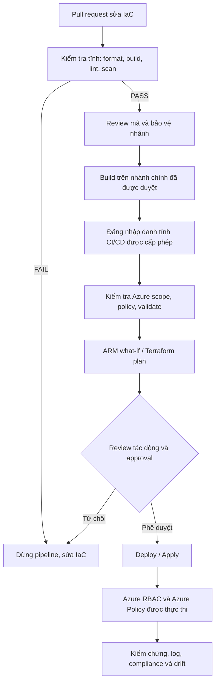

# Kiểm tra policy, quyền và chất lượng IaC trong pipeline

## 1. Vì sao IaC cần nhiều lớp kiểm tra?

Trong chương **Hạ tầng dưới dạng mã (Infrastructure as Code — IaC)** của module **CLOUD_PROVIDERS_AZURE**, chúng ta sử dụng ARM template, Bicep hoặc Terraform để mô tả và triển khai hạ tầng Azure theo phiên bản trong Git. Khi xây dựng một kiến trúc ứng dụng có subscription, resource group, Microsoft Entra ID, mạng ảo, compute, storage, cơ sở dữ liệu, giám sát và kiểm soát chi phí, một thay đổi nhỏ trong IaC có thể ảnh hưởng đến cả bảo mật lẫn tính sẵn sàng của hệ thống.

Giả sử pull request thay đổi cấu hình một Storage Account: bỏ giới hạn TLS, vô tình bật blob public access hoặc chọn SKU đắt hơn. Tệp Bicep vẫn có thể **đúng cú pháp**. Danh tính pipeline vẫn có thể **đủ quyền** để triển khai. Nhưng thay đổi đó không đáp ứng chuẩn bảo mật và chi phí của tổ chức. Ngược lại, một cấu hình an toàn có thể bị Azure từ chối vì pipeline không có quyền ở đúng scope hoặc do **Azure Policy** bắt buộc thêm nhãn tài nguyên.

Do đó, một pipeline tốt cần trả lời nhiều câu hỏi khác nhau trước khi áp dụng thay đổi:

1. **Mã có đúng và nhất quán không?** Kiểm tra định dạng, cú pháp, biên dịch, schema, lint, phiên bản provider và chất lượng cấu hình.
2. **Cấu hình có đạt chuẩn tổ chức không?** Kiểm tra quy tắc bảo mật, naming/tagging, region, encryption, network và chi phí bằng các công cụ static analysis và Azure Policy.
3. **Danh tính chạy pipeline có đúng quyền không?** Kiểm tra Microsoft Entra ID, workload identity federation, Azure RBAC, phạm vi và phân quyền sử dụng service connection.
4. **Azure dự kiến thay đổi những gì?** Chạy ARM `what-if` hoặc Terraform `plan`, xem cả thao tác tạo, sửa, thay thế và xóa.
5. **Ai cho phép triển khai và kết quả có đúng không?** Dùng review, branch protection, environment approval, kiểm tra sau deploy và lưu dấu vết.

**Mục tiêu học tập:** Sau bài này, bạn có thể thiết kế các quality gate theo giai đoạn, đọc kết quả kiểm tra, phân biệt lỗi policy với lỗi RBAC, xây dựng một pipeline Bicep/Azure DevOps mẫu và áp dụng nguyên tắc tương tự cho ARM JSON hoặc Terraform.

**Phạm vi thực hành:** Azure public cloud; ví dụ tài nguyên ở resource group `rg-app-prod`, tên service connection và pipeline chỉ để minh họa. Các bước tạo tài nguyên, gán quyền hay policy phải do người có thẩm quyền thực hiện trong subscription thực tế; không có tài nguyên nào được tạo chỉ bằng việc đọc tài liệu này.

## 2. Bức tranh tổng thể: các cổng kiểm soát



Các lớp này bổ sung cho nhau; **một cổng PASS không thay thế các cổng còn lại**:

| Lớp | Ví dụ công cụ/cơ chế | Phát hiện gì? | Giới hạn |
| --- | --- | --- | --- |
| Chất lượng cú pháp | `az bicep build`, `az bicep lint`, ARM schema validation, `terraform fmt` và `validate` | Sai cú pháp, lỗi type, rule lint, tham số không dùng | Không bảo đảm cấu hình đáp ứng Azure Policy đang gán |
| Static security/compliance | PSRule for Azure, Checkov, Trivy configuration scan, rule tùy chỉnh | Ví dụ: mở public access, thiếu tag, thiếu mã hóa, cấu hình mạng yếu | Phụ thuộc rule, phiên bản và khả năng phân tích biểu thức động |
| Azure Policy | Policy definition, initiative, assignment, exemption và các effect | Kiểm soát yêu cầu quản trị ở scope Azure | `audit` không chặn như `deny`; trạng thái compliance có thể cập nhật trễ |
| Azure RBAC | Role assignment của principal/managed identity ở scope | Danh tính nào có quyền thực hiện thao tác gì | Có quyền ghi resource chưa đồng nghĩa có quyền truy cập data plane |
| Kiểm tra tác động | ARM `what-if`, Terraform `plan` | Tài nguyên dự kiến tạo, sửa, xóa, thay thế | Là dự báo; vẫn có thể có thay đổi ngoại lai giữa preview và apply |
| Quy trình phát hành | Review, branch policy, approvals/checks, khóa phiên bản công cụ | Hạn chế ai được sửa, chấp thuận và triển khai | Không thay thế bảo vệ quyền hạn trên Azure |

Với bài toán production, kết quả mong muốn là **fail closed**: một cổng kiểm tra quan trọng bị lỗi hoặc chưa chạy thì pipeline không được tự động triển khai.

## 3. Phân biệt Azure Policy và Azure RBAC

Đây là điểm nền tảng để chẩn đoán lỗi IaC.

### 3.1. Azure RBAC: “Ai được phép thực hiện thao tác?”

**Azure Role-Based Access Control (RBAC)** gán role cho một security principal (người dùng, nhóm, service principal hoặc managed identity) tại scope management group, subscription, resource group hoặc resource. Role chứa các action đối với control plane, có thể kèm data action cho data plane.

Ví dụ:

- Identity `iac-preview-prod` được cấp phạm vi phù hợp để xem trước deployment.
- Identity `iac-deploy-prod` có quyền cập nhật các tài nguyên ứng dụng trong `rg-app-prod`, theo nguyên tắc quyền tối thiểu.
- Identity của ứng dụng cần role như **Storage Blob Data Reader** để đọc blob; quyền deploy Storage Account ở control plane **không tự cấp** quyền đọc dữ liệu.

Trong triển khai thực tế, role được tính từ nhiều yếu tố: role assignment có thể được thừa kế từ scope cha; deny assignment, điều kiện role, PIM, trạng thái kích hoạt, quyền người dùng và mô hình data plane cũng có thể ảnh hưởng. Vì vậy, **danh sách role assignment không phải bản chứng nhận chắc chắn về quyền hiệu lực** của mọi API.

### 3.2. Azure Policy: “Tài nguyên phải đáp ứng quy tắc gì?”

**Azure Policy** đánh giá tài nguyên theo **policy definition** được gán bằng **assignment**, có thể nhóm bằng **initiative**. Policy hoạt động trong phạm vi quản trị đã gán, ví dụ buộc tài nguyên có tag, giới hạn region được dùng hoặc từ chối một cấu hình không an toàn.

Một số effect phổ biến:

| Effect | Tác dụng điển hình | Ý nghĩa với pipeline |
| --- | --- | --- |
| `deny` | Từ chối yêu cầu tạo/cập nhật không phù hợp khi rule áp dụng | Deploy bị chặn, kể cả identity có quyền ghi theo RBAC |
| `audit` | Đánh dấu tài nguyên không tuân thủ; không nhất thiết chặn thao tác | Pipeline cần kiểm tra compliance/report nếu muốn biến audit thành gate |
| `modify` | Có thể điều chỉnh thuộc tính được hỗ trợ theo cấu hình policy và quyền liên quan | Cần xem cả kết quả áp dụng thực tế; không mặc định what-if đã mô phỏng đầy đủ |
| `deployIfNotExists` | Có thể triển khai thành phần bổ sung sau bước đánh giá với managed identity và quyền phù hợp | Có thể có remediation bất đồng bộ; không mặc định tài nguyên phụ đã tồn tại ngay |
| `auditIfNotExists` | Đánh giá sự tồn tại của tài nguyên liên quan và báo không tuân thủ khi thiếu | Compliance có thể đến muộn; không đồng nghĩa deploy thất bại |
| `disabled` | Không thực thi rule của definition tại assignment tương ứng | Không được coi là lớp bảo vệ đang hoạt động |

**Policy compliance và deployment result là hai khái niệm khác nhau.** Một tài nguyên có thể triển khai thành công nhưng bị đánh dấu `NonCompliant` bởi policy `audit`. Ngược lại, policy `deny` có thể từ chối deployment trước khi tài nguyên được tạo.

### 3.3. Quyền và policy là hai trục độc lập

| Azure RBAC | Azure Policy | Kết quả điển hình |
| --- | --- | --- |
| Có quyền tạo Storage Account | Policy `deny` cấu hình không hợp lệ | Yêu cầu bị từ chối vì policy |
| Không có quyền tạo Storage Account | Cấu hình thỏa policy | Bị từ chối vì thiếu RBAC |
| Có quyền tạo Storage Account | Policy `audit` phát hiện cấu hình yếu | Có thể deploy thành công, sau đó được báo noncompliant |
| Có quyền tạo Storage Account | Không có assignment liên quan | Được phép về hai trục này, nhưng vẫn có thể thất bại do quota, region, provider hoặc validation |

Không nên giải quyết lỗi `RequestDisallowedByPolicy` bằng cách nâng pipeline lên `Owner`. Role rộng hơn không vô hiệu hóa policy `deny` theo cách thông thường. Phải sửa template, lựa chọn scope thích hợp hoặc có exemption đã được phê duyệt.

## 4. Đặt các quy tắc policy theo vòng đời tổ chức

### 4.1. Các thành phần

- **Definition:** biểu thức `if`/`then` cùng effect và parameters; có thể là built-in hoặc custom.
- **Assignment:** kích hoạt definition hoặc initiative trên scope và cung cấp parameter values.
- **Initiative:** nhóm nhiều definitions thành bộ tiêu chuẩn tổ chức.
- **Exemption:** ngoại lệ có phạm vi, lý do và có thể có ngày hết hạn; cần được review và audit.
- **Compliance state:** kết quả đánh giá của Azure Policy đối với tài nguyên đã tồn tại; có thể cập nhật bất đồng bộ.
- **Remediation:** xử lý những tài nguyên cần sửa, đặc biệt với `modify` hoặc `deployIfNotExists`, tùy cấu hình và quyền.

Policy gán ở subscription hoặc management group có thể áp dụng tới resource group bên dưới. Một policy assignment có thể có **exclusions** hoặc exemption hợp lệ; khi điều tra phải kiểm tra scope thực tế, không chỉ xem policy definition ở cấp cao.

### 4.2. Ví dụ policy chỉ cho Storage Account có tag môi trường

Đây là **phần `policyRule` minh họa** của một custom Azure Policy dùng effect `deny` cho Storage Account thiếu tag `environment`. Nó không phải toàn bộ JSON để tạo policy assignment, và phải được quản trị viên kiểm tra trước khi áp dụng.

```json
{
  "if": {
    "allOf": [
      {
        "field": "type",
        "equals": "Microsoft.Storage/storageAccounts"
      },
      {
        "field": "tags['environment']",
        "exists": "false"
      }
    ]
  },
  "then": {
    "effect": "deny"
  }
}
```

Trong một definition tương ứng, quản trị viên có thể dùng `mode: Indexed` và gán policy tại scope cần bảo vệ. Nếu template Bicep tạo Storage Account nhưng không khai báo tag `environment`, policy sẽ từ chối thao tác phù hợp với rule. Nếu tag tồn tại nhưng chứa giá trị không hợp lệ, **rule trên chưa kiểm tra giá trị**; cần bổ sung điều kiện hoặc policy khác.

Policy thực tế cần được thiết kế theo hành vi resource provider, alias và tài nguyên nào hỗ trợ tag, cùng việc áp dụng cho tài nguyên đang có. Luôn thử nghiệm trên scope không quan trọng trước khi dùng `deny` trên production, vì một rule quá rộng có thể chặn các hoạt động hợp lệ.

### 4.3. Các loại policy thường gặp trong IaC

| Nhóm kiểm soát | Ví dụ ý định | Cách kiểm chứng |
| --- | --- | --- |
| Vị trí và vùng | Chỉ cho triển khai ở các region được phép | Review parameter `location` và assignment vùng tại scope |
| Tag và ownership | Phải có `environment`, `owner` hoặc `costCenter` | Rule lint/scan + Azure Policy, kiểm tra tag sau deploy |
| Bảo vệ dữ liệu | HTTPS, TLS tối thiểu, encryption, không dùng public access nếu không được phép | Static scan, policy tương ứng và cấu hình thực tế |
| Mạng | Hạn chế public IP, network exposure hoặc bắt buộc private connectivity | Review module mạng, policy và kiểm tra kết nối thật |
| Compute | Chỉ dùng SKU/OS image được hỗ trợ | Scan rule, policy, quota và đánh giá chi phí |
| Giám sát | Cần diagnostic settings hoặc log collection | Rule `auditIfNotExists`/`deployIfNotExists`, compliance và log thực tế |

Một chính sách audit về diagnostic settings không có nghĩa pipeline sẽ bị chặn ngay. Nếu tổ chức muốn ngăn phát hành trong trường hợp này, phải thiết kế **quality gate** đọc được kết quả tin cậy, xử lý trạng thái chờ và báo rõ những gì chưa thể xác nhận.

## 5. Kiểm tra chất lượng IaC trước khi gọi Azure

Các bước này nên chạy ở pull request bằng runner **không có quyền deployment production**.

### 5.1. Chuẩn định dạng, cú pháp và biên dịch

Với Bicep:

```bash
az bicep version
az bicep lint --file infra/main.bicep
az bicep build --file infra/main.bicep
```

- `lint` đưa ra cảnh báo hoặc lỗi theo bộ quy tắc Bicep và `bicepconfig.json` nếu có.
- `build` kiểm tra/biên dịch Bicep thành ARM JSON; lỗi syntax, type và reference có thể ngăn build.
- **Warning mặc định chưa chắc làm pipeline fail.** Nếu cần chặn triển khai vì một rule cụ thể, nâng mức rule thành `error` trong cấu hình được review. Không nên dựa vào việc log có chữ “warning” để quyết định PASS/FAIL thủ công.
- Biên dịch thành công chỉ chứng minh Bicep có thể được chuyển thành ARM JSON theo công cụ đang dùng; không đảm bảo policy, RBAC hay quota của subscription.

Ví dụ một phần cấu hình `bicepconfig.json` cho tổ chức:

```json
{
  "analyzers": {
    "core": {
      "enabled": true,
      "rules": {
        "no-hardcoded-env-urls": {
          "level": "error"
        },
        "no-unused-params": {
          "level": "warning"
        },
        "secure-parameter-default": {
          "level": "error"
        }
      }
    }
  }
}
```

Đây là ví dụ chính sách lint cho **mã Bicep**, không phải Azure Policy definition. Cần kiểm tra các rule còn được hỗ trợ trong phiên bản Bicep của dự án và tránh thay đổi mức lỗi mà không thử pipeline.

Với ARM template JSON, có thể kiểm tra cú pháp JSON, schema của ARM, các parameter constraints và kiểm tra chất lượng bằng công cụ dành cho ARM, rồi dùng `az deployment group validate` ở giai đoạn có Azure context. Với Terraform, dùng:

```bash
terraform fmt -check -recursive
terraform init -backend=false
terraform validate
```

`terraform init -backend=false` phục vụ kiểm tra cấu hình không cần kết nối remote state, nhưng vẫn có thể tải provider/module; hãy pin version, duy trì lock file và dùng nguồn được tin cậy. `validate` không bảo đảm rằng provider có quyền tạo resource hay policy Azure sẽ cho phép.

### 5.2. Quét bảo mật và quy tắc thiết kế

Các công cụ như **PSRule for Azure**, **Checkov** hoặc **Trivy configuration scanning** có thể phân tích IaC theo bộ rule thích hợp. Quy trình thường có dạng:

1. Chọn bộ quy tắc versioned và loại IaC được hỗ trợ.
2. Chạy scan vào template/source mà công cụ hiểu; nếu cần, build Bicep ra ARM JSON trước.
3. Phân loại kết quả theo severity, resource và đường dẫn tệp.
4. Chặn pull request theo tiêu chí đã thống nhất, ví dụ lỗi `critical/high` hoặc rule bắt buộc.
5. Xuất báo cáo cho reviewer và quản lý ngoại lệ có lý do, người phê duyệt, thời hạn.

**Không có một scanner nào mặc nhiên tương đương Azure Policy.** Static scanner có thể bỏ sót giá trị runtime, linked templates hoặc điều kiện phụ thuộc tham số; Azure Policy lại dựa trên assignments/effects ở scope thực và chính sách đang hiệu lực.

Để tránh biến security gate thành hình thức, hãy **pin phiên bản** công cụ và ruleset; test cả trường hợp cấu hình được cho phép và cấu hình bị cấm; xử lý exit code của scanner, chứ không chỉ lưu báo cáo rồi bỏ qua lỗi.

### 5.3. Kiểm tra chất lượng ngoài bảo mật

Một PR IaC còn cần rà soát:

- **Tính ổn định của tên/ID:** tránh đổi tên resource do thay đổi expression hoặc môi trường, trừ khi cố ý thay thế.
- **Tính tái sử dụng:** module và parameters tách riêng dev/test/prod, giảm hard-code subscription/region.
- **Phiên bản API và provider:** version đủ mới, tương thích, được khóa hoặc quản lý có chủ đích.
- **Drift và state:** với Terraform, quản lý backend, lock, state nhạy cảm; với ARM/Bicep, hiểu idempotency và thay đổi do deploy lại.
- **An toàn dữ liệu:** không xuất secret trong `outputs`, artifact hoặc log; không xóa storage/database bằng thay đổi không được phê duyệt.
- **Giá cả và vận hành:** SKU, region, backup, diagnostics, retention, logging và cost tags phản ánh yêu cầu.

## 6. Thiết kế danh tính và quyền cho pipeline

### 6.1. Ai được chạy kiểm tra nào?

Nên tách quyền theo giai đoạn:

| Giai đoạn | Có cần Azure credential? | Quyền dự kiến |
| --- | --- | --- |
| Format, lint, build, static scan trên PR | Thường **không** | Chỉ đọc repository và tải phiên bản công cụ được phép |
| Validate/preview trên nhánh chính | **Có** nếu gọi ARM ở subscription | Danh tính riêng cho preview, chỉ có những action/scope mà validate/what-if cần |
| Deploy production sau approval | **Có** | Danh tính triển khai với role tối thiểu ở scope đích |
| Kiểm chứng sau deploy | Tùy loại kiểm tra | Đọc resource/control-plane; data-plane role riêng nếu test dữ liệu |

Với Azure DevOps, tạo **Azure Resource Manager service connection** sử dụng **workload identity federation (OIDC)** để pipeline đăng nhập Microsoft Entra ID mà không lưu client secret dài hạn. Đặt tên dễ phân biệt, ví dụ:

- `sc-az-infra-preview` cho bước kiểm tra Azure context và preview.
- `sc-az-infra-prod` cho bước deploy đã được phê duyệt.

Hai kết nối có thể dùng **hai identity và hai bộ role khác nhau**, tránh để bước preview tự động thừa hưởng quyền triển khai rộng hơn mức cần thiết. Azure DevOps `Pipeline permissions` chỉ nên cho phép những pipeline cần dùng kết nối; không cho mọi pipeline quyền dùng kết nối production.

### 6.2. Kiểm tra principal, subscription và scope

Trong job đã đăng nhập, chạy lệnh đọc đơn giản:

```bash
az account show \
  --query '{subscription:id,tenant:tenantId,user:user.name}' \
  --output json

az group show \
  --name rg-app-prod \
  --query '{name:name,id:id,location:location}' \
  --output json
```

Sau đó kiểm tra role assignment của **đúng object ID** của service principal/managed identity (ví dụ trên máy của quản trị viên có quyền đọc role assignments):

```bash
az role assignment list \
  --assignee "<PRINCIPAL_OBJECT_ID>" \
  --scope "/subscriptions/<SUBSCRIPTION_ID>/resourceGroups/rg-app-prod" \
  --include-inherited \
  --output table
```

Kết quả cho biết các role assignment được trả về trong phạm vi truy vấn, kể cả assignment thừa kế nếu tùy chọn cho phép. Nó **chưa phản ánh đầy đủ** mọi hiệu ứng từ deny assignments, điều kiện role, quyền qua nhóm/PIM hoặc các giới hạn phụ của provider. Người tạo service connection cũng cần phân biệt **client ID** với **object ID của service principal** khi tra cứu RBAC.

`az deployment group validate` hoặc `what-if` có thể cần các action liên quan đến deployment và kiểm tra tài nguyên; **đừng mặc định role Reader là đủ** trong mọi môi trường. Hãy lập danh sách action cụ thể rồi thiết kế custom role hoặc role phù hợp, kiểm thử với principal thực sự. Khi lệnh deploy báo `AuthorizationFailed`, xác định resource/action/scope bị từ chối trước khi sửa role.

### 6.3. Ba loại quyền dễ nhầm

- **Quyền trên hệ thống CI/CD:** ai được sửa YAML, chạy workflow, dùng service connection hoặc phê duyệt environment.
- **Quyền Azure control plane:** principal có thể tạo/cập nhật Storage Account, VNet, App Service, role assignment… theo Azure RBAC.
- **Quyền Azure data plane:** ứng dụng có thể đọc/ghi blob, truy cập database, Key Vault secrets… theo role và cơ chế của dịch vụ.

Pipeline cần quyền triển khai resource **không đồng nghĩa** ứng dụng đã được cấp quyền dữ liệu; và một thành viên được phép sửa pull request **không nên tự động được dùng** danh tính deployment production.

## 7. Kiểm tra thay đổi trước khi triển khai: ARM what-if

Sau khi kiểm tra tĩnh và code review, chạy **ARM what-if** với đúng template, parameters, subscription và scope dự kiến deploy:

```bash
az deployment group validate \
  --resource-group rg-app-prod \
  --template-file infra/main.bicep \
  --parameters environment=prod

az deployment group what-if \
  --resource-group rg-app-prod \
  --template-file infra/main.bicep \
  --parameters environment=prod
```

Trước đó, người chạy phải đăng nhập đúng subscription/tenant và có quyền phù hợp. `validate` giúp phát hiện một số lỗi cấu hình, parameter và quyền/provider; `what-if` tính toán **dự kiến** tài nguyên và thuộc tính nào sẽ thay đổi.

| Dấu hiệu what-if | Câu hỏi cần hỏi reviewer |
| --- | --- |
| `Create` | Tạo ở region/SKU nào, có phát sinh phí hoặc public endpoint không? |
| `Modify` | Thay đổi nào, có ảnh hưởng khả năng hoạt động, bảo mật hay dữ liệu không? |
| `Delete` | Có xóa dữ liệu hoặc tài nguyên dùng chung? Có quy trình backup/phê duyệt không? |
| `NoChange` | Các giá trị thực tế có đúng mục đích, còn cảnh báo compliance nào không? |
| Không phân tích được biểu thức / `Ignore` hoặc kết quả chưa rõ | Có cần test bổ sung, xem provider behavior hoặc chặn tự động triển khai? |

Các loại thay đổi cụ thể khác nhau theo công cụ và phiên bản, nên phải đọc **nội dung thực tế** thay vì chỉ nhìn một chữ trong bản tóm tắt. `what-if` có thể hiển thị sai khác do property mặc định hoặc giá trị không tính được trước deployment; nó **không phải cam kết tuyệt đối** về kết quả triển khai.

### 7.1. Terraform plan tương tự ở mục đích, khác cơ chế

Với Terraform:

```bash
terraform init
terraform plan -out=tfplan
terraform show -no-color tfplan
```

`plan` dùng provider, configuration và state để dự tính thay đổi; nó có thể chứa ý định **replace** hoặc destroy. Azure Policy vẫn được thực thi khi Terraform thực sự gọi Azure API. Một `terraform plan` hợp lệ không bảo đảm `terraform apply` được phép.

**Lưu ý bảo mật:** tệp plan và Terraform state có thể chứa giá trị nhạy cảm, ngay cả khi console redacted một phần. Không đăng công khai `tfplan`, `terraform show -json`, state hay stdout chứa bí mật. Nếu tổ chức lưu plan như artifact để áp dụng đúng bản đã review, phải giới hạn quyền đọc, vòng đời và bảo vệ tính toàn vẹn artifact.

### 7.2. Tránh chênh lệch giữa preview và deploy

- Giữ nguyên commit, module và versions của template/provider giữa preview và apply.
- Dùng bộ parameters đúng environment; kiểm tra lại subscription và resource group trong bước deploy.
- Với Terraform, áp dụng plan đã phê duyệt với state locking và backend được bảo vệ, khi quy trình yêu cầu.
- Với ARM/Bicep, nếu có thay đổi ngoài pipeline sau what-if, preview có thể lỗi thời; cân nhắc chạy lại preview sát thời điểm áp dụng.
- Chặn việc tự động bỏ qua approval khi thay đổi đụng tới networking, IAM, encryption, xóa storage/database hoặc cấp quyền rộng.

## 8. Ví dụ mã Bicep để minh họa quality gate

Giả sử repository có tệp `infra/main.bicep` như sau:

```bicep
targetScope = 'resourceGroup'

@allowed([
  'dev'
  'test'
  'prod'
])
param environment string

param location string = resourceGroup().location

var storageName = concat('st', uniqueString(resourceGroup().id, environment))

resource storage 'Microsoft.Storage/storageAccounts@2023-05-01' = {
  name: storageName
  location: location
  tags: {
    environment: environment
    owner: 'platform-team'
  }
  sku: {
    name: 'Standard_LRS'
  }
  kind: 'StorageV2'
  properties: {
    supportsHttpsTrafficOnly: true
    minimumTlsVersion: 'TLS1_2'
    allowBlobPublicAccess: false
    allowSharedKeyAccess: false
  }
}

output storageAccountId string = storage.id
```

**Điều được kiểm tra:**

1. **Bicep lint/build:** xác nhận syntax, type và một phần quy tắc thiết kế; tham số `environment` chỉ nhận giá trị hợp lệ.
2. **Static security scan:** nên nhận ra các cấu hình `supportsHttpsTrafficOnly`, `minimumTlsVersion`, `allowBlobPublicAccess` và `allowSharedKeyAccess` trong phạm vi ruleset hỗ trợ.
3. **Policy:** policy ví dụ ở mục 4 cho phép phần tag `environment`. Một policy khác có thể hạn chế SKU, region hoặc yêu cầu networking riêng.
4. **RBAC:** identity triển khai phải có các action cần thiết ở scope resource group.
5. **What-if:** nhận diện Storage Account được tạo hoặc cập nhật, tên sinh từ `resourceGroup().id` và `environment`.
6. **Post-deploy:** kiểm tra cấu hình thực tế, tags, Resource ID và Activity Log. Việc đóng shared key có thể yêu cầu ứng dụng dùng Entra ID/data-plane RBAC thay cho khóa Storage.

**Giới hạn ví dụ:** Đây không phải kiến trúc storage production hoàn chỉnh. Những yêu cầu như private endpoint, diagnostic settings, backup, khóa mạng hoặc retention phải được khai báo và kiểm tra theo chính sách thực tế. Linter hay static scanner có thể chỉ đánh giá một tập con của các ràng buộc đó.

## 9. Pipeline Azure DevOps mẫu có gate theo giai đoạn

Đoạn `azure-pipelines.yml` sau giả định:

- Repository có `infra/main.bicep` như mục 8.
- Resource group `rg-app-prod` đã tồn tại ở subscription đích.
- Service connections `sc-az-infra-preview` và `sc-az-infra-prod` đã cấu hình workload identity federation và RBAC đúng scope.
- Azure DevOps **Environment** `infra-prod` đã được thiết lập **approvals/checks** và kiểm soát nhánh trong Project settings; việc ghi `environment` trong YAML **không tự tạo approval**.
- Quyền sửa pipeline, quyền dùng service connection và branch protection đã được giới hạn. Static checks cho PR không dùng service connection có quyền production.

```yaml
# azure-pipelines.yml
trigger:
  branches:
    include:
      - main

# Với Azure Repos Git: cấu hình PR build validation trong branch policy.
# Với repository GitHub/Bitbucket: có thể dùng pr: trigger theo hỗ trợ nền tảng.

variables:
  resourceGroup: 'rg-app-prod'

stages:
  - stage: StaticChecks
    displayName: 'IaC syntax and lint'
    jobs:
      - job: CheckBicep
        pool:
          vmImage: 'ubuntu-latest'
        steps:
          - checkout: self
          - bash: |
              set -euo pipefail
              az bicep version
              az bicep lint --file infra/main.bicep
              az bicep build --file infra/main.bicep
            displayName: 'Bicep lint and build'

  - stage: Preview
    displayName: 'Azure validate and what-if'
    dependsOn: StaticChecks
    condition: and(succeeded(), eq(variables['Build.SourceBranch'], 'refs/heads/main'))
    jobs:
      - job: InspectChanges
        pool:
          vmImage: 'ubuntu-latest'
        steps:
          - checkout: self
          - task: AzureCLI@2
            displayName: 'Preview resource-group deployment'
            inputs:
              azureSubscription: 'sc-az-infra-preview'
              scriptType: 'bash'
              scriptLocation: 'inlineScript'
              inlineScript: |
                set -euo pipefail
                az account show --query '{id:id,tenant:tenantId}' -o json
                az deployment group validate \
                  --resource-group '$(resourceGroup)' \
                  --template-file infra/main.bicep \
                  --parameters environment=prod
                az deployment group what-if \
                  --resource-group '$(resourceGroup)' \
                  --template-file infra/main.bicep \
                  --parameters environment=prod

  - stage: Deploy
    displayName: 'Deploy approved infrastructure'
    dependsOn: Preview
    condition: and(succeeded(), eq(variables['Build.SourceBranch'], 'refs/heads/main'))
    jobs:
      - deployment: ApplyBicep
        displayName: 'Apply at production scope'
        pool:
          vmImage: 'ubuntu-latest'
        environment: 'infra-prod'
        strategy:
          runOnce:
            deploy:
              steps:
                - checkout: self
                - task: AzureCLI@2
                  displayName: 'Deploy Bicep'
                  inputs:
                    azureSubscription: 'sc-az-infra-prod'
                    scriptType: 'bash'
                    scriptLocation: 'inlineScript'
                    inlineScript: |
                      set -euo pipefail
                      az deployment group create \
                        --name "iac-prod-$(Build.BuildId)" \
                        --resource-group '$(resourceGroup)' \
                        --template-file infra/main.bicep \
                        --parameters environment=prod
```

### 9.1. Giải thích ranh giới bảo mật

**Stage StaticChecks:** chạy trên agent và đọc repository, không có token Azure production. Cấu hình `bicepconfig.json` quyết định rule lint nào gây lỗi. Nếu dùng thêm PSRule for Azure hoặc scanner khác, đặt ở stage này và đảm bảo **exit code khác 0** khi không đạt chuẩn. Với **Azure Repos Git**, PR validation thường được cấu hình qua branch policies; `trigger: main` ở ví dụ trên xử lý push/merge chính.

**Stage Preview:** chỉ chạy khi commit nằm trên `main` và stage trước thành công. Nó sử dụng identity `sc-az-infra-preview`, kiểm tra ngữ cảnh Azure, chạy validate và what-if. Mức quyền của identity preview phải được thiết kế theo các action Azure thực tế cần dùng; không tự gán Reader và mặc định đủ trong mọi trường hợp. Stage này không thực hiện lệnh `create`.

**Stage Deploy:** là **deployment job** liên kết với Environment `infra-prod`. Nếu environment có approval/checks đã được quản trị viên đặt, Azure DevOps áp dụng các kiểm soát đó trước khi tiếp tục triển khai. Service connection production chỉ được phép dùng bởi pipeline đáng tin cậy; quyền viết repository và YAML cần review chặt chẽ, vì một thay đổi YAML được merge có thể thay đổi lệnh chạy trong job có quyền Azure.

**Thiếu sót chủ ý của mẫu tối giản:** Chưa xuất báo cáo SARIF, chưa bổ sung static scanner chuyên biệt, chưa quản lý artifact/signing, chưa có post-deploy smoke test và chưa làm policy compliance gate đồng bộ. Các bước này cần bổ sung theo tổ chức trước khi coi pipeline đã đáp ứng toàn bộ chuẩn production.

### 9.2. Cần thay gì để dùng cho production?

- Pin phiên bản Azure CLI, Bicep, extension và scanner phù hợp, tránh cập nhật ngoài ý muốn. Agent image `ubuntu-latest` có thể thay đổi theo thời gian.
- Tách role và scope của preview/deploy; lưu service connection trong kiểm soát quyền Azure DevOps, dùng federation thay cho secret dài hạn.
- Thêm security/configuration scan với rule và ngưỡng fail rõ ràng.
- Ghi nhận kết quả what-if vào nơi người duyệt truy cập được, đồng thời giữ quyền truy cập phù hợp vì output có thể lộ metadata hạ tầng.
- Thiết lập approvals/checks, branch policies và kiểm soát sửa `azure-pipelines.yml`, kể cả tệp template và script được gọi gián tiếp.
- Thêm kiểm chứng sau triển khai: resource properties, deployment operations, audit events, policy compliance và các chức năng ứng dụng thiết yếu.

## 10. Chính sách chất lượng và điều kiện “dừng phát hành”

Một quality gate hiệu quả cần **tiêu chí đo được**, ví dụ:

| Cổng | PASS khi | FAIL khi |
| --- | --- | --- |
| Syntax/build | Bicep/ARM/Terraform kiểm tra hợp lệ | Có lỗi syntax/schema/type/provider input |
| Lint | Không có rule mức error | Rule được cấu hình error bị vi phạm |
| Static security | Không có finding thuộc nhóm chặn đã thống nhất hoặc exemption hợp lệ | Có finding cấm hoặc scanner lỗi/không tạo báo cáo bắt buộc |
| Azure scope | Tenant/subscription/resource group đúng; identity có đủ quyền dự kiến | Sai scope hoặc lỗi quyền, không thể xác nhận identity |
| Azure Policy | Các policy bắt buộc được áp dụng và không từ chối thay đổi; compliance gate dùng dữ liệu đủ mới và đúng scope | `deny` chặn yêu cầu, policy quan trọng noncompliant hoặc trạng thái cần thiết chưa xác minh |
| What-if/plan | Review hiểu được thay đổi, không có operation bị cấm | Có xóa/thay thế ngoài dự kiến hoặc dữ liệu chưa đủ để quyết định |
| Approval | Người có thẩm quyền duyệt sau khi đọc report | Chưa duyệt, bị từ chối hoặc check hết hạn |
| Post-deploy | Tài nguyên và ứng dụng đạt smoke check cần thiết | Không đạt điều kiện vận hành hoặc cấu hình thực tế sai lệch |

**Đừng biến báo cáo thành gate giả.** Một bước scanner trả exit code 1 nhưng script dùng `|| true`, `continueOnError: true` hoặc xử lý lỗi rồi trả 0 sẽ khiến stage vẫn PASS. Chỉ cho phép bỏ qua kiểm tra khi đã thiết kế ngoại lệ có thể audit và không phá mục tiêu kiểm soát.

### 10.1. Policy evaluation không luôn đồng bộ

Các policy effect có thể hoạt động ở các thời điểm khác nhau. `deny` có thể chặn request create/update; `audit` và `auditIfNotExists` có thể được đánh giá và hiển thị compliance sau đó. Nếu pipeline cần gate dựa trên compliance, phải xác định **thời điểm đánh giá, scope, loại policy, trạng thái chưa biết** và timeout/retry hợp lý.

Không được suy luận rằng kết quả rỗng từ `az policy state list` nghĩa là “compliant”, vì có thể là thiếu dữ liệu, chưa đánh giá, truy vấn nhầm scope hoặc danh tính không có quyền đọc Policy Insights. Khi cần chứng minh tuân thủ của một thay đổi chưa deploy, dùng static checks và what-if là bước tiền kiểm; đánh giá policy thực tế vẫn là một lớp riêng.

### 10.2. Ngoại lệ phải có thời hạn và người chịu trách nhiệm

Ví dụ một ứng dụng cũ chưa hỗ trợ private endpoint. Nếu tổ chức cho phép ngoại lệ, ghi rõ:

- Rule/policy nào được miễn, tại resource/scope nào và môi trường nào.
- Lý do kỹ thuật, rủi ro, owner, người phê duyệt và ngày xem xét lại.
- Biện pháp giảm thiểu tạm thời (firewall, monitoring, hạn chế truy cập).
- Điều kiện tự hết hạn, kế hoạch khắc phục và log quyết định.

Ngoại lệ Azure Policy ở scope cụ thể **không miễn trừ** quy tắc riêng của scanner hoặc quy trình approval, trừ khi tổ chức đã kết nối các cơ chế đó một cách rõ ràng.

## 11. Chẩn đoán lỗi theo đúng tầng

| Lỗi/hiện tượng | Tầng liên quan | Phản ứng đúng |
| --- | --- | --- |
| `az bicep build` báo type mismatch hoặc symbol không tồn tại | Chất lượng IaC | Sửa Bicep hoặc API/resource declaration; chưa cần Azure RBAC |
| Lint báo hard-coded cloud endpoint | Chất lượng/coding rules | Cấu hình theo `bicepconfig.json` và tách endpoint theo cloud |
| Scanner báo Storage Account public access | Static security | Kiểm tra finding và giá trị Bicep; sửa cấu hình hoặc dùng exemption được phê duyệt |
| `RequestDisallowedByPolicy` | Azure Policy `deny` | Tra assignment/definition và rule gây từ chối, sửa resource hoặc xin exemption hợp lệ |
| `AuthorizationFailed` hoặc HTTP 403 khi deploy | Azure RBAC/control plane | Xác minh principal ID, action, scope và role assignment; kiểm tra deny assignment |
| Service connection “not authorized” trong Azure DevOps | Quyền sử dụng kết nối CI/CD | Cấp quyền đúng pipeline, kiểm tra checks; chưa phải lỗi policy Azure |
| What-if hiển thị Delete/Modify ngoài dự kiến | Preview/tác động | Dừng approval, kiểm tra parameters, scope, resource name, vòng đời dữ liệu |
| Terraform plan báo state lock | Terraform backend/state | Xác minh job đang giữ lock; không tự phá lock khi có deployment đang chạy |
| Deploy PASS nhưng tài nguyên `NonCompliant` | Compliance sau deploy | Kiểm tra effect, thời điểm đánh giá, policy assignment và remediation |
| Deploy PASS nhưng ứng dụng không đọc blob | Data plane/network/app | Kiểm tra Storage Blob Data role, identity, firewall, private endpoint và auth |

**Thứ tự khoanh vùng:** xác định bước pipeline nào thất bại, đọc mã lỗi và scope thực, phân loại thành static check, token/service connection, RBAC, Policy, provider/region/quota, preview hay ứng dụng. Sau đó sửa đúng lớp gây lỗi. Không nâng quyền lên Owner hoặc tắt Policy chỉ để thử sửa một lỗi chưa hiểu nguyên nhân.

## 12. Giữ chứng cứ và theo dõi sau deploy

Mỗi lần phát hành IaC nên liên kết được **commit → pipeline run → identity → scope → preview → approval → deployment result**. Các dữ liệu hữu ích gồm:

- Commit SHA, pull request, người review, phiên bản tool/ruleset và kết quả kiểm tra.
- Tenant/subscription ID, resource group, deployment name, identity/connection đã dùng.
- Báo cáo lint/scan, output what-if được làm sạch, và lý do phê duyệt thay đổi quan trọng.
- Azure deployment operations, Azure Activity Log, Policy compliance state và thay đổi về role assignment.
- Smoke test, kiểm tra hiệu suất/khả dụng phù hợp, log ứng dụng và cảnh báo.

**Bảo vệ log/artifact:** không ghi OIDC token, Azure access token, Terraform state, private key, connection string hay output chứa secret vào nơi nhiều người có thể đọc. Với IaC quản lý Key Vault và quyền truy cập, cần xem cả lịch sử thay đổi IAM và chính sách rotation.

Sau deploy, **Azure Policy compliance** cho biết tình trạng tuân thủ tại thời điểm đánh giá; **Azure Monitor/Activity Log** cho biết hoạt động và lỗi; **Cost Management/Budgets** hỗ trợ phát hiện chi phí tăng do SKU/region hay tài nguyên mới. Đây là các lớp cần kết hợp để quản lý kiến trúc Azure thực tế.

## 13. Bài thực hành

**Tình huống:** Nhóm vận hành chuẩn bị triển khai một ứng dụng vào `rg-app-prod`. Chính sách yêu cầu Storage Account có tag `environment`, chặn public blob access và bắt buộc reviewer phê duyệt thay đổi hạ tầng production. Nhóm dùng Bicep và Azure DevOps.

**Các bước:**

1. Tạo nhánh làm việc, đưa `infra/main.bicep` từ mục 8 vào repository. Chạy `az bicep lint` và `az bicep build`; ghi kết quả và version công cụ.
2. Xác định rule/policy nào kiểm tra tag `environment`. Phân biệt rõ rule trong scanner với Azure Policy assignment của subscription.
3. Sửa thử cấu hình bằng cách xóa tag `environment`. Dự đoán kết quả static scan và Azure Policy `deny` trong trường hợp assignment minh họa đang hiệu lực. **Không triển khai thay đổi không tuân thủ lên production.**
4. Sửa lại IaC, tạo pull request; review sự thay đổi và xác nhận nhánh chính được bảo vệ.
5. Xem pipeline `StaticChecks → Preview → Deploy` ở mục 9. Giải thích identity được dùng ở mỗi stage và tại sao `Preview` cần một kết nối được cấp quyền rõ ràng.
6. Trên môi trường thực hành được cấp phép, chạy `validate`/`what-if` và phân tích chênh lệch về resource, SKU, region, tags và network. Nếu chưa có subscription, mô tả kết quả dự kiến thay vì thực thi.
7. Thiết lập Environment approval cho production theo quyền quản trị viên, rồi chỉ áp dụng deployment đã được review và cấp phép.
8. Xác minh resource properties sau triển khai, kiểm tra policy compliance/Activity Log và ghi lại commit, deployment name, người phê duyệt và kết quả.

**Tiêu chí đạt:** Phân biệt đúng syntax/lint/scan, Azure Policy, Azure RBAC và preview; giải thích được vì sao policy `deny` có thể chặn người có Contributor; kiểm soát được ai dùng service connection; và đưa ra điều kiện FAIL rõ ràng cho trường hợp dữ liệu kiểm chứng chưa đủ.

## 14. Câu hỏi tự kiểm tra

**1. Bicep build thành công có chứng minh template được Azure Policy cho phép không?**  
Không. Build kiểm tra mã và biên dịch; policy được đánh giá theo assignment/effect ở Azure scope, và có thể còn phụ thuộc giá trị runtime.

**2. Pipeline có Contributor trong resource group nhưng bị `RequestDisallowedByPolicy`. Nên xử lý thế nào?**  
Đọc definition/assignment và điều kiện bị vi phạm, sửa IaC hoặc xin exemption theo quy trình. Nâng RBAC không giải quyết nguyên nhân policy `deny`.

**3. Lint đã báo warning nhưng pipeline báo PASS. Điều này có sai không?**  
Không nhất thiết. Nhiều rule warning không làm lệnh lỗi. Nếu rule đó là yêu cầu bắt buộc, cần cấu hình severity thành error hoặc gate dựa trên báo cáo với tiêu chí rõ ràng.

**4. `what-if` báo không thay đổi, vậy có thể bỏ qua approval production không?**  
Không nên suy luận như vậy. Preview không bảo đảm tuyệt đối, có thể chưa đánh giá được một số thuộc tính và không thay thế chính sách phê duyệt đã được tổ chức đặt ra.

**5. Kết quả truy vấn policy state rỗng có chứng minh compliant không?**  
Không. Cần xác nhận scope, quyền đọc dữ liệu compliance, chu kỳ đánh giá, assignment và tính đầy đủ của kết quả trước khi kết luận.

**6. Vì sao bước PR không nên dùng service connection production?**  
Mã chưa được review có thể chạy trong job; nếu job được cấp identity production, người chỉnh workflow hoặc script có thể sử dụng quyền Azure đó. Cần tách giai đoạn không có credential khỏi giai đoạn được kiểm soát, và bảo vệ quyền sửa YAML.

## 15. Tài liệu chính thức nên đối chiếu

- Microsoft Learn — **Azure Policy overview**, **Understand Azure Policy effects** và **Policy compliance**: definition, assignment, evaluation và remediation.
- Microsoft Learn — **Azure RBAC overview** và **Check access to Azure resources**: principal, role, scope và kiểm tra quyền.
- Microsoft Learn — **ARM template deployment what-if operation**: cách xem trước thay đổi và giới hạn dự báo.
- Microsoft Learn — **Bicep linter** và **Bicep configuration file**: quy tắc lint, severity và cấu hình.
- Microsoft Learn — **Azure Pipelines environments**, **Approvals and checks** và **Workload identity federation for Azure Resource Manager service connections**.
- HashiCorp Developer — **Terraform validate**, **terraform plan**, **State** và **Backend configuration**: quy trình tương ứng khi dùng Terraform.
- Tài liệu của công cụ scan được tổ chức chọn (PSRule for Azure, Checkov hoặc Trivy), đặc biệt về format đầu vào, phiên bản ruleset, exit code và xử lý ngoại lệ.

Khi áp dụng vào hệ thống thật, hãy đối chiếu hành vi và cú pháp với phiên bản Azure CLI/Bicep/Terraform, policy assignments, Azure cloud và quyền được dùng trong tổ chức. Bản thiết kế pipeline nên được thử ở môi trường được ủy quyền trước khi triển khai production; tính đúng đắn của template chỉ là một phần của sự an toàn khi phát hành IaC.
