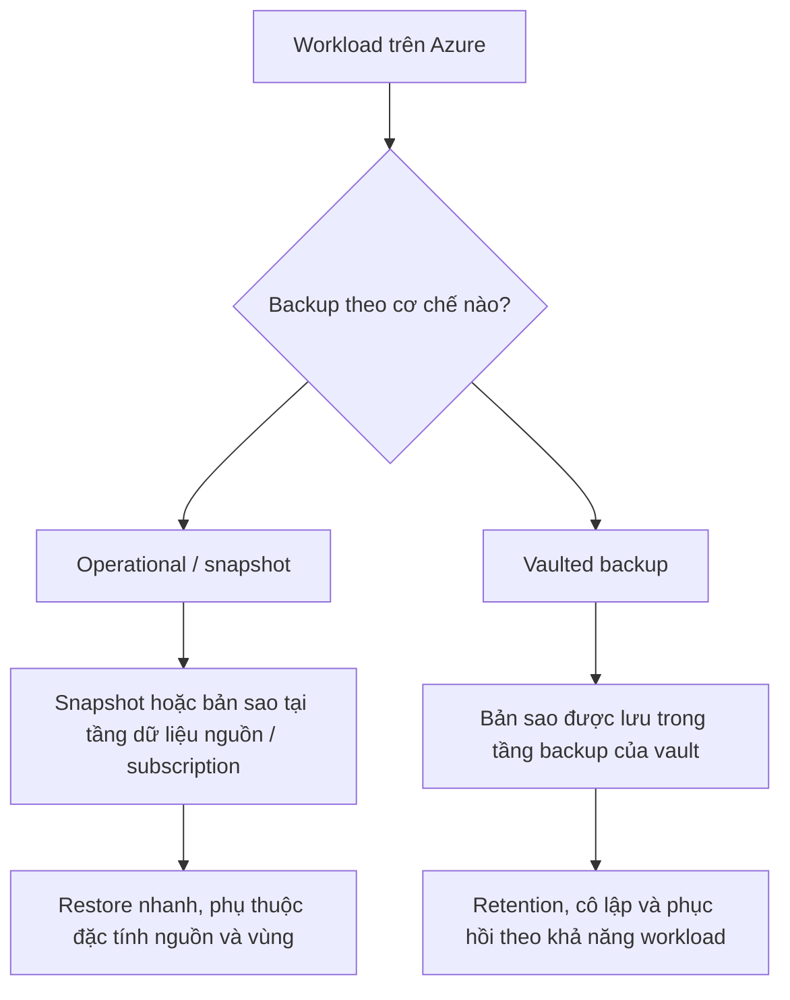
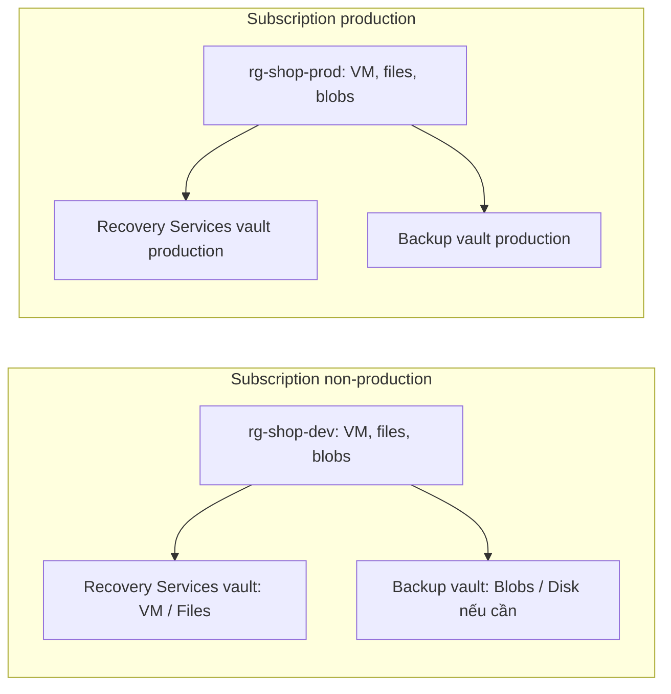

# Azure Backup và lựa chọn vault theo workload

## 1. Vì sao phải chọn đúng vault?

Một hệ thống hoạt động trên Microsoft Azure có thể ngừng phục vụ vì xóa nhầm dữ liệu, cấu hình sai, phần mềm tống tiền, lỗi ứng dụng hoặc mất cả một vùng triển khai. **Backup** cung cấp các điểm khôi phục để đưa dữ liệu hay hệ thống về trạng thái trước sự cố. Tuy nhiên, mỗi loại workload được Azure bảo vệ theo cơ chế khác nhau; lựa chọn vault sai có thể khiến bạn không tìm thấy loại backup, policy hay tính năng restore cần thiết.

Trong chương **Độ tin cậy và khôi phục thảm họa** của mô-đun `CLOUD_PROVIDERS_AZURE`, bài học này tập trung vào hai loại vault của Azure Backup: **Recovery Services vault** và **Backup vault**. Chúng ta sẽ kết nối lựa chọn vault với subscription, resource group, Microsoft Entra ID, quyền Azure RBAC, lưu trữ, dữ liệu, giám sát, bảo mật và chi phí của một kiến trúc ứng dụng trên Azure.

Sau bài học, bạn có thể:

- Phân biệt **Recovery Services vault** với **Backup vault** của Azure Data Protection.
- Chọn vault dựa trên loại workload: Azure VM, managed disk, Azure Files, Blob Storage, AKS, cơ sở dữ liệu chạy trong VM và máy chủ on-premises.
- Nhận biết các dịch vụ PaaS có cơ chế backup tích hợp riêng, thay vì mặc định cần một Azure Backup vault.
- Thiết kế policy theo **RPO**, retention, mức độ độc lập của bản sao và yêu cầu bảo mật.
- Hiểu vai trò của redundancy, soft delete, immutability, phân quyền và thử nghiệm restore.
- Tạo vault bằng Bicep/Azure CLI, sau đó xác minh các bước cần có để thực sự bảo vệ dữ liệu.

**Tình huống xuyên suốt:** đội vận hành `Shop API` có các máy ảo xử lý tác vụ, một managed disk lưu dữ liệu tạm quan trọng, ảnh sản phẩm trong Azure Blob Storage, Azure Files dùng chung và một cụm AKS cho dịch vụ nền. Mỗi thành phần có yêu cầu phục hồi khác nhau. Đội muốn chọn loại vault phù hợp, tránh tạo một vault rồi giả định rằng mọi tài nguyên đã được sao lưu.

## 2. Tư duy nền tảng: backup, restore và disaster recovery

### 2.1. Backup không đồng nghĩa với high availability hay replication

| Cơ chế | Giải quyết vấn đề chính | Giới hạn cần hiểu |
|---|---|---|
| **Backup/restore** | Khôi phục dữ liệu từ một **recovery point** trước đó | Có thể mất dữ liệu phát sinh sau recovery point; cần thời gian phục hồi |
| **High availability (HA)** | Duy trì dịch vụ khi instance, zone hoặc thành phần gặp lỗi | Dữ liệu bị xóa nhầm có thể được đồng bộ sang các bản sao HA |
| **Replication** | Giữ bản sao dữ liệu/hệ thống tại vị trí khác | Sao chép nhanh cũng có thể lan truyền dữ liệu hỏng hoặc hành động xóa |
| **Disaster recovery (DR)** | Khôi phục hoạt động khi có sự cố lớn, có thể cần failover | Cần runbook, hệ thống đích, DNS, mạng, quyền truy cập và kiểm thử |

**Azure Backup** thiên về bảo vệ dữ liệu và điểm khôi phục. **Azure Site Recovery** hỗ trợ replication, failover và failback cho các kịch bản được hỗ trợ; Site Recovery thường được cấu hình qua Recovery Services vault nhưng không phải là một bản backup theo thời điểm. Tùy mục tiêu, một hệ thống cần cả HA, backup và kế hoạch DR.

### 2.2. RPO, RTO và retention

- **RPO (Recovery Point Objective):** mức mất dữ liệu tối đa doanh nghiệp chấp nhận được, tính theo thời gian. RPO 4 giờ có nghĩa là phải thiết kế sao cho mất dữ liệu không vượt quá 4 giờ trong kịch bản được cam kết.
- **RTO (Recovery Time Objective):** thời gian tối đa để khôi phục hoạt động dịch vụ theo mức đã thỏa thuận. RTO 2 giờ đòi hỏi nhiều hơn việc có một file backup: còn phụ thuộc thời gian restore, mạng, khóa bí mật, xác minh và chuyển lưu lượng.
- **Retention:** thời gian giữ các recovery point theo chính sách kỹ thuật, pháp lý và chi phí; chẳng hạn 30 ngày ngắn hạn và các điểm lưu giữ lâu hơn theo kỳ.
- **Recovery point:** trạng thái dữ liệu mà Azure Backup có thể dùng để restore. Mức nhất quán có thể khác nhau: crash-consistent, file-system-consistent hoặc application-consistent tùy workload và cách bảo vệ.

Ví dụ, nếu job backup diễn ra một lần mỗi ngày, khoảng cách giữa các điểm khôi phục có thể gần 24 giờ. Lịch chạy hằng ngày **không thể bảo đảm RPO 15 phút**, và ngay cả lịch 4 giờ cũng cần chừa khoảng an toàn cho job bị chậm hoặc thất bại. RTO phải được **đo bằng một lần restore thực tế** với khối lượng dữ liệu tương ứng.

## 3. Hai loại vault chính trong Azure Backup

Một **vault** là tài nguyên Azure phục vụ quản lý backup, policy, backup instance/item và thao tác khôi phục theo những workload được hỗ trợ. Không phải mọi bản sao dữ liệu đều nằm vật lý bên trong vault: có workflow sao lưu vào tầng snapshot hoặc lưu dữ liệu tại tài nguyên nguồn, trong khi vault giữ thông tin điều phối/chính sách.

| Tiêu chí | Recovery Services vault | Backup vault |
|---|---|---|
| Loại tài nguyên ARM | `Microsoft.RecoveryServices/vaults` | `Microsoft.DataProtection/backupVaults` |
| Họ dịch vụ | Azure Backup truyền thống và một số kịch bản Azure Site Recovery | Azure Backup dựa trên dịch vụ **Data Protection** |
| Workload tiêu biểu | Azure VM backup, Azure Files, SQL Server/SAP HANA trong Azure VM, máy chủ on-premises được hỗ trợ | Azure Managed Disks backup, Azure Blobs backup, AKS backup (theo tính năng/vùng được hỗ trợ) |
| Đơn vị quản lý thường thấy | Backup policy, backup item/protected item, backup job, recovery point | Backup policy, backup instance, backup job, recovery point |
| Lớp lưu trữ | Phụ thuộc workload và policy; có thể có snapshot và bản sao trong vault | Có thể có **operational backup**, **vaulted backup** hoặc cả hai tùy workload |
| Lựa chọn dựa trên | Hệ thống cần backup VM, file share, ứng dụng/database trong VM, môi trường on-prem | Nhu cầu backup disk riêng, blob, AKS và các workload Data Protection hỗ trợ |
| Có thay thế cho nhau không? | Không | Không |

Từ **Backup vault** trong bài này là tên một loại tài nguyên Azure. **Azure Key Vault** dùng quản lý secret, key, certificate; **Key Vault không phải kho lưu bản backup Azure Backup**. Tương tự, **Azure Storage account** có blob versioning hoặc soft delete nhưng việc bật những tính năng ấy không tự tạo một Recovery Services vault.

### 3.1. Recovery Services vault

Recovery Services vault có vai trò trung tâm đối với các kịch bản backup VM và dữ liệu ứng dụng chạy trong VM. Ví dụ:

- Sao lưu một **Azure virtual machine** theo VM, thường có backup nhất quán ứng dụng khi workload, agent/extension và nền tảng hỗ trợ.
- Sao lưu **SQL Server trong Azure VM** hoặc **SAP HANA trong Azure VM** qua cơ chế backup ứng dụng được hỗ trợ; đây là backup ở mức database/workload, khác với snapshot cả VM.
- Bảo vệ **Azure Files** theo khả năng operational/vaulted backup đang hỗ trợ cho loại share, vùng và policy.
- Sao lưu một số workload từ **on-premises** thông qua Microsoft Azure Recovery Services (MARS) agent, Microsoft Azure Backup Server (MABS) hay System Center DPM.
- Điều phối Azure Site Recovery trong các kịch bản được hỗ trợ. Cấu hình Site Recovery khác với cấu hình Azure Backup dù có thể cùng họ vault.

**Điểm mấu chốt:** nếu cần khôi phục **nguyên Azure VM** với hệ điều hành, cấu hình và các disk được hỗ trợ, lựa chọn thông thường là **Recovery Services vault** với Azure VM Backup. Backup một disk đơn lẻ qua Backup vault không đồng nghĩa có thể tái tạo toàn bộ VM và mọi dịch vụ phụ thuộc.

### 3.2. Backup vault

Backup vault thuộc `Microsoft.DataProtection` và quản lý các workload hiện đại theo policy/backup instance. Ví dụ:

- **Azure Disk Backup:** bảo vệ managed disk ở mức disk bằng incremental snapshot theo khả năng hỗ trợ. Recovery point thường dựa trên snapshot lưu ở subscription/resource group của bạn; cần cân nhắc việc mất đồng thời vùng nguồn và snapshot.
- **Azure Blob Backup:** có kịch bản **operational backup** dùng tính năng bảo vệ dữ liệu tại storage account và **vaulted backup** đưa dữ liệu được bảo vệ sang tầng backup trong vault, nếu account, loại blob, vùng và policy hỗ trợ.
- **Azure Kubernetes Service (AKS) Backup:** bảo vệ trạng thái Kubernetes và persistent volume theo phạm vi hỗ trợ, với các thành phần như backup extension, storage/snapshot và cấu hình truy cập cần thiết.

Đây **không phải** một loại vault bảo vệ mọi workload theo cùng cách. Đặc biệt, policy Azure Disk Backup dựa trên snapshot không tự có mức nhất quán ứng dụng tương đương SQL Server backup trong VM; AKS backup cũng không thể thay cho việc sao lưu dữ liệu từ một dịch vụ database PaaS nằm ngoài cụm.

## 4. Ma trận chọn vault theo workload

| Workload cần bảo vệ | Hướng chọn ban đầu | Dữ liệu có thể khôi phục | Lưu ý trước khi quyết định |
|---|---|---|---|
| **Azure VM** (toàn máy, OS và data disk được hỗ trợ) | **Recovery Services vault** | VM hoặc disk/file tùy kịch bản restore | Kiểm tra VM extension, mức nhất quán, encryption, disk type, region và policy |
| **Managed disk** độc lập hoặc chỉ cần snapshot disk | **Backup vault** với Azure Disk Backup | Disk/snapshot theo recovery point | Snapshot-level; cần tự tính việc ghép disk vào VM và khôi phục ứng dụng |
| **Azure Files share** | **Recovery Services vault** | File/folder hoặc share theo backup mode | Phân biệt snapshot/operational và vaulted retention; kiểm tra loại share và giới hạn |
| **Azure Blob Storage** | **Backup vault** | Blob/container hoặc dữ liệu ở thời điểm được hỗ trợ | Operational backup và vaulted backup khác nhau về nơi giữ dữ liệu và khả năng phục hồi |
| **AKS** | **Backup vault** với AKS Backup | Tài nguyên Kubernetes và persistent volume được hỗ trợ | Kiểm tra storage driver, CSI snapshot, backup extension, quyền và giới hạn khôi phục |
| **SQL Server trong Azure VM** | **Recovery Services vault** | Database và recovery point phù hợp, có thể gồm log backup | Cần backup workload-aware; xem chế độ recovery, log chain và quyền SQL |
| **SAP HANA trong Azure VM** | **Recovery Services vault** | Database/workload HANA theo khả năng hỗ trợ | Cấu hình discovery, extension, thời điểm và retention riêng |
| **Máy chủ/workload on-premises được Azure Backup hỗ trợ** | **Recovery Services vault** | File, thư mục, system state hoặc workload được hỗ trợ | Tùy MARS/MABS/DPM; cần băng thông và quy trình đăng ký/bảo mật |
| **Azure SQL Database / SQL Managed Instance** | **Backup tích hợp của dịch vụ** | PITR và long-term retention tùy cấu hình gói dịch vụ | Không tự tạo Recovery Services vault để nhận native automated backup |
| **Các dịch vụ PaaS khác** như Azure Cosmos DB, PostgreSQL managed | **Kiểm tra backup/PITR gốc của dịch vụ trước** | Tùy dịch vụ, chế độ backup và vùng | Không suy từ việc có database rằng bắt buộc phải dùng một trong hai vault |

**Quy tắc ra quyết định:** trước hết xác định **đối tượng phục hồi** (VM, disk, file, blob, database hay toàn ứng dụng), sau đó tra đúng tính năng backup cho workload, rồi mới chọn vault, backup tier, policy và kiến trúc bảo vệ. Bảng trên là điểm xuất phát; tính năng, vùng, loại tài nguyên và giới hạn thường thay đổi theo thời gian nên phải kiểm tra danh sách hỗ trợ hiện hành khi triển khai thật.

### Ví dụ dễ nhầm: một VM và một managed disk

`Shop API` chạy trên Azure VM có OS disk và hai data disk. Nhóm muốn sau lỗi hệ điều hành có thể phục hồi **VM hoàn chỉnh**: chọn Azure VM Backup qua **Recovery Services vault**. Nếu nhóm chỉ cần tạo recovery point cho **một managed disk** để khôi phục hoặc sao chép disk, có thể xét **Azure Disk Backup qua Backup vault**. Hai cách có phạm vi phục hồi, consistency, nơi giữ snapshot và thời gian triển khai khác nhau.

### Ví dụ dễ nhầm: SQL Server trong VM và Azure SQL Database

SQL Server cài trong Azure VM là ứng dụng chạy trên máy do bạn quản trị, vì vậy cần đánh giá **SQL workload backup trong Recovery Services vault** để có điểm khôi phục nhất quán ở mức database. Azure SQL Database là dịch vụ PaaS có **automated backup và point-in-time restore tích hợp**; chế độ giữ dài hạn được cấu hình theo cơ chế của Azure SQL Database. Không nên coi hai mô hình là cùng một quy trình backup.

## 5. Operational backup, vaulted backup và vùng lưu trữ

Chọn loại vault chưa đủ; phải xác định **dữ liệu backup thực sự nằm ở đâu** và nguồn có thể tác động tới bản sao không.



- **Operational backup** thường ưu tiên thời gian khôi phục ngắn vì điểm khôi phục ở gần dữ liệu nguồn, chẳng hạn snapshot của managed disk hoặc các khả năng bảo vệ dữ liệu tại storage account. Phạm vi bảo vệ và mức cô lập phụ thuộc workload, không mặc nhiên có bản sao độc lập ở vùng khác.
- **Vaulted backup** quản lý dữ liệu backup tại tầng lưu trữ vault cho những workload hỗ trợ. Điều này hỗ trợ chính sách giữ dữ liệu và các lựa chọn redundancy/cô lập phù hợp, nhưng không đồng nghĩa mọi dữ liệu tự có thể khôi phục ở vùng khác.
- **Instant restore / snapshot tier / vault tier / archive tier** là các khái niệm có phạm vi hỗ trợ khác nhau theo loại backup. Không gán một thời gian restore, retention hay mô hình phí chung cho tất cả.

Ví dụ với **Azure Blob Backup**, operational backup có thể dựa trên blob versioning, change feed, point-in-time restore và các cơ chế bảo vệ tại storage account khi đủ điều kiện. Bản backup dạng vaulted, nếu workload và chính sách hỗ trợ, sử dụng tầng sao lưu độc lập hơn. Cần so sánh theo mục tiêu chống xóa nhầm, chống sự cố diện rộng và yêu cầu giữ lâu; không giả định bật soft delete cho Blob là đã có một bản sao vaulted.

### 5.1. Redundancy: LRS, ZRS, GRS

| Mô hình | Ý nghĩa chính | Câu hỏi cần hỏi |
|---|---|---|
| **LRS** (Locally Redundant Storage) | Duy trì bản sao dữ liệu trong phạm vi một vùng dữ liệu cục bộ theo thiết kế dịch vụ | Có đáp ứng nguy cơ và mức chi phí của hệ thống không? |
| **ZRS** (Zone-Redundant Storage) | Phân tán bản sao theo nhiều availability zone trong cùng region, khi workload/vault hỗ trợ | Region, loại vault và workload này có hỗ trợ ZRS không? |
| **GRS** (Geo-Redundant Storage) | Có sao chép sang region thứ cấp theo cơ chế geo-redundancy của dịch vụ | Có hỗ trợ cross-region restore cho workload này và đã bật đúng tính năng chưa? |

**GRS không tự bảo đảm khả năng tự phục hồi ở region thứ hai.** Khả năng *Cross Region Restore* (CRR), cách truy cập recovery point ở region phụ, RPO của sao chép dữ liệu và các điều kiện vận hành đều phụ thuộc workload, loại vault và cấu hình. Không dùng chữ “GRS” như bằng chứng rằng DR đã hoàn thành.

Nhiều tùy chọn redundancy và tính năng bảo mật cần được chọn **trước khi vault có protected item/backup data**, hoặc bị hạn chế thay đổi về sau. Vì vậy phải chốt yêu cầu chịu lỗi và dữ liệu lưu ở đâu ngay trong giai đoạn thiết kế.

### 5.2. Vault nằm ở subscription và region nào?

Thông thường, khi bảo vệ tài nguyên Azure bằng dịch vụ backup tương ứng, vault phải ở **region** và **subscription** phù hợp với tài nguyên nguồn theo quy tắc của workload. Từng workload có điều kiện riêng cho cross-subscription restore hoặc khôi phục về tài nguyên khác. Đừng xây dựng kiến trúc dựa trên giả định rằng một vault duy nhất có thể bảo vệ tài nguyên ở mọi subscription/region.

Gợi ý thiết kế cho `Shop API`:



Sơ đồ cho thấy **phân chia trách nhiệm**, không hàm ý tạo tất cả vault cho mọi môi trường. Chỉ tạo các loại vault có workload thực sự sử dụng và kiểm tra giới hạn region/subscription của từng tính năng.

## 6. Thiết kế backup policy từ yêu cầu kinh doanh

Một policy đúng cần trả lời nhiều hơn câu hỏi “backup lúc mấy giờ?”:

1. **Bảo vệ cái gì?** VM, share, disk, blob, database hay đối tượng Kubernetes cụ thể; liệt kê cả phụ thuộc như secret, network, DNS, cấu hình IaC.
2. **Cần khôi phục tới thời điểm nào?** Xác định RPO và kiểu nhất quán cần có. Ứng dụng giao dịch thường đòi hỏi bảo vệ ở mức workload/log backup hoặc backup liên tục của PaaS, không chỉ VM snapshot hằng ngày.
3. **Phải chạy trở lại nhanh đến đâu?** RTO và tốc độ restore ảnh hưởng chọn operational/vault tier, dung lượng, kiến trúc thay thế và runbook.
4. **Giữ dữ liệu bao lâu?** Retention hằng ngày/hằng tuần/hằng tháng/hằng năm tùy workload và yêu cầu tuân thủ; kiểm tra chi phí theo dung lượng tăng trưởng.
5. **Ai có thể xóa, dừng bảo vệ hoặc restore?** Tách quyền và bật biện pháp chống xóa độc hại phù hợp.
6. **Sự cố nào nằm trong phạm vi?** Xóa file, lỗi DB, ransomware, hỏng VM, mất zone, mất region hay mất thông tin xác thực? Mỗi tình huống đòi các lớp bảo vệ khác nhau.

Ví dụ bảng yêu cầu của `Shop API`:

| Thành phần | RPO mục tiêu | RTO mục tiêu | Hướng bảo vệ và lưu ý |
|---|---|---|---|
| VM xử lý tác vụ quan trọng | 24 giờ | 4 giờ | VM Backup qua Recovery Services vault; đo thực tế thời gian tạo lại VM và kết nối ứng dụng |
| File share nghiệp vụ | 8 giờ | 2 giờ | Azure Files backup qua Recovery Services vault; đối chiếu tần suất/policy thực sự được hỗ trợ |
| Managed disk độc lập | 12 giờ | 3 giờ | Disk Backup qua Backup vault nếu crash-consistent snapshot là đủ; tính thời gian tạo disk từ điểm khôi phục |
| Blob hình ảnh sản phẩm | Theo mức mất dữ liệu cho phép, ví dụ 24 giờ | 6 giờ | Blob Backup qua Backup vault; cân nhắc operational và vaulted backup theo khả năng hỗ trợ |
| Database giao dịch PaaS | 15 phút | 1 giờ | Đánh giá PITR/backup native của chính dịch vụ, HA và quy trình restore; không lấy lịch VM backup thay thế |

**Các con số là mục tiêu giả định phục vụ bài tập, không phải cam kết SLA của Azure Backup.** Nếu lịch policy không đạt RPO hoặc thử nghiệm restore vượt RTO, phải điều chỉnh công nghệ hoặc thiết kế DR, không chỉ sửa bảng yêu cầu.

## 7. Thực hành: tạo vault bằng Bicep và kiểm tra kết quả

### 7.1. Điều kiện tiên quyết

Bạn cần Azure CLI đã đăng nhập, Bicep CLI dùng được qua Azure CLI, một subscription thử nghiệm và quyền tạo tài nguyên tại resource group đích. Bài thực hành tạo **tài nguyên vault rỗng**; nó chưa kích hoạt bảo vệ dữ liệu vì chưa có backup policy và chưa đăng ký backup instance/protected item.

```bash
az login
az account list --output table

SUBSCRIPTION_ID="<subscription-id>"
RG_NAME="rg-shop-backup-lab"
LOCATION="southeastasia"

az account set --subscription "$SUBSCRIPTION_ID"
az account show --query '{name:name,id:id,tenantId:tenantId}' --output table

az group create \
  --subscription "$SUBSCRIPTION_ID" \
  --name "$RG_NAME" \
  --location "$LOCATION"

az bicep version
```

Lệnh `az group create` cần quyền ở phạm vi subscription tương ứng. Nếu chỉ được cấp quyền trong một resource group có sẵn, bỏ lệnh tạo group và dùng group đó. Vùng và tính năng phải được kiểm tra theo subscription; không thực hiện với dữ liệu production trong bài thực hành.

### 7.2. Bicep chọn một trong hai loại vault

Tạo tệp minh họa `backup-vault-choice.bicep`:

```bicep
targetScope = 'resourceGroup'

@allowed([
  'RecoveryServices'
  'Backup'
])
@description('Loại vault cần tạo theo workload.')
param vaultKind string

@description('Tên vault, phải hợp lệ và không xung đột trong phạm vi áp dụng.')
param vaultName string

@description('Region của vault.')
param location string = resourceGroup().location

@description('Tag phân biệt môi trường.')
param environment string = 'lab'

// Dùng cho VM Backup, Azure Files, SQL/SAP HANA trong Azure VM, ...
resource recoveryVault 'Microsoft.RecoveryServices/vaults@2023-04-01' = if (vaultKind == 'RecoveryServices') {
  name: vaultName
  location: location
  tags: {
    environment: environment
    managedBy: 'bicep'
  }
  sku: {
    name: 'RS0'
    tier: 'Standard'
  }
  properties: {}
}

// Dùng cho Azure Disk Backup, Blob Backup, AKS Backup, ...
resource dataProtectionVault 'Microsoft.DataProtection/backupVaults@2023-01-01' = if (vaultKind == 'Backup') {
  name: vaultName
  location: location
  identity: {
    type: 'SystemAssigned'
  }
  tags: {
    environment: environment
    managedBy: 'bicep'
  }
  properties: {
    storageSettings: [
      {
        datastoreType: 'VaultStore'
        type: 'LocallyRedundant'
      }
    ]
  }
}
```

**Điểm cần hiểu trong mã:**

- Hai loại vault có **provider và schema khác nhau**: `Microsoft.RecoveryServices` và `Microsoft.DataProtection`; không thể đổi tên provider rồi giữ nguyên toàn bộ thuộc tính.
- Mẫu dùng điều kiện `if` để chỉ tạo loại vault người học chọn; môi trường thực tế nên tách module rõ ràng nếu quản trị từng workload độc lập.
- `identity: SystemAssigned` tạo danh tính quản lý cho Backup vault. **Danh tính tồn tại chưa có nghĩa đã có quyền** đọc disk/blob/AKS; cần role assignment phù hợp theo quy trình của workload.
- `storageSettings` trong mẫu Backup vault đặt `LocallyRedundant` cho ví dụ lab. Việc thay đổi redundancy sau khi có dữ liệu bảo vệ có thể bị giới hạn; production phải chọn theo nhu cầu và tính năng được hỗ trợ.
- Mẫu dùng API version minh họa; khi áp dụng dự án thực tế hãy rà soát API version, Bicep type definition và hỗ trợ region hiện hành. Các thuộc tính bảo mật/policy của vault cần cấu hình riêng theo từng loại.

### 7.3. Validate, what-if rồi tạo

Chạy lựa chọn thứ nhất với **Recovery Services vault**:

```bash
az deployment group validate \
  --subscription "$SUBSCRIPTION_ID" \
  --resource-group "$RG_NAME" \
  --template-file backup-vault-choice.bicep \
  --parameters vaultKind=RecoveryServices vaultName=rsv-shop-lab environment=lab

az deployment group what-if \
  --subscription "$SUBSCRIPTION_ID" \
  --resource-group "$RG_NAME" \
  --template-file backup-vault-choice.bicep \
  --parameters vaultKind=RecoveryServices vaultName=rsv-shop-lab environment=lab

az deployment group create \
  --subscription "$SUBSCRIPTION_ID" \
  --resource-group "$RG_NAME" \
  --name deploy-shop-recovery-vault \
  --template-file backup-vault-choice.bicep \
  --parameters vaultKind=RecoveryServices vaultName=rsv-shop-lab environment=lab
```

Để tạo **Backup vault** trong lab, thay loại vault và tên:

```bash
az deployment group validate \
  --subscription "$SUBSCRIPTION_ID" \
  --resource-group "$RG_NAME" \
  --template-file backup-vault-choice.bicep \
  --parameters vaultKind=Backup vaultName=bv-shop-lab environment=lab

az deployment group what-if \
  --subscription "$SUBSCRIPTION_ID" \
  --resource-group "$RG_NAME" \
  --template-file backup-vault-choice.bicep \
  --parameters vaultKind=Backup vaultName=bv-shop-lab environment=lab

az deployment group create \
  --subscription "$SUBSCRIPTION_ID" \
  --resource-group "$RG_NAME" \
  --name deploy-shop-data-protection-vault \
  --template-file backup-vault-choice.bicep \
  --parameters vaultKind=Backup vaultName=bv-shop-lab environment=lab
```

Vì cùng tệp điều kiện chỉ mô tả **một loại vault mỗi lượt chạy**, khi triển khai với `vaultKind=Backup`, không được suy rằng tài nguyên Recovery Services vault trước đó tự động bị xóa. Trong chế độ ARM incremental thông thường, bỏ tài nguyên khỏi template không xóa tài nguyên còn tồn tại. Việc xóa vault đang chứa backup cần quy trình riêng.

Kiểm tra qua CLI:

```bash
# Liệt kê Recovery Services vault.
az backup vault list \
  --resource-group "$RG_NAME" \
  --output table

# Liệt kê Azure Data Protection Backup vault.
az dataprotection backup-vault list \
  --resource-group "$RG_NAME" \
  --output table

# Xem trạng thái deployment.
az deployment group show \
  --resource-group "$RG_NAME" \
  --name deploy-shop-data-protection-vault \
  --query '{name:name,state:properties.provisioningState}' \
  --output table
```

Nếu một nhóm lệnh `az dataprotection` chưa hiện diện trong bản Azure CLI đang dùng, cập nhật Azure CLI/extension theo hướng dẫn chính thức của công cụ. **Tạo vault thành công chỉ chứng minh đã tạo được tài nguyên ARM**, chưa chứng minh backup hoạt động.

### 7.4. Sau khi tạo vault, còn phải làm gì?

Quy trình đầy đủ phụ thuộc workload, nhưng ít nhất phải:

1. Xác nhận **source workload**, vault, subscription và region đáp ứng điều kiện tương thích.
2. Thiết lập **backup policy** với lịch chạy, retention, tier và các thuộc tính được hỗ trợ.
3. Cấp **quyền truy cập thích hợp** cho dịch vụ backup/vault identity đối với nguồn và nơi lưu snapshot khi workload yêu cầu.
4. **Enable backup/protect** cho backup item hoặc tạo backup instance. Riêng VM, database, disk, blob và AKS có màn hình/cơ chế discovery khác nhau.
5. Kích hoạt backup lần đầu hoặc đợi job theo lịch; **kiểm tra job kết thúc thành công** và có ít nhất một recovery point sử dụng được.
6. Thực hiện **restore vào đích kiểm thử** rồi xác minh dữ liệu và ứng dụng thực sự hoạt động.

Không nên đánh dấu hệ thống là “đã có backup” chỉ vì portal hiển thị vault hoặc policy.

## 8. Bảo mật và phòng chống mất backup

Backup là mục tiêu hấp dẫn khi kẻ tấn công muốn khiến hệ thống không thể phục hồi. Thiết kế nên có các lớp bảo vệ sau:

| Biện pháp | Mục đích | Điều kiện/thận trọng |
|---|---|---|
| **Azure RBAC / quyền tối thiểu** | Phân biệt người xem, người vận hành backup, người quản trị dữ liệu và người quản trị subscription | Quyền bảo vệ, restore, xóa hoặc thay đổi policy phải được đánh giá theo tài nguyên và role cụ thể |
| **Soft delete cho backup item** | Giữ cơ hội phục hồi khi item bị ngừng bảo vệ/xóa nhầm | Thời gian và khả năng hỗ trợ khác nhau theo vault/workload; kiểm tra cấu hình thực tế |
| **Immutability / immutable vault** | Hạn chế thao tác làm mất dữ liệu backup | Khi khóa ở mức không thể đảo ngược, thay đổi về sau bị hạn chế; phải kiểm chứng quy trình trước khi khóa |
| **Multi-user authorization (MUA) / Resource Guard** | Yêu cầu phê duyệt/quyền bổ sung đối với thao tác nhạy cảm | Chỉ dùng cho hành động và loại vault/workload được hỗ trợ; phân tách đơn vị kiểm soát |
| **Encryption / key management** | Bảo vệ dữ liệu ở trạng thái lưu trữ và truyền tải | Kiểm tra mô hình khóa do Microsoft quản lý hay khóa khách hàng quản lý và tác động tới restore |
| **Network restrictions / private connectivity** | Giới hạn đường truy cập backup khi được hỗ trợ | Kiểm tra từng workload, extension, service endpoint/private endpoint và luồng ra mạng |
| **Alerts, logs và audit** | Phát hiện backup job lỗi, thay đổi policy, hành vi xóa hoặc restore bất thường | Cấu hình Azure Monitor, Activity Log và thông báo tới người trực vận hành |

Không cấp `Owner` toàn subscription cho một danh tính chỉ cần chạy job backup; quyền quản trị backup và quyền quản trị bảo mật nên được tách khi phù hợp. Đối với workload dùng Managed Identity, **role assignment đúng scope** là điều kiện quan trọng để Backup vault có thể đọc dữ liệu và tạo điểm khôi phục.

Tách biệt production và non-production theo subscription/resource group, vault, identity và policy phù hợp. Không cho phép môi trường dev có quyền xóa recovery point production. Nếu backup chứa dữ liệu cá nhân, tuân thủ chính sách retention, khu vực lưu trữ và quyền xem dữ liệu phục hồi.

**Lưu ý:** Azure Storage soft delete, versioning và Azure Backup soft delete giải quyết các lớp rủi ro khác nhau. Không coi một tính năng đang bật là bằng chứng rằng tất cả loại xóa, mã hóa độc hại hoặc mất region đều có thể khôi phục.

## 9. Giám sát, kiểm tra restore và lập kế hoạch khôi phục

### 9.1. Các chỉ số cần theo dõi

Theo dõi từ Azure Portal, Azure Monitor và các công cụ báo cáo backup phù hợp:

- **Job status:** backup thành công, thất bại, chạy quá lâu hoặc không xuất hiện đúng kỳ.
- **Recovery point age:** điểm phục hồi mới nhất đã cách hiện tại bao lâu; cảnh báo khi tuổi điểm phục hồi vượt RPO.
- **Protected coverage:** số tài nguyên cần backup so với số item/instance thực sự đang được bảo vệ.
- **Retention compliance:** các điểm được giữ đúng thời gian theo chính sách, không bị rút ngắn trái phép.
- **Restore success and duration:** có thể khôi phục đúng dữ liệu không và mất bao lâu so với RTO.
- **Cost:** protected instances, backup storage, snapshot, giao dịch và lưu lượng phát sinh tùy workload/tier.

Backup job báo `Succeeded` **không có nghĩa** ứng dụng đã phục hồi được. Ví dụ backup disk thành công nhưng bản restore không gắn được vào VM vì network, identity hay ứng dụng có dependency thiếu. Cần đo chất lượng phục hồi ở mức nghiệp vụ.

### 9.2. Runbook restore cho một sự cố xóa nhầm file

Giả sử nhân viên xóa nhầm file cấu hình quan trọng của `Shop API`. Runbook tối thiểu:

1. **Phân loại sự cố:** ghi nhận thời điểm xóa, hệ thống ảnh hưởng, yêu cầu RPO/RTO, và tạm dừng thao tác có thể ghi đè dữ liệu.
2. **Xác minh nguồn backup:** tìm đúng vault, backup policy, protected item/backup instance và recovery point trước thời điểm xóa.
3. **Chọn đích restore:** ưu tiên restore vào vị trí/cấu trúc kiểm thử hoặc đường dẫn thay thế để kiểm tra, tránh ghi đè dữ liệu còn tốt.
4. **Thực hiện restore:** dùng thao tác tương ứng của workload; ghi lại job ID, người thực hiện, thời điểm và vị trí đích.
5. **Kiểm tra dữ liệu:** checksum, quyền truy cập, cấu trúc file, tính nhất quán ứng dụng và log hoạt động.
6. **Đưa vào phục vụ:** thông qua người sở hữu ứng dụng, chuyển dữ liệu đã xác minh vào môi trường vận hành và theo dõi lỗi sau phục hồi.
7. **Đo RTO/RPO thực tế:** ghi chép thời gian hoàn thành, dữ liệu mất nếu có và cải tiến policy/runbook cho lần sau.

Với sự cố ở cấp region, phải đánh giá thêm khả năng CRR, tài nguyên khôi phục tại region khác, DNS, private networking, quota, khóa mã hóa, secrets và các bước vận hành. Một bản backup ở vùng thứ hai chưa đủ để ứng dụng tự chuyển vùng.

### 9.3. Lịch diễn tập

| Chu kỳ gợi ý | Bài kiểm tra | Bằng chứng cần giữ |
|---|---|---|
| Hằng ngày | Kiểm tra job lỗi, tuổi recovery point và backup coverage | Alert, dashboard, ticket xử lý |
| Hằng tháng | Restore thử file hoặc dữ liệu mẫu vào vùng/cấu trúc test | Restore job, kiểm tra tính toàn vẹn, thời gian |
| Hằng quý | Khôi phục một VM/workload vào môi trường cô lập và thử chạy ứng dụng | Runbook, dependency checklist, đo RTO |
| Sau thay đổi lớn | Kiểm tra lại backup/restore khi đổi disk, region, mạng, identity hoặc database schema | Kết quả thử nghiệm và bản cập nhật policy |

Chu kỳ là đề xuất minh họa; workload có yêu cầu tuân thủ nghiêm ngặt có thể cần diễn tập thường xuyên hơn.

## 10. Chi phí và rủi ro vận hành

Chi phí backup thường phụ thuộc vào **loại workload**, số lượng/dung lượng dữ liệu được bảo vệ, **dung lượng backup thực lưu**, lớp backup, redundancy, retention, thay đổi dữ liệu theo thời gian và các khoản chi liên quan như snapshot/restore/egress tùy dịch vụ. Không thể chọn vault chỉ bằng so sánh tên sản phẩm.

Ví dụ:

- Giữ nhiều recovery point hoặc retention dài làm tăng dung lượng dữ liệu backup.
- GRS thường có mô hình chi phí khác LRS; cần đối chiếu yêu cầu DR thực tế.
- Disk backup có chi phí snapshot ở nơi lưu snapshot; không nên coi mọi chi phí đều nằm trong hóa đơn storage của vault.
- Backup operational cho Blob có thể tạo chi phí từ các tính năng bảo vệ của storage account, ngoài chi phí quản lý của dịch vụ được hỗ trợ.
- Diễn tập restore có thể phát sinh compute/storage/network và phải được dự trù trong budget.

Nên gắn tag cost center/environment cho vault và tài nguyên liên quan, đặt Azure Budget/cảnh báo chi phí và rà soát chính sách giữ quá lâu. **Xóa backup để tiết kiệm chi phí** có thể vi phạm retention hoặc khiến hệ thống mất khả năng phục hồi; trước khi thay đổi policy cần đánh giá tác động đến các recovery point hiện hữu.

## 11. Các sai lầm thường gặp và cách xử lý

| Hiện tượng / quyết định sai | Vì sao xảy ra | Hướng xử lý |
|---|---|---|
| Tạo Backup vault nhưng không thấy lựa chọn sao lưu Azure VM toàn máy | Chọn nhầm họ vault so với VM Backup | Dùng Recovery Services vault cho Azure VM Backup; chỉ chọn Backup vault nếu chủ đích backup managed disk theo khả năng hỗ trợ |
| Tạo Recovery Services vault nhưng không thấy Azure Blob Backup | Blob Backup thuộc họ Data Protection | Xem Backup vault và kiểm tra operational/vaulted policy phù hợp |
| Backup policy tồn tại nhưng không có recovery point | Chưa enable protection, chưa tạo backup instance hoặc job thất bại | Kiểm tra danh sách protected items/instances, job và backup đầu tiên |
| Backup vault có Managed Identity nhưng lỗi phân quyền | Identity chưa được gán RBAC phù hợp tại workload hoặc snapshot resource group | Cấp quyền theo hướng dẫn workload với scope tối thiểu; kiểm tra trạng thái role assignment |
| Không restore được sang region khác dù dùng GRS | CRR hoặc cross-region scenario không được hỗ trợ/chưa bật; thiếu hạ tầng đích | Kiểm tra ma trận hỗ trợ và diễn tập restore ở vùng phụ |
| Không đạt RPO mặc dù backup được bật | Lịch backup quá thưa, job lỗi/chậm hoặc policy không áp dụng đúng | Theo dõi tuổi recovery point và điều chỉnh policy/công nghệ |
| Restore disk thành công nhưng ứng dụng lỗi | Thiếu cấu hình VM, secret, database hoặc mức nhất quán phù hợp | Diễn tập restore toàn ứng dụng; cân nhắc application-consistent backup |
| Không thể thay đổi redundancy/immutability như mong muốn | Vault đã có backup data hoặc đã bật chế độ khóa | Chốt thông số trước khi bảo vệ; đánh giá kế hoạch chuyển đổi theo khả năng hỗ trợ |
| Tưởng backup thay thế được DR | Chỉ có điểm khôi phục, chưa có môi trường khôi phục/đường chuyển lưu lượng | Bổ sung kiến trúc HA/DR, runbook và kiểm thử RTO |

## 12. Bài tập thực hành và tiêu chí hoàn thành

**Bài tập A – Chọn vault cho `Shop API`:**

Bạn có năm thành phần: (1) VM chạy batch job; (2) managed disk độc lập cần khôi phục khi vô tình ghi đè; (3) Blob chứa ảnh sản phẩm; (4) file share chứa file nghiệp vụ; (5) Azure SQL Database phục vụ đơn hàng. Hãy lập một bảng cho từng thành phần gồm:

- Nguồn dữ liệu và **đối tượng cần khôi phục**.
- Vault hoặc cơ chế backup được chọn, cùng lý do.
- RPO/RTO mục tiêu và kiểu recovery point/backup policy phù hợp.
- Nơi lưu recovery point/snapshot, retention và rủi ro mất vùng dữ liệu.
- Nhóm chịu trách nhiệm thử nghiệm restore và bằng chứng hoàn thành.

**Bài tập B – Tạo và kiểm tra vault lab:**

1. Tạo một resource group thử nghiệm ở region được phép dùng; chọn một loại vault theo bài tập A.
2. Sử dụng Bicep trong mục 7 để chạy `validate`, `what-if` và `create`; xem lại thay đổi trước khi tạo.
3. Xác minh vault xuất hiện ở đúng subscription, resource group và region.
4. Giải thích vì sao vừa tạo vault xong **chưa thể báo cáo RPO đã đạt**.
5. Trình bày các bước tiếp theo để có policy, backup instance/item, recovery point và một lần restore test thành công.

**Bài tập C – Phân tích sự cố:**

Giả sử backup job VM chạy hằng đêm, đã ba đêm liên tiếp thất bại nhưng Azure Monitor chưa có cảnh báo. Hãy xác định RPO thực tế có nguy cơ tăng bao nhiêu, cần báo ai, kiểm tra những điểm nào (agent/extension, policy, quyền, quota, log, mạng, job history), và cách xác nhận hệ thống được bảo vệ trở lại.

**Tiêu chí hoàn thành bài học:** học viên chọn đúng họ vault hoặc cơ chế backup tích hợp cho các workload phổ biến; phân biệt VM Backup với Disk Backup và Blob operational với vaulted backup; lập được chính sách theo RPO/RTO/retention; hiểu nơi lưu dữ liệu, quyền và tính năng chống xóa; thực hiện được một lượt tạo vault có kiểm tra; giải thích được tại sao phải **kiểm thử restore**.

**Câu hỏi tự đánh giá:**

1. Vì sao một Azure VM cần restore nguyên máy thường sử dụng Recovery Services vault thay vì Backup vault cho managed disk?
2. Operational backup và vaulted backup khác nhau thế nào về nơi giữ dữ liệu và phạm vi rủi ro?
3. Một backup job thành công có đồng nghĩa RTO 30 phút được đáp ứng không? Cần bằng chứng gì?
4. Azure SQL Database có bắt buộc phải đăng ký vào Recovery Services vault để có PITR không?
5. Vì sao bật GRS không đồng nghĩa ứng dụng có thể tự failover sang region khác?
6. Khi Bicep tạo xong Backup vault, vì sao phải tiếp tục cấu hình role, policy, backup instance và kiểm tra recovery point?

## 13. Tài liệu tham khảo

- Microsoft Learn – [Tổng quan Azure Backup](https://learn.microsoft.com/azure/backup/backup-overview).
- Microsoft Learn – [Recovery Services vault](https://learn.microsoft.com/azure/backup/backup-azure-recovery-services-vault-overview).
- Microsoft Learn – [Backup vault](https://learn.microsoft.com/azure/backup/backup-vault-overview).
- Microsoft Learn – [Azure VM Backup](https://learn.microsoft.com/azure/backup/backup-azure-vms-introduction).
- Microsoft Learn – [Azure Disk Backup](https://learn.microsoft.com/azure/backup/backup-managed-disks).
- Microsoft Learn – [Azure Blob Backup](https://learn.microsoft.com/azure/backup/backup-blobs-introduction).
- Microsoft Learn – [Azure Files Backup](https://learn.microsoft.com/azure/backup/backup-azure-files-introduction).

Khi thiết kế sản phẩm thật, dùng trang hỗ trợ workload, giới hạn của từng vault và tài liệu pricing hiện hành để xác minh vùng, redundancy, lớp backup, lịch/retention, cấp quyền và tính năng restore trước khi triển khai.
