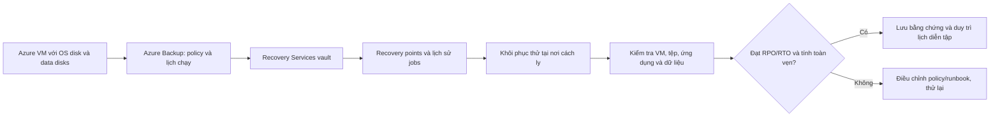

# Backup máy ảo và kiểm tra khả năng khôi phục dữ liệu

> **Chương:** Độ tin cậy và khôi phục thảm họa  
> **Mô-đun:** `CLOUD_PROVIDERS_AZURE` — khám phá Microsoft Azure từ subscription, resource group và Microsoft Entra ID đến mạng ảo, tính toán, lưu trữ, dữ liệu; triển khai, giám sát, bảo vệ và kiểm soát chi phí kiến trúc ứng dụng trên Azure.

## Mục tiêu học tập

Sau bài này, người học có thể:

1. Giải thích mục đích, phạm vi và giới hạn của **Azure VM Backup** trong kế hoạch bảo vệ dữ liệu và phục hồi ứng dụng.
2. Thiết kế chính sách sao lưu theo **RPO**, **RTO**, mức nhất quán dữ liệu, lịch sao lưu và thời gian lưu giữ.
3. Thiết lập **Recovery Services vault**, backup policy và bảo vệ một Azure Virtual Machine bằng Azure Portal hoặc Azure CLI.
4. Kiểm tra lịch sử backup job, recovery point và cảnh báo để biết **bản sao lưu nào thực sự dùng được**.
5. Thực hành khôi phục thử trên tài nguyên tách biệt, kiểm tra dữ liệu, khả năng khởi động, ứng dụng và kết nối, rồi ghi nhận bằng chứng RPO/RTO.
6. Nhận diện rủi ro với đĩa, cơ sở dữ liệu, phân quyền, mã hóa, chi phí, vùng Azure và thao tác thu hồi backup.

## 1. Vì sao “backup thành công” chưa đủ?

Giả sử ứng dụng quản lý đơn hàng chạy trên Azure VM `vm-orders-01`. VM có ổ hệ điều hành, ổ dữ liệu chứa file và một dịch vụ xử lý đơn hàng. Một ngày, hệ điều hành bị lỗi sau cập nhật; hôm khác, người vận hành vô tình xóa thư mục quan trọng; trường hợp nghiêm trọng hơn là resource group gặp sự cố hoặc dữ liệu bị mã độc mã hóa.

Nhóm vận hành đã bật backup và nhìn thấy trạng thái **Completed**. Tuy nhiên, bản backup đó có thể không chứa thư mục cần thiết, không đủ nhất quán cho ứng dụng hoặc không phục hồi trong thời gian nghiệp vụ cho phép. Một bản sao lưu chỉ có giá trị khi **đã xác minh có thể khôi phục đúng dữ liệu, vào đúng thời điểm, trong giới hạn thời gian yêu cầu**.

### Phân biệt những phương án bảo vệ

| Cơ chế | Giúp xử lý | Không bảo đảm |
|---|---|---|
| **Azure VM Backup** | Tạo các điểm khôi phục của VM và đĩa được hỗ trợ, lưu theo chính sách | Khôi phục giao dịch ứng dụng ở độ hạt cao nếu workload cần backup chuyên dụng |
| **Azure VM restore** | Dựng VM mới, khôi phục đĩa hoặc phục hồi tệp theo tùy chọn được hỗ trợ | Tự động khôi phục mọi phụ thuộc bên ngoài VM như DNS, identity, Key Vault hoặc service khác |
| **Azure managed disk snapshot** | Lưu một ảnh chụp đĩa tại thời điểm nhất định để phục vụ tác vụ phù hợp | Tự có chính sách backup lâu dài, lịch quản lý và kiểm thử phục hồi |
| **Azure Site Recovery (ASR)** | Nhân bản và điều phối failover để duy trì dịch vụ khi có sự cố lớn | Thay thế toàn bộ lịch sử backup dài hạn hoặc bảo vệ khỏi mọi xóa/sửa dữ liệu logic |
| **Backup cấp ứng dụng** | Bảo vệ dữ liệu/giao dịch theo nhận thức của ứng dụng, ví dụ SQL Server hoặc database native backup | Thay cho tất cả thành phần khởi động và cấu hình VM |

**Backup và disaster recovery liên quan nhưng khác mục đích.** Backup lưu lịch sử phục hồi; ASR tập trung giảm thời gian gián đoạn bằng replication/failover. Nhiều hệ thống quan trọng cần kết hợp cả hai cùng quy trình restore đã diễn tập.

### Luồng tổng thể



## 2. Xác định RPO, RTO và dữ liệu cần bảo vệ

**RPO (Recovery Point Objective)** là lượng dữ liệu tối đa nghiệp vụ chấp nhận mất, đo bằng chênh lệch thời gian giữa lúc sự cố xảy ra và điểm dữ liệu có thể phục hồi. **RTO (Recovery Time Objective)** là thời gian tối đa cho phép để đưa dịch vụ về trạng thái sử dụng được sau sự cố.

Ví dụ tại thời điểm 14:00 ngày 20/11:

- Nếu điểm khôi phục dùng được mới nhất đại diện cho dữ liệu lúc 12:00, độ trễ khôi phục là **2 giờ**. Với RPO mục tiêu **4 giờ**, điểm đó có thể đáp ứng RPO; với RPO **30 phút**, nó không đạt.
- Nếu đội vận hành cần 2 giờ để dựng VM, 1 giờ để kiểm tra dữ liệu và 30 phút để đưa mạng/DNS vào hoạt động, tổng thời gian là **3 giờ 30 phút**. Với RTO mục tiêu **4 giờ**, kế hoạch có thể đáp ứng nếu phép đo thực tế xác nhận.
- Một lịch backup hằng ngày **không** đáp ứng RPO 1 giờ. Không nên dùng tên policy hay thời điểm job bắt đầu để kết luận thay cho **thời điểm dữ liệu thực sự được phục hồi**.

Các mục tiêu này phải xuất phát từ mức độ quan trọng của dữ liệu, không từ cấu hình mặc định của Azure.

### Bảng ví dụ lập chính sách

| Workload | RPO mục tiêu | RTO mục tiêu | Hướng bảo vệ cần xem xét |
|---|---:|---:|---|
| VM chạy website tĩnh, dữ liệu sinh ra từ CI/CD | 24 giờ cho cấu hình phát sinh | 2 giờ | VM Backup hoặc tái tạo VM bằng IaC; lưu artifact/config riêng |
| VM xử lý tài liệu nội bộ | 4 giờ | 4 giờ | Backup với lịch phù hợp khả năng dịch vụ, kiểm tra tệp sau restore |
| SQL Server chứa giao dịch đơn hàng | 15 phút | 1 giờ | Backup SQL nhận thức giao dịch và kế hoạch HA/DR, bên cạnh bảo vệ VM nếu cần |
| VM lab ít quan trọng | 24 giờ | 1 ngày | Backup hằng ngày, retention ngắn, diễn tập định kỳ |

Các con số chỉ để minh họa. Khả năng đáp ứng phụ thuộc vào gói backup, vùng, workload, kích thước VM, tốc độ phục hồi, network và bản sao gần nhất đã hoàn tất. Với RPO rất nhỏ, cần xem xét backup chuyên dụng và kiến trúc HA/replication.

### Kiểm kê trước khi chọn policy

Hãy xác định rõ **dữ liệu quan trọng nằm ở đâu**:

1. OS disk chứa hệ điều hành, service, cấu hình nào?
2. Data disks chứa file, database, media hoặc log nào? Có disk đã loại khỏi backup không?
3. Ứng dụng còn dùng Azure SQL, Storage Account, Key Vault, file share, API hay dịch vụ ngoài VM không?
4. Dữ liệu có yêu cầu giao dịch nhất quán, khóa mã hóa, chứng chỉ hoặc thông tin xác thực để khôi phục không?
5. Dữ liệu phải được giữ bao lâu vì nghiệp vụ, audit hoặc quy định?

**Đĩa tạm (temporary disk)** và các loại đĩa/cấu hình không được Azure VM Backup hỗ trợ không được coi là dữ liệu đã được bảo vệ. Khả năng hỗ trợ còn phụ thuộc kiểu VM, đĩa, hệ điều hành, tính năng disk exclusion và cấu hình mã hóa. Hãy đối chiếu tập đĩa thực tế trước khi chấp nhận phạm vi backup.

## 3. Azure VM Backup hoạt động thế nào?

Với Azure VM thông thường, **Azure Backup** sử dụng **Recovery Services vault** để quản lý backup item, policy, recovery point và quy trình phục hồi. Dịch vụ thực hiện các bước phù hợp để chụp trạng thái đĩa, tạo recovery point và lưu dữ liệu theo tầng/lịch/retention mà policy hỗ trợ. Cơ chế snapshot hỗ trợ khả năng phục hồi nhanh trong một số trường hợp; các điểm lưu trong vault đáp ứng nhu cầu giữ lâu hơn theo chính sách.

### Các đối tượng cốt lõi

| Đối tượng | Vai trò |
|---|---|
| **Protected VM / backup item** | VM đã được gắn với vault/policy và theo dõi bởi Azure Backup |
| **Recovery Services vault** | Nơi quản lý bảo vệ và các recovery point của workload được hỗ trợ |
| **Backup policy** | Định nghĩa lịch backup, tần suất, thời điểm, retention và một số tùy chọn bảo vệ |
| **Backup job** | Một tác vụ thực hiện backup, restore hoặc thao tác vận hành khác; có trạng thái và thông tin lỗi |
| **Recovery point** | Bản thể hiện dữ liệu có thể dùng làm nguồn phục hồi, gắn với thời điểm và loại nhất quán |
| **Restore job** | Tác vụ khôi phục từ một recovery point đã chọn |
| **Backup alerts/monitoring** | Tín hiệu thất bại, cảnh báo, tình trạng item và xu hướng vận hành |

**Recovery Services vault** dành cho các kịch bản như Azure VM Backup. Azure cũng có **Backup vault** cho những workload/dịch vụ backup khác; không được tùy ý thay thế loại vault chỉ vì tên đều có chữ “backup”.

### Loại nhất quán của recovery point

| Loại | Ý nghĩa | Khi nào cần lưu ý |
|---|---|---|
| **Application-consistent** | Hệ thống backup phối hợp với cơ chế của ứng dụng/guest, khi được hỗ trợ, để giảm khả năng dữ liệu đang ghi bị không nhất quán | Quan trọng với ứng dụng giao dịch; vẫn phải test khởi động và phục hồi ứng dụng |
| **File-system-consistent** | Các thao tác ghi file system được phối hợp/đồng bộ ở mức phù hợp trước snapshot | Có thể chưa đáp ứng yêu cầu giao dịch của một database |
| **Crash-consistent** | Trạng thái đĩa như tại thời điểm mất điện, có thể cần journal replay/recovery khi khởi động | Không thể mặc định dữ liệu ứng dụng hoàn toàn nhất quán |

Trên Windows, cơ chế như **Volume Shadow Copy Service (VSS)** và khả năng tương thích của workload ảnh hưởng mức nhất quán. Với Linux, cơ chế guest và script trước/sau backup có thể cần cho ứng dụng đòi hỏi điều phối ghi dữ liệu. Một backup job **Completed** không tự khẳng định mọi ứng dụng trên VM có trạng thái nhất quán; cần kiểm tra loại recovery point và thực hiện restore test.

### Các trạng thái cần đọc cho đúng

- **Backup configured/enabled:** VM được đăng ký bảo vệ; chưa chứng minh có recovery point sử dụng được.
- **Backup job Completed:** tác vụ backup hoàn thành; cần xác nhận recovery point hiện diện, thời điểm và mức nhất quán.
- **Backup job Failed/Warning:** cần xem lỗi và tác động tới RPO. Chạy lại sau khi khắc phục, theo quy trình phê duyệt.
- **Restore job Completed:** tác vụ phục hồi hạ tầng hoàn thành; **chưa chứng minh ứng dụng đã hoạt động và dữ liệu đúng**.

## 4. Thiết kế Recovery Services vault và policy

### 4.1. Scope và vùng

Thông thường, **vault phải đặt trong cùng Azure region với VM được bảo vệ**. Có thể đặt vault ở một resource group khác trong cùng region nếu chính sách tổ chức cho phép. Chọn subscription, resource group, vault và người quản trị phù hợp để hạn chế phạm vi rủi ro.

Một ví dụ đặt tên:

- Subscription: `sub-training`.
- Resource group chứa VM: `rg-app-demo`; VM: `vm-orders-01`, region `southeastasia`.
- Resource group quản trị backup: `rg-backup-demo`; vault: `rsv-orders-demo`, cùng region `southeastasia`.
- Backup policy: `pol-vm-orders-daily`.

### 4.2. Độ bền và khả năng phục hồi vùng

Vault cho phép chọn cấu hình **backup storage redundancy** như LRS, ZRS hoặc GRS tùy region và hỗ trợ dịch vụ. Đây là lựa chọn về khả năng chịu lỗi của dữ liệu backup, không phải bảo đảm VM có thể tự khởi động tại region khác.

- **LRS:** bản sao backup trong cùng vùng lưu trữ địa phương theo khả năng dịch vụ.
- **ZRS:** phân tán bản sao giữa availability zones trong region khi được hỗ trợ.
- **GRS:** sao chép dự phòng sang paired region để tăng khả năng tồn tại của dữ liệu trong tình huống lỗi vùng.
- **Cross Region Restore (CRR):** khả năng khôi phục từ vùng thứ cấp khi cấu hình và workload đáp ứng điều kiện; không nên coi GRS mặc định đồng nghĩa mọi lúc đều có quyền tự restore từ region khác.

**Chốt lựa chọn redundancy trước khi bắt đầu bảo vệ workload**, vì điều kiện thay đổi về sau phụ thuộc trạng thái vault và hỗ trợ tại thời điểm đó. Với mục tiêu DR xuyên region, diễn tập đúng phương án cross-region thay vì chỉ nhìn thấy nhãn GRS.

### 4.3. Lịch và thời gian lưu giữ

Backup policy phải cân bằng khả năng phục hồi và chi phí:

| Thành phần policy | Câu hỏi cần trả lời | Ví dụ lab |
|---|---|---|
| Loại policy | Standard hay Enhanced phù hợp VM và tần suất? | Chọn loại được Azure hỗ trợ cho VM demo |
| Lịch backup | Hằng ngày hay nhiều lần/ngày nếu được hỗ trợ? | 01:00 theo múi giờ được chọn |
| Retention | Giữ điểm hằng ngày, tuần, tháng, năm bao lâu? | 30 điểm/ngày hoặc thời hạn tương đương theo cấu hình thực tế |
| Instant Restore/snapshot | Cần khả năng phục hồi nhanh trong bao lâu? | Chọn theo RTO và giới hạn chính sách |
| Vault-tier retention | Cần khả năng truy cập điểm cũ trong bao lâu? | Theo dữ liệu và yêu cầu audit |
| Time zone | Backup chạy vào giờ nào theo portal/policy? | Quy đổi rõ UTC/local time, đặc biệt lúc DST nếu có |

Một policy “backup hằng ngày” không tạo ra RPO hằng ngày một cách chắc chắn nếu các job thất bại. Hãy thiết lập cảnh báo **không có điểm phục hồi hợp lệ mới** trong khoảng mục tiêu và kiểm tra tần suất thực tế.

### 4.4. Bảo vệ quyền và thao tác xóa

Vì backup có thể là bản dữ liệu cuối cùng còn lại, bảo vệ vault không kém phần quan trọng so với bảo vệ VM:

- Cấp Azure RBAC theo vai trò và scope phù hợp cho operator backup, người chỉ được xem, người làm restore, quản trị viên và danh tính CI/CD.
- Bật và kiểm tra **soft delete** theo chính sách tổ chức, hiểu rõ thời hạn giữ và hành vi khôi phục nếu ai đó dừng bảo vệ/xóa backup data.
- Xem xét **immutable vault** và **Multi-User Authorization (MUA)/Resource Guard** cho các thao tác quan trọng khi phù hợp với dịch vụ, region và cấu hình tài khoản.
- Hạn chế thao tác phá hủy, giám sát thay đổi policy/vault và báo động khi backup bị vô hiệu hóa, item không được bảo vệ hoặc có thao tác xóa bất thường.
- Đối với VM mã hóa, xác nhận quyền truy cập keys/secrets, Key Vault và cơ chế mã hóa cần thiết để phục hồi; đừng cho rằng bản sao đĩa đủ để dựng ứng dụng.

## 5. Quy trình cấu hình Azure VM Backup

### Điều kiện đầu vào

Để thực hành an toàn, giả sử đã có một VM thử nghiệm `vm-orders-01` đang hoạt động, dữ liệu mẫu không nhạy cảm và người học có quyền trên subscription/resource group/vault tương ứng. Thực hành **không** áp dụng trên VM production hoặc dữ liệu thật khi chưa được phê duyệt.

Kiểm tra trước: VM và vault có nằm trong cùng region không; loại VM/OS/disks có được hỗ trợ không; agent/extension/khả năng guest có đáp ứng mức nhất quán mong muốn không; disk nào được backup và disk nào bị loại trừ; policy có đáp ứng RPO/retention không.

### 5.1. Tạo vault bằng Azure Portal

1. Vào Azure Portal, mở **Recovery Services vaults** rồi chọn tạo mới.
2. Chọn đúng subscription, resource group quản trị và region trùng với VM.
3. Trong cấu hình vault, xác nhận kiểu redundancy/soft delete/bảo vệ phù hợp **trước khi bật backup**, kiểm tra giới hạn của từng lựa chọn.
4. Sau khi vault được tạo, tìm phần **Backup** dành cho **Azure Virtual Machine**; tạo hoặc chọn backup policy phù hợp với mục tiêu phục hồi.
5. Chọn VM cần bảo vệ, kiểm tra các disk và trạng thái hỗ trợ, rồi bật backup.
6. Yêu cầu chạy **Backup now** để có điểm đầu tiên nếu cần, theo dõi tác vụ và xác nhận recovery point.

Tên mục giao diện có thể khác theo phiên bản portal; trọng tâm là **vault → policy → protected VM → job → recovery point**.

### 5.2. Azure CLI: tạo vault và bật bảo vệ

Ví dụ sau sử dụng Bash trong Azure Cloud Shell. Thay giá trị bằng tài nguyên lab thực tế; chạy từng lệnh sau khi đã kiểm tra subscription và quyền. Không chạy nếu chưa có VM thử nghiệm.

```bash
# Các giá trị minh họa; đặt tên và chọn subscription theo môi trường lab.
SUBSCRIPTION_ID="<subscription-id>"
BACKUP_RG="rg-backup-demo"
VM_RG="rg-app-demo"
VAULT="rsv-orders-demo"
VM="vm-orders-01"
LOCATION="southeastasia"

az account set --subscription "$SUBSCRIPTION_ID"
az account show --query "{subscription:id,name:name}" --output table

# Chỉ dùng khi resource group chứa vault chưa tồn tại.
az group create --name "$BACKUP_RG" --location "$LOCATION"

# Recovery Services vault dành cho Azure VM Backup.
az backup vault create \
  --resource-group "$BACKUP_RG" \
  --name "$VAULT" \
  --location "$LOCATION"

# Xem các policy hiện có trước khi chọn/chỉnh chính sách retention.
az backup policy list \
  --resource-group "$BACKUP_RG" \
  --vault-name "$VAULT" \
  --output table

# Lấy đúng resource ID của VM.
VM_ID=$(az vm show \
  --resource-group "$VM_RG" \
  --name "$VM" \
  --query id --output tsv)

# Chỉ chọn DefaultPolicy sau khi kiểm tra lịch/retention của nó.
az backup protection enable-for-vm \
  --resource-group "$BACKUP_RG" \
  --vault-name "$VAULT" \
  --vm "$VM_ID" \
  --policy-name DefaultPolicy
```

**Giải thích và giới hạn:**

- Vault có thể nằm ở resource group riêng, nhưng **region cần phù hợp** với VM.
- `DefaultPolicy` chỉ là tên policy mẫu thường có sẵn, **không mặc nhiên đạt** RPO và retention nghiệp vụ. Nếu không phù hợp, tạo/chọn policy riêng theo chuẩn đội vận hành.
- Để thay redundancy, soft delete hoặc quyền bảo vệ, thực hiện cấu hình vault có chủ đích trước khi backup. Ví dụ trên không tự áp dụng các cấu hình bảo mật đó.
- Bật protection chưa có nghĩa điểm backup đầu tiên đã tạo xong. Kiểm tra job và recovery point trước khi chốt.

### 5.3. Kiểm tra protected item và backup jobs

Ví dụ các lệnh truy vấn:

```bash
az backup item list \
  --resource-group "$BACKUP_RG" \
  --vault-name "$VAULT" \
  --backup-management-type AzureIaasVM \
  --workload-type VM \
  --output table

az backup job list \
  --resource-group "$BACKUP_RG" \
  --vault-name "$VAULT" \
  --output table
```

Khi cần tra một item/recovery point cụ thể, mở Azure Portal tại **Recovery Services vault → Backup items → Azure Virtual Machine → VM → Recovery points** hoặc dùng Azure CLI theo container/item name thực tế trả về từ item list. Không tự đoán tên `container-name` và `item-name` từ tên VM trong script production vì định dạng ID có thể khác display name.

Nếu cần chạy ngay, chọn **Backup now** trên đúng protected item, theo dõi job và ghi lại thời điểm điểm phục hồi xuất hiện. Backup đầu tiên có thể mất thời gian tùy dung lượng và điều kiện hệ thống.

## 6. Đọc và đánh giá recovery point

**Sự tồn tại của một recovery point chưa đủ để kết luận khôi phục đáp ứng RPO/RTO.** Người vận hành nên lưu ít nhất các thuộc tính sau:

| Thuộc tính | Vì sao quan trọng |
|---|---|
| VM/resource ID, vault, policy | Biết điểm phục hồi thuộc tài nguyên và cấu hình bảo vệ nào |
| Recovery point ID và thời gian | Có thể chọn đúng phiên bản tại thời điểm sự cố |
| Recovery point type/consistency | Xác định mức nhất quán đối với hệ điều hành, file và ứng dụng |
| Tier/tình trạng có thể restore | Ảnh hưởng tốc độ và phạm vi thao tác khôi phục |
| Job result, thời lượng, lỗi/cảnh báo | Cho biết backup hoạt động ổn định và điểm nào cần điều tra |
| Dữ liệu/đĩa trong phạm vi bảo vệ | Đối chiếu với danh mục dữ liệu cần phục hồi |
| Kết quả diễn tập restore gần nhất | Bằng chứng thực tế rằng dữ liệu/ứng dụng dùng được |

### Cách kiểm tra RPO từ bằng chứng

Giả sử sự cố giả lập xảy ra lúc **15:00**. Recovery point mới nhất đã hoàn tất có dữ liệu tới **12:40**.

```text
Độ trễ tại thời điểm sự cố = 15:00 - 12:40 = 2 giờ 20 phút.
RPO mục tiêu của ứng dụng = 4 giờ.
Kết quả về thời gian: 2 giờ 20 phút <= 4 giờ => ĐẠT RPO về thời điểm.
```

Đây là **đánh giá theo thời điểm của dữ liệu được phục hồi**, không chỉ thời điểm Azure ghi job completed. Nếu bản backup không chứa file quan trọng hoặc không nhất quán giao dịch, kết quả RPO trên giấy không chứng minh khả năng khôi phục thật.

### Backup health và cảnh báo

Thiết lập hoạt động theo dõi và cảnh báo cho ít nhất:

- Job backup bị thất bại hoặc liên tục cảnh báo.
- Protected item không có recovery point mới trong khoảng RPO cho phép.
- Protection bị dừng, policy bị chỉnh hoặc retention không còn đạt yêu cầu.
- Vault/cấu hình bảo vệ thay đổi bất thường hoặc có thao tác xóa.
- Restore test đến hạn nhưng chưa thực hiện, restore job không thành công hoặc kết quả kiểm tra dữ liệu thất bại.

Có thể dùng các chế độ giám sát được Azure Backup/Azure Monitor cung cấp, Azure Backup Reports khi phù hợp, và hệ thống quản lý sự cố của tổ chức. Phân biệt sự kiện **backup thành công** với thông tin **khôi phục đã kiểm chứng** trong dashboard.

## 7. Khôi phục thử: chọn cách restore theo tình huống

Các lựa chọn khôi phục của Azure VM Backup phụ thuộc kiểu VM, recovery point, quyền và tính năng hỗ trợ. Những cách thường gặp là:

| Phương án | Dùng khi | Điểm cần chú ý |
|---|---|---|
| **Create new virtual machine** | Cần xác minh khả năng dựng lại VM mà không tác động bản gốc | Chọn tên, resource group, virtual network, subnet, IP và quyền thích hợp; tránh xung đột hostname/IP |
| **Restore disks** | Cần khôi phục OS/data disks để kiểm tra hoặc dựng VM theo cấu hình kiểm soát riêng | Kiểm tra disk map, managed disks, boot, encryption và kết nối hạ tầng |
| **Replace existing disks** | Cần phục hồi VM gốc trong những kịch bản được hỗ trợ | Rủi ro ghi đè trạng thái hiện tại; chỉ dùng sau đánh giá và phê duyệt |
| **File recovery** | Cần lấy lại một số file/folder thay vì cả VM | Phụ thuộc hệ điều hành, loại disk và khả năng hỗ trợ; tệp ứng dụng có thể cần phục hồi thêm metadata/quyền |

**Nguyên tắc thực hành:** bắt đầu bằng **restore sang VM/resource group mới, mạng cô lập**, giữ nguyên VM nguồn. Chỉ cân nhắc ghi đè VM production khi có kế hoạch khôi phục đã được phê duyệt và hiểu hậu quả.

### 7.1. Chuẩn bị vùng kiểm tra cách ly

Trước restore, tạo hoặc chọn resource group và virtual network/subnet dành cho diễn tập. Thiết kế:

1. Không cấp public IP nếu không thật sự cần; chỉ mở truy cập kiểm thử qua kênh quản trị được cho phép.
2. Tránh route về production, load balancer production và DNS production.
3. Ngăn máy khôi phục gửi email, chạy job định kỳ, xử lý đơn hàng thật hoặc kết nối tới cơ sở dữ liệu production ngoài ý muốn.
4. Bảo đảm tài khoản/nhóm kiểm thử đủ quyền đọc dữ liệu, xem log và xác minh kết quả; không phát tán secrets.
5. Dự tính quota, kích thước VM, disk, network và chi phí tạm thời.

**Phục hồi một VM có cùng hostname, IP tĩnh hoặc dịch vụ ghi dữ liệu** trong mạng production có thể gây xung đột hoặc ảnh hưởng nghiệp vụ. Cách ly mạng và cấu hình là phần bắt buộc của diễn tập, không chỉ là lựa chọn tiện lợi.

### 7.2. Thao tác trong Azure Portal

1. Mở đúng **Recovery Services vault → Backup items → Azure Virtual Machine** và chọn `vm-orders-01`.
2. Mở **Recovery points**; chọn điểm phù hợp thời điểm, mức nhất quán và tình trạng sẵn có.
3. Chọn **Restore VM** hoặc phương án restore tương ứng được hỗ trợ; dùng **Create new VM** cho bài lab.
4. Chỉ định resource group kiểm thử, tên VM mới, virtual network/subnet cách ly, kích thước và tài nguyên phụ trợ cần thiết.
5. Xem lại cấu hình, khởi chạy restore; theo dõi **Restore job** đến khi hoàn tất.
6. Kiểm tra VM khởi động, OS/disk có mặt, trạng thái dịch vụ và dữ liệu ứng dụng. Ghi lại giờ bắt đầu, giờ ứng dụng sẵn sàng và mọi thao tác sửa thủ công.
7. Sau xác minh, cô lập hoặc tắt VM; thu hồi tài nguyên lab đúng quy trình và giữ bằng chứng diễn tập.

Việc một đường restore được hỗ trợ trong portal không bảo đảm nó phù hợp mọi tình huống. Với VM mã hóa, disk không chuẩn hoặc dịch vụ có phụ thuộc bên ngoài, cần kiểm tra tài liệu hỗ trợ cụ thể trước khi dùng phương án đó.

### 7.3. Có thể xác minh file riêng mà không dựng lại VM không?

Có thể cân nhắc **File recovery** nếu workload/recovery point hỗ trợ và yêu cầu chỉ phục hồi một số file. Tuy nhiên, kiểm tra được một file không đồng nghĩa đã chứng minh toàn bộ VM có thể boot hoặc database hồi phục được. Nên giữ cả **bài kiểm tra file-level** và **bài kiểm tra full-VM/application-level** trong kế hoạch.

## 8. Kiểm tra tính toàn vẹn dữ liệu sau restore

Khôi phục từ backup phải được chứng minh bằng các phép kiểm tra có **đáp án kỳ vọng** chuẩn bị trước khi backup.

### 8.1. Tạo bằng chứng trước khi sao lưu

Trên VM lab, tạo tệp dữ liệu mẫu như `/srv/orders/checkpoint.csv` và ghi lại SHA-256 của tệp. Lưu hash, số dòng, phiên bản ứng dụng và timestamp vào nơi lưu bằng chứng **độc lập với VM**, chẳng hạn change record hoặc hệ thống quản lý diễn tập.

```bash
# Trên Linux VM lab trước khi tạo backup:
sha256sum /srv/orders/checkpoint.csv
wc -l /srv/orders/checkpoint.csv

# Ghi kết quả, timestamp và phiên bản ứng dụng ngoài VM.
date -u +"%Y-%m-%dT%H:%M:%SZ"
```

Trên Windows có thể dùng PowerShell:

```powershell
Get-FileHash -Algorithm SHA256 'C:\Data\orders\checkpoint.csv'
(Get-Content 'C:\Data\orders\checkpoint.csv').Count
```

Không sử dụng hash của file **ngay sau restore** làm “đáp án kỳ vọng” nếu chưa có hash độc lập từ trước; phép so sánh như vậy chỉ tự kiểm tra chính file đó.

### 8.2. Đối chiếu sau khi khôi phục

Trong VM phục hồi được cô lập, kiểm tra lần lượt:

| Tầng | Phép kiểm tra | Tiêu chí đạt minh họa |
|---|---|---|
| **Hạ tầng** | VM boot, managed disks attach, NIC/IP đúng môi trường test | VM ở trạng thái chạy ổn định, không kết nối nhầm production |
| **Hệ điều hành** | File system mount, volume đủ, services cơ bản và event logs | Không có lỗi dữ liệu/hệ thống nghiêm trọng |
| **Tệp** | Đọc tệp mẫu, SHA-256, số dòng, ACL/owner | Hash/số dòng khớp bản trước backup; quyền truy cập đúng |
| **Ứng dụng** | Service khởi động, health endpoint và một luồng đọc dữ liệu | Trả kết quả mong đợi trong mạng test |
| **Cơ sở dữ liệu** | Kiểm tra database consistency theo công cụ chuyên dụng, đếm record/transaction mốc | Không có lỗi integrity; dữ liệu không vượt quá khoảng mất mát RPO |
| **Bảo mật** | Secrets/keys/cert và quyền truy cập ở môi trường test | Đủ để kiểm tra; không mở đường truy cập ngược production |
| **Vận hành** | Thời gian và thao tác thủ công của từng bước | Tổng thời gian đến trạng thái phục vụ đạt mục tiêu RTO |

Ví dụ đối chiếu hash sau restore trên Linux:

```bash
sha256sum /srv/orders/checkpoint.csv
wc -l /srv/orders/checkpoint.csv
# So sánh hai kết quả với bản ghi trước backup được lưu độc lập.
```

Với SQL Server hoặc các cơ sở dữ liệu giao dịch, phép so sánh checksum của một CSV **không** thay thế kiểm tra consistency của engine, recovery log, khóa, transaction boundary và thử truy vấn nghiệp vụ. Với ứng dụng có nhiều hệ thống phụ thuộc, xác minh **khả năng khôi phục ứng dụng như một tổng thể**, không chỉ một VM.

### 8.3. Đo RTO bằng thời điểm thực tế

```text
T0 = 09:00  Phát hiện/giả lập sự cố, bắt đầu đồng hồ RTO
T1 = 09:15  Chọn recovery point và phê duyệt restore
T2 = 10:05  Restore job hoàn thành, VM mới đã được tạo
T3 = 10:35  VM boot, disk/data kiểm tra xong
T4 = 11:00  Ứng dụng vượt qua smoke test và có thể phục vụ

RTO đo được = T4 - T0 = 2 giờ.
Nếu RTO mục tiêu là 3 giờ: ĐẠT theo bài diễn tập này.
```

Tốc độ restore thay đổi theo dung lượng dữ liệu, loại điểm phục hồi, khu vực, quota, quyền, network và thao tác vận hành. Một diễn tập đạt 2 giờ **không bảo đảm** lần khôi phục sau cũng vậy; hãy lưu thời lượng phân bước và dự phòng sai số.

### 8.4. Biên bản diễn tập nên có những gì?

| Trường | Ví dụ ghi nhận |
|---|---|
| Hệ thống / VM | `orders-api / vm-orders-01` |
| Người thực hiện và người phê duyệt | Vai trò/nhóm theo quy trình |
| Vault, backup item, policy | Resource ID và tên chính xác |
| Recovery point | ID, timestamp, consistency |
| Sự cố giả lập | Xóa tệp, lỗi OS hoặc mất VM |
| Hình thức restore | Create new VM trong VNet cách ly |
| T0–T4 | Timestamp thực tế và múi giờ |
| Kết quả dữ liệu | Hash, record count, truy vấn, logs |
| RPO/RTO thực đo | Đối chiếu ngưỡng đã phê duyệt |
| Sai lệch và hành động sửa | Lỗi mount, thiếu key, chậm network, job fail |
| Dọn môi trường kiểm thử | Danh sách tài nguyên thu hồi và thời điểm |

## 9. Những tình huống lỗi phổ biến

| Triệu chứng | Khả năng nguyên nhân | Cách xử lý có kiểm chứng |
|---|---|---|
| Không bật được backup cho VM | Vault khác region, cấu hình VM/disk không được hỗ trợ, sai quyền | Xác minh vùng/scope, loại VM/đĩa, quyền và thông báo lỗi cụ thể |
| Backup job thất bại | Extension/guest, VSS/script, OS, network hoặc lỗi tạm thời | Đọc chi tiết job; kiểm tra VM health, agent/extension và nhất quán ứng dụng |
| VM đã “Protected” nhưng không có điểm mới | Lịch chưa chạy, job đang lỗi hoặc policy sai | Kiểm tra recovery points, job history, thời gian và alert |
| Recovery point có nhưng data không nhất quán | Crash/file-system point chưa đủ cho workload giao dịch | Dùng phương án backup ứng dụng phù hợp, điều phối guest và diễn tập consistency |
| Restore job hoàn thành nhưng VM không boot | OS, boot config, disk mapping, mã hóa hoặc phụ thuộc thiếu | Kiểm tra boot diagnostics, console/logs, disks, keys và giới hạn restore |
| VM phục hồi boot nhưng ứng dụng lỗi | Database/log, DNS, secrets, chứng chỉ, kết nối ngoài VM | Kiểm tra dependency map và runbook application restore |
| Restore vào region khác không thực hiện được | Chưa đủ điều kiện CRR, loại storage redundancy không phù hợp | Kiểm tra GRS/CRR, vùng thứ cấp, tính năng và recovery point được hỗ trợ |
| Không xóa được backup data hoặc vault | Soft delete, immutable vault, MUA, RBAC hoặc item vẫn được bảo vệ | Xác định bảo vệ đang áp dụng; dùng quy trình thay đổi có phê duyệt |
| Chi phí backup tăng | Retention dài, dung lượng dữ liệu lớn, snapshot/vault storage, giữ tài nguyên test | Rà soát policy, backup usage và cleanup sau test; không giảm retention tùy tiện |

### Khi gặp tình huống mất dữ liệu

Quy trình xử lý nên bắt đầu bằng **giữ nguyên bằng chứng và hạn chế thao tác phá hủy**. Xác định phạm vi lỗi, điểm phục hồi phù hợp, khoảng mất mát dự kiến và sự phụ thuộc hệ thống. Thử phục hồi ở vùng an toàn nếu có thể, rồi quyết định chuyển traffic hoặc thay dữ liệu production theo runbook và phê duyệt của tổ chức.

Việc restore ghi đè dữ liệu hiện tại có thể làm mất các giao dịch phát sinh sau recovery point. Cần thống nhất cách xử lý dữ liệu mới, đồng bộ bù, truy xuất nhật ký giao dịch và thời điểm cắt chuyển trước khi thực hiện.

## 10. Bảo mật, chi phí và vận hành dài hạn

### Bảo mật backup

Backup chứa bản sao của dữ liệu có thể nhạy cảm tương đương hệ thống gốc. Áp dụng mã hóa theo cơ chế dịch vụ hỗ trợ, RBAC tối thiểu, quản trị khóa, tách nhiệm vụ và kiểm toán thay đổi. Phân quyền **Backup Reader / Backup Operator / Backup Contributor** hoặc những vai trò tương ứng cần được xem theo tính năng đang dùng; xác nhận quyền thực tế ở scope thay vì suy ra chỉ từ tên role.

Đặc biệt chú ý:

- Không lưu secret, SAS token, credential database trong log backup hoặc tài liệu diễn tập.
- Không cho VM restore test kết nối mạng/dịch vụ production nếu không có nhu cầu và phê duyệt.
- Xem xét soft delete, immutable vault, MUA/Resource Guard đối với rủi ro xóa backup có chủ đích hoặc bị tấn công.
- Theo dõi thay đổi policy, backup protection, quyền vault và tài khoản có đặc quyền.

### Chi phí và lưu giữ

Chi phí thường liên quan tới số protected instances, dung lượng dữ liệu backup, tầng lưu trữ, snapshot/restore tier và tùy chọn redundancy; giá và cách tính phụ thuộc cấu hình/region và thời điểm. Duy trì nhiều recovery point dài hạn giúp bảo vệ tốt hơn nhưng tăng chi phí. Giảm retention tùy tiện có thể làm mất khả năng khôi phục theo yêu cầu audit.

Các bản VM restore dùng để diễn tập cũng phát sinh chi phí compute, managed disks, network, monitoring. Dọn đúng tài nguyên kiểm thử sau khi lưu bằng chứng, nhưng **không xóa vault hoặc dữ liệu backup production** chỉ vì muốn tiết kiệm.

### Lịch diễn tập

Khuyến nghị xây dựng lịch theo mức độ quan trọng của workload: diễn tập sau khi thay đổi kiến trúc/OS/database quan trọng, theo chu kỳ kiểm toán hoặc khi yêu cầu RTO/RPO thay đổi. Một VM nghiệp vụ trọng yếu nên được kiểm tra thường xuyên hơn VM lab. Đối với hệ thống giao dịch, có thể cần bài diễn tập kết hợp backup database, HA/DR, DNS và dependency recovery.

## 11. Bài thực hành có hướng dẫn

**Bối cảnh:** Nhóm vận hành có VM Linux `vm-files-01` trên Azure chứa tệp `/srv/reports/monthly.csv`. Yêu cầu khôi phục được tệp trong vòng **4 giờ**, chấp nhận mất tối đa **24 giờ dữ liệu**. Mục tiêu là chứng minh dữ liệu phục hồi đúng trên một VM thử nghiệm tách biệt.

**Các bước:**

1. Ghi nhận region, resource ID, OS/data disks và thư mục dữ liệu quan trọng của VM. Đảm bảo thư mục không nằm trên temporary disk và được đưa vào phạm vi backup.
2. Tạo Recovery Services vault cùng region, chọn redundancy/bảo vệ vault phù hợp, tạo hoặc rà soát policy sao lưu hằng ngày. Lưu lý do chính sách đáp ứng RPO 24 giờ trong điều kiện job thành công.
3. Tạo file dữ liệu mẫu có dòng xác nhận dễ nhận biết, lưu SHA-256, số dòng và timestamp ra nơi độc lập. Bật VM Backup, chạy lần đầu và xác nhận recovery point đã hoàn thành.
4. Dùng một recovery point hợp lệ để **Create new VM** trong resource group và VNet cách ly. Ghi T0 khi bắt đầu diễn tập; không ghi đè VM nguồn.
5. Kiểm tra VM boot, volume mount, file có đủ quyền và nội dung, hash/số dòng khớp, health check dịch vụ đọc file thành công. Ghi T4 khi hoàn tất và so sánh với RTO 4 giờ.
6. Đối chiếu thời điểm dữ liệu thực tế của recovery point với thời điểm lỗi giả lập; tính độ trễ và so sánh với RPO 24 giờ.
7. Lưu biên bản diễn tập, bằng chứng, vấn đề phát sinh và đề xuất cải thiện; dọn VM/disk/VNet test theo quy trình sau khi xác nhận không còn cần dùng.

**Tiêu chí đạt:** Có recovery point của đúng VM, có bản restore kiểm chứng được, file checksum/record count khớp, không ảnh hưởng production, RPO và RTO thực đo đáp ứng mục tiêu. Nếu không có quyền triển khai Azure, có thể mô phỏng quy trình và điền báo cáo kỳ vọng mà không thao tác trên subscription thật.

### Câu hỏi tự kiểm tra

1. Vì sao “Backup job Completed” không đồng nghĩa “ứng dụng chắc chắn khôi phục được”?
2. VM backup hằng ngày có phù hợp với RPO 15 phút của hệ thống giao dịch không? Cần bổ sung giải pháp nào?
3. Recovery point crash-consistent có thể khác application-consistent ở điểm gì?
4. Vì sao nên thử **Create new VM** trong VNet cách ly trước khi restore ghi đè VM production?
5. Khi restore job hoàn thành nhưng database không truy vấn được, cần kiểm tra thêm những thành phần gì?
6. Thước đo RTO nên dừng khi Azure báo restore job Completed, hay khi ứng dụng sẵn sàng phục vụ?
7. Nếu backup chứa dữ liệu quan trọng, cần bảo vệ vault khỏi xóa cố ý và xóa nhầm như thế nào?

## 12. Ghi nhớ

Backup Azure VM là **quy trình bảo vệ, lưu giữ và khôi phục dữ liệu có thể kiểm chứng**, không chỉ là nút bật backup. Recovery Services vault, policy và recovery point quyết định *dữ liệu nào và phiên bản nào có thể khôi phục*; backup jobs và monitoring giúp phát hiện sai lệch so với lịch, còn **restore test** mới chứng minh VM, tệp và ứng dụng hoạt động sau sự cố.

Với kiến trúc Azure đáng tin cậy, hãy lập mục tiêu RPO/RTO từ nhu cầu nghiệp vụ, bảo vệ đúng các OS/data disks và workload ứng dụng, giới hạn quyền thao tác vault, kiểm tra từng recovery point quan trọng, diễn tập restore cách ly và lưu bằng chứng thời gian cũng như tính toàn vẹn dữ liệu. Khi những phép kiểm tra đó chưa đạt, kế hoạch backup vẫn cần được điều chỉnh.
