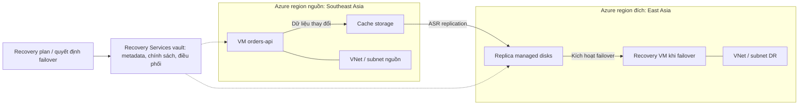
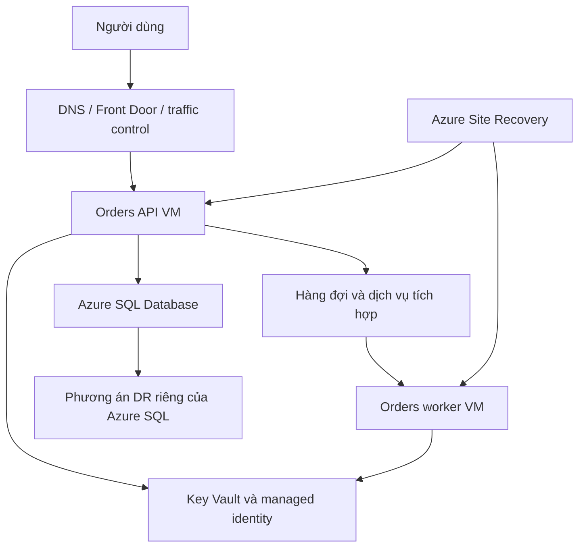
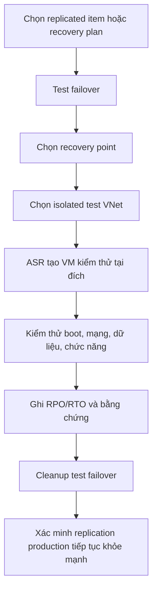
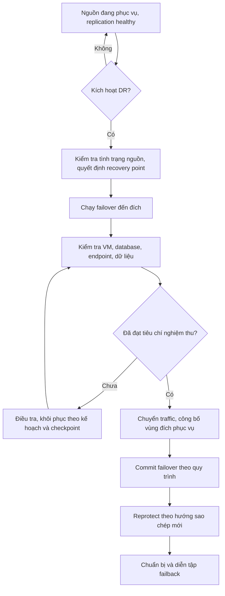

# Azure Site Recovery và sao chép workload phục vụ DR

## 1. Từ hệ thống hoạt động ổn định đến khả năng phục hồi thảm họa

Một ứng dụng trên Microsoft Azure có thể hoạt động tốt trong nhiều tháng nhưng vẫn gián đoạn khi một vùng triển khai (region) gặp sự cố lớn, máy ảo bị hỏng, cấu hình mạng không còn truy cập được hoặc trung tâm dữ liệu tại chỗ mất điện. Với các hệ thống có yêu cầu liên tục kinh doanh, việc triển khai ứng dụng lên Azure mới chỉ giải quyết một phần bài toán: nhóm vận hành còn cần khả năng **khôi phục dịch vụ ở địa điểm khác**, với mức mất dữ liệu và thời gian ngừng hoạt động có thể chấp nhận.

**Disaster Recovery (DR)** là tập hợp thiết kế, quy trình và công cụ để khôi phục ứng dụng sau sự cố vượt quá khả năng tự phục hồi thông thường. Trong hệ sinh thái Azure, **Azure Site Recovery (ASR)** là dịch vụ hỗ trợ **sao chép và điều phối khôi phục cho những workload được hỗ trợ**, đặc biệt là máy ảo, nhằm chuyển hoạt động từ nguồn sang nơi phục hồi. ASR có thể giúp bảo vệ Azure virtual machines giữa các region, hoặc bảo vệ một số workload tại chỗ để khôi phục lên Azure, tùy ma trận hỗ trợ hiện hành.

Bài học thuộc chương **Độ tin cậy và khôi phục thảm họa** của lộ trình Azure, nơi các vấn đề về resource group, mạng ảo, máy tính, dữ liệu, giám sát, bảo mật và chi phí cùng ảnh hưởng đến khả năng phục hồi. Trọng tâm là hiểu **ASR bảo vệ thành phần nào, luồng sao chép hoạt động ra sao, cách diễn tập test failover, cách chuyển đổi khi có sự cố và cách quay về vận hành bình thường**.

### Mục tiêu học tập

Sau bài học, bạn có thể:

1. Phân biệt khả năng sẵn sàng cao (HA), backup, replication và disaster recovery; xác định vai trò phù hợp của ASR.
2. Giải thích các thành phần của ASR: Recovery Services vault, protected/replicated item, replication policy, recovery point, recovery plan và tài nguyên đích.
3. Thiết kế mô hình sao chép máy ảo giữa hai Azure region kèm yêu cầu RPO/RTO, mạng, quyền và dung lượng.
4. Mô tả quy trình enable replication, giám sát replication health, test failover, failover, commit, reprotect và failback.
5. Tổ chức recovery plan theo phụ thuộc ứng dụng và kiểm tra tính nhất quán của dữ liệu sau failover.
6. Phân tích giới hạn, chi phí, các rủi ro bảo mật và cách phối hợp ASR với Azure Backup hoặc cơ chế DR riêng của dịch vụ dữ liệu.

## 2. Khái niệm cần thống nhất trước khi chọn công cụ

| Khái niệm | Câu hỏi mà nó trả lời | Ví dụ |
| --- | --- | --- |
| **High Availability (HA)** | Làm sao dịch vụ vẫn chạy khi một thành phần nhỏ hỏng? | Nhiều VM sau load balancer, trải trên Availability Zones |
| **Replication** | Dữ liệu/trạng thái workload được sao chép sang đích như thế nào? | ASR sao chép trạng thái các đĩa VM được hỗ trợ |
| **Backup** | Làm sao khôi phục dữ liệu từ một thời điểm trong quá khứ? | Azure Backup với chính sách lưu trữ, khôi phục bản sao sạch |
| **Disaster Recovery (DR)** | Làm sao chạy lại ứng dụng tại đích khi nguồn không sử dụng được? | Failover máy ảo sang region khác, đổi định tuyến và kiểm tra dữ liệu |
| **Business Continuity (BC)** | Doanh nghiệp làm gì để tiếp tục phục vụ khách hàng trong sự cố? | Quyết định kích hoạt DR, thông báo, phương án vận hành thủ công |

**RPO (Recovery Point Objective)** là mức mất dữ liệu tối đa cho phép, tính theo thời gian. Nếu RPO đặt ra là 15 phút, doanh nghiệp cần thiết kế khả năng khôi phục sao cho không mất quá 15 phút giao dịch theo tiêu chí đã xác định. **RTO (Recovery Time Objective)** là thời gian tối đa từ khi dịch vụ ngừng hoạt động đến khi dịch vụ đáp ứng lại yêu cầu nghiệp vụ.

Ví dụ minh họa:

- Sự cố xảy ra lúc **10:00**, recovery point cuối cùng chứa dữ liệu đến **09:52**: độ trễ khôi phục quan sát được là **8 phút**.
- Người dùng thực sự sử dụng lại ứng dụng lúc **10:42**: thời gian khôi phục quan sát được là **42 phút**, nếu lấy 10:00 làm mốc ngừng dịch vụ.
- Nếu mục tiêu là **RPO ≤ 15 phút** và **RTO ≤ 60 phút**, lần diễn tập này đạt mục tiêu về thời gian. Nhóm vẫn phải xác minh dữ liệu nghiệp vụ, không được suy từ timestamp của VM rằng mọi giao dịch đã nhất quán.

RPO và RTO là **mục tiêu thiết kế**, không tự động trở thành bảo đảm chỉ vì đã bật ASR. RPO thực tế phụ thuộc tốc độ thay đổi đĩa, băng thông, trạng thái replication và recovery point khả dụng; RTO phụ thuộc thời gian phát hiện sự cố, ra quyết định, chạy failover, khởi động ứng dụng, chuyển DNS/traffic và nghiệm thu.

## 3. Azure Site Recovery làm được gì và không làm được gì?

ASR là dịch vụ điều phối phục hồi cho các kịch bản được hỗ trợ. Các loại nguồn và đường phục hồi thường gặp gồm:

| Nguồn workload | Hướng phục hồi | Điểm cần hiểu |
| --- | --- | --- |
| **Azure VM** | Sang vùng Azure đích được hỗ trợ, điển hình là region khác | ASR duy trì bản sao dữ liệu đĩa và metadata phục hồi; VM đích được khởi tạo theo quy trình failover |
| **VMware VM tại chỗ** | Sang Azure | Cần kiến trúc appliance/agent theo mô hình và phiên bản VMware được hỗ trợ |
| **Máy vật lý tại chỗ** | Sang Azure | Phụ thuộc hỗ trợ hệ điều hành, Mobility Service và kết nối với hạ tầng replication |
| **Hyper-V VM** | Sang Azure theo kịch bản còn được hỗ trợ | Phải kiểm tra chính xác phiên bản host, OS, agent và ma trận hỗ trợ hiện hành |

Các kịch bản khác nhau có **thành phần, bước cấu hình và giới hạn riêng**. Phần thực hành chính của bài này sử dụng Azure VM sang Azure region khác; không mặc định hướng dẫn Azure-to-Azure áp dụng nguyên vẹn cho VMware hoặc Hyper-V.

**ASR không phải cơ chế DR chung cho mọi dịch vụ Azure.** Một số lựa chọn đúng theo loại workload:

| Workload | Cơ chế DR cần đánh giá |
| --- | --- |
| Azure VM chạy API, worker hoặc ứng dụng cài trên máy | ASR nếu loại VM, đĩa và hệ điều hành nằm trong phạm vi hỗ trợ |
| Azure SQL Database | Active geo-replication, failover groups, backup/restore theo yêu cầu dịch vụ |
| Azure Storage | Chiến lược redundancy (ví dụ GRS/RA-GRS/GZRS theo nhu cầu), backup và phục hồi dữ liệu |
| Azure App Service | Kiến trúc đa vùng, deployment và failover cho App Service, dữ liệu phụ trợ được bảo vệ riêng |
| AKS/Kubernetes | Tái tạo cluster từ IaC và manifests, bảo vệ dữ liệu lưu trữ bằng giải pháp tương thích |
| Microsoft Entra ID, DNS, Key Vault, kết nối bên thứ ba | Kiểm tra phương án riêng của từng thành phần, quyền, endpoint và quy trình thay đổi |

Không thể chỉ đưa một ứng dụng PaaS vào vault rồi mong ASR sao chép toàn bộ dữ liệu và luồng truy cập. **DR phải bao phủ toàn bộ dependency chain**: compute, network, identity, database, secret, DNS, traffic routing và tích hợp bên ngoài.

### ASR khác Azure Backup

ASR phục vụ mục tiêu **tiếp tục chạy workload** tại một địa điểm khác với các recovery point và tác vụ failover. Azure Backup phục vụ **khôi phục dữ liệu/tài nguyên từ bản sao lưu** với retention và chính sách bảo vệ riêng. Lỗi xóa dữ liệu hoặc mã độc mã hóa tệp có thể được sao chép sang đích ASR; lúc đó cần backup và phương án khôi phục dữ liệu sạch. Với hệ thống quan trọng, nhiều tổ chức dùng **cả DR replication lẫn backup**, có kiểm soát truy cập và kiểm thử độc lập.

## 4. Kiến trúc Azure-to-Azure Site Recovery

Một ví dụ kiến trúc bảo vệ máy ảo `vm-orders-api-01` chạy tại `southeastasia`, hướng phục hồi sang `eastasia`:



Hai region trên là **ví dụ minh họa**; phải xác minh rằng cặp vùng, VM SKU, hệ điều hành, loại đĩa, quota và tính năng được hỗ trợ tại thời điểm triển khai. Một số thiết kế có thể dùng Availability Zone hoặc vùng khôi phục khác tùy khả năng ASR, nhưng không nên coi mọi cặp zone/region đều tương đương.

### Các thành phần chính

1. **Recovery Services vault:** nơi quản lý các đối tượng Site Recovery, cấu hình bảo vệ, trạng thái sao chép, recovery plan và điều phối phục hồi. Vault không đồng nghĩa với nơi chứa bản backup ứng dụng.
2. **Replication policy:** quyết định các đặc điểm retention/recovery point và thiết lập chụp trạng thái nhất quán được hỗ trợ trong kịch bản.
3. **Replicated/protected item:** biểu diễn workload đã bật bảo vệ; cung cấp replication health, status, recovery point và các thao tác phục hồi.
4. **Cache storage ở nguồn:** hỗ trợ luồng ghi thay đổi trong quá trình sao chép của kịch bản Azure-to-Azure.
5. **Replica disks và cấu hình khôi phục ở đích:** dữ liệu đã được duy trì tại target; khi failover ASR tạo/khởi động VM đích theo cấu hình được chỉ định.
6. **Target resource group, network, subnet và compute:** nơi workload sẽ chạy khi khôi phục.
7. **Recovery plan:** mô tả nhóm máy, thứ tự khởi động, thao tác thủ công và tích hợp automation khi ứng dụng có nhiều thành phần.

Phần **control plane** điều phối nằm trong dịch vụ Site Recovery; đường sao chép dữ liệu thực tế và kết nối tới Azure phải tuân thủ yêu cầu của kịch bản. Cần kiểm tra firewall, endpoint và proxy để agent/extension và hạ tầng ASR có thể hoạt động ổn định.

### Những gì được và không được sao chép

ASR chủ yếu bảo vệ trạng thái đĩa và cấu hình VM trong phạm vi được hỗ trợ. Các thành phần như DNS bên ngoài, endpoint của đối tác, cấu hình ứng dụng bên ngoài VM, cơ sở dữ liệu PaaS hoặc hệ thống danh tính **không tự nhiên trở thành một phần của bản sao VM**. Đồng thời, một số loại đĩa, kích thước VM, cơ chế mã hóa, cấu hình mạng hay tính năng OS có thể có hạn chế hoặc yêu cầu cấu hình bổ sung. Vì vậy, phải tra ma trận hỗ trợ trước khi thiết kế RPO/RTO chính thức.

## 5. Recovery point: crash-consistent và application-consistent

Khi nguồn đang chạy, ASR theo dõi những thay đổi được hỗ trợ và tạo các recovery point theo chính sách áp dụng. Khi failover, bạn cần chọn một **điểm có thể khôi phục** phù hợp, không đơn giản mặc định “mới nhất luôn tốt nhất”.

| Loại điểm khôi phục | Ý nghĩa | Tình huống |
| --- | --- | --- |
| **Crash-consistent** | Dữ liệu giống trạng thái đĩa sau khi máy bị mất điện đột ngột, không bảo đảm tất cả ứng dụng đã flush giao dịch xuống đĩa | Workload có cơ chế tự phục hồi transaction log sau crash |
| **Application-consistent** | Có phối hợp cơ chế nhất quán ứng dụng/guest được hỗ trợ tại thời điểm tạo snapshot | Workload cần ứng dụng hoặc dịch vụ trong guest được chuẩn bị trước snapshot |
| **Recovery point đã xử lý và sẵn sàng** | Dữ liệu đã được xử lý để giảm thời gian chờ tạo máy phục hồi | Ưu tiên rút ngắn RTO nếu điểm phù hợp với mục tiêu mất dữ liệu |

Khả năng và tên lựa chọn recovery point cụ thể trên portal có thể phụ thuộc kịch bản, thời điểm và phiên bản dịch vụ. Không nên dựa vào một lựa chọn recovery point để **khẳng định nhất quán giao dịch xuyên nhiều VM**. Ví dụ, API VM và database VM được sao chép độc lập vẫn có thể có trạng thái không tương thích ở một thời điểm, dù mỗi VM riêng lẻ khởi động thành công.

Với ứng dụng có database, cần:

- Xác định cơ chế phục hồi của database (transaction log, database backup, native replication, recovery process).
- Chỉ rõ recovery point nào phù hợp với yêu cầu nhất quán và thử nghiệm bằng truy vấn nghiệp vụ thực.
- Quy định thứ tự khởi động database, message broker, API, background worker.
- Có phương án rollback nếu bản sao đã khôi phục chứa dữ liệu lỗi hoặc schema không khớp.

**Retention recovery point của ASR không thay cho backup dài hạn.** Dải thời gian và tần suất phục hồi phải được chọn theo tính năng được hỗ trợ, mức thay đổi dữ liệu và chi phí lưu trữ.

## 6. Thiết kế DR theo workload cụ thể: Orders API

Xét hệ thống đơn giản gồm:

- `vm-orders-api-01`: Azure VM chạy Java Orders API.
- `vm-orders-worker-01`: Azure VM xử lý hàng đợi đơn hàng.
- Azure SQL Database: lưu trạng thái đơn hàng, được bảo vệ bằng **cơ chế DR riêng của Azure SQL**, không đưa vào ASR.
- Azure Key Vault: cung cấp secret/certificate theo quyền managed identity.
- Azure Front Door hoặc cơ chế DNS/traffic steering phù hợp: định tuyến đến ứng dụng ở region đang phục vụ.

Sơ đồ phụ thuộc:



Các mũi tên từ ASR tới VM biểu diễn đối tượng được bảo vệ, không khẳng định ASR sao chép toàn bộ hệ thống bên ngoài VM.

### Bảng thiết kế trước khi cấu hình

| Quyết định | Ví dụ cho Orders API | Điều cần kiểm tra |
| --- | --- | --- |
| Region nguồn | `southeastasia` | VM, dịch vụ, network và policy tại nguồn |
| Region DR | `eastasia` | Hỗ trợ ASR, data residency, network latency và quota |
| Resource group đích | `rg-orders-dr-ea` | Role assignment, Azure Policy, tags và naming |
| VNet DR | `vnet-orders-dr-ea` | IP CIDR, NSG, UDR, DNS, Private Endpoint |
| VNet test failover | `vnet-orders-dr-test` | Cô lập với production để tránh xung đột IP và ghi dữ liệu |
| Workload ASR | Hai VM ứng dụng và worker | Khả năng hỗ trợ OS/disks/extension của từng VM |
| Data DR | Azure SQL có chiến lược riêng | RPO, thứ tự failover, quyền và connection string |
| RPO mục tiêu | 15 phút | Phải đối chiếu replication health và thử tính nhất quán |
| RTO mục tiêu | 60 phút | Bao gồm quyết định, thao tác, routing và nghiệm thu |
| Người kích hoạt | Incident commander được ủy quyền | Quyết định khi nào thực sự chuyển lưu lượng |

Các mục tiêu và tài nguyên trong bảng chỉ là tình huống học tập; không phải SLA hoặc tuyên bố hệ thống thực sẽ đạt những con số này.

**Cold, warm và hot DR** mô tả mức tài nguyên sẵn có ở site phục hồi. ASR thường phù hợp với phương án có đĩa/bản sao được duy trì và máy đích được kích hoạt khi cần. Để có RTO rất thấp, có thể cần kiến trúc **active-active/active-passive đã chạy sẵn** bằng cơ chế dịch vụ riêng, vì thời gian boot và chuyển traffic của VM vẫn tồn tại.

## 7. Kiểm tra điều kiện tiên quyết trước khi bật replication

### 7.1. Tương thích và dung lượng

Trước khi bảo vệ VM, kiểm tra:

1. **Support matrix:** VM family/size, Gen 1/Gen 2, OS version, đĩa dữ liệu/OS, encryption, vùng nguồn/đích và các hạn chế tính năng.
2. **Quota đích:** vCPU theo VM family, số lượng NIC, managed disks, địa chỉ IP và các tài nguyên cần tạo khi failover.
3. **Thay đổi dữ liệu:** dung lượng đĩa, tốc độ ghi, giới hạn băng thông và độ trễ; initial replication có thể kéo dài lâu hơn replication duy trì.
4. **Ranh giới mạng:** overlap CIDR, DNS, outbound connectivity tới endpoint cần thiết, firewall/proxy, Private Endpoint, kết nối tới dữ liệu.
5. **Phụ thuộc bảo mật:** Azure RBAC, khóa mã hóa, Key Vault permissions, identity và chính sách Azure Policy tại đích.
6. **Giới hạn dữ liệu:** quy định về chủ quyền dữ liệu, vị trí lưu bản sao, đánh giá chi phí và yêu cầu kiểm toán.

Đặc biệt, những VM dùng **ephemeral OS disk**, shared-disk, một số cấu hình mã hóa hoặc tính năng compute đặc biệt có thể không được hỗ trợ tùy kịch bản. Không tự suy rằng mọi VM trong subscription đều bật ASR được. Chỉ quyết định sau khi đối chiếu tài liệu tương thích chính thức với cấu hình thực.

### 7.2. Thiết kế mạng DR từ trước

ASR không tự tạo một hệ sinh thái mạng nghiệp vụ hoàn chỉnh cho ứng dụng. Cần chuẩn bị:

- Target VNet/subnet với địa chỉ không gây xung đột và có thể liên lạc đúng thành phần phụ thuộc.
- NSG, route table, firewall, NAT, DNS server và private endpoint tương ứng.
- Cách truy cập từ người dùng/đối tác vào endpoint mới; IP công khai và tên miền có thể thay đổi khi failover.
- Một **mạng test tách biệt** cho diễn tập, tránh bản sao ứng dụng gửi email, xử lý đơn hàng hoặc ghi vào hệ thống production.
- Bảo đảm vùng DR có khả năng truy cập Key Vault, Azure SQL DR endpoint và hệ thống giám sát.

Nếu cần giữ một địa chỉ IP cụ thể, phải xác minh cách ASR ánh xạ NIC/IP ở đích và địa chỉ còn khả dụng. Đừng giả định private/public IP của VM nguồn tự động được giữ nguyên trong mọi kịch bản.

### 7.3. Vai trò và tài nguyên quản lý

Người cấu hình Site Recovery cần quyền quản lý vault, các tài nguyên nguồn/đích và các thành phần mà ASR sẽ tạo; người chỉ được phép test failover có thể cần quyền nhỏ hơn. Tổ chức nên tách vai trò **thiết kế/chỉnh replication policy**, **theo dõi** và **kích hoạt failover production**. Các role như Site Recovery Contributor/Operator/Reader có thể giúp phân công, nhưng vẫn phải kiểm tra quyền bổ sung trên network, resource group, storage và danh tính ở đích.

## 8. Thiết lập Azure-to-Azure replication qua Azure Portal

Quy trình dưới đây mô tả luồng thực hành logic. Tên menu hoặc vị trí nút có thể thay đổi theo giao diện portal; cần kiểm tra hướng dẫn Azure Site Recovery cập nhật khi thực hiện thật.

### Bước 1 — Tạo và cấu hình Recovery Services vault

Mở Azure Portal, tìm **Recovery Services vaults**, tạo vault trong subscription/resource group quản lý DR và chọn vùng đặt vault **phù hợp với kịch bản bảo vệ**, có ranh giới sự cố độc lập với nguồn. Với Azure-to-Azure, thường bố trí vault ở vùng phục hồi thay vì vùng nguồn; xác minh quy tắc region được hỗ trợ trước khi tạo.

Trong vault, sử dụng phần **Site Recovery** để cấu hình nguồn và đích. Khác với cách lưu state trong một storage account bình thường, vault là điểm điều phối/giám sát của ASR.

### Bước 2 — Xác định nguồn và đích

Chọn bảo vệ **Azure virtual machines** và chỉ định:

1. Subscription/resource group và region chứa các VM nguồn.
2. Một hoặc nhiều máy ảo cần sao chép.
3. Subscription/resource group, target region, VNet/subnet và các thiết lập tài nguyên đích.
4. Cache storage và replication policy được đề xuất hoặc cấu hình theo yêu cầu.

Không nên mặc định tất cả VM cùng policy. Một workload có tỷ lệ ghi cao và RPO rất chặt có thể cần thiết kế khác VM quản trị ít thay đổi.

### Bước 3 — Bật bảo vệ và theo dõi initial replication

Khởi tạo **Enable replication** cho các VM đã chọn; ASR cấu hình các thành phần cần thiết theo kịch bản. Initial replication sao chép dữ liệu ban đầu và có thể chịu ảnh hưởng lớn của dung lượng, tốc độ ghi, băng thông hoặc cấu hình đĩa.

Chưa nên tuyên bố hệ thống đã sẵn sàng DR cho đến khi:

- Protected item chuyển đến trạng thái replication khỏe mạnh và có recovery point hợp lệ.
- Bạn đã xác minh vùng đích, mạng đích, tài nguyên sẽ tạo và phạm vi quyền.
- Có test failover tối thiểu một lần; trạng thái “replication healthy” chỉ chứng minh một phần của mục tiêu DR.

### Bước 4 — Kiểm tra protected items

Trong phần **Replicated items** của vault, đối chiếu từng VM:

| Thuộc tính | Câu hỏi kiểm tra |
| --- | --- |
| Replication health | Bản sao đang hoạt động bình thường hay có cảnh báo? |
| Latest recovery point | Điểm khôi phục gần nhất là khi nào và loại gì? |
| RPO hoặc replication lag | Độ trễ thực quan sát có chấp nhận được không? |
| Target VM properties | VM size, disk, availability settings, NIC có phù hợp vùng DR? |
| Replication policy | Retention và application-consistent recovery point có phù hợp workload? |
| Alerts/Jobs | Có job thất bại, extension lỗi hoặc thay đổi không được dự kiến? |

Với on-premises VMware/physical, bước cấu hình cần tính tới replication appliance, Mobility Service và đặc thù kết nối từ trung tâm dữ liệu về Azure. **Không áp dụng hướng dẫn nguồn Azure VM cho máy tại chỗ mà bỏ qua appliance/agent**.

## 9. Test failover: điều kiện bắt buộc trước khi tin vào DR

**Test failover** thử tạo workload từ recovery point tại đích **mà không chủ đích chuyển traffic production**. Đây là cơ hội kiểm tra tính khởi động, dữ liệu và quyền mà không gây gián đoạn kinh doanh. Khi chạy test, phải chọn mạng cô lập được chuẩn bị trước.

### Luồng kiểm thử



**Không gắn test VM trực tiếp vào production VNet hoặc production DNS** nếu điều đó có thể khiến hai bản sao cùng thực thi nghiệp vụ, đụng IP hoặc ghi vào hệ thống thật. Với API xử lý đơn hàng, môi trường thử cần database bản sao, hàng đợi thử, tài khoản tích hợp giả lập hoặc cấu hình chặn mọi giao dịch thật.

### Kiểm tra sau khi VM test khởi động

| Lớp | Kiểm tra thực tế | Tiêu chí đạt |
| --- | --- | --- |
| Compute | VM boot, agent/OS ổn định, tài nguyên CPU/RAM phù hợp | Hệ điều hành và service khởi động được |
| Network | DNS, NSG, firewall, route, endpoint nội bộ | Ứng dụng kết nối tới đúng môi trường test |
| Application | Health endpoint, HTTP API, xử lý một request thử | Không có lỗi cấu hình hoặc dependency nghiêm trọng |
| Data | Đọc bản ghi mẫu, transaction log, schema/version | Điểm phục hồi đáp ứng tiêu chí nhất quán đã xác định |
| Security | Managed identity, RBAC, Key Vault/certificate | Chỉ có quyền phù hợp; không dùng nhầm secret production |
| Operations | Logs, metrics, alerts, dashboard | Nhóm SRE quan sát được trạng thái hệ thống ở DR |
| Cleanup | Xóa tài nguyên thử nghiệm theo quy trình ASR | Không để test VM chạy và phát sinh chi phí ngoài dự kiến |

Test failover chỉ chứng minh những hạng mục đã kiểm thử. Một bài test chỉ ping được VM **không đủ** để chứng minh API xử lý đơn hàng hoạt động đầy đủ. Tài liệu DR phải lưu bằng chứng, số liệu và các lỗi chưa giải quyết, kèm người chịu trách nhiệm khắc phục.

### Mẫu biên bản diễn tập

```text
Exercise ID: DR-ORDERS-2026-01 (ví dụ)
Workload: orders-api / orders-worker
Source: Southeast Asia
Target: East Asia, isolated test VNet
Recovery point timestamp: [ghi theo portal]
Time detected / test started: [timestamp]
Time API ready: [timestamp]
Measured data loss: [phút, theo giao dịch kiểm chứng]
Measured recovery time: [phút]
RPO target / RTO target: [phút]
Functional checks passed: [danh sách]
Issues / follow-up / owner / due date: [ghi rõ]
Cleanup test failover: [PASS/FAIL]
Replication health after test: [PASS/FAIL]
```

Đo thời gian theo mốc thống nhất, ví dụ UTC, để dễ so sánh. Nếu chỉ nhìn giờ khởi động máy ảo mà bỏ qua thời điểm ứng dụng có thể nhận traffic, kết quả RTO sẽ thấp hơn thời gian gián đoạn thực.

## 10. Failover thực sự: chọn thời điểm, commit và reprotect

Khi sự cố làm vùng nguồn không thể phục vụ, nhóm vận hành kích hoạt runbook DR. Failover liên quan đến thay đổi trạng thái ứng dụng và dữ liệu, vì vậy cần người được ủy quyền thực hiện, sự phối hợp giữa ứng dụng và hệ thống dữ liệu, cùng tiêu chí rõ ràng trước khi hướng traffic.

### Chu trình khôi phục ở mức khái niệm



**Lưu ý:** thứ tự chi tiết giữa nghiệm thu, chuyển traffic và commit phải tuân theo hướng dẫn của kịch bản ASR và runbook tổ chức. Sơ đồ nhằm thể hiện các quyết định cần kiểm soát, không thay thế các bước trong portal.

### Phân biệt các thao tác

| Thao tác | Mục đích | Điều cần thận trọng |
| --- | --- | --- |
| **Test failover** | Thử khả năng khôi phục trong môi trường tách biệt | Dọn tài nguyên test, không để kết nối tới production ngoài ý muốn |
| **Failover** | Khởi chạy workload tại địa điểm khôi phục bằng recovery point đã chọn | Chấp nhận mức dữ liệu mất có thể xảy ra, bảo đảm không có hai hệ thống cùng ghi |
| **Commit** | Xác nhận kết quả failover và hoàn tất giai đoạn chuyển đổi theo cơ chế ASR | Chỉ thực hiện sau khi đã kiểm tra đầy đủ vì lựa chọn recovery point có thể bị ảnh hưởng |
| **Reprotect** | Thiết lập lại bảo vệ theo hướng phù hợp khi workload đang chạy ở đích | Cần nguồn/đích, quota, network, policy và replication health mới |
| **Failback** | Đưa workload về vùng nguồn cũ hoặc địa điểm chính đã xác định | Phải lập kế hoạch dữ liệu thay đổi sau failover và kiểm thử lại trước chuyển traffic |

Không dùng `Commit` như một nút “xác nhận giao diện” vô hại. Tùy kịch bản, commit có thể giới hạn khả năng chọn lại recovery point của lần failover vừa chạy. Hãy kiểm tra tính nhất quán của database, cấu hình ứng dụng và kết nối trước khi hoàn tất.

### Tránh split-brain và duplicate processing

Khi hai bản VM có thể chạy đồng thời, ứng dụng có nguy cơ phát sinh **split-brain**: cả nguồn lẫn đích đều xử lý yêu cầu hoặc ghi dữ liệu độc lập. Với Orders API, điều này có thể tạo hai lần xử lý thanh toán, xuất kho hoặc gửi thông báo.

Runbook cần ghi rõ:

1. Ai xác định vùng nguồn không còn xử lý traffic hoặc đã được cô lập.
2. Khi nào dừng background worker, scheduler, consumer và các tác vụ không idempotent.
3. Khi nào database và queue tại vùng DR được phép mở ở chế độ ghi.
4. Điều kiện cụ thể để chuyển DNS, Front Door origin hoặc routing khác.
5. Cách xác minh một đơn hàng chỉ được xử lý một lần; sử dụng idempotency key và trạng thái giao dịch nếu ứng dụng hỗ trợ.

Không thể giao toàn bộ việc kiểm soát tính nhất quán phân tán cho ASR vì ASR chỉ nhìn thấy những workload được bảo vệ trong phạm vi riêng của nó.

## 11. Recovery plan và thứ tự khởi động ứng dụng nhiều tầng

Nếu khôi phục từng VM bằng thao tác thủ công rời rạc, nhóm dễ bỏ sót phụ thuộc. **Recovery plan** trong Site Recovery hỗ trợ nhóm workload và điều phối theo các nhóm/bước tương ứng, có thể kết hợp hành động thủ công và automation ở những điểm thích hợp.

Ví dụ thứ tự logic cho Orders API:

| Giai đoạn | Thành phần | Điều kiện chuyển tiếp |
| --- | --- | --- |
| 0. Quyết định | Incident commander, on-call, trạng thái vùng nguồn | Đã phê duyệt DR; xác định ngăn nguồn tiếp tục ghi |
| 1. Nền tảng | DNS riêng, kết nối, Key Vault, monitoring, đường đến data DR | Các endpoint ở đích truy cập được |
| 2. Dữ liệu | Kích hoạt phương án Azure SQL DR, khôi phục queue nếu cần | Kiểm tra schema, role, endpoint, RPO dữ liệu |
| 3. API | Failover `vm-orders-api-01` với ASR | API health check và các luồng nghiệp vụ chính đạt |
| 4. Worker | Failover `vm-orders-worker-01` | Xử lý message thử, không tạo công việc trùng lặp |
| 5. Traffic | Chuyển Front Door/DNS hoặc cơ chế routing | Quan sát tỷ lệ lỗi, độ trễ và số giao dịch |
| 6. Nghiệm thu | Business owner, SRE, bảo mật | Chốt thời gian, lỗi, commit và hướng reprotect |

Những bước về Azure SQL, Front Door, Key Vault hoặc queue cần **automation riêng hoặc hành động thủ công được thiết kế**. Recovery plan của ASR không tự biến mọi dịch vụ PaaS thành protected item.

Recovery plan có thể phối hợp với Azure Automation runbook hoặc cơ chế automation tương thích cho các bước đặc biệt. Script phải có quyền tối thiểu, timeout, retry có kiểm soát, log và cách xử lý lỗi. Không ghi token vào runbook hoặc thông báo sự cố; dùng managed identity/credential store phù hợp.

Đừng gắn mọi VM trong một recovery plan khổng lồ nếu các nhóm ứng dụng có owner, thứ tự phụ thuộc và RTO khác nhau. Phân hoạch theo **đơn vị khôi phục nghiệp vụ** giúp diễn tập thực tế và giảm phạm vi ảnh hưởng.

## 12. Failback: phục hồi hướng sao chép và trở về trạng thái ổn định

Giả sử sự cố tại Southeast Asia được xử lý và Orders API đã chạy ở East Asia trong vài ngày. Trong khoảng thời gian đó, người dùng tạo thêm đơn hàng và worker xử lý message tại đích. Không được chỉ bật lại VM nguồn cũ rồi đổi DNS trở lại: dữ liệu vùng nguồn có thể đã lỗi thời, và hai bộ xử lý có thể cạnh tranh.

Quy trình failback cần:

1. **Xác minh vùng nguồn đã ổn định:** hạ tầng, quota, mạng, quyền, khóa và mọi dependency đã sẵn sàng.
2. **Thiết lập reprotect:** cho ASR tái bảo vệ workload theo hướng cần thiết, theo yêu cầu và khả năng hỗ trợ của kịch bản.
3. **Đồng bộ các thay đổi sau failover:** chờ replication healthy và recovery point phù hợp, kiểm tra đường dữ liệu của database/queue bên ngoài ASR.
4. **Lên lịch chuyển về:** xác nhận người quyết định, kế hoạch quiesce ứng dụng, chặn các writer trùng lặp và chuẩn bị rollback.
5. **Thực thi failback theo runbook:** lựa chọn recovery point, khởi động và kiểm tra ứng dụng, chuyển traffic khi đạt tiêu chí.
6. **Hoàn tất và tái lập bảo vệ:** commit nếu quy trình yêu cầu, cấu hình hướng sao chép bình thường, chạy test lại và cập nhật tài liệu.

Failback có thể phức tạp hơn failover vì vùng DR đã trở thành nơi chứa **dữ liệu mới nhất**. Quy trình chuẩn phải bảo đảm quyết định về hệ thống ghi chính được đưa ra bởi người chịu trách nhiệm dữ liệu, không chỉ bởi người vận hành máy ảo.

## 13. Giám sát replication health và chứng minh RPO/RTO

Với ASR, không nên đợi có sự cố mới mở vault. Nhóm vận hành cần theo dõi liên tục trạng thái protected items, các replication jobs, recovery point, cảnh báo và khả năng khởi chạy tại vùng đích.

### Những tín hiệu cần theo dõi

| Tín hiệu | Ý nghĩa | Phản ứng mong muốn |
| --- | --- | --- |
| Replication health suy giảm | Workload có thể đang chậm sao chép hoặc lỗi agent/kết nối | Điều tra gần thời gian xảy ra lỗi, xác minh recovery point |
| Recovery point quá cũ | RPO quan sát có nguy cơ vượt ngưỡng | Kiểm tra tốc độ ghi, cache/network và lỗi replication |
| Initial replication kéo dài | Chưa có mức bảo vệ mong muốn | Kiểm tra volume/throughput và khả năng kết nối |
| Job test failover/failover thất bại | Workflow khôi phục chưa chạy thành công | Phân tích job detail và rerun có kiểm soát |
| VM đích không boot hoặc app unhealthy | Có thể đã sao chép dữ liệu nhưng không phục hồi nghiệp vụ | Kiểm tra OS, dependencies, disk, NSG, DNS, secret |
| Quota hoặc SKU đích thay đổi | Không thể cấp phát VM khi failover | Kiểm tra quota định kỳ và chiến lược capacity |
| Bất thường Azure Policy/RBAC | ASR không thể tạo/sửa tài nguyên | Kiểm tra chính sách, role assignment và thay đổi quản trị |
| Chi phí replication tăng | Thay đổi dữ liệu hoặc thử nghiệm tốn hơn dự kiến | Theo dõi Cost Management, tối ưu disk/retention |

Có thể tích hợp cảnh báo của Recovery Services vault với Azure Monitor/Action Group theo khả năng phát hành của dịch vụ. Nên gửi cảnh báo tới đội trực, kèm link tới protected item, thời gian recovery point cuối, affected VM, runbook và mức độ ưu tiên.

**Công thức đánh giá ở mức nghiệp vụ:**

```text
Observed data loss (phút)
  = incident timestamp - timestamp dữ liệu nghiệp vụ cuối cùng khôi phục được

Observed recovery time (phút)
  = timestamp dịch vụ được nghiệm thu - timestamp dịch vụ ngừng phục vụ
```

Mốc `incident timestamp` và mốc khôi phục phải được chuẩn hóa; đối với nhiều thành phần, thời điểm dữ liệu khôi phục có thể khác nhau. Đừng chỉ lấy “replication health = Healthy” để suy ra RPO của toàn ứng dụng.

### SLO và diễn tập định kỳ

Nếu chính sách yêu cầu RPO 15 phút và RTO 60 phút, cần lập quy trình kiểm thử có số liệu thực. Ví dụ, một đợt diễn tập test failover đạt thời gian boot VM 18 phút nhưng mất thêm 55 phút cấu hình DNS và database thì **RTO nghiệp vụ là 73 phút**, chưa đạt mục tiêu dù VM khởi động thành công.

Các phép kiểm tra nên có lịch, người phụ trách, tiêu chí đạt và phương án sửa lỗi. Bất kỳ thay đổi lớn về VNet, NSG, Azure Policy, database, identity hoặc kiến trúc ứng dụng đều có thể làm runbook cũ mất hiệu lực.

## 14. Bảo mật, tuân thủ và kiểm soát chi phí cho DR

### Bảo vệ quyền và dữ liệu sao chép

- **Tách quyền quản lý và quyền kích hoạt DR:** không phải mọi người có quyền xem replication health đều được quyền failover production.
- **Bảo vệ encryption/keys:** nếu VM sử dụng cơ chế mã hóa đặc biệt hoặc customer-managed key, kiểm tra điều kiện hỗ trợ và quyền Key Vault tại target.
- **Đảm bảo mạng cô lập cho test:** thử nghiệm không được làm lộ dữ liệu hoặc gửi giao dịch thực.
- **Áp dụng Azure Policy và tagging phù hợp:** các resource được ASR tạo khi failover phải đáp ứng quy tắc bảo mật và quản trị.
- **Xem xét data residency:** replication sang region khác có thể phải được bộ phận phụ trách dữ liệu phê duyệt.
- **Lưu audit trail:** quyết định kích hoạt, thay đổi quyền, job failover, kết quả nghiệm thu, người commit và hành động failback.

Đừng cấp quyền `Owner` trên toàn subscription chỉ để vận hành DR nếu có thể thiết kế Azure RBAC ở phạm vi nhỏ hơn. Identity và network tại DR phải được kiểm thử thực tế vì một role assignment tồn tại trên giấy chưa chứng minh ứng dụng đọc được secret và truy cập được database khi khôi phục.

### Các nhóm chi phí có thể phát sinh

| Nhóm chi phí | Vì sao phát sinh |
| --- | --- |
| Phí bảo vệ ASR | Các protected instances theo chính sách và mức giá hiện hành |
| Replica storage và cache | Đĩa bản sao, tài khoản cache và recovery point |
| Dữ liệu truyền giữa vùng | Network transfer có thể phát sinh phí theo tuyến/giá Azure |
| Tài nguyên vùng đích | VNet, firewall, IP, thành phần hỗ trợ; VM đích khi test/failover được cấp phát |
| Test failover định kỳ | Compute, disk, traffic, logs trong thời gian diễn tập |
| Giám sát, log, backup bổ sung | Azure Monitor, Log Analytics, Azure Backup và các dịch vụ khác |

Chi phí ASR phụ thuộc kịch bản và pricing thực tế; hãy dùng Azure Pricing Calculator và Microsoft Cost Management với dữ liệu cấu hình thật. Không nên cắt bỏ test failover để tiết kiệm phí ngắn hạn: DR chưa được diễn tập có thể thất bại đúng lúc cần nhất. Ngược lại, phải cleanup tài nguyên test ngay sau khi thu thập bằng chứng.

## 15. Các tình huống lỗi và cách tiếp cận xử lý

| Hiện tượng | Nguyên nhân có thể | Các bước kiểm tra |
| --- | --- | --- |
| Không thấy VM trong danh sách bảo vệ | VM/OS/disk không hỗ trợ, sai subscription/region hoặc thiếu quyền | Kiểm tra support matrix, vault và RBAC |
| Initial replication không hoàn tất | Quá nhiều dữ liệu, lỗi extension/agent, cache/network, quota | Xem replication jobs, throughput, endpoint và VM health |
| Recovery point trễ bất thường | Tốc độ ghi tăng, mạng hạn chế hoặc pipeline replication lỗi | Đối chiếu I/O, alert, cache, lag và lịch sử job |
| Test failover VM không được tạo | Quota/SKU đích, policy, storage/disk/network thiếu hoặc bị chặn | Xem lỗi từng job và kiểm tra khả năng cấp phát tại target |
| VM khởi động nhưng API không hoạt động | NSG/DNS/route, secret, database endpoint hoặc service dependency sai | Kiểm tra trong isolated VNet với health check end-to-end |
| Chọn sai subnet khiến VM không truy cập được | Network mapping/target NIC chưa đúng | Sửa cấu hình đích, lặp lại test failover |
| Test VM kết nối production gây xử lý trùng | Mạng thử không cô lập hoặc app config dùng nhầm | Ngắt kết nối, xử lý hậu quả, thiết kế lại test |
| Failover xong không thể failback | Chưa reprotect, vùng nguồn chưa sẵn sàng, quyền/đĩa/quota thay đổi | Kiểm tra hướng replication, trạng thái và plan failback |
| Recovery plan đứng ở một bước | Automation/runbook lỗi, timeout hoặc chờ thao tác thủ công | Kiểm tra execution log, quyền và điều kiện tiếp tục |
| RPO/RTO không đạt dù replication healthy | Nghiệp vụ có dependency khác VM, DNS thủ công, dữ liệu không nhất quán | Đo toàn quy trình, xác định nút thắt và tối ưu kiến trúc |

Khi xử lý lỗi, cần biết protected item nào, job ID, thời điểm, kịch bản, mã lỗi và thay đổi hạ tầng gần nhất. Không tự ý xóa replication, commit sai trạng thái hoặc xóa recovery resource để “làm sạch” lỗi khi chưa đánh giá ảnh hưởng đến khả năng khôi phục.

## 16. Bài thực hành: lập và diễn tập DR cho một Azure VM

**Mục tiêu:** thiết kế phương án Azure-to-Azure Site Recovery cho một VM thử nghiệm chạy web server/API, bật replication nếu môi trường và quyền cho phép, kiểm tra recovery point và diễn tập test failover an toàn trong VNet cô lập.

### Điều kiện môi trường

Sử dụng subscription thử nghiệm có ngân sách được duyệt, VM nằm trong danh sách ASR hỗ trợ, hai region khả dụng, target VNet/subnet và test VNet cô lập. Chuẩn bị người phụ trách, quyền vault, network và các quota cần thiết. **Bài thực hành không yêu cầu gây gián đoạn workload production hoặc thực hiện failover thật**.

### Bước 1 — Xác định phạm vi và mục tiêu

Điền vào phiếu thiết kế:

```yaml
# Ví dụ tài liệu kế hoạch, KHÔNG phải cấu hình trực tiếp cho Azure CLI
application: orders-api-demo
source_region: southeastasia
target_region: eastasia
source_vm: vm-orders-demo
test_network: vnet-orders-dr-test
rpo_target_minutes: 15
rto_target_minutes: 60
critical_dependencies:
  - network_and_dns
  - identity_and_secrets
  - data_store_recovery
exercise_mode: isolated_test_failover
```

Hai vùng là giá trị tham khảo; hãy thay theo support matrix và chính sách tổ chức. Ghi lại các chức năng cần có sau khi khôi phục: HTTP health endpoint, đăng nhập, đọc/ghi dữ liệu giả lập và logs.

### Bước 2 — Đánh giá tính sẵn sàng

Trong portal, ghi nhận VM size, OS, loại đĩa, storage, region, subnet, NSG, identity. Xác minh vùng đích có quota và network, không có CIDR gây xung đột. Đối với dịch vụ dữ liệu khác VM, bổ sung một runbook DR riêng, không mặc định ASR xử lý.

### Bước 3 — Tạo vault và bật replication

Tạo Recovery Services vault theo kịch bản phù hợp, chọn VM thử nghiệm và bật replication với target region/network đã chuẩn bị. Theo dõi tới khi protected item đạt trạng thái khỏe mạnh, có recovery point hợp lệ. Chụp hoặc lưu **bằng chứng trạng thái và timestamp**, không cần chụp dữ liệu nhạy cảm.

### Bước 4 — Chạy test failover trong isolated VNet

Trong Site Recovery, chọn **Test failover** cho VM hoặc recovery plan thử nghiệm; chọn recovery point phù hợp và **test VNet cô lập**. Khi test VM hoạt động, xác minh:

1. Hệ điều hành lên bình thường và service web/API sẵn sàng.
2. VM nhận địa chỉ mạng mong đợi và không truy cập production ngoài ý muốn.
3. Có thể thực hiện request nghiệp vụ mẫu với dữ liệu thử nghiệm.
4. Log của ứng dụng, cảnh báo và quyền secret phù hợp.
5. RPO/RTO quan sát được theo các mốc đã thống nhất.

### Bước 5 — Cleanup và ghi kết quả

Hoàn tất **Cleanup test failover** từ giao diện ASR, xác minh tài nguyên test đã được xử lý theo quy trình và replication nguồn tiếp tục hoạt động. Cập nhật biên bản theo mục 9; nếu thất bại ở bước DNS hoặc dependency, ghi công việc khắc phục và lên lịch kiểm thử lại.

### Bước 6 — Mô phỏng quyết định failover bằng runbook

Không cần chuyển production. Mô tả bằng văn bản: ai tuyên bố thảm họa, nguồn được cô lập như thế nào, chọn recovery point ra sao, thứ tự failover giữa dữ liệu/API/worker, tiêu chí chuyển traffic, ai được commit và khi nào sẽ reprotect/failback.

### Tiêu chí hoàn thành bài thực hành

| Tiêu chí | Đạt khi |
| --- | --- |
| Tương thích | VM/OS/disks/regions phù hợp support matrix |
| Hạ tầng DR | Vault, mạng, RBAC, quota được ghi rõ và kiểm chứng |
| Replication | Có protected item khỏe mạnh và recovery point hợp lệ |
| Cô lập thử nghiệm | Test VM không tác động hệ thống production |
| Khả năng phục hồi | API/service test chạy được sau test failover |
| Dữ liệu | Có phép kiểm tra tính nhất quán phù hợp workload |
| RPO/RTO | Có phép đo thực tế và so với mục tiêu |
| Cleanup | Test resources được dọn và replication vẫn healthy |
| Runbook | Có quy trình failover, commit, reprotect và failback |
| Bằng chứng | Biên bản, lỗi còn tồn đọng và người phụ trách |

## 17. Câu hỏi tự kiểm tra và tình huống phỏng vấn

1. Vì sao việc bật replication thành công chưa chứng minh ứng dụng có thể phục hồi trong RTO?
2. ASR khác Azure Backup ở mục tiêu bảo vệ và cách khôi phục như thế nào?
3. Crash-consistent và application-consistent recovery point khác nhau ra sao? Vì sao cả hai không tự bảo đảm tính nhất quán xuyên nhiều VM?
4. Trong mô hình Orders API, những thành phần nào được ASR bảo vệ và những thành phần nào cần cơ chế DR riêng?
5. Tại sao test failover cần mạng cô lập? Điều gì xảy ra nếu hai bản worker cùng đọc và xử lý queue production?
6. Một VM đã failover và đang phục vụ ở region DR trong ba ngày. Vì sao không nên khởi động VM nguồn cũ và đổi DNS về ngay?
7. Khi replication health báo bình thường nhưng user không đăng nhập được sau failover, bạn kiểm tra những dependency nào?
8. Một đợt diễn tập boot VM trong 10 phút, nhưng mất thêm 50 phút để cấu hình database và 20 phút chuyển traffic. Với RTO 60 phút, có đạt không?
9. Nếu recovery point mới nhất chứa dữ liệu bị mã hóa do ransomware, ASR có tự khôi phục bản sao sạch từ nhiều tháng trước không?
10. Tại sao phải tính đến quota, NSG, Azure Policy và quyền Key Vault ở region DR ngay khi thiết kế thay vì đợi lúc failover?

**Gợi ý đối chiếu:** (1) RTO còn gồm quyết định, network, dependency, kiểm thử và routing; (2) ASR phục hồi vận hành workload, Backup phục hồi dữ liệu theo chính sách lưu; (3) application-consistent có phối hợp guest, nhưng trạng thái nghiệp vụ phân tán vẫn phải kiểm tra; (4) VM API/worker dùng ASR, Azure SQL/Key Vault/DNS có kế hoạch riêng; (5) tránh split-brain và giao dịch trùng; (6) data mới được ghi ở region DR cần đồng bộ ngược và reprotect; (7) DNS, identity, database, TLS, secret và firewall; (8) tổng 80 phút nên chưa đạt; (9) không, cần backup và phương án khôi phục sạch; (10) vì ASR cần cấp phát và kết nối đầy đủ ngay thời điểm xảy ra sự cố.

## 18. Tổng kết và tài liệu tham khảo

Azure Site Recovery là một **công cụ quan trọng trong chiến lược DR cho VM được hỗ trợ**, giúp sao chép trạng thái workload và điều phối failover đến site phục hồi. Tuy nhiên, khả năng phục hồi thành công phải được đánh giá ở **mức ứng dụng và dữ liệu**, không chỉ ở trạng thái máy ảo. Mục tiêu RPO/RTO đòi hỏi kết hợp replication policy, mạng đích, quota, danh tính, cơ sở dữ liệu, traffic routing, recovery plan và các đợt diễn tập có đo lường.

Để thiết kế một phương án đáng tin cậy trên Azure, hãy xác định workload quan trọng và dependency, chọn vùng phục hồi phù hợp, kiểm tra support matrix, lập runbook failover/failback, bảo vệ state dữ liệu bằng backup độc lập, giám sát replication health và **diễn tập test failover trên mạng cô lập theo lịch**. Với mỗi thay đổi lớn của ứng dụng, cập nhật lại runbook và tiêu chí nghiệm thu để DR luôn bám sát hạ tầng đang vận hành.

Tài liệu chính thức nên dùng khi triển khai thực tế:

- [Microsoft Learn — Azure Site Recovery documentation](https://learn.microsoft.com/azure/site-recovery/)
- [Microsoft Learn — Azure-to-Azure disaster recovery overview](https://learn.microsoft.com/azure/site-recovery/azure-to-azure-overview)
- [Microsoft Learn — Support matrix for Azure VM disaster recovery](https://learn.microsoft.com/azure/site-recovery/azure-to-azure-support-matrix)
- [Microsoft Learn — Recovery plans in Site Recovery](https://learn.microsoft.com/azure/site-recovery/recovery-plan-overview)
- [Microsoft Learn — Azure Backup documentation](https://learn.microsoft.com/azure/backup/)
- [Microsoft Learn — Azure Reliability documentation](https://learn.microsoft.com/azure/reliability/)
