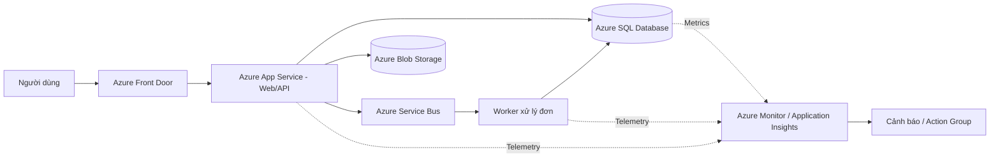
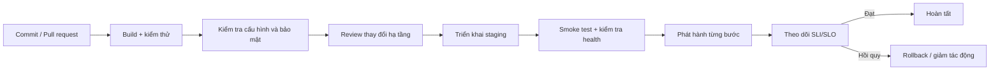

# Áp dụng trụ cột hiệu năng và vận hành của Well-Architected Framework

## Mục tiêu bài học

Trong **Microsoft Azure Well-Architected Framework (WAF)**, *Performance Efficiency* (hiệu quả về hiệu năng) và *Operational Excellence* (vận hành xuất sắc) là hai trụ cột bổ trợ nhau. Một hệ thống có thể phản hồi rất nhanh khi thử nghiệm nhưng vẫn thất bại trong thực tế nếu không có giám sát, quy trình triển khai an toàn và khả năng ứng phó sự cố. Ngược lại, quy trình vận hành chặt chẽ cũng không thể bù cho kiến trúc nghẽn tài nguyên khi lưu lượng tăng.

Sau bài học, bạn có thể:

1. Phân biệt mục tiêu và trách nhiệm của hai trụ cột, đồng thời nhận diện tác động tới độ tin cậy, bảo mật và chi phí.
2. Đặt mục tiêu hiệu năng có thể đo bằng SLI/SLO, xác định tải dự kiến và nhận diện điểm nghẽn bằng dữ liệu.
3. Chọn biện pháp phù hợp trên Azure: tối ưu ứng dụng và dữ liệu, cache, xử lý bất đồng bộ, mở rộng tài nguyên và kiểm thử tải.
4. Thiết lập nền tảng vận hành gồm đo lường, cảnh báo, hạ tầng dưới dạng mã, triển khai có kiểm soát, runbook và cải tiến sau sự cố.
5. Đánh giá một thay đổi kiến trúc dựa trên bằng chứng trước và sau thay đổi, thay vì chỉ nhìn vào CPU hoặc số lượng máy chủ.

Bài học sử dụng những dịch vụ quen thuộc trong hệ sinh thái Azure như App Service, Azure SQL Database, Azure Storage, Service Bus, Azure Monitor và các công cụ CI/CD. Các ví dụ là tình huống minh họa; chỉ số và cấu hình cuối cùng phải được xác nhận bằng phép đo trên khối lượng công việc thực tế.

## 1. Hai trụ cột giải quyết những câu hỏi nào?

WAF là bộ hướng dẫn ra quyết định kiến trúc theo năm trụ cột: **Reliability**, **Security**, **Cost Optimization**, **Operational Excellence** và **Performance Efficiency**. Đây không phải năm bộ mục tiêu tách rời: tăng số bản sao để cải thiện tốc độ có thể tăng chi phí; thay đổi chính sách cache có thể ảnh hưởng độ nhất quán dữ liệu và bảo mật.

| Góc nhìn | Performance Efficiency | Operational Excellence |
| --- | --- | --- |
| Câu hỏi chính | Hệ thống có đáp ứng thời gian xử lý và thông lượng khi nhu cầu thay đổi không? | Đội ngũ có thể quan sát, triển khai, khắc phục và cải tiến hệ thống an toàn, lặp lại được không? |
| Kết quả mong muốn | Độ trễ ổn định, đủ năng lực xử lý, sử dụng tài nguyên hợp lý | Thay đổi đáng tin cậy, phát hiện nhanh, khôi phục có quy trình, học được từ sự cố |
| Bằng chứng | p95/p99 latency, requests/second, độ dài hàng đợi, thời gian truy vấn, mức bão hòa, kết quả kiểm thử tải | Dashboard, cảnh báo có người nhận, nhật ký triển khai, tỷ lệ lỗi sau phát hành, runbook, thời gian khôi phục |
| Ví dụ quyết định | Tạo chỉ mục phù hợp cho truy vấn chậm trước khi tăng kích cỡ cơ sở dữ liệu | Cho thay đổi chỉ mục đi qua pipeline, kiểm thử, triển khai từng bước và theo dõi sau triển khai |
| Thất bại thường gặp | Tăng số instance nhưng điểm nghẽn thực tế nằm ở cơ sở dữ liệu | Có dashboard nhưng không ai chịu trách nhiệm phản hồi cảnh báo |

**Hiệu năng** không đồng nghĩa với việc mọi tài nguyên đều phải chạy ở mức thấp nhất. Mục tiêu là đáp ứng trải nghiệm người dùng ở các mức tải đã xác định, với biên an toàn hợp lý. **Vận hành xuất sắc** cũng không chỉ là trực hệ thống 24/7; cốt lõi là giảm thao tác thủ công, chuẩn hóa cách thay đổi và biến tín hiệu quan sát thành hành động.

Các trụ cột còn lại đặt giới hạn cho quyết định. Chẳng hạn, cache dữ liệu nhạy cảm cần kiểm soát truy cập và thời gian tồn tại; autoscale cần giới hạn chi phí; một vùng Azure có hiệu năng tốt không có nghĩa là đã có phương án khôi phục thảm họa.

## 2. Tình huống xuyên suốt: nền tảng đặt hàng trên Azure

Giả sử một đội phát triển vận hành ứng dụng đặt hàng với các chức năng xem sản phẩm, tạo đơn và tra cứu trạng thái. Ứng dụng có đỉnh lưu lượng theo chiến dịch khuyến mãi. Kiến trúc ban đầu:



**Phân ranh giới trách nhiệm:** đường đi đồng bộ của yêu cầu xem sản phẩm cần phản hồi nhanh; thao tác gửi email xác nhận hoặc đồng bộ với hệ thống phụ có thể chuyển sang hàng đợi. SQL Database chịu trách nhiệm dữ liệu giao dịch; Blob Storage chứa ảnh/tệp; Azure Monitor tập hợp tín hiệu phục vụ vận hành. Sơ đồ đơn giản hóa đường dữ liệu và chưa thể hiện đầy đủ mạng riêng, danh tính, vùng dự phòng hoặc cấu hình bảo mật.

Giả định ban đầu để thực hành:

| Chỉ tiêu | Mục tiêu minh họa |
| --- | --- |
| API xem sản phẩm | p95 thời gian đáp ứng ≤ 300 ms tại tải mục tiêu |
| API tạo đơn | p95 ≤ 800 ms, không tạo đơn trùng khi gửi lại yêu cầu |
| Lỗi phía máy chủ | Tỷ lệ HTTP 5xx dưới 0,5% trong cửa sổ theo dõi đã thống nhất |
| Tải cần phục vụ | 250 yêu cầu/giây trong giờ cao điểm, có khả năng tăng ngắn hạn |
| Tác vụ xử lý nền | 99% thông điệp được xử lý trong 2 phút |
| Thay đổi hệ thống | Có thể biết phiên bản đang chạy, phát hiện hồi quy và quay lại phiên bản ổn định |

Đây là **mục tiêu giả định**, không phải thông số mặc định hoặc cam kết của các dịch vụ Azure. Khi áp dụng thực tế, phải thống nhất phạm vi đo: API nào, người dùng ở đâu, tải bao nhiêu, dữ liệu kích cỡ nào và cách tính lỗi. Nếu một endpoint quan trọng phải gọi dịch vụ ngoài, thời gian chờ dịch vụ đó cũng thuộc trải nghiệm cuối cùng.

## 3. Chuyển yêu cầu kinh doanh thành chỉ số đo được

### 3.1. Phân biệt SLI, SLO và SLA

- **SLI (Service Level Indicator)** là phép đo, ví dụ p95 thời gian đáp ứng API tạo đơn trong cửa sổ 5 phút hoặc tỷ lệ yêu cầu thành công.
- **SLO (Service Level Objective)** là ngưỡng mục tiêu của SLI, ví dụ ít nhất 99,5% yêu cầu tạo đơn thành công trong 30 ngày, với định nghĩa thành công rõ ràng.
- **SLA (Service Level Agreement)** là thỏa thuận về mức dịch vụ, có thể kèm hệ quả khi không đạt. SLO nội bộ của ứng dụng không tự động trở thành SLA của Azure hay cam kết hợp đồng.

Đừng đánh đồng *availability* của một dịch vụ Azure với khả năng hoàn tất giao dịch đầu cuối. Một yêu cầu có thể thất bại dù App Service đang chạy, do truy vấn SQL timeout hoặc phụ thuộc bên ngoài trả lỗi.

### 3.2. Đo từ trải nghiệm người dùng xuống từng thành phần

| Nhóm tín hiệu | Chỉ số nên quan sát | Câu hỏi cần trả lời |
| --- | --- | --- |
| Latency | Trung vị, p95, p99 của thời gian đáp ứng; thời gian phụ thuộc SQL/HTTP | Người dùng chậm ở phân đoạn nào và khi nào? |
| Traffic | Số request/giây, số người dùng đồng thời, số giao dịch/giây | Tải thực tế có khác kịch bản dự kiến? |
| Errors | HTTP 5xx, timeout, tỷ lệ lỗi nghiệp vụ, số thông điệp xử lý thất bại | Có yêu cầu nào không hoàn tất dù hệ thống còn tài nguyên? |
| Saturation | CPU, bộ nhớ, kết nối, hàng chờ, giới hạn tài nguyên, tốc độ đọc/ghi | Thành phần nào gần giới hạn năng lực? |
| Dữ liệu | Thời gian truy vấn, tranh chấp khóa, số truy vấn, mức sử dụng tài nguyên database | Tăng instance API có làm cơ sở dữ liệu quá tải? |
| Worker | Số thông điệp chưa xử lý, tuổi thông điệp, thời gian xử lý, dead-letter | Tác vụ nền có đáp ứng thời gian cam kết? |

**Phân vị p95** có nghĩa khoảng 95% giá trị quan sát không vượt mức đó trong tập dữ liệu được xét; nó khác với thời gian trung bình. Ví dụ, 95 yêu cầu hoàn thành trong 150–250 ms và 5 yêu cầu mất 3 giây vẫn có thể cho trung bình tương đối thấp, nhưng trải nghiệm của nhóm đuôi rất kém. Khi traffic thay đổi mạnh, nên phân tích theo endpoint, phiên bản, vùng địa lý và mốc triển khai; số liệu gộp dễ che mất lỗi cục bộ.

Một phép ước lượng hữu ích khi tính năng lực là **định luật Little** cho hệ thống ổn định:

\[
L = \lambda \times W
\]

Trong đó `L` là số yêu cầu trung bình đang xử lý, `λ` là tốc độ đến trung bình và `W` là thời gian lưu lại trung bình trong hệ thống. Với 200 yêu cầu/giây và thời gian xử lý đầu cuối **trung bình** 0,25 giây, ước tính khoảng 50 yêu cầu đồng thời. Công thức dùng giá trị trung bình và giả định trạng thái ổn định; không lấy p95 để thay cho `W`, cũng không dùng riêng kết quả này để quyết định số instance.

### 3.3. Thiết lập ngân sách hiệu năng

Với mục tiêu p95 API xem sản phẩm 300 ms, đội ngũ có thể đặt **ngân sách độ trễ** ban đầu như sau:

| Thành phần đường đi | Ngân sách minh họa |
| --- | ---: |
| Mạng và tuyến vào | 50 ms |
| Xử lý trong ứng dụng | 70 ms |
| Truy vấn dữ liệu | 130 ms |
| Biên dao động/chi phí khác | 50 ms |
| **Tổng** | **300 ms** |

Đây là ngân sách thiết kế, **không phải phép cộng phân vị thống kê**: p95 của tổng thời gian không nhất thiết bằng tổng p95 các thành phần. Cần đo trực tiếp độ trễ đầu cuối và dùng distributed tracing để phân bổ nguyên nhân.

## 4. Áp dụng Performance Efficiency theo vòng lặp có số liệu

Một quy trình bền vững gồm **xác định tải → đo đường chuẩn → tìm giới hạn → thay đổi có giả thuyết → kiểm thử lại → quan sát sản xuất**.

### Bước 1 — Lập mô hình tải thực tế

Tách các nhóm hoạt động: xem danh sách sản phẩm (đọc nhiều), tạo đơn (ghi và cần nhất quán), tải ảnh (nội dung tĩnh) và xử lý tác vụ nền. Mô tả tỷ lệ giữa chúng, dữ liệu lớn lên theo thời gian, thời gian cao điểm, vùng người dùng và chu kỳ tăng/giảm lưu lượng. Một bài kiểm thử chỉ gửi cùng một API với dữ liệu rất nhỏ khó phát hiện tranh chấp khóa hoặc nghẽn kết nối.

Trong kiểm thử tải, xác định rõ ramp-up, tải ổn định, tải đỉnh và giai đoạn giảm tải. Quan sát cả lúc cache lạnh, lúc cache đã ấm và sau khi mở rộng instance. Sử dụng công cụ như k6 hoặc Apache JMeter; môi trường thử phải đủ tương đồng để kết quả có ý nghĩa. Không bắn tải vào hệ thống dùng chung khi chưa kiểm soát tác động tới người dùng khác.

### Bước 2 — Tìm nút thắt trước khi mở rộng

Ví dụ dashboard cho thấy API xem sản phẩm có p95 là 850 ms ở tải 200 request/giây. CPU App Service chỉ 45%, nhưng dependency span gọi SQL chiếm phần lớn thời gian. Query Store và kế hoạch thực thi chỉ ra một truy vấn thường xuyên quét nhiều hàng trong danh mục sản phẩm:

```sql
-- Ví dụ cấu trúc bảng và tên cột giả định.
SELECT TOP (20)
    ProductId, Name, Price, UpdatedAt
FROM dbo.Products
WHERE CategoryId = @CategoryId
ORDER BY UpdatedAt DESC;
```

Một phương án **cần kiểm chứng bằng execution plan và thống kê thực tế** là tạo chỉ mục phù hợp với điều kiện lọc và thứ tự sắp xếp:

```sql
CREATE INDEX IX_Products_CategoryId_UpdatedAt
ON dbo.Products (CategoryId, UpdatedAt DESC)
INCLUDE (ProductId, Name, Price);
```

Việc thêm chỉ mục tiêu tốn dung lượng và có thể làm chậm thao tác ghi; phải đo tác động với dữ liệu và tải thực, kiểm tra chỉ mục đã có và lập kế hoạch triển khai/hoàn tác. Nếu nguyên nhân chính là kết nối cạn kiệt hoặc khóa giao dịch, giải pháp sẽ khác. **Không nên tăng gấp đôi số instance API chỉ vì API chậm** khi nút thắt nằm trong database.

### Bước 3 — Chọn biện pháp theo dạng tải

| Biện pháp | Phù hợp khi | Đánh đổi cần kiểm tra |
| --- | --- | --- |
| Tối ưu mã, truy vấn và chỉ mục | Truy vấn lặp thừa, N+1 query, kế hoạch thực thi kém | Chi phí triển khai, tính đúng đắn và chi phí ghi của chỉ mục |
| Cache nội dung đọc nhiều | Danh mục sản phẩm/ảnh ít thay đổi | TTL, vô hiệu hóa cache, dữ liệu cũ và phân quyền |
| Scale out App Service | API phần lớn stateless và CPU/throughput là giới hạn | Giới hạn của App Service Plan, thời gian khởi tạo instance, database phía sau |
| Scale up | Cần thêm CPU/RAM trên mỗi instance, giới hạn theo cấp dịch vụ | Giá, giới hạn kích thước và nguy cơ vẫn có điểm lỗi ở tầng phụ thuộc |
| Đưa công việc sang Service Bus | Gửi email, tạo báo cáo hoặc xử lý không cần nằm trong request đồng bộ | Tính cuối cùng nhất quán, trùng thông điệp, thứ tự xử lý, dead-letter |
| Tối ưu phân phối nội dung với Front Door | Ảnh/tài nguyên tĩnh đi tới người dùng phân tán | Quy tắc cache, invalidation và chính sách không cache dữ liệu riêng tư |

Với cache, xác định **cache key**, chủ sở hữu dữ liệu, TTL, cách làm mới và khả năng phục vụ khi cache lỗi. Tránh dùng cache như nguồn dữ liệu duy nhất của giao dịch. Với Service Bus, worker cần xử lý **idempotent**: một thông điệp được giao lại không được tạo thêm đơn hoặc trừ tiền lần nữa. Theo dõi tuổi thông điệp để tránh đạt p95 API đẹp nhưng công việc phía sau bị tồn đọng hàng giờ.

Với autoscale, chọn chỉ số phản ánh tải thực: CPU có thể phù hợp với ứng dụng tốn tính toán; số yêu cầu, độ dài hàng đợi hoặc tín hiệu tùy chỉnh có thể phù hợp hơn với loại workload khác. Đặt mức tối thiểu/tối đa, thời gian đánh giá, cooldown và giới hạn chi phí. App Service chạy trên App Service Plan, nên cần hiểu tài nguyên dùng chung của các ứng dụng thuộc cùng plan và điều kiện hỗ trợ của tier trước khi bật quy tắc mở rộng.

### Bước 4 — Chứng minh cải thiện bằng kiểm thử lặp lại

Không thay đổi nhiều yếu tố cùng lúc nếu mục tiêu là xác định nguyên nhân. Ghi lại cấu hình, phiên bản ứng dụng, dữ liệu thử, tỷ lệ endpoint, số người dùng và thời gian chạy. Một kết quả minh họa sau khi điều chỉnh truy vấn:

| Kết quả | Trước | Sau | Cách diễn giải |
| --- | ---: | ---: | --- |
| Tải trong phép thử | 200 req/s | 250 req/s | Cần ghi rõ tải vì không so sánh hai phép đo trong điều kiện giống hệt |
| p95 API xem sản phẩm | 850 ms | 230 ms | Đạt mục tiêu minh họa 300 ms tại tải sau thay đổi |
| Tỷ lệ HTTP 5xx | 1,2% | 0,2% | Cần kiểm tra cả timeout và lỗi nghiệp vụ |
| CPU ứng dụng | 45% | 58% | CPU tăng khi throughput tăng chưa hẳn là xấu |
| Tuổi thông điệp p99 | 40 s | 45 s | Chưa có dấu hiệu worker tụt quá xa mục tiêu 2 phút |

Số liệu trong bảng **chỉ nhằm minh họa cách báo cáo**, không phải kết quả benchmark của Azure. Để xác nhận cải thiện, cần lặp lại với cùng mức tải, cùng tập dữ liệu, cùng cấu hình, đo thêm p99 và so sánh ở tải đỉnh. Sau khi chuyển phiên bản, tiếp tục theo dõi telemetry thật để phát hiện chênh lệch giữa phòng thử và sản xuất.

## 5. Áp dụng Operational Excellence từ thiết kế đến sự cố

### 5.1. Xây dựng khả năng quan sát từ đầu

Một hệ thống quan sát được cần đủ ba loại tín hiệu: **metrics** để phát hiện xu hướng, **logs** để tìm sự kiện cụ thể và **distributed traces** để biết yêu cầu đi qua các thành phần nào. Trên Azure, có thể kết hợp:

- **Azure Monitor** và **Log Analytics workspace** để thu thập, truy vấn dữ liệu quan sát theo cấu hình.
- **Application Insights** để theo dõi request, dependency, exception và phân tán trace cho ứng dụng có instrument.
- **Azure Monitor Alerts** và **Action Groups** để chuyển tín hiệu bất thường tới kênh và người chịu trách nhiệm.
- **Azure Service Health** để nắm thông tin vấn đề dịch vụ/nền tảng ảnh hưởng tới tài nguyên Azure; tín hiệu này bổ sung, không thay thế giám sát ứng dụng.

Gắn `operation_Id`/trace ID hoặc correlation ID xuyên từ API tới worker và thông điệp hàng đợi. Log nên có tên thao tác, kết quả, mã lỗi, phiên bản ứng dụng và thời lượng, nhưng không chứa mật khẩu, token hay dữ liệu cá nhân không cần thiết. Chọn sampling và retention sao cho vẫn tìm được nguyên nhân ở mức chi phí chấp nhận được. Sampling có thể ảnh hưởng độ chính xác của số đếm nếu truy vấn không xét đến cơ chế lấy mẫu.

Ví dụ truy vấn KQL trong Log Analytics khi dùng **các bảng workspace-based Application Insights có tên `AppRequests`**:

```kusto
AppRequests
| where TimeGenerated >= ago(1h)
| summarize
    Requests = count(),
    Errors = countif(Success == false),
    P95Ms = percentile(DurationMs, 95)
    by bin(TimeGenerated, 5m)
| extend ErrorRatePct = round(100.0 * Errors / Requests, 2)
| order by TimeGenerated asc
```

Truy vấn này tìm phân vị thời gian và tỷ lệ request có `Success == false` theo cửa sổ 5 phút. **Tỷ lệ này không tự động đồng nghĩa với tỷ lệ HTTP 5xx**: tiêu chí `Success` phụ thuộc dữ liệu được instrument. Nếu yêu cầu chỉ đếm 5xx, cần lọc chính xác mã trạng thái phù hợp với schema. Với Application Insights dùng giao diện/bảng `requests` thay vì `AppRequests`, tên trường và cách truy vấn có thể khác; hãy đối chiếu schema thực tế trước khi đưa vào dashboard hoặc rule cảnh báo.

Một truy vấn bổ trợ giúp tìm dependency chậm hoặc thất bại:

```kusto
AppDependencies
| where TimeGenerated >= ago(1h)
| summarize
    Calls = count(),
    Failed = countif(Success == false),
    P95Ms = percentile(DurationMs, 95)
    by Target
| order by Failed desc, P95Ms desc
```

Kết quả nên được khoanh theo endpoint/operation hoặc phiên bản ứng dụng khi điều tra, tránh quy kết mọi chậm trễ cho một dependency có số lượng gọi lớn.

### 5.2. Thiết kế cảnh báo để có hành động

Không phải biến động nào trên dashboard cũng cần đánh thức người trực. Phân tầng cảnh báo theo mức ảnh hưởng:

| Mức | Ví dụ điều kiện minh họa | Hành động |
| --- | --- | --- |
| Khẩn cấp | Tỷ lệ giao dịch tạo đơn thất bại vượt ngưỡng liên tục, có đủ mẫu quan sát | Kích hoạt người trực, kiểm tra thay đổi gần nhất và tình trạng phụ thuộc |
| Cần xử lý sớm | p95 API tăng trong nhiều cửa sổ đo; tuổi hàng đợi tăng bền vững | Điều tra năng lực xử lý, kế hoạch tải và dấu hiệu nghẽn |
| Theo dõi/cải tiến | CPU tiến sát ngưỡng vào giờ cao điểm nhưng SLO chưa bị vi phạm | Lập kế hoạch tối ưu và kiểm thử năng lực trước đợt cao điểm tiếp theo |

Mỗi cảnh báo nên có tên dịch vụ, môi trường, mức ảnh hưởng, đường dẫn dashboard, runbook, người chịu trách nhiệm và điều kiện kết thúc. Sử dụng thời gian đánh giá đủ dài để tránh báo động giả; đồng thời không đặt ngưỡng quá trễ khiến SLO đã bị vi phạm nghiêm trọng mới nhận ra. Với chỉ số lưu lượng thấp, phải quy định số mẫu tối thiểu hoặc áp dụng phép đo phù hợp.

### 5.3. Coi triển khai là một quy trình vận hành có thể lặp lại

Với ứng dụng đặt hàng, một thay đổi nhỏ như thêm chỉ mục hoặc đổi timeout có thể ảnh hưởng toàn bộ luồng giao dịch. Pipeline nên tạo được **vết kiểm chứng** từ commit tới phiên bản đang phục vụ:



Có thể sử dụng **Bicep** hoặc công cụ Infrastructure as Code phù hợp để quản lý cấu hình tài nguyên; Azure DevOps Pipelines hoặc GitHub Actions để thực thi các bước có kiểm soát. Ưu tiên xác thực bằng managed identity/workload identity federation khi được hỗ trợ, giữ bí mật trong cơ chế quản lý secret phù hợp và hạn chế quyền của tài khoản triển khai. Phân tách môi trường theo subscription/resource group phù hợp, quản lý quyền bằng Azure RBAC gắn với danh tính Entra ID, và dùng tag/budget để theo dõi chi phí vận hành. Kiểm soát kết nối mạng giữa ứng dụng, cơ sở dữ liệu và dịch vụ phụ thuộc theo yêu cầu bảo mật của workload.

Đối với App Service, deployment slots (nếu tier hỗ trợ) giúp kiểm tra phiên bản trước khi chuyển traffic. Một tính năng cũng có thể cần feature flag hoặc phát hành theo phần trăm người dùng nếu kiến trúc cho phép. Trước khi phát hành, phải xác định cách rollback **ứng dụng và dữ liệu**: hoàn tác mã thường đơn giản hơn hoàn tác thay đổi schema không tương thích. Migrations nên thiết kế tương thích ngược qua giai đoạn chuyển tiếp khi cần.

Điều kiện phát hành không chỉ là pipeline xanh. Sau rollout, so sánh p95/p99, lỗi giao dịch, tốc độ tiêu thụ queue và saturation với đường chuẩn. Một bản phát hành tăng thông lượng nhưng khiến dữ liệu đơn hàng sai vẫn phải bị coi là thất bại.

### 5.4. Runbook, diễn tập và học từ sự cố

Mỗi dịch vụ quan trọng cần có người sở hữu, lịch trực hoặc đường leo thang, bản mô tả phụ thuộc, link dashboard và hướng dẫn can thiệp đã được thực hành. Ví dụ runbook cho cảnh báo **p95 API tạo đơn vượt 800 ms trong 15 phút**:

1. **Xác nhận ảnh hưởng:** đối chiếu tỷ lệ lỗi, số đơn tạo thành công, số request và phạm vi phiên bản/region. Kiểm tra telemetry có bị thiếu dữ liệu không.
2. **Khoanh vùng:** xem thời điểm deployment/configuration change; phân tích trace để tách thời gian App Service, SQL và dịch vụ ngoài; đối chiếu CPU, kết nối, khóa và hàng đợi.
3. **Giảm tác động:** nếu gắn với phiên bản mới, quay về bản ổn định hoặc tắt tính năng bằng feature flag đã chuẩn bị; nếu tải tăng thực, dùng cơ chế scale đã kiểm thử; nếu dependency lỗi, áp dụng timeout, retry có giới hạn và circuit breaker phù hợp.
4. **Kiểm tra kết quả:** xác nhận lại p95, tỷ lệ lỗi, số đơn và hàng đợi trở về ngưỡng; theo dõi thêm một khoảng thời gian để đảm bảo không tái phát.
5. **Ghi nhận và cải tiến:** lưu timeline, tác động thực tế, giả thuyết được kiểm chứng, nguyên nhân gốc và người sở hữu hành động phòng ngừa. Cập nhật runbook, dashboard, kiểm thử hoặc guardrail trong pipeline.

Trong tình huống retry, dùng **backoff và jitter** để tránh nhiều client gọi lại đồng thời; có giới hạn tổng thời gian/ số lần thử, chỉ retry lỗi tạm thời phù hợp, và bảo đảm tính idempotent với thao tác ghi. Retry vô hạn có thể làm hệ thống phụ thuộc đã quá tải trở nên tệ hơn. Circuit breaker cần có tiêu chí mở/đóng và telemetry đủ để biết nó đang chặn bao nhiêu yêu cầu.

Operational Excellence còn có nhịp cải tiến ngoài sự cố: kiểm tra cảnh báo ồn, tác vụ thủ công lặp lại, độ trôi cấu hình, cập nhật dependency và hiệu quả sử dụng tài nguyên. Một thao tác khắc phục chỉ được xem là trưởng thành khi người trực khác cũng thực hiện được từ runbook, không phụ thuộc vào kiến thức của một cá nhân.

## 6. Đưa hai trụ cột vào một quy trình quyết định

Giả sử đội ngũ định tăng App Service từ 2 lên 6 instance để xử lý p95 tăng cao. Hãy đặt các câu hỏi theo thứ tự:

1. **Mục tiêu nào đang bị vi phạm?** p95 của endpoint nào, tại bao nhiêu req/s, trong bao lâu, tỷ lệ lỗi ra sao?
2. **Bằng chứng về nguyên nhân là gì?** CPU cao, hàng đợi request tăng, SQL chậm, khóa dữ liệu hay giới hạn kết nối?
3. **Biện pháp nào trực tiếp xử lý nguyên nhân?** Tối ưu truy vấn, cache, scale, tách công việc nền hay thay đổi phân phối tải?
4. **Thay đổi có an toàn và quan sát được không?** Có môi trường thử, điều kiện phát hành, người chịu trách nhiệm, dashboard và khả năng rollback không?
5. **Đánh đổi đã được chấp nhận chưa?** Chi phí instance, dữ liệu cũ trong cache, tác động ghi SQL, quyền truy cập và mục tiêu phục hồi?

| Quyết định | Kiểm tra theo hiệu năng | Kiểm tra theo vận hành và trụ cột liên quan |
| --- | --- | --- |
| Bật autoscale | Đủ số instance để đạt p95 ở tải đỉnh; quy tắc phản ứng kịp | Thử quy tắc, cảnh báo khi chạm max, đặt giới hạn chi phí; kiểm tra khả năng phục hồi khi scale |
| Thêm cache sản phẩm | Hit rate, độ trễ, tải SQL trước/sau | Cách xóa cache, phân quyền, telemetry hit/miss, fallback khi cache lỗi |
| Đưa xử lý đơn vào queue | Thời gian phản hồi API giảm, worker xử lý kịp | Idempotency, dead-letter, retry, trạng thái đơn và giám sát độ trễ đầu cuối |
| Thay đổi chỉ mục SQL | Query plan, logical reads, CPU/IO, thời gian truy vấn | Migration, thời gian tạo chỉ mục, ảnh hưởng thao tác ghi, phương án hoàn tác |
| Phát hành phiên bản mới | SLO dưới tải dự kiến còn đạt không? | Smoke test, theo dõi canary, rollback, log thay đổi và khả năng giải thích hồi quy |

Đây là cách hai trụ cột kết nối: **Performance Efficiency xác định và cải thiện năng lực xử lý; Operational Excellence giữ cho phép cải thiện đó được triển khai, đo lường và duy trì an toàn.**

## 7. Bài thực hành: từ phát hiện nghẽn đến vận hành có kiểm chứng

Hãy dựng môi trường thử riêng cho một Web API đơn giản và cơ sở dữ liệu mẫu trên Azure hoặc dùng workload giả lập có telemetry tương đương. Không cần triển khai toàn bộ kiến trúc đặt hàng; mục tiêu là thực hành vòng lặp ra quyết định.

**Phần A — Xác định mục tiêu và đường chuẩn**

1. Chọn endpoint đọc dữ liệu và một endpoint ghi dữ liệu. Định nghĩa tải mục tiêu, p95, ngưỡng lỗi và khoảng đo.
2. Instrument request và dependency bằng Application Insights; xác nhận mỗi yêu cầu có thể lần tới lời gọi database tương ứng.
3. Chạy kiểm thử tải ở mức thấp, trung bình và tải mục tiêu. Ghi p50/p95/p99, lỗi, throughput, CPU và thời gian truy vấn vào bảng kết quả.

**Phần B — Cải thiện hiệu năng dựa trên giả thuyết**

1. Chỉ chọn **một** nút thắt có dữ liệu hỗ trợ; viết giả thuyết dạng: “Nếu giảm số truy vấn SQL trên mỗi request từ N xuống M, p95 sẽ giảm trong cùng điều kiện tải”.
2. Thực hiện một thay đổi trong môi trường thử (ví dụ bỏ N+1 query, thêm chỉ mục có kiểm chứng hoặc cache dữ liệu đọc nhiều).
3. Chạy lại cùng kịch bản và ghi cả tác động phụ: CPU, thời gian ghi, tỷ lệ cache hit hoặc tuổi thông điệp nếu có.

**Phần C — Bổ sung năng lực vận hành**

1. Tạo dashboard cho p95, error rate, throughput và thành phần nghi ngờ là điểm nghẽn; kiểm tra dữ liệu hiển thị có đúng với truy vấn gốc.
2. Cấu hình một cảnh báo thử nghiệm có điều kiện rõ ràng và người nhận; gây lỗi có kiểm soát để xác minh đường cảnh báo hoạt động.
3. Viết runbook ngắn cho lỗi vừa mô phỏng, bao gồm cách xác nhận ảnh hưởng, phân tích, giảm tác động, hoàn tác và kiểm tra sau khôi phục.
4. Ghi phiên bản thay đổi, kết quả trước/sau và quyết định giữ hay hoàn tác dựa trên mục tiêu đã đặt.

**Tiêu chí hoàn thành:** người khác có thể xem bảng đo, hiểu vì sao chọn cách tối ưu, lặp lại phép thử và xử lý cảnh báo theo runbook. Nếu chỉ có ảnh chụp CPU giảm mà không có số liệu độ trễ đầu cuối và chất lượng giao dịch, bằng chứng chưa đủ.

## 8. Những sai lầm thường gặp và cách điều chỉnh

| Sai lầm | Vì sao nguy hiểm | Cách điều chỉnh |
| --- | --- | --- |
| Chỉ nhìn CPU trung bình | Bỏ qua p99, nghẽn kết nối và truy vấn chậm | Kết hợp latency, lỗi, throughput, saturation và dependency tracing |
| Tăng instance cho mọi lỗi hiệu năng | Không giải quyết database/hàng đợi bị nghẽn, làm tăng chi phí | Xác minh bottleneck trước khi scale |
| Dùng kết quả một lần kiểm thử làm cam kết lâu dài | Không phản ánh dữ liệu, cấu hình và lưu lượng thay đổi | Kiểm thử lặp, lưu baseline, đánh giá lại sau thay đổi quan trọng |
| Cache mọi thứ | Có thể trả dữ liệu cũ, rò rỉ dữ liệu hoặc khó vô hiệu hóa | Xác định dữ liệu cache được, TTL, key và cơ chế invalidation |
| Cảnh báo theo mọi dao động nhỏ | Nhiễu khiến người trực bỏ qua sự cố thực | Cảnh báo theo mức ảnh hưởng, điều kiện bền vững và runbook rõ ràng |
| Triển khai xong là kết thúc | Hồi quy chỉ lộ ra khi có tải thật | Theo dõi sau phát hành, có ngưỡng dừng và phương án rollback |
| Retry không giới hạn | Tăng tải lên dependency đang lỗi, gây tạo dữ liệu trùng | Retry có giới hạn, backoff/jitter và idempotency |
| Đánh đổi chi phí/bảo mật không được ghi nhận | Tối ưu một chỉ số nhưng làm hại kiến trúc tổng thể | Đánh giá liên trụ cột và lưu quyết định kiến trúc |

## 9. Checklist đánh giá trước khi đưa workload vào vận hành

Sử dụng checklist này như **bằng chứng cần xuất trình**, không phải danh sách bật dịch vụ theo hình thức:

- [ ] Mỗi luồng nghiệp vụ quan trọng có SLI/SLO, định nghĩa tải và cách tính lỗi.
- [ ] Có baseline và kết quả kiểm thử ở tải thông thường, tải đỉnh dự kiến; đã quan sát p95/p99 và điểm nghẽn.
- [ ] Có phương án scale, giới hạn tài nguyên/chi phí, và biết thành phần nào sẽ nghẽn tiếp theo.
- [ ] Logs, metrics và traces có thể kết nối một giao dịch từ API tới dependency/worker; dữ liệu nhạy cảm được kiểm soát.
- [ ] Dashboard và cảnh báo phản ánh trải nghiệm người dùng; cảnh báo có chủ sở hữu và runbook đã thử.
- [ ] Thay đổi ứng dụng, dữ liệu và hạ tầng được kiểm tra và triển khai bằng quy trình có thể lặp lại.
- [ ] Có smoke test, theo dõi sau phát hành, điều kiện dừng và phương án khôi phục/rollback đã xem xét.
- [ ] Có lịch đánh giá hiệu năng, chi phí, bảo mật và hành động sau sự cố với người chịu trách nhiệm.

## Kết nối với các trụ cột còn lại

Khi một workload tăng trưởng, thiết kế tốt hiếm khi tối đa hóa một chỉ tiêu riêng lẻ. **Reliability** bổ sung failover và khả năng chịu lỗi; **Security** bảo vệ dữ liệu, định danh và đường truy cập; **Cost Optimization** giúp chọn quy mô đúng và tránh chi tiêu không cần thiết. Performance Efficiency và Operational Excellence giúp đội ngũ *đo được* những đánh đổi đó và *thực hiện được* quyết định trong môi trường vận hành thật.

Một kiến trúc Azure được quản lý tốt phải trả lời được đồng thời ba câu hỏi thực dụng: **người dùng đang nhận chất lượng dịch vụ nào, nút thắt ở đâu, và đội ngũ có thể thay đổi hoặc khôi phục hệ thống bằng cách nào?**
