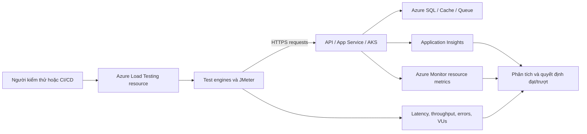
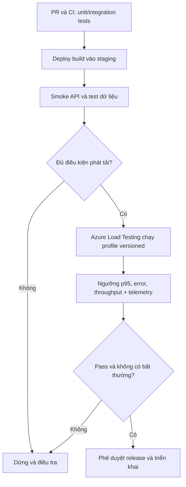

# Kiểm thử tải ứng dụng bằng Azure Load Testing

> **Chương:** Hiệu năng và vận hành  
> **Mô-đun:** `CLOUD_PROVIDERS_AZURE` — khám phá Microsoft Azure từ subscription, resource group, Microsoft Entra ID, mạng ảo, dịch vụ tính toán, lưu trữ và dữ liệu đến triển khai, giám sát, bảo vệ và kiểm soát chi phí ứng dụng.

## Mục tiêu học tập

Sau bài học, bạn có thể:

1. Giải thích vì sao cần **kiểm thử tải** trước và sau khi triển khai ứng dụng trên Azure, phân biệt load, stress, spike và soak test.
2. Xây dựng mục tiêu kiểm thử từ **SLO**, số người dùng, lưu lượng truy cập, tỷ lệ lỗi và độ trễ **p95/p99**.
3. Tạo tài nguyên **Azure Load Testing**, chạy kiểm thử dựa trên URL hoặc kịch bản **Apache JMeter** và chọn số test engine phù hợp.
4. Đọc biểu đồ phía máy tạo tải và chỉ số phía hệ thống qua **Azure Monitor/Application Insights** để xác định điểm nghẽn.
5. Định nghĩa tiêu chí đạt/trượt, đưa kiểm thử tải vào CI/CD và so sánh các lần chạy theo cùng điều kiện.
6. Thiết kế bài kiểm thử an toàn: môi trường được phép, dữ liệu thử, giới hạn chi phí/tải, cách dừng và quy trình lưu bằng chứng.

## 1. Vấn đề thực tế: ứng dụng chạy đúng nhưng có chịu được tải?

Nhóm phát triển triển khai API đặt hàng lên Azure App Service. Khi thử thủ công, endpoint `GET /api/products` phản hồi trong 150 ms. Nhưng vào giờ cao điểm, có nhiều người dùng cùng tìm sản phẩm, thêm vào giỏ hàng và thanh toán. Khi số request tăng lên, độ trễ có thể tăng mạnh vì CPU, kết nối cơ sở dữ liệu, giới hạn dịch vụ phụ thuộc hoặc hàng đợi.

**Một request nhanh không chứng minh ứng dụng chịu tải tốt.** Muốn quyết định có thể phát hành, cần đo hành vi dưới một **workload định nghĩa trước** và quan sát cả phía người gửi yêu cầu lẫn hạ tầng nhận yêu cầu.

**Azure Load Testing** là dịch vụ được quản lý để tạo tải và đo hiệu năng ứng dụng. Bạn có thể bắt đầu bằng bài kiểm thử dựa trên URL cho kịch bản đơn giản, hoặc sử dụng **Apache JMeter test plan** khi cần mô phỏng nhiều bước, dữ liệu đầu vào và hành vi người dùng phức tạp. Dịch vụ hỗ trợ chạy tải trên các test engine, theo dõi kết quả và kết nối chỉ số hệ thống Azure để phân tích nguyên nhân.

### Kiểm thử chức năng và kiểm thử tải trả lời câu hỏi khác nhau

| Kiểm thử | Câu hỏi chính | Ví dụ |
|---|---|---|
| Unit/integration | Hàm hoặc thành phần có trả đúng kết quả? | Tính tổng tiền đơn hàng đúng |
| End-to-end | Một luồng nghiệp vụ có hoạt động? | Đăng nhập → chọn hàng → tạo giỏ |
| **Load** | Ứng dụng có giữ tốc độ, độ trễ và tỷ lệ lỗi trong **tải kỳ vọng**? | 200 request/giây theo mẫu lưu lượng thực tế |
| **Stress** | Điểm giới hạn và cách thất bại khi vượt năng lực? | Tăng tải dần tới khi vượt SLO |
| **Spike** | Ứng dụng phản ứng khi tải tăng hoặc giảm đột ngột? | Lưu lượng tăng gấp nhiều lần trong vài phút |
| **Soak/endurance** | Có lỗi phát sinh khi chạy lâu? | Rò rỉ bộ nhớ hoặc cạn connection pool sau nhiều giờ |

Load Testing đo **hành vi được quan sát trong bài chạy cụ thể**. Nó không tự bảo đảm mọi giờ cao điểm tương lai đều giống nhau, vì dữ liệu, mạng, cache, số lượng instance và các phụ thuộc đều có thể thay đổi.

## 2. Kiến trúc kiểm thử trên Azure

Một bài chạy Azure Load Testing thường có các thành phần sau:

- **Load Testing resource:** tài nguyên Azure để tổ chức test, lưu cấu hình/lịch sử chạy và quản lý quyền.
- **Test definition:** kịch bản URL hoặc file `.jmx` của JMeter, tham số, dữ liệu hỗ trợ, số engine và cấu hình chạy.
- **Load engines:** các tiến trình tạo virtual users/request đến endpoint mục tiêu. Số engine và số user không phải hai đại lượng tương đương.
- **System under test (SUT):** ứng dụng được kiểm thử, ví dụ App Service, AKS, VM hoặc API Gateway cùng database/cache phía sau.
- **Telemetry và test result:** thống kê client-side của lượt gọi và chỉ số server-side từ Azure Monitor/Application Insights khi tích hợp.



Có hai hướng quan sát:

1. **Client-side:** virtual users, thời gian phản hồi toàn đường đi từ engine, số request/giây, tỷ lệ lỗi, timeout, các phân vị độ trễ.
2. **Server-side:** CPU, memory, request queue, autoscale, HTTP 5xx, thời gian truy vấn, dependency calls, giới hạn kết nối và các chỉ số phù hợp với tài nguyên Azure đang sử dụng.

Nếu client-side p95 tăng nhưng CPU thấp, vẫn có thể bị chậm vì database, mạng, lock, rate limiting hoặc hệ thống phụ thuộc. **Không kết luận nguyên nhân chỉ từ một biểu đồ.**

## 3. Định nghĩa workload và tiêu chí trước khi chạy

### 3.1. Bắt đầu từ yêu cầu nghiệp vụ

Ví dụ ứng dụng `orders-api` có các hành vi:

| Luồng nghiệp vụ | Tỷ lệ request dự kiến | Mức quan trọng | Kết quả kỳ vọng |
|---|---:|---|---|
| `GET /api/products` | 60% | Cao | Danh sách sản phẩm chính xác |
| `GET /api/products/{id}` | 25% | Cao | Chi tiết sản phẩm |
| `POST /api/cart` | 10% | Cao | Thêm vào giỏ thử nghiệm thành công |
| `GET /api/orders` | 5% | Trung bình | Trả danh sách đúng quyền |

Những tỷ lệ này phải lấy từ telemetry, phân tích sản phẩm hoặc ước lượng có ghi chú; đây chỉ là **dữ liệu minh họa**. Không dùng một endpoint `/health` nhẹ để đại diện cho toàn bộ giao dịch có database và authentication.

### 3.2. SLI, SLO và ngưỡng đạt/trượt

- **SLI (Service Level Indicator):** đại lượng quan sát được, ví dụ p95 latency, tỷ lệ request lỗi, tốc độ xử lý.
- **SLO (Service Level Objective):** mục tiêu cụ thể của SLI trong điều kiện và thời gian xác định.
- **Load profile:** lượng tải, thời gian tăng tải, thời gian giữ ổn định, môi trường, dữ liệu và cấu hình hệ thống.
- **Pass/fail criteria:** điều kiện để pipeline chấp nhận hoặc từ chối bản phát hành.

Ví dụ mục tiêu cho một bài kiểm thử **trên staging với tải đã biết**, không phải chuẩn chung cho mọi ứng dụng:

| Thước đo | Mục tiêu ví dụ | Ý nghĩa |
|---|---|---|
| p95 latency của `GET /api/products` | Không quá 800 ms | Ít nhất khoảng 95% mẫu hợp lệ có độ trễ không vượt ngưỡng này |
| p99 latency | Không quá 1.500 ms | Phát hiện phần đuôi chậm dù trung bình vẫn tốt |
| Tỷ lệ lỗi ứng dụng | Dưới 1% | Đánh giá các request thất bại, gồm mã lỗi và timeout phù hợp |
| Throughput đạt được | Ít nhất 150 request/giây | Xác nhận năng lực xử lý thực tế, không chỉ tải mong muốn |
| Khoảng tải ổn định | 20 phút sau khi tăng tải | Tránh quyết định dựa hoàn toàn trên giai đoạn warm-up |

**Phải xác định cách tính tỷ lệ lỗi.** Một mã 404 do dữ liệu thử cố ý không tồn tại khác 500 do server lỗi; một HTTP 200 với nội dung nghiệp vụ sai vẫn là lỗi chức năng. Các assertion ở JMeter giúp bắt lỗi không thể thấy qua status code thuần túy.

### 3.3. Virtual users không đồng nghĩa request/giây

Virtual user (VU) thường mô phỏng một luồng thao tác tuần tự có thời gian chờ. Với kịch bản khép kín đơn giản, throughput xấp xỉ:

\[
\text{Requests/second} \approx
\frac{\text{Số virtual users}}{\text{Thời gian phản hồi trung bình}+\text{Thời gian nghĩ (think time)}}
\]

Nếu có 100 VU, mỗi vòng thực hiện một request mất trung bình 0,4 giây và chờ 1,6 giây, throughput lý tưởng khoảng 50 request/giây. Đây là **ước lượng**, không phải cam kết: số lượng request mỗi giao dịch, ramp-up, giới hạn generator, lỗi, mạng và server đều làm thay đổi kết quả.

Vì vậy cần nhìn **throughput thực đo** và concurrency thực tế trên dashboard, thay vì kết luận “đặt 500 VU nghĩa là có 500 request/giây”.

## 4. Thiết kế profile tải có thể lặp lại

Với một phép đo có ý nghĩa, hãy mô tả toàn bộ profile:

| Pha | Thời lượng ví dụ | Tải mục tiêu | Mục đích |
|---|---:|---|---|
| Baseline | 5 phút | 10 VU | Kiểm tra script, kết nối, dữ liệu và SUT |
| Ramp-up | 10 phút | Tăng dần lên 100 VU | Quan sát autoscale, pooling và trạng thái chuyển tiếp |
| Steady-state | 20 phút | 100 VU | Đo p95/p99, error rate và resource usage ổn định |
| Ramp-down | 5 phút | Giảm về 0 | Quan sát hồi phục, không để tải đột ngột treo |
| Sau thử | 5–10 phút | Không phát tải | Kiểm tra queue, memory, database, chi phí và logs |

Các giá trị trên chỉ để học; số VU và thời gian phải phù hợp năng lực, ngân sách, điều kiện thử nghiệm và quyền truy cập hệ thống. Với workload có nhiều hành vi, phân phối request theo tỷ lệ, dữ liệu và think time riêng cho từng hành vi.

### Các loại bài thử cần phân biệt

- **Smoke-load:** vài user, thời gian ngắn để xác nhận file `.jmx` và kết nối đúng trước khi chạy lớn.
- **Load test:** mức tải phổ biến/cao điểm dự đoán để kiểm chứng SLO.
- **Stress test:** tăng dần qua mức kỳ vọng để tìm điểm bão hòa và cách hệ thống từ chối yêu cầu.
- **Spike test:** tạo cú tăng/giảm tải theo kịch bản được phép để kiểm tra autoscaling, throttling và queue.
- **Soak test:** giữ tải dài để phát hiện leak, connection pool exhaustion, cache growth và hành vi theo thời gian.

Không chạy stress/spike test ngoài phạm vi được ủy quyền. Một bài kiểm thử có nhiều request đến API thật có thể gây gián đoạn hoặc phát sinh phí cho nhiều dịch vụ phụ thuộc.

## 5. Chuẩn bị môi trường Azure Load Testing

### 5.1. Điều kiện đầu vào

Giả sử nhóm sở hữu:

- Subscription và resource group `rg-perf-lab` ở region phù hợp.
- Azure App Service hoặc API thử nghiệm `orders-api-staging`, endpoint được kiểm soát `https://orders-perf.example.test` (**địa chỉ giả định**; thay bằng DNS staging thật được phép).
- Dữ liệu người dùng, sản phẩm và giỏ hàng **dành riêng cho test**, không chứa dữ liệu cá nhân.
- Quyền phù hợp để tạo/cấu hình tài nguyên Azure Load Testing và để test agent truy cập đích.
- Azure Monitor/Application Insights đã thu thập telemetry ứng dụng, với thời gian đo đồng bộ và sampling được hiểu rõ.

Nếu ứng dụng ở private network, đích chỉ truy cập qua private endpoint hoặc IP hạn chế, phải thiết kế kết nối mạng của **load engine** tương ứng; có thể cần cấu hình VNet/private endpoint theo khả năng và giới hạn của dịch vụ. Đừng mở công khai môi trường riêng chỉ để chạy thử.

### 5.2. Tạo tài nguyên bằng Azure Portal

1. Trong Azure Portal, tìm **Azure Load Testing** và tạo tài nguyên mới.
2. Chọn subscription, resource group, tên dễ truy vết (ví dụ `alt-orders-lab`) và vùng hỗ trợ.
3. Kiểm tra quyền của nhóm tạo test, người chỉ xem kết quả và danh tính CI/CD. Giữ quyền thấp nhất phù hợp thay vì cấp Owner toàn subscription.
4. Sau khi tạo, vào phần tạo test. Chọn **URL-based test** cho thử nghiệm đơn giản hoặc bài test **JMeter-based** cho kịch bản nhiều bước.
5. Chọn hoặc liên kết các tài nguyên Azure cần quan sát qua monitoring để xem server-side metrics trong lúc test, nếu tính năng/kết nối được hỗ trợ.
6. Xác định số engine, cấu hình mạng, thời lượng, dữ liệu thử và chi phí dự tính trước khi chạy.

Tài nguyên Azure Load Testing là **bộ điều phối thử nghiệm**; các engine gửi tải có thể chạy từ hạ tầng khác với App Service. Độ trễ client đo được còn phản ánh quãng đường mạng, DNS, TLS và chính cấu hình engine.

### 5.3. Kiểm tra truy cập và bảo mật

Trước khi phát tải, cần xác nhận: endpoint đúng môi trường được phép; domain và chứng chỉ TLS hợp lệ; firewall, WAF, IP restrictions và authentication được cấu hình; bí mật được đặt trong cơ chế quản lý secret hỗ trợ thay vì file `.jmx` hoặc repository; tài khoản thử không gọi dịch vụ thanh toán/email/SMS thật.

Với Azure Key Vault hoặc managed identity, cần cấu hình quyền truy cập từ danh tính phù hợp của dịch vụ kiểm thử và xác minh khả năng đọc secret theo mô hình hỗ trợ. **Không in token hoặc mật khẩu vào JMeter result logs.**

## 6. Cách nhanh: chạy URL-based load test

URL-based test giúp xác nhận một endpoint hoặc tập request đơn giản mà không phải tạo file `.jmx` ngay từ đầu.

Quy trình trong portal:

1. Chọn **Create test** và hình thức **URL-based test** nếu tùy chọn hiện diện trong môi trường.
2. Đặt tên, ví dụ `orders-products-baseline`, thêm endpoint HTTPS staging và phương thức `GET`; đặt header cần thiết cho request đã được cấp quyền.
3. Cấu hình số VU/request profile, ramp-up, thời lượng và số engine trong giới hạn dịch vụ.
4. Đặt ngưỡng đánh giá độ trễ/tỷ lệ lỗi bằng các tùy chọn hiện có; lưu test.
5. Chạy một lần tải nhỏ để kiểm tra host, DNS, TLS, quyền và expected response; chỉ tăng tải khi smoke-load pass.
6. Xem đồ thị của test, so sánh p95/p99, throughput, lỗi và tài nguyên Azure.

**Giới hạn:** nếu cần login stateful, nhiều bước nghiệp vụ, correlation, biến động dữ liệu theo user hoặc assertion phức tạp, hãy dùng JMeter. URL-based test chưa chắc mô phỏng đầy đủ luồng người dùng cuối.

## 7. Bài test Apache JMeter nhiều bước

Azure Load Testing có thể thực thi bài test xây bằng Apache JMeter. Một file `.jmx` mô tả test plan, thread group, samplers, controllers, assertions, timers và phần tử cấu hình. Có thể phát triển/test file với JMeter trên máy của nhóm trước khi upload.

### 7.1. Thiết kế một kịch bản đọc dữ liệu

Giả sử API chỉ cho phép các request kiểm thử sau:

```http
GET /api/products?category=books HTTP/1.1
Host: orders-perf.example.test
Accept: application/json
X-Test-Run: orders-load-lab
```

`orders-perf.example.test` là hostname minh họa, không phải endpoint đang hoạt động. Người học cần dùng hostname staging thuộc quyền kiểm thử của mình.

Trong giao diện JMeter, tạo các phần tử:

| Phần tử JMeter | Thiết lập mẫu | Lý do |
|---|---|---|
| **Test Plan** | `Orders staging load` | Bao toàn bộ kịch bản |
| **HTTP Request Defaults** | Protocol `https`, domain staging, port thích hợp | Giảm lỗi nhập sai host/port giữa nhiều request |
| **Thread Group** | Bắt đầu 10 users, ramp-up 60 s, thời lượng ngắn | Kiểm thử an toàn trước khi mở rộng |
| **HTTP Header Manager** | `Accept: application/json`, header đánh dấu test | Phân biệt request kiểm thử trong logs |
| **HTTP Cookie Manager** | Chỉ bật nếu API dùng session/cookie | Mô phỏng session đúng cách |
| **HTTP Request** | `GET /api/products?category=books` | Gọi endpoint cụ thể |
| **Response Assertion** | Mong đợi HTTP 200 và nội dung chính xác | Không coi response 200 sai dữ liệu là thành công |
| **Constant/Uniform Random Timer** | Chờ phù hợp hành vi người dùng | Tránh gửi request liên tục phi thực tế |
| **CSV Data Set Config** | Đọc các category/product ID thử nghiệm | Tránh cache toàn bộ ở một URL duy nhất |
| **Aggregate Report / View Results Tree** | Chỉ dùng ở môi trường phát triển để debug | Tránh listener nặng khi chạy tải lớn |

Ví dụ dữ liệu CSV tách khỏi mã test, dùng **dữ liệu giả**:

```csv
category,expected_marker
books,BOOKS
electronics,ELECTRONICS
home,HOME
```

Trong HTTP Request, có thể tham chiếu biến `${category}` từ **CSV Data Set Config** (ở cột path hoặc parameter). Assertion cần đối chiếu cấu trúc/giá trị thực tế của API, ví dụ JSONPath phù hợp, thay vì chỉ tìm một chuỗi có thể xuất hiện ở trang lỗi.

### 7.2. Luồng nghiệp vụ có POST và trạng thái

Với các thao tác đăng nhập → đọc sản phẩm → thêm vào giỏ, cần xem thêm:

1. **Correlation:** lấy access token/session/ID từ response trước bằng extractor phù hợp, truyền sang request sau.
2. **Dữ liệu riêng cho user:** mỗi VU có giỏ hàng/test account riêng, tránh ghi đè hoặc dùng chung một key trong database.
3. **Think time và pacing:** phản ánh thời gian người dùng đọc/nhấp và tần suất giao dịch mong muốn.
4. **Assertions:** xác minh mã HTTP, cấu trúc JSON, record liên quan và lỗi nghiệp vụ.
5. **Cleanup:** xóa dữ liệu thử hoặc dùng TTL; chặn email/SMS/payment/webhook ngoài môi trường lab.
6. **Secret handling:** token được cấp từ cơ chế bí mật phù hợp, không hardcode trong `.jmx` hay CSV được commit.

Ví dụ một lỗi thiết kế thường gặp: 100 virtual users cùng thêm sản phẩm vào **một giỏ hàng**. Lúc này bạn đang chủ yếu đo tranh chấp trên một record, có thể không đại diện hành vi người dùng bình thường. Đôi khi đây là mục tiêu stress test riêng, nhưng phải ghi rõ giả thuyết.

### 7.3. Tạo cấu hình test có thể lưu trong Git

Một pipeline thường quản lý chung file `.jmx`, dữ liệu hỗ trợ và cấu hình tải. Ví dụ cấu trúc:

```text
tests/performance/
  orders-read.jmx
  categories.csv
  load-test-config.yaml
```

Một **mẫu minh họa** cho file cấu hình Azure Load Testing khi dùng cơ chế config YAML được phiên bản đang sử dụng hỗ trợ:

```yaml
version: v0.1
testId: orders-read-staging
testName: Orders read performance
description: Load test cho API sản phẩm trên staging
testPlan: orders-read.jmx
engineInstances: 1
failureCriteria:
  - p95(response_time_ms) > 800
  - percentage(error) > 1
```

Ở đây các ngưỡng là **tiêu chí ví dụ**: fail khi p95 lớn hơn 800 ms hoặc tỷ lệ lỗi vượt 1%. Cú pháp các trường, hàm đo và phiên bản schema cần được kiểm tra với tính năng/extension Azure Load Testing hiện có trước khi sử dụng trong pipeline. Không được coi file YAML tự tạo đủ để phát tải nếu `.jmx`, cấu hình mạng, dataset hoặc identity chưa hợp lệ.

**Lưu ý:** 1 engine là điểm bắt đầu để debug; tăng số engine chỉ khi cần thêm năng lực tạo tải và sau khi kiểm tra rằng bản thân engine không bị nghẽn. Số virtual users thực tế đến từ cấu hình workload và cách dịch vụ chạy test plan.

## 8. Chạy test, quan sát và phân tích

### 8.1. Quy trình một test run chuẩn

1. Kiểm tra commit, bản build, môi trường, số instance, SKU, dữ liệu/seed và các feature flags; ghi nhận làm baseline.
2. Test nhỏ: xác minh TLS, authentication, assertions, response data và request distribution đúng.
3. Tăng tải theo profile đã định, quan sát **concurrency** và throughput đạt được.
4. Khi ổn định, ghi p50/p95/p99, lỗi, timeout, request/giây, thời gian từng sampler và chỉ số server.
5. Kiểm tra hệ thống sau giảm tải: queue có thoát, CPU/memory hạ xuống, không còn job/test đang chạy.
6. Lưu run ID, version, thời gian UTC, test config và link tới dashboard/telemetry.

Không so sánh hai lần chạy nếu một bên dùng một App Service instance, bên kia ba instances, hoặc dữ liệu/cache/region khác nhau mà không ghi nhận sự khác biệt.

### 8.2. Client metrics và các bẫy diễn giải

| Metric | Cách hiểu | Cần kiểm tra thêm |
|---|---|---|
| **Average response time** | Trung bình độ trễ | Dễ che phần đuôi chậm |
| **p95/p99** | Phân vị độ trễ | Phải có đủ mẫu và phân tích riêng endpoint |
| **Requests/s** | Throughput thực đạt | Có thể giảm khi server bão hòa dù VU tăng |
| **Error rate** | Tỷ lệ mẫu thất bại theo cấu hình/assertions | Phân biệt 401/429/5xx, timeout và lỗi nghiệp vụ |
| **Active virtual users** | Số luồng đang phát hoạt động theo thời điểm | Không bằng request/s |
| **Engine health** | Khả năng load generator phát đủ tải | CPU/mạng/giới hạn engine có thể gây trần giả |
| **Response size** | Độ lớn payload | Cache/response rỗng có thể làm kết quả “nhanh” giả |

**p95 không phải trung bình.** Nếu p95 = 800 ms, khoảng 95% mẫu đo có độ trễ không lớn hơn 800 ms; số ít request còn lại có thể chậm hơn nhiều. Chỉ lấy trung bình theo toàn bộ test cũng che đi độ trễ xấu trong pha steady-state hoặc ở endpoint quan trọng.

### 8.3. Cùng xem Azure Monitor và Application Insights

Tùy kiến trúc, kết hợp:

- **App Service/AKS/VM:** CPU, memory, số instance/replicas, queue, thread pool, connection và autoscaling events.
- **Azure SQL:** CPU/DTU/vCore, truy vấn chậm, blocking, connection pool và giới hạn tài nguyên.
- **Azure Cache for Redis:** throughput, latency, memory pressure, evictions, connection count nếu dịch vụ/metric hỗ trợ.
- **Application Insights:** server request duration, request success, dependency latency, exceptions, distributed traces.
- **Azure Monitor Logs:** đối chiếu thời điểm chạy test, deployment, scale events và lỗi hạ tầng.

Nếu telemetry được lưu trong **Log Analytics** và có bảng `AppRequests`, truy vấn KQL minh họa để xem hiệu năng theo phút:

```kusto
AppRequests
| where TimeGenerated > ago(30m)
| where AppRoleName == "orders-api"
| summarize
    total = count(),
    failures = countif(Success == false),
    p95_ms = percentile(DurationMs, 95),
    p99_ms = percentile(DurationMs, 99)
    by bin(TimeGenerated, 1m)
| extend error_pct = round(100.0 * todouble(failures) / iff(total == 0, 1, total), 2)
| order by TimeGenerated asc
```

Bảng và tên cột có thể khác khi Application Insights dùng mô hình classic, workspace-based hoặc schema đã được tổ chức tùy chỉnh. Thay `orders-api` bằng vai trò thực và giới hạn thời gian đúng **test run**; kiểm tra sampling trước khi dùng `total` để suy ra tổng request chính xác.

**Đừng kỳ vọng số liệu client và server giống tuyệt đối.** Client-side đo thêm mạng và quá trình xử lý của load engine; server-side có thể đo phần xử lý bên trong ứng dụng, chịu ảnh hưởng sampling và logic instrumentation.

## 9. Xác định điểm nghẽn thay vì chỉ đọc kết quả pass/fail

Ví dụ dưới tải 100 VU, quan sát được:

| Mốc | Throughput | p95 | Error rate | Tín hiệu server |
|---|---:|---:|---:|---|
| Baseline 10 VU | 20 req/s | 210 ms | 0% | CPU thấp |
| Steady 50 VU | 95 req/s | 450 ms | 0,2% | CPU và DB tăng |
| Steady 100 VU | 130 req/s | 1.400 ms | 4% | SQL throttling, DB calls chậm |
| Sau giảm tải | 15 req/s | 250 ms | 0% | Queue giảm dần |

**Giả thuyết:** hệ thống có dấu hiệu bão hòa ở database hoặc đường truy cập dữ liệu. Từ 50 lên 100 VU, throughput tăng không tương ứng, p95 và lỗi tăng mạnh. Tuy nhiên phải xác minh bằng số liệu SQL, dependency traces, network và load engine trước khi kết luận.

### Quy trình điều tra

1. **Chốt triệu chứng:** request nào chậm, xảy ra từ lúc nào, ở tải nào; có tương quan với lỗi không?
2. **Chọn nhóm request:** phân tích riêng `GET`, `POST`, endpoint/transaction quan trọng; tổng hợp toàn app dễ che khác biệt.
3. **Đọc hạ tầng cùng timestamp:** CPU, memory, autoscale, SQL throttle, connection limits, queue length.
4. **Xem distributed traces:** xác định thời gian ở ứng dụng, database, cache, HTTP dependencies.
5. **Đưa ra giả thuyết đo được:** ví dụ “query truy cập bảng sản phẩm thiếu index khi đồng thời nhiều request”.
6. **Sửa từng nguyên nhân và chạy lại cùng profile:** giữ nguyên dữ liệu, cấu hình và engine đủ ổn định để so sánh.
7. **Kiểm tra tác động phụ:** tăng App Service instances có thể chuyển bottleneck sang database; cache có thể cải thiện GET nhưng làm tăng vấn đề invalidation.

Khi server trả nhiều **HTTP 429**, cần xem giới hạn hợp pháp của dịch vụ, API Management/WAF và thiết kế retry của client. Không tắt rate limiting chỉ để làm biểu đồ “đẹp”: nếu 429 là hành vi bảo vệ đã thiết kế, hãy phân biệt lỗi kỳ vọng với SLO nghiệp vụ và điều chỉnh workload cho đúng.

## 10. Tích hợp Azure Load Testing vào CI/CD

Kiểm thử tải thường không cần chạy toàn bộ sau mỗi commit. Một quy trình hợp lý là smoke test nhỏ trước, còn test tải đầy đủ chạy trước phát hành production, theo lịch hoặc sau thay đổi hiệu năng đáng kể.

### Chuỗi triển khai minh họa



Giữ file JMeter, CSV dữ liệu giả và file config trong repository. Dùng **service connection** đã được ủy quyền, Azure RBAC theo scope của Load Testing resource và quyền đọc telemetry/secrets cần thiết. Lưu kết quả từng run như bằng chứng liên kết build/release.

### Ví dụ tham chiếu Azure Pipelines

Nếu tổ chức dùng Azure DevOps và đã cài task tích hợp Azure Load Testing tương ứng, một stage có thể gọi task để chạy cấu hình test đã commit. Ví dụ:

```yaml
stages:
  - stage: PerformanceGate
    displayName: Validate staging performance
    dependsOn: DeployStaging
    condition: succeeded()
    jobs:
      - job: LoadTest
        displayName: Azure Load Testing
        pool:
          vmImage: ubuntu-latest
        steps:
          - checkout: self
          - task: AzureLoadTest@1
            inputs:
              azureSubscription: 'sc-loadtest-staging'
              loadTestConfigFile: 'tests/performance/load-test-config.yaml'
              resourceGroup: 'rg-perf-lab'
              loadTestResource: 'alt-orders-lab'
```

Đây là **mẫu tích hợp**: cần xác minh tên task/phiên bản, cú pháp input và schema config được cài trong Azure DevOps của tổ chức, cùng cách task trả trạng thái failed khi vi phạm tiêu chí test. `DeployStaging` là stage giả định đã có ở pipeline tổng thể; đoạn này không tự chạy độc lập nếu chưa khai báo stage đó, test plan và service connection.

**Không dùng chỉ số p95 không rõ workload để chặn mọi phát hành.** Gate cần công bố trước môi trường, profile, warm-up, ngưỡng, cách xử lý telemetry thiếu và trường hợp test engine bị nghẽn. Có thể tách gate bắt buộc cho lỗi nghiêm trọng và cảnh báo cho regression nhỏ cần điều tra.

## 11. An toàn, quản trị và chi phí

### 11.1. Quyền kiểm thử và giới hạn tác động

Trước khi chạy test, người phụ trách phải xác nhận mục tiêu thuộc phạm vi mình **được phép kiểm thử**, đặc biệt với production hoặc hệ thống bên thứ ba. Thiết lập lịch, tải tối đa và điều kiện dừng; thông báo cho nhóm SRE/DBA và người phụ trách bảo mật khi có khả năng ảnh hưởng dịch vụ khác.

Các giới hạn quan trọng:

- **Staging là mặc định tốt cho test tải lớn**; không đưa tải stress/spike lên production khi chưa có kế hoạch/ủy quyền cụ thể.
- **Không dùng tài khoản thật hoặc dữ liệu khách hàng.** Seed sản phẩm/đơn hàng/tài khoản giả, tách webhook và đường gửi thông báo.
- **Giới hạn duration, số VU/engines và ngân sách.** Tắt hoặc dừng test khi xuất hiện lỗi nghiêm trọng, tăng chi phí bất thường hay ảnh hưởng ngoài phạm vi.
- **Cấu hình secret và mạng:** TLS, identity, Key Vault, private endpoint/VNet nếu cần, allowlist nguồn phù hợp.
- **Dọn sau test:** dữ liệu sinh ra, VM/dịch vụ test, chạy lại webhook/queue, cache và kết nối còn tồn tại.
- **Không phát tải đến hostname ngẫu nhiên hoặc địa chỉ bên ngoài** chỉ vì nhận được 200; xác minh ownership và giấy phép thử nghiệm.

### 11.2. Chi phí đến từ cả hai phía

Azure Load Testing có chi phí liên quan tới khả năng tạo tải và thời gian/đơn vị sử dụng dịch vụ theo biểu giá hiện hành. **Ứng dụng bị kiểm thử cũng phát sinh chi phí**: App Service/AKS autoscale, Azure SQL, Redis, egress, telemetry ingestion và các request đến phụ thuộc. Đo lường chi phí test bao gồm cả engine và SUT, không chỉ hóa đơn của Azure Load Testing.

Cấu hình một test ngắn để xác nhận script, sau đó tăng dần theo giới hạn đã duyệt. Lưu tên người sở hữu và ngày hết hạn dữ liệu test. Không tự động chạy soak test nhiều giờ trong CI cho mọi commit.

## 12. Khắc phục lỗi thường gặp

| Triệu chứng | Khả năng nguyên nhân | Cách kiểm tra |
|---|---|---|
| Hầu hết request đều lỗi ngay lúc bắt đầu | DNS/TLS, sai host/port, proxy, firewall, authentication | Thử thủ công từ môi trường tương đương; xem lỗi kết nối, host và chứng chỉ |
| 401/403 tăng hàng loạt | Token hết hạn, identity/permission sai, WAF/IP restrictions | Kiểm tra thời hạn token, RBAC, headers, access restrictions và log |
| Test đạt VU nhưng throughput rất thấp | Think time lớn, request chậm, engine hoặc network bị nghẽn | So số VU, request rate, CPU/health engine và server duration |
| p95 tăng, CPU web thấp | DB/queue/lock/dependency hoặc network | Xem Application Insights dependencies, SQL metrics và traces |
| Tỷ lệ 429 cao | Throttling/rate limit từ API, gateway hoặc dependency | Xác định rate policy, pattern retry và throughput hợp lệ |
| p95 ổn định nhưng người dùng vẫn kêu chậm | Kịch bản không đại diện, bỏ qua client rendering/flow, caching giả | Rà soát workload và kết hợp RUM/synthetic/end-to-end |
| Kết quả giữa hai run biến động mạnh | Khác vùng engine, cache, autoscale, dữ liệu, VM/DB SKU hoặc background traffic | Chuẩn hóa setup, ghi metadata, chạy lặp lại có kiểm soát |
| Task pipeline pass dù app có lỗi | Failure criteria thiếu/sai, assertion không đủ, bỏ qua sample fail | Kiểm tra config, test result/error logs và cách task trả exit status |
| Không có server-side metrics | Chưa kết nối resource, thiếu quyền, sampling hoặc time range sai | Kiểm tra Azure Monitor/Application Insights, role access, đồng bộ thời gian |
| Chi phí tăng mạnh sau test | Auto scale chưa giảm, dữ liệu test hoặc telemetry tăng | Kiểm tra autoscale, retention/ingestion, cleanup và budget alerts |

### Khi nào nên chạy lại?

Chạy lại khi đã sửa lỗi script/authorization hoặc thay đổi một giả thuyết hiệu năng có thể đo được. Nếu cấu hình, dữ liệu, engine và tải đều giữ nguyên mà kết quả khác nhiều, điều tra nền tảng đo trước khi chấp nhận số liệu. Một run duy nhất thường chưa đủ để kết luận regression nhỏ.

## 13. Bài thực hành có hướng dẫn

**Bối cảnh:** Một nhóm có `orders-api-staging` chạy trên Azure App Service. Endpoint `GET /api/products` lấy dữ liệu từ Azure SQL. Người quản lý yêu cầu hệ thống giữ **p95 dưới 800 ms**, **lỗi dưới 1%** trong **20 phút giữ tải**, và nhóm muốn quan sát điểm nghẽn khi nâng tải từ 10 đến 100 VU.

### Các bước thực hiện

1. Xác nhận endpoint staging và quyền kiểm thử. Tạo dataset giả đủ đa dạng, tắt thanh toán/email/SMS thật và bật Application Insights.
2. Tạo Azure Load Testing resource. Chọn đúng resource group/region, thiết lập quyền, môi trường mạng và mức chi phí dự kiến.
3. Bắt đầu với URL-based test để xác minh kết nối; sau đó tạo file JMeter `orders-read.jmx` với HTTP Request Defaults, Thread Group, timer và assertion.
4. Chuẩn bị ba giai đoạn: smoke 10 VU; tăng tải dần lên 100 VU; giữ 100 VU trong 20 phút. Cấu hình số engine đủ phát tải và tránh để generator trở thành điểm nghẽn.
5. Đặt failure criteria cho p95 và error rate. Ghi nhận rõ tiêu chí áp cho toàn test hay pha steady-state, và cách tính mẫu hợp lệ.
6. Chạy test trong thời gian được phép. Quan sát p95/p99, request rate, error count, App Service CPU/instances và Azure SQL metrics.
7. Tìm điểm bắt đầu tăng độ trễ. Dựa trên dependency traces đưa giả thuyết; có thể tối ưu query/index, pool hoặc cache rồi chạy lại **cùng profile**.
8. So sánh hai run, ghi version/commit/SKU, dashboard và sự khác biệt. Dọn dữ liệu thử và xác nhận hệ thống ổn định sau test.

### Phiếu ghi kết quả

| Mục | Lần chạy A | Lần chạy B sau tối ưu |
|---|---|---|
| Build/commit và App Service SKU | … | … |
| JMeter file và profile VU | … | … |
| Throughput tại steady-state | … | … |
| p95/p99 của `GET /api/products` | … | … |
| Tỷ lệ lỗi và loại lỗi | … | … |
| CPU, SQL và dependency bottleneck | … | … |
| Tiêu chí đạt/trượt | … | … |
| Kết luận và hành động tiếp theo | … | … |

**Tiêu chí hoàn thành:** Biết test đã chạy đúng target được cấp quyền, dữ liệu và tải đo được tương ứng kịch bản, có kết quả p95/error/throughput cùng telemetry server, có đánh giá đạt/trượt theo ngưỡng trước test và có giải thích cho thay đổi giữa hai run. Nếu chưa có quyền Azure, có thể trình bày bản thiết kế và số liệu giả lập gắn nhãn minh họa, không chạy thử trên hệ thống ngoài quyền quản lý.

### Câu hỏi tự kiểm tra

1. Vì sao 100 virtual users không đồng nghĩa 100 request/giây?
2. p95 và p99 khác average response time như thế nào trong đánh giá trải nghiệm?
3. Tại sao cần assertion nghiệp vụ, ngay cả khi API trả HTTP 200?
4. Khi p95 tăng nhưng CPU App Service thấp, nên kiểm tra metric nào tiếp theo?
5. Điều gì xảy ra khi load engine không đủ khả năng phát tải mục tiêu?
6. Những điều kiện nào phải giữ cố định để so sánh hai bản build công bằng?
7. Nêu ba biện pháp ngăn bài load test gây ảnh hưởng ngoài phạm vi và chi phí vượt kế hoạch.
8. Tại sao cần phát hiện cả throughput không đạt, không chỉ tỷ lệ lỗi và p95 vượt ngưỡng?

## 14. Ghi nhớ

Azure Load Testing giúp mô phỏng lưu lượng để đo **năng lực thực tế của ứng dụng dưới một điều kiện tải đã định nghĩa**. Thiết kế bài thử bắt đầu từ yêu cầu nghiệp vụ và workload có thể tái hiện; dashboard cho biết độ trễ, throughput và lỗi; Azure Monitor/Application Insights giúp tìm nguyên nhân ở hạ tầng và dependencies.

Một kết quả đáng tin cậy cần **kịch bản đúng, dữ liệu giả an toàn, mức tải xác thực, ngưỡng rõ ràng, server-side telemetry, run có thể tái hiện và bằng chứng so sánh**. Khi đưa vào CI/CD, kiểm thử tải trở thành cổng chất lượng hiệu năng, giúp phát hiện sớm suy giảm trước khi khách hàng gặp sự cố.
