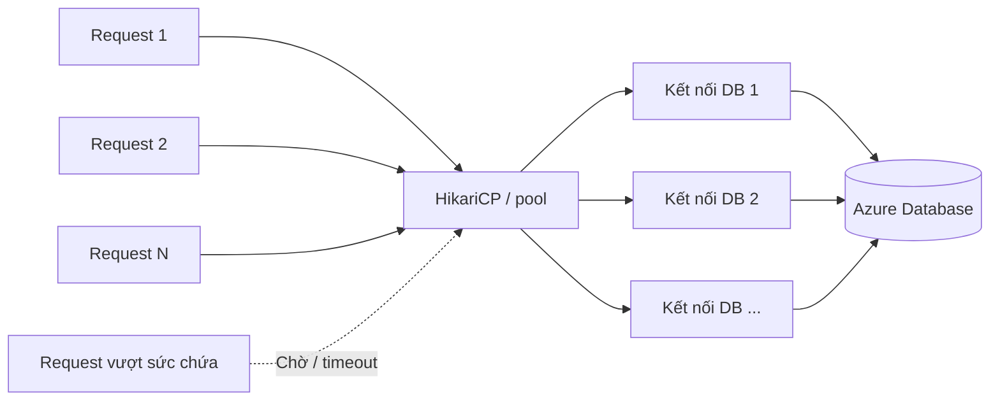

# Tối ưu connection pool và tái sử dụng kết nối dịch vụ

> **Phạm vi:** Microsoft Azure — chương **Hiệu năng và vận hành**. Bài học tập trung vào cách quản lý vòng đời kết nối từ ứng dụng Java chạy trên Azure App Service, Azure Functions hoặc Azure Kubernetes Service (AKS) đến Azure SQL Database, Azure Database for PostgreSQL, Azure Blob Storage, Azure Service Bus và các dịch vụ HTTP. Các nguyên tắc cũng áp dụng cho ngôn ngữ và nền tảng khác.

## Mục tiêu học tập

Sau bài học, bạn có thể:

1. Giải thích vì sao tạo kết nối mới liên tục làm tăng độ trễ, tải hệ thống và nguy cơ cạn cổng mạng.
2. Phân biệt **connection pool** của cơ sở dữ liệu với **HTTP keep-alive**, **HTTP/2 multiplexing** và việc tái sử dụng **Azure SDK client**.
3. Ước lượng giới hạn pool theo mức song song của ứng dụng, số instance khi autoscale và ngân sách kết nối ở dịch vụ đích.
4. Cấu hình HikariCP cho Java/Spring Boot, trả kết nối về pool đúng cách và tái sử dụng client Azure theo vòng đời ứng dụng.
5. Quan sát, kiểm thử và xử lý tình huống pool hết chỗ, kết nối chết sau failover, timeout, connection leak và SNAT port exhaustion.

## 1. Vì sao vòng đời kết nối ảnh hưởng hiệu năng?

Giả sử API xử lý đơn hàng chạy trên Azure App Service. Mỗi request cần truy vấn Azure Database for PostgreSQL, lấy tệp trên Azure Blob Storage và gửi sự kiện qua Azure Service Bus. Nếu mỗi request tự tạo rồi hủy kết nối vật lý, ứng dụng liên tục trả chi phí thiết lập TCP, TLS, xác thực và khởi tạo phiên. Những thao tác này tốn thời gian và tài nguyên hơn nhiều so với lấy một kết nối đang rảnh từ pool.

Có hai khái niệm cần tách bạch:

- **Kết nối vật lý:** phiên TCP/TLS (và với cơ sở dữ liệu, phiên DB) tồn tại giữa tiến trình ứng dụng và dịch vụ đích.
- **Kết nối logic:** quyền sử dụng tạm thời của một request hoặc một tác vụ. Khi gọi `Connection.close()` trên kết nối do HikariCP cấp, mã ứng dụng thường **trả kết nối về pool**, không đóng phiên TCP thực ngay lập tức.

Một pool duy trì số kết nối vật lý hữu hạn. Request mượn kết nối khi cần, sử dụng trong thời gian ngắn rồi trả lại. Nếu mọi kết nối đang bận, request phải chờ đến khi có kết nối được trả hoặc đến thời hạn chờ.



Tối ưu kết nối không đồng nghĩa với tăng `maximumPoolSize` tối đa. Pool quá nhỏ gây chờ; pool quá lớn chiếm tài nguyên DB, tạo nhiều session, tăng tranh chấp và có thể làm hệ thống chậm hơn.

## 2. Chọn đúng cơ chế tái sử dụng theo loại dịch vụ

| Loại kết nối | Cơ chế chủ đạo | Đối tượng nên dùng lại | Ranh giới quan trọng |
| --- | --- | --- | --- |
| JDBC đến Azure SQL / PostgreSQL | Pool các phiên DB (ví dụ HikariCP) | `DataSource` / pool dùng chung | Mỗi thao tác mượn và trả `Connection`; không dùng một `Connection` đồng thời giữa nhiều luồng |
| HTTP/HTTPS đến API hoặc Azure Blob Storage | TCP keep-alive, pool bên trong HTTP transport; HTTP/2 có thể ghép nhiều request trên một kết nối | `HttpClient` và Azure SDK client | Tạo request mới tùy nhu cầu, nhưng không dựng HTTP client mới cho từng request |
| Azure Service Bus | Kết nối AMQP và các liên kết sender/receiver | `ServiceBusSenderClient`, processor hoặc client thích hợp | Khởi tạo theo vòng đời ứng dụng, đóng khi ứng dụng dừng |
| Redis hoặc cache | Connection manager/pool theo thư viện client | Client/factory dùng chung, thường hỗ trợ multiplexing | Không suy ra rằng mọi lệnh cache cần một kết nối riêng |

**Phân biệt pool và đa luồng:** Pool JDBC gồm nhiều phiên có thể thực hiện nhiều giao dịch đồng thời. HTTP/2 có thể đưa nhiều stream qua một kết nối TCP. Vì vậy không thể dùng cùng một công thức hay tham số kích thước cho tất cả client.

Trong Spring Boot, điểm khởi tạo phù hợp thường là **singleton bean**. Với Azure Functions, khai báo client trong phạm vi ứng dụng/host để tái sử dụng qua nhiều lần invocation trên cùng instance; mỗi instance khi scale out vẫn có tập kết nối riêng. Với AKS, mỗi pod có pool riêng.

## 3. Tính ngân sách kết nối trước khi chỉnh pool

### 3.1. Số kết nối đồng thời thực sự cần dùng

Định luật Little cho một luồng công việc ổn định cho phép ước lượng:

```text
L ≈ λ × W

L = số thao tác đang giữ kết nối trung bình
λ = số thao tác cần kết nối mỗi giây
W = số giây trung bình mỗi thao tác giữ kết nối
```

Ví dụ **một pod** xử lý 60 thao tác DB/giây, mỗi thao tác giữ kết nối trung bình 80 ms:

```text
L ≈ 60 × 0,080 = 4,8 kết nối bận trung bình
```

Đây là **điểm khởi đầu**, không phải cấu hình đủ dùng cho mọi tải. Burst, giao dịch chậm ở p95/p99, lock, số truy vấn trên request và sự lệch tải giữa các pod có thể làm số kết nối cần thiết tăng mạnh. Hãy thử với pool 8–12 kết nối/pod, đo thời gian chờ pool và độ trễ đầu cuối trước khi chọn giá trị cuối cùng.

Đo **thời gian thực sự giữ kết nối**, không lấy toàn bộ thời gian xử lý HTTP request thay thế. Nếu code mượn kết nối rồi gọi HTTP ra bên ngoài trong 500 ms, kết nối DB vẫn bị chiếm trong 500 ms dù truy vấn chỉ chạy 10 ms. Rút ngắn thời gian giữ kết nối thường hiệu quả hơn tăng pool.

### 3.2. Nhân với số instance, cả lúc triển khai

Giả sử một dịch vụ AKS dùng HikariCP, mỗi pod tối đa 12 kết nối:

```text
4 pod bình thường × 12 kết nối = tối đa 48 phiên DB
6 pod khi rolling update × 12 kết nối = tối đa 72 phiên DB
```

Nếu có 15 phiên cho background jobs và công cụ quản trị, cần dự trù ít nhất `72 + 15 = 87` phiên; vẫn phải chừa phần dự phòng cho failover, maintenance và dịch vụ khác.

Công thức ngân sách tổng quát:

```text
Tổng kết nối tiềm năng =
  Σ(số instance tối đa của từng nhóm × max pool của nhóm)
  + kết nối từ job, migration, hệ thống quản trị và ứng dụng khác
```

Khi xác định số instance, tính cả giới hạn autoscale, pod `maxSurge` trong rolling update, instance dự phòng và các vùng triển khai khác. Với App Service hoặc Azure Functions, scale out làm tăng số pool độc lập. Khi dùng nhiều connection string, database, user identity hoặc tenant, ứng dụng có thể tạo **nhiều pool**, phải cộng đủ chúng.

Giới hạn phiên kết nối thực tế tùy loại dịch vụ và cấu hình Azure SQL Database hoặc Azure Database for PostgreSQL. Kiểm tra quota/setting của tài nguyên đích trong môi trường thật; không sao chép một con số mặc định giữa các tier.

### 3.3. Các tham số quan trọng

| Tham số | Tác dụng | Hướng điều chỉnh |
| --- | --- | --- |
| `maximumPoolSize` | Trần số kết nối vật lý trong một Hikari pool | Đủ đáp ứng tải đo được nhưng nằm trong ngân sách DB trên **toàn bộ instance** |
| `minimumIdle` | Số kết nối rảnh pool cố duy trì | Thấp giúp giảm phiên không cần thiết khi nhiều instance; cao hơn giảm độ trễ tạo kết nối sau tải tăng |
| `connectionTimeout` | Thời gian tối đa chờ mượn kết nối | Phù hợp ngân sách timeout của request; không để request chờ vô hạn |
| `idleTimeout` | Thời gian để loại bớt kết nối rảnh vượt `minimumIdle` | Cân bằng tiết kiệm kết nối và chi phí tái tạo |
| `maxLifetime` | Tuổi thọ tối đa của một kết nối trước khi được thay | Đặt thấp hơn giới hạn sống của kết nối do mạng/dịch vụ đặt ra, nếu có; không nên thay mọi kết nối quá thường xuyên |
| `keepaliveTime` | Kiểm tra giữ kết nối rảnh còn sống | Chỉ bật/tinh chỉnh khi môi trường có nguy cơ ngắt kết nối nhàn rỗi; phải nhỏ hơn `maxLifetime` |
| Timeout truy vấn / socket | Giới hạn thời gian thao tác DB thực hiện | Đặt theo SLA, không nhầm với `connectionTimeout` chỉ dành cho việc **mượn pool** |

Một pool cố định (không điều chỉnh `minimumIdle`) có thể phù hợp hệ thống tải ổn định. Pool co giãn có thể tiết kiệm connection budget khi số pod lớn. Quyết định dựa vào số đo, không tối ưu theo một tham số riêng lẻ.

## 4. Thực hành Java/Spring Boot với Azure Database for PostgreSQL

Ví dụ một dịch vụ `orders-api` chạy trên AKS hoặc App Service, sử dụng PostgreSQL Flexible Server và HikariCP (pool JDBC mặc định trong nhiều cấu hình Spring Boot). Ứng dụng nhận URL, tên đăng nhập và thông tin xác thực từ môi trường được quản lý; tuyệt đối không đưa mật khẩu vào source code.

### 4.1. Cấu hình pool

```yaml
# application.yml — giá trị minh họa, cần load test trước production
spring:
  datasource:
    url: ${DB_JDBC_URL}
    username: ${DB_USERNAME}
    password: ${DB_PASSWORD}
    hikari:
      pool-name: orders-db-pool
      maximum-pool-size: 12
      minimum-idle: 2
      connection-timeout: 3000
      validation-timeout: 1000
      idle-timeout: 600000
      max-lifetime: 1500000
      keepalive-time: 300000
```

Ví dụ URL PostgreSQL TLS với tên DNS của Azure:

```text
DB_JDBC_URL=jdbc:postgresql://example.postgres.database.azure.com:5432/orders?sslmode=verify-full
```

`sslmode=verify-full` yêu cầu xác thực tên máy chủ/chứng chỉ CA hợp lệ tại môi trường chạy. Các biến cấu hình chỉ là ví dụ; hãy dùng Managed Identity/Microsoft Entra ID khi driver và quy trình cấp token hỗ trợ, hoặc cung cấp secret qua Key Vault và cơ chế nạp secret thích hợp. Với xác thực bằng access token ngắn hạn, cần cơ chế **cấp token mới khi pool mở kết nối vật lý mới**; không đặt cố định một token sắp hết hạn làm mật khẩu tĩnh.

Ý nghĩa của các giá trị ví dụ: nhiều nhất 12 phiên DB/pod; chờ mượn tối đa 3 giây; giữ tối thiểu 2 kết nối rảnh; đánh giá lại vòng đời kết nối sau tối đa khoảng 25 phút. Những ngưỡng này là giả định ban đầu để đo, không phải giá trị chuẩn cho mọi Azure PostgreSQL.

### 4.2. Mượn ngắn, trả đúng và đóng mọi tài nguyên

```java
import java.sql.Connection;
import java.sql.PreparedStatement;
import java.sql.ResultSet;
import java.sql.SQLException;
import java.util.Optional;
import java.util.UUID;
import javax.sql.DataSource;
import org.springframework.stereotype.Service;

@Service
public class OrderReader {
    private final DataSource dataSource;

    public OrderReader(DataSource dataSource) {
        this.dataSource = dataSource;
    }

    public Optional<String> findStatus(UUID orderId) throws SQLException {
        String sql = "SELECT status FROM orders WHERE id = ?";

        try (Connection connection = dataSource.getConnection();
             PreparedStatement statement = connection.prepareStatement(sql)) {

            statement.setObject(1, orderId);
            statement.setQueryTimeout(2); // Giới hạn thực thi truy vấn: 2 giây

            try (ResultSet rows = statement.executeQuery()) {
                if (!rows.next()) {
                    return Optional.empty();
                }
                return Optional.ofNullable(rows.getString("status"));
            }
        }
        // Connection.close() -> trả về HikariCP pool.
    }
}
```

`try-with-resources` hoạt động cả khi ném ngoại lệ, nhờ đó trả kết nối về pool. Không giữ `Connection` trong biến static hoặc field singleton; đối tượng này đại diện cho một lần sử dụng, có transaction state và không dành cho truy cập đồng thời tùy ý.

Nếu dùng Spring `@Transactional`, transaction manager thường quản lý thời điểm mượn/trả. Tránh bao trùm các lời gọi HTTP chậm, xử lý tệp lớn hoặc chờ queue trong cùng một transaction. Giao dịch càng dài, lượng kết nối đang bận và lock của DB càng tăng.

### 4.3. Không tạo pool mới trong mỗi request

Đoạn mã sau là phản ví dụ:

```java
// KHÔNG NÊN: tạo DataSource/Hikari pool mới mỗi lần xử lý request.
public void handleRequest() {
    HikariDataSource temporaryPool = new HikariDataSource();
    // ... nạp cấu hình rồi truy vấn ...
}
```

Mỗi pool mới có thể mở phiên DB riêng; autoscale hoặc traffic spike sẽ nhân số phiên rất nhanh. Hãy inject `DataSource` do Spring quản lý vào các service và để container ứng dụng đóng pool khi shutdown.

## 5. Tái sử dụng Azure SDK client và HTTP transport

### 5.1. Một BlobServiceClient cho vòng đời ứng dụng

Các client dịch vụ của Azure SDK for Java được thiết kế để tái sử dụng và nhìn chung an toàn khi gọi từ nhiều luồng. Việc tạo lại client, credentials và HTTP transport cho mỗi HTTP request làm phát sinh thiết lập kết nối, cache token và tài nguyên nền không cần thiết.

```java
import com.azure.core.credential.TokenCredential;
import com.azure.identity.DefaultAzureCredentialBuilder;
import com.azure.storage.blob.BlobServiceClient;
import com.azure.storage.blob.BlobServiceClientBuilder;
import org.springframework.beans.factory.annotation.Value;
import org.springframework.context.annotation.Bean;
import org.springframework.context.annotation.Configuration;

@Configuration
public class AzureClientConfiguration {

    @Bean
    public TokenCredential tokenCredential() {
        return new DefaultAzureCredentialBuilder().build();
    }

    @Bean
    public BlobServiceClient blobServiceClient(
            TokenCredential credential,
            @Value("${app.azure.blob-endpoint}") String endpoint) {

        return new BlobServiceClientBuilder()
                .endpoint(endpoint)
                .credential(credential)
                .buildClient();
    }
}
```

`app.azure.blob-endpoint` có dạng `https://<storage-account>.blob.core.windows.net`. Trong code xử lý request, inject `BlobServiceClient` và lấy `BlobContainerClient`/`BlobClient` phù hợp để làm việc với blob. Đừng lặp lại `new DefaultAzureCredentialBuilder()` hay `new BlobServiceClientBuilder()` mỗi request.

Việc một Azure SDK client có thể dùng chung **không có nghĩa** mọi đối tượng giao dịch/stream tạo từ nó đều an toàn khi dùng đồng thời. Đóng stream khi đọc/ghi xong; chỉ đóng client/HTTP transport sở hữu tài nguyên khi ứng dụng shutdown nếu thư viện yêu cầu.

### 5.2. Azure Service Bus: giữ sender/processor sống theo ứng dụng

Với Service Bus, việc liên tục tạo sender hoặc processor có thể làm tăng churn của kết nối AMQP. Khởi tạo một `ServiceBusSenderClient` cho queue/topic cần dùng, tái sử dụng giữa các lần gửi, và đóng khi ứng dụng dừng:

```java
import com.azure.core.credential.TokenCredential;
import com.azure.messaging.servicebus.ServiceBusClientBuilder;
import com.azure.messaging.servicebus.ServiceBusSenderClient;
import org.springframework.beans.factory.annotation.Value;
import org.springframework.context.annotation.Bean;
import org.springframework.context.annotation.Configuration;

@Configuration
public class ServiceBusConfiguration {

    @Bean(destroyMethod = "close")
    public ServiceBusSenderClient orderSender(
            TokenCredential credential,
            @Value("${app.azure.service-bus-namespace}") String namespace) {

        return new ServiceBusClientBuilder()
                .fullyQualifiedNamespace(namespace)
                .credential(credential)
                .sender()
                .queueName("orders")
                .buildClient();
    }
}
```

Ví dụ sử dụng thông tin định danh Microsoft Entra ID; cần cấp đúng quyền gửi cho identity của ứng dụng. Hãy dùng cơ chế retry, backpressure và giới hạn mức song song phù hợp khi gửi lượng lớn sự kiện; một sender dùng chung vẫn có giới hạn throughput thực tế.

### 5.3. HTTP API: giữ một HttpClient và giới hạn concurrency

Trong Java, `java.net.http.HttpClient` được thiết kế để dùng lại giữa các request; bản thân client quản lý việc dùng lại kết nối HTTP phù hợp. Ví dụ cấu hình một bean:

```java
import java.net.http.HttpClient;
import java.time.Duration;
import org.springframework.context.annotation.Bean;
import org.springframework.context.annotation.Configuration;

@Configuration
public class HttpConfiguration {
    @Bean
    public HttpClient outboundHttpClient() {
        return HttpClient.newBuilder()
                .connectTimeout(Duration.ofSeconds(2))
                .version(HttpClient.Version.HTTP_2)
                .build();
    }
}
```

Tạo `HttpRequest` mới cho từng thao tác, đặt **request timeout** riêng, nhưng dùng chung `HttpClient`. HTTP/2 chỉ được sử dụng khi phía server và đường truyền hỗ trợ; ứng dụng phải xử lý việc thương lượng hoặc fallback sang HTTP/1.1. Đặt giới hạn số request đang thực thi tới từng downstream, vì connection reuse không tự ngăn hàng nghìn request đồng thời làm nghẽn dịch vụ đích.

Khi sử dụng Reactor Netty, Apache HttpClient hoặc HTTP transport riêng của Azure SDK, hãy cấu hình pool và timeout đúng thư viện đang dùng. Không giả định tham số HikariCP áp dụng cho pool HTTP.

## 6. Những điểm đặc thù trên Azure

### 6.1. App Service và outbound SNAT port exhaustion

Azure App Service có thể gặp tình trạng thiếu cổng SNAT trong các luồng outbound qua hạ tầng dùng SNAT, nhất là khi ứng dụng tạo nhiều kết nối TCP mới đến cùng endpoint và đóng/mở liên tục. Dấu hiệu thường thấy là lỗi kết nối hoặc timeout không liên tục dù CPU ứng dụng chưa cao.

Ưu tiên tái sử dụng HTTP connection, HTTP/2 khi khả dụng và giới hạn mức song song outbound. Sau đó đối chiếu mô hình mạng: VNet Integration, Private Endpoint, NAT Gateway hoặc kiến trúc outbound phù hợp với đường đi thực tế. **NAT Gateway có thể tăng năng lực SNAT** trong cấu hình sử dụng được, nhưng không thay thế việc sửa code tạo kết nối mới liên tục. Chẩn đoán đúng đường đi traffic trước khi áp dụng thay đổi mạng.

### 6.2. Azure Functions và scale out

Instance Functions có thể xử lý nhiều invocation và hệ thống có thể tự mở thêm instance. Đặt SDK client trong vùng được giữ qua các invocation, ví dụ field static được khởi tạo an toàn hoặc dependency injection với vòng đời singleton. Mỗi instance vẫn có client và connection budget riêng; cần tính tổng ở mức scale-out. Không tạo pool JDBC lớn theo mặc định nếu workload Functions burst mạnh và DB có giới hạn session chặt.

### 6.3. Azure SQL Database / PostgreSQL và failover

Khi failover, maintenance hoặc thay đổi đường mạng xảy ra, kết nối đang nằm trong pool có thể trở thành kết nối hỏng. HikariCP có thể kiểm tra/tái tạo kết nối qua driver; ứng dụng vẫn phải xử lý **lỗi tạm thời** khi một thao tác đang chạy. Đừng giữ địa chỉ IP cũ vĩnh viễn; tôn trọng DNS và khả năng reconnect của driver, điều chỉnh tuổi thọ kết nối theo chính sách hạ tầng và kết quả kiểm thử.

Đặt timeout rõ ràng, retry có giới hạn với exponential backoff và jitter ở lớp phù hợp. Chỉ retry thao tác an toàn hoặc đã có khóa idempotency; tránh chạy nhiều tầng retry (SDK, driver và service) không kiểm soát. Retry quá mức có thể khiến sự cố pool cạn kết nối trầm trọng thêm.

### 6.4. Managed Identity, Key Vault và vòng đời xác thực

Tái sử dụng `TokenCredential` có lợi vì thư viện identity quản lý việc lấy và cache token phù hợp. Với HTTP/SDK, client thường có thể tự xin token mới qua credential. Với JDBC dùng xác thực Entra ID, cơ chế nạp token cho phiên DB phải được tích hợp đúng với driver/pool: phiên vật lý mở sau khi token cũ hết hạn cần được cung cấp token hợp lệ. Không đưa token cố định vào file cấu hình rồi mong pool tự làm mới.

## 7. Quan sát và tìm nguyên nhân tắc nghẽn

Có thể dùng Micrometer + Spring Boot Actuator và xuất telemetry vào Azure Monitor / Application Insights. Đo trong cùng thời gian để phân biệt nghẽn pool, DB và mạng.

| Quan sát | Dấu hiệu | Cách diễn giải và kiểm tra |
| --- | --- | --- |
| `hikaricp.connections.active` | Liên tục gần `maximumPoolSize` | Pool đang bận; xem truy vấn chậm, transaction dài và concurrency |
| `hikaricp.connections.pending` | Tăng cùng p95/p99 response time | Request chờ mượn kết nối; xem thời gian giữ connection và timeout |
| `hikaricp.connections.timeout` | Tăng trong spike | Có thao tác không mượn được kết nối kịp thời; đối chiếu DB CPU/session |
| `hikaricp.connections.idle` | Cao kéo dài ở nhiều pod | Pool có thể dự trữ nhiều phiên không dùng; cân nhắc `minimumIdle` |
| Thời gian lấy connection và thời gian dùng connection | Đột ngột tăng | Phân biệt chờ pool với bản thân query/transaction chậm |
| Application Insights dependency duration/failure | Tăng với PostgreSQL, SQL, HTTP hoặc Service Bus | Xác định downstream và trạng thái lỗi tương ứng |
| Azure SQL/PostgreSQL metrics, query statistics | Session nhiều, CPU cao, lock hoặc slow query | Có thể cần tối ưu query/index hoặc giảm concurrency thay vì tăng pool |
| App Service diagnostics / SNAT | Timeout outbound, dấu hiệu cạn SNAT | Kiểm tra churn kết nối TCP, đường đi mạng và khả năng reuse |

Tên metric sẵn có phụ thuộc phiên bản HikariCP/Micrometer, cấu hình exporter và tài nguyên Azure. Kiểm tra thực tế tên và nhãn trước khi tạo dashboard/alert. Một dashboard hữu ích đặt **request rate, số instance, pool active/idle/pending, acquire time, DB CPU, DB sessions, dependency latency và error rate** trên cùng trục thời gian.

Gợi ý hai cảnh báo theo SLO của đội vận hành: hàng chờ mượn pool kéo dài kèm p95 response time tăng; hoặc timeout khi mượn pool xuất hiện liên tiếp. Không đặt cảnh báo chỉ vì một thời điểm `active = max`: pool đầy trong vài mili giây lúc burst có thể là hành vi bình thường.

### Phân loại lỗi nhanh

| Hiện tượng | Nguyên nhân có thể | Bước đầu xử lý |
| --- | --- | --- |
| Pool `pending` tăng, DB CPU thấp | Transaction giữ connection khi gọi service khác; connection leak | Xem duration giữ connection, thread dump/trace, đóng tài nguyên và rút ngắn transaction |
| Pool `pending` tăng, DB CPU/lock cao | Query chậm, lock contention, concurrency quá lớn | Tối ưu query/index, giới hạn request song song, rà soát transaction |
| Tạo mới connection thất bại trên nhiều pod | Đụng giới hạn session DB hoặc auth/TLS lỗi | Tính lại pool trên mọi instance; kiểm tra quota, credential, TLS và logs |
| Lỗi xuất hiện sau thời gian idle hoặc failover | Kết nối bị trung gian/DB đóng, DNS thay đổi | Kiểm tra driver, validation, idle/max lifetime và retry thích hợp |
| HTTP timeout outbound, SNAT diagnostics bất thường | Kết nối HTTP mở liên tục, không reuse | Dùng chung HTTP client, giới hạn concurrency, xem lại outbound networking |
| Lỗi 429/503 dù pool rảnh | Downstream rate limit hoặc quá tải | Điều chỉnh backpressure, retry hợp lý và quota dịch vụ; tăng pool không giải quyết gốc rễ |

Khi nghi ngờ rò rỉ kết nối JDBC, có thể bật HikariCP `leakDetectionThreshold` tạm thời trong môi trường chẩn đoán để ghi dấu thao tác giữ connection lâu. Ngưỡng quá thấp sẽ tạo cảnh báo giả cho các truy vấn hợp lệ; không coi đây là biện pháp sửa lỗi hoặc cơ chế đóng connection thay cho code.

## 8. Quy trình tối ưu có kiểm chứng

Thực hiện theo thứ tự sau, ở môi trường kiểm thử tương tự production:

1. **Lập baseline:** đo throughput, p50/p95/p99, tỷ lệ lỗi, độ trễ mượn connection, active/pending/idle, thời gian transaction, số DB sessions và số instance. Xác nhận đang dùng lại client/pool đúng vòng đời.
2. **Tìm kết nối giữ quá lâu:** kiểm tra code có gọi HTTP bên trong transaction, xử lý stream chưa đóng, transaction chờ lock, truy vấn không có timeout. Sửa nguyên nhân và thử lại trước khi tăng kích thước pool.
3. **Tính ngân sách:** lấy số instance tối đa, dự phòng rolling update, các ứng dụng/job dùng chung DB và giới hạn DB thực tế để chọn `maximumPoolSize` an toàn.
4. **Điều chỉnh một nhóm tham số mỗi lần:** thử `maximumPoolSize`, `minimumIdle`, acquisition timeout; chỉ chỉnh keepalive/lifetime khi số đo hoặc hạ tầng cho thấy cần. Ghi lại sự thay đổi về latency, CPU và timeout.
5. **Kiểm thử tải và mở rộng:** dùng Azure Load Testing hoặc công cụ phù hợp để chạy tải ổn định, burst, autoscale và rollout; giám sát cả nguồn lẫn đích.
6. **Kiểm thử gián đoạn:** mô phỏng database failover/connection drop trong môi trường cho phép; xác minh reconnect, timeout, retry, idempotency và không tạo bão kết nối.
7. **Đưa vào vận hành:** chuẩn hóa cấu hình, dashboard, alert; lưu kết quả test cùng giới hạn tải mà phiên bản ứng dụng đã được xác thực.

**Sai lầm thường gặp:** tăng pool từ 12 lên 100 trên một pod vì thấy hàng chờ. Nếu 10 pod cùng tăng, mức trần từ 120 thành 1.000 session; khi DB không đủ tài nguyên, request có thể chậm hơn và lỗi xuất hiện hàng loạt. Cần tìm thời gian giữ connection, giới hạn tổng và tải DB trước.

## 9. Bài thực hành: sizing cho dịch vụ orders-api trên AKS

Một hệ thống giả định có các điều kiện:

- 4 pod bình thường; lúc rolling update có thể đồng thời 6 pod.
- Mỗi pod xử lý khoảng 60 giao dịch DB/giây; connection hold time trung bình 80 ms.
- 15 phiên DB được giữ cho các tác vụ khác.
- Ngân sách kết nối vận hành dành cho ứng dụng và các tác vụ kể trên là **100 phiên**, chỉ là con số của bài tập.
- Giải pháp đang xét là HikariCP `maximumPoolSize=12` và `minimumIdle=2` mỗi pod.

**Câu hỏi 1:** Trung bình mỗi pod cần bao nhiêu connection bận?

```text
L = 60 × 0,08 = 4,8 connection/pod
```

**Câu hỏi 2:** Khi rolling update, tổng phiên tối đa theo cấu hình là bao nhiêu?

```text
6 × 12 + 15 = 87 phiên
Dự phòng theo ngân sách giả định = 100 - 87 = 13 phiên
```

**Câu hỏi 3:** Có thể tăng `maximumPoolSize` lên 20 để giảm chờ ngay không?

```text
6 × 20 + 15 = 135 phiên > ngân sách 100 phiên
```

Không nên áp dụng cấu hình này ở quy mô đang xét. Nếu thấy pending tăng, trước tiên kiểm tra hold time p95/p99, giao dịch chậm, lock, độ phân bố request và số instance. Sau đó thử giá trị khác dưới tải thực, hoặc điều chỉnh giới hạn concurrency, năng lực DB hay kiến trúc xử lý.

**Câu hỏi 4:** Nếu HPA có thể tăng lên 8 pod và rolling update thêm 2 pod thì cấu hình 12 còn trong ngân sách không?

```text
(8 + 2) × 12 + 15 = 135 phiên > 100 phiên
```

Vì vậy ngân sách phải dùng **giới hạn scale-out thực tế**, không dùng duy nhất số pod hiện tại. Với ngân sách 100 và 15 phiên ngoài ứng dụng, nếu có thể cùng lúc 10 pod, trần lý thuyết của mỗi pool là `floor((100 - 15)/10) = 8`; còn cần giảm thêm để dành dự phòng và xác thực bằng load test.

## 10. Checklist trước khi đưa lên production

- [ ] `DataSource`/HikariCP, `HttpClient` và Azure SDK client được tạo theo vòng đời ứng dụng, không tạo mỗi request.
- [ ] Mọi connection, statement, result set, stream được đóng/trả đúng lúc; transaction không bao trùm thao tác chậm không cần thiết.
- [ ] Có timeout tách biệt cho mượn pool, connect, truy vấn, HTTP request và tổng ngân sách xử lý.
- [ ] `maximumPoolSize` đã tính theo autoscale, rolling update, nhiều pool và toàn bộ workload dùng chung DB.
- [ ] Đã phân biệt nghẽn pool với nghẽn DB, rate limit downstream và cạn SNAT.
- [ ] Credential và token được quản lý an toàn; kiểm tra reconnect và refresh token khi mở kết nối mới.
- [ ] Retry có giới hạn, có backoff/jitter và phù hợp tính idempotent của thao tác.
- [ ] Dashboard và alert phản ánh pending/acquire timeout, latency, throughput, DB sessions và lỗi dependency.
- [ ] Đã chạy load test, burst/scale-out test và thử tình huống kết nối đứt/failover.

## 11. Tự kiểm tra kiến thức

1. Vì sao gọi `close()` trên một `Connection` lấy từ HikariCP thường không đồng nghĩa với đóng TCP?
2. Nếu 7 pod có `maximumPoolSize=16` và lúc triển khai thêm 2 pod, ứng dụng có thể tiêu thụ tối đa bao nhiêu phiên DB, chưa tính các workload khác? (**Đáp án:** `9 × 16 = 144`.)
3. Tại sao tăng pool có thể khiến p99 chậm hơn dù số request đang chờ pool giảm?
4. Trong trường hợp nào cần xem App Service SNAT diagnostics, và việc dùng chung `HttpClient` giúp thế nào?
5. Một transaction chạy query 20 ms nhưng giữ connection 2 giây để chờ HTTP response. Bạn sẽ sửa phần nào trước?

## Tài liệu tham khảo

- [Azure App Service: Troubleshoot intermittent outbound connection errors](https://learn.microsoft.com/en-us/azure/app-service/troubleshoot-intermittent-outbound-connection-errors) — bối cảnh kết nối outbound và SNAT.
- [Azure Functions: Manage connections](https://learn.microsoft.com/en-us/azure/azure-functions/manage-connections) — tái sử dụng kết nối và client khi scale.
- [Azure Database for PostgreSQL Flexible Server: Limits](https://learn.microsoft.com/en-us/azure/postgresql/flexible-server/concepts-limits) — kiểm tra giới hạn dịch vụ theo cấu hình thực tế.
- [HikariCP — Configuration](https://github.com/brettwooldridge/HikariCP#configuration-knobs-baby) — ý nghĩa và giới hạn các tham số pool.
- [Microsoft Azure SDK for Java](https://learn.microsoft.com/en-us/azure/developer/java/sdk/overview) — thực hành tạo, xác thực và sử dụng client Azure.

**Ghi nhớ:** Connection pool là giới hạn tài nguyên có chủ đích. Tối ưu tốt nhất là **tái sử dụng client, giữ connection trong thời gian ngắn, đo tải thực tế và kiểm soát số phiên trên toàn bộ instance**, đồng thời chuẩn bị sẵn cơ chế xử lý lỗi kết nối trong quá trình vận hành.

