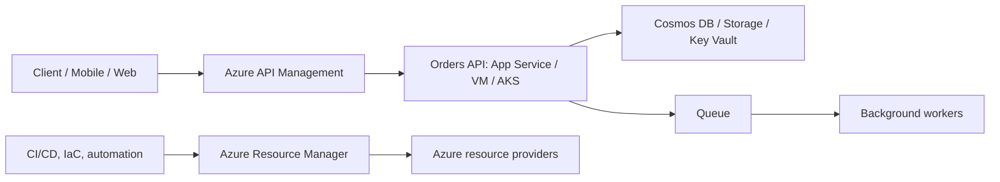
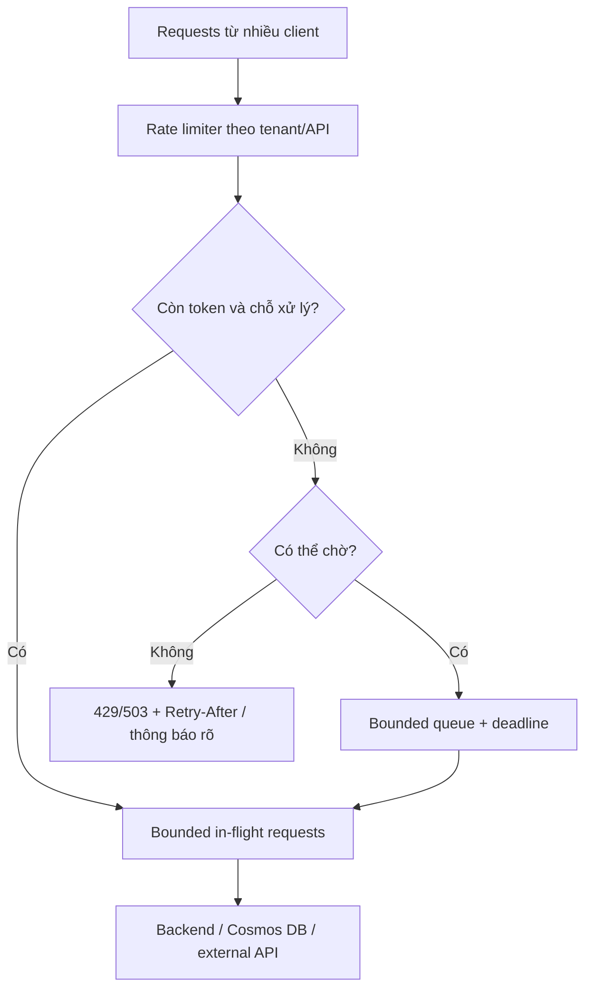
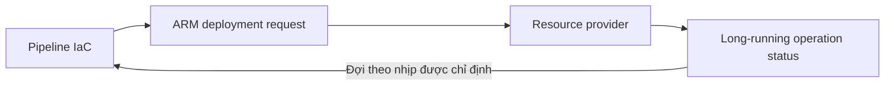
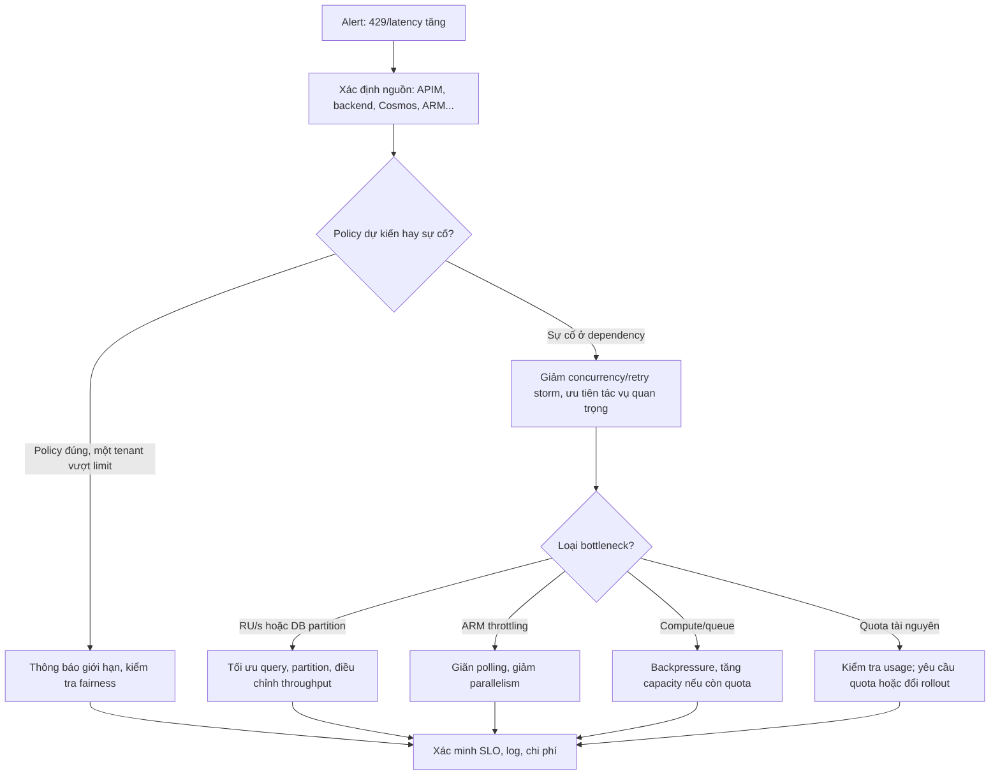

# Kiểm soát throttling, giới hạn API và quota khi tăng tải

## 1. Bối cảnh: tăng tải không chỉ là tăng số máy chủ

Một ứng dụng chạy trên Microsoft Azure có thể hoạt động tốt ở 100 yêu cầu/giây nhưng phát sinh lỗi khi lượng truy cập tăng đột biến. Trong lúc API trả về HTTP `429 Too Many Requests`, nhóm vận hành có thể thấy CPU của máy ảo vẫn thấp. Nguyên nhân không nhất thiết nằm ở khả năng xử lý của ứng dụng: một dịch vụ phụ thuộc, API Gateway, Azure Resource Manager, tài khoản lưu trữ, cơ sở dữ liệu hoặc giới hạn cấp subscription cũng có thể đang từ chối yêu cầu.

Trong hành trình học hệ sinh thái Azure, từ **subscription, resource group và Microsoft Entra ID** đến mạng, compute, storage, database, triển khai, giám sát, bảo mật và kiểm soát chi phí, quản lý giới hạn là một phần quan trọng của chương **Hiệu năng và vận hành**. Bài này hướng dẫn cách phân biệt các lớp giới hạn, nhận diện nơi phát sinh throttling, xử lý retry an toàn và lập kế hoạch quota khi tải tăng.

Xét ứng dụng **Orders API** gồm Azure API Management (APIM) phía trước, ứng dụng Java phía sau, Azure Cosmos DB lưu đơn hàng và một worker xử lý hàng đợi. Vào giờ khuyến mại, số lượt gọi API tăng gấp nhiều lần; cùng lúc pipeline triển khai đang gọi Azure Resource Manager để cập nhật hạ tầng. Có thể xuất hiện ít nhất ba vấn đề khác nhau:

- APIM trả `429` vì một khách hàng vượt giới hạn gọi API.
- Cosmos DB trả `429` cho yêu cầu dữ liệu khi mức tiêu thụ request units vượt khả năng đáp ứng tại thời điểm đó.
- Azure Resource Manager hoặc resource provider hạn chế các thao tác quản lý tài nguyên được gọi quá dày.

Mặc dù đều liên quan đến tăng tải, **mỗi nguồn gây giới hạn cần một cơ chế xử lý riêng**. Tăng VM size không giải quyết quota ARM; tăng quota VM cũng không tự loại bỏ `429` từ Cosmos DB.

### Mục tiêu học tập

Sau khi hoàn thành bài, bạn có thể:

1. Phân biệt **throttling**, **rate limit**, **quota**, **concurrency limit** và **capacity**.
2. Nhận diện giới hạn ở Azure control plane, data plane, API gateway và ứng dụng; giải thích vì sao mã `429` không cho biết đầy đủ nguyên nhân.
3. Xử lý `Retry-After`, exponential backoff, jitter, retry budget, timeout và idempotency một cách an toàn.
4. Dùng API Management áp chính sách giới hạn theo khách hàng và tổ chức lưu lượng bằng queue, rate limiter, backpressure.
5. Xác định bottleneck của Cosmos DB, Azure Resource Manager và quota compute theo đúng loại tài nguyên.
6. Lập dashboard, cảnh báo, kế hoạch capacity và bài kiểm thử tải để chứng minh hệ thống chịu được lưu lượng mục tiêu.
7. Xây dựng runbook ứng phó khi tăng số lỗi throttling, đồng thời tránh làm tăng chi phí và độ trễ ngoài kiểm soát.

## 2. Năm khái niệm dễ nhầm lẫn

| Khái niệm | Ý nghĩa | Ví dụ điển hình | Điều cần làm |
| --- | --- | --- | --- |
| **Rate limit** | Giới hạn số yêu cầu trong một khoảng thời gian | Tối đa 120 lượt gọi/phút cho mỗi khách hàng tại APIM | Điều tiết đầu vào, chờ cửa sổ làm mới |
| **Throttling** | Hệ thống chủ động làm chậm hoặc từ chối yêu cầu để bảo vệ tài nguyên | HTTP `429`, hoặc phản hồi đặc thù của dịch vụ | Đọc tín hiệu, giảm tốc và retry có giới hạn |
| **Quota** | Mức được cấp về tài nguyên hoặc mức sử dụng trong một phạm vi | Giới hạn vCPU theo VM family tại một Azure region | Kiểm tra mức sử dụng, yêu cầu tăng quota hoặc đổi thiết kế |
| **Concurrency limit** | Số công việc được xử lý đồng thời | Tối đa 40 tác vụ xuất báo cáo đang chạy | Giới hạn in-flight, xếp hàng hoặc từ chối có kiểm soát |
| **Capacity/throughput** | Khả năng xử lý thực tế theo thời gian hoặc theo đơn vị tiêu thụ | RU/s của Cosmos DB, RPS của API backend | Đo tải, tối ưu truy vấn, partition hoặc scale |

**Một quota chưa hết không có nghĩa dịch vụ sẽ không throttling.** Quota có thể là tổng số tài nguyên cho phép trong subscription, còn throttling có thể dựa trên số lệnh API trong một phút hoặc sức chịu tải của một phân vùng dữ liệu. Tương tự, đã tăng quota không có nghĩa tài nguyên đã được triển khai thêm hay throughput đã tăng.

### Burst và sustained load

**Burst** là đợt yêu cầu tăng mạnh trong thời gian ngắn; **sustained load** là mức tải cao duy trì lâu. Hai hệ thống có cùng lưu lượng trung bình vẫn có thể có tỷ lệ throttling khác nhau:

- 6.000 yêu cầu phân bố đều trong 60 giây tương đương trung bình 100 RPS.
- 6.000 yêu cầu đến gần như đồng thời trong một vài giây có thể vượt số worker, connection pool hoặc bộ đếm giới hạn ngắn hạn.

Do đó, khi đánh giá API phải quan sát ít nhất **RPS theo thời gian ngắn**, lưu lượng mỗi người dùng/tenant, thời gian phản hồi, số yêu cầu đồng thời và tốc độ từ chối; không chỉ xem tổng số lượt gọi theo giờ.

## 3. Throttling xuất hiện ở những lớp nào trên Azure?



Trên cùng hệ thống, nơi trả về lỗi có thể nằm tại bất cứ nút nào trong sơ đồ. Một lỗi `429` do gateway áp policy khác về **chủ sở hữu, bộ đếm, thời gian làm mới và hướng xử lý** so với `429` phát sinh ở Cosmos DB.

| Lớp | Nguồn giới hạn thường gặp | Tín hiệu/triệu chứng | Cách xử lý ưu tiên |
| --- | --- | --- | --- |
| Client/SDK | Tạo quá nhiều yêu cầu hoặc retry đồng loạt | Số request thực cao hơn lưu lượng nghiệp vụ | Rate limiter phía client, retry budget, jitter |
| APIM/API gateway | Rate limit hoặc quota theo key, subscription, tenant | Gateway chủ động trả lỗi cho người gọi | Policy, thông báo giới hạn, công bằng giữa tenant |
| Compute/backend | Thread pool, connection pool, request queue, concurrency | p95/p99 tăng, timeout hoặc `503` | Backpressure, giới hạn concurrency, scale phù hợp |
| Cosmos DB | Provisioned/autoscale RU/s, partition nóng | HTTP `429`, request charge/diagnostics | Tối ưu query, phân phối partition, cấp RU/s |
| Azure Storage | Request/throughput/partition limits, tải theo tài khoản | Có thể xuất hiện `503 Server Busy` hoặc lỗi timeout đặc thù | Phân tán key, backoff và điều chỉnh thiết kế truy cập |
| Azure Key Vault | Giới hạn thao tác trong khoảng thời gian | `429`, tăng độ trễ lấy secret/key | Cache, giảm polling, backoff, giảm tần suất gọi |
| Azure Resource Manager (ARM) | Throttling API control plane, cùng giới hạn resource provider | `429` và header giới hạn nếu được cung cấp | Giảm polling, gom thao tác, xử lý long-running operation |
| Subscription/region | Quota vCPU, VM family hoặc số tài nguyên | Lỗi quota/capacity; không nhất thiết là `429` | Kiểm tra quota, yêu cầu tăng hoặc chuyển vùng/SKU |

**Control plane** quản lý cấu hình tài nguyên (ví dụ gọi ARM để tạo VM, cập nhật App Service hoặc liệt kê resource group). **Data plane** xử lý dữ liệu/luồng nghiệp vụ (ví dụ đọc tài liệu Cosmos DB, blob, gọi ứng dụng). Hai lớp có hạn mức, identity, endpoint và cơ chế giám sát khác nhau.

Một số dịch vụ có nhiều loại giới hạn đồng thời. Ví dụ API AI có thể hạn chế requests/minute, tokens/minute hoặc concurrency theo deployment; tài nguyên compute có thể vướng quota vCPU và khả năng cấp phát SKU. Không suy ra con số giới hạn cố định chỉ từ tên dịch vụ: giá trị có thể thay đổi theo region, tier, subscription, loại tác vụ và cấu hình hiện tại.

## 4. Tình huống xuyên suốt: Orders API tăng tải

Giả sử hệ thống có cấu hình minh họa:

| Thành phần | Giả định trong bài | Loại giới hạn |
| --- | --- | --- |
| APIM | Một subscription API được phép 120 calls/phút | Rate limit theo consumer |
| Orders API | Tối đa 40 yêu cầu gọi dịch vụ ngoài cùng lúc | Concurrency |
| Cosmos DB | Phân bổ 600 RU/s cho workload minh họa | Throughput ngân sách RU |
| Truy vấn `GET /orders/{id}` | Khoảng 5 RU/yêu cầu trong điều kiện thử nghiệm | Chi phí mỗi request |
| Azure deployment | Pipeline liên tục kiểm tra trạng thái ARM | Control-plane request rate |
| Azure region DR | Subscription gần đầy quota vCPU của một VM family | Resource quota |

**Các con số chỉ là giả định học tập**, không phải hạn mức mặc định của Azure hay APIM.

Nếu truy vấn dữ liệu tiêu thụ khoảng 5 RU mỗi request và tất cả yêu cầu đều cùng dùng ngân sách 600 RU/s, mức 150 truy vấn/giây sẽ đòi khoảng 750 RU/s. Hệ thống có thể gặp `429` ngay cả khi Java API còn CPU rảnh. Trong thực tế phải tính phân vùng, độ lớn tài liệu, độ phức tạp query và RU charge thực tế, nên phép tính chỉ dùng để ước lượng bước đầu.

Nếu API có 120 calls/phút/subscription, một consumer gửi 300 lượt trong một phút sẽ vượt giới hạn của chính consumer đó. Tăng RU/s cho Cosmos DB không giải quyết được rate limit tại APIM; muốn tăng ngưỡng cần đánh giá chính sách công bằng, bảo vệ backend và gói dịch vụ cho khách hàng.

## 5. Chẩn đoán đúng nguồn giới hạn trước khi sửa

Khi thấy `429`, đừng lập tức tăng số lần retry hoặc scale mọi thành phần. Hãy đi theo đường đi của một request:

1. **Xác định ai trả response:** client SDK, APIM gateway, ứng dụng, Cosmos DB, ARM hay dịch vụ ngoài.
2. **Ghi thời điểm và phạm vi:** UTC timestamp, endpoint, region, subscription/tenant, API operation và mức tải đang xảy ra.
3. **Lấy mã trạng thái và header liên quan:** `Retry-After`, correlation/request ID và header đặc thù của dịch vụ nếu có.
4. **Đối chiếu log phân tán:** gateway request ID, trace ID, backend logs, Cosmos diagnostics, Azure Activity Log hoặc HTTP logs.
5. **Xem xu hướng:** throughput có tăng không, tỷ lệ 429 theo từng endpoint/tenant, p95/p99, queue length, quota utilization.
6. **Thử một thay đổi có kiểm soát:** giảm concurrency, điều chỉnh giới hạn gateway, tối ưu query hoặc bổ sung capacity đúng nơi.

Một request đi qua nhiều tầng có thể bị **chuyển đổi mã lỗi**. Gateway có thể trả lỗi của chính nó hoặc chuyển tiếp `429` từ upstream. Vì vậy, chỉ dùng status code để kết luận “APIM là nguyên nhân” là chưa đủ; cần kiểm tra log và request correlation.

### Mã HTTP không đồng nhất giữa các dịch vụ

| Status/loại lỗi | Diễn giải thường gặp | Không nên suy ra |
| --- | --- | --- |
| `429 Too Many Requests` | Một bộ đếm/rate policy hoặc capacity điều tiết request | Không có nghĩa subscription đã hết quota tài nguyên |
| `503 Service Unavailable` | Backend quá tải, bảo trì hoặc từ chối tạm thời | Không chắc là APIM rate limit |
| `408 Request Timeout` hoặc client timeout | Yêu cầu không hoàn tất đúng thời gian | Không tự chứng minh server đã xử lý hay chưa |
| Lỗi `QuotaExceeded`/`OperationNotAllowed` | Không được cấp phát thêm tài nguyên hoặc vượt một giới hạn cụ thể | Không nhất thiết nên retry liên tục |
| `403 Forbidden` | Bị từ chối vì quyền/chính sách hoặc điều kiện dịch vụ | Không nên “chữa” bằng retry mù |

Mã lỗi cụ thể và header của từng resource provider phải được đọc theo tài liệu dịch vụ tương ứng.

## 6. Đọc `Retry-After` và header giới hạn

HTTP có thể cung cấp **`Retry-After`** để báo thời gian sớm nhất nên thử lại. Header này có hai dạng hợp lệ:

```http
HTTP/1.1 429 Too Many Requests
Retry-After: 3
```

Ở đây người gọi nên chờ khoảng **3 giây** trước khi thử lại, nếu tổng thời gian chờ cho phép.

```http
HTTP/1.1 503 Service Unavailable
Retry-After: Fri, 20 Nov 2026 13:30:00 GMT
```

Đây là ví dụ định dạng **HTTP-date**, chỉ có ý nghĩa khi so với đồng hồ thời gian thực. Khi nhận header, client cần parse đúng kiểu và tránh sử dụng giờ địa phương như một chuỗi không có múi giờ.

Một số API cung cấp các header về hạn mức còn lại hoặc thời gian làm mới; Azure có những header riêng theo dịch vụ, chẳng hạn nhóm `x-ms-ratelimit-remaining-*` ở một số API quản lý, hoặc header chẩn đoán/thời gian chờ riêng của Cosmos DB. **Không phải mọi endpoint đều trả cùng tên header hoặc cùng đơn vị thời gian**. Đừng đọc giá trị milliseconds như seconds hoặc trông chờ `Retry-After` luôn tồn tại.

Nguyên tắc xử lý:

- Nếu có `Retry-After` hợp lệ và việc retry được phép, ưu tiên tôn trọng thời gian này.
- Nếu thiếu, dùng exponential backoff kết hợp jitter thay vì retry ngay.
- Nếu thời gian chờ được yêu cầu **dài hơn retry budget hoặc deadline của request**, thất bại có kiểm soát, chuyển việc sang queue hoặc trả phản hồi phù hợp; không tự ý chờ vô hạn.
- Không ghi Authorization header, API key, token, connection string hoặc body nhạy cảm vào log chỉ để chẩn đoán throttling.

## 7. Retry an toàn: exponential backoff, jitter và giới hạn tổng thể

Một client triển khai sai có thể làm sự cố nghiêm trọng hơn. Giả sử 1.000 client đều nhận `429` và đồng loạt retry sau đúng một giây: phía server lại nhận 1.000 yêu cầu cùng lúc, dẫn đến **retry storm**. Kết hợp exponential backoff với jitter giúp phân tán thời điểm retry.

Với các lần thử bổ sung \(k = 1, 2, \ldots\), có thể đặt độ trễ tăng theo cấp số nhân:

\[
D_k = \min(D_{\max}, D_0 \cdot 2^{k-1})
\]

Thêm **full jitter** bằng cách chọn thời gian chờ ngẫu nhiên trong khoảng \([0, D_k]\) (hoặc đặt một ngưỡng sàn nhỏ để tránh retry tức thời). Mọi con số như `D0 = 200 ms`, `Dmax = 5 s`, tối đa 4 lần thử dưới đây đều là **tham số minh họa**; sản phẩm thật cần thiết kế theo SLA, deadline và hướng dẫn của API.

### Java 17: gọi HTTP GET và xử lý 429/503 có giới hạn

Ví dụ sau dùng `java.net.http.HttpClient`, xử lý `Retry-After` dạng số giây hoặc ngày HTTP, tính jitter khi thiếu header và giới hạn tổng thời gian chờ. Đây là minh họa cho **GET an toàn để thử lại**; SDK Azure thường có retry policy riêng nên nên dùng chính sách của SDK khi có sẵn.

```java
import java.io.IOException;
import java.net.URI;
import java.net.http.HttpClient;
import java.net.http.HttpRequest;
import java.net.http.HttpResponse;
import java.net.http.HttpTimeoutException;
import java.time.Duration;
import java.time.Instant;
import java.time.ZonedDateTime;
import java.time.format.DateTimeFormatter;
import java.time.format.DateTimeParseException;
import java.util.Optional;
import java.util.OptionalLong;
import java.util.concurrent.ThreadLocalRandom;

public final class ResilientGet {
    private static final int MAX_ATTEMPTS = 4;
    private static final long MAX_BACKOFF_MS = 5_000;
    private static final HttpClient CLIENT = HttpClient.newBuilder()
            .connectTimeout(Duration.ofSeconds(3))
            .build();

    public static HttpResponse<String> fetch(URI uri)
            throws IOException, InterruptedException {
        long deadline = System.nanoTime() + Duration.ofSeconds(20).toNanos();

        for (int attempt = 1; attempt <= MAX_ATTEMPTS; attempt++) {
            HttpRequest request = HttpRequest.newBuilder(uri)
                    .timeout(Duration.ofSeconds(5))
                    .GET()
                    .build();

            HttpResponse<String> response;
            try {
                response = CLIENT.send(
                        request, HttpResponse.BodyHandlers.ofString());
            } catch (HttpTimeoutException ex) {
                if (attempt == MAX_ATTEMPTS) {
                    throw ex;
                }
                sleepWithinBudget(jitterDelay(attempt), deadline);
                continue;
            }

            int status = response.statusCode();
            if (status != 429 && status != 503) {
                return response;
            }
            if (attempt == MAX_ATTEMPTS) {
                return response; // caller xử lý trạng thái cuối cùng
            }

            OptionalLong serverDelay = retryAfterMillis(
                    response.headers().firstValue("Retry-After"));
            long delay = serverDelay.isPresent()
                    ? serverDelay.getAsLong()
                    : jitterDelay(attempt);
            sleepWithinBudget(delay, deadline);
        }
        throw new IllegalStateException("Không thể tới nhánh này");
    }

    private static long jitterDelay(int attempt) {
        long upper = Math.min(
                MAX_BACKOFF_MS, 200L * (1L << (attempt - 1)));
        return ThreadLocalRandom.current().nextLong(50, upper + 1);
    }

    private static OptionalLong retryAfterMillis(Optional<String> value) {
        if (value.isEmpty()) {
            return OptionalLong.empty();
        }
        String raw = value.get().trim();
        try {
            long seconds = Long.parseLong(raw);
            if (seconds >= 0) {
                return OptionalLong.of(Math.multiplyExact(seconds, 1_000));
            }
        } catch (NumberFormatException | ArithmeticException ignored) {
            // Có thể là định dạng HTTP-date.
        }
        try {
            Instant target = ZonedDateTime.parse(
                    raw, DateTimeFormatter.RFC_1123_DATE_TIME).toInstant();
            long millis = Math.max(
                    0, Duration.between(Instant.now(), target).toMillis());
            return OptionalLong.of(millis);
        } catch (DateTimeParseException ignored) {
            return OptionalLong.empty();
        }
    }

    private static void sleepWithinBudget(long delayMillis, long deadline)
            throws IOException, InterruptedException {
        long remainingNanos = deadline - System.nanoTime();
        if (delayMillis < 0
                || remainingNanos <= Duration.ofMillis(delayMillis).toNanos()) {
            throw new IOException("Retry budget đã hết; cần thử sau.");
        }
        Thread.sleep(delayMillis);
    }

    public static void main(String[] args) throws Exception {
        String endpoint = System.getenv("TARGET_URL");
        if (endpoint == null || endpoint.isBlank()) {
            throw new IllegalArgumentException("Thiếu TARGET_URL");
        }
        HttpResponse<String> response = fetch(URI.create(endpoint));
        System.out.println("Final HTTP status: " + response.statusCode());
    }
}
```

Để chạy minh họa trên endpoint thử nghiệm do bạn kiểm soát:

```bash
javac ResilientGet.java
TARGET_URL="https://example.test/api/orders/health" java ResilientGet
```

Thay URL giả bằng **endpoint test hợp lệ**; đoạn lệnh đặt biến môi trường theo cú pháp Bash. Đoạn code cố tình không thực hiện thao tác thay đổi dữ liệu và không kèm credential. Với API có xác thực, truyền token qua cơ chế an toàn của client/SDK và không in giá trị vào log.

### Giới hạn của ví dụ

Đây là ví dụ dạy cơ chế retry, chưa phải thư viện HTTP đầy đủ. Trong sản phẩm:

- Phải tính **toàn bộ thời gian kết nối, xử lý và chờ** vào deadline của request nghiệp vụ. Ở ví dụ trên, deadline kiểm soát thời gian *chờ retry*; một request đang chạy còn có timeout 5 giây riêng.
- Có thể cần circuit breaker, cancellation, quota trên **tổng số attempts**, phân loại lỗi theo từng endpoint và hỗ trợ HTTP client bất đồng bộ.
- Không tự retry mọi mã `4xx`/`5xx`. Với `401`/`403`, cần xử lý xác thực hoặc quyền; với lỗi quota tài nguyên, cần xử lý capacity thay vì gửi lại lệnh y hệt.
- Kiểm tra policy retry **đã có trong Azure SDK** để tránh tầng SDK, service mesh và code ứng dụng cùng retry, khiến số request bị nhân lên.

## 8. Idempotency: khi nào được phép gửi lại yêu cầu?

Retry không an toàn có thể tạo **đơn hàng, giao dịch hoặc hóa đơn trùng lặp**. Một request `POST /orders` đã được backend xử lý nhưng response bị mất; client không biết và gửi lại có thể tạo bản ghi thứ hai.

| Tình huống | Có thể retry ngay? | Lưu ý |
| --- | --- | --- |
| `GET` chỉ đọc với API ổn định | Thường có, nếu deadline cho phép | Tôn trọng 429/Retry-After |
| `PUT` ghi toàn bộ tài nguyên với cùng trạng thái và API idempotent | Có thể, theo contract | Kiểm tra ETag/conditional update và trạng thái hiện tại |
| `DELETE` được API định nghĩa idempotent | Tùy API; thường có thể thử lại có kiểm soát | Một số API trả khác nhau nếu tài nguyên đã biến mất |
| `POST /orders` tạo mới đơn | Không mặc định | Dùng idempotency key và lưu kết quả theo key |
| Gửi thanh toán, gửi email, tăng bộ đếm | Không retry mù | Cần deduplication, transaction/outbox hoặc xác nhận trạng thái |
| ARM long-running operation đã được chấp nhận | Không gửi lại thao tác tạo chỉ để hỏi tiến độ | Theo dõi URL trạng thái và nhịp poll mà API cung cấp |

### Idempotency key cho Orders API

Client tạo một mã duy nhất cho **một ý định nghiệp vụ**, giữ mã đó xuyên các lần retry:

```http
POST /orders HTTP/1.1
Content-Type: application/json
Idempotency-Key: 7fd2acb8-demo-order-001

{"customerId":"demo-customer","items":[{"sku":"book","qty":1}]}
```

`Idempotency-Key` trong ví dụ là **quy ước của API ứng dụng**: không phải Azure tự bảo đảm header này có tác dụng. Backend cần kiểm tra key trong phạm vi người dùng/tenant, đối chiếu nội dung request, lưu kết quả/transaction và trả cùng kết quả khi nhận lại cùng ý định. Phải thiết kế TTL, chống race condition và không dùng key để lộ dữ liệu khách hàng.

Đối với các SDK Azure, nhiều thao tác đã có quy tắc retry riêng và đôi khi hỗ trợ conditional request. Khi không chắc thao tác có idempotent, ưu tiên tra cứu trạng thái bằng operation ID hoặc request ID trước khi thử lại.

## 9. Điều tiết từ client: rate limiter, concurrency và backpressure

**Exponential backoff** xử lý lỗi đã xảy ra. **Rate limiter** và **backpressure** hạn chế số lỗi xảy ra ngay từ đầu.



Ba kỹ thuật thường kết hợp:

1. **Token bucket:** mỗi khách hàng được cấp một lượng token; mỗi request tiêu thụ token, token được bổ sung theo tốc độ giới hạn. Phù hợp khi muốn cho phép burst ngắn có kiểm soát.
2. **Semaphore/bulkhead:** giới hạn số thao tác truy cập một dịch vụ phụ thuộc đang chạy đồng thời, ví dụ tối đa 40 truy vấn DB cho một worker pool.
3. **Bounded queue:** xếp các công việc có thể trì hoãn, nhưng phải có giới hạn chiều dài, TTL và dead-letter handling. Queue không giới hạn chỉ chuyển nghẽn từ CPU sang độ trễ và bộ nhớ.

### Vì sao phải quan sát độ trễ khi đặt concurrency?

Theo xấp xỉ Little's Law ở trạng thái ổn định:

\[
\text{In-flight requests} \approx \text{Throughput (requests/s)} \times \text{Latency (s)}
\]

Ví dụ, 120 RPS với thời gian xử lý trung bình 0,25 giây có khoảng **30 request đang xử lý**. Nếu độ trễ tăng lên 2 giây trong khi client vẫn tiếp tục gửi 120 RPS, số request đang xử lý có thể lên khoảng **240**. Connection pool, thread pool và bộ nhớ có thể cạn dù lưu lượng đến không đổi.

Vì vậy, cần có **giới hạn song song và cơ chế từ chối/cảnh báo**, thay vì chỉ dựa vào autoscale. Những request chờ lâu hơn deadline của client thường vô ích; tiếp tục xử lý chúng có thể làm giảm throughput của các request còn giá trị.

### Công bằng theo tenant

Rate limit chung có thể để một tenant chiếm toàn bộ công suất. Với hệ thống SaaS, có thể thiết lập:

- Ngân sách API theo tenant hoặc subscription được xác thực.
- Giới hạn riêng cho các API tốn tài nguyên như export/report và batch operations.
- Global concurrency limit bảo vệ backend.
- Priority queue hoặc reserved capacity cho tác vụ nghiệp vụ quan trọng, với tiêu chí minh bạch.

Không dùng IP làm định danh tenant chính nếu nhiều người dùng chung NAT/proxy, vì các khách hàng khác nhau có thể chia sẻ một địa chỉ. Khóa định danh cũng không nên là token bí mật hiển thị trong log hoặc tên metric.

## 10. Azure API Management: giới hạn tại gateway

APIM có thể áp dụng policy giới hạn số lượt gọi theo key và quota ở phạm vi API/product/operation tùy cấu hình. Hai policy hay dùng:

- `rate-limit-by-key`: giới hạn lượt gọi trong cửa sổ ngắn theo key, trả về phản hồi throttling khi vượt.
- `quota-by-key`: áp quota sử dụng cho khoảng thời gian dài hơn theo key.

Ví dụ policy minh họa dưới đây giả định **APIM yêu cầu subscription** và `context.Subscription.Id` có giá trị tại điểm đánh giá. Cần kiểm tra **tier/policy support** và cấu trúc policy thực của APIM trước khi áp dụng.

```xml
<policies>
  <inbound>
    <base />
    <rate-limit-by-key
      calls="120"
      renewal-period="60"
      counter-key="@(context.Subscription.Id)" />
    <quota-by-key
      calls="10000"
      renewal-period="86400"
      counter-key="@(context.Subscription.Id)" />
  </inbound>
  <backend>
    <base />
  </backend>
  <outbound>
    <base />
  </outbound>
  <on-error>
    <base />
  </on-error>
</policies>
```

Ở đây `120` calls/60 seconds và `10.000` calls/24 hours là **ngưỡng ví dụ do người thiết kế chọn**; không phải quota mặc định của Azure. Cách tính bộ đếm và mức độ nhất quán tức thời của giới hạn phụ thuộc gateway/tier, số gateway và chi tiết triển khai. Đặc biệt, nếu APIM dùng subscription ở cấp product, API hoặc scope khác nhau, hãy xác nhận `counter-key` có thực sự ổn định theo người tiêu thụ cần giới hạn.

### Thiết kế policy trước khi đưa vào production

| Câu hỏi | Hướng quyết định |
| --- | --- |
| Ai bị giới hạn? | Tenant ID, subscription ID hay user ID đã xác thực |
| Endpoint nào tốn tài nguyên? | Giới hạn riêng cho report/export/search nặng |
| Burst được phép bao nhiêu? | Đặt rate window phù hợp với tải thực và backend |
| Quota dài hạn có cần không? | Dựa trên gói dịch vụ, chi phí và fairness |
| Khi vượt giới hạn trả gì? | Phản hồi `429` dễ hiểu và hướng dẫn thời gian thử lại |
| Khách hàng theo dõi mức dùng ra sao? | API analytics, quota dashboard, contract rõ ràng |
| Có nhiều gateway/region không? | Kiểm tra semantics bộ đếm và hành vi phân tán |
| Policy có áp đúng scope không? | Xem thứ tự policy, inheritance và `<base />` |

Một policy ở gateway là **lớp bảo vệ đầu vào**, chưa thay thế rate limiter ở ứng dụng và giới hạn kết nối tới database. Nếu APIM cho qua 1.000 RPS nhưng backend chỉ xử lý ổn định 400 RPS, hệ thống vẫn có thể quá tải.

## 11. Cosmos DB: RU/s, HTTP 429 và partition nóng

Azure Cosmos DB for NoSQL tính chi phí nhiều thao tác theo **Request Units (RU)**; tài nguyên thường được cấp **throughput RU/s** hoặc dùng autoscale trong giới hạn cấu hình. Khi một request không thể được phục vụ ngay trong ngân sách tại thời điểm đó, dịch vụ có thể trả `429 RequestRateTooLarge`. SDK Cosmos DB thông thường có retry policy cho loại lỗi này.

### Ví dụ tính toán

Giả sử một container được cấp **600 RU/s** và truy vấn đọc tài liệu trung bình tốn **5 RU** trong điều kiện kiểm thử. Nếu tải đến là 150 request/s thì nhu cầu lý thuyết:

\[
150 \times 5 = 750\ \text{RU/s}
\]

Mức này lớn hơn 600 RU/s. Nhưng điều đó **không có nghĩa mọi request thứ 121 đều trả 429**: RU charge thay đổi theo request, phân bổ theo partition, tốc độ thực và SDK retries. Để chẩn đoán cần xem throughput, request charge, `429` diagnostics, normalized RU consumption và dữ liệu theo partition khi khả dụng.

### Partition nóng

Nếu ứng dụng dùng partition key có phân bố lệch (ví dụ hầu hết đơn hàng đều thuộc một tenant phổ biến), một logical/physical partition có thể bị quá tải dù tổng RU/s chưa dùng hết. Tăng tổng RU/s có thể cải thiện một phần nhưng không giải quyết triệt để lỗi mô hình khóa phân vùng.

Hướng xử lý theo thứ tự:

1. Đo RU charge và request volume theo loại truy vấn.
2. Xác định query fan-out, cross-partition query và các request đọc nhiều lần.
3. Kiểm tra partition key, hot partition, indexing policy, kích thước tài liệu và pattern truy cập.
4. Dùng point read khi có partition key và ID phù hợp; cache dữ liệu có thể cache được.
5. Cấu hình RU/s hoặc autoscale dựa trên **tải thử và nhu cầu thực**, không tăng mù.
6. Quan sát SDK retries, end-to-end latency và chi phí sau thay đổi.

**Không viết retry tự động bên ngoài Cosmos SDK mà không biết SDK đang retry bao nhiêu lần.** Nếu SDK đã chờ và thử lại bên trong, lớp API bên ngoài tiếp tục retry nhiều lần có thể nhân số lượt gọi và làm tăng latency đáng kể.

## 12. Azure Resource Manager: tránh throttling của control plane

Terraform, Bicep deployment, Azure CLI, Azure SDK, Azure Portal và các agent tự động hóa có thể cùng tạo nhiều lời gọi tới **Azure Resource Manager (ARM)**. Khi nhiều script liên tục liệt kê resource, gọi `GET` trạng thái hoặc đồng thời tạo/sửa hàng loạt resource, giới hạn ARM hoặc resource provider có thể phát sinh.

Một luồng triển khai hợp lý:



Những việc nên làm:

- **Hạn chế polling quá dày.** Với long-running operation, dùng URL trạng thái và nhịp polling mà dịch vụ hướng dẫn, thay vì gửi lại yêu cầu tạo resource liên tục.
- **Giới hạn parallelism** của pipeline, script và các job cùng subscription/region/resource provider.
- **Tận dụng SDK và cơ chế retry mặc định** được thiết kế cho ARM, đồng thời đặt timeout và retry budget.
- **Giảm truy vấn danh sách lặp lại**; cache dữ liệu khi phù hợp và cân nhắc Azure Resource Graph cho nhu cầu inventory ở quy mô lớn.
- **Không dùng retry vô hạn** với lỗi quota, validation, policy hay quyền.
- **Quan sát chính xác scope** (subscription, principal, tenant, region, resource provider) theo tài liệu giới hạn của API đang gọi.

Đôi khi ARM trả các header mô tả số lượng request còn lại. Các tên header, bộ đếm và cách làm mới khác nhau theo loại thao tác/provider; không nên xây dựng một điều kiện duy nhất cho mọi dịch vụ dựa vào một header cụ thể.

### Throttling khác quota tạo tài nguyên

Một deployment thất bại vì subscription đã chạm quota **regional total vCPUs** hoặc **VM family vCPUs** là vấn đề về quyền được cấp phát tài nguyên. Thử lại 100 lần mà không đổi điều kiện thường chỉ tốn thời gian và làm tăng request control plane. Ngược lại, nếu đang bị throttling khi liệt kê VM, yêu cầu tăng vCPU quota không trực tiếp làm tăng giới hạn lời gọi liệt kê.

## 13. Xác định và lập kế hoạch Azure resource quota

Quota là một yếu tố quan trọng khi chuẩn bị autoscale, triển khai đa vùng và disaster recovery. Ví dụ một hệ thống có autoscale rule tăng số VM từ 8 lên 20 nhưng quota compute region chỉ còn đủ cho 4 VM mới: autoscale mong muốn không đạt dù CPU ở máy hiện tại rất cao.

### Ma trận quota vận hành

| Thành phần | Câu hỏi cần kiểm tra | Cách chuẩn bị |
| --- | --- | --- |
| Azure VM/VMSS | Total regional vCPUs, VM family quota, SKU availability | Xem quota/usage theo subscription và region, yêu cầu tăng trước tải cao |
| Public IP, load balancing | Giới hạn resource và số IP có thể tạo | Kiểm tra năng lực scale theo kiến trúc mạng |
| Storage | Giới hạn tài khoản, dung lượng, throughput, partition | Phân bố dữ liệu/key và sizing theo loại workload |
| Cosmos DB | RU/s, autoscale max, partition và vùng địa lý | Đo RU charge, thử tải và tối ưu partition |
| API Management | Tier, capacity/gateway và policy counters | Kiểm tra đặc tính tier, scale và rate policy |
| Azure Functions/App Service | Scale options, instance/concurrency limits và dependency quota | Giới hạn đồng thời, kiểm tra plan và vùng |
| Key Vault | Giới hạn số thao tác theo loại operation | Cache và batch, giảm gọi secret liên tục |
| Azure AI services | Quota theo model, deployment, region và loại hạn mức | Xác minh quota/usage cụ thể trước khi tăng traffic |

Một lệnh Azure CLI có thể dùng để quan sát usage liên quan đến VM theo vùng:

```bash
az login
az account set --subscription "<subscription-id>"
az vm list-usage --location southeastasia --output table
```

Lệnh trên cần subscription ID thật và quyền đọc tương ứng; kết quả, tên metric và giá trị tùy subscription/region. Có thể dùng giao diện **Azure Portal → Quotas** (hoặc trang quota của dịch vụ cụ thể) để xem mức hiện tại và gửi yêu cầu tăng khi tính năng đó hỗ trợ. Không có một nút chung có thể tăng mọi loại quota ngay tức thì; một số yêu cầu cần xét duyệt, có thể bị giới hạn bởi năng lực cung ứng, loại subscription hoặc region.

### Công thức headroom

Đặt:

\[
H = Q - U
\]

Trong đó \(Q\) là quota được cấp, \(U\) là lượng đã sử dụng, \(H\) là phần quota còn khả dụng. Tuy nhiên, **quota headroom không đồng nghĩa với available capacity**: còn phải xét việc SKU cụ thể có sẵn ở vùng đó, giới hạn network, vùng lỗi và phụ thuộc khác.

Nếu dự kiến scale lên tối đa 30 VM, cần tính vCPU cho toàn bộ số VM mong muốn, cả headroom cho rolling upgrade và failover nếu kế hoạch yêu cầu. Nhóm cũng phải tính đến **chi phí** của tài nguyên sau khi quota được tăng; được phép cấp phát thêm không có nghĩa nên dùng hết.

## 14. Quan sát throttling với Azure Monitor và Application Insights

Không thể tối ưu một hệ thống nếu chỉ xem biểu đồ CPU. Dashboard vận hành nên kết hợp **lưu lượng đầu vào, tỷ lệ từ chối, hiệu năng và mức dùng của dependency**.

### Những chỉ số nên theo dõi

| Nhóm | Chỉ số | Vì sao cần |
| --- | --- | --- |
| Lưu lượng | RPS, requests/min, burst peak, lượng request theo tenant/API | Biết tải đến và nhóm gây tải |
| Kết quả | 2xx, 4xx, 429, 5xx; số request bị từ chối tại gateway/backend | Biết tỷ lệ lỗi và nguồn từ chối |
| Latency | p50, p95, p99, end-to-end timeout | Thấy queueing và tác động từ retries |
| Retry | attempts/request, `Retry-After`, retry success rate, retry budget exhausted | Phát hiện retry storm hoặc delay bất thường |
| Backend | CPU, memory, active connections, worker concurrency, saturation | Xác định cần tối ưu hoặc scale compute |
| Cosmos DB | RU consumption, normalized RU, 429, request charge, partition hotspots | Phân biệt thiếu RU và truy vấn/partition chưa tối ưu |
| Queue | Queue length, oldest-message age, dead-letter count | Biết backlog và khả năng xử lý async |
| ARM/quota | Số request quản trị, lỗi throttling, quota utilization, deployment failures | Phát hiện giới hạn control plane và resource |
| Chi phí | Compute, DB throughput, APIM tier, network, logging | Đánh giá tác động chi phí của scale |

### Ví dụ KQL với Application Insights

Với bảng `requests` trong một Application Insights workspace dùng schema tương ứng, có thể nhóm response code theo từng phút:

```kusto
requests
| where timestamp >= ago(1h)
| summarize
    total = count(),
    throttled = countif(resultCode == "429"),
    server_errors = countif(toint(resultCode) >= 500)
    by cloud_RoleName, bin(timestamp, 1m)
| extend throttle_rate_pct =
    iff(total == 0, 0.0, 100.0 * todouble(throttled) / total)
| order by timestamp asc
```

Nếu dữ liệu được gửi vào bảng **`AppRequests`** của Log Analytics, tên cột có thể là `TimeGenerated`, `ResultCode` và `AppRoleName` thay vì các tên trên. Phải điều chỉnh KQL theo bảng thực tế. Truy vấn trên cũng chỉ thấy request được ghi ở lớp application instrumentation; nếu APIM từ chối ngay tại gateway, **backend không nhận request** và chỉ query `requests` của ứng dụng sẽ bỏ sót một phần 429. Cần kết hợp APIM diagnostics/metrics.

### Gắn correlation cho các lớp

Một log entry nên có:

```json
{
  "timestamp": "2026-11-20T13:25:00Z",
  "service": "orders-api",
  "operation": "GET /orders/{id}",
  "status": 429,
  "source": "cosmos-db",
  "retry_attempt": 2,
  "retry_after_ms": 600,
  "tenant_hash": "demo-anonymized",
  "trace_id": "example-trace-id"
}
```

Đây là schema minh họa. Không log token, subscription key, dữ liệu đơn hàng, IP cá nhân hoặc tài khoản khi không cần thiết. Với tenant ID, cân nhắc hash hoặc mã giả định danh và quyền truy cập theo chính sách dữ liệu.

### Gợi ý thiết lập cảnh báo

Có thể tạo cảnh báo khi tỷ lệ 429 vượt **ngưỡng đã xác định theo baseline** trong nhiều phút, đồng thời xét p95 latency và tần suất retry. Không coi mọi 429 đều là sự cố: APIM cố ý chặn một client gửi quá giới hạn có thể là **policy hoạt động đúng**. Ngược lại, 429 tăng đồng loạt trên các tenant hoặc lỗi từ Cosmos DB khiến đơn hàng không hoàn tất là tín hiệu cần điều tra ngay.

## 15. Kiểm thử tải để tìm điểm nghẽn và giới hạn thật

Trước đợt khuyến mại, không chỉ test ở mức trung bình. Hãy tạo kịch bản kiểm thử có mục tiêu và phạm vi tác động rõ ràng, ưu tiên môi trường thử có quota, dữ liệu và dependency gần với môi trường thật. Có thể dùng **Azure Load Testing** hoặc công cụ phù hợp để tạo lưu lượng có kiểm soát và quan sát các thành phần liên quan.

| Kịch bản | Mục tiêu | Câu hỏi cần trả lời |
| --- | --- | --- |
| **Baseline** | Đo tải hiện tại | 429, p95/p99, throughput và RU sử dụng lúc bình thường là bao nhiêu? |
| **Step load** | Tăng RPS từng bậc | Tại ngưỡng nào latency và retry bắt đầu tăng nhanh? |
| **Spike/burst** | Tăng mạnh trong thời gian ngắn | Rate limiter, APIM, queue và autoscale phản ứng ra sao? |
| **Soak** | Chạy lâu ở tải cao ổn định | Có rò rỉ tài nguyên, tích tụ queue hoặc lỗi quota không? |
| **Hot partition** | Dồn request vào một tenant/partition | Một phân vùng bị nghẽn dù RU/s tổng còn dư? |
| **Dependency throttling** | Mô phỏng Cosmos/external API trả 429 | Client có tôn trọng Retry-After, retry budget và deadline? |
| **Quota boundary** | Kiểm tra autoscale trước khi chạm quota | Scale action có bị từ chối do quota/region/SKU không? |

### Mẫu kịch bản theo giai đoạn

```text
00-05 phút:  tải cơ sở, ghi baseline
05-10 phút:  tăng gấp đôi lưu lượng
10-15 phút:  burst ngắn ở lưu lượng đỉnh giả định
15-25 phút:  duy trì tải cao (soak ngắn)
25-30 phút:  giảm tải, kiểm tra queue drain và recovery
```

Thời lượng này chỉ để minh họa phương pháp; một bài soak test thực tế có thể dài hơn nhiều. Thử nghiệm phải giới hạn mức ảnh hưởng lên dịch vụ và dữ liệu được phép kiểm thử; không bắn lưu lượng lớn vào production hoặc dịch vụ bên thứ ba nếu chưa có kế hoạch được phê duyệt.

### Tiêu chí thành công ví dụ

1. **Business success rate:** các thao tác đặt hàng hợp lệ hoàn tất theo SLO đã định.
2. **Latency:** p95/p99 trong ngưỡng mục tiêu dưới tải định trước.
3. **Throttling có chủ đích:** APIM chặn tenant vượt hợp đồng, nhưng tenant khác tiếp tục phục vụ bình thường.
4. **Throttling ở dependency:** tỷ lệ 429 từ Cosmos/Key Vault được đo, retry không tạo request storm.
5. **Backpressure:** hệ thống không hết thread/connection; queue giữ trong giới hạn và được drain sau burst.
6. **Quota headroom:** tài nguyên có thể scale tới mức dự kiến, bao gồm dung lượng dự phòng cho failover/rolling upgrade.
7. **Chi phí:** chi phí compute, RU/s, gateway, logging và băng thông nằm trong ngân sách chấp nhận.

Một hệ thống “không có 429” nhưng p99 tăng đến vài chục giây, hàng đợi không cạn và chi phí tăng gấp nhiều lần chưa chắc đạt mục tiêu hiệu năng. Cần đánh giá cả **trải nghiệm người dùng, độ ổn định và chi phí**.

## 16. Runbook ứng phó khi 429 tăng đột biến

Khi dashboard báo throttling bất thường, đội trực nên thực hiện theo luồng quyết định ngắn, có thể ghi vào runbook:



**Bước 1 — Khoanh vùng:** ghi lại UTC thời điểm bắt đầu, affected operation/tenant, HTTP status, request ID, Retry-After, 429 rate, p95/p99 và lưu lượng trước/sau.

**Bước 2 — Bảo vệ hệ thống:** kích hoạt rate limiter, giảm concurrency hoặc tạm dừng batch không ưu tiên. Nếu client đang retry quá dày, giảm retry attempts, tăng jitter và đưa công việc có thể trì hoãn vào queue hữu hạn.

**Bước 3 — Khắc phục đúng nguyên nhân:** kiểm tra APIM policy, Cosmos RU/partition, ARM poller, compute concurrency hoặc subscription quota. Khi tăng capacity, thay đổi một biến mỗi lần và so sánh số liệu; đừng đổi toàn bộ policy khi chưa hiểu nguồn gây lỗi.

**Bước 4 — Kiểm tra end-to-end:** thực hiện request nghiệp vụ đại diện, xác nhận không có đơn trùng hoặc mất dữ liệu, xem backlog, p95 latency và tỷ lệ lỗi sau khi khôi phục.

**Bước 5 — Hậu kiểm:** ghi nguyên nhân, số lượng khách hàng bị ảnh hưởng, retry amplification, ngưỡng cảnh báo mới, công việc capacity planning và owner của từng hành động.

### Khi nào cần tăng quota?

Chỉ sau khi xác định giới hạn là **quota có thể tăng** hoặc capacity được cấp phát không đủ, có dự báo nhu cầu và ngân sách phù hợp. Trước đợt tăng tải, yêu cầu quota phải được làm sớm vì có loại yêu cầu cần thời gian xét duyệt. Nếu là throttling do request rate của API, yêu cầu tăng quota vCPU đơn thuần thường không giúp gì.

## 17. Bài thực hành: bảo vệ Orders API khi tăng tải

**Mục tiêu:** thiết kế giải pháp giới hạn API công bằng, retry có kiểm soát và dashboard theo dõi throttling cho một Orders API thử nghiệm. Có thể làm trên môi trường dev với APIM và backend mẫu hoặc mô phỏng bằng test server tự trả 429; không cần tạo tài nguyên production.

### Bước 1 — Lập bảng giả định

| Thành phần | Giả định thử nghiệm |
| --- | --- |
| Endpoint | `GET /orders/{id}` và `POST /orders` |
| Chính sách gateway | 120 calls/phút theo subscription |
| Truy vấn Cosmos DB | 5 RU/request trung bình trong test |
| Ngân sách RU | 600 RU/s, chỉ là con số minh họa |
| Client retries | Tối đa 4 attempts và deadline 20 giây |
| Concurrent dependency calls | Tối đa 40 requests đang xử lý |

Ghi rõ mức tải nền và mục tiêu spike test. Xác định `GET` có thể retry theo ví dụ Java, còn `POST` cần idempotency key và lưu kết quả ở backend.

### Bước 2 — Thêm giới hạn tại APIM hoặc gateway giả lập

Nếu có APIM test, áp policy `rate-limit-by-key` theo mục 10, dùng subscription/key thử nghiệm riêng và quan sát chính xác nơi tạo 429. Nếu không có APIM, viết một gateway/test server đơn giản đếm request theo key và trả `429` kèm `Retry-After` sau khi chạm ngưỡng. Không phải tạo workload hoặc tự động gửi hàng nghìn request tới dịch vụ công cộng.

### Bước 3 — Kiểm tra retry client

Biên dịch `ResilientGet.java` và thử với endpoint test trả:

- `200` ngay lần đầu: client không retry.
- `429` với `Retry-After: 2`: client chờ khoảng 2 giây rồi thử lại nếu còn budget.
- `429` không có `Retry-After`: client dùng exponential backoff và jitter.
- `429` liên tục: client dừng ở `MAX_ATTEMPTS` hoặc hết retry budget.
- `429` với `Retry-After` lớn hơn deadline: client thoát và cho phép xử lý ở mức ứng dụng thay vì ngủ vô hạn.

Ghi log số attempt, thời gian chờ, HTTP status cuối; tuyệt đối không log credential. So sánh số request thực tế phát sinh khi bật/tắt retry.

### Bước 4 — Mô phỏng thiếu RU hoặc nghẽn backend

Nếu sử dụng Cosmos DB dev, chạy workload với dữ liệu thử và quan sát RU charge/429; nếu không có, dùng mock dependency trả `429` theo ngưỡng. Tăng dần concurrency để thấy tác động lên p95/p99 và queue. Giảm concurrent calls hoặc tối ưu truy vấn, đo lại hiệu quả.

### Bước 5 — Kiểm tra quota của Azure trước khi scale

Đọc quota/usage của subscription và region dev, ví dụ qua `az vm list-usage` cho compute. Lập bảng `quota hiện có – sử dụng – headroom – peak dự báo` cho những tài nguyên hệ thống cần scale. Với giới hạn không có quyền xem hoặc dịch vụ không được sử dụng trong lab, ghi `chưa xác minh` thay vì đoán số.

### Bước 6 — Tạo dashboard và cảnh báo

Trên Azure Monitor/Application Insights hoặc hệ thống metrics thử nghiệm, tạo biểu đồ RPS, 429 theo nguồn, p95 latency, retry attempts, queue length, Cosmos RU và quota headroom. Đặt một cảnh báo theo **baseline thực nghiệm**, cố tình tạo 429 có kiểm soát để xác minh quy trình.

### Bước 7 — Viết hậu kiểm

Điền kết quả:

```text
Run ID: LOAD-ORDERS-001
Environment: dev / isolated test
Load profile: baseline -> burst -> recovery
Peak RPS: [đo thực tế]
Gateway 429 rate: [giá trị]
Backend/Cosmos 429 rate: [giá trị]
P95/P99 latency: [giá trị]
Retry attempts per request: [giá trị]
Queue length / drain time: [giá trị]
Quota headroom: [giá trị hoặc chưa xác minh]
Critical path / bottleneck: [ghi rõ]
Change made: [rate/concurrency/RU/query/scale]
Retest result: PASS/FAIL
Cost impact: [ước tính/đo]
Owner and next review date: [ghi rõ]
```

### Tiêu chí hoàn thành

| Kiểm tra | Kết quả đạt |
| --- | --- |
| Phân loại lỗi | Chỉ ra APIM hay dependency tạo 429 và bằng chứng correlation |
| Retry | Tôn trọng Retry-After, jitter, max attempts và deadline |
| Nghiệp vụ | Không tạo đơn hàng trùng khi client retry |
| Fairness | Một tenant vượt giới hạn không làm mất công suất của tenant khác |
| Backpressure | Queue/concurrency có giới hạn và phục hồi sau burst |
| Cosmos/DB | Có số liệu RU/request hoặc số liệu mock tương đương |
| Quota | Ghi usage/headroom theo region và loại tài nguyên |
| Observability | Có dashboard 429, p95 và retry metrics |
| Runbook | Phân biệt hướng xử lý ARM, gateway, database, quota |
| Chi phí | Ghi nhận ảnh hưởng của việc scale và logging |

## 18. Các sai lầm thường gặp và cách phòng tránh

| Sai lầm | Hệ quả | Cách sửa |
| --- | --- | --- |
| Retry mọi lỗi `429/5xx` vô hạn | Retry storm, chi phí, request trùng | Retry budget, jitter, idempotency và deadline |
| Chỉ scale CPU khi thấy 429 | Không sửa bottleneck ở APIM/Cosmos/ARM | Xác định source of throttling qua logs/headers |
| Dùng queue không giới hạn | Backlog và latency tăng không kiểm soát | Bounded queue, TTL, dead-letter, overload policy |
| Đếm API theo IP cho SaaS nhiều tenant | Người dùng chung NAT bị ảnh hưởng lẫn nhau | Dùng tenant/subscription ID đã xác thực |
| Chỉ quan sát request vào backend | Bỏ sót 429 bị chặn từ gateway | Kết hợp APIM metrics và backend telemetry |
| Tăng RU/s mà bỏ qua partition nóng | Phí tăng nhưng một partition vẫn nghẽn | Kiểm tra partition key, query và RU distribution |
| Hết quota VM mà vẫn retry deployment | Tạo thêm lỗi ARM và chậm khôi phục | Kiểm tra quota, xin tăng hoặc giảm rollout |
| Dùng SDK retry cùng outer retry nhiều tầng | Nhân request và kéo dài timeout | Kiểm kê retry policy từng lớp |
| `POST` tạo mới không có idempotency | Đơn hàng hoặc thanh toán bị nhân đôi | Idempotency key, dedup và trạng thái giao dịch |
| Tăng API limit đột ngột theo yêu cầu khách | Backend/DB quá tải cho mọi tenant | Capacity test và rollout có kiểm soát |
| Cho rằng quota cao bảo đảm cấp phát | Thiếu SKU capacity hoặc lỗi region/zone | Kiểm tra cả quota và availability thực |
| Không cân nhắc chi phí sau scale | Vượt ngân sách dù lỗi giảm | Azure Cost Management và cost guardrails |

## 19. Câu hỏi tự kiểm tra

1. Phân biệt rate limit, quota, concurrency limit và throttling bằng một ví dụ Azure cho mỗi loại.
2. Vì sao cùng có HTTP 429 nhưng APIM, Cosmos DB và ARM cần hướng xử lý khác nhau?
3. `Retry-After` có thể biểu diễn bằng những dạng nào? Vì sao không nên luôn coi nó là số milliseconds?
4. Exponential backoff và jitter ngăn retry storm như thế nào?
5. Vì sao outer retry quanh một SDK đã tự retry có thể làm ứng dụng chậm hơn?
6. `POST /orders` bị timeout sau khi request được gửi. Làm sao retry mà không tạo hai đơn hàng?
7. Với 600 RU/s và request có charge 5 RU, 150 request/s có thể gây vấn đề gì? Những yếu tố thực tế nào khiến phép tính chỉ là ước lượng?
8. APIM cho phép 120 calls/phút/subscription. Nếu một subscription gửi 300 calls/phút, có nên tăng quota vCPU VM trước không? Vì sao?
9. Quota vùng còn 100 vCPU có bảo đảm scale được 25 VM loại 4 vCPU không?
10. Khi KQL của backend không có dòng 429 nhưng người dùng nhận 429, cần kiểm tra telemetry ở đâu?
11. Tại sao queue không giới hạn không phải chiến lược tốt để hấp thụ burst?
12. Một deployment nhận lỗi `QuotaExceeded`. Vì sao `Retry-After` và exponential backoff thường không phải giải pháp đầy đủ?
13. Công thức gần đúng giữa throughput, latency và số request in-flight nói lên điều gì khi p99 tăng mạnh?
14. Bạn sẽ chọn tối thiểu những metric nào để xác nhận thay đổi rate limit hoặc RU/s thực sự cải thiện trải nghiệm?

**Gợi ý đối chiếu:** (1) rate per window, tổng quyền cấp phát, in-flight và hành động từ chối; (2) nguồn và bộ đếm khác nhau; (3) số giây hoặc HTTP-date, ngoài ra có header riêng theo dịch vụ; (4) phân tán thời điểm và tránh đồng loạt gọi lại; (5) nhân attempts qua nhiều lớp; (6) idempotency key và dedup transaction; (7) nhu cầu lý thuyết 750 RU/s, còn partition/query/SDK ảnh hưởng; (8) không, giới hạn APIM nằm trước compute; (9) không, còn SKU/region/zone capacity và giới hạn khác; (10) APIM gateway và các dịch vụ upstream; (11) tồn backlog, chiếm RAM và hết deadline; (12) phải giải quyết quota/capacity; (13) request đang xử lý tăng theo latency; (14) 429 theo nguồn, p95/p99, success rate, retry, RU/queue, chi phí.

## 20. Kết luận và nguồn tài liệu chính thức

Kiểm soát throttling trên Azure bắt đầu từ việc **tìm đúng lớp đang áp giới hạn**. Azure Resource Manager quản lý control-plane requests, API Management giới hạn theo consumer, database và storage có mức throughput riêng, còn subscription có quota tài nguyên theo vùng và loại dịch vụ. Các cơ chế này không thay thế lẫn nhau. Để ứng dụng chịu tải tốt cần kết hợp rate limiter, giới hạn concurrency, backpressure, retry có deadline/jitter, idempotency, giám sát và capacity planning.

Trong vận hành, hãy đo **RPS, tỷ lệ 429 theo nguồn, retry amplification, latency, queue, RU usage, quota headroom và chi phí**. Dùng load test ở mức burst và sustained load để kiểm tra hiệu quả trước khi tăng giới hạn hoặc quy mô hạ tầng. Khi xảy ra sự cố, ưu tiên giảm áp lực và phục hồi chức năng nghiệp vụ, sau đó xử lý nguyên nhân tại đúng dịch vụ.

Tài liệu chính thức để tra cứu hành vi và hạn mức theo phiên bản, tier, subscription và region đang dùng:

- [Microsoft Learn — Azure Resource Manager request limits and throttling](https://learn.microsoft.com/azure/azure-resource-manager/management/request-limits-and-throttling)
- [Microsoft Learn — Azure API Management policies](https://learn.microsoft.com/azure/api-management/api-management-policies)
- [Microsoft Learn — Azure Cosmos DB: request rate too large (429)](https://learn.microsoft.com/azure/cosmos-db/nosql/troubleshoot-request-rate-too-large)
- [Microsoft Learn — Azure subscription and service limits, quotas, constraints](https://learn.microsoft.com/azure/azure-resource-manager/management/azure-subscription-service-limits)
- [Microsoft Learn — Azure Load Testing](https://learn.microsoft.com/azure/load-testing/overview-what-is-azure-load-testing)
- [Microsoft Learn — Azure Monitor](https://learn.microsoft.com/azure/azure-monitor/overview)
