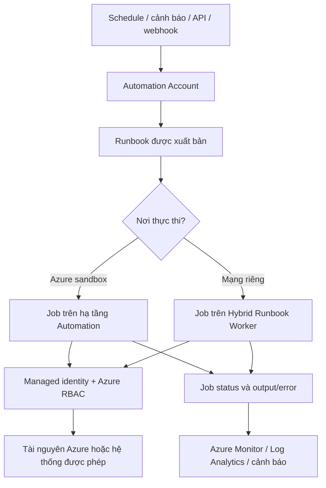

# Tự động hóa vận hành bằng Azure Automation

## Mục tiêu bài học

Sau bài học, bạn có thể:

1. Giải thích Azure Automation giải quyết những công việc vận hành nào và phân biệt **runbook**, **job**, **schedule**, **Automation Account** và **Hybrid Runbook Worker**.
2. Thiết kế quyền truy cập an toàn bằng **managed identity** và **Azure RBAC**, xác định đúng phạm vi subscription/resource group.
3. Viết, kiểm thử, xuất bản và đặt lịch cho một PowerShell runbook có kiểm tra điều kiện, chế độ chạy thử và xử lý lỗi.
4. Theo dõi kết quả qua job, output/error streams, Azure Monitor và Log Analytics; nhận biết sự cố thường gặp.
5. Chọn khi nào dùng Azure Automation, Azure Logic Apps, Azure Functions, Azure Policy hoặc Azure Update Manager cho nhu cầu thực tế.

> **Bối cảnh:** Bài thuộc chương **Hiệu năng và vận hành** của học phần `CLOUD_PROVIDERS_AZURE`. Khi vận hành ứng dụng trên Azure, ngoài subscription, resource group, Microsoft Entra ID, mạng, compute, storage và dữ liệu, nhóm kỹ thuật còn phải lặp lại nhiều thao tác triển khai, kiểm tra, khôi phục và kiểm soát chi phí. Azure Automation giúp thực thi những thao tác đó một cách có lịch, có quyền và có dấu vết.

## 1. Bài toán vận hành và vai trò của Azure Automation

Giả sử một nhóm có hàng chục máy ảo phục vụ phát triển và kiểm thử. Mỗi tối, kỹ sư phải tìm VM đang chạy, xác định máy nào được phép dừng, thực hiện lệnh và kiểm tra kết quả. Làm thủ công vừa tốn thời gian vừa dễ dừng nhầm máy production. Một quy trình tự động tốt cần biết **tài nguyên đích**, **điều kiện được phép thao tác**, **danh tính thực thi**, **thời điểm chạy**, **kết quả** và **cách xử lý khi lỗi**.

**Azure Automation** là dịch vụ Azure để thực thi và quản lý các tác vụ tự động hóa, chủ yếu thông qua *runbook*. Runbook có thể điều khiển tài nguyên Azure bằng API hoặc các module như `Az.Accounts`, `Az.Compute`, và cũng có thể gọi tới hệ thống khác khi môi trường chạy có quyền, module và kết nối phù hợp. Ví dụ:

- Bật hoặc giải phóng tài nguyên tính toán ngoài giờ làm việc để kiểm soát chi phí.
- Thu thập tình trạng tài nguyên định kỳ và tạo báo cáo vận hành.
- Phản ứng với cảnh báo bằng quy trình khắc phục có giới hạn, có phê duyệt nếu cần.
- Điều phối các bước kiểm tra trước/sau bảo trì, sao lưu hoặc chuyển đổi dự phòng.
- Thực hiện thao tác trên máy chủ trong mạng riêng qua Hybrid Runbook Worker.

Automation **không tự quyết định** một tác vụ có an toàn hay không. Runbook phải mã hóa quy tắc nghiệp vụ, kiểm tra trạng thái và thiết kế phương án quan sát, khôi phục. Ví dụ việc dừng VM có thể khiến dịch vụ gián đoạn hoặc mất dữ liệu chưa lưu, dù lệnh PowerShell chạy thành công.

## 2. Các thành phần và luồng thực thi

| Thành phần | Nhiệm vụ | Ví dụ |
| --- | --- | --- |
| **Automation Account** | Không gian quản lý runbook, job, schedule, identity và tài nguyên dùng chung. | `aa-ops-dev` trong một resource group quản trị. |
| **Runbook** | Mã hoặc quy trình mô tả công việc cần làm, có thể nhận tham số. | `Stop-TaggedDevVMs`. |
| **Job** | Một lần thực thi cụ thể của runbook; có trạng thái, thời điểm, output/error. | Job được tạo lúc 19:00 ngày làm việc. |
| **Schedule** | Lịch kích hoạt runbook, kèm tham số và múi giờ. | Mỗi ngày lúc 19:00 theo giờ Việt Nam. |
| **Runtime environment / modules** | Phiên bản ngôn ngữ và thư viện mà runbook dùng. | PowerShell cùng các module `Az.Accounts`, `Az.Compute`. |
| **Managed identity + RBAC** | Danh tính không cần lưu mật khẩu và quyền với tài nguyên đích. | Quyền dừng VM trong `rg-dev-compute`. |
| **Hybrid Runbook Worker** | Máy/nhóm máy thực thi runbook trong mạng riêng hoặc nơi cần công cụ cài sẵn. | Worker kết nối tới máy chủ nội bộ qua mạng doanh nghiệp. |
| **Job streams / diagnostics** | Ghi nhận đầu ra, cảnh báo, lỗi và gửi dữ liệu giám sát. | Phát hiện job `Failed` trên Azure Monitor. |



Điểm cần phân biệt: **runbook** là định nghĩa công việc; **job** là lần chạy của định nghĩa đó. Một runbook có thể có nhiều job do lịch, thao tác bấm **Start** hoặc API tạo ra. Nếu hai job cùng thay đổi một tài nguyên, chúng có thể xung đột; lịch chạy không tự cung cấp cơ chế khóa.

### Azure sandbox hay Hybrid Runbook Worker?

| Tiêu chí | Azure sandbox | Extension-based Hybrid Runbook Worker |
| --- | --- | --- |
| Vị trí chạy | Hạ tầng do Azure Automation quản lý. | Máy có extension Hybrid Runbook Worker do bạn quản lý. |
| Phù hợp | Gọi Azure Resource Manager, thao tác cloud không phụ thuộc mạng riêng. | Cần truy cập mạng nội bộ, endpoint private, phần mềm hoặc công cụ trên máy chạy. |
| Mạng và phụ thuộc | Chịu giới hạn môi trường sandbox và khả năng truy cập endpoint. | Phụ thuộc kết nối, DNS, tài nguyên và bảo trì của worker. |
| Vận hành | Ít phải quản lý máy chạy. | Phải giám sát sức khỏe worker, extension, quyền và bản vá hệ điều hành. |

Với công việc chỉ dừng VM thông qua Azure API, hãy bắt đầu bằng sandbox. Nếu cần thực thi lệnh bên trong mạng riêng hoặc gọi hệ thống tại chỗ, đánh giá Hybrid Runbook Worker. Với triển khai mới, dùng mô hình **extension-based**; các hướng dẫn dùng agent-based Hybrid Runbook Worker cũ không còn phù hợp.

## 3. Thiết kế quyền và vùng ảnh hưởng trước khi viết mã

Một runbook có thể chạy tự động trong nhiều tháng nên quyền của nó là một phần của kiến trúc bảo mật.

1. **Bật managed identity** trên Automation Account. System-assigned identity gắn vòng đời với Automation Account; user-assigned identity có vòng đời và cách quản trị độc lập.
2. **Gán Azure RBAC** cho danh tính tại phạm vi hẹp nhất có thể, ưu tiên resource group chứa tài nguyên đích hoặc tài nguyên cụ thể. Quyền truy cập Automation Account dành cho người tạo/sửa runbook là vấn đề khác với quyền runbook thao tác lên VM.
3. **Chọn quyền cần thiết cho hành động.** Với ví dụ dừng VM, cần quyền đọc VM/trạng thái và quyền deallocate. Có thể dùng vai trò dựng sẵn phù hợp để thực hành trong môi trường thử nghiệm; production nên cân nhắc custom role chỉ gồm các action thực sự cần. Không cấp `Owner` hoặc `Contributor` ở subscription chỉ để chạy một script dừng VM.
4. **Kiểm tra ranh giới dữ liệu.** RBAC trên Azure Resource Manager không mặc nhiên cấp quyền truy cập dữ liệu bên trong Storage, Key Vault hay database; các dịch vụ này có cơ chế cấp quyền riêng.
5. **Không đặt mật khẩu, secret, webhook URL hoặc access token trong mã nguồn/log.** Ưu tiên managed identity; khi hệ thống đích bắt buộc dùng secret, lưu trong Key Vault và kiểm soát quyền đọc.

Ví dụ bố trí phạm vi:

```text
Subscription: sub-workload
├── rg-automation
│   └── aa-ops-dev                (managed identity: mi-aa-ops-dev)
├── rg-dev-compute                (mi-aa-ops-dev được cấp quyền dừng VM ở đây)
│   ├── vm-dev-01  [AutoStop=true]
│   └── vm-dev-02  [AutoStop=false]
└── rg-prod-compute               (không cấp quyền dừng VM cho identity này)
    └── vm-prod-01
```

Phạm vi không nên chỉ dựa vào tên VM bắt đầu bằng `dev`. Dùng **resource group** để khoanh vùng ở lớp truy cập và **tag** để đánh dấu sự đồng ý của chủ sở hữu tài nguyên. Hai điều kiện độc lập này giúp giảm rủi ro thao tác sai. Nhớ rằng tag là metadata vận hành; người có quyền sửa tag có thể thay đổi đối tượng mà runbook chọn.

> **Lưu ý về xác thực:** Các tài liệu cũ có thể dùng **Automation Run As account** và service principal gắn certificate. Cơ chế Run As cũ đã được ngừng hỗ trợ; với runbook mới, hãy dùng managed identity và RBAC.

## 4. Thực hành: tự động giải phóng VM phát triển theo tag

### 4.1. Yêu cầu và tiêu chí chấp nhận

Bài toán: mỗi tối, giải phóng VM trong `rg-dev-compute` nếu VM có tag `AutoStop=true` và đang ở trạng thái `running`. Mọi VM khác phải được bỏ qua. Lần chạy đầu tiên **chỉ mô phỏng**.

| VM | Resource group | Tag `AutoStop` | Trạng thái ban đầu | Kết quả mong đợi |
| --- | --- | --- | --- | --- |
| `vm-dev-01` | `rg-dev-compute` | `true` | `running` | Hiện trong dry run; được deallocate khi chạy thật. |
| `vm-dev-02` | `rg-dev-compute` | `false` | `running` | Bỏ qua. |
| `vm-dev-03` | `rg-dev-compute` | `true` | `deallocated` | Bỏ qua vì đã dừng. |
| `vm-prod-01` | `rg-prod-compute` | `true` | `running` | Không được truy vấn vì ngoài resource group đích. |

Các tên trên chỉ là ví dụ; không cần tạo bốn VM chỉ để học mã. Nếu thực hành trên subscription thật, dùng môi trường sandbox được phép, VM có thể dừng và kiểm tra quyền từ trước. **Deallocate VM làm gián đoạn hệ điều hành và workload đang chạy**, dù tài nguyên lưu trữ bền vững vẫn tồn tại; cần có cửa sổ bảo trì và sự đồng ý của chủ workload.

### 4.2. Chuẩn bị trong Azure Portal

1. Mở **Automation Accounts** và tạo Automation Account (ví dụ `aa-ops-dev`) trong subscription, resource group, region được phép. Tên thực tế phải duy nhất theo quy tắc Azure tại thời điểm tạo.
2. Vào **Identity**, bật **System assigned** và lưu. Sau khi Azure tạo service principal cho identity, ghi lại **Object/Principal ID** để gán quyền, tránh dùng nhầm Application/Client ID.
3. Tại resource group chứa VM phát triển, mở **Access control (IAM)** và gán role thích hợp cho identity của Automation Account. Người thực hiện bước này cần quyền gán role. Với production, áp dụng role tùy biến chỉ có quyền đọc/trạng thái và `Microsoft.Compute/virtualMachines/deallocate/action` nếu đã kiểm chứng đủ cho các API được gọi.
4. Kiểm tra Automation Account có runtime PowerShell và các module **`Az.Accounts`**, **`Az.Compute`** tương thích. Có thể cần import/cập nhật module cho runtime environment sử dụng; không mặc định máy chạy có đủ thư viện hoặc version bạn muốn.
5. Trong resource group đích, thêm tag `AutoStop=true` vào một VM thử nghiệm. Đảm bảo tên subscription và resource group được chép chính xác.

Tài khoản Microsoft Entra dùng để đăng nhập Portal quản lý và gán role **không phải** là danh tính mà job sử dụng khi `Connect-AzAccount -Identity` chạy. Vì thế, việc người tạo runbook nhìn thấy hoặc dừng được VM thủ công không chứng minh managed identity có quyền tương ứng.

### 4.3. Tạo PowerShell runbook

Trong Automation Account, tạo **PowerShell runbook** tên `Stop-TaggedDevVMs`. Chọn phiên bản runtime đang được Azure Automation hỗ trợ trong tenant và tương thích với các module đã chuẩn bị. Dán mã sau vào trình soạn thảo.

```powershell
param(
    [Parameter(Mandatory = $true)]
    [ValidateNotNullOrEmpty()]
    [string] $SubscriptionId,

    [Parameter(Mandatory = $true)]
    [ValidateNotNullOrEmpty()]
    [string] $ResourceGroupName,

    # Mặc định an toàn: chỉ ghi log kế hoạch, chưa thay đổi VM.
    [bool] $DryRun = $true
)

$ErrorActionPreference = 'Stop'

try {
    Import-Module Az.Accounts -ErrorAction Stop
    Import-Module Az.Compute -ErrorAction Stop

    # Tránh kế thừa Azure context của job trước trong môi trường thực thi dùng chung.
    Disable-AzContextAutosave -Scope Process | Out-Null

    # Job sử dụng system-assigned managed identity của Automation Account.
    Connect-AzAccount -Identity -ErrorAction Stop | Out-Null
    Set-AzContext -SubscriptionId $SubscriptionId -ErrorAction Stop | Out-Null

    # Chỉ lấy VM trong RG đã chỉ định, kèm trạng thái nguồn điện.
    $vms = @(Get-AzVM -ResourceGroupName $ResourceGroupName -Status -ErrorAction Stop)
}
catch {
    throw "Khởi tạo hoặc truy vấn VM thất bại: $($_.Exception.Message)"
}

$eligible = 0
$deallocated = 0
$skipped = 0
$failures = @()

foreach ($vm in $vms) {
    # Không suy đoán mục đích VM từ tên. Chỉ nhận tag chấp thuận rõ ràng.
    if ($null -eq $vm.Tags -or $vm.Tags['AutoStop'] -ne 'true') {
        $skipped++
        continue
    }

    $eligible++
    $isRunning = @($vm.Statuses | Where-Object {
        $_.Code -eq 'PowerState/running'
    }).Count -gt 0

    if (-not $isRunning) {
        Write-Output "SKIP name=$($vm.Name) reason=not-running"
        $skipped++
        continue
    }

    if ($DryRun) {
        Write-Output "DRY_RUN action=deallocate name=$($vm.Name) rg=$ResourceGroupName"
        continue
    }

    try {
        # Mặc định Stop-AzVM deallocate VM; không dùng -StayProvisioned.
        Stop-AzVM -ResourceGroupName $ResourceGroupName -Name $vm.Name `
            -Force -ErrorAction Stop | Out-Null
        $deallocated++
        Write-Output "SUCCESS action=deallocate name=$($vm.Name) rg=$ResourceGroupName"
    }
    catch {
        $failures += $vm.Name
        Write-Error -Message "FAILED name=$($vm.Name) detail=$($_.Exception.Message)" `
            -ErrorAction Continue
    }
}

Write-Output "SUMMARY total=$($vms.Count) eligible=$eligible skipped=$skipped deallocated=$deallocated failed=$($failures.Count) dryRun=$DryRun"

if ($failures.Count -gt 0) {
    throw "Không thể deallocate các VM: $($failures -join ', ')"
}
```

**Giải thích các điểm quyết định:**

- `Disable-AzContextAutosave -Scope Process` ngăn job dùng lại Azure context đã lưu trong môi trường Automation; `Connect-AzAccount -Identity` lấy token cho managed identity, rồi `Set-AzContext` cố định subscription mục tiêu.
- Hai tham số `SubscriptionId` và `ResourceGroupName` xác định đích chạy. Nếu sử dụng cùng Automation Account cho nhiều môi trường, cần kiểm soát quyền và tham số lịch chạy vì điền sai subscription có thể tác động tài nguyên khác mà identity được quyền quản lý.
- `Get-AzVM ... -Status` lấy thông tin trạng thái. Tag là điều kiện nghiệp vụ; chỉ VM có `AutoStop=true` **và** đang `PowerState/running` mới được chọn để dừng.
- `DryRun` mặc định `true`, vì thế chạy thử chỉ in kế hoạch. Khi đã kiểm tra, truyền `false` cho lịch production được phê duyệt.
- `Stop-AzVM` mặc định yêu cầu giải phóng VM, tương ứng **deallocate**, giúp ngừng tính phí compute khi VM đã ở trạng thái deallocated; chi phí disk, một số địa chỉ IP và dịch vụ liên quan vẫn có thể tiếp tục. `-Force` bỏ qua xác nhận tương tác nên cần các điều kiện bảo vệ trước đó.
- `try/catch` xử lý thất bại riêng từng VM, cho phép các VM sau vẫn được thử. Nếu có lỗi, `throw` cuối job báo tình trạng thất bại cho hệ thống giám sát. Không chỉ dựa vào các dòng output có chữ `FAILED` để suy luận trạng thái job.

Trong hệ thống lớn, việc kiểm tra state rồi ra lệnh có thể có **race condition**: một người khác vừa bật/tắt VM giữa hai thao tác. Đối với tác vụ quan trọng cần thêm cơ chế phối hợp như khóa theo tài nguyên, giới hạn số job đồng thời và chính sách change window. Mẫu này là nền tảng thực hành, không phải giải pháp điều phối toàn bộ ứng dụng có phụ thuộc lẫn nhau.

### 4.4. Chạy thử, xuất bản và lập lịch

**Bước 1 — Test pane:** chạy runbook với tham số ví dụ:

```text
SubscriptionId  = <subscription-id-cua-ban>
ResourceGroupName = rg-dev-compute
DryRun          = true
```

Kiểm tra output. Nếu VM `vm-dev-01` đang chạy và có tag đúng, bạn sẽ thấy dòng dạng:

```text
DRY_RUN action=deallocate name=vm-dev-01 rg=rg-dev-compute
SKIP name=vm-dev-03 reason=not-running
SUMMARY total=3 eligible=2 skipped=2 deallocated=0 failed=0 dryRun=True
```

Tổng `skipped` có thể gồm VM không có tag hợp lệ và VM đã dừng. Số liệu trên chỉ minh họa theo bảng giả định; output thật phụ thuộc tài nguyên tại thời điểm job chạy. Kiểm tra không có `vm-prod-01` trong output vì lệnh chỉ truy vấn resource group phát triển.

**Bước 2 — Kiểm tra lần chạy thật:** sau khi chủ workload chấp thuận và trong thời gian bảo trì, chạy thử trên một VM phát triển có thể dừng, chuyển `DryRun=false`. Quan sát job và trạng thái VM tại Portal; xác minh máy đạt trạng thái **Stopped (deallocated)**. Nếu có lỗi quyền hoặc kết nối, không bật lịch định kỳ cho tới khi xử lý.

**Bước 3 — Publish:** lưu bản nháp và **Publish** runbook đã kiểm thử. Schedule chạy bản **đã publish**; sửa draft chưa chắc thay đổi hành vi của job đang chạy hoặc job được lập lịch.

**Bước 4 — Schedule:** tạo hoặc liên kết lịch (ví dụ 19:00 hằng ngày theo múi giờ `Asia/Ho_Chi_Minh` nếu giao diện hỗ trợ cách hiển thị tương ứng), đặt tham số `SubscriptionId`, `ResourceGroupName` và **`DryRun=false`**. Xác minh ngày bắt đầu, múi giờ, chu kỳ lặp và việc thay đổi giờ mùa hè đối với khu vực có DST; Portal có thể biểu diễn múi giờ theo danh sách riêng.

**Bước 5 — Chạy lại để kiểm tra tính lặp:** một job khác chạy khi VM đã deallocated phải bỏ qua VM đó thay vì báo lỗi hoặc liên tục tác động. Đây là ví dụ về **idempotency** ở mức quy trình: chạy nhiều lần đưa hệ thống về cùng trạng thái mong muốn trong phạm vi bài toán.

> Trước khi dùng lịch thật cho nhiều VM, hãy thống nhất ai được gắn `AutoStop=true`, giờ bảo trì, cách khởi động lại và kế hoạch xử lý khi workload có tiến trình chưa hoàn tất. Giải phóng VM không tự động đóng database connection hay lưu trạng thái ứng dụng.

## 5. Kích hoạt runbook ngoài lịch định kỳ

| Cơ chế | Khi nào nên dùng | Điều cần kiểm soát |
| --- | --- | --- |
| **Manual Start** | Thử nghiệm, thao tác vận hành có người chịu trách nhiệm. | Tham số đầu vào, RBAC của người khởi chạy, log job. |
| **Schedule** | Nhiệm vụ lặp lại theo ngày/tuần/tháng. | Múi giờ, lịch chồng lấn, thời gian chạy vượt chu kỳ. |
| **API / PowerShell** | Một hệ thống điều phối được ủy quyền tạo job. | Danh tính gọi API, tham số, chống tạo job trùng. |
| **Webhook** | Hệ thống bên ngoài gửi HTTP request để kích hoạt job. | URL chứa token bí mật, vòng đời webhook, kiểm tra payload; không công bố URL. |
| **Azure Monitor + Logic Apps** | Cảnh báo cần lọc tín hiệu, xác minh điều kiện hoặc xin phê duyệt trước khi khắc phục. | Tránh vòng lặp cảnh báo → chạy lại → cảnh báo; ràng buộc tần suất và điều kiện. |

Webhook của Azure Automation sử dụng URL bí mật làm khả năng kích hoạt; bất kỳ ai có URL hợp lệ có thể gửi yêu cầu. Nếu quy trình đòi hỏi xác thực mạnh, xác thực payload hoặc phê duyệt, đặt thành phần trung gian như Logic Apps/API trước khi gọi Automation theo thiết kế bảo mật của tổ chức.

Không phải mọi cảnh báo đều nên tự khởi động lại VM hoặc thay đổi cấu hình. Ví dụ CPU tăng cao có thể do traffic hợp lệ; runbook nên xác thực thêm tín hiệu, so sánh baseline, giới hạn số lần chạy và có đường chuyển cho người trực vận hành.

## 6. Giám sát job, lỗi và dấu vết vận hành

Một runbook chạy theo lịch nhưng không có giám sát sẽ biến lỗi thành sự cố âm thầm. Mỗi lần chạy cần đủ thông tin để trả lời: **job nào**, **chạy lúc nào**, **đích nào**, **đã làm gì**, **tác động bao nhiêu tài nguyên**, **có lỗi không**.

### Trạng thái và streams

Vào Automation Account → **Jobs** hoặc mở runbook → **Jobs** để xem lần chạy. Các trạng thái thường gặp gồm `New`, `Activating`, `Running`, `Completed`, `Failed`, `Stopped` và `Suspended`; trạng thái cụ thể và giai đoạn chuyển có thể thay đổi theo runtime. Đọc **Output** để xem `DRY_RUN`, `SUCCESS`, `SUMMARY`; đọc **Error** khi có exception; sử dụng Warning/Verbose/Progress khi thích hợp. `Completed` chỉ chứng minh job kết thúc theo cơ chế runtime, chưa chứng minh toàn bộ mục tiêu nghiệp vụ đạt được nếu script đã tự nuốt lỗi.

Lời khuyên về ghi log:

- Dùng cấu trúc ổn định như `action=... name=...` để dễ tìm kiếm, không ghi bearer token hoặc connection string.
- Thêm correlation/job ID vào thông báo khi cần đối chiếu nhiều hệ thống; ghi thời gian theo UTC trong luồng máy xử lý và chuyển sang giờ địa phương ở giao diện.
- Cho job báo lỗi rõ ràng khi nhiệm vụ thực sự thất bại; cảnh báo chỉ hiệu quả nếu trạng thái và log phản ánh kết quả.
- Ghi tổng số mục tiêu được chọn, thực hiện và thất bại để đối chiếu với dự kiến sau mỗi đợt chạy.

### Gửi log tới Log Analytics và tạo cảnh báo

Trong Automation Account, cấu hình **Diagnostic settings** gửi **JobLogs** và **JobStreams** tới Log Analytics workspace phù hợp. Sau khi có dữ liệu, có thể thử truy vấn KQL sau để xem lưu lượng job theo giờ trong bảng chung `AzureDiagnostics`:

```kusto
AzureDiagnostics
| where ResourceProvider =~ 'MICROSOFT.AUTOMATION'
| where Category == 'JobLogs'
| summarize JobLogRecords = count() by bin(TimeGenerated, 1h)
| order by TimeGenerated desc
```

Đây là truy vấn minh họa cho chế độ ghi log vào `AzureDiagnostics`. **Schema thực tế phụ thuộc cách cấu hình bảng đích và phiên bản diagnostic logs**; nếu workspace dùng bảng tài nguyên riêng, thay tên bảng/field bằng tên được Azure Monitor hiển thị. Trước khi tạo alert, xác minh bản ghi có xuất hiện và chọn đúng cột biểu thị trạng thái job. Sau đó tạo log search alert khi có job thất bại hoặc một runbook quan trọng **không chạy trong cửa sổ mong đợi**. Kiểm tra alert bằng một job lỗi có chủ ý trong môi trường thử nghiệm.

Ngoài tình trạng Failed, theo dõi số lần chạy, độ trễ từ lúc kích hoạt, thời gian thực thi, số VM đã xử lý và số lần phải khởi động lại job. Các chỉ số giúp đánh giá hiệu năng vận hành và kế hoạch năng lực của chính hệ thống tự động hóa.

## 7. Thiết kế vận hành đáng tin cậy khi tăng quy mô

### Idempotency và khả năng chạy lại

Một trigger có thể được gửi lại, job có thể bị dừng giữa chừng, hoặc lịch kế tiếp bắt đầu khi job trước chưa xong. Vì vậy mỗi runbook nên kiểm tra trạng thái hiện tại, ghi tiến độ, chỉ tác động đối tượng hợp lệ và xử lý chạy lặp. Trong ví dụ, VM đã deallocated được bỏ qua. Với tác vụ tạo tài nguyên hoặc gửi thông báo, cần idempotency key hay bảng trạng thái bền vững để tránh tạo/sử dụng lặp.

### Giới hạn, retry và lỗi tạm thời

Azure Resource Manager và các API có thể trả về `429 Too Many Requests` hoặc lỗi tạm thời. Khi đó, dùng retry có giới hạn với exponential backoff, jitter và tôn trọng `Retry-After` nếu API cung cấp; không đặt vòng lặp retry vô hạn. Phân biệt **lỗi tạm thời** (throttling/network) với **lỗi cố định** (`403 Forbidden`, resource không tồn tại, tham số sai). Với thao tác lâu hoặc nhiều VM, giới hạn concurrency theo subscription/region và xem xét thời hạn thực thi, số job đồng thời cùng quota hiện hành của dịch vụ.

### Quản lý thay đổi

Xem runbook như mã ứng dụng: lưu nguồn trong kho mã, review thay đổi, phân tách dev/prod, kiểm tra tham số, thử bằng dry run, kiểm thử trong môi trường thấp trước khi publish. Nếu deploy bằng Bicep/Terraform hoặc pipeline, quản lý cả quyền, runbook, runtime, schedules và diagnostics như một phần của cấu hình có thể kiểm toán. Tránh sửa trực tiếp mã production mà không có lịch sử phiên bản và quy trình quay lui.

### Chi phí và vòng đời

Automation có chi phí theo cấu phần và mức sử dụng, còn Log Analytics tính phí lưu/thu thập log, Hybrid Worker tiêu thụ tài nguyên máy chủ và những dịch vụ được gọi có thể tính phí riêng. Xem bảng giá hiện hành cho region và cấu hình cụ thể. Khi dừng VM để tiết kiệm, cần kiểm tra **compute đã deallocate**; trạng thái `Stopped` trong hệ điều hành nhưng VM vẫn được cấp phát có thể tiếp tục phát sinh phí compute. Chi phí đĩa, backup, public IP và dữ liệu có thể vẫn tồn tại sau khi deallocate.

## 8. Khi nào chọn dịch vụ khác?

| Nhu cầu | Dịch vụ thường phù hợp | Lý do |
| --- | --- | --- |
| Chạy script quản trị Azure định kỳ, nhiều lệnh PowerShell | **Azure Automation** | Runbook, schedule, identity, job history tích hợp. |
| Kết nối nhiều dịch vụ SaaS, workflow nghiệp vụ có nhánh và phê duyệt | **Azure Logic Apps** | Connectors, workflow trực quan, tích hợp sự kiện. |
| Chạy hàm ngắn theo HTTP, timer hoặc event trong ứng dụng | **Azure Functions** | Môi trường code theo sự kiện, linh hoạt cho logic ứng dụng. |
| Chặn cấu hình tài nguyên trái quy định hoặc kiểm toán compliance | **Azure Policy** | Đánh giá và áp quy tắc lên tài nguyên, không cần tự quét bằng script mọi lúc. |
| Đánh giá và điều phối cập nhật bản vá hệ điều hành trên máy | **Azure Update Manager** | Dịch vụ chuyên trách patch orchestration cho Azure VM và máy hỗ trợ qua Arc. |
| Chuỗi thao tác triển khai hạ tầng có review và rollback phiên bản | **CI/CD + Bicep/Terraform** | Dễ kiểm soát thay đổi, plan, approval và môi trường. |

Các dịch vụ có thể kết hợp: Azure Monitor phát hiện sự cố → Logic Apps kiểm tra/phê duyệt → Azure Automation khởi chạy runbook → job streams đẩy về Log Analytics → cảnh báo cho người trực nếu lỗi.

## 9. Lỗi thường gặp và cách chẩn đoán

| Hiện tượng | Nguyên nhân có thể | Cách kiểm tra hoặc khắc phục |
| --- | --- | --- |
| `Connect-AzAccount -Identity` thất bại | Chưa bật identity, runtime/worker chưa hỗ trợ cấu hình tương ứng. | Xác nhận Identity đã bật, job chạy đúng Automation Account/worker; xem Error stream. |
| `AuthorizationFailed` hoặc `403` | RBAC thiếu quyền hoặc gán sai principal/scope. | Xem object ID của identity, role assignment ở đúng RG; chờ quyền mới được áp dụng rồi thử lại. |
| `Get-AzVM` hoặc `Stop-AzVM` không tồn tại | Thiếu module/phiên bản runtime không tương thích. | Kiểm tra module `Az.Compute` và `Az.Accounts` trong runtime environment. |
| Job chạy thành công nhưng VM không dừng | `DryRun=true`, tag sai, VM đã dừng hoặc lệnh chọn sai RG. | Xem `SUMMARY`, tag, trạng thái `PowerState`, tham số truyền vào. |
| Runbook thủ công chạy được nhưng lịch không chạy | Chưa publish, schedule chưa liên kết, lịch chưa đến hạn, tham số khác. | Xem trạng thái publish, schedules, timezone và lịch sử job. |
| Job bị treo hoặc không truy cập hệ thống private | Sandbox không tới được endpoint, DNS/firewall hoặc worker không sẵn sàng. | Kiểm tra kiến trúc mạng; dùng Hybrid Worker khi cần, giám sát extension và network route. |
| Nhiều job tác động cùng tài nguyên | Lịch trùng, API/webhook gửi lại; không có khóa. | Kiểm tra job history, bổ sung điều kiện state và giới hạn chạy song song. |
| API báo `429` | Vượt giới hạn dịch vụ hoặc gọi quá nhanh. | Kiểm tra throttling, thêm retry/backoff và giới hạn batch/concurrency. |
| Không thấy log trong Log Analytics | Diagnostic settings sai workspace/category hoặc chưa phát sinh dữ liệu. | Xác minh destination, `JobLogs`/`JobStreams`, thời gian ingest và schema thực tế. |

## 10. Bài tập củng cố

**Bài tập A — Kiểm soát phạm vi:** sửa giải pháp để chỉ chạy cho VM có cả `AutoStop=true` và `Environment=dev`. Hãy giải thích vì sao điều kiện tag **vẫn phải đi kèm** RBAC phạm vi resource group, và cách bạn kiểm thử chắc chắn production không nằm trong tập xử lý.

**Bài tập B — Giám sát:** thiết kế một cảnh báo nếu runbook chạy xong nhưng có ít nhất một VM không deallocate thành công. So sánh hai cách: để job `Failed` rồi tạo alert theo trạng thái job; hoặc xuất metric/log có cấu trúc với số VM thất bại. Chọn cách đáp ứng yêu cầu audit và tránh false positive.

**Bài tập C — Sự cố vận hành:** giả sử job đầu tiên dừng được 4/5 VM rồi lỗi `429` với VM cuối. Hãy mô tả cách chạy lại an toàn, chính sách retry tối đa và lý do không nên thử vô hạn. Xác định những dữ liệu phải xuất hiện trong log để điều tra được sau một tuần.

### Tự kiểm tra

1. Khác biệt quan trọng giữa **runbook** và **job** là gì? — Runbook mô tả mã/quy trình; job là một lần thực thi cụ thể cùng tham số và logs.
2. Vì sao managed identity vẫn cần Azure RBAC? — Identity chứng minh danh tính, RBAC xác định tài nguyên và thao tác được phép.
3. Vì sao runbook nên có `DryRun` và kiểm tra trạng thái trước khi `Stop-AzVM`? — Giảm rủi ro thao tác ngoài dự kiến và giúp chạy lại có kiểm soát.
4. Vì sao job `Completed` chưa đủ để chứng minh mục tiêu vận hành? — Script có thể không phát lỗi khi bỏ qua hoặc xử lý thiếu tài nguyên; cần thêm chỉ số kết quả nghiệp vụ.
5. Khi nào dùng Hybrid Runbook Worker? — Khi script cần kết nối, công cụ hoặc phụ thuộc chỉ có trên worker/mạng riêng.

## Tài liệu Microsoft Learn để tra cứu khi thực hành

- [Azure Automation overview](https://learn.microsoft.com/azure/automation/overview)
- [Runbook types in Azure Automation](https://learn.microsoft.com/azure/automation/automation-runbook-types)
- [Use a managed identity in Azure Automation](https://learn.microsoft.com/azure/automation/enable-managed-identity-for-automation)
- [Manage schedules in Azure Automation](https://learn.microsoft.com/azure/automation/shared-resources/schedules)
- [Extension-based Hybrid Runbook Worker](https://learn.microsoft.com/azure/automation/automation-hybrid-runbook-worker)
- [Send Automation job logs to Azure Monitor Logs](https://learn.microsoft.com/azure/automation/automation-manage-send-joblogs-log-analytics)

Khi triển khai thực tế, hãy đối chiếu phiên bản runtime, các module khả dụng, quota, tính năng và giá tại subscription/region đang dùng vì nền tảng Azure được cập nhật liên tục.
