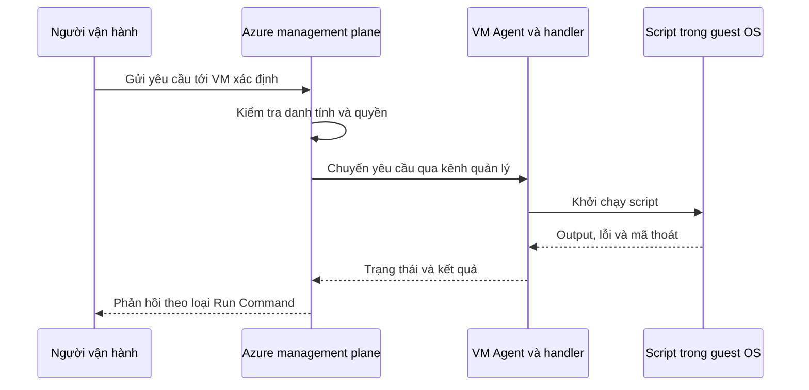
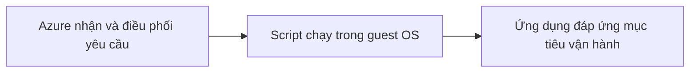

# Azure Run Command và thao tác quản trị từ xa

## Mục tiêu và bối cảnh

Trong chương **Hiệu năng và vận hành** của module **CLOUD_PROVIDERS_AZURE**, Azure Run Command là một công cụ để đưa script quản trị vào máy ảo qua kênh quản lý của Azure. Nó hữu ích khi cần khảo sát hệ điều hành, xác minh trạng thái ứng dụng hoặc thực hiện một thay đổi có kiểm soát.

Một ứng dụng Azure còn phụ thuộc mạng ảo, lưu trữ, dữ liệu, danh tính và giám sát. Vì vậy, “lệnh chạy xong trên VM” cần được phân biệt với “dịch vụ đã phục hồi”. Bài này hướng dẫn chọn loại Run Command, kiểm tra điều kiện thực thi, chạy ví dụ chẩn đoán trên Linux và Windows, đọc kết quả và ghi nhận thao tác.

Các tên VM, GUID, service và số liệu trong ví dụ là giả định. Người học cần thay chúng bằng đích đã được giao. Những ví dụ chẩn đoán không chủ động thay cấu hình ứng dụng; việc gọi Run Command vẫn là một thao tác quản trị và có thể tạo trạng thái, script hoặc log phục vụ thực thi trên VM.

## 1. Run Command hoạt động qua VM Agent

Run Command sử dụng **Azure VM Agent** để thực thi script bên trong máy ảo Linux hoặc Windows. Đây không phải một phiên terminal tương tác. Azure có hai mô hình chính: **Action Run Command** và **Managed Run Command**. Xem [tổng quan Azure Run Command](https://learn.microsoft.com/en-us/azure/virtual-machines/run-command-overview).

Có thể hình dung đường đi của yêu cầu như sau:



Sơ đồ này giúp tách các điểm có thể thất bại: yêu cầu bị từ chối ở Azure, agent không nhận việc, script lỗi trong guest OS hoặc kết quả không truyền về được.

Một VM mất kết nối SSH/RDP chưa chắc đã mất kênh agent. Ngược lại, một VM còn hiển thị trong Portal chưa chắc agent và hệ điều hành đã đủ khỏe để chạy script.

## 2. Khi nào chọn Run Command?

Một nhu cầu điển hình là kiểm tra nhanh disk, service hoặc cấu hình mạng bên trong VM khi không mở được phiên đăng nhập thông thường.

| Nhu cầu | Hướng lựa chọn công cụ |
| --- | --- |
| Chạy một script chẩn đoán nhỏ, không cần tương tác | Action Run Command thường phù hợp |
| Quản lý script như một tài nguyên triển khai, cần theo dõi thực thi | Cân nhắc Managed Run Command |
| Cần phiên làm việc tương tác để khảo sát nhiều bước | Dùng kênh SSH/RDP được tổ chức cho phép |
| Cài phần mềm hoặc cấu hình sau triển khai theo mẫu | Cân nhắc Custom Script Extension hoặc cơ chế triển khai của đội |
| Cần chạy định kỳ trên nhiều VM | Dùng hệ thống điều phối hoặc lịch chạy; Run Command có thể là một bước thực thi |
| Guest OS không khởi động hoặc agent không hoạt động | Chọn quy trình khôi phục phù hợp với trạng thái VM |

Bảng là hướng phân tích nhu cầu, không phải cam kết mọi công cụ đều áp dụng được cho mọi VM. Microsoft mô tả Run Command và Custom Script Extension trong [các cách chạy script trên Azure VM](https://learn.microsoft.com/en-us/azure/virtual-machines/windows/run-scripts-in-vm).

Run Command không tự cung cấp lịch định kỳ chỉ vì script đã được lưu thành tài nguyên Managed Run Command. Lịch chạy, điều kiện kích hoạt và xử lý lỗi vẫn cần được thiết kế.

## 3. Phân biệt Action và Managed Run Command

### 3.1. Action Run Command

Action Run Command phù hợp với lần thực thi ngắn, ví dụ đọc trạng thái service hoặc thu thập thông tin chẩn đoán. Lệnh CLI điển hình là `az vm run-command invoke`; với Azure PowerShell là `Invoke-AzVMRunCommand`.

Các giới hạn cần tính khi dùng Action trên Linux gồm một script đang hoạt động tại một thời điểm, không hỗ trợ nhập liệu tương tác, không hủy trực tiếp script đang chạy, thời gian tối đa 90 phút và phần output trả về bị giới hạn ở 4.096 byte cuối. Xem [Action Run Command trên Linux](https://learn.microsoft.com/en-us/azure/virtual-machines/linux/run-command).

### 3.2. Managed Run Command

Managed Run Command được biểu diễn bằng tài nguyên con của VM, loại `Microsoft.Compute/virtualMachines/runCommands`. Mô hình này hỗ trợ cấu hình timeout, theo dõi trạng thái, chạy nhiều script theo cách song song hoặc theo chuỗi và các tùy chọn output mở rộng.

Có thể phân biệt nhanh:

| Khía cạnh | Action | Managed |
| --- | --- | --- |
| Cách sử dụng điển hình | Gọi một lần thực thi | Tạo hoặc cập nhật tài nguyên Run Command |
| CLI thường dùng | `invoke` | `create`, `show`, `update` |
| Quản lý như tài nguyên ARM | Không phải tài nguyên con cho lần invoke | Có |
| Thời gian script | Có giới hạn Action | Có timeout do người dùng cấu hình |
| Nhiều script | Cần xét giới hạn Action trên VM | Có khả năng song song hoặc theo chuỗi |
| Theo dõi | Phản hồi của lần gọi | Trạng thái thực thi qua instance view |

Tham khảo mô hình và cách sử dụng ở [Managed Run Command trên Linux](https://learn.microsoft.com/en-us/azure/virtual-machines/linux/run-command-managed).

Cụm từ “chạy theo chuỗi” không có nghĩa các script tự biết phụ thuộc nghiệp vụ. Nếu script B cần dữ liệu do A tạo ra, quy trình phải chờ và kiểm tra kết quả A trước khi cho B tiếp tục.

### 3.3. Cùng nhóm tên CLI nhưng khác mô hình

Hai lệnh sau không tương đương:

```text
az vm run-command invoke
    -> Gửi một Action Run Command

az vm run-command create
    -> Tạo hoặc cập nhật một Managed Run Command có tên
```

Không dùng `create` hoặc `update` như một lệnh hỏi trạng thái. Để quan sát một Managed Run Command đã tồn tại, dùng thao tác đọc như `show`.

## 4. Kiểm tra điều kiện trước khi gửi script

### 4.1. Xác định đúng đích

Một hồ sơ đích tối thiểu nên có:

```text
Cloud:
Tenant ID:
Subscription ID:
Resource group:
VM name và resource ID:
Hệ điều hành:
Mục đích thao tác:
```

Tên VM có thể giống nhau ở những subscription khác nhau. Trong ví dụ CLI, luôn truyền `--subscription` và resource group thay vì chỉ dựa vào subscription mặc định.

### 4.2. Kiểm tra VM Agent và trạng thái VM

Trước khi chẩn đoán ứng dụng, hãy xác định VM đang chạy và agent có trạng thái phù hợp. Azure Windows VM Agent quản lý tương tác giữa VM và hạ tầng Azure cho các hoạt động như extension; xem [tổng quan Azure Windows VM Agent](https://learn.microsoft.com/en-us/azure/virtual-machines/extensions/agent-windows).

Ví dụ dưới đây chạy trên máy quản trị có **Azure CLI**, với cú pháp PowerShell:

```powershell
$subscriptionId = '22222222-2222-4222-8222-222222222222'
$resourceGroup = 'rg-orders-prod'
$vmName = 'vm-orders-linux-01'

az account show --query "{subscription:id,tenant:tenantId,account:user.name}" --output json

az vm show --subscription $subscriptionId --resource-group $resourceGroup --name $vmName --query "{id:id,location:location,osType:storageProfile.osDisk.osType}" --output json

az vm get-instance-view --subscription $subscriptionId --resource-group $resourceGroup --name $vmName --output json
```

Đọc thông tin power state, agent và extension trong instance view. Nếu lệnh khảo sát thất bại, cần xử lý ngữ cảnh, quyền hoặc trạng thái VM trước; không coi một phản hồi rỗng là xác nhận agent khỏe.

### 4.3. Kiểm tra mạng theo đường agent và đường dữ liệu

Run Command có thể hữu ích khi cổng SSH/RDP không mở, nhưng vẫn phụ thuộc vào agent và kết nối outbound để trả kết quả. Với Action trên Windows, tài liệu nêu yêu cầu kết nối HTTPS tới các endpoint Azure phù hợp; script có thể chạy nhưng không trả kết quả khi đường này bị chặn. Agent ở trạng thái NOT READY cũng khiến Run Command không hoạt động. Xem [điều kiện và giới hạn Action Run Command trên Windows](https://learn.microsoft.com/en-us/azure/virtual-machines/windows/run-command).

Cần tách hai đường mạng:

- **Đường điều khiển:** agent nhận yêu cầu và chuyển trạng thái/kết quả.
- **Đường script sử dụng:** tải script, truy cập blob output hoặc gọi hệ thống nghiệp vụ.

Một script đọc trạng thái service có thể không cần gọi database. Script kiểm tra kết nối database lại cần DNS, route và quyền truy cập thích hợp. Không suy ra rằng kênh agent hoạt động thì mọi đích mạng của script cũng truy cập được.

## 5. Quyền Azure và tài khoản thực thi trong guest OS

### 5.1. Azure RBAC cho phép gửi thao tác

Theo danh mục operation của Compute:

| Hoạt động | Operation cần đối chiếu |
| --- | --- |
| Gọi Action Run Command | `Microsoft.Compute/virtualMachines/runCommand/action` |
| Đọc tài nguyên Managed Run Command | `Microsoft.Compute/virtualMachines/runCommands/read` |
| Tạo hoặc cập nhật Managed Run Command | `Microsoft.Compute/virtualMachines/runCommands/write` |
| Xóa tài nguyên Managed Run Command | `Microsoft.Compute/virtualMachines/runCommands/delete` |

Đây là các operation của Compute, không phải một role definition hoàn chỉnh cho mọi quy trình. Các bước đọc VM, instance view hoặc danh mục command có thể cần quyền đọc tương ứng. Đối chiếu [danh mục Azure permissions for Compute](https://learn.microsoft.com/en-us/azure/role-based-access-control/permissions/compute).

Khi phân quyền, xác định phạm vi VM hoặc nhóm VM cần quản lý. Quyền chạy script có tác động lớn hơn quyền đọc cấu hình tài nguyên; không xem nó như quyền quan sát thông thường.

### 5.2. Danh tính người gọi khác tài khoản chạy script

Với Action, script chạy bằng tài khoản hệ thống có đặc quyền trên VM; trên Windows là `Local System`. Môi trường này không giống phiên RDP của người vận hành: profile, ổ đĩa được map, biến môi trường và quyền truy cập dịch vụ từ xa có thể khác.

Microsoft dùng sự khác biệt tài khoản thực thi để giải thích nhiều lỗi script trong [hướng dẫn debug Custom Script Extension và Run Command](https://learn.microsoft.com/en-us/troubleshoot/azure/virtual-machines/windows/debug-customscriptextension-runcommand-scripts).

Hệ quả thực hành:

- Sử dụng đường dẫn tuyệt đối khi đọc file trong guest.
- Không giả định ổ đĩa được map trong phiên đăng nhập của một người sẽ tồn tại.
- Kiểm tra tài khoản thực thi trong output chẩn đoán.
- Quyền quản trị cục bộ không tự tạo quyền đọc database hoặc storage từ xa.

Managed Run Command có tùy chọn chạy dưới user được chỉ định. Nếu dùng, tài khoản và quyền cần thiết phải được chuẩn bị trong guest; không coi đó là cách bỏ qua phân quyền.

## 6. Thao tác nhanh từ Portal

Đối với Action Run Command, có thể mở VM trong Portal, tìm mục **Run command**, rồi chọn command phù hợp với hệ điều hành:

- `RunShellScript` cho Linux.
- `RunPowerShellScript` cho Windows.

Dán một script nhỏ, xem lại đích VM và nội dung rồi chạy theo quyền đã được giao. Bắt đầu bằng thông tin nhận diện và trạng thái cần khảo sát để xác nhận cách công cụ hoạt động trước khi dùng script thay đổi.

Khi nội dung dài hoặc cần lặp lại, quản lý script có phiên bản sẽ giúp đối chiếu chính xác nội dung đã chạy. Portal tiện cho thao tác một lần; một quy trình vận hành có thể lặp lại còn cần tên phiên bản, tham số, thời điểm và kết quả.

## 7. Ví dụ Linux: khảo sát service mà không đổi cấu hình

Giả sử VM Linux dùng `systemd` và backend đã được cài dưới service `orders-api.service`. Script mẫu khảo sát thời gian, danh tính, dung lượng phân vùng gốc và trạng thái service. Thay tên service nếu kiến trúc của bạn khác.

Nội dung file **`diag-linux.sh`** trên máy quản trị:

```sh
#!/bin/sh
set -eu

printf 'run_id=diag-orders-001\n'
printf 'time_utc=%s\n' "$(date -u '+%Y-%m-%dT%H:%M:%SZ')"
printf 'host=%s\n' "$(hostname)"
printf 'execution_identity:\n'
id

printf 'root_filesystem:\n'
df -Pk /

if ! command -v systemctl >/dev/null 2>&1; then
    printf 'error=systemctl_not_available\n' >&2
    exit 3
fi

if systemctl is-active --quiet orders-api.service; then
    printf 'service_state=active\n'
else
    printf 'service_state=not_active\n'
    exit 2
fi

printf 'run_result=PASS\n'
```

Script dùng cú pháp shell POSIX và không yêu cầu nhập liệu. Mã thoát 2 có nghĩa điều kiện service không đạt theo quy ước của ví dụ; mã 3 chỉ ra môi trường không có `systemctl`. Các mã này không phải mã lỗi chuẩn của Azure.

Trên **máy quản trị chạy PowerShell với Azure CLI**, gọi:

```powershell
az vm run-command invoke --subscription $subscriptionId --resource-group $resourceGroup --name $vmName --command-id RunShellScript --scripts "@diag-linux.sh" --output json

if ($LASTEXITCODE -ne 0) {
    throw 'Lần gọi Azure CLI thất bại; cần kiểm tra phản hồi.'
}
```

Cú pháp `@file` được Azure CLI dùng để lấy nội dung script từ máy quản trị. File này không được giả định đã tồn tại trên guest. Trong PowerShell, đặt chuỗi `"@diag-linux.sh"` trong dấu nháy để truyền đối số rõ ràng. Xem [tham chiếu az vm run-command invoke](https://learn.microsoft.com/en-us/cli/azure/vm/run-command#az-vm-run-command-invoke).

Đọc đầy đủ cấu trúc kết quả, bao gồm message chứa output/lỗi. `$LASTEXITCODE` ở đây là exit code của tiến trình CLI trên máy quản trị, không mặc nhiên là exit code nghiệp vụ của script trong guest.

Nếu service không active, dữ kiện tiếp theo nên là trạng thái và log có giới hạn của đúng service. Không restart ngay khi chưa xác định liệu nó bị dừng có chủ đích, lỗi cấu hình hay thiếu một phụ thuộc.

## 8. Ví dụ Windows: thực thi PowerShell trong tài khoản hệ thống

Giả sử VM Windows chạy IIS và có service `W3SVC`. Nếu backend không dùng IIS, thay service kiểm tra bằng service của workload.

Ví dụ sau chạy trên **máy quản trị có module Azure PowerShell Az**. Đăng nhập và tạo context chỉ định tenant/subscription trước:

```powershell
$tenantId = '11111111-1111-4111-8111-111111111111'
$subscriptionId = '22222222-2222-4222-8222-222222222222'

Connect-AzAccount -Tenant $tenantId -Subscription $subscriptionId -Scope Process -ErrorAction Stop
$context = Set-AzContext -Tenant $tenantId -Subscription $subscriptionId -Scope Process -ErrorAction Stop
```

Đặt script guest trong một here-string nháy đơn để các biến PowerShell bên trong được giữ nguyên cho phía guest:

```powershell
$guestScript = @'
$ErrorActionPreference = 'Stop'

try {
    $service = Get-Service -Name 'W3SVC' -ErrorAction Stop

    [pscustomobject]@{
        RunId = 'diag-orders-win-001'
        TimeUtc = [DateTime]::UtcNow.ToString('o')
        Host = $env:COMPUTERNAME
        Identity = [Security.Principal.WindowsIdentity]::GetCurrent().Name
        Service = $service.Name
        ServiceStatus = $service.Status.ToString()
    } | ConvertTo-Json -Compress

    if ($service.Status -ne 'Running') {
        throw 'Service W3SVC không ở trạng thái Running.'
    }

    Write-Output 'run_result=PASS'
    exit 0
}
catch {
    Write-Error -Message $_.Exception.Message -ErrorAction Continue
    exit 2
}
'@

$result = Invoke-AzVMRunCommand -ResourceGroupName 'rg-orders-prod' -VMName 'vm-orders-windows-01' -CommandId 'RunPowerShellScript' -ScriptString $guestScript -DefaultProfile $context -ErrorAction Stop

$result.Value | Select-Object Code, Level, DisplayStatus, Message
```

`Invoke-AzVMRunCommand` hỗ trợ `-ScriptString`, `-ScriptPath` và `-DefaultProfile`; tham khảo [cmdlet Invoke-AzVMRunCommand](https://learn.microsoft.com/en-us/powershell/module/az.compute/invoke-azvmruncommand).

`-ErrorAction Stop` của lần gọi trên máy quản trị xử lý lỗi cmdlet. Nó không thay việc đọc nội dung phản hồi và kết quả script bên trong guest. Script mẫu tự chuyển điều kiện service không đạt thành mã thoát khác 0.

Đối tượng output giúp nhận diện host và tài khoản thực thi, nhưng trạng thái service Running chưa xác nhận website hoặc luồng giao dịch hoạt động. Bước xác minh nghiệp vụ vẫn phải dùng tín hiệu phù hợp với ứng dụng.

## 9. Ví dụ Managed Run Command: tạo tài nguyên và đọc instance view

Managed Run Command phù hợp khi cần quản lý một script bằng tên tài nguyên và theo dõi riêng trạng thái thực thi. Ví dụ này dùng Linux, tạo một command chỉ in thời gian UTC; mục đích là minh họa vòng đời và cách quan sát.

Trên máy quản trị chạy **PowerShell với Azure CLI**, dùng các biến subscription, resource group và VM Linux ở phần trước. Đọc location thực tế của VM:

```powershell
$vmLocation = az vm show --subscription $subscriptionId --resource-group $resourceGroup --name $vmName --query location --output tsv

if ($LASTEXITCODE -ne 0 -or [string]::IsNullOrWhiteSpace($vmLocation)) {
    throw 'Không đọc được location của VM.'
}

$runCommandName = 'diag-orders-managed-001'
```

Chọn tên chưa được dùng cho lần khảo sát này. Nếu tên đã tồn tại, đọc trạng thái và hồ sơ của nó trước khi quyết định cập nhật.

### 9.1. Tạo Managed Run Command

```powershell
az vm run-command create --subscription $subscriptionId --resource-group $resourceGroup --vm-name $vmName --name $runCommandName --location $vmLocation --script 'date -u' --timeout-in-seconds 120 --async-execution false --output json

if ($LASTEXITCODE -ne 0) {
    throw 'Yêu cầu Managed Run Command không hoàn tất thành công ở phía CLI.'
}
```

Lệnh này ghi một tài nguyên Run Command và có thể thực thi script trên VM. Thời gian 120 giây là giá trị minh họa, không phải ngưỡng mặc định khuyến nghị cho mọi tác vụ.

`--script` của Managed khác tên tham số `--scripts` ở Action invoke. Các tham số `--timeout-in-seconds` và `--async-execution` được mô tả trong [tham chiếu CLI cho Run Command](https://learn.microsoft.com/en-us/cli/azure/vm/run-command#az-vm-run-command-create).

### 9.2. Đọc trạng thái, không gửi lại script

```powershell
az vm run-command show --subscription $subscriptionId --resource-group $resourceGroup --vm-name $vmName --name $runCommandName --instance-view --output json
```

Ví dụ dùng `--instance-view` theo tham chiếu CLI hiện hành. Nếu phiên bản CLI đang cài có cú pháp khác, kiểm tra `az vm run-command show --help` trước khi vận dụng.

Trong kết quả, chú ý thông tin tương đương:

```text
provisioningState
instanceView.executionState
instanceView.exitCode
instanceView.startTime
instanceView.endTime
instanceView.output
instanceView.error
```

Với Managed Run Command, `provisioningState` mô tả quá trình cấp phát/điều phối của nền tảng, còn `instanceView.executionState` và `exitCode` phản ánh thực thi script. Output và error trong instance view cũng bị giới hạn; cần thiết kế nơi giữ output đầy đủ khi có nhu cầu. Xem [cách đọc kết quả Managed Run Command trên Windows](https://learn.microsoft.com/en-us/azure/virtual-machines/windows/run-command-managed).

Trong workflow, chỉ kết luận phần script đạt khi trạng thái thực thi đã kết thúc thành công và mã thoát phù hợp. Trạng thái chưa cập nhật hoặc trường chưa có dữ liệu phải được coi là chưa đủ bằng chứng.

### 9.3. Ba khái niệm thời gian khác nhau

| Khái niệm | Ý nghĩa cần phân biệt |
| --- | --- |
| Thời gian chờ của máy quản trị | CLI, terminal hoặc job còn chờ phản hồi bao lâu |
| Timeout thực thi script | Giới hạn thời gian cho script theo loại Run Command |
| Thời hạn xử lý sự cố | Mục tiêu vận hành cho việc xác minh và phục hồi |

`--no-wait` cho phép phía CLI không chờ hoạt động hoàn tất; nó không có nghĩa script được hủy khi terminal kết thúc. `--async-execution` liên quan việc hoàn tất cấp phát có chờ script hay không; nó không phải kết quả sức khỏe của ứng dụng.

Nếu terminal mất kết nối hoặc hết thời gian chờ, trước hết hãy đọc trạng thái tài nguyên/lần thực thi. Gửi lại yêu cầu ngay có thể khiến thao tác thay đổi chạy trùng.

### 9.4. Quản lý vòng đời tài nguyên

Tên Managed Run Command nên gắn với mục đích và lần thực thi hoặc phiên bản script trong quy trình của đội. Đặt chính sách thu hồi sau khi đã lưu kết quả cần thiết để tránh tích lũy tài nguyên chẩn đoán.

Xóa tài nguyên Managed Run Command đang chạy có thể kết thúc thực thi theo cơ chế của dịch vụ; việc đó không hoàn tác các thay đổi mà script đã làm. Xem [vòng đời Managed Run Command trên Linux](https://learn.microsoft.com/en-us/azure/virtual-machines/linux/run-command-managed#delete-runcommand-resource-from-the-vm).

## 10. Đọc kết quả ở ba cấp

Một thao tác quản trị có ít nhất ba cấp kết quả khác nhau:



| Cấp | Bằng chứng cần xem | Điều chưa thể suy ra |
| --- | --- | --- |
| Management plane | Phản hồi API/cmdlet, trạng thái hoạt động | Script đạt mọi điều kiện nghiệp vụ |
| Guest execution | Execution state, exit code, output/error | Người dùng truy cập ứng dụng bình thường |
| Ứng dụng | Health check, metric, log và giao dịch thử phù hợp | Vấn đề đã được xử lý bền vững nếu chưa theo dõi tiếp |

Ví dụ, script trả mã 0 sau khi in `service_state=active` mới xác nhận điều kiện mà script kiểm tra. Nếu backend không truy cập được database thì người dùng vẫn có thể gặp lỗi.

### Không che lỗi bằng dòng cuối thành công

Một script cần thể hiện lỗi ở mã thoát cuối cùng. Các lệnh native hoặc cmdlet có thể có quy tắc báo lỗi khác nhau, nên phải xử lý theo ngôn ngữ đang dùng.

Mẫu logic:

```text
Thực hiện bước bắt buộc
Nếu bước đó thất bại:
    Ghi thông tin lỗi đã được giới hạn
    Thoát bằng mã khác 0
Nếu mọi điều kiện đều đạt:
    Ghi kết quả cuối
    Thoát bằng mã 0
```

Trong shell, không để một lệnh in thông báo cuối che mã lỗi của bước quan trọng. Trong PowerShell, xác định lỗi nào phải trở thành terminating error, và kiểm tra `$LASTEXITCODE` nếu gọi chương trình native.

Một dòng “done” hoặc “success” trong output không thay thế trạng thái thực thi và điều kiện kiểm chứng.

## 11. Thiết kế script quản trị có thể kiểm soát

### 11.1. Không tương tác

Script gửi qua Run Command phải có đủ dữ liệu đầu vào, không chờ trả lời câu hỏi hoặc thao tác GUI.

Ví dụ, trước khi gửi một script cài đặt, cần xác định hành vi khi package manager hỏi xác nhận, khi file cấu hình đã tồn tại hoặc khi dịch vụ yêu cầu reboot. Nếu những tình huống đó chưa được xử lý, chuyển sang một quy trình triển khai thích hợp hơn.

### 11.2. Kiểm tra trạng thái trước khi thay đổi

Một script sửa lỗi nên có cấu trúc:

```text
Xác nhận đúng host và điều kiện áp dụng
Đọc trạng thái hiện tại
Nếu trạng thái đã đúng:
    Trả kết quả không cần thay đổi
Nếu cần thay đổi:
    Ghi nhận trạng thái trước
    Thực hiện đúng thay đổi được giao
    Kiểm tra trạng thái sau
    Trả kết quả cùng bằng chứng
```

Đặc tính **idempotent** nghĩa là chạy lại không tạo thêm tác động ngoài trạng thái mong muốn. Ví dụ, kiểm tra một khóa cấu hình rồi đặt đúng giá trị thường dễ kiểm soát hơn việc nối thêm cùng một dòng vào file ở mỗi lần chạy.

Tuy vậy, idempotent không tự giải quyết hai tiến trình chạy đồng thời hoặc một thay đổi bị gián đoạn giữa chừng. Những tác vụ dùng chung tài nguyên vẫn cần cơ chế điều phối thích hợp.

### 11.3. Phạm vi thay đổi nhỏ và có đường khôi phục

Trước một thay đổi, xác định:

- File, service hoặc thiết lập nào được phép tác động.
- Điều kiện để bỏ qua hoặc dừng.
- Trạng thái trước thay đổi cần giữ lại.
- Cách kiểm tra kết quả và cách khôi phục nếu điều kiện không đạt.

Không gộp hàng loạt bước không liên quan vào một script chỉ để giảm số lần gọi. Với lỗi đăng nhập từ xa, một lần sửa firewall, thay route và restart nhiều service cùng lúc sẽ khiến việc tìm nguyên nhân và hoàn tác khó hơn.

### 11.4. Hạn chế tác động lên kênh đang điều khiển

Nếu script thay đổi route, DNS, proxy hoặc agent, nó có thể tác động chính kênh nhận kết quả. Cần chọn phương án xác minh thay thế trước khi thực hiện loại thay đổi đó.

Reboot, dừng agent hoặc sửa mạng không nên được coi là phần kết thúc vô hại của một script. Khi thật sự cần, tách thành bước quản trị có điều kiện và theo dõi vòng đời VM độc lập.

## 12. Tham số, bí mật và nguồn script

### 12.1. Đầu vào phải được xác định rõ

Nếu service name, path hoặc endpoint được truyền vào script, cần kiểm tra chúng theo miền giá trị được phép. Đừng ghép một chuỗi chưa kiểm soát thành lệnh shell.

Ví dụ, script chỉ quản lý một nhóm service xác định có thể nhận khóa logic `orders-api`, rồi ánh xạ nó sang tên service cố định. Cách này dễ kiểm soát hơn việc nhận một đoạn lệnh tùy ý từ tham số.

### 12.2. Không trộn bí mật vào output

Managed Run Command có cơ chế tham số bảo vệ và các tùy chọn user thực thi. Các khả năng này không ngăn script tự in giá trị nhạy cảm ra stdout, stderr hoặc log của ứng dụng.

Khi script cần credential, phải thiết kế cách cấp và sử dụng credential phù hợp với hệ thống. Tránh để token, mật khẩu hoặc SAS URL xuất hiện trong nội dung script, tham số công khai, lịch sử terminal hoặc kết quả chẩn đoán.

Ở đây cần tách hai quyền:

- Danh tính Azure có quyền yêu cầu Run Command.
- Tài khoản hoặc danh tính bên trong VM có quyền truy cập hệ thống đích.

Không suy ra rằng user gọi Azure là danh tính mà một câu lệnh truy cập database bên trong guest sẽ sử dụng.

### 12.3. Xác minh nguồn script

Với script lấy từ URI, hãy dùng nguồn được quản lý, phiên bản có thể truy vết và quyền tải phù hợp. URI cho phép tải script cũng không nên được chuyển thành một quyền đọc kho dữ liệu rộng hơn nhu cầu.

Trong hồ sơ thao tác, nên ghi phiên bản hoặc hash nội dung đã được xem xét. Một URL trỏ tới “latest” có thể không đủ để tái hiện nội dung đã chạy sau này.

## 13. Output lớn và dữ liệu chẩn đoán

Output dài có thể bị cắt, làm mất thông tin mở đầu hoặc lỗi quan trọng. Với thao tác đơn giản, thiết kế output thành một bản tóm tắt ngắn:

```text
run_id
thời gian bắt đầu/kết thúc
host và tài khoản thực thi
điều kiện trước/sau
mã kết quả
vị trí bằng chứng chi tiết nếu có
```

Với Managed Run Command, có thể chuyển output và error tới blob. Tài liệu yêu cầu blob output/error thuộc loại **AppendBlob** và quyền truy cập phù hợp với phương thức được dùng. Xem [cấu hình output cho Managed Run Command](https://learn.microsoft.com/en-us/azure/virtual-machines/linux/run-command-managed).

Khi thiết kế nơi giữ bằng chứng, hãy xác định:

| Nội dung | Quyết định cần có |
| --- | --- |
| Script nguồn | Ai được đọc, phiên bản nào được dùng |
| Output | Có dữ liệu nhạy cảm không, ai được truy cập |
| Error | Có chứa endpoint, đường dẫn hoặc credential không |
| Thời gian lưu | Giữ đến khi nào theo mục tiêu vận hành |
| Lưu lượng và dung lượng | Giới hạn khối lượng chẩn đoán và chi phí lưu |

Không thu thập toàn bộ log ứng dụng hoặc toàn bộ biến môi trường chỉ vì output có thể chuyển sang Storage. Hãy giới hạn theo câu hỏi chẩn đoán và khoảng thời gian cần thiết.

Tạo riêng nơi lưu cho từng lần chạy hoặc một quy ước phân tách rõ ràng giúp tránh trộn dữ liệu của các incident. Cần biết output đang đọc thuộc lần thực thi nào, không chỉ biết tên VM.

## 14. Theo dõi và audit thao tác

Azure Activity Log ghi nhận các hoạt động quản lý tài nguyên ở control plane. Nó hữu ích để đối chiếu danh tính, thời điểm, operation và kết quả quản lý. Xem [Azure Monitor Activity Log](https://learn.microsoft.com/en-us/azure/azure-monitor/fundamentals/activity-log).

Activity Log không thay thế stdout/stderr của script hoặc bằng chứng ứng dụng đã hoạt động lại. Một hồ sơ vận hành nên liên kết các lớp:

```text
Incident hoặc change ID
    -> Danh tính và operation Azure
    -> VM resource ID
    -> Script version / hash và tham số không nhạy cảm
    -> Thời điểm, execution state và exit code
    -> Kết quả kiểm chứng ứng dụng
```

Nếu Activity Log đã được xuất tới Log Analytics workspace phù hợp, có thể dùng truy vấn minh họa:

```kusto
AzureActivity
| where TimeGenerated > ago(24h)
| where ResourceProviderValue =~ "MICROSOFT.COMPUTE"
| where OperationNameValue contains "runCommand"
| project TimeGenerated, Caller, OperationNameValue,
          ActivityStatusValue, ResourceId, CorrelationId
| order by TimeGenerated desc
```

Truy vấn chỉ lọc các operation có tên chứa `runCommand`; cần thu hẹp resource ID và thời gian theo sự cố thực tế. Nó không khẳng định mọi lần chạy đều tạo một bản ghi duy nhất. Các cột dùng trong ví dụ được mô tả ở [schema bảng AzureActivity](https://learn.microsoft.com/en-us/azure/azure-monitor/reference/tables/azureactivity).

Nếu chưa cấu hình xuất Activity Log tới workspace đó, không có cơ sở để kỳ vọng truy vấn sẽ trả đầy đủ dữ liệu subscription. Trước hết cần xác nhận nguồn log và phạm vi thu thập.

## 15. Chẩn đoán lỗi theo lớp

| Triệu chứng | Lớp cần khảo sát | Hướng xử lý |
| --- | --- | --- |
| Yêu cầu bị từ chối quyền | Azure identity và RBAC | Xác định caller, operation và scope; đối chiếu quyền cụ thể |
| Không tìm thấy VM | Ngữ cảnh hoặc định danh | Kiểm tra tenant, subscription, resource group và resource ID |
| VM chưa chạy hoặc agent không sẵn sàng | VM và guest agent | Đọc instance view, power state và quy trình khôi phục phù hợp |
| Script có vẻ chạy nhưng không có output | Đường phản hồi hoặc output | Kiểm tra trạng thái, agent, outbound và nơi giữ kết quả |
| Action báo có tác vụ đang chạy | Điều phối thực thi | Xác định lần chạy trước; không gửi thêm liên tục |
| Timeout | Script, dependency hoặc kênh trả kết quả | Xác minh tác động thực tế trước khi retry |
| Chạy tay được nhưng Run Command lỗi | Tài khoản và môi trường guest | Kiểm tra user thực thi, path, profile và quyền hệ thống từ xa |
| Managed provisioning thành công nhưng script lỗi | Guest execution | Đọc instance view, exit code và error |
| Script trả 0 nhưng người dùng vẫn lỗi | Kiểm chứng ứng dụng | Kiểm tra health, dữ liệu và luồng giao dịch |
| Output thiếu đầu hoặc thiếu cuối mong đợi | Giới hạn và cách ghi output | Dùng bản tóm tắt hoặc nơi lưu chi tiết phù hợp |

Đối với Action, tài liệu nêu các vị trí log chẩn đoán thường dùng:

- Linux: `/var/log/azure/run-command/handler.log`.
- Windows: `C:\WindowsAzure\Logs\Plugins\Microsoft.CPlat.Core.RunCommandWindows\<version>\RunCommandExtension.log`.

Đường dẫn và cách khảo sát cần đối chiếu với [troubleshooting Action trên Linux](https://learn.microsoft.com/en-us/azure/virtual-machines/linux/run-command#action-run-command-linux-troubleshooting) và [troubleshooting Action trên Windows](https://learn.microsoft.com/en-us/azure/virtual-machines/windows/run-command#action-run-command-windows-troubleshooting). Không mặc định mọi phiên bản Managed dùng cùng đường dẫn này.

### Khi timeout hoặc không chắc script đã chạy

Một quy trình phù hợp là:

1. Giữ lại định danh yêu cầu, tên Managed Run Command nếu có và thời điểm gửi.
2. Đọc trạng thái hiện tại; với Managed, xem instance view.
3. Kiểm tra bằng chứng trong guest hoặc hệ thống quan sát qua kênh còn hoạt động.
4. Xác định thay đổi đã xảy ra toàn bộ, một phần hay chưa xảy ra.
5. Chỉ quyết định chạy lại sau khi biết tác động lặp và điều kiện áp dụng.

Timeout không tự khôi phục dữ liệu hoặc cấu hình về trạng thái trước đó. Một script không idempotent có thể gây thêm tác động khi được gửi lại.

## 16. Minh họa một quy trình xử lý service lỗi

Giả sử dashboard báo backend trả nhiều lỗi và không mở được SSH tới VM Linux. Quy trình dưới đây là một ví dụ về thứ tự suy luận, không phải yêu cầu thực hiện trên hệ thống thật.

**Bước 1 — Xác định phạm vi.** Đối chiếu VM, subscription, thời gian bắt đầu lỗi và các thay đổi gần đó. Kiểm tra liệu lỗi chỉ ở một VM hay toàn bộ nhóm backend.

**Bước 2 — Xác nhận kênh quản lý.** Đọc power state và VM Agent. Nếu agent không sẵn sàng, chuyển sang quy trình khôi phục phù hợp; không tiếp tục gửi Run Command với cùng giả định.

**Bước 3 — Chẩn đoán ngắn.** Chạy script khảo sát trạng thái service và phân vùng gốc. Giả sử service không active nhưng phân vùng còn dung lượng; đây mới là dữ kiện để tiếp tục kiểm tra, chưa phải bằng chứng rằng restart là đúng.

**Bước 4 — Tìm điều kiện gây lỗi.** Đọc phần log giới hạn quanh thời điểm service dừng, kiểm tra cấu hình hoặc phụ thuộc liên quan. Nếu thay đổi cấu hình gần đây là nguyên nhân đã được xác nhận, chọn thao tác khôi phục trong phạm vi được giao.

**Bước 5 — Xác minh và khép thao tác.** Kiểm tra lại service, health endpoint và tỷ lệ lỗi của backend. Ghi kết quả cùng bằng chứng, rồi đưa thay đổi cần duy trì vào cơ chế cấu hình/triển khai chính thức.

Điểm cuối giúp tránh **configuration drift**: một bản sửa tay trên VM có thể bị mất khi VM được dựng lại từ cấu hình cũ. Run Command hỗ trợ thao tác hiện tại; trạng thái lâu dài vẫn cần được quản lý bằng quy trình của hệ thống.

## 17. Hồ sơ tối thiểu cho một lần quản trị từ xa

Một bản ghi gọn nên đủ để người khác xác định đã làm gì và đã kiểm chứng đến đâu:

```text
Mục đích và incident/change ID:
Cloud, tenant và subscription:
VM resource ID và hệ điều hành:
Action hay Managed Run Command:
Caller và phạm vi quyền:
Script version/hash:
Tham số không nhạy cảm:
Tài khoản chạy trong guest:
Thời điểm bắt đầu/kết thúc:
Trạng thái quản lý:
Execution state / exit code / output:
Thay đổi đã thực hiện:
Kết quả kiểm chứng ứng dụng:
Bằng chứng và thời gian lưu:
Việc cần làm trong cấu hình triển khai chính thức:
```

Sử dụng Run Command hiệu quả đòi hỏi xác định đúng VM, có agent và kết nối phù hợp, chạy script trong phạm vi rõ ràng và đọc kết quả ở cả lớp Azure, guest OS lẫn ứng dụng. Bằng chứng sau thao tác là cơ sở để kết luận một vấn đề vận hành đã được xử lý.
