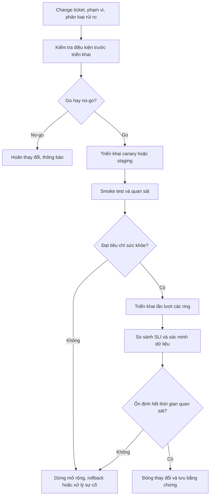

# Thiết kế maintenance window và triển khai thay đổi an toàn

Một hệ thống chạy trên Microsoft Azure vẫn phải thay đổi thường xuyên: phát hành mã nguồn, vá hệ điều hành, nâng cấp AKS, điều chỉnh cấu hình mạng, thay đổi cơ sở dữ liệu hoặc xoay vòng chứng chỉ. Nếu chỉ chọn một giờ ít người dùng rồi bấm triển khai, một thay đổi nhỏ vẫn có thể gây gián đoạn dây chuyền. Thiết kế **maintenance window** (cửa sổ bảo trì) là xác định trước *khi nào* thay đổi được phép diễn ra, *điều kiện nào* cho phép bắt đầu, *cách giới hạn ảnh hưởng*, *khi nào phải dừng hoặc quay lui* và *bằng chứng nào* chứng minh hệ thống đã ổn định.

Bài học thuộc chương **Hiệu năng và vận hành**, đặt trong hệ sinh thái Azure gồm subscription, resource group, Entra ID, mạng ảo, dịch vụ tính toán, lưu trữ, dữ liệu, giám sát, bảo mật và quản lý chi phí. Ví dụ chính là một API chạy trên Azure App Service; những nguyên tắc tương ứng cho Azure Virtual Machines, Azure Kubernetes Service (AKS) và dịch vụ dữ liệu được nêu riêng.

## Mục tiêu học tập

Sau bài này, bạn có thể:

1. Phân biệt cửa sổ được phép thay đổi, khoảng gián đoạn dự kiến và lịch bảo trì do Azure quản lý.
2. Chọn thời điểm bảo trì dựa trên hành vi tải, phụ thuộc hệ thống, SLO và múi giờ.
3. Lập kế hoạch thay đổi có chủ sở hữu, phạm vi ảnh hưởng, kiểm tra trước, tiêu chí thành công, điều kiện dừng và phương án khôi phục.
4. Chọn cơ chế giảm rủi ro phù hợp cho App Service, VM, AKS, hạ tầng dưới dạng mã và cơ sở dữ liệu.
5. Thực hiện một runbook mẫu với kiểm tra sức khỏe và quan sát bằng Azure Monitor/Application Insights.

## 1. Hiểu đúng về maintenance window

**Maintenance window** là khoảng thời gian đã thống nhất để đội vận hành *thực hiện và kiểm chứng thay đổi*. Nó không đồng nghĩa với toàn bộ thời gian dịch vụ được phép ngừng hoạt động. Một ứng dụng có thể triển khai trong cửa sổ hai giờ mà vẫn phải đạt mục tiêu không gián đoạn người dùng.

Phân biệt bốn khái niệm:

| Khái niệm | Ý nghĩa | Ví dụ |
| --- | --- | --- |
| Change window | Khoảng thời gian được phép thực hiện thay đổi | Thứ Bảy 00:00–02:00 (giờ Việt Nam) |
| Expected downtime | Khoảng gián đoạn được dự báo và thông báo, nếu có | Tối đa 5 phút khi khởi động lại một dịch vụ chỉ có một instance |
| Maintenance schedule | Lịch áp dụng cho một cơ chế bảo trì cụ thể | Lịch cập nhật guest OS bằng Azure Update Manager |
| Change freeze | Thời kỳ hạn chế thay đổi để bảo vệ hoạt động kinh doanh | Ngày chốt sổ, kỳ khuyến mại hoặc đợt cao điểm |

Lịch bảo trì của ứng dụng do đội ứng dụng quyết định không tự động điều khiển lịch bảo trì nền tảng của mọi dịch vụ Azure. Tùy tài nguyên, Azure có cơ chế thông báo, đặt lịch hoặc chọn lịch ưu tiên khác nhau. **Azure Service Health** giúp theo dõi thông báo bảo trì và sự cố liên quan đến subscription; **Resource Health** cho biết tình trạng từng tài nguyên. Không nên giả định mọi dịch vụ PaaS đều cho phép trì hoãn bảo trì của Microsoft hoặc bảo đảm chính xác phút bắt đầu.

Về SLO, thời gian gián đoạn đã lên lịch vẫn ảnh hưởng trải nghiệm người dùng. Chỉ loại trừ nó khỏi phép tính SLO nếu định nghĩa SLO/SLI và thỏa thuận dịch vụ của tổ chức quy định rõ như vậy; đừng tự coi việc “đã thông báo” là được miễn trừ.

## 2. Chọn cửa sổ dựa trên dữ liệu và phụ thuộc

Giả sử ứng dụng thanh toán có người dùng tại Việt Nam, chạy trên App Service, Azure SQL Database, Azure Cache for Redis và tích hợp một cổng thanh toán bên ngoài. Đội vận hành cần cập nhật phiên bản API và sau đó vá một số VM xử lý tác vụ nền.

Trước khi ấn định lịch, hãy thu thập **ít nhất vài chu kỳ sử dụng điển hình** từ Azure Monitor và Application Insights: lưu lượng yêu cầu, tỷ lệ lỗi, p95/p99 latency, hàng đợi, tác vụ định kỳ, kết nối cơ sở dữ liệu, thời điểm đối soát thanh toán và các đỉnh tải theo ngày trong tuần. Kết hợp thêm lịch kinh doanh, lịch chốt sổ, lịch backup, sự kiện bảo mật và phụ thuộc với đối tác. Thời điểm ít HTTP request chưa chắc đã an toàn nếu đang chạy batch hoặc đối soát dữ liệu.

Một lịch mẫu:

| Thuộc tính | Quyết định mẫu | Lý do |
| --- | --- | --- |
| Cửa sổ | Thứ Bảy 00:00–02:00, múi giờ Asia/Ho_Chi_Minh | Sau giờ xử lý giao dịch chính, có trực vận hành |
| Đối chiếu UTC | Thứ Sáu 17:00–19:00 UTC | Tránh lệch ngày khi cấu hình công cụ dùng UTC |
| Giới hạn triển khai | Kết thúc chuyển lưu lượng trước 01:00 | Dành phần còn lại cho xác minh và rollback |
| Thời gian dự phòng | 45–60 phút trong cùng cửa sổ | Kiểm tra, khôi phục và truyền thông nếu có sự cố |
| Điều kiện hoãn | Đang có sự cố mức cao, backup lỗi, đối tác đang bảo trì, SLO bất thường | Không thêm rủi ro vào hệ thống chưa ổn định |

Việt Nam không áp dụng đổi giờ mùa hè, nhưng đơn vị kinh doanh hoặc nhà cung cấp ở các múi giờ khác có thể áp dụng. Ghi **múi giờ theo tên vùng** trong change ticket và kiểm tra cách dịch vụ Azure diễn giải lịch (UTC hay múi giờ được chọn). Nếu cấu hình lặp lại theo múi giờ có đổi giờ mùa hè, phải xác minh ngày chuyển giờ.

Đối với hệ thống nhiều vùng, cửa sổ cần xét luồng người dùng toàn cầu, khả năng chuyển tải, replication lag và vị trí máy chủ dự phòng. Không thực hiện đồng thời bảo trì cả vùng chính lẫn vùng dự phòng nếu mục tiêu kiến trúc là duy trì khả năng chịu lỗi vùng.

## 3. Phân loại thay đổi và xác định mức rủi ro

Một kế hoạch tốt bắt đầu từ **một đơn vị thay đổi có thể kiểm soát**. Hãy mô tả điều gì sẽ khác sau triển khai, tài nguyên nào bị tác động và ai có thể bị ảnh hưởng.

| Loại thay đổi | Rủi ro điển hình | Biện pháp ưu tiên |
| --- | --- | --- |
| Cập nhật API trên App Service | Khởi động lỗi, cấu hình sai, tăng lỗi 5xx | Deployment slot, warm-up, health probe, rollback phiên bản |
| Vá guest OS trên Azure VM | Cần reboot, xung đột gói, mất capacity | Azure Update Manager, chia vòng, kiểm tra reboot và năng lực dự phòng |
| Nâng cấp AKS/node pool | Pod bị evict, phiên bản API không tương thích | Planned maintenance, surge, readiness, PodDisruptionBudget, kiểm tra tương thích |
| Thay đổi mạng/identity | Mất truy cập trên diện rộng, vô hiệu hóa tích hợp | IaC what-if, least privilege, triển khai từng phạm vi, kiểm tra luồng truy cập |
| Thay đổi schema Azure SQL | Không tương thích phiên bản cũ, migration dài, mất dữ liệu | Expand–migrate–contract, backup/PITR, thử nghiệm trên bản sao phù hợp |

Đánh giá rủi ro theo xác suất lỗi, tác động kinh doanh, **blast radius** (phạm vi có thể bị ảnh hưởng) và khả năng phục hồi. Một thay đổi có thể nhỏ về số dòng mã nhưng rủi ro cao nếu sửa chính sách Entra ID, route mạng hoặc cột dữ liệu dùng bởi nhiều ứng dụng.

Chia tài nguyên thành các **ring** giúp giảm phạm vi ảnh hưởng: môi trường thử nghiệm → một phần nhỏ production → phần còn lại. Với VM, có thể dùng tag như `environment=prod`, `patch-ring=canary`, `patch-ring=batch-2`; với AKS là node pool hoặc workload được thiết kế để nâng cấp lần lượt; với HTTP là triển khai theo slot hoặc tỷ lệ lưu lượng nếu nền tảng hỗ trợ. Canaries cần có lưu lượng đủ đại diện để phát hiện lỗi.

## 4. Bộ hồ sơ thay đổi phải có

Change ticket hoặc tài liệu triển khai nên chứa tối thiểu:

- **Danh tính thay đổi:** mã ticket, nguyên nhân, phiên bản/artifact, liên kết commit và người chịu trách nhiệm.
- **Phạm vi:** subscription, resource group, resource ID, môi trường, thành phần phụ thuộc và nhóm người dùng có thể bị ảnh hưởng.
- **Lịch:** giờ bắt đầu/kết thúc kèm múi giờ; thời hạn chốt quyết định chuyển tiếp hoặc rollback; người trực và kênh liên lạc.
- **Mức độ rủi ro:** tác động dự kiến, SLO/SLI cần bảo vệ, capacity còn lại, thứ tự các ring.
- **Điều kiện trước khi thực hiện:** các phê duyệt theo quy trình, tình trạng hệ thống ổn định, backup/restore hợp lệ, artifact đã kiểm thử, quyền triển khai đúng.
- **Runbook:** lệnh hoặc bước thực hiện, kết quả mong đợi, cách kiểm chứng từng mốc.
- **Go/no-go và rollback:** ngưỡng số liệu, ai có quyền ra quyết định dừng, thời gian khôi phục dự kiến, cách xác nhận dữ liệu nhất quán.
- **Bằng chứng và truyền thông:** dashboard trước/sau, thay đổi trong Azure Activity Log, incident nếu phát sinh và thông báo hoàn tất.

**RTO** là thời gian khôi phục mục tiêu sau sự cố; **RPO** là mức mất dữ liệu tối đa được chấp nhận tính theo thời gian. Cần kiểm tra cơ chế backup, restore, replication và khả năng chuyển vùng có đáp ứng RTO/RPO, thay vì chỉ ghi các con số vào ticket. Một “rollback” mã nguồn không có nghĩa là có thể hoàn tác giao dịch hoặc schema dữ liệu.

Các vai trò có thể gộp ở đội nhỏ nhưng phải xác định rõ: change owner điều phối và ra quyết định, người triển khai thao tác, người trực quan sát metrics/log, người phụ trách dữ liệu xác nhận migration/khôi phục, đại diện kinh doanh duyệt ảnh hưởng và nhận thông báo. Tránh để chính người đang nhập lệnh vừa phán đoán toàn bộ tín hiệu bất thường vừa quyết định kéo dài cửa sổ.

## 5. Chọn cơ chế bảo trì phù hợp trên Azure

### 5.1. Azure Virtual Machines: vá hệ điều hành có lịch

**Azure Update Manager** quản lý việc đánh giá và cài đặt bản cập nhật guest OS cho Azure VM và các máy được hỗ trợ qua Azure Arc. Với lịch vá định kỳ, đội vận hành có thể cấu hình **Maintenance Configuration** cho phạm vi *in-guest patching*, lịch lặp lại, thời lượng bảo trì, phân loại hoặc lựa chọn bản vá và chính sách reboot; sau đó gán cho các máy phù hợp. Hỗ trợ chi tiết và điều kiện tiên quyết phụ thuộc loại máy, hệ điều hành và chế độ điều phối bản vá.

Quy trình an toàn:

1. Kiểm tra danh sách máy và tình trạng update assessment; xác nhận agent/extension, patch orchestration và quyền theo yêu cầu của Azure Update Manager.
2. Chọn lịch, thời lượng thực thi và tag/ring. Nếu sử dụng **dynamic scoping**, kiểm tra chính xác bộ lọc subscription, resource group, vùng và tag; VM mới thêm có thể được chọn trong các lần chạy sau.
3. Chạy trước trên nhóm canary, xác minh ứng dụng, hệ thống tập tin, kết nối DB, trạng thái reboot và bản vá được cài đặt.
4. Tiếp tục các nhóm tiếp theo với đủ capacity dự phòng. Với workload stateful, tuân thủ cơ chế cluster/failover của ứng dụng trước khi reboot.
5. Kiểm tra kết quả cài đặt, máy thất bại, cập nhật còn thiếu và tác động đến SLI; xử lý riêng các máy không thành công.

Không xem “lệnh cài patch đã chạy” là đủ để tuyên bố thành công. Một bản vá có thể cần khởi động lại; thời lượng công việc, các bản vá phụ thuộc và khả năng đáp ứng cửa sổ cần được kiểm tra thực tế. Lịch guest patch không thay thế các thông báo bảo trì nền tảng từ Azure.

### 5.2. AKS: lịch bảo trì không thay thế cơ chế nâng cấp an toàn

AKS cung cấp các **planned maintenance configurations** dành cho hoạt động được dịch vụ hỗ trợ, chẳng hạn lịch bảo trì hoặc nâng cấp tự động của control plane và node OS theo cơ chế tương ứng. Cấu hình lịch cần đúng loại tác vụ và phiên bản AKS đang sử dụng; không nên hiểu rằng một lịch AKS sẽ tự động lên lịch mọi lần triển khai container thủ công.

Khi lên lịch nâng cấp, cần chuẩn bị:

- Kiểm tra phiên bản Kubernetes, API đã bị loại bỏ, add-on và sự tương thích của manifest.
- Bảo đảm node pool còn dư capacity; cấu hình nâng cấp cuốn chiếu và surge phù hợp với quota, giới hạn IP và số node tối đa.
- Có nhiều replica, `readinessProbe`, `livenessProbe`, `startupProbe` theo đúng hành vi ứng dụng, cùng **PodDisruptionBudget** (PDB) phù hợp.
- Kiểm tra thời gian drain/termination, kết nối đang mở, volume stateful và job đang chạy; PDB không bảo vệ khỏi mọi nguyên nhân gián đoạn.
- Theo dõi rollout theo từng pool hoặc workload; dừng khi replica không Ready, lỗi ứng dụng tăng hoặc capacity xuống dưới ngưỡng.

Lịch bảo trì giảm khả năng thao tác vào giờ cao điểm; độ sẵn sàng vẫn do kiến trúc replica, zone, storage, probes và quy trình rollout quyết định.

### 5.3. App Service: chuẩn bị bản phát hành trên deployment slot

Với các gói App Service có hỗ trợ **deployment slots**, có thể triển khai phiên bản mới vào slot `staging`, kiểm tra health endpoint và cấu hình, sau đó **swap** sang `production`. Slot giúp chuẩn bị và làm nóng ứng dụng trước khi chuyển phiên bản, giảm nguy cơ gián đoạn khi khởi động.

Trước khi swap, cần rà soát app settings/connection strings nào là **slot settings** (giữ nguyên theo slot), cấu hình danh tính, hostname, mạng riêng, database và cơ chế xác thực. Khi dùng traffic routing, có thể phát hành theo tỷ lệ từng bước nếu phù hợp; chuyển 100% lưu lượng bằng swap không đồng nghĩa với canary.

Swap ngược là phương án rollback nhanh cho **mã ứng dụng và cấu hình tương thích**; nó không khôi phục được dữ liệu đã bị sửa hay migration schema không tương thích. Vì vậy thay đổi database nên thiết kế hỗ trợ cả phiên bản cũ lẫn mới trong giai đoạn chuyển tiếp.

### 5.4. Hạ tầng dưới dạng mã và dữ liệu

Với Bicep/ARM, chạy `what-if` trước khi triển khai để phát hiện tài nguyên tạo, sửa hoặc xóa. Với Terraform, đọc `plan` và kiểm tra state/lock; đừng áp dụng kế hoạch cũ sau khi môi trường đã đổi. Kiểm soát thay đổi RBAC, firewall, route table, private endpoint và DNS vì chúng có thể làm mất đường truy cập của cả ứng dụng lẫn công cụ cứu hộ.

Đối với Azure SQL Database, áp dụng **expand–migrate–contract**:

1. **Expand:** thêm bảng/cột/index tương thích ngược, giữ API cũ hoạt động.
2. **Migrate:** triển khai ứng dụng đọc/ghi theo cách tương thích; backfill theo lô và kiểm tra dữ liệu.
3. **Contract:** chỉ loại bỏ schema cũ sau khi xác minh không còn client phụ thuộc, thường ở một đợt thay đổi khác.

Xác minh chính sách retention, khả năng point-in-time restore (PITR) hoặc hình thức phục hồi phù hợp trước khi chạy migration rủi ro. Khôi phục database thường cần đánh giá ghi mới phát sinh kể từ thời điểm backup; không tự động rollback toàn hệ thống mà không kiểm tra tính nhất quán.

## 6. Thiết kế các cổng kiểm soát khi triển khai

Một quy trình an toàn có các cổng kiểm soát (*gates*) rõ ràng:



Điều kiện **go** có thể bao gồm: không có incident mức nghiêm trọng; dashboard baseline bình thường; các replica/node/zone đủ capacity; backup đã kiểm tra; pipeline xanh; artifact có checksum hoặc phiên bản bất biến; người trực sẵn sàng; các quyền triển khai dùng Azure RBAC theo nguyên tắc đặc quyền tối thiểu. Điều kiện **no-go** phải có tác dụng thực tế: khi không đạt thì hoãn, dù cửa sổ đã đến.

Ở mỗi ring, quan sát cả **tín hiệu kỹ thuật** và **nghiệp vụ**: request success, p95 latency, CPU/memory, timeout, connection pool, queue lag, tỷ lệ thanh toán thành công, số đơn hàng bất thường. Đặt giới hạn dựa vào baseline của chính ứng dụng. Ví dụ minh họa:

| Tín hiệu | Baseline giả định | Cổng sau khi chuyển lưu lượng |
| --- | --- | --- |
| Tỷ lệ lỗi HTTP | 0,2% | Không vượt 1,0% trong hai cửa sổ 5 phút liên tiếp |
| p95 request latency | 300 ms | Không vượt 450 ms bền vững |
| Tỷ lệ thanh toán thành công | 99,5% | Không giảm dưới 99,0% khi mẫu đủ lớn |
| Số instance khỏe | 3/3 | Luôn còn đủ capacity theo SLO; không mất đồng thời mọi replica |
| Queue age | 20 giây | Không tăng liên tục vượt ngưỡng xử lý đã thống nhất |

Đây là **ngưỡng minh họa**, không phải khuyến nghị mặc định của Azure. Điều chỉnh theo mùa vụ, lưu lượng, SLO, ngưỡng cảnh báo đã được hiệu chuẩn và sai số thống kê. Với ít request, tỷ lệ phần trăm có thể dao động mạnh; cần kết hợp số lượng mẫu và kiểm tra hành vi end-to-end.

Nếu tín hiệu chạm ngưỡng dừng, change owner phải dừng mở rộng trước, xác định thay đổi có phải nguyên nhân hay không, rồi quyết định rollback, roll forward bằng bản sửa đã kiểm chứng hoặc kích hoạt quy trình incident. Luôn đặt một **điểm dừng theo thời gian**, tránh cố triển khai sát giờ kết thúc khiến không đủ thời gian phục hồi.

## 7. Runbook mẫu: phát hành API trên Azure App Service

**Tình huống:** API `payments-api-prod` trong resource group `rg-payments-prod` có hai slot `production` và `staging`, chạy trong gói App Service hỗ trợ slots. API có endpoint `/health/ready` kiểm tra phụ thuộc thiết yếu và một bộ smoke test giao dịch an toàn. Gói release là file ZIP tạo từ CI, migration database đã được thiết kế tương thích ngược và thử ở môi trường gần production.

Các lệnh bên dưới là **minh họa có biến mẫu**, chạy trong Bash/Azure Cloud Shell hoặc runner được cấp quyền thích hợp. Cần thay bằng thông tin thực tế và bảo đảm health endpoint truy cập được từ nơi chạy lệnh; nếu dùng private endpoint, chạy kiểm tra từ mạng được phép. Không đưa mật khẩu vào script; pipeline nên dùng managed identity hoặc workload identity federation.

### 7.1. Từ T–7 ngày đến T–1 ngày: chuẩn bị

Xác nhận impact/risk, thời điểm, danh sách người trực và phương án rollback. Hoàn thành kiểm thử build, integration test, smoke test, kiểm tra cấu hình slot, xác nhận dữ liệu và backup. Chạy thử rollback trên staging nếu có thể. Tạo hoặc xác minh alert Azure Monitor, kiểm tra Application Insights nhận telemetry. Nếu thay đổi hạ tầng kèm theo Bicep, xem kết quả:

```bash
az account set --subscription "$SUBSCRIPTION_ID"
az deployment group what-if --resource-group rg-payments-prod --template-file main.bicep --parameters @prod.parameters.json
```

Lệnh `what-if` chỉ có ý nghĩa khi repo thực sự dùng hai file Bicep/parameters nêu trên. Người chịu trách nhiệm phải xem kỹ các thay đổi dự kiến, đặc biệt việc xóa hoặc thay đổi quyền và mạng, trước khi duyệt triển khai IaC. Không coi `what-if` là bằng chứng đã kiểm tra hành vi runtime.

### 7.2. T–30 phút: xác nhận go/no-go

Người trực kiểm tra baseline 30–60 phút, tình trạng slot đang chạy, kết nối database, Service Health, các alert đang mở, dung lượng còn lại và tình trạng đối tác thanh toán. Ghi lại mã release cũ, mã release mới, bản cấu hình và timestamp. Khóa thay đổi không liên quan trong lúc triển khai.

Ví dụ truy vấn tại **Logs của Application Insights theo schema `requests`** (với workspace-based schema sử dụng bảng/cột tương ứng, chẳng hạn `AppRequests`):

```kusto
requests
| where timestamp > ago(30m)
| summarize
    requests = count(),
    errorRatePct = 100.0 * countif(success == false) / count(),
    p95Latency = percentile(duration, 95)
  by bin(timestamp, 5m)
| order by timestamp asc
```

Lưu kết quả baseline và kiểm tra thêm luồng nghiệp vụ. Nếu không có telemetry hoặc các điều kiện trước không đạt, chọn **no-go**.

### 7.3. T0: triển khai vào staging và kiểm tra

Giả sử slot `staging` đã tồn tại, cấu hình chính xác và `release.zip` là artifact đã qua CI. Thực hiện:

```bash
RG="rg-payments-prod"
APP="payments-api-prod"
PACKAGE="./release.zip"

az webapp deploy --resource-group "$RG" --name "$APP" --slot staging --src-path "$PACKAGE" --type zip

STAGING_HOST=$(az webapp show --resource-group "$RG" --name "$APP" --slot staging --query "defaultHostName" -o tsv)
curl --fail --show-error --silent "https://$STAGING_HOST/health/ready"
```

Tiếp tục smoke test các API đọc/ghi an toàn, xác thực, luồng tích hợp và trường hợp lỗi; kiểm tra logs của staging, thời gian khởi động và kết nối database. Một HTTP 200 đơn lẻ chưa chứng minh thay đổi hoạt động đúng: phải kiểm tra hành vi ứng dụng và các chỉ số cụ thể.

### 7.4. Chuyển phiên bản và theo dõi

Chỉ swap khi staging vượt qua các kiểm tra:

```bash
az webapp deployment slot swap --resource-group "$RG" --name "$APP" --slot staging --target-slot production

PROD_HOST=$(az webapp show --resource-group "$RG" --name "$APP" --query "defaultHostName" -o tsv)
curl --fail --show-error --silent "https://$PROD_HOST/health/ready"
```

Đánh dấu thời điểm swap trong dashboard. Trong tối thiểu hai hoặc nhiều cửa sổ quan sát được thống nhất, so sánh p95, lỗi 5xx, request rate, dependency failures, thời gian xử lý hàng đợi và chỉ số thanh toán với baseline và traffic thực tế. Kiểm tra cả phiên người dùng đang hoạt động, tác vụ nền và bản ghi dữ liệu mới. Nếu có tính năng điều hướng lưu lượng theo tỷ lệ, thực hiện từng mức canary và xác minh ở mỗi mức theo runbook riêng.

### 7.5. Điều kiện rollback và thao tác

Giả sử sau swap, tỷ lệ lỗi vượt ngưỡng, ứng dụng chưa sửa dữ liệu theo cách phá tương thích và slot `staging` đang chứa phiên bản trước đó. Change owner kích hoạt rollback:

```bash
az webapp deployment slot swap --resource-group "$RG" --name "$APP" --slot staging --target-slot production
curl --fail --show-error --silent "https://$PROD_HOST/health/ready"
```

Sau rollback, kiểm tra **phiên bản thực tế** đang phục vụ production, đối chiếu metric và smoke test. Không lặp lệnh swap nếu trạng thái hai slot đã thay đổi ngoài dự kiến; kiểm tra trước để tránh chuyển nhầm chiều. Nếu migration làm mất khả năng tương thích với bản cũ, cần dùng phương án phục hồi dữ liệu/roll-forward được phê duyệt, thay vì mặc định rằng swap lại sẽ an toàn.

Nếu vượt quá thời hạn ra quyết định hoặc SLO đang bị ảnh hưởng, chuyển sang xử lý incident theo mức độ, ưu tiên phục hồi và thông báo cho bên liên quan. Bảo toàn logs, deployment history, Activity Log và thông tin bản phát hành để điều tra nguyên nhân.

### 7.6. T+30 đến T+60 phút: đóng cửa sổ

Người trực và change owner cùng xác nhận: metrics và nghiệp vụ trở về ngưỡng cho phép; không còn lỗi mới; hệ thống xử lý hết backlog; trạng thái resource, replica và kết nối ổn định; các tác vụ theo lịch vận hành bình thường. Ghi kết quả thành công, rollback hay hoãn; thời điểm từng bước; phiên bản cuối; bằng chứng từ dashboard và đường dẫn incident nếu có. Theo dõi tăng cường sau cửa sổ nếu sự cố có thể xuất hiện muộn.

## 8. Lịch thao tác và ngân sách khôi phục

Một mẫu timeline cho cửa sổ hai giờ:

| Mốc giờ Việt Nam | Công việc | Điều kiện để tiến tiếp |
| --- | --- | --- |
| 23:30–00:00 | Kiểm tra sức khỏe, phê duyệt go/no-go, xác nhận người trực | Không có blocker, backup và monitoring sẵn sàng |
| 00:00–00:15 | Triển khai staging và smoke test | Health, cấu hình và luồng nghiệp vụ đạt |
| 00:15–00:30 | Chuyển phiên bản/canary | Không phát sinh tín hiệu chặn |
| 00:30–01:00 | Theo dõi và mở rộng có kiểm soát | SLI trong ngưỡng, đủ mẫu quan sát |
| 01:00 | **Hạn chốt triển khai** | Dừng nếu chưa đạt; dành thời gian phục hồi |
| 01:00–01:45 | Xác minh kéo dài hoặc rollback/khôi phục | Có đủ thời gian kiểm chứng bản ổn định |
| 01:45–02:00 | Xác nhận người trực tiếp nhận, cập nhật ticket và truyền thông | Trạng thái cuối rõ ràng |

Thời gian dự phòng phải dựa trên **rollback đã đo được**. Nếu rollback thực tế cần 90 phút, cửa sổ hai giờ với hạn chốt 01:00 là không phù hợp. Có thể kéo dài cửa sổ, giảm phạm vi thay đổi hoặc thiết kế một cơ chế chuyển lưu lượng nhanh hơn. Đừng dùng “sẽ hoàn tất trong vài phút” nếu chưa từng diễn tập.

## 9. Những tình huống dễ gây sự cố

**Có lịch nhưng không có năng lực chịu lỗi.** Reboot ba VM sau load balancer cùng lúc có thể làm mất dịch vụ dù lịch chọn đúng giờ thấp tải. Phải vá theo ring, xác minh health probe và capacity, tránh mất quorum của cluster stateful.

**Lịch Azure và lịch ứng dụng không khớp.** AKS maintenance configuration hoặc lịch guest patch không tự đồng bộ với pipeline triển khai ứng dụng. Chủ sở hữu phải kiểm tra từng lịch, kể cả các thông báo Service Health và lịch của nhà cung cấp bên ngoài.

**Giả định slot swap hoàn tác tất cả.** Nếu bản mới xóa cột SQL, đổi khóa mã hóa hoặc ghi dữ liệu không đọc được bởi bản cũ thì quay về artifact cũ có thể làm sự cố nghiêm trọng hơn. Sử dụng migration tương thích ngược, feature flags, snapshot/backup và kế hoạch phục hồi dữ liệu đã thử nghiệm.

**Lỗi đến muộn.** Memory leak, cache expiry, cron job và queue backlog có thể chưa xuất hiện trong 5 phút đầu. Khoảng giám sát sau phát hành phải bao phủ đủ chu kỳ hoạt động quan trọng; có thể mở rộng giai đoạn quan sát hoặc áp dụng canary lâu hơn.

**Thiếu quyền khi cần cứu hộ.** Người trực có quyền deploy nhưng không có quyền xem log, thay route hoặc khôi phục backup sẽ làm tăng thời gian khôi phục. Kiểm tra Azure RBAC, quy trình kích hoạt quyền tạm thời, các runbook và khả năng truy cập khi mạng chính bị lỗi, trước cửa sổ.

**Bảo trì khẩn cấp.** Vá lỗ hổng nghiêm trọng có thể không chờ lịch cố định. Vẫn cần đánh giá blast radius, phê duyệt ngoại lệ theo quy trình, backup, thay đổi theo vòng nhỏ và telemetry rõ ràng; báo cáo hậu kiểm giải thích vì sao cần thao tác ngoài lịch.

## 10. Bài tập thực hành

Một ứng dụng đặt hàng chạy trên ba VM ở hai availability zone, có một database chính và các worker xử lý queue. Yêu cầu cập nhật guest OS cho cả ba VM. Dashboard cho thấy lưu lượng thấp nhất lúc 01:00, nhưng backup DB chạy 01:00–01:30; đồng thời một trong ba VM là worker duy nhất xử lý tác vụ đối soát.

Hãy xây dựng change ticket gồm thời gian phù hợp, sơ đồ các ring, điều kiện go/no-go, tiêu chí xác minh, điểm dừng và kế hoạch khôi phục. Trả lời:

1. Vì sao 01:00 không tự động là lựa chọn tốt dù HTTP request thấp?
2. Trước khi reboot worker đối soát cần xác nhận điều gì về queue, idempotency và khả năng chạy lại job?
3. Những tín hiệu nào buộc dừng giữa các ring?
4. Nếu bản vá thành công trên VM nhưng tỷ lệ đơn hàng xử lý thành công giảm, thay đổi có được coi là hoàn thành không?

**Gợi ý đối chiếu:** cửa sổ cần tránh xung đột backup và đối soát hoặc có phương án kiểm soát phù hợp; thử trên VM ít rủi ro trước; mỗi lần phải giữ đủ capacity; kiểm tra cả tín hiệu VM lẫn nghiệp vụ, queue và dữ liệu; dừng khi điều kiện sức khỏe không đạt; chỉ đóng change khi hệ thống hoạt động ổn định theo tiêu chí đã định.

## 11. Checklist đưa vào vận hành

- [ ] Đã xác định phạm vi, người sở hữu, dependency, rủi ro và lịch theo múi giờ rõ ràng.
- [ ] Đã kiểm tra baseline từ Azure Monitor/Application Insights và các khung giờ nghiệp vụ quan trọng.
- [ ] Đã xác nhận backup, restore, RTO/RPO, quyền và kênh liên lạc.
- [ ] Đã chọn đúng cơ chế Azure cho tài nguyên: Update Manager, AKS planned maintenance, App Service slots hoặc pipeline IaC.
- [ ] Đã có artifact cố định, smoke test, canary/ring, health gates và tiêu chí no-go.
- [ ] Đã diễn tập hoặc đo thời gian rollback và dành đủ ngân sách phục hồi trong cửa sổ.
- [ ] Đã kiểm tra tác động đến schema/dữ liệu và khả năng tương thích của phiên bản trước.
- [ ] Đã có người giám sát độc lập, dashboard/alert và quyết định dừng theo ngưỡng.
- [ ] Đã ghi lại trạng thái cuối, phiên bản cuối, telemetry, timeline và bài học từ sự cố nếu có.

Một maintenance window được thiết kế tốt giúp đội vận hành biết **khi nào nên bắt đầu, khi nào không được tiếp tục và phải làm gì để phục hồi**, đồng thời giữ được bằng chứng thực tế về hiệu năng, tính sẵn sàng và tác động nghiệp vụ sau mỗi thay đổi trên Azure.
