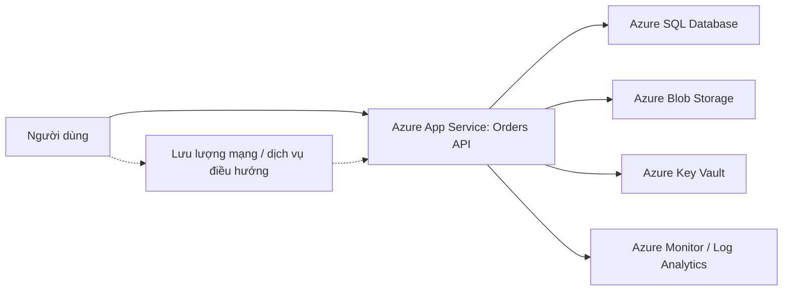
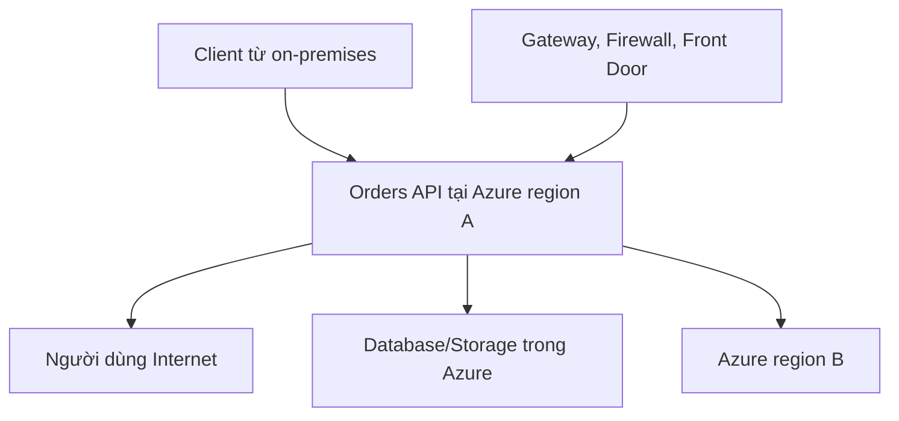
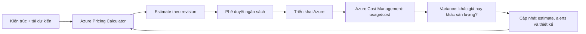

# Ước tính chi phí bằng Azure Pricing Calculator

## 1. Vì sao phải ước tính chi phí trước khi triển khai Azure?

Một ứng dụng triển khai trên Microsoft Azure thường sử dụng nhiều tài nguyên cùng lúc: subscription và resource group để tổ chức, mạng ảo để kết nối, App Service hoặc máy ảo để chạy chương trình, cơ sở dữ liệu để lưu thông tin, Azure Storage để chứa tệp, Key Vault để quản lý bí mật, Azure Monitor để giám sát. Cấu hình của mỗi dịch vụ ảnh hưởng đến **chi phí vận hành** và khả năng đáp ứng của hệ thống. Một lựa chọn có vẻ nhỏ, như bật thêm Availability Zone hoặc tăng thời gian giữ log, có thể thay đổi dự toán hàng tháng.

**Azure Pricing Calculator** là công cụ trực tuyến giúp xây dựng **ước tính trước triển khai** bằng cách chọn các dịch vụ Azure, vùng triển khai, cấu hình, mô hình mua và giả định sử dụng. Kết quả là một **estimate dựa trên các điều kiện đầu vào**, không phải hóa đơn cam kết, SLA về giá hay dự báo chắc chắn. Đơn giá công khai, lựa chọn cấu hình và ưu đãi có thể thay đổi theo thời điểm, vùng, loại subscription và thỏa thuận mua của tổ chức.

Bài này thuộc chương **Quản lý chi phí** trong lộ trình tìm hiểu Azure. Mục tiêu là đưa một thiết kế ứng dụng từ sơ đồ kiến trúc thành bảng ước tính có thể giải thích, kiểm tra và cập nhật khi nhu cầu tăng. Bạn sẽ làm quen với chi phí compute, lưu trữ, dữ liệu, mạng, sao lưu, giám sát và các yếu tố kinh doanh như cam kết sử dụng, đơn vị tiền tệ và thuế.

### Sau bài học, bạn có thể

1. Phân biệt Azure Pricing Calculator với Azure Cost Management, TCO Calculator và báo giá theo hợp đồng.
2. Thu thập các đầu vào cần thiết trước khi ước tính: region, SKU, số instance, thời gian chạy, dung lượng, thao tác, băng thông, mức sẵn sàng và môi trường.
3. Thao tác trên Pricing Calculator để thêm từng dịch vụ, chỉnh thông số và tổng hợp dự toán theo tháng.
4. Tính kiểm tra chi phí theo công thức đơn giá nhân lượng sử dụng, nhận diện các giả định bị bỏ sót.
5. So sánh dự toán cơ sở, tăng tải, staging và disaster recovery; áp dụng vùng đệm phù hợp với bất định.
6. Hiểu phạm vi áp dụng của pay-as-you-go, reservations, savings plan, Azure Hybrid Benefit và ưu đãi theo hợp đồng.
7. Đối chiếu dự toán với dữ liệu sử dụng thực và xây dựng quy trình cập nhật estimate sau khi triển khai.

## 2. Công cụ nào giải quyết câu hỏi nào?

| Công cụ | Câu hỏi chính | Thời điểm sử dụng |
| --- | --- | --- |
| **Azure Pricing Calculator** | Với cấu hình và sản lượng giả định, tài nguyên Azure có thể tốn bao nhiêu? | Trước triển khai; khi thiết kế thay đổi; khi cân nhắc scale |
| **Azure Cost Management** | Tài nguyên đang phát sinh chi phí thực tế và dự báo ra sao? | Trong vận hành, phân tích, phân bổ và lập ngân sách |
| **Azure TCO Calculator** | Chi phí sở hữu khi vận hành tại chỗ so với chuyển lên Azure khác nhau thế nào? | Khi lập phương án di chuyển hạ tầng |
| **Azure Advisor** | Có cơ hội tiết kiệm, tăng hiệu năng hoặc cải thiện vận hành nào trong tài nguyên đang chạy? | Khi tối ưu môi trường đã triển khai |
| **Bảng giá/hợp đồng Azure của tổ chức** | Những đơn giá và ưu đãi nào thực sự áp dụng khi thanh toán? | Trước phê duyệt ngân sách và khi đối soát hóa đơn |

Pricing Calculator giúp lập dự toán **trước khi tạo tài nguyên**; Cost Management phân tích chi phí đã hoặc đang được ghi nhận. Dù cùng dựa trên dịch vụ Azure, hai kết quả có thể khác nhau vì lượng sử dụng thực, điều chỉnh hóa đơn, ưu đãi, credits, đơn vị tiền tệ và phạm vi dữ liệu.

Đường truy cập phổ biến là [Azure Pricing Calculator](https://azure.microsoft.com/pricing/calculator/). Tên nút, cách sắp xếp và khả năng xuất/chia sẻ có thể đổi theo bản cập nhật giao diện; hãy dùng các tên sản phẩm và khái niệm giá làm điểm tựa thay vì phụ thuộc tuyệt đối vào vị trí của một nút.

## 3. Mô hình tính chi phí: đơn giá, sản lượng và phạm vi

Ở mức khái niệm:

\[
\text{Chi phí ước tính}=\sum_i \left(\text{Đơn giá}_i\times\text{Sản lượng tính phí}_i\right)+\text{Phụ phí/chi phí khác}
\]

Đây là công thức khái quát. Azure có thể dùng **bậc giá, mức miễn phí, đơn vị tính khác nhau, cam kết sử dụng hoặc định giá lũy tiến**, nên không phải meter nào cũng nhân một đơn giá cố định trên toàn bộ sản lượng.

### Những đơn vị thường gặp

| Meter/đơn vị | Hiểu như thế nào? | Ví dụ |
| --- | --- | --- |
| Instance-hour hoặc vCPU-hour | Một instance/vCPU được tính phí trong một giờ theo điều kiện dịch vụ | App Service plan, máy ảo, compute cơ sở dữ liệu |
| GB-month | Dung lượng lưu trong tháng theo mô hình giá của dịch vụ | Azure Blob Storage, disk, database storage |
| GB dữ liệu truyền | Lượng dữ liệu qua một tuyến truyền có tính phí | Outbound từ Azure ra Internet hoặc giữa các vùng |
| Số lượt thao tác | Số transaction/request hoặc lô request được tính phí | Blob operations, Key Vault operations |
| RU/s hoặc mức provisioned throughput | Công suất xử lý dữ liệu được cấp theo thời gian | Azure Cosmos DB |
| GB dữ liệu log được ingest | Lượng telemetry tính phí đẩy vào dịch vụ quan sát | Azure Monitor Logs / Log Analytics |
| Request, execution-time hoặc GB-second | Sản lượng tiêu thụ theo số lần chạy và tài nguyên sử dụng | Một số gói serverless, Azure Functions |
| Instance được bảo vệ và dung lượng backup | Đối tượng được bảo vệ cùng dữ liệu backup | Azure Backup, Site Recovery theo kịch bản |

### Ba lớp phạm vi dễ bị bỏ sót

**Phạm vi tài nguyên:** region, SKU, OS, licensing, availability, replication và storage redundancy. Hai VM có cùng số vCPU vẫn có thể có đơn giá khác nhau theo family, region và giấy phép.

**Phạm vi sử dụng:** số giờ, peak traffic, lượng đọc/ghi, dung lượng gia tăng, retention, số yêu cầu API và lưu lượng dữ liệu. Một hệ thống chạy 730 giờ/tháng khác nhiều với batch job chỉ hoạt động 100 giờ.

**Phạm vi thanh toán:** đơn vị tiền tệ, thỏa thuận mua, reservations, savings plans, Azure Hybrid Benefit, thuế và phí ngoài Azure. Dự toán giá niêm yết công khai có thể không giống đơn giá thực trên subscription công ty.

## 4. Chuẩn bị dữ liệu đầu vào trước khi mở Calculator

Thiết kế một ứng dụng `orders-api` phục vụ người dùng tại Đông Nam Á. Kiến trúc minh họa:



Sơ đồ dùng để **liệt kê tất cả phần phát sinh chi phí**; nó không khẳng định một dịch vụ mạng cụ thể đã được triển khai. Khi hệ thống thực tế dùng Front Door, API Management, Application Gateway hoặc Load Balancer, hãy thêm đúng sản phẩm đó vào dự toán.

### Bảng giả định nền cho môi trường production

| Thuộc tính | Giá trị giả định | Lý do cần biết |
| --- | --- | --- |
| Azure region | Southeast Asia (`southeastasia`) | Đơn giá và dịch vụ có thể khác vùng |
| Thời gian hoạt động | 24/7, lấy 730 giờ/tháng để ước lượng | Dùng cho compute tính theo giờ |
| App Service | Một plan với 2 instance đang chạy | Tính số instance-hour |
| Database | Một Azure SQL Database, gói provisioned compute | Cần compute, storage, backup/HA theo lựa chọn |
| Dữ liệu SQL | 100 GB ban đầu | Cơ sở tính storage và tăng trưởng |
| Blob Storage | Hot access tier, LRS, 500 GB | Đơn giá phụ thuộc tier và redundancy |
| Blob transactions | Có thao tác đọc/ghi hàng tháng | Cần meter operations/retrieval tương ứng |
| Logs | 50 GB dữ liệu tính phí/tháng | Quyết định ingestion và retention cost |
| Network | 300 GB outbound tính phí/tháng | Cần kiểm tra tuyến mạng và mức được miễn nếu có |
| Môi trường khác | Development, staging, DR | Không được tự coi production là toàn bộ ngân sách |
| Mức tăng trưởng | +15% storage/tháng trong kịch bản tăng trưởng | Tác động sau vài kỳ thanh toán |

**730 giờ** là giá trị trung bình thường dùng để lập ngân sách tháng (365 ngày × 24 giờ ÷ 12), không phải số giờ chính xác của mọi tháng. Nếu dịch vụ tính phí theo usage thực, dùng giờ hoặc thời gian thực tế từ workload.

### Câu hỏi bổ sung về kiến trúc

Trước khi gõ số vào Calculator, cần làm rõ:

1. App Service dùng Windows hay Linux? Có yêu cầu zone redundancy, nhiều instance, autoscale hoặc staging slot?
2. Database dùng mô hình vCore hay DTU, provisioned hay serverless; loại service tier, compute size, storage, backup retention và HA là gì?
3. Blob thuộc tier Hot/Cool/Cold/Archive nào, lưu theo LRS/ZRS/GRS hay lựa chọn khác? Tỷ lệ read/write, retrieval và data lifecycle?
4. User ở đâu? Dữ liệu ra Internet, giữa các region, qua VPN/ExpressRoute, NAT Gateway hay gateway/WAF nào?
5. Telemetry có bao nhiêu GB ingest, retention bao lâu, có sampling hoặc xuất dữ liệu không?
6. Hệ thống có dùng Key Vault, Defender for Cloud, Azure Backup, Site Recovery, DNS, certificates, API Management, Front Door và dịch vụ hỗ trợ trả phí không?
7. Các tài nguyên chạy 24/7 hay chỉ giờ hành chính? Có cơ chế dừng/deallocate thực sự hay không?
8. Quyết định mua dùng pay-as-you-go hay chương trình giá và giấy phép riêng của tổ chức?

Thiếu đầu vào phải được đánh dấu **chưa xác minh** trong estimate, thay vì âm thầm điền `0`.

## 5. Quy trình thao tác trên Azure Pricing Calculator

### Bước 1 — Mở Calculator và tạo estimate

Truy cập [azure.microsoft.com/pricing/calculator](https://azure.microsoft.com/pricing/calculator/). Tại giao diện Calculator, tìm chức năng thêm sản phẩm/dịch vụ và vùng tổng hợp estimate. Một số chế độ lưu, chia sẻ, xuất dữ liệu có thể cần đăng nhập hoặc tài khoản phù hợp; việc chỉ lập ước tính giá công khai thường có thể bắt đầu từ giao diện trực tuyến.

Ghi tên bản dự toán riêng trong tài liệu nhóm, ví dụ:

```text
Estimate: orders-api | production | Southeast Asia | PAYG | rev-01
Date captured: [YYYY-MM-DD]
Architecture revision: [commit hoặc tài liệu thiết kế]
Currency: [đơn vị tiền đang được hiển thị]
Region: Southeast Asia
Term/payment model: Pay-as-you-go (giả định)
Owner/reviewer: [người chịu trách nhiệm]
```

Ngày ghi nhận rất quan trọng vì kết quả có thể thay đổi khi Azure điều chỉnh giá hoặc cung cấp thêm lựa chọn.

### Bước 2 — Chọn sản phẩm compute

Tìm **Azure App Service** và thêm vào estimate. Điều chỉnh các trường có sẵn tương ứng với mô hình dịch vụ:

- Region triển khai.
- OS/nền tảng và pricing tier (ví dụ Basic, Standard, Premium hoặc các lớp tương thích hiện có).
- Kích thước plan/instance, số instance, thời gian hoạt động hay đơn vị được giao diện yêu cầu.
- Điều kiện trả trước/ưu đãi nếu Calculator hỗ trợ và thực sự phù hợp.

Hãy so sánh cấu hình trong Calculator với **App Service plan**, không nhầm với số lượng web app được host trên plan. Nhiều web app có thể cùng dùng tài nguyên của một plan; việc tạo thêm app trên cùng plan không nhất thiết tạo một plan tính phí mới. Mặt khác, **tắt một web app không tự khiến App Service plan ngừng tính phí** nếu các instance trả phí vẫn được cấp phát.

### Bước 3 — Thêm dịch vụ cơ sở dữ liệu

Tìm **Azure SQL Database** rồi xác định mô hình mua và cấu hình thực tế:

1. Region và dịch vụ phù hợp (database đơn lẻ, elastic pool, managed instance là những mô hình khác nhau).
2. Purchasing model, service tier, compute/vCore hoặc DTU theo lựa chọn.
3. Provisioned compute hay serverless nếu cấu hình đó được hỗ trợ, cùng cách tính thời gian/auto-pause nếu có.
4. Storage, backup retention, geo-redundant backup và các tính năng HA/DR bổ sung.
5. Azure Hybrid Benefit, reserved capacity hoặc ưu đãi phù hợp nếu có quyền sử dụng.

Không chọn mức compute serverless chỉ vì tưởng tất cả thời gian không có truy vấn đều miễn phí. Các điều kiện auto-pause, minimum vCore, storage và tính năng không tương thích phải được kiểm tra trước.

### Bước 4 — Thêm lưu trữ và hoạt động dữ liệu

Tìm **Storage Accounts/Azure Blob Storage** theo danh mục sản phẩm hiện hiển thị. Chọn region, redundancy, access tier, dung lượng, read/write operations, retrieval và các meter khác theo workload.

Nếu ứng dụng có managed disks cho VM, thêm sản phẩm **Managed Disks** riêng: dung lượng provisioned, loại đĩa, snapshots và giao dịch có thể mang quy tắc tính phí khác Blob Storage. Blob, disk và database storage không thể dùng chung một đơn giá GB-month.

### Bước 5 — Thêm băng thông và dịch vụ mạng

Tìm **Bandwidth** hoặc sản phẩm truyền dữ liệu tương ứng để ước tính lưu lượng tính phí. Xác định rõ:

- Dữ liệu đi vào Azure, ra Internet hoặc chuyển qua các region.
- Tuyến liên lạc có miễn phí, bậc miễn phí hay giá phân tầng theo hợp đồng không.
- Có dùng Azure Front Door, Application Gateway, Azure Firewall, NAT Gateway, VPN Gateway, ExpressRoute, Public IP hoặc DNS không.

Phí mạng thường là mục dễ bỏ sót nhất trong sơ đồ chỉ thể hiện compute và database. Không nên lấy số GB của **tất cả lưu lượng nội bộ** rồi nhân với giá egress Internet; mỗi loại tuyến có chính sách riêng.

### Bước 6 — Thêm log, bảo mật và khả năng phục hồi

Đánh giá lần lượt các dịch vụ sử dụng thật:

- **Azure Monitor/Log Analytics/Application Insights:** ingestion, retention, export, commitment tier và meter phụ trợ theo cấu hình.
- **Azure Key Vault:** số thao tác secret/key/certificate, tính năng được dùng và tier phù hợp.
- **Azure Backup:** protected instances, dung lượng backup, loại redundancy/retention.
- **Azure Site Recovery:** protected instances, replica storage, network transfer và tài nguyên phát sinh khi diễn tập hoặc failover.
- **Defender for Cloud** hoặc dịch vụ bảo mật trả phí khác nếu được bật.

Không phải mọi chức năng xuất hiện trên giao diện đều có phí riêng, nhưng **không thấy một dòng giá** cũng không chứng minh thành phần đó miễn phí. Với cấu hình khó biểu diễn, hãy lập một dòng chi phí bổ sung và ghi nguồn kiểm tra.

### Bước 7 — Chỉnh currency, điều kiện thanh toán và kiểm tra tổng hợp

Chọn đơn vị tiền tệ và mô hình tính giá mà giao diện hỗ trợ, kiểm tra từng sản phẩm đã dùng đúng region, đơn vị và thời gian. Giá trong Calculator có thể là **giá bán lẻ ước lượng**; khoản giảm giá trong hợp đồng doanh nghiệp, chương trình nhà cung cấp, credit hoặc thuế có thể làm kết quả thanh toán khác đi.

### Bước 8 — Xuất và lưu kết quả có thể kiểm toán

Khi giao diện hỗ trợ, dùng chức năng **save, share hoặc export** để lưu estimate và gửi người review. Nếu cách xuất thay đổi hoặc không có quyền, hãy lưu bảng sản phẩm, thông số, tổng và ngày chụp kết quả vào tài liệu dự án. Tránh coi liên kết chia sẻ là bảo đảm nội dung sẽ bất biến: lưu thêm **revision, giả định và quyết định kiến trúc**.

**Nguyên tắc:** một dòng ước tính phải trả lời được bốn câu hỏi: *dịch vụ gì, vùng và cấu hình nào, bao nhiêu đơn vị tính phí, dựa trên nguồn giá nào?*

## 6. Tính compute: số instance, giờ hoạt động và autoscale

Với gói tính phí theo **instance-hour**, phép kiểm tra đơn giản là:

\[
C_{\text{compute}}=N_{\text{instance}}\times H_{\text{mỗi instance}}\times P_{\text{instance-hour}}
\]

Ví dụ thuần toán học: hai instance hoạt động 730 giờ/tháng, giả định đơn giá **0,12 USD/instance-hour**, chi phí compute là:

\[
2\times730\times0{,}12=175{,}20\ \text{USD/tháng}
\]

**0,12 USD chỉ là đơn giá giả định để học phép tính, không phải giá hiện hành của bất kỳ SKU Azure nào.** Khi lập dự toán thật, thay bằng đơn giá do Calculator thể hiện cho đúng region, OS, tier và điều khoản.

### Autoscale không có nghĩa tất cả giờ đều chạy ở mức cực đại

Giả sử nền là 2 instance chạy liên tục; mỗi ngày có thêm 2 instance trong 4 giờ, suốt 30 ngày:

```text
Base instance-hours  = 2 × 730             = 1.460
Extra instance-hours = 2 × 4 × 30          =   240
Total instance-hours = 1.460 + 240         = 1.700
Assumed unit price   = 0,12 USD/hour
Compute estimate     = 1.700 × 0,12        = 204,00 USD
```

Chi phí tăng thêm trong kịch bản là **28,80 USD/tháng** so với 2 instance luôn chạy. Đây là mô hình tuyến tính đơn giản; khi SKU/tier, autoscale behavior hoặc đơn vị tính phí của dịch vụ khác đi, phải tính lại theo meter thực.

### Điểm đặc biệt của từng loại compute

| Loại compute | Cách ước tính cần chú ý |
| --- | --- |
| Azure Virtual Machines | VM size, OS license, hours, disk, network; VM **stopped (allocated)** có thể vẫn bị tính phí compute, còn **deallocated** thường dừng phần compute nhưng vẫn có các khoản disk/IP khác |
| App Service plan | Plan tier và số instance được cấp phát; tắt riêng web app thường không dừng phí plan |
| Azure Functions Consumption/Flex hoặc gói khác | Requests, execution duration, memory/compute, baseline/always-ready tùy gói; không lấy máy ảo 730 giờ làm công thức chung |
| AKS | Phí node VM, disks, load balancer, network và phí quản lý theo tier/configuration nếu áp dụng |
| Container Apps | Có thể tính theo mức tiêu thụ CPU/memory, request và provisioned capacity tùy mô hình |
| Batch jobs | Số máy chạy đồng thời, thời gian từ cấp phát đến giải phóng, disk/network và queue |

**Không chỉ so sánh giá trên một giờ.** SKU rẻ hơn nhưng phải dùng gấp đôi số máy, xử lý lâu hơn hoặc gây timeout có thể khiến tổng chi phí và chi phí trên mỗi giao dịch tăng.

## 7. Tính chi phí cơ sở dữ liệu: compute, dữ liệu và khả năng phục hồi

Một cơ sở dữ liệu thường có nhiều nguồn chi phí:

\[
C_{\text{DB}}=C_{\text{compute}}+C_{\text{storage}}+C_{\text{backup/HA/DR}}+C_{\text{operations khác}}
\]

Đối với **Azure SQL Database**, các lựa chọn vCore/DTU, provisioned/serverless, service tier, data storage và backup retention đều ảnh hưởng đến dự toán. Với provisioned compute, số giờ cấp phát có thể gần 24/7; với serverless, mức tiêu thụ/auto-pause cần được mô hình hóa theo điều kiện thực.

Đối với **Azure Cosmos DB**, throughput provisioned hoặc autoscale có thể là thành phần chi phí đáng kể, bên cạnh storage và các tùy chọn vùng/replication. Khi phân phối trên nhiều region, cần kiểm tra cả mô hình throughput lẫn chi phí nhân bản dữ liệu; không nhân đại một RU/s với giá một vùng rồi coi như tổng toàn cầu.

Ví dụ Orders API dùng SQL provisioned trong bảng minh họa ở mục 11. Nếu database chuyển sang mô hình HA hoặc triển khai read replica, cần bổ sung những tài nguyên tương ứng thay vì chỉ tăng dung lượng dữ liệu.

**Một sai lầm thường gặp:** dữ liệu chỉ 100 GB nhưng chọn database compute quá lớn và chạy cả tháng. Giảm kích thước storage không giải quyết phần lớn chi phí nếu compute mới là khoản chi chủ đạo.

## 8. Storage: GB-month, redundancy, transactions và lifecycle

Với dữ liệu nằm trong Blob Storage, ít nhất cần xem:

| Yếu tố | Tác động lên dự toán |
| --- | --- |
| Dung lượng trung bình GB-month | Ổn định hay tăng nhanh trong tháng? |
| Access tier | Hot/Cool/Cold/Archive có các chi phí truy cập và đặc tính khác nhau |
| Redundancy | LRS/ZRS/GRS hoặc lựa chọn tương thích; chi phí bảo vệ tăng theo yêu cầu |
| Transactions | Read, write, list và các thao tác có thể tính theo nhóm meter |
| Retrieval/rehydration | Truy xuất dữ liệu ở tier lạnh có thể phát sinh chi phí và độ trễ |
| Lifecycle/retention | Di chuyển tier, xóa, snapshot, versioning và phí lưu tối thiểu |
| Data transfer | Sao chép/chuyển dữ liệu giữa khu vực hoặc ra ngoài Azure |

Đơn giản hóa:

\[
C_{\text{blob}}\approx G_{\text{avg}}\times P_{\text{GB-month}}+
C_{\text{transactions}}+C_{\text{retrieval}}+\cdots
\]

Giả sử trung bình lưu 500 GB trong Hot LRS, dùng **0,022 USD/GB-month** làm đơn giá **giả định**. Phần dung lượng tương đương \(500\times0{,}022=11\) USD/tháng. Nếu có thêm 2 USD chi phí thao tác giả định thì tổng thành phần Blob là 13 USD/tháng, **chưa gồm mọi loại phí thực tế**.

Trong hệ thống có dữ liệu tăng liên tục, không được lấy dung lượng **cuối tháng** làm dung lượng trung bình nếu muốn estimate sát thực tế. Ví dụ từ 500 GB đầu tháng tăng tuyến tính đến 650 GB cuối tháng, dung lượng trung bình xấp xỉ 575 GB trong tháng đó, với giả định dữ liệu tăng đều.

Khi chuyển dữ liệu sang Cool/Archive, hãy cân nhắc **thời gian lưu tối thiểu, tần suất truy cập và phí retrieval**. Giá lưu/GB thấp chưa chắc giúp tiết kiệm nếu dữ liệu thường xuyên được đọc lại.

## 9. Network: outbound, region, gateway và bảo mật

Chi phí mạng là phần dễ sai vì dữ liệu di chuyển theo **nhiều tuyến khác nhau**:



Đơn giá có thể phụ thuộc đường truyền, dịch vụ, region, tier, lượng dữ liệu và bậc giá. Đừng coi mọi mũi tên có cùng phí/GB. Với dịch vụ mạng trung gian, còn có thể phát sinh **phí giờ hoạt động, request, rule processing, data processing và logging**.

Một bước ước tính thực tế:

1. Đo/phỏng đoán tổng lượng response ra Internet trong tháng.
2. Tách lưu lượng intra-region, inter-region, cross-zone và tới on-premises nếu liên quan.
3. Xác định thành phần nào được Calculator tính trong sản phẩm **Bandwidth** và thành phần nào cần đưa vào sản phẩm gateway/network khác.
4. Kiểm tra bậc miễn phí/ưu đãi và cách đo billable GB thực tế; không tự nhân đôi dữ liệu do đi qua hai dịch vụ nếu báo giá đã tính một phần.
5. Tính riêng lưu lượng tăng vào giờ cao điểm, data replication và backup/DR.

Ví dụ minh họa 300 **billable** GB outbound, giả định 0,09 USD/GB:

\[
300\times0{,}09=27\ \text{USD/tháng}
\]

Đơn giá này **không đại diện giá egress Azure hiện hành**; trong Calculator phải dùng đúng tuyến, region và bậc giá đang áp dụng.

## 10. Log, giám sát, bảo mật và chi phí bị che khuất

Ứng dụng cần log để vận hành và bảo mật, nhưng logging không được quản lý có thể vượt chi phí compute.

### Azure Monitor/Log Analytics

Với mức 50 GB log **tính phí** mỗi tháng và đơn giá giả định **2,50 USD/GB**, phần ingestion là 125 USD/tháng. Đây chỉ là phép tính mẫu. Dự toán thực phải xem:

- Loại dữ liệu và data plan nào được ingest.
- Retention miễn phí/retention tính phí nếu áp dụng.
- Mức sampling, lọc bỏ log debug, ingestion-time transformation.
- Export và tích hợp với các dịch vụ khác.
- Commitment tier/ưu đãi của workspace nếu đủ điều kiện.
- Khối lượng log tăng khi tải, retry hoặc exception storm.

Nếu application exception log tăng cùng traffic, tính log theo một con số cố định mỗi tháng có thể quá lạc quan.

### Bảo mật và phục hồi

Cần xem những chi phí sau nếu kiến trúc sử dụng:

- Key Vault secret/key/certificate operations hoặc các tier/chế độ bảo vệ liên quan.
- Microsoft Defender for Cloud plans.
- Backup protected instances, backup storage, long-term retention, data restore.
- Azure Site Recovery protected instances, replication storage, network transfer và VM bật lên khi failover/test failover.
- Traffic filtering/WAF, Azure Firewall, DDoS Protection tùy cấp độ yêu cầu.
- Công cụ theo dõi trạng thái, alerting và xuất log sang hệ thống bên ngoài.

**Zero trong bảng không phải zero trên hóa đơn.** Nếu thiếu ước tính cho một dịch vụ, hãy ghi `TBD: cần xác nhận` và mô tả đầu vào còn thiếu.

## 11. Bài toán số: lập dự toán production từ các giả định

Phần này trình bày một **mô hình số học hoàn toàn giả định**, sử dụng đơn giá được đặt ra để luyện kiểm tra estimate. **Không có số nào trong bảng được xác nhận là giá bán lẻ Azure tại thời điểm hiện tại.** Khi triển khai, phải thay toàn bộ đơn giá bằng giá xuất từ Calculator hoặc bảng giá hợp đồng phù hợp.

Giả sử các tài nguyên vận hành gần 24/7:

| Thành phần | Giả định sản lượng | Đơn giá *giả định* (USD) | Thành tiền giả định (USD/tháng) |
| --- | --- | --- | ---: |
| App Service plan | 2 instance × 730 giờ | 0,12/instance-hour | 175,20 |
| Azure SQL compute | 1 × 730 giờ | 0,40/giờ | 292,00 |
| Azure SQL storage | 100 GB-month | 0,12/GB-month | 12,00 |
| Blob Storage Hot LRS | 500 GB-month | 0,022/GB-month | 11,00 |
| Blob operations | Một lượng giao dịch giả định | Giá gộp minh họa | 2,00 |
| Azure Monitor log ingestion | 50 billable GB | 2,50/GB | 125,00 |
| Network outbound | 300 billable GB | 0,09/GB | 27,00 |
| **Tổng riêng các dòng đã mô hình hóa** | | | **644,20** |

Kiểm tra phép cộng:

```text
App Service            2 × 730 × 0,12 = 175,20
Azure SQL compute      1 × 730 × 0,40 = 292,00
Azure SQL storage      100 × 0,12     =  12,00
Blob storage           500 × 0,022    =  11,00
Blob operations                       =   2,00
Log ingestion          50 × 2,50      = 125,00
Outbound transfer      300 × 0,09     =  27,00
-------------------------------------------------
Subtotal                               = 644,20 USD/tháng
```

Đây là **subtotal của bảy dòng**, chưa phải **tổng chi phí sản xuất**. Ví dụ chưa tính đầy đủ Key Vault, backup, DR, hỗ trợ, gateway, WAF, DNS, phí giao dịch khác, phụ phí retention, thuế và những meter chỉ xuất hiện khi tính năng cụ thể được bật. Đừng gửi riêng con số `644,20 USD` như một cam kết ngân sách của ứng dụng.

### Đối chiếu bảng số với Calculator

Khi nhập thông số thật:

1. Chọn đúng sản phẩm, region, tier, OS và mô hình mua cho từng thành phần.
2. Chọn đúng đơn vị usage/hour/GB/requests. Nếu Calculator tự tính 730 giờ cho cấu hình always-on, **không nhân thêm 730 lần** khi cộng bảng.
3. Kiểm tra phần SQL compute đã bao gồm những gì và storage có được tính riêng không.
4. Đọc tổng từ Calculator, rồi so với phép kiểm tra độc lập bằng bảng.
5. Nếu khác, truy ngược các dòng meter, chính sách miễn phí, tiered pricing, giờ sử dụng, redundancy và ưu đãi.
6. Bổ sung các dòng còn thiếu trước khi trình duyệt chi phí.

## 12. So sánh kịch bản: tải cơ sở, tăng tải và tăng trưởng

Một estimate tốt cần nhiều hơn một số tổng. Hãy cùng dùng các **đơn giá giả định của mục 11**, không dùng để dự báo giá Azure thực.

### Kịch bản A — Baseline

App Service có 2 instance chạy 730 giờ và các thành phần khác giữ như bảng trên:

\[
C_A=644{,}20\ \text{USD/tháng (giả định)}
\]

### Kịch bản B — Tăng tải vào giờ cao điểm

Giữ 2 instance chạy liên tục và thêm 2 instance trong 4 giờ mỗi ngày, 30 ngày. Phần compute:

\[
C_{\text{app},B}=(2\times730+2\times4\times30)\times0{,}12=204{,}00
\]

Phần tăng so với baseline: \(204-175{,}20=28{,}80\). Nếu **mọi meter khác giữ nguyên**, tổng mô hình là:

\[
C_B=644{,}20+28{,}80=673{,}00\ \text{USD/tháng (giả định)}
\]

Trong thực tế, tăng tải có thể đồng thời làm tăng **database RU/compute, log ingestion, outbound bandwidth, transactions và cache**. Vì thế, cộng 28,80 chỉ là phân tích độ nhạy của một biến; không phải mô hình đầy đủ cho chiến dịch khuyến mại.

### Kịch bản C — Log tăng gấp đôi

Nếu lượng log tính phí từ 50 lên 100 GB/tháng, các giả định khác giữ nguyên:

\[
\Delta C_{\text{log}}=(100-50)\times2{,}50=125{,}00
\]

Tổng mô hình sẽ thành \(644{,}20+125=769{,}20\) USD/tháng. Ví dụ này cho thấy hệ thống có thể tăng hóa đơn chỉ vì **telemetry** mà không thay đổi SKU compute.

### Kịch bản D — Staging, development và DR

Đừng lấy production × 3 khi các môi trường có lịch chạy và cấu hình khác nhau. Lập bảng riêng:

| Môi trường | Giả định tính phí | Rủi ro bỏ sót |
| --- | --- | --- |
| Development | Ít instance, có thể tắt/deallocate một số tài nguyên ngoài giờ | Disk và dịch vụ luôn chạy vẫn tính phí |
| Staging | Kiến trúc gần production, test định kỳ, dữ liệu giả | Load test làm phát sinh log/network/DB cost |
| Production | 24/7, HA, monitoring và backup đầy đủ | Khả năng chịu tải và HA thường chiếm phần lớn chi phí |
| Disaster Recovery | Replication, storage, standby hoặc failover theo phương án | Test failover, cross-region transfer và tài nguyên DR |

Nếu môi trường dùng các sản phẩm khác hoặc gói giá khác, tạo estimate riêng cho từng môi trường. Một phần chi phí dùng chung (ví dụ hub network, logging tập trung) cần chỉ rõ cách phân bổ để không tính lặp.

## 13. Kịch bản cam kết và giảm giá: so sánh công bằng

Calculator có thể cung cấp lựa chọn mua khác nhau tùy sản phẩm và khu vực:

| Mô hình | Ý nghĩa | Câu hỏi trước khi chọn |
| --- | --- | --- |
| Pay-as-you-go | Trả theo mức sử dụng và đơn giá áp dụng | Workload thay đổi bao nhiêu theo mùa? |
| Reserved capacity / Reservations | Cam kết thời hạn cho các loại tài nguyên đủ điều kiện | Có sử dụng liên tục và đủ ổn định trong kỳ cam kết không? |
| Azure Savings Plan for Compute | Cam kết mức chi tiêu compute đủ điều kiện theo thời hạn | Những tài nguyên và loại compute nào thật sự được áp dụng? |
| Azure Hybrid Benefit | Dùng quyền lợi giấy phép đủ điều kiện để giảm thành phần license | Tổ chức có license đáp ứng điều kiện hay không? |
| Giá theo hợp đồng / chương trình mua | Có thể khác giá niêm yết công khai | Billing account, offer, discount và quyền xem giá là gì? |

**Không cộng chồng tùy ý các phần trăm giảm giá.** Phạm vi dịch vụ, cách áp dụng, priority, điều kiện license và xử lý khi không sử dụng hết cam kết thay đổi theo loại chương trình. Một ưu đãi compute không mặc nhiên làm rẻ outbound bandwidth hoặc storage.

### Đánh giá sử dụng cam kết

Giả sử một workload cần compute đều 24/7. Phương án cam kết có thể giảm đơn giá áp dụng; nhưng nếu 6 tháng sau dịch vụ được tắt, chuyển loại tài nguyên hoặc thiết kế lại, phần chi trả cam kết còn lại có thể làm lợi ích biến mất. Vì vậy, hãy so sánh:

1. Dự toán pay-as-you-go cho cùng workload và cùng khoảng thời gian.
2. Dự toán với cam kết, bao gồm khoản trả trước hay định kỳ nếu có.
3. Mức sử dụng tối thiểu dự kiến và phần capacity có thể thay đổi.
4. Chi phí ngoài phạm vi được ưu đãi.
5. Ràng buộc đổi/hoàn, chuyển scope, quyền giấy phép và trách nhiệm quản trị.

Không gọi mức giảm giá trong ví dụ minh họa là tỷ lệ hiện hành khi chưa xác minh bằng bảng giá và thỏa thuận thực tế.

## 14. Tiền tệ, thuế, hợp đồng và sai khác so với hóa đơn

Giá có thể được hiển thị bằng USD hoặc đơn vị tiền tệ được hỗ trợ. Quy đổi từ USD sang VND bằng một tỷ giá tự chọn chỉ là **phép ước lượng tài chính**, không nhất thiết bằng tỷ giá hoặc cách xử lý tiền tệ của Azure hay đối tác bán hàng trên hóa đơn.

Các câu hỏi phải xác nhận trước khi trình ngân sách:

- Đơn vị tiền trong Calculator là gì? Đơn vị tiền thanh toán của billing account là gì?
- Báo giá có bao gồm hay chưa bao gồm các loại thuế áp dụng?
- Subscription thuộc mô hình mua trực tiếp, hợp đồng doanh nghiệp hay Cloud Solution Provider (CSP)?
- Đơn giá có discounts, benefits hoặc credits riêng theo hợp đồng không?
- Billing scope, subscription và resource group nào thực sự gánh chi phí?
- Có dịch vụ SaaS, license bên ngoài Azure, phí vận hành đội ngũ hoặc phí hỗ trợ không?

**Resource group bản thân không phải dòng phí compute cố định**, nhưng các tài nguyên bên trong có nhiều meter. Tổ chức resource group tốt giúp quản lý và phân bổ, nhưng không tự bảo đảm chi phí thấp.

### Estimate, budget và invoice là ba khái niệm khác nhau

**Estimate** là kịch bản đầu vào do kiến trúc sư tạo. **Budget** là mức chi tiêu được phê duyệt và theo dõi, có thể tạo cảnh báo khi chi phí đạt ngưỡng. **Invoice** là chứng từ thanh toán thực tế với các quy tắc kế toán và giá áp dụng. Budget alert giúp phát hiện sớm, nhưng **không tự động ngăn Azure tiếp tục phát sinh phí** ở mọi trường hợp.

## 15. Từ Pricing Calculator đến Azure Cost Management sau triển khai

Sau khi ứng dụng đi vào hoạt động, cần đối chiếu dự toán với dữ liệu chi phí thực bằng Cost Management trong phạm vi có quyền truy cập:



### Quy trình đối soát hàng tháng

1. Xác định đúng **billing scope**, subscription, resource group, tag và kỳ dữ liệu.
2. So chi phí thực theo service, resource, meter, region với từng dòng đã ước tính.
3. Kiểm tra các dòng mới xuất hiện: storage snapshot, log retention, data transfer, gateway, backup, public IP.
4. Tách **price variance** (đơn giá khác giả định) khỏi **usage variance** (số giờ, GB, requests hoặc instance tăng).
5. Xem xét các điều chỉnh do discounts, reservation benefit, credit, currency và thuế nếu có.
6. Cập nhật workload profile, baseline, kịch bản peak và mức dự phòng ngân sách.

Ví dụ:

```text
Forecasted log ingestion = 50 billable GB
Observed log ingestion   = 90 billable GB
Difference               = +40 GB (+80%)

Root-cause candidates:
  - API traffic tăng
  - Exception logs tăng bất thường
  - Sampling bị tắt
  - Có thêm nguồn log từ gateway

Action:
  - Đo tỷ lệ log theo nguồn và category
  - Điều chỉnh sampling/retention hợp lý
  - Cập nhật estimate tháng tiếp theo
```

Không xóa log bảo mật hoặc log phục vụ kiểm toán chỉ để đạt chi phí dự kiến. Tối ưu phải giữ các yêu cầu vận hành và tuân thủ.

### Tags, budgets và ownership

Áp dụng các tag như `environment`, `application`, `owner`, `costCenter` khi phù hợp để hỗ trợ phân bổ. Không phải tất cả loại chi phí đều được phân bổ hoàn chỉnh theo tag; tài nguyên chia sẻ, phí theo subscription và dữ liệu thiếu tag cần quy tắc phân bổ riêng.

Đặt budget và alert theo môi trường/ứng dụng khi quyền và tính năng hỗ trợ. Cần nhớ dữ liệu chi phí có độ trễ; alert không thay thế cơ chế kiểm soát số instance, quota, autoscale limits hoặc phê duyệt thay đổi hạ tầng.

## 16. Kiểm tra độ chính xác của estimate: review và sensitivity analysis

Một estimate tốt phải làm rõ **những gì biết chắc, những gì giả định và những gì chưa được tính**.

### Bảng kiểm review

| Hạng mục | Câu hỏi |
| --- | --- |
| Kiến trúc | Có đủ tất cả thành phần từ người dùng đến dữ liệu, log và backup? |
| Region | Mọi dòng đều chọn đúng vùng? |
| SKU/Tier | Có nhầm Standard/Premium, provisioned/serverless hoặc OS? |
| Capacity | Số instance, vCPU, database tier và redundancy phản ánh thiết kế? |
| Thời gian | Always-on và lịch autoscale có được mô hình hóa đúng? |
| Storage | Có tính transactions, retrieval, snapshots, backup, redundancy? |
| Network | Có outbound và dịch vụ gateway/WAF/traffic steering? |
| Observability | Có ingestion, retention, export và telemetry từ các môi trường? |
| Security/DR | Các dịch vụ bật thêm có được tính phí đầy đủ? |
| Billing | Currency, model mua, ưu đãi và thuế được ghi rõ? |
| Growth | Có kịch bản tải cao, tăng dữ liệu và môi trường mới? |
| Documentation | Có ngày, revision, link/export và owner? |

### Độ nhạy và nguồn bất định

Chọn các biến có ảnh hưởng nhiều nhất: số instance, giờ chạy, size database, lượng log, dữ liệu truyền và backup retention. Thay đổi một biến để ước lượng ảnh hưởng:

\[
\Delta C=\Delta \text{Usage}\times \text{Unit Price}
\]

Phép tính tuyến tính thích hợp để **kiểm tra nhanh** khi giá không chuyển bậc, không đổi SKU và không có điều kiện giảm giá. Nếu vượt ngưỡng tier hoặc chuyển sang mô hình billing khác, phải lấy lại estimate từ Calculator.

Một số đội sử dụng dự toán **base / expected / peak** rồi thêm **contingency** phù hợp với mức bất định. Contingency là khoản quản trị ngân sách do tổ chức chọn, **không phải một mức phí Azure cố định**.

## 17. Các lỗi ước tính phổ biến và cách tránh

| Lỗi | Tác động | Cách sửa |
| --- | --- | --- |
| Nhìn tổng giá mà không lưu cấu hình | Không tái lập được phép tính | Lưu SKU/region/usage/currency/revision |
| Chọn nhầm region | Đơn giá và availability sai | Đối chiếu region với thiết kế và chính sách dữ liệu |
| Tính App Service theo số app thay vì plan | Có thể cộng lặp hoặc thiếu instance-hour | Mô hình theo App Service plan và cấu hình instance |
| Giả định stop app đồng nghĩa dừng tính phí | Dự toán thấp | Kiểm tra hành vi billing; deallocation của VM khác App Service |
| Bỏ quên disk, backup, snapshot | Thiếu storage dài hạn | Liệt kê riêng các dịch vụ lưu dữ liệu |
| Không tính outbound/cross-region traffic | Chi phí mạng bất ngờ | Vẽ data-flow và đo GB theo tuyến |
| Dùng sản lượng dữ liệu cuối tháng thay vì trung bình | Sai GB-month | Dùng trung bình thời gian và tăng trưởng |
| Quên Azure Monitor log ingestion | Chi phí quan sát cao hơn ước tính | Ước tính dữ liệu theo nguồn và số sự kiện |
| Giả định mọi discount cộng chồng | Dự toán thấp không thực tế | Xác minh chương trình mua và loại meter |
| Dùng giá niêm yết như hóa đơn cuối | Chênh lệch billing/tax/currency | Đối soát với bảng giá hợp đồng |
| Chỉ tính production | Thiếu dev, staging và DR | Tách estimate theo môi trường |
| Chỉ tính mức tải trung bình | Thiếu peak/autoscale và dung lượng dự phòng | Làm sensitivity và peak scenarios |
| Mua reservation theo peak nhất thời | Cam kết không dùng hết | Phân tích utilization ổn định |
| Coi budget alert là nút chặn chi phí | Dịch vụ vẫn phát sinh phí | Kết hợp budget với giới hạn kỹ thuật và phê duyệt |

## 18. Thực hành: tạo estimate cho Orders API

**Mục tiêu:** từ một sơ đồ ứng dụng nhiều thành phần, tạo và trình bày một dự toán trên Azure Pricing Calculator có thể review. Bài thực hành chỉ sử dụng **giá hiển thị tại thời điểm bạn làm**, không yêu cầu tạo tài nguyên Azure hoặc phát sinh chi phí.

### Bước 1 — Định nghĩa workload

Chọn `southeastasia` và môi trường `production`. Ghi giả định 2 App Service instances 24/7, một Azure SQL Database, 100 GB dữ liệu SQL, 500 GB Blob Hot LRS, 50 GB log tính phí/tháng và 300 GB outbound tính phí/tháng. Kiểm tra xem loại SKU/tier phù hợp còn được cung cấp ở region đã chọn hay không.

### Bước 2 — Nhập từng sản phẩm

Trong Calculator, thêm **App Service**, **Azure SQL Database**, **Storage**, **Bandwidth** và **Azure Monitor** nếu các sản phẩm tương ứng khả dụng; cấu hình đúng meter và region. Nếu Calculator thể hiện Log Analytics trong sản phẩm/cách nhóm khác, chọn theo mô tả meter thay vì chỉ theo tên.

### Bước 3 — Kiểm tra những mục bị thiếu

Lập một danh sách `TBD` cho Key Vault, backup, DR, WAF/API Management/Front Door, licensing, hỗ trợ và các dịch vụ chưa có sản lượng. Không tự động đặt các khoản này bằng zero.

### Bước 4 — Lưu estimate đã có giả định

Ghi lại:

```text
Estimate ID: ORDERS-AZ-PRICE-001
Date: [YYYY-MM-DD]
Architecture version: [revision]
Region: [region]
Currency: [currency]
Purchase model: [PAYG/reservation/other]
Source: Azure Pricing Calculator
Subtotal modeled services: [amount]
Additional services still TBD: [list]
Environment: production
Reviewer: [person]
```

Nếu giao diện có tính năng export/share, lưu liên kết hoặc file cùng tài liệu giả định. Không lưu token truy cập Azure hay thông tin billing nhạy cảm trong ảnh chụp hoặc tệp chia sẻ công khai.

### Bước 5 — Tính lại một dòng bằng tay

Lấy một dòng có đơn giá và đơn vị rõ ràng, ví dụ instance-hour hoặc GB-month. Thử nhân giá với sản lượng và so với Calculator. Nếu khác, kiểm tra bậc giá, số giờ, cách làm tròn, chính sách miễn phí và các loại meter cộng thêm.

### Bước 6 — Tạo hai kịch bản

**Kịch bản tăng tải:** từ 2 instance lên 4 instance trong 4 giờ/ngày suốt 30 ngày; điều chỉnh số giờ hoặc lượng instance phù hợp với UI và so sánh. Nếu Calculator không biểu diễn được lịch phức tạp trong một dòng, tạo các dòng tính bổ sung hoặc bảng hỗ trợ với cách ghi chú rõ.

**Kịch bản log tăng:** từ 50 lên 100 billable GB/tháng, giữ các giả định khác. Đối chiếu tổng trước/sau và nêu dịch vụ nào khiến chi phí tăng.

### Bước 7 — Tạo estimate nhiều môi trường

Tạo thêm kịch bản staging và development với size, uptime và retention hợp lý. Ghi phương án DR, rồi thêm chi phí riêng khi có thiết kế replication/backup cụ thể. Kiểm tra tài nguyên chia sẻ để không tính hai lần.

### Bước 8 — Đánh giá mua theo cam kết

Nếu một dịch vụ có lựa chọn trả theo cam kết trong Calculator, lưu thêm estimate tương ứng và so với PAYG. Chỉ kết luận về hiệu quả tiết kiệm sau khi kiểm tra phạm vi áp dụng, quyền license, sử dụng dự kiến và thời hạn cam kết.

### Bước 9 — Đề xuất vận hành chi phí

Đề xuất tags, budget alert và lịch đối soát Cost Management sau go-live. Chỉ rõ ai sẽ cập nhật estimate khi tăng traffic, đổi region, thêm database replica hoặc triển khai dịch vụ mới.

### Tiêu chí hoàn thành

| Tiêu chí | Kết quả cần có |
| --- | --- |
| Danh sách tài nguyên | Đủ các thành phần chính của Orders API và dịch vụ phụ trợ |
| Cấu hình | Region, SKU, thời gian sử dụng và số lượng đã xác minh |
| Công thức | Ít nhất một dòng được tính chéo bằng tay |
| Tổng tiền | Có subtotal và ghi các chi phí còn `TBD` |
| Các kịch bản | Baseline, tăng tải, log tăng, dev/staging/DR |
| Mô hình mua | Có so sánh PAYG và ưu đãi phù hợp nếu đủ điều kiện |
| Chia sẻ | Có ngày, revision, currency, link/export và người review |
| Sau triển khai | Có cách đối soát với Cost Management và budget |

## 19. Câu hỏi tự kiểm tra

1. Azure Pricing Calculator khác Azure Cost Management ở loại dữ liệu và mục đích sử dụng như thế nào?
2. Vì sao không nên xem một estimate là hóa đơn chắc chắn?
3. App Service có hai web app cùng chạy trong một plan trả phí. Đơn vị nào cần được kiểm tra trước khi cộng giá compute?
4. Một VM ở trạng thái stopped (allocated) có chắc được miễn phần compute như VM đã deallocated không?
5. Tại sao 500 GB Blob Hot LRS và 500 GB Archive hoặc GRS không thể nhân chung một đơn giá?
6. Với 2 instance, 730 giờ và đơn giá **giả định** 0,12 USD/instance-hour, compute là bao nhiêu?
7. Nếu từ 2 instance tăng thêm 2 instance trong 4 giờ/ngày, 30 ngày, tăng bao nhiêu instance-hour và chi phí giả định?
8. Dịch vụ nào có thể tạo chi phí mới dù lưu lượng nghiệp vụ không tăng nhưng log debug được bật hàng loạt?
9. Kết nối giữa hai Azure region, Internet egress và lưu lượng tới on-premises có luôn cùng giá không?
10. Vì sao không nên cộng thẳng mức giảm reservations, savings plan và Azure Hybrid Benefit?
11. Trong bảng ước tính, `TBD: chi phí Key Vault và backup` tốt hơn điền `0` trong trường hợp nào?
12. Quota subscription được tăng có đồng nghĩa hóa đơn Azure sẽ tăng ngay không?
13. Nếu Cost Management cao hơn dự toán 30%, bạn phân tích **price variance** và **usage variance** ra sao?
14. Tại sao một budget alert không bảo đảm dịch vụ dừng tạo chi phí?
15. Cấu hình staging/dev nên được ước tính như production nhân ba hay theo lịch chạy và workload thực?

**Gợi ý đối chiếu:** (1) Calculator dự toán trước, Cost Management đo/đánh giá chi phí vận hành; (2) cấu hình và giá/usage có thể đổi; (3) số instance và cấu hình của App Service plan; (4) không; (5) access tier và redundancy có giá/meter riêng; (6) 175,20 USD; (7) thêm 240 instance-hour và 28,80 USD theo đơn giá giả định; (8) Log Analytics/Azure Monitor; (9) không; (10) điều kiện áp dụng và phạm vi chồng lấn khác nhau; (11) khi chưa có dữ liệu xác minh; (12) không, quota là quyền cấp phát, chi phí phụ thuộc sử dụng; (13) đối chiếu đơn giá và số lượng theo meter; (14) alert là cảnh báo, không mặc nhiên chặn sử dụng; (15) theo môi trường thực tế.

## 20. Tổng kết và nguồn tham khảo

Azure Pricing Calculator biến quyết định kiến trúc thành **bảng ước tính chi phí có thể giải thích**. Muốn dự toán đáng tin cậy, cần chọn đúng vùng, SKU, cách mua và đơn vị tính phí; mô hình hóa giờ chạy, dung lượng trung bình, lưu lượng dữ liệu, log, bảo mật, backup và các môi trường phụ trợ. Một subtotal không bao quát mọi dịch vụ phải được ghi rõ là subtotal.

Thực hành quản lý chi phí hiệu quả là một vòng lặp: **ước tính → review kiến trúc → triển khai → đối soát Cost Management → cập nhật giả định và tối ưu**. Dự toán mới có giá trị khi người vận hành biết số liệu bắt nguồn từ đâu, ngày nào, ai sở hữu và điều gì khiến nó thay đổi.

Các nguồn chính thức để tra cứu khi thực hiện với tài khoản và bảng giá hiện hành:

- [Azure Pricing Calculator](https://azure.microsoft.com/pricing/calculator/)
- [Microsoft Learn — Azure Pricing Calculator](https://learn.microsoft.com/azure/cost-management-billing/costs/pricing-calculator)
- [Microsoft Learn — Cost Management and Billing](https://learn.microsoft.com/azure/cost-management-billing/)
- [Microsoft Learn — Azure Retail Prices API](https://learn.microsoft.com/rest/api/cost-management/retail-prices/azure-retail-prices)
- [Azure pricing overview](https://azure.microsoft.com/pricing/)
- [Azure bandwidth pricing](https://azure.microsoft.com/pricing/details/bandwidth/)
