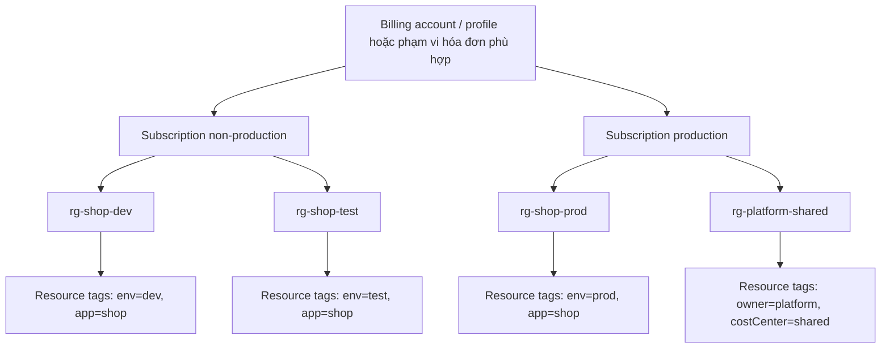
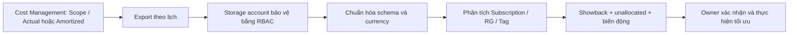

# Phân tích chi phí theo subscription, resource group và tag

## 1. Vấn đề cần giải quyết

Một ứng dụng trên Microsoft Azure có thể hoạt động ổn định nhưng hóa đơn tăng đều qua từng tháng. Nếu chỉ nhìn **tổng chi phí**, đội vận hành khó trả lời: subscription nào đang tăng, môi trường nào tốn nhiều nhất, chi phí của ứng dụng nào thuộc nhóm nào và phần tiền chưa được phân bổ nằm ở đâu. Chức năng **Cost Management** giúp chuyển dữ liệu sử dụng tài nguyên thành báo cáo có thể phân tích theo nhiều chiều.

Trong chương **Quản lý chi phí** của mô-đun `CLOUD_PROVIDERS_AZURE`, chúng ta phân tích chi phí theo ba lớp: **subscription → resource group → tag**. Đây là bước thực hành quan trọng khi học hệ sinh thái Azure từ subscription, resource group, Microsoft Entra ID đến mạng ảo, compute, storage, dữ liệu, vận hành và kiểm soát ngân sách của ứng dụng.

Sau bài học, bạn có thể:

- Xác định **scope** xem chi phí, loại chi phí và khoảng thời gian để so sánh các báo cáo đúng cách.
- Đọc Cost Analysis theo subscription, resource group và tag; hiểu khác nhau giữa **filter** và **group by**.
- Nhận diện các khoản **không có resource group** hoặc **không có tag**, và xử lý trường hợp không phân bổ được ngay.
- Thiết kế quy ước tag phục vụ showback/chargeback, quản lý tag bằng Azure Policy và giám sát độ phủ.
- Đọc dữ liệu bằng **Cost Management Query REST API**, đồng thời phân biệt số liệu thực tế với số liệu ví dụ.
- Tạo quy trình báo cáo, kiểm tra biến động chi phí và đưa ra hành động có người chịu trách nhiệm.

**Tình huống xuyên suốt:** đội phát triển vận hành hệ thống `Shop API`. Môi trường dev và test chạy trong một subscription non-production; production dùng subscription riêng. Có những tài nguyên dùng chung cho log, network và bảo mật. Người quản lý muốn biết chi phí hằng tháng của từng môi trường, nhóm sở hữu và phần chi phí chung.

## 2. Trước khi phân tích: xác định đúng khái niệm và nguồn số liệu

### 2.1. Ba chiều phân tích và vai trò của chúng



| Chiều | Ý nghĩa | Phù hợp với câu hỏi | Giới hạn |
|---|---|---|---|
| **Subscription** | Ranh giới quản lý, phân quyền và thanh toán/ghi nhận chi phí tùy mô hình hợp đồng | Subscription nào tốn bao nhiêu? Production chiếm tỷ trọng nào? | Một subscription có thể chứa nhiều ứng dụng, môi trường và chủ sở hữu |
| **Resource group** | Nhóm vòng đời tài nguyên trong một subscription | Nhóm tài nguyên `rg-shop-prod` tăng bao nhiêu? | Một số khoản không gắn resource group; cùng group có thể phục vụ nhiều đội |
| **Tag** | Cặp khóa–giá trị gắn lên tài nguyên hoặc đối tượng được hỗ trợ | `env=prod` tốn bao nhiêu? Ai là owner? | Nhiều loại phí không có tag; thiếu tag và lịch sử tag có thể làm sai phân bổ |

**Resource group là ranh giới quản lý**, nhưng không phải hóa đơn độc lập; **tag là metadata phân loại**, không tự động cấp quyền hoặc giới hạn tiền. Tag trên resource group **không tự lan xuống tất cả tài nguyên bên trong**. Muốn dùng các tag nhóm để phân bổ chi phí, phải có cơ chế gắn tag tài nguyên, chính sách kế thừa hoặc tính năng **tag inheritance của Cost Management** khi đủ điều kiện.

### 2.2. Scope xem chi phí không phải scope gắn tag

Trong Azure Portal, **Cost Management** có thể mở tại subscription, resource group hoặc một billing scope tùy hợp đồng và quyền. Nếu bạn đứng ở resource group, dữ liệu nhìn thấy thường chỉ liên quan đến group đó; nếu đứng ở subscription, bạn có thể so sánh nhiều resource group trong subscription. Muốn xem nhiều subscription cùng lúc có thể cần chọn scope quản lý/billing cấp cao phù hợp và quyền cần thiết.

Đừng giả định **management group** hoặc **billing profile** có cùng cách gom chi phí, quyền và loại charge trên mọi loại hợp đồng Azure. Mô hình Microsoft Customer Agreement (MCA), Enterprise Agreement (EA), Microsoft Online Services Program và các hợp đồng khác có cách hiển thị/phạm vi được hỗ trợ khác nhau. Hãy kiểm tra scope và danh sách subscription thực sự xuất hiện trước khi so sánh.

**Azure RBAC và quyền xem chi phí:** một danh tính có quyền đọc tài nguyên chưa chắc nhìn được mọi dữ liệu billing; ngược lại, được xem báo cáo chi phí không đồng nghĩa được sửa VM. Role phổ biến như **Cost Management Reader** hỗ trợ truy cập chi phí ở scope được cấp; quyền xem chi phí ở một số billing scope còn phụ thuộc vai trò và chính sách billing riêng. Thiết lập theo nguyên tắc quyền tối thiểu.

### 2.3. Actual cost, amortized cost và hóa đơn

| Khái niệm | Phản ánh điều gì? | Dùng khi |
|---|---|---|
| **Actual cost** | Khoản chi phí được ghi nhận theo cách tính của billing/cost data trong kỳ, gồm thời điểm phát sinh khoản mua/điều chỉnh theo mô hình hợp đồng | Đối chiếu khoản ghi nhận và xu hướng chi tiêu |
| **Amortized cost** | Phân bổ chi phí của một số cam kết trả trước, như Reservations/Savings Plans khi được hỗ trợ, theo thời gian sử dụng để phản ánh tiêu thụ | So sánh hiệu quả sử dụng giữa ngày, nhóm hoặc workload |
| **Forecast** | Dự báo chi phí dựa trên dữ liệu và mô hình của dịch vụ, nếu tính năng khả dụng | Nhận diện nguy cơ vượt ngân sách, không phải số tiền đã chốt |
| **Invoice / billed amount** | Khoản phải trả theo hóa đơn và điều khoản hợp đồng, có thể liên quan thuế, credit, điều chỉnh hoặc phí khác | Đối soát tài chính với billing |

Khi phân tích, hãy ghi **cost type**, currency, billing period, dữ liệu đã cập nhật đến thời điểm nào và những phí có được bao gồm hay không. Không so tổng actual cost trong một biểu đồ với tổng amortized cost ở biểu đồ khác rồi kết luận chúng “thiếu tiền”. Amortization thay đổi cách **phân bổ theo thời gian**, không làm giảm số tiền đã cam kết.

Giá hiển thị có thể theo đơn vị tiền tệ billing và không phải chi phí cuối cùng sau thuế, credit hoặc hỗ trợ; một số charge không có resource ID/resource group/tag. Dữ liệu Cost Management có **độ trễ nhập liệu** và có thể tiếp tục điều chỉnh sau khi sử dụng. Chi phí “hôm nay” hay của tháng đang diễn ra vì vậy thường chưa đầy đủ.

## 3. Thiết lập một phép so sánh đáng tin cậy

Trước khi mở biểu đồ, viết ra câu hỏi cụ thể:

> Trong tháng vừa đóng sổ, tổng chi phí actual của hai subscription cho `Shop API` là bao nhiêu, phân theo resource group và `environment`, và bao nhiêu phần chưa được phân bổ?

Áp dụng cùng một quy trình:

1. **Chọn kỳ:** ưu tiên tháng đã kết thúc cho báo cáo tài chính; khi xem tháng đang chạy, ghi rõ ngày dữ liệu mới nhất.
2. **Chọn scope:** một subscription để drill-down; scope cấp trên phù hợp khi so nhiều subscription. Xác nhận ID subscription để tránh nhầm subscription có tên giống nhau.
3. **Chọn loại chi phí:** actual hoặc amortized theo mục đích, dùng **cùng** loại ở các lần so sánh.
4. **Chọn đơn vị và phương pháp:** currency hiển thị, daily/monthly granularity, có/không có thuế và phí không phân bổ theo tài nguyên.
5. **Đặt baseline:** cùng kỳ tháng trước, cùng số ngày, có cân nhắc số ngày của tháng, sự kiện triển khai và mùa cao điểm.
6. **Lọc và phân nhóm:** dùng một chiều tại một thời điểm để tránh bỏ sót; luôn giữ lại nhóm không xác định khi có.
7. **Đối soát tổng:** tổng sau khi chia nhóm phải phù hợp với tổng của cùng scope, kỳ, cost type và tập charge; nếu không, rà soát các filter, credit hoặc dữ liệu thiếu.

**Filter** giới hạn dữ liệu đưa vào truy vấn. **Group by** chia số liệu trong tập đã lọc theo thuộc tính. Nếu lọc chỉ `env=prod`, biểu đồ không thể cho biết tổng chi phí của tất cả môi trường. Để đánh giá **độ phủ tag**, không được loại nhóm tag rỗng khỏi mẫu số.

## 4. Thao tác trong Azure Portal: từ subscription đến tag

Giao diện có thể thay đổi, nhưng luồng phân tích cốt lõi của **Cost Management → Cost analysis** gồm chọn phạm vi, thời gian, cost type, cách biểu diễn, filter và group by.

### 4.1. Bước 1 — Chia theo subscription

Ở phạm vi billing/management được phép xem nhiều subscription, chọn kỳ và cost type, sau đó **group by Subscription** hoặc dùng filter cho từng subscription khi tính năng hỗ trợ. Ghi ra bảng:

| Subscription | ID/tham chiếu nội bộ | Chi phí | Nhận xét |
|---|---|---:|---|
| Non-production | Subscription A | Theo biểu đồ | Dev/test có thể dùng chung các dịch vụ |
| Production | Subscription B | Theo biểu đồ | Ưu tiên giám sát tăng trưởng và cam kết |
| Chưa xác định/khác | Kiểm tra scope | Theo biểu đồ | Có thể là phí không phân bổ hoặc ngoài phạm vi đã chọn |

Tại subscription đơn lẻ, không cần cố group by Subscription: chọn đúng subscription đã là một phép lọc. Khi không có quyền tại scope cấp cao, mở từng subscription với **cùng kỳ, cost type và currency**; chỉ cộng số tiền khi quy tắc báo cáo và đơn vị tiền tệ tương thích.

### 4.2. Bước 2 — Drill-down theo resource group

Tại subscription đang phân tích, chọn **Group by → Resource group**. Kiểm tra các nhóm như `rg-shop-dev`, `rg-shop-test`, `rg-shop-prod`, `rg-platform-shared` và các charge không có resource group. Chọn group tăng bất thường rồi xem tiếp **Service name**, **Resource** hoặc **Meter** khi khả dụng.

Ví dụ: `rg-shop-prod` tăng từ 480 lên 660 đơn vị tiền tệ một tháng. Sự tăng 180 có thể do tăng số instance App Service, giao dịch SQL, phí storage hay network egress. Resource group cho biết **vị trí chi phí tập trung**; phải phân tiếp theo resource/service và đối chiếu metric sử dụng mới biết nguyên nhân.

Không xóa một resource group chỉ vì biểu đồ cho thấy nó đắt: hãy nhận diện tài nguyên, owner, hợp đồng dự trữ, dependency và rủi ro trước khi đề xuất thay đổi.

### 4.3. Bước 3 — Nhìn theo tag

Trở lại scope đủ rộng để thấy tất cả charge cần phân tích. Trong phần **Group by**, chọn **Tag** và khóa `environment` hoặc `costCenter` (tên hiển thị tùy portal và dữ liệu). So sánh `dev`, `test`, `prod`, `shared` cùng nhóm **untagged / no tag / unavailable**.

Có thể bổ sung filter, chẳng hạn `app=shop`, nhưng phải báo cáo rõ rằng mọi chi phí không có tag `app` đã bị loại khỏi tập được lọc. Với tag `owner`, xem sự khác biệt giữa các đội, sau đó drill-down vào resource group và service. Nếu dịch vụ không hỗ trợ group theo một tag, kiểm tra quyền, dữ liệu tag, phạm vi, loại charge và khả năng của giao diện/API thay vì suy rằng chi phí bằng 0.

**Mục đích của trình tự:** subscription trả lời **tiền đến từ đâu**, resource group trả lời **nhóm tài nguyên nào phát sinh**, tag giúp trả lời **phục vụ ai/môi trường nào**. Đây là các chiều cắt của **cùng bộ dữ liệu**, không phải các bảng tiền độc lập để cộng chồng lên nhau.

## 5. Ví dụ số liệu: đối soát ba chiều

Dưới đây là **số liệu giả định** của một tháng đã kết thúc, cùng loại `ActualCost` và một đơn vị tiền tệ minh họa; không phải giá hoặc hóa đơn thực của Azure.

| Subscription | Resource group hoặc phần không có RG | `environment` | `owner` | Chi phí |
|---|---|---|---|---:|
| Non-production | `rg-shop-dev` | dev | shop | 120 |
| Non-production | `rg-shop-test` | test | qa | 80 |
| Non-production | Không có RG | không có | không có | 30 |
| Production | `rg-shop-prod` | prod | shop | 600 |
| Production | `rg-platform-shared` | shared | platform | 200 |
| Production | Không có RG | không có | không có | 70 |
| **Tổng** | | | | **1.100** |

Từ bảng này ta lập ba cách nhìn:

- **Theo subscription:** non-production = 120 + 80 + 30 = **230**; production = 600 + 200 + 70 = **870**. Tổng 1.100.
- **Theo resource group:** dev 120; test 80; shop production 600; platform shared 200; **không có RG 100**. Tổng 1.100.
- **Theo tag `environment`:** dev 120; test 80; prod 600; shared 200; **không có tag 100**. Tổng 1.100.

**Không cộng 230 + 870 + 120 + 80 + ...** vì cùng một khoản 120 đã xuất hiện ở nhiều góc nhìn. Có thể xây dashboard gồm nhiều biểu đồ nhưng chỉ một phép cộng tổng chi phí.

Tỷ lệ các khoản chưa gắn được `environment` trong ví dụ:

```text
Untagged cost rate = chi phí không xác định theo environment / tổng chi phí
                  = 100 / 1.100 ≈ 9,09%

Tagged cost coverage = (1.100 - 100) / 1.100 ≈ 90,91%
```

Đây là **độ phủ chi phí**, khác với **độ phủ số lượng tài nguyên**. Có thể có 99% resource được gắn tag nhưng 1% resource thiếu tag lại tiêu tốn phần lớn ngân sách; nên theo dõi cả hai.

### 5.1. Khi chi phí có RG nhưng không có tag

Giả sử một storage account trong `rg-shop-prod` tiêu tốn 50 nhưng chưa có tag. Báo cáo theo resource group vẫn đưa 50 vào `rg-shop-prod`, còn báo cáo theo `environment` có thể để 50 trong nhóm chưa được phân bổ. **Không tự suy ra `prod` chỉ từ tên group** nếu quy tắc phân bổ chưa được chấp thuận; việc này dễ che giấu dữ liệu tag lỗi hoặc chi phí dùng chung.

### 5.2. Khi khoản phí không thuộc tài nguyên nào

Một số khoản như phí hỗ trợ, phần mua cam kết, điều chỉnh/credit hoặc chi phí phát sinh theo quy tắc billing có thể không có resource group và tag. Cách hiển thị chúng phụ thuộc hợp đồng và cost type; không cố gắn ép một `resourceId` không tồn tại. Dùng nhãn **shared**, **central** hoặc **unallocated** theo chính sách phân bổ, đồng thời ghi nhận cơ sở của quy tắc.

## 6. Thiết kế tag phục vụ quản lý chi phí

### 6.1. Bộ tag tối thiểu

Một quy ước thực tế có thể gồm:

| Khóa | Giá trị ví dụ | Dùng để làm gì | Ai chịu trách nhiệm |
|---|---|---|---|
| `application` | `shop` | Nhận diện workload/product | Chủ ứng dụng |
| `environment` | `dev`, `test`, `prod` | Tách vòng đời và ngân sách | Đội triển khai |
| `costCenter` | `cc-042`, `shared-platform` | Liên hệ đơn vị chi trả | FinOps/tài chính |
| `owner` | `team-shop`, `team-platform` | Giao việc khi chi phí bất thường | Team lead |
| `managedBy` | `bicep`, `terraform` | Truy nguyên cách quản lý | Đội nền tảng |

Tốt nhất dùng **một bộ khóa chuẩn**, có định nghĩa giá trị hợp lệ trong tài liệu quản trị. Tránh viết lẫn `env`, `environment`, `Environment`, `Prod`, `production`; các biến thể gây phân nhóm tách rời hoặc khó tổng hợp. Khi tạo policy, automation và báo cáo, kiểm tra cách Azure xử lý hoa/thường của khóa và giá trị tag trong ngữ cảnh tương ứng; xây dựng quy ước nhất quán ở tầng ứng dụng.

**Không đặt dữ liệu bí mật** như mật khẩu, token, email cá nhân hoặc số hợp đồng nhạy cảm vào tag vì tag là metadata có thể xuất hiện trong API, audit và báo cáo. Tag hỗ trợ phân tích, không thay thế Azure RBAC, Azure Policy hay Azure Budget.

### 6.2. Gắn tag bằng Bicep

Ví dụ một đoạn Bicep tạo storage account trong resource group đã tồn tại:

```bicep
targetScope = 'resourceGroup'

param storageName string
param location string = resourceGroup().location

@allowed([
  'dev'
  'test'
  'prod'
])
param environment string

param application string = 'shop'
param costCenter string
param owner string

resource storage 'Microsoft.Storage/storageAccounts@2023-05-01' = {
  name: storageName
  location: location
  sku: {
    name: 'Standard_LRS'
  }
  kind: 'StorageV2'
  tags: {
    application: application
    environment: environment
    costCenter: costCenter
    owner: owner
    managedBy: 'bicep'
  }
  properties: {
    allowBlobPublicAccess: false
    supportsHttpsTrafficOnly: true
    minimumTlsVersion: 'TLS1_2'
  }
}
```

Cấp `environment`, `costCenter` và `owner` khi chạy IaC; lưu giá trị chuẩn trong parameter file cho từng môi trường. Ví dụ này chỉ áp dụng cho một loại resource hỗ trợ tags; **không phải mọi loại Azure resource, resource child hoặc charge đều hỗ trợ gắn tag theo cùng cách**.

Nếu sử dụng Resource Group tags, cần nhớ **tag của group không tự động trở thành tag của storage account**. Một nhóm ứng dụng có thể dùng cùng group nhưng nguồn charge vẫn thiếu tag cho đến khi tài nguyên hoặc dữ liệu billing có metadata thích hợp.

### 6.3. Azure Policy và tự động hóa tag

Azure Policy có các effect như **audit**, **deny**, **modify** (tùy định nghĩa và tính năng hỗ trợ) để phát hiện tag thiếu, chặn triển khai không đạt yêu cầu, hoặc áp/thừa hưởng tag cho tài nguyên được hỗ trợ. Một trình tự hợp lý:

1. **Audit trước:** đo số resource/chi phí thiếu tag; phát hiện workload ngoại lệ, owner và resource type không hỗ trợ.
2. **Chuẩn hóa:** định nghĩa khóa/giá trị được duyệt và nơi lưu thông tin owner hoặc cost center.
3. **Modify/deny có chọn lọc:** dùng policy phù hợp cho tài nguyên mới, với **managed identity và quyền** cần thiết nếu policy cần sửa tài nguyên.
4. **Remediation** cho tài nguyên đã tồn tại khi policy hỗ trợ; kiểm tra các thay đổi trước–sau và tránh ghi đè metadata đúng.
5. **Theo dõi định kỳ:** rà soát các charge chưa phân bổ, các giá trị sai quy ước và nguyên nhân mới phát sinh.

**Đừng giả định policy tác động ngược lịch sử hóa đơn.** Việc bổ sung tag hôm nay nhìn chung không làm các cost record trong quá khứ tự có tag. Những khoản chi phí đã phát sinh thường phải xử lý theo dữ liệu lịch sử hoặc quy tắc phân bổ đã công bố.

### 6.4. Tag inheritance trong Cost Management

Azure Cost Management có khả năng **tag inheritance** ở một số billing agreement/scope, cho phép dùng tag từ subscription hoặc resource group để hỗ trợ phân bổ chi phí của tài nguyên thuộc phạm vi ấy. Tính năng cần được bật với quyền phù hợp và có điều kiện áp dụng cụ thể theo hợp đồng. Nó **không đồng nghĩa** với việc thực sự gắn tag vào tất cả Azure resource.

Cần phân biệt:

- **Resource tag:** metadata thực tế của tài nguyên, đọc qua resource API và dùng cho vận hành/policy.
- **Resource group/subscription tag:** metadata ở cha; không tự chảy xuống mọi resource.
- **Cost Management inherited tag:** thông tin phục vụ **bản ghi chi phí** theo tính năng và quy tắc billing hỗ trợ.

Khi bật kế thừa, xác định thời điểm có hiệu lực, cách xử lý tag trùng giữa cha và resource, loại charge nào được áp dụng và ranh giới hợp đồng. Kiểm tra trước–sau bằng báo cáo tháng mới và không suy rằng toàn bộ lịch sử đã được cập nhật.

## 7. Phân tích bằng Cost Management Query REST API

Giao diện Azure Portal phù hợp cho điều tra thủ công. Khi cần báo cáo lặp lại, **Cost Management Query API** hỗ trợ truy vấn dữ liệu chi phí theo scope, thời gian và dimension hoặc tag. Ví dụ dùng một subscription được phép đọc.

### 7.1. Xác thực và chọn scope

Trước tiên xác định subscription ID cần xem, quyền `Cost Management Reader` hoặc quyền phù hợp và đăng nhập Azure CLI:

```bash
az login

SUBSCRIPTION_ID="<subscription-id>"
az account set --subscription "$SUBSCRIPTION_ID"
az account show --query '{subscription:id,name:name}' --output json
```

Phương thức REST thường được gọi là:

```text
POST https://management.azure.com/subscriptions/{subscriptionId}/providers/Microsoft.CostManagement/query?api-version=2023-11-01
Authorization: Bearer <Azure Resource Manager access token>
Content-Type: application/json
```

API version là ví dụ minh họa; cần xem phiên bản REST API hiện hành, quyền, scope và các field metric được cung cấp theo hợp đồng trước khi triển khai production. Token phải được lấy bằng cơ chế xác thực an toàn, không lưu trong source code hoặc nhật ký.

### 7.2. JSON truy vấn theo resource group

Đây là **request body** minh họa cho khoảng thời gian xác định. Dùng `ActualCost`, tổng `PreTaxCost` và chia theo resource group:

```json
{
  "type": "ActualCost",
  "timeframe": "Custom",
  "timePeriod": {
    "from": "2026-10-01T00:00:00Z",
    "to": "2026-11-01T00:00:00Z"
  },
  "dataset": {
    "granularity": "None",
    "aggregation": {
      "totalCost": {
        "name": "PreTaxCost",
        "function": "Sum"
      }
    },
    "grouping": [
      {
        "type": "Dimension",
        "name": "ResourceGroup"
      }
    ]
  }
}
```

Mốc thời gian là ví dụ, không phải kết quả truy vấn thực tế. Trên môi trường thực cần kiểm tra quy tắc xử lý biên ngày trong API và chọn kỳ nhất quán với báo cáo Cost Analysis.

Phản hồi điển hình có `properties.columns` mô tả các cột và `properties.rows` chứa giá trị. **Không cố định vị trí cột** khi xử lý chương trình; luôn đọc schema `columns` theo tên và `currency` trả về. Truy vấn lớn có thể có cơ chế phân trang hoặc giới hạn; phải xử lý theo response và tài liệu API, không coi trang đầu là toàn bộ dữ liệu.

### 7.3. Đổi phép nhóm sang tag

Giữ nguyên `type`, `timeframe`, `timePeriod` và `aggregation`, chỉ thay `grouping` bằng:

```json
"grouping": [
  {
    "type": "Tag",
    "name": "environment"
  }
]
```

Khi thực thi, cách truy vấn và loại tag được hỗ trợ có thể khác theo API/scope. Kết quả tag rỗng có thể được biểu diễn bằng một giá trị không xác định riêng; **không bỏ dòng đó** trong phân tích coverage. Dùng `type: AmortizedCost` để nghiên cứu cách phân bổ cam kết theo thời gian, nhưng hãy làm lại mọi biểu đồ so sánh với cùng cost type.

### 7.4. Ví dụ gọi REST với Azure CLI

Lưu request body vào `cost-by-rg.json` trong dự án thực hành, rồi gọi:

```bash
az rest \
  --method post \
  --uri "https://management.azure.com/subscriptions/$SUBSCRIPTION_ID/providers/Microsoft.CostManagement/query?api-version=2023-11-01" \
  --headers "Content-Type=application/json" \
  --body @cost-by-rg.json \
  --output json
```

Tệp `cost-by-rg.json` chứa JSON ở mục 7.2; dấu `@` ở `--body` chỉ đường dẫn file của Azure CLI. Lệnh này sử dụng ngữ cảnh đăng nhập CLI; người dùng phải có quyền xem chi phí tại scope. Một response lỗi `403` có thể do thiếu quyền billing/cost; `429` cho thấy giới hạn yêu cầu cần retry có backoff, tránh chạy truy vấn dồn dập.

**Lưu ý về thời gian và tiền tệ:** `PreTaxCost` là metric trong ví dụ API; tập cột và cách tính cost có thể khác theo hợp đồng. Không suy từ tên metric rằng số trả về đã khớp hóa đơn cuối cùng.

## 8. Từ báo cáo sang showback và chargeback

Phân tích chi phí có hai mức sử dụng:

- **Showback:** công khai chi phí theo team/app/environment để nâng nhận thức và hỗ trợ tối ưu, chưa nhất thiết chuyển tiền giữa đơn vị.
- **Chargeback:** phân bổ khoản tiền cho một đơn vị theo quy tắc được phê duyệt, thường cần quản trị tài chính và phương pháp giải trình chặt hơn.

Thực tế sẽ có **shared cost**: Log Analytics workspace phục vụ nhiều ứng dụng, network hub, Firewall, Bastion, monitoring, backup hoặc hỗ trợ tập trung. Những khoản này thường không thể phân bổ đúng chỉ bằng tag.

### 8.1. Chọn quy tắc phân bổ chi phí chung

Ví dụ `rg-platform-shared` có 200 đơn vị tiền tệ. Ba ứng dụng dùng nền tảng chung:

| Workload | Số request trong kỳ (giả định) | Tỷ trọng | Phí dùng chung phân bổ |
|---|---:|---:|---:|
| Shop | 600.000 | 60% | 120 |
| Catalog | 300.000 | 30% | 60 |
| Admin | 100.000 | 10% | 20 |
| **Tổng** | **1.000.000** | **100%** | **200** |

Đây là **quy tắc giả định**, chỉ phù hợp nếu số request có mối liên hệ đủ tốt với chi phí của dịch vụ dùng chung. Với log ingestion, GB ingest mỗi ứng dụng có thể hợp lý hơn request count; với network egress, cân nhắc bytes; với shared cluster, có thể dùng requested/used CPU-memory đã chuẩn hóa. Không dùng một quy tắc chung cho mọi dịch vụ chỉ vì dễ tính.

Một số môi trường Azure có khả năng **Cost allocation rules** trong Cost Management ở billing scope đủ điều kiện. Kiểm tra tính năng, loại charge hỗ trợ và hiệu lực thay đổi trước khi dùng; nếu không phù hợp, ghi quy tắc ở tầng báo cáo riêng. **Phân bổ lại chỉ là báo cáo nội bộ, không tự thay đổi hóa đơn gốc.**

### 8.2. Cách tránh tính hai lần

Nếu chuyển 200 phí shared sang ba ứng dụng, báo cáo chi phí theo ứng dụng sẽ gồm:

```text
Direct cost (ứng dụng)
+ Allocated shared cost (phân bổ đúng một lần)
= Fully loaded cost (chi phí toàn phần)
```

Khi đã phân bổ 200, không cộng thêm 200 một lần nữa vào tổng fully loaded. Nên giữ hai cột **direct** và **allocated**, kèm tổng gốc chưa phân bổ để đối soát và truy ngược nguồn.

## 9. Phát hiện biến động và chuyển thành hành động

Giả sử `rg-shop-prod` tăng 35% so với tháng trước. Trước khi đánh dấu chi phí bất thường, cần phân tích:

1. **Đã so đủ cùng số ngày chưa?** Tháng đang chạy dễ lệch so với tháng hoàn chỉnh; cost ingestion có thể trễ.
2. **Cùng loại chi phí chưa?** Actual so với amortized có thể làm committed cost xuất hiện khác thời điểm.
3. **Có thay đổi kiến trúc không?** VM/App Service Plan tăng instance, SKU đổi, Azure SQL nâng tier, thêm private endpoint, traffic network outbound tăng.
4. **Sử dụng tăng hay giá/đơn vị thay đổi?** Xem quantity, meter, service name, pricing/cam kết, reservation coverage theo khả năng hiển thị.
5. **Có phí ngoài resource group không?** Mua cam kết, marketplace, hỗ trợ hoặc charge không gắn resource không thể chỉ điều tra qua RG.
6. **Ai chịu trách nhiệm?** Dùng tag owner, lịch deployment, ticket và thông tin team để giao xác minh, không kết luận lỗi do nhóm nào chỉ từ tên resource.

Ví dụ khung báo cáo:

| Trường | Ví dụ |
|---|---|
| Scope | Subscription production |
| Thời gian | Tháng hoàn chỉnh so với tháng trước |
| Cost type | Actual |
| Dimension đang xét | Resource group → Service name → Resource |
| Biến động | +35% |
| Giả thuyết | Tăng egress hoặc instance sau release |
| Bằng chứng cần thu | Usage quantity, meter, traffic metric, change log, thời điểm scale |
| Owner | Team Shop |
| Hành động | So sánh trước–sau; tối ưu đúng dịch vụ |
| Kết quả | Chi phí và SLO sau thay đổi, rủi ro, phần tiết kiệm đã xác minh |

**Không giảm chi phí bằng cách tắt bảo mật/backup/giám sát khi chưa đánh giá rủi ro.** Mục tiêu là đưa chi phí về mức hợp lý với SLO, độ tin cậy, an toàn và nhu cầu thực.

## 10. Báo cáo định kỳ, budgets và exports

### 10.1. Budget và alert

Azure Budgets có thể được tạo theo scope phù hợp như subscription hoặc resource group, với ngưỡng chi tiêu và thông báo theo tính năng khả dụng. Budget hỗ trợ **cảnh báo** và theo dõi; bản thân budget **không phải hạn mức cứng tự dừng tài nguyên**. Muốn tự động hóa hành động sau cảnh báo cần workflow riêng, có kiểm soát để tránh dừng production sai thời điểm.

Ví dụ dùng budget cho subscription production: mức mục tiêu 2.000 đơn vị tiền tệ/tháng, thông báo tại các mức 50%, 80%, 100% theo điều kiện và loại ngưỡng được Azure hỗ trợ. Người nhận cần biết **scope, kỳ, actual/forecast, tài nguyên đóng góp** và cách điều tra. Giá trị budget phải cùng currency với scope chi phí.

### 10.2. Exports và lưu trữ lịch sử

Đối với báo cáo định kỳ, sử dụng tính năng **Cost Management Exports** để xuất dữ liệu được hỗ trợ sang Azure Storage, sau đó xử lý bằng công cụ phân tích như Power BI hoặc pipeline dữ liệu. Dữ liệu xuất có schema, cấu hình kỳ, loại cost và thời điểm tạo; cần quản lý version schema, quyền truy cập, chi phí storage và khả năng chạy lại.

Pipeline tham khảo:



Không dùng export chi phí thay cho dữ liệu hoạt động: muốn xác định vì sao Azure SQL tăng tiền phải kết hợp metric/query/usage của SQL. **Giới hạn quyền truy cập** dữ liệu cost export vì có thể tiết lộ cấu trúc subscription, workload và thông tin chi tiêu nội bộ.

### 10.3. Một báo cáo tháng tối thiểu

Báo cáo tốt thường gồm:

- Metadata: kỳ, scope/subscription, loại cost, currency, thời điểm data refresh và người lập.
- Tổng chi phí, so sánh tháng trước/forecast và chi phí chưa phân bổ.
- Bảng theo subscription, top resource groups, top service/resource, top tags `environment`/`costCenter`.
- Độ phủ tag theo **chi phí** và theo **số resource**, cùng danh sách owner cần khắc phục.
- Shared cost: tổng gốc, phương pháp allocation, dữ liệu làm trọng số và số đã phân bổ.
- Giải thích top biến động và hành động: người chịu trách nhiệm, hạn xử lý, cách đo kết quả.

## 11. Sự cố thường gặp khi phân tích

| Hiện tượng | Nguyên nhân có thể gặp | Cách kiểm tra |
|---|---|---|
| Tổng theo tag thấp hơn tổng subscription | Phí không có tag, tag không được hỗ trợ, hoặc filter đã loại dữ liệu | Bỏ filter tag, giữ nhóm untagged và kiểm tra cost type/scope |
| Tổng RG thấp hơn tổng subscription | Charge không gắn RG hoặc được ghi nhận ở scope khác | So tổng trực tiếp và dòng no RG, xem loại phí |
| Không thấy tag mới trong lịch sử | Tag áp dụng sau ngày sử dụng, ingestion trễ hoặc thừa kế chưa có hiệu lực | Xác nhận ngày sửa tag, kỳ charge và điều kiện kế thừa |
| Tag `Prod` và `prod` tách nhóm | Giá trị hoặc khóa tag không chuẩn | Chuẩn hóa quy ước và remediation; tránh sửa lịch sử tùy tiện |
| Hai báo cáo khác nhau | Actual so amortized, khác currency, khác kỳ, scope, filter hoặc thời điểm refresh | Ghi đầy đủ metadata và tái chạy cùng điều kiện |
| Không nhìn thấy subscription/team | Chưa có quyền Cost Management/billing hoặc scope chọn sai | Kiểm tra role và scope phù hợp theo hợp đồng |
| Tháng này chưa thấy phí hôm nay | Cost ingestion có độ trễ | Kiểm tra thời điểm dữ liệu mới nhất; không coi là 0 |
| Budget gửi alert nhưng VM vẫn chạy | Budget chỉ theo dõi/cảnh báo | Thiết kế automation được phê duyệt nếu cần hành động |
| Số theo app bị cộng quá cao | Cộng direct cost + shared cost hai lần | Đối soát tổng trước/sau allocation với cùng nguồn |
| Resource group tăng nhưng CPU không tăng | Charge có thể đến từ storage, backup, data transfer, reservations hoặc giá | Drill-down theo service/meter/usage, kết hợp metric phù hợp |

## 12. Bài tập thực hành

### Bài tập A — Cost Analysis trong Portal

Giả sử bạn có quyền xem chi phí của hai subscription. Hãy chọn một tháng đã đóng sổ, thống nhất cost type và ghi lại:

1. Tổng chi phí theo từng subscription và tổng toàn bộ scope.
2. Năm resource group chi phí cao nhất, lý do có khoản không thuộc resource group.
3. Tổng theo tag `environment` và nhóm chưa có tag; tính **coverage theo chi phí**.
4. Drill-down một resource group tăng mạnh theo Service name và Resource.
5. Viết một giả thuyết có bằng chứng cần thu thập trước khi đề xuất tối ưu.

### Bài tập B — Tag governance

Thiết kế các tag `application`, `environment`, `costCenter`, `owner` cho một hệ thống có dev/test/prod. Trình bày cơ chế đưa tag vào Bicep, cách Azure Policy phát hiện thiếu tag, một ngoại lệ cho loại resource không hỗ trợ tag và cách báo cáo khoản phí không có resource ID. Giải thích vì sao tag gắn hôm nay không tự sửa báo cáo tháng trước.

### Bài tập C — Phân bổ shared cost

Sử dụng số liệu ví dụ ở mục 5. Giả sử khoản shared cost 200 được phân bổ cho Shop/Catalog/Admin với trọng số 60%/30%/10%. Hãy tính phí từng ứng dụng, chứng minh tổng allocation bằng 200 và chỉ ra cách trình bày **direct + allocated** mà không tính đôi.

### Bài tập D — Tự động hóa

Soạn JSON request body Cost Management Query theo resource group cho một kỳ bất kỳ; chuyển `grouping` sang tag `environment` và giải thích vì sao hai truy vấn phải có cùng scope/cost type/period. Nêu cách lưu dữ liệu, kiểm tra currency và xử lý các dòng không có tag trước khi vẽ báo cáo.

**Tiêu chí hoàn thành:** người học có thể phân tích cùng một khoản chi phí theo ba chiều mà không cộng trùng; nhận diện phí không có resource group/tag; phân biệt actual và amortized; tạo được bộ quy ước tag có owner; nêu được giới hạn của policy, inheritance, API và budget; lập báo cáo có số liệu đối soát và hành động cụ thể.

**Câu hỏi tự đánh giá:**

1. Vì sao phân nhóm theo resource group không đảm bảo tất cả chi phí subscription đều nằm trong một nhóm có tên?
2. Tag trên resource group có tự gắn lên mọi resource con không?
3. Độ phủ 95% số resource có đủ kết luận độ phủ chi phí tốt không?
4. Vì sao không nên so ActualCost tháng này với AmortizedCost tháng trước?
5. Cost Management tag inheritance có thay đổi metadata của từng Azure resource không?
6. Một ngân sách vượt 100% có tự tắt VM production không?
7. Shared cost đã phân bổ hết có được cộng thêm vào tổng chung lần nữa không?

## 13. Tài liệu tham khảo

- Microsoft Learn — [Cost analysis trong Azure Cost Management](https://learn.microsoft.com/azure/cost-management-billing/costs/quick-acm-cost-analysis).
- Microsoft Learn — [Hiểu dữ liệu trong Cost Management](https://learn.microsoft.com/azure/cost-management-billing/costs/understand-cost-mgt-data).
- Microsoft Learn — [Tag inheritance cho phân tích chi phí](https://learn.microsoft.com/azure/cost-management-billing/costs/enable-tag-inheritance).
- Microsoft Learn — [Cost Management exports](https://learn.microsoft.com/azure/cost-management-billing/costs/tutorial-export-acm-data).
- Microsoft Learn — [Azure Cost Management Query REST API](https://learn.microsoft.com/rest/api/cost-management/query/usage).
- Microsoft Learn — [Azure Policy và policy definitions](https://learn.microsoft.com/azure/governance/policy/concepts/definition-structure-basics).

Khi áp dụng vào môi trường thực, kiểm tra khả năng được hỗ trợ theo hợp đồng billing, API version, tên dimension/tag, quyền và tình trạng cập nhật dữ liệu. Chi phí có ý nghĩa quản trị khi báo cáo giữ được **scope, loại chi phí, kỳ, đơn vị tiền tệ, khoản chưa phân bổ và bằng chứng hành động**.
