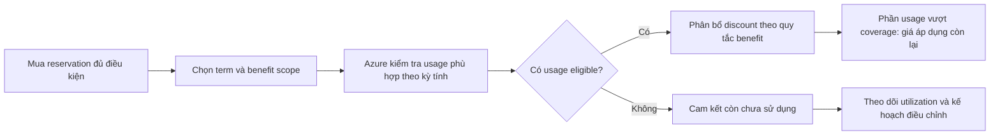
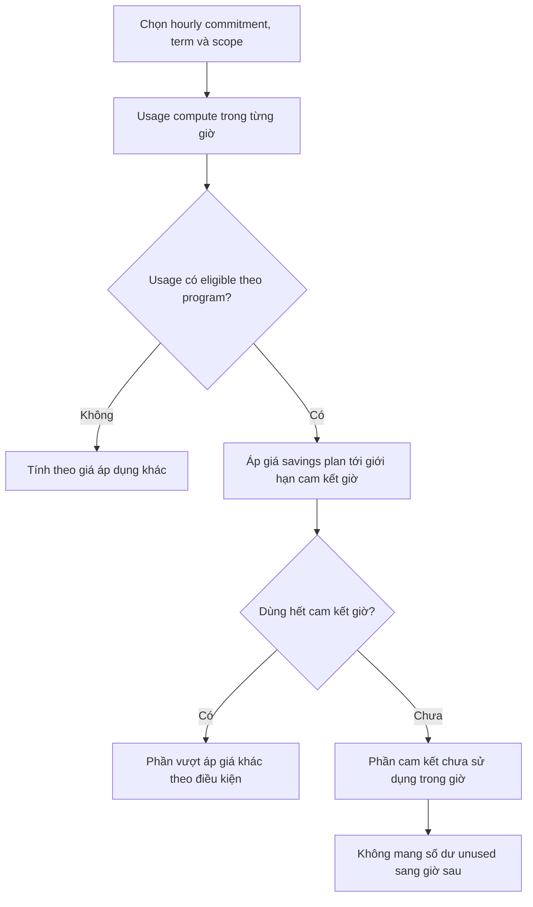
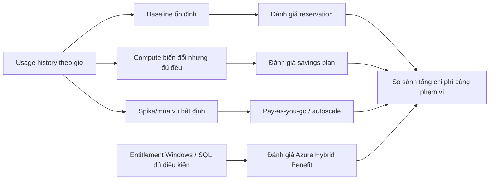
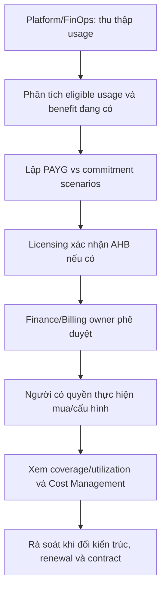

# Reservations, savings plan và Azure Hybrid Benefit

## 1. Vì sao chi phí cam kết quan trọng khi chạy ứng dụng trên Azure?

Một kiến trúc ứng dụng trên Microsoft Azure thường đi qua nhiều lớp: **subscription**, **resource group**, mạng ảo, máy ảo hoặc App Service, database, storage, bảo mật với Microsoft Entra ID/Key Vault, giám sát và sao lưu. Khi hệ thống mới thử nghiệm, nhóm có thể trả theo mức sử dụng thông thường để giữ linh hoạt. Khi ứng dụng vận hành liên tục và có số liệu tải ổn định, **chi phí tính toán và giấy phép** có thể trở thành cơ hội tiết kiệm đáng kể.

Trong chương **Quản lý chi phí**, ba cơ chế cần hiểu là:

- **Azure Reservations:** cam kết mua quyền lợi giảm giá cho một phạm vi sử dụng/tài nguyên đủ điều kiện trong thời hạn xác định. Với compute VM, người học thường gặp tên *Reserved Virtual Machine Instances*.
- **Azure Savings Plan for Compute:** cam kết một **mức chi tiêu theo giờ** cho compute đủ điều kiện để nhận mức giá theo savings plan, giúp linh hoạt hơn khi các dịch vụ compute hoặc cấu hình thay đổi.
- **Azure Hybrid Benefit (AHB):** sử dụng **quyền lợi giấy phép đủ điều kiện đang sở hữu** để giảm phần phí license của một số dịch vụ Azure, ví dụ Windows Server hoặc SQL Server/Azure SQL theo điều khoản áp dụng.

Ba cơ chế này có thể liên quan đến cùng một workload nhưng **không mang cùng ý nghĩa**. Reservation và savings plan là **cam kết tài chính cho mức sử dụng đủ điều kiện**; Azure Hybrid Benefit là **quyền sử dụng giấy phép** cần chứng minh đủ điều kiện. Tăng quota subscription, gắn tag hay thay đổi resource group không tự tạo ra ba quyền lợi trên.

> **Phạm vi bài học:** giá, mức giảm, sản phẩm được áp dụng, chính sách hủy/đổi và điều khoản giấy phép phụ thuộc thời điểm, region, loại tài khoản, hợp đồng và dịch vụ. Mọi đơn giá số học trong bài là **giả định để học cách tính**, không phải báo giá Azure hiện hành. Trước khi mua hay kích hoạt lợi ích, phải kiểm tra bảng giá và điều khoản chính thức áp dụng cho tài khoản của tổ chức.

### Mục tiêu học tập

Sau bài này, bạn có thể:

1. So sánh pay-as-you-go, Reservations, savings plan for compute và Azure Hybrid Benefit theo bản chất, phạm vi, tính linh hoạt và rủi ro.
2. Xác định workload nào có tải nền ổn định, tải biến thiên, mùa vụ hoặc nhu cầu giấy phép phù hợp từng cơ chế.
3. Đọc các khái niệm **term**, **scope**, **eligibility**, **utilization**, **coverage**, **hourly commitment** và chi phí trả trước/trả định kỳ.
4. Tính kiểm tra bằng tay chi phí của workload với và không có cam kết, bao gồm trường hợp sử dụng không hết cam kết.
5. Phân biệt tiền thực trả với cách phân bổ chi phí theo kỳ khi dùng Azure Cost Management.
6. Lập phương án kết hợp quyền lợi một cách có kiểm soát, không cộng chồng mức giảm giá sai cách.
7. Viết quy trình quản trị, kiểm tra license, phê duyệt, giám sát và điều chỉnh khi kiến trúc thay đổi.

## 2. Bốn cách nhìn chi phí Azure

| Cơ chế | Bản chất | Đơn vị cam kết/quyền lợi | Phù hợp khi | Rủi ro chính |
| --- | --- | --- | --- | --- |
| **Pay-as-you-go (PAYG)** | Trả theo mức dùng đủ điều kiện ở mức giá áp dụng | Số giờ, dung lượng, requests, đơn vị dịch vụ | Tải khó dự báo, thử nghiệm, dự án ngắn hạn | Chi phí đơn vị có thể cao hơn phương án cam kết |
| **Reservations** | Mua quyền lợi giá cho loại mức sử dụng được xác định theo sản phẩm | Một lượng capacity/meter đủ điều kiện trong term, tùy sản phẩm | Baseline ổn định, cấu hình ít thay đổi | Mua dư, đổi SKU/region ngoài phạm vi được áp dụng |
| **Savings Plan for Compute** | Cam kết mức chi tiêu compute đủ điều kiện theo mỗi giờ | **Tiền/giờ** trong term | Nhu cầu compute tương đối ổn định nhưng cấu hình thay đổi | Không sử dụng hết cam kết giờ, áp dụng ngoài tập dịch vụ eligible |
| **Azure Hybrid Benefit** | Dùng quyền lợi giấy phép phần mềm đủ điều kiện | Entitlement/license và quyền sử dụng theo điều khoản | Đã có Windows Server/SQL license phù hợp | Không đủ điều kiện, khai báo quá số quyền lợi, hết hiệu lực giấy phép |

**Reservation khác với capacity reservation.** Reserved VM Instance là **quyền lợi về giá** cho mức sử dụng tương ứng; nó không tự đảm bảo Azure giữ sẵn VM capacity tại một vùng hoặc zone. Nếu cần bảo đảm khả năng cấp phát VM theo kịch bản được hỗ trợ, phải đánh giá **On-demand Capacity Reservation** riêng, cùng quota và availability. Một reservation cũng không tự bật VM, tạo máy mới hoặc thay đổi cấu hình máy đang chạy.

### Ví dụ ở cấp kiến trúc

Ứng dụng `orders-api` có:

- Hai Azure VM chạy API 24/7 trên một VM family tương đối ổn định.
- Một số worker được autoscale theo lượng đơn hàng, có thể đổi kích thước instance hoặc chuyển sang dịch vụ compute khác.
- Một Azure SQL Database chạy liên tục.
- Azure Storage, Key Vault, network egress và Log Analytics.
- Một số VM Windows có thể sử dụng giấy phép Windows Server đủ điều kiện của tổ chức.

Trong trường hợp này, nhóm có thể **đánh giá reservation cho baseline VM**, **savings plan cho một phần compute linh hoạt**, **Azure Hybrid Benefit cho các quyền license đủ điều kiện**, trong khi Blob operations, mạng, log và nhiều meter khác vẫn được tính phí theo điều kiện riêng. Không được lấy mức giảm giá compute áp cho toàn bộ hóa đơn Azure.

## 3. Thống nhất từ vựng về discount và cam kết

| Thuật ngữ | Ý nghĩa thực tiễn |
| --- | --- |
| **Term** | Thời hạn cam kết; nhiều sản phẩm hỗ trợ lựa chọn 1 năm hoặc 3 năm, nhưng phải kiểm tra theo offer cụ thể |
| **Billing scope** | Phạm vi tài khoản/đơn vị thanh toán và quyền mua, quản lý benefit |
| **Benefit scope** | Subscription, resource group, nhóm subscription hoặc phạm vi chia sẻ được phép nhận quyền lợi, tùy sản phẩm và thỏa thuận |
| **Eligibility** | Bộ thuộc tính của usage được chấp nhận: dịch vụ, region, SKU, OS, model mua, scope và điều kiện khác |
| **Utilization** | Phần cam kết/benefit đã được sử dụng trong khoảng đo |
| **Coverage** | Tỷ lệ usage đủ điều kiện được benefit bao phủ; khác với utilization |
| **Hourly commitment** | Khoản chi tiêu compute được cam kết cho mỗi giờ với savings plan |
| **Upfront / monthly payments** | Lịch thanh toán cam kết; không đồng nghĩa quyền lợi có thời gian áp dụng khác |
| **Actual cost / amortized cost** | Các cách trình bày chi phí thanh toán và chi phí phân bổ lợi ích theo thời kỳ |
| **Pay-as-you-go overage** | Phần usage ngoài mức/điều kiện được cam kết, trả theo giá áp dụng còn lại |

Một VM thuộc đúng family nhưng ở region hoặc môi trường ngoài phạm vi benefit có thể **không dùng được reservation**. Một VM đủ điều kiện vẫn có thể không nhận benefit do quyền lợi đã được dùng cho workload khác ở cùng thời điểm.

### Utilization và coverage không phải một số

Giả sử bạn có reservation cho **1 VM tương ứng chạy 24 giờ mỗi ngày**:

- VM phù hợp chạy 24/24 giờ: utilization của reservation lý tưởng xấp xỉ 100%.
- VM phù hợp chỉ chạy 12/24 giờ: utilization tương ứng xấp xỉ 50%; nửa thời gian cam kết còn lại không được sử dụng.
- Bạn có 10 VM phù hợp chạy cả ngày nhưng chỉ một reservation: benefit đó có thể utilization 100%, nhưng **coverage chỉ khoảng 10%** số giờ VM trong ví dụ giản lược.

Số liệu thực có thể được Azure tính theo đơn vị billing và các cơ chế linh hoạt instance size; dùng báo cáo reservation utilization/coverage thay vì cố suy từ danh sách tên VM.

## 4. Reservations hoạt động thế nào?

**Azure Reservations** là tên chung của các ưu đãi mua trước theo term cho **dịch vụ đủ điều kiện**, không chỉ VM. Tùy sản phẩm, reservation có thể áp cho compute, database capacity hoặc dịch vụ khác với định nghĩa meter khác nhau. Với **Azure Reserved VM Instances**, mức sử dụng VM phù hợp được áp quyền lợi theo điều kiện mua; các khoản như **managed disks, network egress, backup, monitoring và thành phần license không được reservation bao phủ** vẫn phải xem riêng.

### Luồng quyền lợi giá



Những điều cần nhớ:

1. **Chỉ có quyền lợi giá khi usage match.** Không phải mọi VM trong subscription đều tự được giảm.
2. **Reservation không tự cấp phát tài nguyên.** Việc scale và điều kiện quota/capacity vẫn độc lập.
3. **Term vẫn tồn tại khi VM tắt.** Dừng VM hoặc chuyển sản phẩm có thể làm giảm utilization nhưng không tự hủy nghĩa vụ cam kết.
4. **Phần license và phụ phí khác cần tính riêng.** Đặc biệt cần phân biệt base compute với Windows/SQL license.
5. **Điều khoản điều chỉnh không giống nhau cho mọi reservation.** Khả năng chuyển scope, exchange, refund, cancel, renew và giới hạn áp dụng phải kiểm tra tại thời điểm mua và theo hợp đồng.

### Các thuộc tính thường cần chọn

| Thuộc tính | Câu hỏi trước khi mua |
| --- | --- |
| Product/type | Đây là VM reservation hay reserved capacity của dịch vụ khác? |
| Region | VM/workload sẽ ở region nào trong phần lớn kỳ cam kết? |
| VM series/SKU/size | Có kế hoạch resize hoặc migrate instance family trong term không? |
| Instance size flexibility | Loại reservation này có hỗ trợ và đã bật cách áp phù hợp không? |
| Quantity | Baseline hoạt động thường xuyên tương đương bao nhiêu đơn vị được tính phí? |
| Term | Workload có chắc còn dùng trong 1/3 năm không? |
| Scope | Subscription/resource group/shared scope nào được phép dùng benefit? |
| Billing plan | Thanh toán trước hay trả định kỳ; ai là billing owner? |
| Auto-renew | Có cần tái đánh giá trước khi hết hạn để tránh gia hạn ngoài ý muốn? |

**Instance size flexibility** có thể giúp benefit VM áp cho các instance size tương ứng trong phạm vi cùng một nhóm linh hoạt được hỗ trợ, dựa trên tỷ lệ quy đổi. Đây không phải khả năng tự do đổi sang mọi VM family, mọi region hoặc mọi hệ điều hành. Nếu sử dụng Dedicated Host, SQL reserved capacity hoặc loại reservation khác, quy tắc sản phẩm có thể hoàn toàn khác.

## 5. Mua reservation theo baseline, không theo đỉnh tải

Một workload có 2 VM chạy liên tục và 4 VM bổ sung chỉ vài giờ trong ngày có **baseline 2 VM**, còn peak là 6 VM. Nếu mua reservation cho cả 6 VM chỉ vì từng chạm mức đó trong khuyến mại, phần không dùng trong giờ thấp điểm có thể làm chi phí tăng.

Quy tắc sơ bộ:

\[
H_{\mathrm{eligible}}=\sum_{\text{VM đủ điều kiện}} \text{giờ hoạt động}
\]

\[
\text{Baseline tương đương} \approx
\frac{H_{\mathrm{eligible}}}{H_{\mathrm{kỳ}}}
\]

Với 30 ngày giả định, \(H_{\mathrm{kỳ}}=720\) giờ. Nếu tổng cộng 2.100 instance-hours, baseline tương đương là \(2.100/720\approx2{,}92\) instance. Đây chỉ là tỷ lệ trung bình để thảo luận; **không bảo đảm** mua đúng 2 hoặc 3 reservations là tối ưu vì phân bố theo từng giờ, quy tắc matching, giá và việc sử dụng theo khu vực có thể làm khác kết quả.

### Khi nào chưa nên mua?

Khi ứng dụng còn thử nghiệm, chưa quyết định giữa VM và container/serverless, chuẩn bị đổi region, cấu hình family thường xuyên thay đổi, hoặc không có usage history đủ dài, ưu tiên hoàn thiện dự báo và theo dõi thực tế trước. Savings plan có thể đáng nghiên cứu nếu compute thay đổi nhiều nhưng tổng chi tiêu theo giờ tương đối ổn định; nếu tải cũng rất bất định, pay-as-you-go vẫn là lựa chọn hợp lý cho phần biến thiên.

## 6. Azure Savings Plan for Compute hoạt động thế nào?

**Azure Savings Plan for Compute** cho phép người mua cam kết **một mức chi tiêu theo giờ** cho các dịch vụ compute đủ điều kiện trong thời hạn cam kết. Khi Azure ghi nhận usage phù hợp, usage được hưởng **giá savings plan**, cho đến khi phần cam kết tương ứng cho giờ đó đã được sử dụng. Những usage đủ điều kiện nhưng vượt mức cam kết, hoặc không thuộc diện áp dụng, tiếp tục nhận mức giá khác phù hợp theo điều khoản.

Khác reservation gắn nhiều hơn với đặc điểm của meter/dịch vụ cụ thể, savings plan được thiết kế linh hoạt hơn khi người dùng **chuyển VM size/family/region hoặc dịch vụ compute đủ điều kiện**, trong phạm vi chương trình hỗ trợ. **Không suy ra mọi sản phẩm Azure đều được bao phủ**: kiểm tra danh sách services, SKU và điều kiện tài khoản hiện hành.



### Bốn đặc điểm cốt lõi

- **Cam kết bằng tiền/giờ**, ví dụ một lượng USD/giờ do bên mua xác nhận trong portal.
- **Tính theo từng giờ:** mức cam kết được tính theo giờ dù mức sử dụng của một giờ thấp; phần cam kết chưa sử dụng không tự động chuyển sang giờ sau.
- **Hỗ trợ nhiều compute eligible:** độ linh hoạt cao hơn reservation cụ thể, nhưng giới hạn do chương trình quy định.
- **Term và điều kiện thanh toán vẫn ràng buộc:** trả theo tháng thay vì trả trước không biến cam kết thành hợp đồng có thể tắt theo ngày.

### Cần biết trước khi đặt hourly commitment

1. Tổng **chi tiêu compute đủ điều kiện sau khi xét các quyền lợi hiện có** trong từng giờ gần đây.
2. Độ dao động ngày/đêm, cuối tuần, theo mùa và kế hoạch tăng/giảm tải.
3. Các reservation hiện hữu, mức utilization, thời điểm hết hạn và khả năng thay đổi cấu hình.
4. Những dịch vụ/scope **không eligible** hoặc đã được hưởng quyền lợi khác.
5. Kế hoạch chuyển workload sang PaaS hoặc serverless có thể ảnh hưởng cách tiêu dùng cam kết.
6. Các ràng buộc mua, quản lý và phân bổ benefit theo billing scope.

**Không lấy tổng hóa đơn cloud chia cho số giờ** để chọn savings plan commitment. Hóa đơn còn có storage, database meters không eligible, network, log, licensing, support và thuế.

## 7. Reservation và savings plan: chọn cái nào?

| Tiêu chí | Reservation | Savings Plan for Compute |
| --- | --- | --- |
| Dạng cam kết | Quyền lợi trên meter/sản phẩm và số lượng được xác định | Mức chi tiêu compute eligible theo giờ |
| Phù hợp nhất | Usage ổn định, có cấu hình phù hợp trong term | Compute có thể đổi cấu hình/dịch vụ nhưng tổng nhu cầu tương đối đều |
| Linh hoạt khi đổi VM | Phụ thuộc matching và instance size flexibility | Phụ thuộc danh sách compute eligible, thường rộng hơn |
| Độ nhạy với region/SKU | Thường cao hơn với reservation VM cụ thể | Phụ thuộc quy tắc chương trình và scope |
| Không dùng hết | Mất cơ hội dùng hết benefit theo term | Cam kết giờ chưa dùng không chuyển sang giờ khác |
| Khả năng tiết kiệm | Phụ thuộc sản phẩm, term, matching và đơn giá thực | Phụ thuộc usage eligible, hourly commitment và giá áp dụng |
| Capacity reservation | Không tự bảo đảm capacity | Không tự bảo đảm capacity |
| Quản trị | Kiểm tra utilization theo reservation/SKU | Kiểm tra utilization commitment theo giờ và coverage |

Chọn mô hình dựa trên **dữ liệu thực và dự báo**, không mặc định “3 năm tiết kiệm nhiều nhất” hay “savings plan luôn tốt hơn reservation”. Một reservation có mức chiết khấu hấp dẫn nhưng utilization thấp có thể kém hiệu quả hơn phương án linh hoạt; một savings plan quá cao cũng tạo phần cam kết không được sử dụng.

### Chiến lược kết hợp theo ba lớp

Với hệ thống Orders API:

1. **Baseline rất ổn định:** đánh giá reservation cho phần VM đủ điều kiện thường xuyên hoạt động.
2. **Compute linh hoạt nhưng mức chi theo giờ khá đều:** đánh giá savings plan với phần usage còn lại **sau khi xem benefit hiện có**.
3. **Burst ngắn và không thể dự báo:** chấp nhận pay-as-you-go hoặc giải pháp autoscale phù hợp.

Trong ví dụ này, Azure Hybrid Benefit được đánh giá riêng theo **license entitlement**, không được xem là “lớp giảm giá thứ tư” có thể cộng một con số % tùy ý lên mọi meter.

## 8. Azure Hybrid Benefit: sử dụng đúng quyền giấy phép

**Azure Hybrid Benefit (AHB)** cho phép khách hàng đủ điều kiện sử dụng quyền lợi giấy phép phần mềm hiện có trong những dịch vụ Azure được hỗ trợ. Hai nhóm quen thuộc là **Windows Server** và **SQL Server/Azure SQL**; chính sách có thể khác theo sản phẩm, loại workload, edition, core, license agreement và quyền lợi Software Assurance/subscription.

Điều kiện đủ dùng AHB không được quyết định chỉ bằng việc “công ty có một key Windows hoặc SQL”. Cần:

- Xác nhận **loại giấy phép, số lượng core/quyền sử dụng, edition** và thỏa thuận.
- Xác nhận **Software Assurance đang hiệu lực hoặc subscription licensing** thuộc danh mục đủ điều kiện, khi chương trình yêu cầu.
- Kiểm tra quyền dùng đồng thời on-premises và Azure trong giai đoạn di chuyển nếu có; không tự giả định quyền sử dụng song song vô thời hạn.
- Xác định cách áp dụng lên **Azure VM, Azure SQL Database, Managed Instance hoặc SQL Server trên Azure VM**, vì thao tác và điều kiện có thể khác nhau.
- Ghi nhận ai chịu trách nhiệm theo dõi entitlement và rà soát tuân thủ khi tăng số máy hoặc nâng SQL edition.

### Tác động lên cấu trúc giá

Sơ đồ khái niệm:

```text
Azure VM chạy Windows Server:
  Tổng chi phí liên quan có thể gồm:
    + phần compute/hạ tầng
    + phần giấy phép Windows nếu chưa áp quyền lợi
    + disk / network / backup / monitoring / các chi phí khác

Khi đủ điều kiện và áp Azure Hybrid Benefit:
  Phần phí license đủ điều kiện được điều chỉnh theo program;
  phần compute và phụ phí khác vẫn cần tính theo meter riêng.
```

Đây là cách giải thích mô hình, không khẳng định Azure luôn cung cấp hóa đơn có đúng hai dòng “base compute” và “Windows license” cho mọi SKU. Việc tính giá Windows Server, SQL Server hoặc Azure SQL có các meter và phương pháp khác nhau.

### AHB không thay thế bảo mật hay quyền Azure

AHB thuộc **phương diện licensing/billing**; nó không phải managed identity, Azure RBAC, không làm VM tự động secure hơn và không cung cấp disaster recovery. Khi dùng AHB cho SQL database vẫn cần tính compute, storage, high availability, backup, data transfer và chi phí các region.

## 9. AHB với Windows Server VM, Azure SQL và SQL Server trên VM

### Windows Server trên Azure Virtual Machines

Một VM Windows có thể có chi phí license đi kèm trong mức giá. Khi tổ chức có quyền Windows Server Azure Hybrid Benefit hợp lệ, cần cấu hình để Azure nhận biết **Windows Server license benefit** theo cách dịch vụ hỗ trợ. Trong môi trường có quyền và hướng dẫn đã được xác minh, trường `licenseType` của Azure VM là một tín hiệu cấu hình có thể kiểm tra:

```bash
# Lệnh đọc trạng thái minh họa, không thay đổi VM.
az vm show \
  --resource-group rg-orders-prod \
  --name vm-orders-api-01 \
  --query "{name:name,licenseType:licenseType,size:hardwareProfile.vmSize}" \
  --output table
```

Lệnh chỉ chạy được khi tên resource group/VM tồn tại và identity có quyền đọc. Giá trị license type, khả năng dùng benefit và điều khoản core phải được kiểm tra theo hướng dẫn dành cho Windows Server của dịch vụ. Không dùng kết quả một thuộc tính để thay cho kiểm toán quyền license thực.

### Azure SQL Database và Azure SQL Managed Instance

Các sản phẩm Azure SQL đủ điều kiện có thể cho lựa chọn **License included** hoặc áp Azure Hybrid Benefit theo model vCore/dịch vụ tương ứng. Người thiết kế phải xem:

- Dịch vụ và purchasing model có hỗ trợ AHB không.
- Số lượng core/edition của quyền license đem áp có tương thích không.
- Có đang sử dụng rights tại on-premises, Azure VM khác hoặc tài nguyên SQL khác vượt giới hạn cho phép không.
- Có reservation/benefit khác đi kèm và thứ tự áp dụng trong hóa đơn thực thế nào.

Không suy ra Azure SQL Database dạng DTU và vCore có cùng cơ chế AHB. Hãy chọn model đúng trong Azure Pricing Calculator hoặc portal trước khi so sánh.

### SQL Server chạy trong Azure VM

SQL Server trên VM có thể liên quan **hai lớp giấy phép**: hệ điều hành Windows Server (nếu dùng Windows) và SQL Server. Đánh giá từng entitlement riêng; không vì đã áp AHB cho Windows mà mặc định SQL Server cũng được áp. Khi nâng vCPU, chuyển edition hoặc dùng nhiều VM, số core quyền lợi cần đối chiếu lại.

### Quy trình kiểm soát license

| Bằng chứng | Người xác nhận | Ví dụ dữ liệu cần lưu |
| --- | --- | --- |
| Danh sách license đủ điều kiện | Licensing/Procurement | Product, edition, core count, agreement và hiệu lực |
| Workload sử dụng benefit | Cloud platform/FinOps | Subscription, resource ID, VM/SQL type, environment |
| Quyền di chuyển và dual-use | Licensing/Legal khi cần | Điều kiện, thời hạn và hạn chế sử dụng |
| Trạng thái cấu hình Azure | Cloud operations | AHB/license setting đã áp đúng tài nguyên |
| Chi phí trước/sau | FinOps | Meter, mức dùng, giá theo hợp đồng, actual/amortized |
| Rà soát định kỳ | Người sở hữu license | Thay đổi số core, edition, VM, hợp đồng |

## 10. Cơ chế kết hợp lợi ích: lưu ý khi tính giá

**AHB có thể được dùng cùng reservation hoặc savings plan trong một số kịch bản đủ điều kiện** vì chúng giải quyết các thành phần khác nhau của chi phí. Tuy nhiên, việc áp dụng cụ thể, thứ tự benefit và cấu trúc giá phải được đối chiếu theo sản phẩm và hợp đồng. Không tự tính `Giá PAYG × (1 - %RI) × (1 - %SP) × (1 - %AHB)` rồi công bố là số tiền Azure sẽ thu.

Ví dụ khái niệm:

```text
Workload: Windows Server VM đủ điều kiện

1. Xác định chi phí hiện tại của base compute và thành phần license.
2. Kiểm tra có reservation match hay không.
3. Kiểm tra usage còn lại có thuộc diện savings plan hay không.
4. Kiểm tra quyền Windows Server AHB đủ điều kiện và cấu hình.
5. Giữ nguyên các dòng disk, network, monitoring, backup, data transfer...
6. Xem Azure Pricing Calculator/Cost Management cho hiệu ứng thực tế.
```

Các ưu đãi có **quy tắc ưu tiên và matching do nền tảng billing xác định**; người dùng không được giả định cả hai loại cam kết cùng giảm giá cho cùng một đơn vị compute-hour. Khi có nhiều benefit, hãy dựa trên **usage details/benefit reports** để giải thích dòng nào được bao phủ, dòng nào tính theo giá còn lại và phần commitment nào chưa sử dụng.

## 11. Bài toán 1: reservation cho tải nền và rủi ro mua dư

Tất cả đơn giá dưới đây là **số giả định để luyện tính**, hoàn toàn không đại diện cho VM SKU hay mức giảm giá hiện hành của Azure.

Giả sử một VM đủ điều kiện có:

- Giá PAYG giả định: **0,20 USD/instance-hour**.
- Chi phí reservation phân bổ tương đương: **0,13 USD/instance-hour** khi mua đúng term.
- Một tháng giả định **30 ngày = 720 giờ**.
- Một VM chạy **24/7**, và VM thứ hai chạy thêm **10 giờ mỗi ngày**.

Nhu cầu thực:

```text
VM nền:       1 × 720             = 720 instance-hours
VM bổ sung:   1 × 10 × 30         = 300 instance-hours
Tổng usage:                         1.020 instance-hours

Không có benefit:
  1.020 × 0,20                     = 204,00 USD/tháng
```

Nếu mua **một** reservation match với VM nền:

```text
Chi phí quy đổi reservation 1 VM: 720 × 0,13 = 93,60 USD
VM bổ sung theo PAYG:             300 × 0,20 = 60,00 USD
Tổng mô hình:                                  153,60 USD
Tiết kiệm so với PAYG:            204 - 153,60 = 50,40 USD
```

Giả sử thay vào đó mua **hai** reservations cùng loại cho cả 720 giờ trong tháng:

```text
Chi phí quy đổi 2 reservations:  2 × 720 × 0,13 = 187,20 USD
Usage thực:                               1.020/1.440 instance-hours
Unused entitlement (đơn giản hóa):               420 giờ
So với 1 reservation + PAYG:        187,20 - 153,60 = 33,60 USD đắt hơn
```

Trong ví dụ, cả phương án hai reservations vẫn thấp hơn PAYG thuần, nhưng **mua theo peak đã làm mất 33,60 USD tiết kiệm tiềm năng** so với phương án một reservation. Đây là mô hình chi phí phân bổ lý thuyết để hiểu utilization; Azure thực tế có thể ghép benefit theo giờ, size flexibility, các workload khác trong scope và thời gian cam kết khác.

### Câu hỏi vận hành

Nếu nhóm đưa thêm một VM tương thích ở subscription khác vào scope được phép, benefit thứ hai có thể được sử dụng tốt hơn. Nhưng quyết định đổi scope phải tuân theo quyền mua, billing/benefit scope và chính sách hiện hành. Đừng chuyển scope chỉ để “nâng utilization” nếu điều đó làm mất quyền lợi của ứng dụng ưu tiên hoặc vi phạm phân bổ ngân sách.

## 12. Bài toán 2: savings plan có commitment theo giờ

Trong ví dụ **độc lập** này, giả sử:

- Chi phí PAYG cho một đơn vị compute eligible: **0,20 USD/giờ**.
- Giá tương đương khi được savings plan bao phủ: **0,14 USD/giờ**.
- Cam kết savings plan: **0,14 USD/giờ** trong 720 giờ.
- Một đơn vị workload nền đủ điều kiện chạy 24/7.
- Một đơn vị compute bổ sung có cùng giả định giá chạy 300 giờ/tháng.

Tại mỗi giờ có một workload nền, nó sử dụng vừa đủ toàn bộ commitment minh họa. Phần workload bổ sung chỉ hoạt động một số giờ và, **với giả định không còn cam kết giờ trống**, được tính theo PAYG:

```text
Savings plan commitment:      0,14 × 720         = 100,80 USD
Compute bổ sung không được cover: 0,20 × 300     =  60,00 USD
Tổng mô hình:                                     = 160,80 USD
PAYG thuần:             (720 + 300) × 0,20       = 204,00 USD
Tiết kiệm lý thuyết:                             =  43,20 USD
```

Đây không phải bảng giá và không thể dùng kết quả này để khẳng định savings plan rẻ hơn/đắt hơn reservation trong mọi trường hợp. Savings plan có lợi thế khi **các loại compute đủ điều kiện thay đổi** nhưng tổng chi tiêu theo giờ vẫn đủ lấp commitment.

### Minh họa unused commitment

Giả sử cùng commitment 0,14 USD/giờ nhưng **không có compute eligible ở 100 giờ** (và không có workload eligible khác trong scope):

```text
Tổng commitment trong 720 giờ:      0,14 × 720 = 100,80 USD
100 giờ không có usage eligible:    0,14 × 100 =  14,00 USD
Khoản commitment unused tương ứng:               14,00 USD
```

Phần 14,00 USD không tự chuyển sang bù cho giờ burst ở ngày tiếp theo. Vì vậy, lựa chọn mức commitment cần nhìn **phân phối sử dụng từng giờ**, không chỉ nhìn tổng chi tiêu một tháng.

### Cẩn trọng với cách so sánh

Reservation trong mục 11 và savings plan trong mục 12 sử dụng mức giá giả định khác nhau, là hai bài tập độc lập. Để chọn giải pháp cho dự án thật, phải nhập **cùng workload, cùng billing period, cùng phạm vi, cùng quyền lợi license và cùng bảng giá** rồi so sánh trên đề xuất/estimate áp dụng cho tài khoản.

## 13. Bài toán 3: tính quyền lợi license với AHB

Giả sử để luyện tính:

- Một VM Windows tương đương có tổng giá PAYG **0,20 USD/giờ**, trong đó ta mô hình hóa **0,04 USD/giờ** là phần license đủ điều kiện được loại trừ khi dùng AHB.
- Phần còn lại **0,16 USD/giờ** là compute theo mô hình đơn giản.
- VM chạy 720 giờ và tổ chức **đã có quyền license hợp lệ**.

Kết quả lý thuyết:

```text
Không áp quyền lợi AHB:   720 × 0,20 = 144,00 USD
Có áp AHB hợp lệ:         720 × 0,16 = 115,20 USD
Chênh lệch hóa đơn Azure:              28,80 USD
```

**0,04 USD/giờ là phần license giả định**, không phải cách Azure tách giá chính thức của mọi VM Windows. Kết quả còn phải tính **chi phí mua, gia hạn hoặc quản lý giấy phép đã sở hữu** ở góc độ tổng chi phí sở hữu (TCO) nếu chúng chưa được phản ánh trong mô hình tài chính. AHB cũng không làm disk, network hoặc backup miễn phí.

Nếu muốn xét thêm reservation hoặc savings plan, hãy lấy **đơn giá sau quy tắc quyền lợi thực tế** từ công cụ/billing được áp dụng, sau đó mô hình hóa từng meter. Không lấy mức “tiết kiệm 28,80” này rồi cộng với một phần trăm giảm giả định không rõ cơ sở.

## 14. Mô hình hóa baseline, burst và kế hoạch thay đổi kiến trúc

Khi ra quyết định mua benefit, dữ liệu tối thiểu nên có:

| Nhóm dữ liệu | Ví dụ Orders API | Mục đích |
| --- | --- | --- |
| Region/SKU | `southeastasia`, VM family cụ thể | Kiểm tra eligibility/matching của reservation |
| Số giờ hoạt động | VM API 24/7, worker theo ca | Ước tính baseline và hourly spend |
| Loại workload | VM Windows, Linux, container, Azure SQL | Biết compute/sản phẩm có eligible hay không |
| Billing scope | Subscription production, subscription staging | Xác định benefit dùng ở phạm vi nào |
| Existing benefits | Reservations, savings plan, AHB đang áp | Tránh mua trùng cam kết |
| Quyền license | Windows/SQL entitlement và hạn hợp đồng | Đánh giá AHB hợp lệ |
| Kế hoạch thay đổi | Resize VM, chuyển AKS, migrate region | Dự đoán utilization khi kiến trúc đổi |
| Chi phí khác | Disk, network, log, backup, DR | Không ghi sai tỷ lệ tiết kiệm toàn hóa đơn |

Phân thành ba lớp:



**Dự báo tương lai quan trọng hơn số liệu trung bình quá khứ** khi tổ chức dự kiến chuyển VM sang App Service, đổi region hoặc chia nhỏ monolith thành microservices. Mua benefit 3 năm dựa trên workload đang chuẩn bị dừng có thể biến “tiết kiệm theo đơn giá” thành chi phí cam kết chưa sử dụng.

### Định lượng mức bất định

Nếu chưa rõ mức dùng, hãy tạo ba kịch bản:

- **Low case:** giảm 30% eligible usage sau tối ưu hóa và di chuyển.
- **Expected:** giữ baseline hoặc tăng nhẹ theo dự báo sản phẩm.
- **High case:** peak cao hơn, thêm region hoặc mở rộng dịch vụ đủ điều kiện.

Phần trăm trên là tham số của bài tập, không phải dự báo Azure. Ước tính tiền theo từng giờ hoặc nhóm giờ; nếu dữ liệu thực chỉ có tổng tháng, cần thu thập thêm trước khi đặt hourly commitment lớn.

## 15. Cách lập estimate trong Azure Pricing Calculator

**Azure Pricing Calculator** hữu ích để so sánh **các phương án có cùng kiến trúc và cấu hình**. Truy cập [Azure Pricing Calculator](https://azure.microsoft.com/pricing/calculator/) rồi:

1. Chọn dịch vụ phù hợp: Azure Virtual Machines, Azure SQL Database hoặc dịch vụ được hỗ trợ cần so sánh.
2. Xác định **region, SKU, OS, số instance, số giờ, capacity, storage và network**. Lưu lại tất cả giả định.
3. Lập kịch bản **pay-as-you-go** làm mốc; kiểm tra phần compute so với phần storage/network/license.
4. Khi giao diện có lựa chọn **reservation**, chọn term và mô hình thanh toán phù hợp, kiểm tra dịch vụ/SKU eligible.
5. Khi sản phẩm và giao diện có thể biểu diễn **savings plan**, xem mức cam kết và yêu cầu sử dụng tương ứng; nếu Calculator không trình bày được mức spend theo giờ nhiều loại compute, bổ sung bảng tính theo hourly usage profile.
6. Xác nhận **Azure Hybrid Benefit** chỉ khi tổ chức thực sự có entitlement đủ điều kiện, và chọn đúng tùy chọn license của sản phẩm.
7. Giữ nguyên các dòng chi phí khác khi so sánh để tránh quy phần giảm do kiến trúc khác vào benefit.
8. Lưu ngày, đơn vị tiền, billing offer, cấu hình và revision. Kiểm tra kết quả với bảng giá hợp đồng nếu có.

Không có một checkbox duy nhất áp đồng thời Reservations, savings plan và AHB cho mọi dịch vụ. Những lựa chọn không có trong giao diện cần kiểm tra tài liệu sản phẩm và/hoặc báo cáo mua benefit chứ không tự suy rằng được hỗ trợ.

### Bảng so sánh để đưa vào đề xuất

| Chỉ tiêu | PAYG | Reservation | Savings plan | AHB / kết hợp hợp lệ |
| --- | --- | --- | --- | --- |
| Giả định workload | Giống nhau | Giống nhau | Giống nhau | Giống nhau |
| Chi phí compute eligible | Giá PAYG | Giá/meter reservation áp được | Giá compute theo cam kết giờ | Dựa theo quy tắc license và compute thực |
| Unused commitment | Không áp dụng | Cần ghi | Cần ghi theo giờ | Không thay thế kiểm soát license |
| Chi phí license | Theo model mặc định | Kiểm tra riêng | Kiểm tra riêng | Tùy entitlement được xác minh |
| Disk/network/log | Đầy đủ | Đầy đủ | Đầy đủ | Đầy đủ |
| Term và ràng buộc | Không cam kết | Theo hợp đồng | Theo hợp đồng | Theo license agreement |
| Rủi ro thay đổi kiến trúc | Ít ràng buộc mua | Matching có thể giảm | Eligible spend có thể giảm | Số core/edition/quyền lợi có thể đổi |

## 16. Cách kiểm tra trên Azure Portal và Cost Management

Tùy quyền truy cập billing account và subscription, các khu vực có thể cần xem:

| Khu vực/nguồn | Điều cần lấy |
| --- | --- |
| **Azure Portal → Reservations** | Reservation đang có, term, scope, expiry, utilization, recommendations nếu khả dụng |
| **Azure Portal → Savings plans** | Hourly commitment, utilization, scope, kỳ cam kết và recommendations |
| **Azure Advisor** | Đề xuất tiết kiệm dựa trên sử dụng, cần xác minh giả định và điều kiện |
| **Cost Management → Cost analysis** | Chi phí theo dịch vụ, resource, meter, actual/amortized, kỳ và phạm vi |
| **Usage details/Exports** | Meter, pricing model/benefit mapping, usage và chi phí để giải thích phân bổ |
| **Azure Pricing Calculator** | Giá mô hình dự kiến cho cấu hình và phương án mua khác nhau |
| **Cổng quản lý license nội bộ** | Entitlement Windows/SQL, thời hạn và quyền sử dụng |

**Không phải ai có quyền `Contributor` vào resource group đều có quyền mua reservation hoặc xem toàn bộ billing data**. Phân quyền billing và quyền thao tác Azure RBAC có những ranh giới riêng; phải nhờ owner phù hợp phê duyệt nếu quyền mua/đọc billing chưa được cấp.

### Actual cost và amortized cost

Một reservation có thể được thanh toán trước hoặc theo kỳ, trong khi mức sử dụng hưởng benefit được phân bổ cho các subscription/resource theo thời gian. Vì vậy:

- **Actual cost** cho thấy các khoản ghi nhận theo logic thanh toán của hệ thống chi phí, có thể có dòng mua reservation hoặc savings plan ở kỳ khác với kỳ sử dụng.
- **Amortized cost** phân bổ chi phí cam kết theo kỳ sử dụng để đánh giá TCO của ứng dụng/nhóm chính xác hơn.

Đối chiếu phải chọn **một góc nhìn nhất quán**, đúng billing scope và kỳ. Nếu cộng nguyên khoản upfront purchase rồi tiếp tục cộng lại phần amortized allocation, bạn có thể **đếm hai lần cùng một commitment**.

### Utilization, coverage, savings

Ví dụ một reservation utilization 100% nhưng chỉ cover 20% VM usage: bạn có thể đánh giá mua thêm cho baseline, nhưng cần xem điều kiện giá và tính ổn định. Ngược lại, utilization 40% có nghĩa benefit hiện tại chưa được dùng tốt; không nên mua thêm chỉ vì còn nhiều VM đang PAYG ở family/region khác không match.

Với savings plan, hãy xem **unused hourly commitment**, vì thống kê trung bình tháng có thể che mất nhiều giờ thấp tải. Với AHB, cần kiểm toán **đúng entitlement và đúng cấu hình VM/SQL**; số liệu chi phí thấp không phải bằng chứng license đã hợp lệ.

## 17. Phân quyền và quy trình phê duyệt khi mua cam kết

Reservations và savings plan là quyết định tài chính có thể tạo **nghĩa vụ nhiều kỳ**. Quy trình nên rõ ai đề xuất, ai phân tích, ai duyệt và ai theo dõi.



### Checklist trước khi mua

1. Workload và người sở hữu nghiệp vụ đã được xác nhận.
2. Phạm vi billing, subscription, resource group và tenant đã được kiểm tra.
3. Đã có **usage history** đại diện, gồm mức tải ngày/đêm, cuối tuần và mùa vụ.
4. Đã kiểm tra tất cả reservations/savings plans hiện tại để tránh mua chồng.
5. SKU/region/term/scope và điều kiện matching đã được review.
6. Có dự báo thay đổi ứng dụng, VM size, region, database model trong kỳ cam kết.
7. Đã so sánh tổng chi phí và phương án unused commitment, không chỉ nhìn phần trăm discount.
8. Lựa chọn trả trước/trả kỳ và mô hình hạch toán đã được bộ phận tài chính duyệt.
9. AHB đã được đội license xác nhận theo edition/core/SA/subscription agreement.
10. Có owner theo dõi utilization, expiration, renewal và phương án xử lý unused.

### Sau khi mua

Không coi việc mua là đã hoàn tất tối ưu. Theo dõi và review định kỳ; khi một ứng dụng được tắt, chuyển vùng hoặc đổi SKU, cần biết benefit sẽ áp sang workload nào trong phạm vi cho phép. Quyết định đổi scope, tắt auto-renew, hủy hay xử lý reservation phải tuân chính sách sản phẩm và hợp đồng tại thời điểm thực hiện.

## 18. Phối hợp với quyền Azure, quản trị và khả năng phục hồi

Giảm chi phí không nên phá mục tiêu **bảo mật, độ tin cậy và vận hành**.

| Tình huống | Rủi ro nếu chỉ nhìn discount | Cách đánh giá |
| --- | --- | --- |
| Chuyển VM sang SKU rẻ hơn để match reservation | Thiếu RAM/CPU hoặc không có SKU trong vùng DR | Kiểm thử tải, quota và năng lực failover |
| Giảm số VM 24/7 | Không đủ vùng lỗi hoặc capacity lúc cao điểm | Kiểm tra SLA, autoscale và Availability Zones |
| Mua commitment cho region hiện tại | Kiến trúc sắp chuyển region theo data residency/latency | Review roadmap trước khi cam kết |
| Dùng AHB với SQL | Không đáp ứng số core/edition hoặc quyền license | Xác nhận với licensing/finance |
| Mua reservations ở scope dùng chung | Benefit chuyển sang ứng dụng khác, phân bổ chi phí khó giải thích | Quy tắc showback/chargeback và owner |
| Tăng cam kết khi DR standby còn thấp tải | Reservation unused trong bình thường | So sánh chi phí standby, failover và mục tiêu RTO |
| Tối ưu giá compute nhưng bỏ phần khác | Disk, log, egress, backup vẫn tăng | Xem tổng chi phí kiến trúc |

Reservation không giải quyết hạn mức vCPU quota hoặc đảm bảo VM capacity phục vụ failover. Quyết định DR phải dựa vào recovery objective, hỗ trợ region/SKU và bài diễn tập độc lập với quyết định mua benefit.

## 19. Bài thực hành: chọn chiến lược chi phí cho Orders API

**Mục tiêu:** lập phương án tối ưu compute và license cho một ứng dụng minh họa trên Azure mà không mua benefit thực, không tạo thêm resource và không làm thay đổi subscription.

### Dữ liệu bài tập

Giả sử sản phẩm có những workload sau:

| Workload | Cấu hình/tải giả định | Câu hỏi |
| --- | --- | --- |
| `orders-api-windows` | 1 VM Windows 24/7 | Reservation và AHB có phù hợp không? |
| `orders-worker` | 1 VM hoặc compute eligible chạy 10 giờ/ngày | Có nên mua reservation cho cả tháng? |
| `orders-batch` | Workload compute thay đổi loại dịch vụ nhưng có giờ hoạt động khá đều | Savings plan có phù hợp hơn không? |
| `orders-sql` | Azure SQL Database dùng vCore liên tục | Có reserved capacity hoặc AHB nào áp dụng được không? |
| `orders-logs` | 50 GB ingest mỗi tháng | Vì sao không lấy discount compute áp lên Log Analytics? |
| `orders-storage` | 500 GB Blob lưu trữ | Sản phẩm/meter nào cần dự toán riêng? |

Không gắn số tiết kiệm % cho từng dòng trước khi biết điều kiện và bảng giá thật.

### Bước 1 — Thu thập input

Chọn một **Azure region và cùng billing currency**. Ghi rõ VM size/family, OS, number of instances, số giờ theo ngày, các tài nguyên database, quan hệ subscription và điều kiện license hiện có. Nếu không có dữ liệu thực, dùng input giả định của bài nhưng đánh dấu `SAMPLE_ONLY`.

### Bước 2 — Lập phương án PAYG

Trong Pricing Calculator, tạo estimate pay-as-you-go cho compute eligible và các thành phần khác. Ghi ngày, region, SKU, hours, database config, storage, log và phần được miễn/ưu đãi nếu có. Giữ nguyên cấu hình này làm baseline khi so sánh.

### Bước 3 — Xác định baseline và kịch bản peak

Lập biểu đồ hoặc bảng **24 giờ × các nhóm workload**:

```text
Giờ UTC | VM API nền | Worker thêm | Batch eligible | Tổng eligible usage
00-07   |     1      |     0       |      ?         |       ?
08-17   |     1      |     1       |      ?         |       ?
18-23   |     1      |     0       |      ?         |       ?
```

Với dữ liệu thật, thay các dấu hỏi bằng usage/billing meters được đo. Không tự giả định batch hoặc dịch vụ mới đều nằm trong savings plan eligible list.

### Bước 4 — Phân tích Reservations

Dùng bảng VM giờ và bài toán mục 11 để đánh giá **0, 1 hoặc 2 reservations** cho nhóm tài nguyên phù hợp. Nêu utilization và rủi ro khi VM bị resize, migrate hoặc dừng. Nếu kiểm tra portal, chỉ đọc recommendation/usage; **không thực hiện mua** trong bài tập.

### Bước 5 — Phân tích Savings Plan

Lấy phần eligible compute **còn lại sau các benefit đã có**. Ước lượng chi tiêu theo từng giờ ở giá savings plan giả định hoặc giá thực do hệ thống báo. Thử vài mức hourly commitment, tính unused commitment ở giờ thấp tải và overage ở giờ cao tải.

### Bước 6 — Kiểm tra AHB

Lập một checklist license cho Windows Server/SQL: agreement, active Software Assurance/subscription eligibility, edition, số core, quyền đang sử dụng ở các nơi khác và ai ký xác nhận. Nếu dữ liệu license chưa có, ghi **`AHB: chưa xác minh`**; không lấy số license giả định làm cơ sở phê duyệt.

### Bước 7 — So sánh tài chính

Tạo bảng:

```text
Scenario                       Compute + license   Other meters   Commitment unused   Total
PAYG                           [số]               [số]           0                  [số]
1 reservation + PAYG           [số]               [số]           [số]              [số]
Savings plan + PAYG            [số]               [số]           [số]              [số]
Reservation + AHB eligible     [số]               [số]           [số]              [số]
Mixed (nếu được hỗ trợ)        [số]               [số]           [số]              [số]
```

Không cộng `commitment unused` hai lần nếu nó đã nằm trong tổng tiền mua/chi phí phân bổ. Nêu rõ phương pháp tính và billing view đang dùng.

### Bước 8 — Đề xuất và đặt tiêu chí theo dõi

Chọn phương án dựa trên **tổng chi phí hợp lệ, utilization dự kiến, rủi ro thay đổi kiến trúc, quyền license và yêu cầu độ tin cậy**. Đề xuất ngưỡng theo dõi utilization, lịch rà soát, cảnh báo trước ngày hết hạn, chủ sở hữu việc mua/renew và cách đối chiếu actual/amortized cost sau khi triển khai.

### Tiêu chí hoàn thành thực hành

| Tiêu chí | Cần có |
| --- | --- |
| Usage profile | Giờ chạy và chi tiêu eligible theo nhóm tài nguyên |
| PAYG baseline | Giá/cấu hình cùng region, có ngày chụp |
| Reservation | Phân tích số lượng, scope, term và utilization |
| Savings plan | Có hourly commitment, unused và overage |
| AHB | Quyền license đã xác nhận hoặc ghi chưa xác minh |
| Quy tắc kết hợp | Không nhân/cộng chồng discount tùy ý |
| Tổng kiến trúc | Bao gồm disk, network, storage, log và DR nếu dùng |
| Billing | Phân biệt actual và amortized, tránh double counting |
| Phê duyệt | Ghi người sở hữu, người duyệt và kế hoạch review |

## 20. Tình huống sai lầm thường gặp

| Sai lầm | Hậu quả | Cách xử lý |
| --- | --- | --- |
| Mua reservation bằng peak VM count | Utilization thấp ở giờ bình thường | Mua theo baseline tương đương, kiểm tra usage từng giờ |
| Cho rằng reservation cấp sẵn VM capacity | DR/autoscale thất bại do thiếu quota hoặc SKU | Đánh giá quota/On-demand Capacity Reservation riêng |
| Chọn savings commitment từ tổng hóa đơn Azure | Cam kết vượt spend compute eligible | Lọc chính xác eligible compute và benefit hiện có |
| Cho rằng unused savings commitment được chuyển giờ | Dự báo tiết kiệm quá cao | Tính riêng từng giờ, xem unused |
| Lấy discount % áp cả disk, network, log | Dự toán thấp hơn thực tế | Phân tách meter được benefit và meter không eligible |
| Cộng nhiều discount % cho cùng một compute-hour | Double counting tiền tiết kiệm | Kiểm tra quy tắc áp dụng bằng dữ liệu billing |
| Bật AHB chỉ vì thấy VM chạy Windows/SQL | Rủi ro không tuân thủ license | Xác minh agreement, SA/subscription rights và core |
| Chỉ xem chi phí upfront | Không biết ứng dụng nào thật sự dùng commitment | Đối chiếu actual và amortized đúng scope |
| Một subscription nhận benefit dùng chung nhưng chi phí đẩy sang nhóm khác | Chargeback thiếu công bằng | Ghi owner, scope, phân bổ nội bộ nhất quán |
| Quên các ngày/giờ không hoạt động | Mua thừa cam kết | Tính lịch chạy, cuối tuần, shutdown, thay đổi roadmap |
| Tự gia hạn benefit không đánh giá lại | Giữ cam kết khi kiến trúc đã đổi | Theo dõi expiry và quy trình renewal |
| Xem savings là kết quả kinh doanh duy nhất | Có thể giảm giá nhưng tăng downtime/latency | Kiểm tra SLA, capacity, security và DR |

## 21. Câu hỏi tự kiểm tra

1. Reservation và savings plan for compute khác nhau ở **đơn vị cam kết** như thế nào?
2. Tại sao một Reserved VM Instance không đồng nghĩa có sẵn VM capacity ở region đích của DR?
3. Một reservation utilization đạt 100% nhưng coverage chỉ 20% nói lên điều gì?
4. Khi một VM ngừng chạy giữa term reservation, cam kết có tự dừng không?
5. Vì sao savings plan commitment phải phân tích **theo giờ** thay vì chỉ tổng chi tiêu theo tháng?
6. Những dịch vụ/meter ngoài compute nào trong Orders API vẫn phải được dự toán riêng?
7. Khi nào Azure Hybrid Benefit hợp lệ? Vì sao chỉ sở hữu một product key chưa đủ?
8. Azure SQL Database sử dụng DTU có thể mặc nhiên dùng mọi quyền AHB như mô hình vCore không?
9. Nếu một Windows VM có AHB, có thể lấy số tiền tiết kiệm giấy phép nhân tiếp với % giảm reservation/savings plan không?
10. Với PAYG 0,20 USD/giờ, giá reservation giả định 0,13 USD/giờ, một VM chạy đủ 720 giờ thì mô hình tiết kiệm bao nhiêu?
11. Trong ví dụ reservation ở mục 11, mua 2 reservations thay 1 reservation làm tổng mô hình tăng thêm bao nhiêu?
12. Savings plan có commitment 0,14 USD/giờ và 100 giờ không có usage eligible thì unused tương ứng bao nhiêu?
13. Vì sao Actual cost có thể khác Amortized cost trong tháng mua reservation trả trước?
14. Khi một ứng dụng chuyển từ Azure VM sang kiến trúc container, cần kiểm tra gì trước khi tiếp tục mua cam kết?
15. Ai trong tổ chức nên xác nhận entitlement AHB và ai nên phê duyệt quyết định mua cam kết dài hạn?
16. Một workload 24/7 vẫn có thể không nhận được reservation benefit vì những lý do nào?

**Gợi ý trả lời:** (1) reservation theo meter/số lượng eligible, savings plan theo tiền/giờ; (2) benefit về giá không giữ capacity; (3) quyền lợi dùng hết nhưng phần lớn usage chưa được bao phủ; (4) không; (5) số dư cam kết không tự chuyển giờ; (6) disk, storage, data transfer, log, backup, Key Vault và dịch vụ khác; (7) agreement/edition/core/SA hoặc licensing phù hợp, phải đối chiếu entitlement; (8) không; (9) không cộng chồng tùy ý; (10) \(720\times(0{,}20-0{,}13)=50{,}40\) USD; (11) 33,60 USD đắt hơn; (12) 14,00 USD; (13) một cách phản ánh khoản mua, cách kia phân bổ theo thời gian; (14) eligibility, scope, usage và lịch chuyển đổi; (15) licensing/finance cùng cloud owner; (16) khác region, SKU/family, scope, OS/eligibility, đã dùng hết quyền lợi hoặc chính sách matching.

## 22. Tổng kết và tài liệu tham khảo chính thức

Reservations, Azure Savings Plan for Compute và Azure Hybrid Benefit giúp tối ưu những phần **khác nhau** của hóa đơn cloud. Reservation thường phù hợp với **baseline ổn định và meter cụ thể**; savings plan thích hợp khi **chi tiêu compute theo giờ tương đối đều nhưng workload linh hoạt**; AHB yêu cầu **quyền giấy phép hợp lệ** để giảm thành phần license của dịch vụ được hỗ trợ. Cả ba đòi hỏi kiểm tra điều kiện áp dụng, term, scope và dữ liệu sử dụng thực tế.

Quy trình quyết định nên bắt đầu bằng **usage theo giờ và sơ đồ kiến trúc**, kiểm tra benefits đang có, tính PAYG làm mốc, mô hình hóa chi phí cam kết/unused, xác minh license, lấy quyền phê duyệt tài chính và theo dõi utilization trong suốt term. Khi hệ thống thay đổi region, SKU, số instance, database hoặc loại compute, phải đánh giá lại mô hình ngay. Luôn tính cả network, disk, storage, backup, log, monitoring và chi phí bảo vệ hệ thống khi báo cáo tiết kiệm toàn kiến trúc.

Các nguồn chính thức cần dùng để kiểm tra giá và điều kiện đang áp dụng tại thời điểm quyết định:

- [Microsoft Learn — Azure reservations](https://learn.microsoft.com/azure/cost-management-billing/reservations/)
- [Microsoft Learn — Azure savings plans for compute](https://learn.microsoft.com/azure/cost-management-billing/savings-plan/)
- [Microsoft Learn — Azure Hybrid Benefit](https://learn.microsoft.com/azure/virtual-machines/windows/hybrid-use-benefit-licensing)
- [Microsoft Learn — Azure Hybrid Benefit for Azure SQL Database](https://learn.microsoft.com/azure/azure-sql/database/azure-hybrid-benefit)
- [Microsoft Learn — Cost Management](https://learn.microsoft.com/azure/cost-management-billing/costs/)
- [Azure Pricing Calculator](https://azure.microsoft.com/pricing/calculator/)
- [Azure pricing overview](https://azure.microsoft.com/pricing/)
