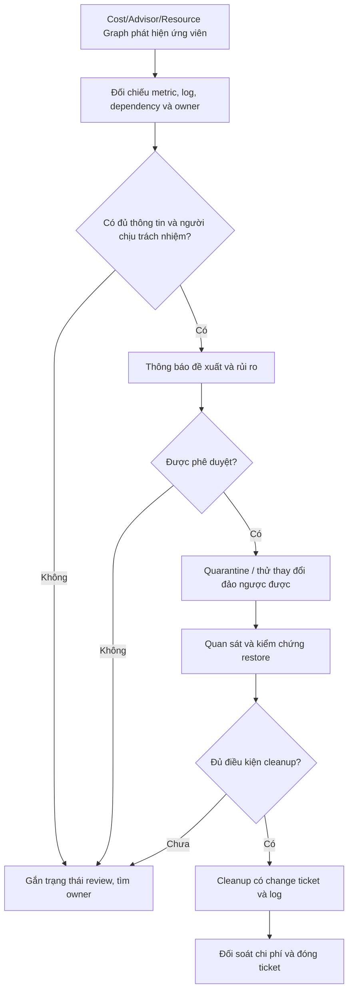

# Lên lịch tắt môi trường và xử lý tài nguyên nhàn rỗi

## 1. Bài toán thực tế và mục tiêu học tập

Trong chương **Quản lý chi phí** của module **CLOUD_PROVIDERS_AZURE**, chúng ta áp dụng những kiến thức về subscription, resource group, Microsoft Entra ID, mạng ảo, dịch vụ tính toán, lưu trữ, dữ liệu, giám sát, bảo vệ và kiểm soát chi phí vào hoạt động hàng ngày của kiến trúc ứng dụng trên Azure.

Một nhóm phát triển cần môi trường `dev` vào giờ làm việc, nhưng VM vẫn chạy suốt đêm và cuối tuần. Một nhóm khác đã xóa VM thử nghiệm nhưng giữ lại managed disk, public IP hoặc snapshot. Tất cả đều có thể tạo chi phí dù không mang lại giá trị tương ứng. Tuy nhiên, một VM ít CPU có thể là máy chạy batch cuối tháng; một disk chưa gắn có thể là bản sao phục hồi; một database gần như không có truy vấn có thể là thành phần dự phòng quan trọng.

Vì vậy, **xử lý tài nguyên nhàn rỗi** là quy trình gồm phát hiện, kiểm tra mục đích, xác nhận người sở hữu, lựa chọn hành động, phê duyệt, thực thi có kiểm soát và đo kết quả. Mục tiêu không phải xóa càng nhiều tài nguyên càng tốt, mà là **giảm lãng phí mà vẫn giữ an toàn dữ liệu, độ tin cậy và năng suất làm việc**.

Sau bài học, bạn có thể:

- Phân loại ứng viên nhàn rỗi bằng Azure Cost Management, Azure Advisor, Azure Monitor và Azure Resource Graph.
- Dùng tags, allowlist, lịch hoạt động và ngoại lệ để tự động hóa môi trường dev/test an toàn.
- Phân biệt VM `stopped` và `deallocated`, đồng thời giải thích khoản phí còn lại sau khi ngừng VM.
- Thiết kế lịch start/stop bằng Azure VM Auto-shutdown và Azure Automation có managed identity.
- Đọc, chạy thử và điều chỉnh runbook PowerShell có Preview, kiểm tra tag, idempotency và hậu điều kiện.
- Phân biệt dừng/thu nhỏ tài nguyên với **xóa**, xây dựng quy trình phê duyệt cleanup.
- Tính số giờ compute tránh được và kiểm chứng tiết kiệm bằng số liệu thực.

**Tình huống xuyên suốt:** một VM API thử nghiệm tên `vm-dev-api-01` nằm trong `rg-shop-dev`; nhóm cần nó từ 08:00 đến 19:00 ngày làm việc theo giờ Việt Nam. Tên resource, tags, giá và thời gian là ví dụ học tập; mọi thao tác với tài nguyên thật phải dùng subscription, scope và quyền đã được tổ chức cho phép.

## 2. Định nghĩa “nhàn rỗi” dựa trên nhiều nguồn bằng chứng

Một tài nguyên được coi là **ứng viên tối ưu** khi chi phí đáng kể nhưng mức sử dụng thấp so với nhu cầu. Để quyết định hành động, cần đồng thời xem:

1. **Mức sử dụng thực tế:** CPU, memory, disk I/O, network, request, job execution và số lượng kết nối trong thời gian đủ dài.
2. **Mục đích nghiệp vụ:** dev/test, staging, production, standby/DR, training, backup, compliance hoặc hệ thống chạy batch.
3. **Người sở hữu:** team, cost center, người phê duyệt và thời điểm hết hạn môi trường.
4. **Các phụ thuộc:** CI build agent, database, Key Vault, IP allowlist, backup, monitoring, hệ thống ngoài và lịch bảo trì.
5. **Khả năng phục hồi:** thao tác có thể đảo ngược không, mất bao lâu để phục hồi, có mất dữ liệu hay địa chỉ truy cập không?

| Dấu hiệu ban đầu | Điều cần kiểm tra | Hành động có thể phù hợp |
| --- | --- | --- |
| VM dev/test không có người dùng ngoài giờ | Lịch làm việc, build đêm, owner, backup | Lên lịch deallocate và start |
| VM sản xuất có CPU thấp nhiều tuần | P95/đỉnh tải, RAM, I/O, HA, SLO, batch định kỳ | Rightsize hoặc autoscale nếu được phép |
| Managed disk không gắn VM | Dữ liệu phục hồi, migration, snapshot và retention | Đưa vào danh sách owner review, có thể xóa sau phê duyệt |
| Public IP chưa liên kết | DNS, allowlist, deployment đang chạy | Thu hồi sau kiểm chứng network |
| Snapshot hoặc backup cũ | Chính sách retention và trách nhiệm pháp lý | Lifecycle/retention policy phù hợp |
| App Service hầu như không nhận request | App Service plan, ứng dụng khác dùng chung plan | Rightsize/scale plan; stop app không làm plan hết phí |
| Database thử nghiệm có ít query | SKU, job, backup, cấu hình serverless/auto-pause | Pause/stop/resize chỉ nếu dịch vụ và tier hỗ trợ |
| Môi trường tạm thời quá hạn | Owner, dữ liệu, thay đổi gần đây | Quarantine, thông báo rồi cleanup có phê duyệt |

**Không dùng một ngưỡng CPU cố định làm tiêu chí xóa.** Máy chạy tính toán theo tháng hoặc tài nguyên chờ DR có thể ít tải nhưng vẫn cần giữ. Với workload định kỳ, chọn cửa sổ quan sát chứa ít nhất một chu kỳ hoạt động có ý nghĩa.

## 3. Tìm ứng viên: Cost Management, Advisor, Monitor và Resource Graph

### 3.1. Xem chi phí trước khi chọn nơi tối ưu

Trong **Azure Cost Management → Cost analysis**, chọn subscription hoặc scope bạn được phép xem. Lọc và nhóm theo resource, resource group, service, tags như `environment` và `costCenter`. So sánh chu kỳ nhiều tuần, ngày làm việc/cuối tuần và các khoản charge lớn.

Để đo chính xác:

- Phân biệt **actual cost** và **amortized cost**; reservations và Savings Plans có thể làm việc đọc “tiết kiệm” khác với giá VM niêm yết.
- Ghi baseline, thời điểm thu thập, currency, SKU, region và loại charge.
- Dùng budget/forecast để phát hiện tăng chi phí, nhưng không coi ngân sách là cơ chế chặn tiêu dùng theo giờ.
- Kiểm tra những khoản tiếp tục tính phí sau khi VM deallocated: managed disks, snapshot, backup, networking/public IP và log.

Cost Management cho biết **tiền đang đi đâu**, còn telemetry giúp trả lời tài nguyên có thực sự cần hoạt động vào thời điểm đó không.

### 3.2. Đọc Azure Advisor đúng cách

Azure Advisor có thể đề xuất giảm cỡ VM/tài nguyên ít sử dụng hoặc các phương án tiết kiệm tùy loại dịch vụ và dữ liệu hiện có. Xem khuyến nghị như **đầu vào để review**, không như lệnh xóa. Cần kiểm tra thời gian quan sát, đỉnh tải, SKU hỗ trợ, rủi ro downtime, khả năng chi trả và bản cam kết giá hiện có.

Ví dụ: VM dev có CPU dưới 5% phần lớn thời gian nhưng cần 1 giờ build rất nặng vào buổi sáng. Rightsize có thể làm build chậm; **deallocate ngoài giờ** đôi khi là lựa chọn hợp lý hơn.

### 3.3. Kết hợp Azure Monitor và hoạt động ứng dụng

Với VM, có thể xem các chỉ số như `Percentage CPU`, disk I/O, network traffic, heartbeat và log của ứng dụng. Thông số RAM hoặc process bên trong guest có thể cần **Azure Monitor Agent** và cấu hình Data Collection Rule; không mặc định metrics nền tảng đã cung cấp mọi chỉ số.

Hãy kiểm tra:

- Đỉnh tải P95/P99, không chỉ mức trung bình.
- Thời gian chạy CI/CD, lịch backup, batch, test ban đêm và người dùng ở múi giờ khác.
- Lịch sử Azure Activity Log, trạng thái VM và công việc gần đây.
- Mùa vụ: các công việc chạy cuối tháng/quý có thể khiến 7 ngày quan sát là chưa đủ.

### 3.4. Azure Resource Graph: inventory, không phải bằng chứng xóa

Truy vấn Resource Graph dưới đây **chỉ đọc** để tìm ứng viên managed disk chưa gắn:

```kusto
Resources
| where type =~ 'microsoft.compute/disks'
| extend diskState = tostring(properties.diskState)
| where diskState =~ 'Unattached'
| project id, name, subscriptionId, resourceGroup,
          location, diskState, skuName = tostring(sku.name), tags
| order by resourceGroup asc
```

Đầu ra phải được đối chiếu với trạng thái resource thực tế; schema/properties có thể thay đổi theo provider. **Disk Unattached vẫn có thể chứa dữ liệu cần phục hồi.** Tuyệt đối không nối ngay query này với script xóa.

Liệt kê các VM và tags để xác định đối tượng có lịch:

```kusto
Resources
| where type =~ 'microsoft.compute/virtualmachines'
| project id, name, resourceGroup, location,
          environment = tostring(tags.environment),
          owner = tostring(tags.owner),
          schedule = tostring(tags.schedule),
          automation = tostring(tags.automation),
          doNotStop = tostring(tags.doNotStop)
| order by resourceGroup asc
```

Resource Graph phản ánh inventory ở một thời điểm; nó không thay thế **time series metrics**. Kết hợp query với Cost Management, Azure Monitor và xác nhận của owner trước khi đề xuất tối ưu.

## 4. Chính sách tags, lịch và ngoại lệ

Gợi ý bộ tags cho một tổ chức có nhiều subscription:

| Tag | Giá trị ví dụ | Mục đích |
| --- | --- | --- |
| `environment` | `dev`, `test`, `staging`, `prod` | Phân loại và giới hạn |
| `owner` | `team-commerce` | Người cần xác nhận |
| `costCenter` | `CC-042` | Phân bổ chi phí |
| `schedule` | `office-hours-vn` | Gắn chính sách lịch |
| `automation` | `allowed` | Opt-in cho runbook |
| `doNotStop` | `true` | Cờ chặn tắt theo lịch |
| `expiresOn` | `2026-12-31` | Ngày phải rà soát lại |
| `criticality` | `noncritical` | Đánh giá ảnh hưởng |

Quy tắc áp dụng:

1. Chỉ cho phép script hoạt động trong **resource group allowlist** và trên những VM có `environment=dev` hoặc `test`.
2. Yêu cầu đủ tags `automation=allowed` và `schedule=office-hours-vn`. Thiếu tags thì **không tự cho phép**.
3. `doNotStop=true` được ưu tiên chặn tắt. Các ngoại lệ phải có owner, lý do, ngày hết hạn và người phê duyệt.
4. Tags chỉ là **guard logic**. Người có quyền sửa tags/runbook có thể thay đổi mục tiêu; Azure RBAC phải giới hạn danh tính Automation ở scope thực sự.
5. Khi không rõ owner, đưa resource vào danh sách điều tra, không tự xóa vì thiếu tag.

Azure Policy có thể hỗ trợ yêu cầu tags và quy tắc quản trị, nhưng cần kiểm tra policy assignment tại scope thực và tránh cho rằng mọi tài nguyên sẽ tự kế thừa tags.

## 5. Chọn phương án lịch phù hợp với từng dịch vụ

### 5.1. Azure VM Auto-shutdown

Với VM dev/test đơn lẻ, tính năng **Auto-shutdown** trong Azure Portal thường là cách đơn giản để định giờ tắt và cấu hình thông báo theo những tùy chọn được hỗ trợ. Kiểm tra timezone, thời điểm thực thi và ảnh hưởng đến công việc đang chạy.

Auto-shutdown **không phải một hệ điều phối toàn bộ môi trường**: không mặc định bật VM lại buổi sáng, không tự kiểm tra mọi database và không xử lý tất cả ngoại lệ của ứng dụng. Khi cần lịch hai chiều start/stop, rules theo tags và nhiều máy, có thể dùng Azure Automation.

### 5.2. Azure Automation với PowerShell runbook

**Automation Account** chứa runbook; **schedule** kích hoạt runbook với tham số; mỗi lần thực thi tạo một **job** có ID, status và output/error streams. Một system-assigned managed identity được cấp **Azure RBAC** có thể gọi Azure Resource Manager mà không lưu client secret dài hạn.

Lịch đề xuất:

| Schedule | Thời điểm giờ Việt Nam (UTC+07:00) | Hành động |
| --- | --- | --- |
| `dev-start-workday` | 08:00 thứ Hai–thứ Sáu | `Start` |
| `dev-stop-evening` | 19:00 thứ Hai–thứ Sáu | `Stop` |
| `idle-review-weekly` | Mỗi tuần | Báo cáo inventory ứng viên, **chỉ đọc** |

Việt Nam không dùng giờ mùa hè (DST), nhưng vẫn phải kiểm tra đúng timezone và **Next run time** trong Portal. Với team ở nhiều múi giờ, lựa chọn lịch cần xuất phát từ giờ sử dụng thực tế.

### 5.3. Không thể tắt mọi dịch vụ theo cách của VM

| Dịch vụ | Phương án cần cân nhắc | Giới hạn |
| --- | --- | --- |
| Azure VM | Deallocate khi không sử dụng | Disks, backup, public IP, networking vẫn có phí |
| VM Scale Sets | Scale down theo cấu hình và yêu cầu sẵn sàng | Phải tính dependency, capacity và SLO |
| AKS | Quản lý workloads và node pools đúng loại; giảm capacity khi phù hợp | System pools và dịch vụ nền có giới hạn, scale pod không bảo đảm ngừng mọi phí |
| Azure App Service | Rightsize và scale App Service plan | Stop web app không tự chấm dứt phí App Service plan |
| Azure SQL | Chọn đúng tier, serverless auto-pause khi đủ điều kiện | Không phải mọi tier có auto-pause; storage/backup vẫn có phí |
| Storage Account | Lifecycle management, tiering và retention | Không có nút stop để ngừng phí lưu trữ như VM |
| Managed disk / snapshots | Rà soát attachment, backup, retention trước cleanup | Xóa sai có thể làm mất dữ liệu |
| Public IP / network resource | Xác minh liên kết, DNS/allowlist rồi cleanup | Không có traffic không đồng nghĩa không có dependency |

Một môi trường gồm nhiều thành phần nên dừng theo **thứ tự phụ thuộc**, ví dụ dừng worker và ứng dụng trước database nếu dịch vụ hỗ trợ; khi bật, chuẩn bị network/database rồi mới app và worker. Không dùng một lệnh stop VM làm đại diện cho mọi dịch vụ Azure.

## 6. Runbook PowerShell mẫu: start/stop VM an toàn

Ví dụ tạo runbook PowerShell cho `vm-dev-api-01` trong `rg-shop-dev`. Nó dùng **system-assigned managed identity**, modules `Az.Accounts` và `Az.Compute`, có chế độ Preview mặc định, kiểm tra tag, hạn chế resource group và kiểm chứng trạng thái sau lệnh.

```powershell
param(
    [Parameter(Mandatory = $true)]
    [string] $SubscriptionId,

    [Parameter(Mandatory = $true)]
    [string] $ResourceGroupName,

    [Parameter(Mandatory = $true)]
    [string] $VMName,

    [Parameter(Mandatory = $true)]
    [ValidateSet('Start', 'Stop')]
    [string] $Action,

    [ValidateSet('Preview', 'Execute')]
    [string] $Mode = 'Preview'
)

$ErrorActionPreference = 'Stop'
$allowedGroups = @('rg-shop-dev')

if ($ResourceGroupName -notin $allowedGroups) {
    throw "BLOCKED: Resource group khong nam trong allowlist."
}

try {
    Disable-AzContextAutosave -Scope Process | Out-Null
    Connect-AzAccount -Identity -ErrorAction Stop | Out-Null
    Set-AzContext -SubscriptionId $SubscriptionId -ErrorAction Stop |
        Out-Null

    $target = @{
        ResourceGroupName = $ResourceGroupName
        Name = $VMName
        ErrorAction = 'Stop'
    }
    $vm = Get-AzVM @target

    if (-not $vm.Tags -or
        $vm.Tags['environment'] -notin @('dev','test') -or
        $vm.Tags['automation'] -ne 'allowed' -or
        $vm.Tags['schedule'] -ne 'office-hours-vn' -or
        $vm.Tags['doNotStop'] -eq 'true') {
        throw "BLOCKED: VM khong dat dieu kien tags."
    }

    $view = Get-AzVM @target -Status
    $state = ($view.Statuses |
        Where-Object { $_.Code -like 'PowerState/*' } |
        Select-Object -First 1).Code

    if (-not $state) {
        throw 'Khong lay duoc PowerState; khong thao tac.'
    }

    Write-Output ("TARGET sub={0} rg={1} vm={2}" -f
        $SubscriptionId, $ResourceGroupName, $VMName)
    Write-Output ("PLAN mode={0} action={1} current={2}" -f
        $Mode, $Action, $state)

    if ($Action -eq 'Stop') {
        if ($state -eq 'PowerState/deallocated') {
            Write-Output 'SKIP: VM da deallocated.'
            return
        }
        if ($state -notin @('PowerState/running',
                           'PowerState/stopped')) {
            throw "BLOCKED: VM dang o trang thai $state."
        }
        $expected = 'PowerState/deallocated'
    }
    else {
        if ($state -eq 'PowerState/running') {
            Write-Output 'SKIP: VM da running.'
            return
        }
        if ($state -notin @('PowerState/stopped',
                           'PowerState/deallocated')) {
            throw "BLOCKED: VM dang o trang thai $state."
        }
        $expected = 'PowerState/running'
    }

    if ($Mode -eq 'Preview') {
        Write-Output 'PREVIEW: khong thay doi VM.'
        return
    }

    if ($Action -eq 'Stop') {
        Stop-AzVM @target -Force | Out-Null
    }
    else {
        Start-AzVM @target | Out-Null
    }

    # Kiem tra trang thai cuoi voi so lan thu co gioi han.
    $actual = $null
    for ($i = 1; $i -le 12; $i++) {
        $after = Get-AzVM @target -Status
        $actual = ($after.Statuses |
            Where-Object { $_.Code -like 'PowerState/*' } |
            Select-Object -First 1).Code
        if ($actual -eq $expected) { break }
        Start-Sleep -Seconds 10
    }

    if ($actual -ne $expected) {
        throw "FAILED: expected $expected, actual $actual."
    }

    Write-Output ("SUCCESS: VM={0}, state={1}" -f
        $VMName, $actual)
}
catch {
    Write-Error ("FAILED: {0}" -f $_.Exception.Message)
    throw
}
```

### 6.1. Các lớp bảo vệ trong script

**Managed identity và RBAC.** `Connect-AzAccount -Identity` tránh lưu client secret. Identity cần quyền đọc VM/PowerState và thực hiện `start`/`deallocate` tại scope cho phép. Có thể thiết kế custom role hẹp; không cấp Owner toàn subscription chỉ vì lệnh bị từ chối. `Set-AzContext` chọn subscription, và `Disable-AzContextAutosave` giảm nguy cơ context được lưu từ job khác.

**Allowlist và tags.** Chỉ resource group `rg-shop-dev` được xét; VM phải opt-in qua tags và không có `doNotStop=true`. Trong vận hành thật, cần chuẩn hóa cách ghi tags (bao gồm chữ hoa/thường) và bảo vệ quyền sửa tags. Tag không thay thế Azure RBAC.

**Idempotency.** Nếu Start khi VM đã running hoặc Stop khi VM đã deallocated, job chỉ log `SKIP`. VM ở trạng thái đang chuyển tiếp hoặc không rõ sẽ bị chặn. Với các job chạy đồng thời vẫn cần kiểm soát concurrency/lock bên ngoài.

**Preview.** `Mode=Preview` chỉ đọc và lập kế hoạch. **Test pane vẫn thực thi code thật**, nên một runbook không có Preview guard sẽ có thể gọi API ghi trong quá trình test.

**Stop/deallocate và hậu điều kiện.** `Stop-AzVM` trong ví dụ không dùng `-StayProvisioned`, nhằm deallocate VM. Sau lệnh, script xác minh PowerState có giới hạn thử lại. Nếu không đạt, job báo lỗi để operator xem log thay vì giả định thành công.

**Giới hạn:** Đây là mẫu học tập cho một VM. Không tự dùng cho VM production, VM Scale Set, VM có tác vụ dữ liệu chưa hoàn tất hoặc toàn bộ resource group. Cần kiểm tra backup, dynamic IP, quota, startup dependencies, SLA và runtime module trước khi chạy.

### 6.2. Phân biệt `stopped` và `deallocated`

| PowerState | Ý nghĩa | Tác động hóa đơn |
| --- | --- | --- |
| `PowerState/running` | VM đang chạy | Thường tính phí compute và các tài nguyên liên quan |
| `PowerState/stopped` | Guest OS đã tắt nhưng compute có thể còn được cấp phát | **Có thể vẫn tính phí compute** |
| `PowerState/deallocated` | Compute VM đã được giải phóng | Thường ngừng phí compute VM, nhưng disk/backup/IP/network/log vẫn có thể tính phí |
| `starting/stopping/deallocating` | Đang chuyển trạng thái | Chưa xác nhận hoàn tất, không tính là tiết kiệm thành công |

Không dùng câu “VM tắt là không mất tiền” trong báo cáo FinOps. Cần đối chiếu đầy đủ loại charge trong Cost Management.

## 7. Cấu hình Automation Account và lịch chạy

### 7.1. Thiết lập và kiểm thử

1. Tạo **Automation Account** trong resource group quản trị (ví dụ `rg-ops-automation`), bật **system-assigned managed identity**.
2. Ở `rg-shop-dev`, gán role phù hợp cho **principal ID của Automation Account**. Giới hạn scope và actions đúng nhu cầu; tách identity production khi cần.
3. Chọn runtime PowerShell và modules `Az.Accounts`, `Az.Compute` tương thích; tạo runbook `rb-manage-dev-vm`.
4. Trong **Test pane**, chạy `Mode=Preview` với `Action=Stop`, VM thử nghiệm đúng tags. Xem `TARGET`, `PLAN`, `PREVIEW`; xác nhận VM không đổi.
5. Trên VM được phép, chạy `Mode=Execute` có kiểm soát; xác nhận `PowerState/deallocated`. Chạy lại Stop để kiểm tra `SKIP` rồi Start để xác nhận VM running.
6. **Publish** phiên bản đã được review; ghi runbook version, principal ID, resource scope và job IDs.

### 7.2. Liên kết lịch

Tạo hai schedules trong Azure Automation:

- `dev-start-workday`: 08:00 ngày làm việc, tham số `Action=Start` và `Mode=Execute`.
- `dev-stop-evening`: 19:00 ngày làm việc, tham số `Action=Stop` và `Mode=Execute`.

Cả hai dùng `SubscriptionId`, `ResourceGroupName=rg-shop-dev`, `VMName=vm-dev-api-01`. Khi link schedule, xác nhận timezone, recurrence, ngày bắt đầu, trạng thái bật và **Next run time**. Lưu ý lịch nghỉ, bảo trì, CI test đêm và người dùng ngoài múi giờ Việt Nam.

**Quy trình vận hành:** theo dõi lần chạy đầu, alert nếu Stop không deallocate hay Start không đưa VM lên running, có manual override đã duyệt và cách xử lý khi Automation Account/job không khả dụng.

## 8. Xử lý tài nguyên nhàn rỗi và mồ côi theo quy trình

Phân biệt **deallocate** với **delete**. VM có thể start lại; xóa disk, snapshot, database hoặc resource group có thể không phục hồi được nếu không có backup.



### 8.1. Mức độ rủi ro

| Hành động | Khả năng phục hồi | Điều kiện trước thao tác |
| --- | --- | --- |
| Thay lịch VM dev/test | Có thể đảo ngược nếu dữ liệu an toàn | Owner, kiểm tra các job/backup và lịch |
| Resize VM hoặc plan | Có thể tác động hiệu năng hoặc downtime | Baseline tải, thử nghiệm và rollback |
| Scale down workers/node pools | Phụ thuộc quorum/SLO/queue | Kiểm tra capacity và nghiệp vụ |
| Thay storage tier/retention | Có độ trễ/phí truy xuất hoặc mất dữ liệu khi delete | Data owner, lifecycle và retention |
| Thu hồi IP/NIC chưa liên kết | Có thể mất endpoint/cấu hình ngoài Azure | Network owner, DNS/allowlist và quan sát |
| Xóa managed disk/snapshot | Có nguy cơ mất dữ liệu không thể phục hồi | Xác nhận backup, restore, retention, owner |
| Xóa cả resource group | Rất rộng, có thể xóa mọi resource trong scope | Inventory, dependency graph và approval cấp cao |

### 8.2. Ví dụ quy trình disk chưa gắn

1. Phát hiện disk từ Resource Graph, rồi kiểm tra lại trạng thái trực tiếp trong Azure.
2. Xem Activity Log, deployment/change records và thông tin owner; xác định disk có phải của VM vừa xóa hoặc quá trình migration đang diễn ra không.
3. Thông báo owner, đề xuất giữ/snapshot/xóa, quy định ngày phản hồi và cách khôi phục.
4. Nếu có yêu cầu retention, tạo/kiểm chứng bản sao phục hồi theo quy định; ghi ID và vị trí backup.
5. Chỉ khi được phê duyệt mới đưa vào change thực thi. **Kiểm tra attachment ngay trước khi delete** vì trạng thái có thể thay đổi.
6. Ghi người thực hiện, thời điểm, resource ID, kết quả và theo dõi Cost Analysis ở kỳ tiếp theo.

Nếu không tìm được owner, đưa vào danh sách `owner-review-needed` để nhóm quản trị subscription/FinOps quyết định. Không dùng chính sự thiếu tag làm căn cứ tự động xóa.

## 9. Đo tiết kiệm: lý thuyết và thực tế

Với VM, tính sơ bộ:

\[
H_{\text{tránh}} = H_{\text{baseline}} - H_{\text{được cấp phát sau lịch}}
\]

\[
S_{\text{compute ước tính}} = H_{\text{tránh}} \times P_{\text{compute hiệu dụng/giờ}}
\]

Ví dụ giả định một tháng 30 ngày, VM trước đó chạy 24/7; sau tối ưu chỉ chạy 10 giờ mỗi ngày trong 22 ngày làm việc:

| Đại lượng | Phép tính | Kết quả |
| --- | --- | ---: |
| Giờ compute baseline | `30 × 24` | 720 giờ |
| Giờ compute sau lịch | `22 × 10` | 220 giờ |
| Giờ compute tránh được | `720 − 220` | 500 giờ |
| Giá compute giả định | `0,20 USD/giờ` | — |
| Tiết kiệm lý thuyết | `500 × 0,20` | 100 USD/tháng |

**100 USD chỉ là ví dụ**, chưa phải số tiền giảm trên hóa đơn. Savings Plans, reservations, disk, backup, IP, logs, usage thực và thời gian VM đã tắt sẵn từ trước có thể làm kết quả khác.

KPI nên theo dõi gồm:

- Tỷ lệ VM đủ điều kiện đã có lịch hợp lệ.
- Số giờ thực sự deallocated, không phải số giờ lịch định tắt.
- Tỷ lệ job đạt **hậu điều kiện PowerState**, không chỉ trạng thái `Completed`.
- Số ngoại lệ `doNotStop` có owner và ngày hết hạn.
- Chi phí compute/total cost trước-sau, có phân tích đơn giá và usage.
- Incident/CI failure do lịch hoặc cleanup gây ra.
- Số resource mồ côi đã được owner xác nhận và xử lý đúng quy trình.

## 10. Giám sát, bảo mật và lỗi thường gặp

Trong Automation Account, kiểm tra **Jobs**, streams Output/Error/Warning và input an toàn. Bật Diagnostic settings để gửi các loại job logs được hỗ trợ tới Log Analytics/Storage/Event Hub theo nhu cầu. Tạo alert khi job thất bại, job không chạy đúng giờ, VM chưa deallocate sau giờ tắt hoặc không running khi bắt đầu ca.

| Hiện tượng | Nguyên nhân có thể | Cách xử lý |
| --- | --- | --- |
| Không có job chạy đúng giờ | Schedule chưa link, chưa publish, timezone sai hoặc bị tắt | Kiểm tra Next run time và job history |
| `Connect-AzAccount -Identity` lỗi | Identity chưa bật, module/worker hoặc network không phù hợp | Kiểm tra Identity, runtime và connectivity |
| HTTP `403 AuthorizationFailed` | Role thiếu action/scope, quyền chưa hiệu lực hoặc deny assignment | Kiểm tra principal ID, role assignment và scope |
| Job Completed nhưng VM vẫn running | Lỗi bị bỏ qua, Stop chỉ tắt guest OS hoặc thiếu postcondition | Kiểm tra PowerState và script, yêu cầu deallocate |
| VM deallocate nhưng sáng không start | Lịch Start lỗi, quota/capacity hoặc dependency | Xem error stream, Azure Health và manual recovery |
| VM bị stop giữa CI test | Lịch không phản ánh workload hoặc owner chưa phê duyệt | Sửa lịch, thêm maintenance/exception và review |
| IP thay đổi sau start | Dynamic IP hoặc phụ thuộc vào endpoint không ổn định | Kiểm tra thiết kế network và DNS |
| Query báo disk Unattached nhưng disk quan trọng | Disk dành cho backup, restore hoặc migration | Dừng cleanup; kiểm tra owner, retention, dữ liệu |
| Ước tính tiết kiệm cao nhưng hóa đơn không giảm | Reservations/Savings Plans, disk/IP vẫn tính, lịch chưa hoạt động | So sánh Cost Analysis, PowerState và usage |
| Nhiều job đồng thời, Azure trả 429 | Throttling và cạnh tranh tài nguyên | Giới hạn concurrency, retry có backoff và timeout |

**Quyền:** Người có thể publish runbook hoặc chỉnh schedule/tag có thể tác động tới tài nguyên. Quản lý phiên bản runbook bằng Git, review thay đổi, giới hạn quyền Automation và Azure RBAC, không ghi access token/secret/webhook URL vào log. Nếu cần điều phối nhiều VM, thêm khóa chống jobs xung đột và kiểm soát số tác vụ chạy song song.

## 11. Bài thực hành

**Đề bài:** Azure subscription có VM dev/test và một VM production. Đội dev muốn bật máy 08:00, deallocate 19:00 vào ngày làm việc; đồng thời một managed disk đang Unattached và một public IP chưa liên kết cần được rà soát.

1. Lập inventory 3 VM, disk và IP: Resource ID, owner, tags, chi phí gần đây, mức sử dụng và phụ thuộc.
2. Dùng Cost Management, Azure Monitor/Advisor để xác nhận VM nào đủ điều kiện schedule; giữ nguyên production trừ khi có quy trình riêng.
3. Gắn tags theo mục 4 cho VM dev và chọn `rg-shop-dev` trong allowlist.
4. Tạo Automation Account và system-assigned managed identity; gán quyền tối thiểu ở resource group dev.
5. Tạo runbook từ mục 6, chạy `Mode=Preview`. Kiểm tra không có API ghi nhưng vẫn xác minh chính xác target.
6. Thực hiện `Mode=Execute` **trên VM lab được ủy quyền**, xác nhận Stop đưa về deallocated. Chạy lại Stop để kiểm tra `SKIP`.
7. Start VM, xác nhận running và ứng dụng dev hoạt động; ghi lại job ID và điều kiện khôi phục.
8. Tạo schedules 08:00 và 19:00, xác nhận timezone và Next run time; thiết lập alert nếu job không đạt hậu điều kiện.
9. Với disk/IP, thu thập bằng chứng và owner, đề xuất thời hạn review, snapshot/retention/approval; không xóa tự động.
10. Tính giờ compute tránh được và lập kế hoạch kiểm chứng kết quả sau một khoảng thời gian sử dụng đại diện.

**Tiêu chí hoàn thành:** có bằng chứng về owner, tags, RBAC, Preview/Execute, PowerState, lịch, job logs, kết quả đánh giá disk/IP và chi phí thực tế. Nếu chỉ mô phỏng, ghi rõ chưa chạy trên subscription thật.

## 12. Câu hỏi tự kiểm tra

**1. CPU thấp liên tục có đồng nghĩa VM nên bị xóa?**  
Không. Có thể là standby, chạy batch theo chu kỳ hoặc hệ thống dự phòng. Cần đối chiếu owner, mục đích, tải đỉnh và dữ liệu.

**2. `PowerState/stopped` và `PowerState/deallocated` khác nhau ra sao?**  
Stopped có thể vẫn giữ compute được cấp phát và còn phí; deallocated giải phóng compute nhưng disk, backup, networking và log vẫn có thể phát sinh phí.

**3. VM Auto-shutdown có tự khởi động lại VM vào sáng hôm sau không?**  
Không nên giả định vậy. Khi cần start/stop theo lịch và kiểm tra đầu vào, dùng Azure Automation hoặc cơ chế có hỗ trợ tương ứng.

**4. Vì sao tags không thay thế RBAC?**  
Tags là metadata và có thể bị sửa. Azure RBAC giới hạn danh tính được phép gọi action nào trên scope nào.

**5. Disk Unattached có thể xóa ngay sau một truy vấn Resource Graph?**  
Không. Nó có thể giữ dữ liệu phục hồi hoặc phục vụ migration; cần owner, backup, retention và approval.

**6. Job `Completed` nhưng VM còn running sau giờ tắt; mục tiêu đạt chưa?**  
Chưa. Hậu điều kiện là VM deallocated, được kiểm chứng từ PowerState và logs.

**7. Ước tính Azure Advisor có bằng số tiền tiết kiệm thực tế không?**  
Không. Nó là khuyến nghị; phải xem số liệu usage/cost sau thay đổi, bao gồm giá hiệu dụng và những khoản phí tiếp tục phát sinh.

**8. Khi xử lý môi trường nhiều tài nguyên, tại sao không tắt đồng thời mọi thứ?**  
Ứng dụng có dependencies; cần giảm/thoát workload ghi, dừng worker/app theo thứ tự và khi bật lại phải kiểm tra data/network rồi smoke test.

## 13. Tài liệu chính thức nên tham khảo

- Microsoft Learn — **Azure Cost Management / Cost Analysis** và **Azure Well-Architected Cost Optimization**.
- Microsoft Learn — **Azure Advisor Cost recommendations**.
- Microsoft Learn — **Azure Monitor metrics and logs**, cùng hướng dẫn guest metrics.
- Microsoft Learn — **Azure Resource Graph overview** và truy vấn inventory.
- Microsoft Learn — **Azure Virtual Machines power states and billing**; **Auto-shutdown for VMs**.
- Microsoft Learn — **Azure Automation overview**, **Runbooks**, **Schedules** và **Managed identities**.
- Microsoft Learn — **Azure Policy / Resource tags** và **Azure Storage lifecycle management**.

Tính năng stop/pause/scale, giá và giới hạn runtime khác nhau theo dịch vụ, SKU, region và thời điểm. Trước khi áp dụng rộng rãi, phải đối chiếu tài liệu chính thức, kiểm tra scope quyền, dữ liệu và hậu điều kiện; **tiết kiệm phải đi cùng độ tin cậy và quyền kiểm soát của owner**.
