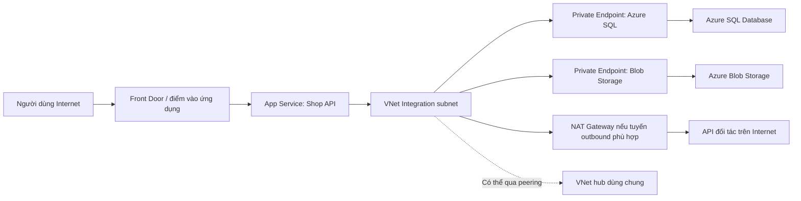
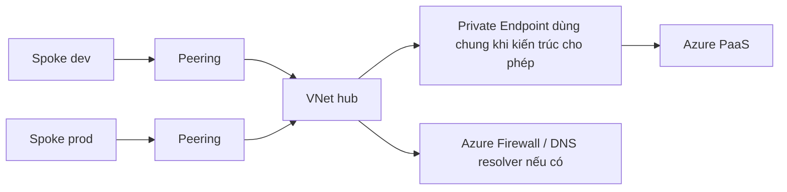

# Tính chi phí data transfer, kết nối mạng và private endpoint

## 1. Mục tiêu học tập và vấn đề thực tế

Một ứng dụng triển khai trên Microsoft Azure có thể tối ưu CPU, bộ nhớ và dung lượng lưu trữ nhưng hóa đơn vẫn tăng khi người dùng truy cập nhiều hơn. Nguyên nhân thường nằm ở **lưu lượng truyền dữ liệu (data transfer)**, số giờ sử dụng tài nguyên mạng và lượng dữ liệu được **xử lý bởi các dịch vụ kết nối** như Private Endpoint, NAT Gateway, Azure Firewall hoặc VNet peering. Các khoản này có thể được tính theo **meter khác nhau** dù cùng phục vụ một luồng kết nối.

Trong chương **Quản lý chi phí** thuộc mô-đun `CLOUD_PROVIDERS_AZURE`, bài học này giải thích cách lập bản đồ luồng mạng, ước tính chi phí, kiểm tra hóa đơn Azure và tối ưu một kiến trúc ứng dụng. Kiến thức liên hệ với subscription, resource group, Microsoft Entra ID, virtual network, dịch vụ tính toán, lưu trữ, dữ liệu, giám sát, bảo mật và kiểm soát chi phí.

Sau bài học, bạn có thể:

- Xác định lưu lượng theo **nguồn, đích, region, availability zone và đường đi** thay vì chỉ cộng tổng GB.
- Phân biệt **bandwidth/data transfer charge**, **phí xử lý dữ liệu**, **phí theo giờ tài nguyên mạng** và **chi phí của dịch vụ đích**.
- Giải thích vì sao **Private Endpoint không đồng nghĩa kết nối miễn phí**, và khi nào còn có phí DNS, peering, cross-region hoặc các dịch vụ mạng khác.
- Xây dựng bảng ước tính với số lượng endpoint, thời gian hoạt động, lưu lượng theo chiều và đơn giá giả định.
- Tìm và đối soát khoản phí trong Azure Cost Analysis, Cost Management Query/Exports và metric/flow telemetry.
- Đề xuất tối ưu chi phí mà không phá vỡ yêu cầu bảo mật, độ sẵn sàng hay trải nghiệm người dùng.

**Tình huống xuyên suốt:** hệ thống `Shop API` gồm Azure App Service, Azure SQL Database, Azure Storage và một worker trong Azure Virtual Network (VNet). Nhóm bảo mật yêu cầu truy cập SQL/Storage qua **Private Link**, trong khi ứng dụng còn gọi dịch vụ đối tác trên Internet. Hệ thống dùng hai subscription `non-production` và `production`; một số thành phần dùng chung chạy ở VNet hub. Nhiệm vụ của nhóm FinOps là trả lời: mỗi đường đi phát sinh những loại chi phí nào và cần dữ liệu gì để tính?

> **Nguyên tắc cốt lõi:** Không có một “giá mỗi GB mạng Azure” áp dụng cho mọi đường đi. Đơn giá thay đổi theo region, cặp region, chiều truyền, dịch vụ/SKU, loại hợp đồng, bậc sử dụng, thời điểm và các khoản miễn phí nếu có. Mọi con số tiền tệ trong bài tập đều là **giả định minh họa**, không phải báo giá hay cam kết của Microsoft.

## 2. Nhìn đúng bản chất: dữ liệu đi đâu và qua những gì?

### 2.1. Phân loại lưu lượng trước khi tính tiền

Đối với một luồng dữ liệu, ghi rõ **nguồn → đích → tuyến đường → chiều → khối lượng → thời gian**. Một request HTTP có thể chứa nhiều luồng: client gửi yêu cầu tới ứng dụng, ứng dụng gọi SQL/Storage, ứng dụng gửi phản hồi ra Internet. Các luồng có điểm tính phí khác nhau.

| Luồng ví dụ | Điều cần xác định trước | Nhóm phí có thể liên quan |
|---|---|---|
| Internet → ứng dụng Azure | Client ở đâu, endpoint công khai nào nhận request? | Inbound internet bandwidth thường có chính sách giá khác outbound; gateway/CDN/WAF vẫn có meter riêng |
| Ứng dụng Azure → Internet | Nguồn region, số GB thực sự ra ngoài, đường qua NAT/firewall? | Internet egress bandwidth; NAT/firewall/LB/public IP nếu được sử dụng |
| VM/app → SQL hoặc Storage **cùng region** | Cùng VNet, khác VNet, có Private Endpoint/peering không? | Private Link processing + endpoint giờ; peering/gateway hoặc dịch vụ đích nếu có; không mặc định là internet egress |
| VNet A ↔ VNet B | Regional hay global peering? Hai chiều và cặp region? | VNet peering data transfer theo các meter/chiều áp dụng |
| Azure region A → region B | Dữ liệu đi giữa các region nào và qua dịch vụ gì? | Inter-region bandwidth; các lớp mạng/đích bổ sung nếu có |
| Giữa availability zones | Dịch vụ, loại deployment và tuyến đường cụ thể? | Kiểm tra chính sách inter-zone data transfer hiện hành; không suy từ “cùng region” là luôn miễn phí |
| Azure ↔ on-premises | VPN Gateway, ExpressRoute, loại circuit, metered/unlimited? | Gateway/circuit theo giờ hoặc gói; outbound/metered data transfer tùy trường hợp |
| Storage/SQL → ứng dụng | Có đọc, giao dịch, backup, replication hoặc tier storage không? | Ngoài network có thể có **phí của dịch vụ dữ liệu** theo request/operation, compute, storage, replication |

**Dữ liệu không bị tính phí hai lần chỉ vì ta vẽ hai mũi tên**, nhưng cùng một luồng có thể làm phát sinh **nhiều meter độc lập**: chẳng hạn phí xử lý Private Link và phí peering khi luồng đi qua cả hai. Khi đối soát hóa đơn, phải nhóm theo **meter và tài nguyên được tính tiền**, không tự lấy một lượng GB nhân nhiều loại giá nếu đường đi thực tế không sử dụng các dịch vụ đó.

### 2.2. Luồng mạng trong `Shop API`



Sơ đồ là **mô hình phân tích**, không khẳng định mọi luồng chắc chắn đi qua NAT hoặc hub. App Service Regional VNet Integration chủ yếu phục vụ **outbound** vào mạng ảo; tuyến Internet, route-all, DNS và NAT phụ thuộc cấu hình. Private Endpoint tạo điểm kết nối có **IP riêng trong VNet** tới một dịch vụ hỗ trợ Private Link; dịch vụ đích vẫn giữ danh tính và API thông thường.

Để ước tính đúng, hãy làm rõ:

1. App Service và SQL/Storage nằm ở **region** nào?
2. Private Endpoint được tạo trong **subnet/VNet** nào, kết nối có được phê duyệt và DNS có phân giải đúng IP riêng không?
3. Có VNet peering hoặc hub firewall trên đường đi không?
4. Lưu lượng đến API đối tác có thật sự qua NAT Gateway không, hay đi bằng đường outbound mặc định?
5. Dữ liệu truyền là payload nén hay không nén; tổng GB của chiều đi và chiều về ra sao?

### 2.3. Phân biệt ba khái niệm dễ nhầm

- **Private Endpoint:** tài nguyên giao diện mạng có IP riêng, dùng để truy cập một dịch vụ hỗ trợ Azure Private Link từ mạng của client. Hóa đơn có thể gồm **giờ endpoint** và **dữ liệu được xử lý** theo bảng giá.
- **Private Link Service:** cơ chế **phía nhà cung cấp** để cung cấp dịch vụ của mình qua Private Link, không phải cùng một tài nguyên/bảng giá với Private Endpoint phía người dùng.
- **Private DNS Zone:** quản lý tên miền riêng cho endpoint. DNS phục vụ việc tìm IP đúng; **DNS không tạo Private Endpoint** và có thể có phí zone/truy vấn riêng.

`Azure Key Vault` là dịch vụ giữ khóa/secret, không phải một loại network vault. Azure Storage với `publicNetworkAccess: Disabled` có thể vẫn cần private endpoint hoặc một đường truy cập được hỗ trợ khác; chỉ bật cấu hình “private” không bảo đảm DNS, route và quyền dữ liệu hoạt động đúng.

## 3. Cấu phần chi phí mạng thường gặp trên Azure

| Cấu phần | Đơn vị chi phí cần kiểm tra | Khi nào phát sinh | Bẫy phổ biến |
|---|---|---|---|
| **Internet outbound data transfer** | Dữ liệu tính phí theo GB/bậc/region | Dữ liệu ra Internet hoặc đích theo bảng giá bandwidth | Tưởng lượng dữ liệu inbound/outbound có cùng giá hoặc mọi GB đều tính từ byte đầu tiên |
| **Inter-region data transfer** | GB theo region nguồn/đích và dịch vụ | Chuyển dữ liệu giữa Azure regions | Nhầm với lưu lượng nội bộ cùng region |
| **Cross-zone data transfer** | Theo điều kiện dịch vụ và bảng giá hiện hành | Luồng giữa availability zones | Áp dụng một quy tắc chung cho mọi SKU/region |
| **VNet peering** | GB theo chiều và loại peering regional/global | Lưu lượng qua kết nối peering | Chỉ đếm phí ở một phía hoặc quên loại peering |
| **Private Endpoint (Private Link)** | Số endpoint × giờ; dữ liệu được xử lý theo GB/tier | Endpoint tồn tại và có lưu lượng qua endpoint | Nghĩ private IP thì không có chi phí xử lý dữ liệu |
| **NAT Gateway** | Số giờ tài nguyên, GB được NAT xử lý; có thể có phí public IP | Subnet sử dụng NAT Gateway cho outbound qua tuyến phù hợp | Tưởng NAT chỉ tính GB, hoặc cứ có VNet Integration là luôn qua NAT |
| **Azure Firewall** | Giờ/SKU triển khai và GB dữ liệu xử lý, cùng các dịch vụ liên quan | Traffic được định tuyến qua firewall | Quên phí của firewall khi so mạng hub-spoke với kết nối trực tiếp |
| **Application Gateway / Load Balancer** | Theo loại SKU, giờ, capacity/rules hoặc dữ liệu xử lý tùy dịch vụ | Có gateway/load balancing thực sự phục vụ traffic | Nhầm phí gateway với chỉ riêng phí Internet egress |
| **VPN Gateway / ExpressRoute** | Gateway/circuit giờ hoặc gói; bandwidth metered/unlimited theo loại | Azure kết nối tới on-premises hoặc private circuit | Cộng phí theo GB kiểu Internet cho mọi gói ExpressRoute |
| **Public IP** | Theo SKU, vùng, thời gian hoặc chính sách giá | Tài nguyên IP công cộng được cấp phát | Quên phí IP độc lập với NAT/LB nếu áp dụng |
| **Azure Private DNS** | Zone/thời gian và số truy vấn theo gói giá | Zone riêng và DNS lookup theo cấu hình | Cho rằng zone DNS miễn phí vì endpoint dùng IP riêng |
| **Network telemetry** | Log ingestion, retention, storage, truy vấn hoặc tính năng giám sát | Bật flow logs/diagnostics/Log Analytics | Xem chi phí log là chi phí transfer của traffic sản xuất |

**Chính sách tính phí có thể thay đổi và một số meter có miễn phí/bậc giảm giá**. Bảng dùng để xác định nơi tra bảng giá, không để suy ra một khoản chắc chắn phải trả. Giá dịch vụ đích, ví dụ Azure SQL compute, Storage transactions hoặc egress của CDN, có thể **độc lập** với một số meter mạng.

## 4. Private Endpoint: tính phí như thế nào?

### 4.1. Hai thành phần chính

Một mô hình ước tính cho **những meter Private Endpoint được áp dụng**:

```text
Chi phí Private Endpoint
  = Tổng (số endpoint hoạt động × số giờ tính phí × giá mỗi endpoint-giờ)
  + Tổng (GB dữ liệu được xử lý × giá mỗi GB theo meter/chiều/bậc)
```

Lưu ý:

- **Phí theo giờ** phụ thuộc thời gian tồn tại/hoạt động có tính phí của endpoint, không phụ thuộc vào việc có truy cập hay không. Một endpoint không có request vẫn có thể phát sinh tiền.
- **Phí dữ liệu** phụ thuộc lượng truyền thực tế qua Private Link và cách meter tính dữ liệu/chiều. Không lấy dung lượng database hoặc dung lượng blob **đang lưu** làm GB truyền qua endpoint.
- **Nhiều endpoint** làm tăng thành phần phí giờ. Storage có thể cần endpoint riêng theo **subresource** như `blob`, `file` hoặc `dfs` tùy trường hợp; không mặc định một endpoint phục vụ mọi loại truy cập.
- **Bảng giá theo vùng và hợp đồng** có thể khác nhau, kèm mức giá theo bậc; phải tách từng meter thay vì nhân mọi GB với một giá duy nhất.

**Ví dụ minh họa:** môi trường production dùng hai endpoint: một cho Azure SQL và một cho Blob Storage. Ta giả định chu kỳ báo cáo có 730 giờ, đơn giá mỗi endpoint-giờ là **0,010 USD**, tổng lưu lượng qua hai endpoint được meter ghi nhận là **600 GB**, đơn giá xử lý giả định là **0,010 USD/GB**, không có bậc/miễn phí khác.

| Khoản | Công thức | Phí giả định |
|---|---|---:|
| Hai endpoint | 2 × 730 h × 0,010 USD/h | 14,60 USD |
| Data processing Private Link | 600 GB × 0,010 USD/GB | 6,00 USD |
| **Tạm tính Private Endpoint** | 14,60 + 6,00 | **20,60 USD** |

Đây **không phải giá Azure hiện hành**, chỉ là bài toán số học. Tạm tính này **chưa bao gồm** Azure SQL compute, Storage operations, VNet peering, cross-region transfer, NAT, DNS, backup hay log. Nếu có hai meter với giá riêng cho hai chiều hoặc giá theo bậc, phải thay công thức tương ứng và đối soát trên Cost Management.

### 4.2. Private Link bảo mật đường đi, không xóa chi phí khác

Một luồng `App Service (VNet A) → peering → Private Endpoint (VNet B) → Azure SQL` có thể có:

1. **Phí endpoint theo giờ**, vì endpoint được tạo trong VNet đích phía client.
2. **Phí Private Link data processing** theo meter khi dữ liệu qua endpoint.
3. **Phí VNet peering** nếu lưu lượng thực sự đi qua liên kết chịu tính phí.
4. **Phí inter-region** nếu nguồn và đích nằm ở các region khác nhau và đường đi thuộc trường hợp tính phí.
5. **Phí compute/IO của SQL** do workload sử dụng database, độc lập với việc chọn Private Link.

Không kết luận cả năm khoản đều phát sinh ở mọi môi trường: phải kiểm tra **topology thực**, điều kiện pricing và các meter hóa đơn. Nếu App Service và Private Endpoint ở cùng VNet/region và không đi qua peering, **đừng tự cộng phí peering**. Nếu API đối tác đi qua NAT nhưng traffic SQL dùng Private Endpoint, **đừng nhân số GB SQL với giá NAT**.

### 4.3. Cẩn trọng với DNS và subnet

Private Endpoint cần phân giải tên dịch vụ sang đúng **private IP**. Chẳng hạn Azure SQL thường dùng vùng DNS riêng thuộc `privatelink.database.windows.net`; Blob Storage có vùng DNS thuộc `privatelink.blob.core.windows.net`. DNS sai có thể khiến app dùng public endpoint hoặc không kết nối được, ảnh hưởng cả bảo mật và phép ước tính chi phí.

Private DNS Zone có thể tính phí theo số zone và lượng query. Việc liên kết zone với VNet, sử dụng resolver/hub DNS và tuyến forward cần được kiểm tra cùng chính sách mạng. Một thiết kế nhiều vùng hoặc nhiều tenant có thể có thêm DNS Private Resolver hoặc dịch vụ DNS khác với meter riêng. Private Endpoint còn sử dụng địa chỉ IP trong subnet; cần lên kế hoạch dải IP, nhưng **không mặc định tính một phí IP riêng** chỉ vì IP đó là private.

### 4.4. Tiền không phải tiêu chí duy nhất

Giữ Private Endpoint có thể là yêu cầu bắt buộc để bảo vệ dữ liệu, tuân thủ quy định hoặc tránh mở public network access. Không nên “tối ưu” bằng cách xóa endpoint và mở công khai Azure SQL/Storage chỉ để giảm phí. Cần đánh giá IAM/Entra ID, network policies, DNS, logging, HA, chi phí vận hành và nguy cơ rò rỉ dữ liệu trước khi thay đổi.

## 5. Data transfer: tính phí theo vùng, chiều và tuyến

### 5.1. Internet ingress và egress

**Ingress** là dữ liệu đi **vào** Azure từ bên ngoài theo cách đo của meter, **egress** là dữ liệu đi **ra** Azure. Chính sách bandwidth cho ingress và egress thường không giống nhau; một số dạng Internet ingress có thể không tính phí bandwidth riêng, còn outbound thường có giá theo region/bậc và điều kiện miễn phí. Cần xem **dịch vụ nhận/gửi** và đường đi thực tế, không suy mọi kiểu inbound đều miễn phí ở mọi lớp xử lý.

Ví dụ: upload 20 GB ảnh từ client vào Blob Storage, sau đó người dùng tải 200 GB ảnh từ Blob qua Internet. Không thể kết luận chi phí chỉ bằng tổng 220 GB: dữ liệu **đọc ra Internet** có thể nằm ở meter outbound khác với upload, và còn có phí **Storage read/write transactions**. Nếu có CDN/Front Door, phải xem dữ liệu được phục vụ từ cache hay origin và mô hình phí của CDN.

### 5.2. Cùng region, khác zone và khác region

Các đường đi cần tách riêng:

- **Cùng VNet, cùng region:** không nên tự áp giá Internet egress. Tuy nhiên Private Link, Load Balancer, firewall, service requests hoặc các meter khác vẫn có thể tính phí nếu được dùng.
- **VNet khác nhau nhưng peering:** kiểm tra **regional** hay **global peering**, khối lượng truyền qua peering và cách tính ở hai phía. Peering không tự loại bỏ phí Private Endpoint hoặc phí của dịch vụ đích.
- **Khác availability zone:** kiểm tra quy định giá và ngoại lệ của từng loại dịch vụ. Không coi mọi traffic nội vùng đều có giá giống nhau.
- **Khác region:** có thể có **data transfer charge liên vùng**, kể cả đường đi sử dụng private network. Azure backbone/Private Link không mặc nhiên biến cross-region traffic thành miễn phí.

Mỗi luồng cần ghi cả **region nguồn, region đích và chiều tính phí**. Nếu một API gửi 10 GB request nhỏ nhưng nhận 90 GB response, tổng bytes ở hai chiều không đối xứng; dùng đúng meter/chiều để tính.

### 5.3. VNet peering và hub-spoke

Trong mô hình **hub-spoke**, subnet ứng dụng ở spoke có thể kết nối tới DNS, firewall hoặc Private Endpoint tại hub qua VNet peering. Hãy tránh nhầm “hub dùng chung tiết kiệm số endpoint” với “hub luôn rẻ hơn”: thiết kế tập trung có thể giảm một số khoản phí theo giờ, nhưng tăng traffic qua peering, thiết bị firewall hoặc liên vùng.



**Lưu ý về an toàn:** không gom mọi môi trường vào một Private Endpoint nếu làm mất cô lập truy cập, gây xung đột DNS, vi phạm ranh giới subscription hoặc làm khó kiểm toán. Đánh giá mô hình **riêng endpoint theo môi trường** so với **dùng chung endpoint có kiểm soát** trên cả ba mặt: chi phí, vận hành và bảo mật.

## 6. Chi phí các kết nối bổ sung: NAT, firewall, VPN, ExpressRoute

### 6.1. NAT Gateway

NAT Gateway phục vụ một số luồng **outbound Internet** từ subnet gắn với gateway khi routing phù hợp. Mô hình phí thường gồm **thời gian sử dụng NAT Gateway** và **dữ liệu được xử lý**, cùng các tài nguyên như public IP nếu có tính phí. Internet outbound bandwidth có thể là khoản **riêng**.

```text
NAT subtotal
  = NAT-hours × hourly unit price
  + NAT processed GB × applicable processing unit price
  + applicable public-IP charges

Total outbound path cost may additionally include Internet egress bandwidth.
```

NAT không tự được áp dụng cho mọi luồng chỉ vì app có VNet Integration. Cần xác nhận subnet, route, tính năng route-all và đường đi. Lưu lượng đến Azure SQL qua private endpoint không nhất thiết đi qua NAT; **không gom chung NAT bytes và Private Link bytes**.

### 6.2. Azure Firewall và gateway

**Azure Firewall** thường có meter theo thời gian/SKU và lượng data processed; đường đi qua firewall có thể phát sinh phí bổ sung cho public IP, logging hoặc các thành phần liên quan. Một số SKUs/cấu hình còn có năng lực hoặc giới hạn khác nhau. **VPN Gateway** tính theo loại gateway/SKU và thời gian, đồng thời có thể có data transfer charge. **ExpressRoute** có các mô hình metered và unlimited, với circuit, provider và routing khác nhau; không tự lấy đơn giá Internet egress áp vào mọi luồng on-premises.

Nếu mô hình kết nối sử dụng Application Gateway, Azure Front Door hoặc Load Balancer, tham chiếu bảng giá riêng của từng dịch vụ (fixed/capacity/processed-data/rules/requests tùy SKU). **Chi phí bảo vệ và vận hành** có thể lớn hơn phí truyền dữ liệu thuần, nhưng chúng vẫn là thành phần cần tính để so sánh kiến trúc đầy đủ.

## 7. Lập bảng ước tính chi phí mạng có thể kiểm toán

### 7.1. Tập dữ liệu đầu vào

Trước khi tính tiền, chuẩn hóa đầu vào:

| Trường | Ví dụ | Cách xác minh |
|---|---|---|
| Kỳ tính | 730 giờ giả định | Thời gian phân tích, ngày cấp/xóa tài nguyên |
| Source / destination | App Service → Private Endpoint → SQL | Sơ đồ mạng, resource ID, subnet, DNS và route |
| Subscription / RG / owner | `sub-prod`, `rg-shop-prod`, `team-shop` | Azure Resource Manager, tag và ownership |
| Region / zone nguồn–đích | `southeastasia`, cùng region hoặc cross-region | Resource metadata, topology thực |
| Số endpoint / giờ hoạt động | 2 endpoint, 730 h mỗi endpoint | Danh mục ARM, lịch sử thay đổi, billing meters |
| Số GB theo chiều | 600 GB đã được meter chuẩn hóa | Azure cost usage, service/flow metrics, traffic model |
| Giá theo meter | Ví dụ 0,010 USD/đơn vị | Azure Pricing Calculator/Price Sheet và điều khoản hợp đồng |
| Free allowance/tier/cam kết | Theo contract | Bảng giá áp dụng, consumption/discount |
| Currency và đơn vị | USD, GB/giờ | Billing/cost export và schema meter |

**GB và GiB không hoàn toàn giống nhau.** 1 GB (hệ thập phân) = 1.000.000.000 byte; 1 GiB (hệ nhị phân) = 1.073.741.824 byte. Công cụ đo có thể báo bytes/GiB trong khi meter báo GB theo quy định sản phẩm. Khi chuyển đổi, dùng **đơn vị và quy tắc billing được tài liệu hóa**, không chỉ đổi nhãn cột.

### 7.2. Công thức tổng quát

```text
Network & connectivity cost
  = Σ(data transfer GB by path/direction/tier × rate)
  + Σ(private endpoint active hours × rate)
  + Σ(private link processed GB × rate)
  + Σ(peering traffic by side/direction × rate)
  + Σ(NAT, firewall, gateway, load balancer, public IP charges)
  + Σ(private DNS and monitoring charges, if included in scope)
  - applicable discounts/allowances/credits (under agreed accounting rules)
```

Không được cộng mọi dòng nếu chúng **không tồn tại trong topology**; đồng thời không được lược bỏ khoản có meter riêng chỉ vì một lượng byte đã được tính ở thành phần khác. Phân biệt **network connectivity subtotal** với **application total cost**, vì compute/SQL/Storage có pricing riêng.

### 7.3. Ví dụ tính toán minh họa đầy đủ

Giả sử `Shop API` có những meter **thực sự phát sinh trong một mô hình giả định**, sử dụng USD và các đơn giá sau chỉ nhằm luyện số học:

| Meter minh họa | Số lượng có tính phí | Đơn giá giả định | Công thức | Kết quả |
|---|---:|---:|---|---:|
| Private Endpoint-hours | 2 × 730 h | 0,010 USD/h | 1.460 × 0,010 | **14,60 USD** |
| Private Link processed data | 600 GB | 0,010 USD/GB | 600 × 0,010 | **6,00 USD** |
| Peering meter phía nguồn | 250 GB | 0,012 USD/GB | 250 × 0,012 | **3,00 USD** |
| Peering meter phía đích | 250 GB | 0,012 USD/GB | 250 × 0,012 | **3,00 USD** |
| NAT Gateway-hours | 730 h | 0,045 USD/h | 730 × 0,045 | **32,85 USD** |
| NAT processed data | 300 GB | 0,045 USD/GB | 300 × 0,045 | **13,50 USD** |
| Internet outbound metered | 100 GB | 0,050 USD/GB | 100 × 0,050 | **5,00 USD** |
| Private DNS Zone | 1 zone-kỳ | 0,50 USD/kỳ | 1 × 0,50 | **0,50 USD** |
| **Tổng chi phí kết nối giả định** | | | 14,60 + 6,00 + 3,00 + 3,00 + 32,85 + 13,50 + 5,00 + 0,50 | **78,45 USD** |

**Cách diễn giải:** 600 GB của Private Link, 250 GB peering và 300 GB NAT **không nhất thiết là ba luồng hoàn toàn khác nhau hoặc ba phần của một tổng 1.150 GB**. Đây là ba tập dữ liệu meter, có thể cùng liên quan tới một số luồng nhưng phản ánh những dịch vụ được cung cấp khác nhau. Bảng giả định rằng mỗi dòng là **một meter thực sự có trên hóa đơn**. Nếu không có peering trên đường SQL hoặc NAT không xử lý traffic đó, phải cập nhật lượng GB cho đúng; đừng dự đoán số từ kiến trúc trên giấy.

**Điều chưa bao gồm:** thuế, biến động tỷ giá, phí Azure SQL/Storage operations, tính năng dịch vụ bảo mật khác, support, backup, log ingestion và các mức miễn phí/giá theo bậc nếu thực tế có. Con số **78,45 USD không phải dự báo hóa đơn của một khách hàng Azure bất kỳ**.

### 7.4. So sánh hai phương án kiến trúc

Giả sử có lựa chọn đặt private endpoint ở mỗi spoke hay dùng một endpoint chung tại hub:

| Câu hỏi | Endpoint riêng từng spoke | Endpoint tập trung tại hub |
|---|---|---|
| Số endpoint-hours | Có thể nhiều hơn | Có thể ít hơn |
| Peering traffic | Có thể ít hơn khi cùng VNet | Có thể tăng nếu truy cập qua peering |
| Chi phí firewall/DNS | Phụ thuộc routing và thiết kế | Có thể bổ sung thành phần tập trung |
| Cô lập mạng và quản trị | Ranh giới đơn giản theo workload | Cần kiểm soát truy cập và DNS cẩn thận |
| Availability và blast radius | Có thể tách biệt tốt hơn | Điểm tập trung có thể tăng phạm vi ảnh hưởng |

Đánh giá bằng **tổng chi phí của luồng thực** cộng chi phí quản trị/độ tin cậy. Nếu chỉ so “3 endpoint × giá giờ” với “1 endpoint × giá giờ”, quyết định có thể sai vì bỏ qua peering và firewall.

## 8. Đối soát với Azure Cost Management

### 8.1. Azure Portal: tìm đúng meter

Trong **Azure Portal → Cost Management → Cost analysis**, tại scope có quyền xem chi phí:

1. **Chọn scope**: subscription hoặc billing scope thích hợp. Nếu hai subscription khác nhau, kiểm tra bạn có quyền xem cả hai và báo cáo có cùng currency/cost type.
2. **Chọn khoảng thời gian**: nên dùng kỳ đã hoàn thành để đối soát; tháng đang diễn ra thường có **độ trễ ghi nhận** chi phí.
3. **Chọn cost type**: `Actual cost` để xem khoản ghi nhận theo kỳ; `Amortized cost` phục vụ phân bổ cam kết ở những trường hợp được hỗ trợ. Không trộn hai loại khi cộng.
4. **Group by** `Service name`, `Resource group`, `Resource` hoặc `Meter`/nhóm meter nếu portal hỗ trợ; tìm những dòng gắn với Virtual Network/Private Link, Bandwidth, NAT Gateway, Firewall, VPN/ExpressRoute, DNS, Network Watcher và monitoring.
5. **Filter và drill-down** vào resource ID hoặc resource group của từng endpoint/NAT/peering. Đọc **meter name, usage quantity, unit, effective price, location, currency**, khi báo cáo có các trường này.
6. **Giữ khoản chưa phân bổ**: một số chi phí data transfer có thể không gắn đúng endpoint, resource group hoặc tag theo kỳ và quy tắc billing. Đưa vào nhóm `unallocated`, không lặng lẽ xóa.
7. **Đối soát tổng** theo cùng scope/kỳ/cost type: tổng các meter thuộc phạm vi phân tích phải giải thích được tổng subtotal mạng đã chọn; không ép subtotal phải bằng tổng hóa đơn subscription vì còn các dịch vụ khác.

**Tên service/meter không nhất thiết đồng nhất với tên kiến trúc.** Một khoản outbound bandwidth có thể ghi ở meter của dịch vụ/mạng, không nằm dưới resource group “Private Endpoint” mà bạn nghĩ. Tìm theo **resource ID, meter và charge category**, đồng thời kiểm tra cách cost export thực tế hiển thị.

### 8.2. Phân tích theo tag và phần chưa gắn tag

Quy ước tag đề xuất:

```text
application = shop
environment = prod
owner = team-shop
costCenter = cc-042
networkRole = private-endpoint | nat | hub | spoke
```

Gắn tag lên **tài nguyên hỗ trợ tags**, chẳng hạn Private Endpoint hoặc NAT Gateway, và kiểm tra các thành phần liên quan. Tuy nhiên:

- **Resource group tags không tự truyền xuống resource con**; có thể dùng Azure Policy hoặc cơ chế kế thừa được hỗ trợ theo hợp đồng.
- **Tag trên tài nguyên không bảo đảm mọi dòng bandwidth/peering/data processed đều mang tag đó.** Một số charge không có resource ID/tag để phân bổ trực tiếp.
- Tên/giá trị tag phải thống nhất; không dùng tag để chứa secrets hoặc dữ liệu cá nhân.
- Chi phí dùng chung hub/firewall cần **showback/allocation rule** minh bạch; không tự phân bổ toàn bộ cho một app chỉ vì firewall nằm cùng subscription.

Với các khoản không phân bổ được, có thể chia theo số GB lưu lượng của từng ứng dụng hoặc tỷ lệ sử dụng hợp lý nếu có dữ liệu và quy tắc được duyệt. Phải lưu **nguồn dữ liệu, trọng số, kỳ, chủ sở hữu và phần phí còn lại**, tránh tính hai lần.

### 8.3. Actual cost, amortized cost và dữ liệu trễ

Cost Management có thể cập nhật dữ liệu sau thời điểm sử dụng; hệ thống báo cáo theo tháng cần ghi **data freshness**. Giá Retail Prices trên trang công khai có thể khác đơn giá hợp đồng do cam kết, quy đổi tiền tệ, bậc, credit hoặc các điều khoản riêng. Đừng lấy **giá niêm yết × tổng GB monitor** để tuyên bố hóa đơn sai khi chưa đối chiếu quantity và meter thực tế.

## 9. Cost Management Query REST API và dữ liệu xuất

### 9.1. API truy vấn chi phí

Một cách tự động hóa là gọi **Cost Management Query API** tại subscription đã được cấp quyền:

```text
POST https://management.azure.com/subscriptions/{subscriptionId}/providers/Microsoft.CostManagement/query?api-version=2023-11-01
Authorization: Bearer <ARM access token>
Content-Type: application/json
```

JSON request minh họa cho một **kỳ đã khép lại**, `ActualCost`, nhóm theo `ServiceName`:

```json
{
  "type": "ActualCost",
  "timeframe": "Custom",
  "timePeriod": {
    "from": "2026-10-01T00:00:00Z",
    "to": "2026-11-01T00:00:00Z"
  },
  "dataset": {
    "granularity": "None",
    "aggregation": {
      "totalCost": {
        "name": "PreTaxCost",
        "function": "Sum"
      }
    },
    "grouping": [
      {
        "type": "Dimension",
        "name": "ServiceName"
      }
    ]
  }
}
```

Các ngày, API version và trường `PreTaxCost` là **ví dụ**; triển khai thật phải kiểm tra schema/field được hỗ trợ theo scope và hợp đồng. Nếu `ServiceName` chưa đủ để tách phí Private Link và peering, tiếp tục phân tích **MeterCategory/MeterSubCategory/MeterId** qua Cost Details/Exports hoặc khả năng grouping phù hợp với API thực tế.

Đăng nhập CLI, lưu JSON trên thành file minh họa `cost-network-query.json`, sau đó chạy:

```bash
az login

SUBSCRIPTION_ID="<subscription-id>"
az account set --subscription "$SUBSCRIPTION_ID"

az rest \
  --method post \
  --uri "https://management.azure.com/subscriptions/$SUBSCRIPTION_ID/providers/Microsoft.CostManagement/query?api-version=2023-11-01" \
  --headers "Content-Type=application/json" \
  --body @cost-network-query.json \
  --output json
```

Tài khoản cần quyền **xem chi phí** ở scope đích. Không hard-code bearer token; `az rest` sử dụng phiên đăng nhập Azure CLI. Truy vấn có thể bị giới hạn, phân trang hoặc trả dữ liệu chậm; nếu gặp 403, kiểm tra role/permission; nếu gặp 429, tuân thủ hướng dẫn backoff thay vì gửi yêu cầu liên tục.

**Mục tiêu của Query API:** tổng hợp chi phí đã ghi nhận. Nếu cần breakdown **usage quantity theo MeterId, ResourceId, unit price** và cơ chế charge chi tiết, dùng Cost Management **Cost Details/Exports** với schema áp dụng cho hợp đồng của bạn. Đọc `columns`/field names từ dữ liệu trả về, không cố định vị trí cột và không giả định mọi meter có ResourceId/tag.

### 9.2. Kiểm tra danh mục endpoint và topology

Trong môi trường lab/production đã được cấp quyền đọc, dùng các lệnh Azure CLI chỉ đọc:

```bash
SUBSCRIPTION_ID="<subscription-id>"
RG_NAME="rg-shop-prod"
PE_NAME="pe-shop-sql"

az account set --subscription "$SUBSCRIPTION_ID"

# Các Private Endpoint trong resource group:
az network private-endpoint list \
  --resource-group "$RG_NAME" \
  --output table

# Đọc loại kết nối, subnet, resource đích và trạng thái phê duyệt:
az network private-endpoint show \
  --resource-group "$RG_NAME" \
  --name "$PE_NAME" \
  --output json

# NAT Gateway và private DNS zone, nếu có:
az network nat gateway list --resource-group "$RG_NAME" --output table
az network private-dns zone list --resource-group "$RG_NAME" --output table

# Các VNet và peering liên quan:
az network vnet list --resource-group "$RG_NAME" --output table
az network vnet peering list \
  --resource-group "$RG_NAME" \
  --vnet-name "<ten-vnet>" \
  --output table
```

Đây là **danh mục cấu hình**, không phải dữ liệu GB đã bị tính tiền. Một Private Endpoint xuất hiện trong `list` chưa khẳng định traffic đang đi qua đó. Kiểm tra DNS từ client, tuyến đường, trạng thái kết nối Private Link, ứng dụng và traffic/flow telemetry để xác nhận.

## 10. Đo lưu lượng thực tế và nối với chi phí

### 10.1. Nguồn dữ liệu để đo

| Nguồn | Điều đo được | Không thể suy ra trực tiếp |
|---|---|---|
| **Azure Cost Management / Cost Details** | Lượng sử dụng **theo meter được tính phí**, subtotal, currency khi có | Latency hoặc nguyên nhân ứng dụng tăng lưu lượng |
| **Azure Monitor Metrics** | Bytes, requests, NAT/Firewall/Storage/network metrics được resource provider hỗ trợ | Mọi GB đều có giá giống meter billing |
| **Application Insights / distributed tracing** | Tần suất request, response size khi có telemetry, dependency, lỗi, latency | Meter Private Link hoặc VNet peering chính xác nếu không có phép đo phù hợp |
| **Virtual Network flow logs / Network Watcher** | Flow/route/source-destination/volume theo khả năng và cấu hình | Hóa đơn chính xác sau miễn phí, bậc và giá hợp đồng |
| **Storage/SQL diagnostics** | Request, egress/ingress, giao dịch và tải dữ liệu | Toàn bộ chi phí qua NAT hoặc VNet peering nếu thiếu topology |
| **Architecture/ARM inventory** | Private Endpoint, VNet, NAT, peering, DNS, region, subscription | Giờ có tính phí và data processing thực tế trong lịch sử nếu chỉ đọc hiện trạng |

**Lưu ý:** Flow logs/diagnostics có chi phí thu thập và lưu trữ, dữ liệu nhạy cảm về mạng và có hạn chế theo dịch vụ. Chỉ bật trong phạm vi có nhu cầu điều tra, retention/role hợp lý và kiểm tra loại flow logging hiện được Azure hỗ trợ; không tự coi log là miễn phí.

### 10.2. Ví dụ với Metrics Explorer và Azure CLI

Trong Azure Portal, mở **Monitor → Metrics** của resource liên quan, chọn khoảng thời gian trùng với kỳ cost analysis (hoặc một giai đoạn gần đây để giải thích biến động), xem bytes processed/ingress/egress, request count, connections hay throughput khi metric có hỗ trợ.

Có thể khám phá danh sách **metric name do resource provider thật sự cung cấp**:

```bash
RESOURCE_ID="<full-azure-resource-id>"

az monitor metrics list-definitions \
  --resource "$RESOURCE_ID" \
  --output table

# Chỉ thay <metric-name-supported> bằng metric thực tế có trong list-definitions:
az monitor metrics list \
  --resource "$RESOURCE_ID" \
  --metric "<metric-name-supported>" \
  --interval PT1H \
  --aggregation Total \
  --output json
```

Không phải mọi resource type cung cấp metric bytes cho từng chiều; `Total` cũng không hợp lệ cho mọi metric. Nếu metric dùng `Average`, hoặc chỉ có event count, hãy xem định nghĩa để chọn aggregation và quy đổi đơn vị đúng. **Không dùng metric name tưởng tượng để đánh giá chi phí.**

### 10.3. Quy trình đối soát

1. Xác định resource/meter đang tăng trong Cost Management, cùng scope, time window và currency.
2. Ghi **quantity/unit/meter** của khoản tăng, không chỉ số tiền.
3. Đọc architecture để xác định nguồn/đích, Private Endpoint, NAT, peering, region và dịch vụ đích.
4. So sánh tăng trưởng với traffic/request, bytes, deployment/release và hệ số tăng dữ liệu.
5. Kiểm tra xem có **retry storm**, vòng lặp đồng bộ dữ liệu, backup cross-region, cache miss, file tải lặp lại hoặc thay đổi tuyến mạng không.
6. Ước tính phương án sửa bằng cùng loại meter và cùng thời kỳ; tính cả tác động bảo mật/SLO.
7. Theo dõi hóa đơn sau thay đổi; lưu bằng chứng **trước–sau**, tránh tuyên bố tiết kiệm khi cost data còn trễ.

## 11. Tối ưu chi phí an toàn theo đường truyền

| Biện pháp | Khi có thể hữu ích | Kiểm tra trước khi áp dụng |
|---|---|---|
| **Đặt compute gần dữ liệu** | Giảm cross-region traffic/latency khi nguồn và dịch vụ đích tách vùng không cần thiết | Yêu cầu residency, disaster recovery, độ sẵn sàng và rủi ro khi di chuyển |
| **Cache dữ liệu gần người dùng** | Giảm repeated origin reads/egress, giảm request tới backend | CDN/Front Door cost, cache invalidation, dữ liệu cá nhân/nhạy cảm |
| **Nén payload, phân trang, delta sync** | Giảm bytes truyền Internet, qua peering hoặc Private Link | CPU tăng do nén, độ phức tạp và khả năng tương thích |
| **Giảm retry không kiểm soát** | Tránh bùng nổ data transfer và request khi dependency lỗi | Backoff/jitter/circuit breaker và idempotency |
| **Tối ưu số Private Endpoint** | Nhiều endpoint nhàn rỗi hoặc trùng chức năng | Cô lập môi trường, DNS, giới hạn subresource, availability và quyền |
| **So sánh peering trực tiếp với hub-spoke** | Phí peering/firewall lớn so với mô hình đơn giản hơn | Security inspection, routing, segmentation, vận hành tập trung |
| **Chọn NAT/firewall SKU và topology đúng nhu cầu** | Tải thực nhỏ hoặc đường đi không cần xử lý ở tầng đắt | Không bỏ yêu cầu logging/inspection và khả năng mở rộng |
| **Dùng connection pooling/keep-alive** | Outbound nhiều kết nối ngắn, SNAT pressure và retry cao | Tuổi kết nối, DNS refresh, thread safety và giới hạn đối tác |
| **Giám sát phí DNS và logs** | Zone/query/log ingestion tăng sau thay đổi kiến trúc | Không tắt quan sát cần cho audit/bảo mật/incident |

**Anti-pattern:** thay Private Endpoint bằng public endpoint chỉ vì endpoint có phí giờ; chuyển mọi thành phần sang một region để tránh cross-region charge nhưng đánh mất DR; hoặc giảm WAF/firewall logging mà chưa đánh giá tuân thủ. Chi phí tối ưu chỉ có ý nghĩa khi **giữ được ràng buộc bảo mật, quyền riêng tư, RPO/RTO, latency và vận hành**.

## 12. Lỗi phân tích thường gặp

| Nhận định sai | Vì sao sai | Cách sửa |
|---|---|---|
| “Private IP thì truyền dữ liệu miễn phí” | Private Link có meter endpoint-hours và data processing | Kiểm tra Private Link meter và đường đi thực |
| “Chỉ cần cộng số GB Internet egress” | Có NAT, peering, firewall, DNS, private endpoint giờ | Lập danh mục mọi meter được sử dụng |
| “Có một PE Storage là đủ cho blob, file, dfs” | Một số subresource cần Private Endpoint/DNS riêng | Xem loại truy cập, endpoint subresource và cấu hình |
| “Đã có PE nên mọi request đều đi private” | DNS, routing, approval hoặc public access có thể khiến đường đi khác | Kiểm tra DNS từ client, route, trạng thái kết nối |
| “Tất cả traffic cùng region đều miễn phí” | Peering, Private Link, firewall và dịch vụ khác có thể tính tiền | Phân loại dịch vụ/đường đi thay vì chỉ nhìn region |
| “VNet Integration đồng nghĩa mọi outbound qua NAT” | Routing và subnet NAT Gateway phải phù hợp | Đọc tuyến đường, route-all, NAT association |
| “Tổng số GB Azure Monitor bằng GB tính tiền” | Khác loại dữ liệu, quy tắc meter, đơn vị, sampling và miễn phí | Dùng Cost Details làm nguồn quantity billing |
| “Giá trên website chính là đơn giá hợp đồng” | Có bậc, region, currency, agreement và giảm giá | Dùng price sheet/effective price thực tế khi có |
| “Không thấy PE dưới tag thì chi phí bằng 0” | Một số meter không có resource tag/ID | Group theo meter/service, giữ nhóm unallocated |
| “Nhân volume với giá rồi so ngay hóa đơn tháng này” | Cost ingestion trễ, prorated hours, tier và credit | Chọn kỳ đã đóng, đối soát cùng cost type/currency |
| “Peering và Private Link giống nhau” | Peering nối VNets; Private Link cung cấp private access tới dịch vụ | Vẽ riêng đường VNet và endpoint dịch vụ |
| “Có thể bỏ firewall để tiết kiệm chắc chắn” | Firewall có thể là kiểm soát an ninh bắt buộc | Đánh giá chi phí, rủi ro và phương án thay thế |

## 13. Thực hành tổng hợp

### Bài tập A — Lập bản đồ đường đi

Với `Shop API` gồm App Service, Azure SQL, Blob Storage và API đối tác:

1. Vẽ đường client → App Service → SQL/Blob → client; tách outbound tới đối tác.
2. Đánh dấu region, VNet, subnet, peering, NAT và Private Endpoint trên từng mũi tên.
3. Liệt kê meter có thể áp dụng cho mỗi luồng; đánh dấu **chưa xác minh** nếu không chắc route.
4. Với mỗi meter, chỉ rõ nguồn đo quantity và nguồn lấy đơn giá thực tế.
5. Giải thích tại sao phí SQL/Storage operations không được gọi là “phí Private Endpoint”.

### Bài tập B — Tính chi phí minh họa

Dùng số liệu ở mục 7.3:

- Kiểm tra tổng **78,45 USD** bằng phép cộng từng dòng.
- Nếu hai endpoint giữ nguyên nhưng data processed giảm từ 600 xuống 450 GB với đơn giá giả định không đổi, phần **Private Link processing** giảm bao nhiêu? Phí endpoint-hours có đổi không?
- Nếu bỏ tuyến peering khỏi topology và không còn meter peering cho 250 GB hai phía, phần tiền peering giả định biến mất là bao nhiêu? Cần xác nhận điều gì về bảo mật/đường đi trước khi kết luận tiết kiệm ròng?
- Nếu NAT chỉ hoạt động 360 giờ thay vì 730 giờ, hãy tính lại phần phí theo giờ (giữ các giả định về giá và lưu lượng khác không đổi). Trong Azure thực tế, điều kiện nào khiến NAT được tính giờ theo trạng thái tài nguyên?

**Gợi ý tự kiểm tra:**

```text
Giảm processing: (600 - 450) × 0,010 = 1,50 USD
Endpoint-hours vẫn: 2 × 730 × 0,010 = 14,60 USD
Peering giả định hai phía: 3,00 + 3,00 = 6,00 USD
NAT 360 giờ × 0,045 = 16,20 USD
```

Phép tính chỉ có ý nghĩa khi topology sau thay đổi thực sự bỏ được các meter tương ứng. Riêng NAT, “không có request” không đồng nghĩa ngừng tính giờ; phải xét lifecycle/tình trạng cấp phát tài nguyên theo billing.

### Bài tập C — Đối soát Azure

Trong subscription lab mà bạn được phép đọc:

1. Dùng `az network private-endpoint list`, `show`, `nat gateway list` và `vnet peering list` để lập inventory.
2. Trong Azure Cost Analysis, chọn cùng một kỳ và `Actual cost`; group theo service/meter, lọc nhóm network có liên quan.
3. Ghi các cột **Meter, Quantity, Unit, Cost, Currency, Resource/Scope, Tag coverage** khi có.
4. Chỉ ra ít nhất một chi phí **không có resource tag** hoặc một meter mạng khó quy về app và đề xuất cách phân bổ.
5. Đối chiếu biến động usage/traffic với monitoring và kiến trúc; đề xuất một hành động tối ưu, một rủi ro và cách kiểm chứng hiệu quả.

### Tiêu chí hoàn thành

Học viên giải thích đúng data ingress/egress, cross-region/peering và Private Endpoint; phân biệt chi phí giờ, GB xử lý và bandwidth; tính được một bảng estimate có đơn vị; không cộng trùng các cách nhìn cùng meter; hiểu yếu tố DNS/NAT/firewall và giá dịch vụ đích; biết dùng Azure Cost Analysis/Exports để kiểm chứng; giữ nguyên các yêu cầu bảo mật, HA và DR khi tối ưu.

**Câu hỏi tự đánh giá:**

1. Private Endpoint không có traffic trong một tuần có thể phát sinh phí không? Vì sao?
2. Khi có một Private Endpoint SQL trong VNet hub, vì sao traffic từ spoke vẫn có thể phát sinh phí VNet peering?
3. Lưu lượng App Service → API Internet và App Service → SQL private endpoint có thể đi cùng một tuyến NAT không? Cần kiểm tra gì?
4. Tại sao 1 GiB và 1 GB khác nhau khi đổi đơn vị cho bảng ước tính?
5. Có thể chứng minh 600 GB private-link-processed trùng hoàn toàn với 600 GB Internet outbound chỉ từ hai bảng số liệu không?
6. Nếu app và SQL cùng region, liệu phí Private Link bằng 0 không? Vì sao?
7. Vì sao không thể lấy lượng bytes trong flow logs rồi nhân một giá duy nhất để kết luận hóa đơn Azure sai?

## 14. Tài liệu tham khảo

- Microsoft Learn — [Azure Private Endpoint](https://learn.microsoft.com/azure/private-link/private-endpoint-overview).
- Microsoft Learn — [Private Endpoint DNS configuration](https://learn.microsoft.com/azure/private-link/private-endpoint-dns).
- Microsoft Learn — [Azure Virtual Network peering](https://learn.microsoft.com/azure/virtual-network/virtual-network-peering-overview).
- Microsoft Learn — [Azure NAT Gateway](https://learn.microsoft.com/azure/nat-gateway/nat-overview).
- Microsoft Learn — [Cost Analysis trong Azure Cost Management](https://learn.microsoft.com/azure/cost-management-billing/costs/quick-acm-cost-analysis).
- Microsoft Learn — [Cost Management Query REST API](https://learn.microsoft.com/rest/api/cost-management/query/usage).
- Azure Pricing — [Private Link](https://azure.microsoft.com/pricing/details/private-link/), [Bandwidth](https://azure.microsoft.com/pricing/details/bandwidth/), [Virtual Network](https://azure.microsoft.com/pricing/details/virtual-network/), [NAT Gateway](https://azure.microsoft.com/pricing/details/nat-gateway/).

**Kết luận:** để tính chi phí data transfer và Private Endpoint một cách có trách nhiệm, trước tiên hãy xác định **đường đi thực tế**; sau đó lập danh sách **meter theo giờ, theo GB và theo dịch vụ**; cuối cùng đối soát Cost Management với telemetry. Cách làm này tránh tối ưu nhầm nơi, giúp giải thích hóa đơn và giữ được an toàn, độ tin cậy cũng như hiệu năng của ứng dụng Azure.
