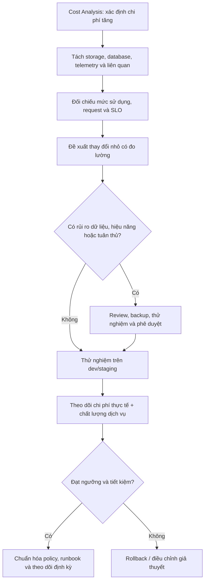
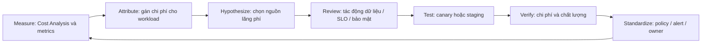

# Tối ưu chi phí lưu trữ, cơ sở dữ liệu và telemetry

> **Chương:** Quản lý chi phí  
> **Mô-đun:** `CLOUD_PROVIDERS_AZURE` — khám phá Microsoft Azure từ subscription, resource group, Microsoft Entra ID và mạng ảo đến dịch vụ tính toán, lưu trữ, dữ liệu; học cách triển khai, giám sát, bảo vệ và kiểm soát chi phí một kiến trúc ứng dụng.

## Mục tiêu học tập

Sau bài học này, bạn có thể:

1. Phân rã chi phí Azure thành **dung lượng, mức sử dụng, giao dịch, truyền dữ liệu, lưu giữ và khả năng sẵn sàng**, thay vì chỉ nhìn tổng hóa đơn.
2. Dùng **Azure Cost Management**, Azure Monitor và chỉ số ứng dụng để xác định resource, meter hoặc workload gây chi phí tăng.
3. Chọn tier và chính sách vòng đời thích hợp cho **Azure Blob Storage**, đồng thời đánh giá managed disks, snapshots, Azure Files và chi phí dữ liệu sao lưu.
4. Tối ưu **Azure SQL Database, Azure Database for PostgreSQL và Azure Cosmos DB** dựa trên workload, hiệu năng, khả năng mở rộng và yêu cầu bảo vệ dữ liệu.
5. Kiểm soát chi phí **Application Insights, Log Analytics và telemetry** qua thiết kế tín hiệu, lấy mẫu, lọc tại nguồn, retention và các tùy chọn lưu trữ.
6. Lập giả thuyết tiết kiệm, ước lượng trước, thử nghiệm an toàn, đo hiệu quả sau thay đổi và đặt ngưỡng bảo vệ SLO, RPO/RTO, bảo mật và kiểm toán.

## 1. Bài toán: chi phí tăng nhưng không rõ vì sao

Một ứng dụng `orders-api` trên Azure sử dụng Blob Storage để lưu hóa đơn, Azure SQL Database cho đơn hàng và Application Insights/Log Analytics để quan sát. Ban đầu có ít người dùng, nhưng sau vài tháng tổng chi phí hàng tháng tăng mạnh. Các dấu hiệu thường gặp:

- Blob lưu nhiều file cũ ít ai truy cập nhưng vẫn ở tier có giá lưu trữ cao.
- Database dùng cấu hình compute lớn suốt ngày đêm dù lưu lượng cao chỉ trong vài giờ.
- Mọi request, health check và dependency call đều sinh telemetry với khối lượng lớn, trong đó có dữ liệu ít giá trị chẩn đoán.
- Snapshot, bản sao lưu, bản ghi log và tài nguyên kiểm thử tồn tại lâu hơn nhu cầu.
- Thay đổi hạ tầng giúp giảm một dòng chi phí nhưng lại tăng giao dịch, độ trễ truy cập hoặc phí khôi phục.

**Mục tiêu tối ưu chi phí là giảm tổng chi phí của một mức dịch vụ đã cam kết.** Nếu giảm tiền nhưng làm mất dữ liệu, tăng lỗi ứng dụng hoặc không đáp ứng yêu cầu kiểm toán, quyết định đó không đạt mục tiêu.

### Công thức tổng quát

Một cách phân tích là tách các cấu phần:

\[
C_{\text{tháng}} =
C_{\text{lưu trữ}} +
C_{\text{cơ sở dữ liệu}} +
C_{\text{telemetry}} +
C_{\text{mạng}} +
C_{\text{vận hành liên quan}}
\]

Trong từng cấu phần, giá thường phụ thuộc số lượng sử dụng nhân đơn giá, có thể cộng thêm phí giao dịch, dung lượng lưu giữ, sao chép hoặc đọc dữ liệu. **Đơn giá thực tế thay đổi** theo region, loại dịch vụ, redundancy, giao kèo, dung lượng và thời điểm. Mọi con số giả định trong bài chỉ dùng để minh họa phép tính; trước quyết định thật phải đối chiếu Azure Pricing Calculator và Cost Management của subscription.

### Sơ đồ ra quyết định



## 2. Tạo đường cơ sở chi phí trước khi chỉnh cấu hình

### 2.1. Xác định phạm vi đo

Trước tiên, chọn một phạm vi nhất quán: subscription, resource group, tag ứng dụng hoặc một nhóm resource IDs. Nếu một workload dùng chung database, Log Analytics workspace hay mạng với ứng dụng khác, cần có **quy tắc phân bổ chi phí** rõ ràng. Không gán toàn bộ chi phí tài nguyên dùng chung cho một ứng dụng chỉ vì tag hoặc tên gần giống.

Trong **Azure Portal → Cost Management + Billing → Cost Management → Cost analysis**, phân tích:

1. Chọn đúng **scope**, kỳ 7/30/90 ngày hoặc khoảng có cả trước và sau thời điểm chi phí tăng.
2. Nhóm chi phí theo **Service name**, **Resource**, **Resource group**, **Meter** hoặc tag hữu ích được tài khoản hỗ trợ.
3. Phân biệt chi phí **thực tế** và dự báo; ghi nhận loại tiền, thuế, khoản giảm giá/điều chỉnh, reservations hoặc cam kết nếu hiển thị.
4. Đối chiếu với hoạt động triển khai, tăng lưu lượng, thay đổi retention, replication, scaling và logging.
5. Tìm những resource có chi phí phát sinh khi không phục vụ tải: đĩa không gắn, snapshot lâu ngày, cơ sở dữ liệu dev 24/7, workspace có ingestion bất thường.

**Cost Management có độ trễ cập nhật dữ liệu**, nên không nên kết luận một lần thay đổi vừa thực hiện đã tiết kiệm ngay sau vài phút. Dùng metric sử dụng và sau đó đối chiếu lại với dữ liệu hóa đơn đủ thời gian.

### 2.2. Đặt chỉ số kỹ thuật cùng chỉ số tiền

| Nhóm | Chỉ số chi phí | Chỉ số kỹ thuật đi kèm |
|---|---|---|
| Blob Storage | GB-tháng theo tier, read/write/list operations, retrieval, egress | Độ tuổi object, tần suất đọc, latency và dung lượng |
| Managed disks/Azure Files | Disk capacity/tier, provisioned throughput/IOPS, snapshots, backup | IOPS thực, throughput, queue/latency, free space |
| Azure SQL | Compute/DTU/vCore, storage, backup, HA/replica | CPU, IO, storage, connection, Query Store, p95 |
| PostgreSQL | Compute tier, storage/IO, backup, HA | CPU, active connections, query latency, cache hit |
| Cosmos DB | Provisioned/autoscale RU/s hoặc RU sử dụng, storage và vùng | RU/request, 429, latency, partition distribution |
| Azure Monitor | Ingestion GB, retention, truy vấn/xuất dữ liệu theo loại hình | Số event, loại tín hiệu, độ bao phủ cảnh báo, độ trễ tìm lỗi |

Một thước đo hữu ích để chuẩn hóa tăng trưởng:

\[
\text{Chi phí trên 1.000 giao dịch thành công}
= \frac{\text{Chi phí phân bổ cho workload}}{\text{Số giao dịch thành công}} \times 1000
\]

Khi số khách hàng tăng, tổng hóa đơn có thể tăng trong lúc **chi phí cho mỗi giao dịch giảm**. Cần phân biệt hai hiện tượng để không cắt giảm sai chỗ.

### 2.3. Budget và cảnh báo

Thiết lập **Azure Budgets** và các cảnh báo ở scope thích hợp, ví dụ mức 70%, 90%, 100% ngân sách. Gắn owner nhận thông báo và runbook xử lý. **Budget alert không mặc nhiên là giới hạn cứng ngăn dịch vụ phát sinh chi phí**; cơ chế tắt dịch vụ nếu có phải được thiết kế riêng để tránh gián đoạn ứng dụng.

Azure Advisor và các khuyến nghị tiết kiệm là nguồn giả thuyết tốt, nhưng cần xác minh với workload, cấu hình bảo vệ dữ liệu và hiệu năng thực tế trước khi áp dụng.

## 3. Tối ưu Azure Blob Storage theo cách truy cập dữ liệu

### 3.1. Phân biệt các tier

Azure Blob Storage hỗ trợ các access tier phù hợp với tần suất và yêu cầu đọc dữ liệu. Khả năng sử dụng từng tier phụ thuộc loại tài khoản, region, redundancy và tính năng được hỗ trợ.

| Tier | Đặc trưng | Khi cân nhắc |
|---|---|---|
| **Hot** | Phù hợp dữ liệu truy cập thường xuyên, phí lưu trữ thường cao hơn tier ít truy cập | Ảnh sản phẩm phổ biến, file giao dịch mới, nội dung ứng dụng đọc liên tục |
| **Cool** | Phí lưu dữ liệu thường thấp hơn Hot, nhưng truy cập và giữ dữ liệu có quy tắc/phí khác | Hóa đơn 1–3 tháng tuổi, tệp ít đọc |
| **Cold** | Tối ưu cho dữ liệu online rất hiếm đọc, điều kiện và phí retrieval/giữ tối thiểu cần xem kỹ | Nhật ký hoặc chứng từ ít được truy vấn nhưng vẫn cần truy cập online |
| **Archive** | Dữ liệu offline, phí lưu thấp nhưng cần **rehydrate** trước khi đọc; có thời gian và phí khôi phục | Dữ liệu lưu nhiều năm, yêu cầu truy cập thấp và RTO cho phép |

**Giá lưu trữ thấp hơn không có nghĩa tổng chi phí thấp hơn.** Khi truy cập từ tier lạnh, các hoạt động đọc, truy xuất, chuyển tier, rehydration, phí giữ tối thiểu hoặc chuyển ra Internet/region khác có thể khiến phương án trở nên đắt hơn.

Không đưa dữ liệu cần đọc ngay cho nghiệp vụ hoặc quy trình khôi phục có RTO ngắn vào Archive nếu ứng dụng không chịu được độ trễ rehydration. Với Blob versioning, soft delete và snapshot, **phiên bản/bản sao được giữ lại có thể tiếp tục phát sinh phí** dù đã xóa object hiện hành.

### 3.2. Tính thử một quyết định chuyển tier

Giả sử có **1.000 GB** file, tất cả đang ở Hot. Trong dữ liệu đo được, 400 GB vẫn thường xuyên được đọc; 600 GB gần như không có lượt đọc.

**Giả định đơn giá để minh họa, không phải giá Azure:** Hot 0,020 USD/GB-tháng và Cool 0,010 USD/GB-tháng.

| Phương án | Phép tính lưu trữ | Tiền minh họa/tháng |
|---|---|---:|
| Tất cả Hot | 1.000 × 0,020 | 20 USD |
| 400 GB Hot + 600 GB Cool | 400 × 0,020 + 600 × 0,010 | 14 USD |
| Chênh lệch **trước khi cộng phụ phí** | 20 − 14 | **6 USD** |

Lợi ích 6 USD chỉ là phần lưu trữ trong ví dụ. **Tiết kiệm ròng** phải trừ phí đọc/retrieval, transaction, lưu tối thiểu, chuyển tier và những phát sinh khác. Đánh giá theo mẫu truy cập cả tháng, không chỉ vài ngày ít truy cập.

### 3.3. Lifecycle Management

**Azure Blob Lifecycle Management** cho phép dùng quy tắc tự động chuyển tier hoặc xóa blob theo điều kiện, ví dụ tuổi từ lúc sửa, prefix hoặc blob index tags. Chính sách tạo trên storage account, không phải một script xóa file chạy thủ công.

Ví dụ thiết kế:

- `app-current/`: dữ liệu ứng dụng đang phục vụ, giữ Hot khi cần.
- `app-logs/`: logs của ứng dụng có chính sách lưu riêng; chuyển từ Hot sang Cool sau một khoảng thời gian được phê duyệt.
- `audit-records/`: có retention bắt buộc, **không** dùng quy tắc xóa ngắn hoặc chuyển offline nếu ảnh hưởng yêu cầu truy xuất.
- `temp-exports/`: file tạm có owner và kỳ hạn cụ thể; xóa chỉ sau khi xác nhận không còn phụ thuộc.

Một policy JSON **minh họa chỉ chuyển tier, không xóa dữ liệu**:

```json
{
  "rules": [
    {
      "enabled": true,
      "name": "tier-old-app-logs-to-cool",
      "type": "Lifecycle",
      "definition": {
        "filters": {
          "blobTypes": ["blockBlob"],
          "prefixMatch": ["app-logs/"]
        },
        "actions": {
          "baseBlob": {
            "tierToCool": {
              "daysAfterModificationGreaterThan": 45
            }
          }
        }
      }
    }
  ]
}
```

Đặt nội dung trong file `lifecycle.json` thuộc bài thực hành riêng, rồi **sau khi kiểm tra scope và phê duyệt** có thể áp dụng bằng Azure CLI:

```bash
az account show --query "{subscription:id,name:name}" --output table

az storage account management-policy create \
  --resource-group rg-cost-lab \
  --account-name stcostlabexample \
  --policy @lifecycle.json

az storage account management-policy show \
  --resource-group rg-cost-lab \
  --account-name stcostlabexample \
  --output json
```

Tên resource ở đây là giả định, không phải tài nguyên đã tồn tại. **Lệnh `create` là thay đổi cấu hình thật** nếu được chạy trên subscription có quyền; phải kiểm tra tệp policy, tên storage account, phiên bản Azure CLI và chính sách tổ chức trước khi sử dụng. Lifecycle rule không nhất thiết thay đổi toàn bộ blobs ngay lập tức; theo dõi trạng thái và chi phí ở các kỳ sau.

**Cần kiểm tra trước khi tự động xóa:** quyền sở hữu dữ liệu, snapshot/version, soft delete, legal hold/immutability, retention và khả năng khôi phục. Không cắt thời hạn lưu giữ pháp lý chỉ để tiết kiệm.

### 3.4. Redundancy, giao dịch và truyền dữ liệu

Ngoài access tier, tổng chi phí còn phụ thuộc:

- **Redundancy:** LRS, ZRS, GRS, GZRS và các biến thể read-access có mức giá/khả năng chịu lỗi khác nhau; chọn theo yêu cầu RPO/RTO và DR.
- **Operations:** số lần đọc, ghi, liệt kê, đổi tier và request khác; ứng dụng đọc quá nhiều object nhỏ có thể bị tính phí thao tác đáng kể.
- **Network:** egress ra Internet và một số đường truyền liên vùng; kiểm tra kiến trúc đa vùng/CDN.
- **File size và request pattern:** hợp nhất file nhỏ hoặc cache khi phù hợp có thể giảm số request; không thay đổi định dạng khi ứng dụng yêu cầu truy xuất ngẫu nhiên.
- **Encryption, private endpoint và bảo mật:** tối ưu cấu hình mà không giảm yêu cầu bảo vệ dữ liệu.

Chuyển từ GRS sang LRS có thể giảm giá nhưng làm suy giảm khả năng chống sự cố region. Cần quyết định dựa trên độ quan trọng của dữ liệu, khả năng phục hồi thật và chính sách tổ chức.

## 4. Managed disks, snapshots và Azure Files

Blob Storage chỉ là một phần chi phí lưu trữ. Máy ảo và hệ thống chia sẻ file có cơ chế định giá riêng.

### 4.1. Azure managed disks

Các loại disk như Standard HDD, Standard SSD, Premium SSD và các lựa chọn hiệu năng cao hơn phù hợp nhu cầu IOPS/throughput khác nhau. Với một số loại disk, chi phí liên quan **mức dung lượng hoặc hiệu năng đã provisioned**, dù chỉ sử dụng một phần.

Quy trình tối ưu:

1. Tìm các disk có chi phí cao và đối chiếu VM đang gắn, kích thước provisioned, IOPS, throughput, disk latency và hàng đợi.
2. Xác minh disk đang phục vụ database, OS, dữ liệu ứng dụng hay là disk không gắn sau khi xóa VM.
3. Nếu nhiều ngày liên tục chỉ dùng một phần nhỏ năng lực, đánh giá SKU/dung lượng khác đáp ứng burst và SLO.
4. Thử thay đổi trong thời gian bảo trì; một số thao tác giảm kích thước disk hoặc chuyển SKU không thể thực hiện trực tiếp, cần phương án di chuyển dữ liệu.
5. Sau đổi, quan sát `throttling`, IOPS, throughput, độ trễ, lỗi và chi phí.

**Đừng nhầm dung lượng còn trống trong filesystem với dung lượng disk có thể giảm ngay.** Việc giảm provisioned disk có thể cần tạo disk mới và di chuyển dữ liệu. Xóa disk “unattached” cũng phải xác minh ownership, snapshot/backup và kế hoạch phục hồi.

### 4.2. Snapshots và backup

Snapshots và Azure Backup hỗ trợ phục hồi nhưng có chi phí lưu trữ/retention. Trước khi xóa:

- Xác định snapshot thuộc chính sách backup, migration hoặc khôi phục nào.
- Kiểm tra restore point, khóa mã hóa, dependencies và yêu cầu lưu giữ.
- Phân biệt bản snapshot tạm phục vụ triển khai với bản backup chính thức.
- Đối chiếu với báo cáo backup hiện hành và quyền của owner.

Không đánh đổi chi phí bằng cách giảm retention khiến không còn bản backup có thể dùng khi sự cố xảy ra.

### 4.3. Azure Files

Azure Files có mô hình chi phí tùy loại share/tier và cách provision dung lượng/hiệu năng. Cần đo **dung lượng sử dụng thực, IOPS, throughput, latency, snapshot và giao dịch**; xem mô hình provisioned hoặc pay-as-you-go của cấu hình đang dùng.

Dữ liệu dùng chung có thể phù hợp Azure Files, Blob hoặc Managed Disk theo access semantics. Không di chuyển chỉ để giảm đơn giá GB nếu ứng dụng phụ thuộc SMB/NFS, locking, ACL hoặc file share concurrency.

## 5. Cơ sở dữ liệu: tối ưu compute, storage và truy vấn

Tối ưu database bắt đầu bằng **workload**: tỷ lệ đọc/ghi, concurrency, latency, kích thước dữ liệu, peak hours và yêu cầu HA/DR. Chỉ giảm SKU theo CPU trung bình có thể gây lỗi lúc cao điểm.

### 5.1. Azure SQL Database

Các mô hình như provisioned compute, serverless (khi tier và cấu hình hỗ trợ), elastic pools và các service tier khác nhau có cơ chế tính phí khác nhau.

| Tình huống | Phương án cần đánh giá | Đánh đổi |
|---|---|---|
| Một database dùng ổn định cả ngày | Chọn provisioned capacity sát mức tải và kiểm tra ưu đãi/commitment thích hợp | Phải đủ headroom cho peak và sự cố |
| Dev/test chỉ dùng giờ làm việc | Serverless/auto-pause khi được hỗ trợ, hoặc lịch dừng/hạ cấu hình theo quy trình | Auto-resume latency, tính tương thích, storage vẫn có phí |
| Nhiều database có đỉnh tải khác giờ | Elastic pool để chia sẻ compute | Cần theo dõi tổng concurrency và mức peak đồng thời |
| Cơ sở dữ liệu nặng I/O và latency thấp | Xem service tier đáp ứng I/O và HA cần thiết | Không chọn tier rẻ hơn nếu làm tăng latency |
| Dữ liệu và backup tăng dài hạn | Tối ưu indexing, retention, archive, long-term backup theo chính sách | Xóa dữ liệu/backup ảnh hưởng truy vết và phục hồi |

**Trước khi giảm compute**, kiểm tra CPU, data I/O, log write, memory, connections, deadlocks, Query Store và độ trễ truy vấn ở giờ cao điểm.

Ví dụ lệnh SQL **chỉ đọc** cho Azure SQL Database để quan sát gần đây; quyền và dữ liệu khả dụng phụ thuộc database:

```sql
SELECT TOP (20)
    end_time,
    avg_cpu_percent,
    avg_data_io_percent,
    avg_log_write_percent
FROM sys.dm_db_resource_stats
ORDER BY end_time DESC;
```

Các cột dạng phần trăm giúp nhận diện áp lực tài nguyên ở từng thời điểm, nhưng không phải báo cáo giá tiền. Dùng **Query Store** và execution plan để tìm truy vấn đắt trước khi tăng hoặc giảm vCore.

### 5.2. Tối ưu truy vấn trước hoặc song song với thay đổi SKU

Một truy vấn không có index phù hợp hoặc đọc quá nhiều hàng có thể làm database quá tải. Các bước điển hình:

1. Tìm top queries theo CPU, duration, reads/writes hoặc số lần gọi.
2. Đọc execution plan và chẩn đoán blocking, lock contention, query parameter skew.
3. Thử thay đổi index hoặc truy vấn trên dữ liệu đại diện; tính cả chi phí ghi và bảo trì index.
4. So sánh latency p95/p99, CPU, IO, deadlocks và throughput trước/sau.
5. Chỉ giảm compute sau khi thử tải đạt ngưỡng trong điều kiện peak và có khả năng rollback.

Tối ưu query đôi khi tiết kiệm nhiều hơn thay đổi pricing tier vì giảm workload thật. Tuy nhiên, một index mới có thể tăng dung lượng lưu và chi phí write I/O; cần đo ròng.

### 5.3. Azure Database for PostgreSQL

Với Azure Database for PostgreSQL Flexible Server, kiểm tra compute tier, vCores, storage, IOPS, backup, high availability và khả năng stop/start dành cho môi trường không chạy liên tục. Một server **đã dừng** không đồng nghĩa mọi phí storage/backup biến mất; tính năng stop/start còn có giới hạn và trạng thái tự khởi động theo dịch vụ.

- Với dev/test, lên lịch sử dụng nếu được hỗ trợ, có owner và cảnh báo khi server không chạy đúng giờ làm việc.
- Với production, chọn compute/HA theo peak latency, failover và RTO; không tắt HA chỉ dựa vào giá.
- Chẩn đoán SQL chậm, thống kê bảng, connection pooling, index, autovacuum và bloat trước khi tăng tài nguyên.
- Giữ chính sách backup và kiểm chứng restore, nhất là khi xóa bản ghi lâu năm hoặc thay đổi storage.

### 5.4. Azure Cosmos DB

Cosmos DB thường liên quan tới **request units (RU)**, kiểu throughput (provisioned/autoscale/serverless tùy cấu hình), storage, vùng replication và các tính năng liên quan.

| Dấu hiệu | Giả thuyết | Hướng kiểm tra |
|---|---|---|
| RU tiêu thụ quá cao dù request ít | Truy vấn không tối ưu, phân vùng nóng, indexing hoặc payload lớn | RU/request, query metrics, partition key, index policy |
| Provisioned RU/s cao cả ngày nhưng chỉ peak ngắn | Cấp phát quá dư so với profile | Đánh giá autoscale hoặc mô hình khác phù hợp workload |
| Nhiều phản hồi 429 | Đã đạt giới hạn throughput hoặc partition nóng | Quan sát retry, latency, hot partitions và RU provisioned |
| Storage tăng dù dữ liệu chỉ cần ngắn hạn | Thiếu TTL hoặc dữ liệu cũ không được thu hồi | Xác minh quyền giữ dữ liệu và tác động TTL/cleanup |
| Chi phí tăng sau thêm region | Replication và throughput ở nhiều vùng | Rà soát yêu cầu HA/latency và topology thật |

**Không xem mọi HTTP 429 là sự cố phải tăng RU ngay.** Cosmos DB SDK có thể retry theo cơ chế được hỗ trợ; cần xem tỷ lệ lỗi cuối cùng, latency và yêu cầu SLO. Ngược lại, việc giảm RU/s quá mức có thể làm tăng throttling và chi phí vận hành do retry.

## 6. Chi phí telemetry: Application Insights và Log Analytics

### 6.1. Telemetry nào mang lại giá trị?

Một ứng dụng tạo nhiều loại tín hiệu:

- **Metrics:** số liệu tóm tắt theo thời gian, thích hợp cảnh báo CPU, memory, request latency, queue, v.v.
- **Traces/spans và dependencies:** giúp phân tích luồng request đi qua dịch vụ và độ trễ giữa các thành phần.
- **Logs:** thông tin sự kiện chi tiết để tìm nguyên nhân lỗi, audit và điều tra.
- **Availability/synthetic tests:** tín hiệu về mức sẵn sàng từ góc nhìn người dùng.

Azure Monitor thu thập nhiều nguồn dữ liệu; **Application Insights** thường hỗ trợ quan sát ứng dụng và có thể lưu logs qua **Log Analytics workspace**. Chi phí không chỉ tính theo số dashboard được mở, mà phụ thuộc dữ liệu được ingest, thời gian lưu, loại table/plan, query, export và các tính năng áp dụng.

**Phải xác định dữ liệu nào cần cho SLO, phát hiện sự cố, điều tra bảo mật và lưu giữ pháp lý** trước khi lọc hoặc giảm retention.

### 6.2. Phân rã telemetry theo nguồn

| Nguồn | Dấu hiệu tốn phí | Phương án kiểm tra |
|---|---|---|
| Request logs | Ghi mọi health probe với thông tin lặp lại | Giảm noise ở nguồn, giữ metrics về availability và failure |
| Dependency traces | Mỗi request tạo rất nhiều spans | Điều chỉnh instrumentation và sampling phù hợp |
| Debug/verbose logs | In toàn bộ payload hoặc stack trace lặp lại | Sửa mức log, không ghi dữ liệu nhạy cảm |
| Custom events | Event bị phát nhiều lần do vòng lặp hoặc retry | Sửa logic phát event, chuẩn hóa event schema |
| Infrastructure diagnostic logs | Bật toàn bộ categories dù không dùng | Chọn categories phục vụ alert, audit và troubleshooting |
| Workspace retention | Giữ mọi table lâu với cùng chính sách | Thiết kế retention theo lớp dữ liệu và yêu cầu truy vấn |

### 6.3. Ba tầng cắt giảm chi phí telemetry

**Tầng 1 — Ngăn dữ liệu không cần thiết được tạo.** Chọn mức log phù hợp theo môi trường, loại bỏ debug quá mức và payload lặp; không gửi secrets, thông tin cá nhân hoặc dữ liệu người dùng không cần thiết.

**Tầng 2 — Lọc/lấy mẫu trước khi ingest.** Tùy SDK và nguồn, dùng sampling trong Application Insights hoặc **Data Collection Rules (DCR) transformations** cho luồng hỗ trợ. Giảm dữ liệu được tính phí mà vẫn giữ các tín hiệu quan trọng. Phải kiểm tra tương thích, hiệu quả và chính sách dữ liệu.

**Tầng 3 — Chọn cách lưu giữ/truy vấn phù hợp.** Cân nhắc table plan, thời gian analytics retention, long-term retention, export hoặc archive theo tính năng được hỗ trợ. Các tùy chọn table và khả năng truy vấn/alert khác nhau; không chuyển log điều tra cần phản ứng ngay sang cách lưu khó truy vấn chỉ vì đơn giá thấp.

**Đừng sampling bừa bãi sự kiện bảo mật/audit hoặc lỗi hiếm.** Sampling có thể phù hợp request trace phổ biến nhưng làm mất bằng chứng cần thiết. Cũng không nên giảm retention dưới thời hạn pháp lý hoặc yêu cầu điều tra.

### 6.4. KQL để tìm nhóm dữ liệu ingest lớn

Trong **Log Analytics workspace** dùng Application Insights workspace-based với các bảng tương ứng, có thể truy vấn sơ bộ kích thước dữ liệu được đánh dấu có tính phí:

```kusto
union withsource=SourceTable
    AppRequests,
    AppDependencies,
    AppTraces,
    AppExceptions
| where TimeGenerated >= ago(7d)
| where tostring(_IsBillable) == "true"
| summarize ApproxGiB = round(sum(todouble(_BilledSize)) / 1073741824.0, 2)
    by SourceTable
| order by ApproxGiB desc
```

**Giới hạn của truy vấn:** các bảng có thể không tồn tại, tên cột hoặc quyền truy cập có thể khác theo workspace/source; sửa danh sách table theo dữ liệu thật. `_BilledSize` là chỉ số kích thước bản ghi dùng để **ước lượng** và không thay thế toàn bộ hóa đơn Azure (tier, free quota, discount, commitment, mức tính theo meter có thể khác). Truy vấn cũng không đại diện các table khác ngoài bốn bảng trên.

Sau khi tìm table lớn nhất, phân nhóm theo `AppRoleName`, `OperationName`, `SeverityLevel` hoặc dimension thực tế để xem ứng dụng nào phát lượng lớn. Không triển khai bộ lọc chỉ dựa trên tên table nếu nó bao gồm cả log phục vụ phát hiện sự cố.

### 6.5. Sampling và ảnh hưởng tới số liệu

Ví dụ telemetry HTTP request trước sampling có 1.000 events/giây, sample 10% chỉ thu khoảng 100 events/giây đối với luồng phù hợp. Chi phí ingestion **có thể giảm**, nhưng lượng giảm thực tế tùy SDK, loại telemetry, retry, volume và phần dữ liệu không bị sample.

Một số hệ thống instrumentation lưu metadata giúp ước lượng tổng số request từ sampled telemetry, nhưng không nên lấy `count()` của bảng logs đã sample để kết luận chắc chắn tổng traffic thật. **SLI và alert quan trọng** nên dựa trên metric hoặc cơ chế thống kê phù hợp đã xác minh, trong đó không mất những lỗi cần phát hiện.

### 6.6. Daily cap và commitment

- **Daily cap** có thể dùng như hàng rào vận hành cho một số luồng ingestion, nhưng khi đạt cap bạn có thể **mất khả năng quan sát**. Không coi đây là giải pháp tiết kiệm duy nhất hoặc một mức trần hóa đơn tuyệt đối.
- **Commitment tiers** hay ưu đãi theo mức dùng có thể hữu ích với ingestion đều và đủ lớn, nhưng cần đối chiếu hợp đồng, mức sử dụng và rủi ro cam kết.
- **Retention** dài không phải lúc nào cũng đắt theo cùng đơn giá hoặc được phép trên mọi table plan. Chọn theo yêu cầu tra cứu và audit, kiểm tra giá và tính năng thực tế.

## 7. Mô hình hóa chi phí và giá trị tiết kiệm

### 7.1. Tính tiết kiệm ròng, không chỉ một hạng mục

Công thức đơn giản:

\[
\text{Tiết kiệm ròng}
=
\text{Chi phí hiện tại}
-
\text{Chi phí sau thay đổi}
-
\text{Chi phí chuyển đổi phát sinh}
\]

Chi phí chuyển đổi có thể gồm retrieval, egress, data migration, tăng giao dịch, chi phí thử nghiệm hoặc thời gian vận hành, và cả chi phí hiệu năng nếu làm mất doanh thu hoặc vi phạm SLO.

### 7.2. Ví dụ mô phỏng theo tháng

Giả sử một workload có ba giả thuyết (đơn giá và chi phí **hoàn toàn giả định**, không phải báo giá):

| Biện pháp | Trước | Sau | Tiết kiệm sơ bộ |
|---|---:|---:|---:|
| Chuyển 600/1.000 GB Blob từ Hot sang Cool | 20 USD | 14 USD | 6 USD |
| Right-size database sau kiểm thử tải | 300 USD | 240 USD | 60 USD |
| Giảm telemetry ít giá trị từ 40 xuống 30 GB/ngày ở giả định 2 USD/GB, 30 ngày | 2.400 USD | 1.800 USD | 600 USD |
| **Tổng sơ bộ** | **2.720 USD** | **2.054 USD** | **666 USD** |

Bảng **chưa tính** các phụ phí tiering, đọc blob, downtime/migration, backup, commitment, truy vấn telemetry, xử lý query mới và chi phí chia sẻ. Không dùng số này để dự báo hóa đơn thật.

### 7.3. Một quyết định “tiết kiệm” có thể thất bại

Giả sử chuyển hóa đơn khách hàng vào Archive làm giảm 100 USD lưu trữ mỗi tháng, nhưng khi cần khôi phục phải chờ lâu hơn RTO cam kết và phát sinh retrieval charge lớn. Đó có thể là phương án **không đạt**.

Tương tự, giảm vCore khi CPU bình quân chỉ 20% nhưng peak định kỳ 95% có thể gây throttling; cắt Application Insights request traces quá mạnh có thể khiến không chẩn đoán được lỗi hiếm khi production gặp sự cố.

Do đó cần đánh giá:

\[
\text{Giá trị quyết định}
=
\text{Tiết kiệm kỳ vọng}
-
\text{Chi phí bổ sung}
-
\text{Tác động rủi ro đã lượng hóa}
\]

Trong thực tế tác động rủi ro không luôn quy ra một con số đáng tin cậy; vẫn phải liệt kê các **điều kiện bắt buộc không được vi phạm**.

## 8. Guardrail: giữ hiệu năng, độ tin cậy và bảo mật

| Hàng rào bảo vệ | Ví dụ điều kiện trước/sau |
|---|---|
| **Độ trễ ứng dụng** | p95/p99 của luồng đơn hàng không vượt SLO khi thử tải tương đương |
| **Khả năng phục hồi dữ liệu** | Bản backup mới nhất và diễn tập restore vẫn đáp ứng RPO/RTO |
| **Dữ liệu pháp lý/audit** | Retention, legal hold và khả năng truy xuất chứng từ không suy giảm |
| **Tính sẵn sàng** | HA/zone/region redundancy theo kiến trúc đã phê duyệt |
| **Database** | Không tăng bất thường 429/timeout, deadlock, CPU/IO saturation |
| **Giám sát** | Các cảnh báo trọng yếu, traces lỗi và sự kiện bảo mật vẫn hoạt động |
| **An toàn dữ liệu** | RBAC, mã hóa, private endpoint, soft delete/immutability vẫn phù hợp |
| **Chi phí** | Tiết kiệm thực tế đã được Cost Management xác minh sau một chu kỳ sử dụng đủ dài |

Không cắt log authentication/security, bật tính năng auto-delete hoặc thay đổi quyền backup mà thiếu phê duyệt từ người sở hữu dữ liệu. Nếu điều kiện guardrail thất bại, phải có **phương án rollback** chứ không tiếp tục thay đổi để đạt một chỉ tiêu tiền ngắn hạn.

## 9. Quy trình tối ưu theo chu kỳ FinOps

### 9.1. Một vòng lặp có thể lặp lại



Thực hiện định kỳ theo tháng hoặc sau thay đổi lớn về tải, dữ liệu hay region. Với mỗi thay đổi, lưu:

1. Resource ID, subscription và người sở hữu.
2. Baseline cost 7/30 ngày kèm đơn vị tính và nguồn meter.
3. Giả thuyết, lượng sử dụng và đơn giá ước lượng.
4. Cấu hình dự kiến, SLO/RPO/RTO và loại dữ liệu có thể bị ảnh hưởng.
5. Bản backup, kế hoạch restore, thứ tự triển khai và rollback.
6. Kết quả trước/sau theo workload và chi phí, cùng quyết định giữ hay hoàn tác.

### 9.2. Đưa tối ưu vào IaC và CI/CD

Trong Bicep/Terraform và pipeline, có thể quản lý:

- Storage redundancy, lifecycle policies, retention phù hợp.
- Database tier/compute, autoscale hoặc cấu hình service theo môi trường.
- Diagnostic settings, Data Collection Rules và log sampling ở application code.
- Tags như `application`, `owner`, `environment`, `cost-center` (không phải mọi dòng phí đều hỗ trợ tag).
- Các policy kiểm soát cấu hình hoặc luồng phê duyệt có thể xóa dữ liệu.

**Không cho pipeline trực tiếp xóa bucket/blob/backup chỉ vì cảnh báo vượt ngân sách.** Các bước có tác động dữ liệu cần reviewer phù hợp và kiểm chứng sau triển khai.

## 10. Những lỗi tối ưu thường gặp

| Dấu hiệu | Nguyên nhân khả dĩ | Cách kiểm chứng |
|---|---|---|
| Storage GB giảm nhưng hóa đơn không giảm | Phí giao dịch/egress/retrieval, snapshot/version còn lại hoặc billing delay | Xem meter trong Cost Analysis, blob access patterns, retained versions |
| Tier Cool/Archive lại đắt hơn | Dữ liệu bị đọc thường xuyên, yêu cầu rehydration hoặc phí giữ tối thiểu | Đo số request, thời gian lưu và total cost theo từng tier |
| Tắt hoặc giảm database làm app chậm | Peak tải hoặc query kém tối ưu bị che bởi số liệu trung bình | Thử tải, Query Store, CPU/IO/log write, p95/p99 |
| Serverless không auto-pause | Cấu hình/tier không hỗ trợ hoặc database vẫn có hoạt động/kết nối | Kiểm tra điều kiện auto-pause và sessions/jobs nền |
| Cosmos DB vẫn có 429 sau tăng RU | Hot partition, truy vấn hoặc client retries gây nghẽn | Đọc RU/request, partition metrics, retry và latency |
| Log Analytics giảm chi phí nhưng mất log lỗi | Sampling/filter loại cả failure hoặc audit | Kiểm thử cảnh báo, traces lỗi, sự kiện bảo mật trên staging |
| Đã bật daily cap nhưng vẫn có phí | Các meter/nguồn dữ liệu khác không chịu tác động như kỳ vọng | Kiểm tra cost scope và metric nguồn, không coi cap là billing cap |
| Budget alert không dừng tài nguyên | Budget là cơ chế thông báo | Kiểm tra action/runbook riêng, tác động nếu dừng dịch vụ |
| Xóa snapshot gây khó restore | Snapshot chưa được phân loại ownership/retention | Kiểm tra backup inventory, restore requirement và lịch sử thay đổi |
| Không chứng minh được khoản tiết kiệm | So sánh khác traffic/region/giá hoặc dữ liệu hóa đơn chưa cập nhật | Chuẩn hóa cost per transaction và chờ đủ kỳ dữ liệu |

## 11. Bài thực hành: tìm ba nguồn chi phí cần tối ưu

**Bối cảnh:** Nhóm quản trị ứng dụng `orders-api` trong `rg-orders-lab`. Ứng dụng sử dụng Blob Storage, Azure SQL Database và Application Insights trong Log Analytics workspace. Ngân sách có hạn, nhưng phải giữ p95 giao dịch dưới ngưỡng SLO, giữ backup/restore và không mất log bảo mật.

### Các bước thực hiện

1. **Đo baseline:** trong Cost Analysis, lọc đúng scope và thời gian 30 ngày, nhóm theo service/resource/meter; ghi lại tổng và ba nhóm lớn nhất. Nếu không có Azure thật, dùng bảng giả định ở mục 7.
2. **Đánh giá Blob:** phân loại file theo prefix, tuổi và tần suất truy cập; lập bảng Hot/Cool/Cold/Archive, khả năng retrieval và retention. Đề xuất một policy **chỉ chuyển tier** cho dữ liệu ít đọc trong lab, không xóa.
3. **Đánh giá database:** xem CPU/IO/latency theo giờ, Query Store và giờ peak. Đề xuất một phương án right-size hoặc tối ưu query; ghi điều kiện không được vi phạm.
4. **Đánh giá telemetry:** dùng KQL mục 6.4 nếu workspace hỗ trợ để biết table phát sinh lượng dữ liệu lớn. Tìm health check/debug/trace lặp nhiều và xác định loại có thể sample/lọc mà vẫn giữ lỗi, bảo mật và audit.
5. **Ước tính chi phí ròng:** tính tiết kiệm theo giả định có ghi rõ; bổ sung retrieval, migration, backup, retained logs và chi phí vận hành.
6. **Kiểm tra tác động:** trên staging hoặc môi trường lab được cấp quyền, thử lifecycle policy/tuning DB/sampling một thay đổi mỗi lần. Theo dõi p95/p99, lỗi, dữ liệu và alerts.
7. **Đối chiếu trước/sau:** ghi load profile, thời gian, SKU, ingestion, storage operations, chi phí dự kiến và thực tế khi đủ dữ liệu; rollback nếu guardrail thất bại.
8. **Ghi quyết định:** chọn phương án triển khai hoặc không, kèm lý do kinh tế, kỹ thuật, bảo mật và người phê duyệt.

### Phiếu kết quả

| Hạng mục | Baseline | Đề xuất | Đo sau thử nghiệm |
|---|---|---|---|
| Blob GB theo tier và số lần đọc | … | … | … |
| Chi phí storage + retrieval + operations | … | … | … |
| SQL tier, CPU/IO, p95 | … | … | … |
| Chi phí database và backup | … | … | … |
| Log Analytics GB/ngày và table chính | … | … | … |
| Lỗi/alert/trace vẫn quan sát được | … | … | … |
| Tổng chi phí và chi phí/1.000 giao dịch | … | … | … |
| Các guardrail bắt buộc | … | … | … |

**Tiêu chí đạt:** người học giải thích được nguồn chi phí cụ thể, đưa ra ít nhất một phương án cho mỗi nhóm, tính được tiết kiệm ròng theo giả định có nguồn, không tự ý xóa dữ liệu và có cách xác minh SLO/khả năng phục hồi/telemetry. Trong tài khoản không có quyền sửa Azure, thực hiện hoàn toàn trên dữ liệu giả lập và ghi rõ đây là mô phỏng.

### Câu hỏi tự kiểm tra

1. Vì sao chuyển Blob từ Hot sang Archive có thể làm chi phí tổng tăng dù đơn giá GB thấp hơn?
2. Tại sao phải kiểm tra access pattern và retention trước khi tạo lifecycle policy?
3. CPU database trung bình 15% có đủ chứng minh nên giảm vCore không? Cần xem chỉ số nào?
4. Serverless auto-pause có nghĩa toàn bộ chi phí database biến mất khi không có request không?
5. Khi nào Cosmos DB autoscale hoặc serverless có thể phù hợp hơn provisioned RU/s cố định?
6. Những telemetry nào có thể sampling, và những loại nào cần giữ đủ để điều tra/audit?
7. Azure Budget có tự ngăn hóa đơn vượt ngân sách không?
8. Vì sao cần so sánh chi phí trên 1.000 giao dịch thay vì chỉ tổng hóa đơn?
9. Nếu chi phí giảm nhưng p99 tăng vượt SLO, có nên giữ cấu hình mới không?
10. Vì sao báo cáo Cost Management phải được đối chiếu với meter và số liệu sử dụng thực tế?

## 12. Ghi nhớ

Tối ưu chi phí Azure trong ba nhóm **lưu trữ, cơ sở dữ liệu và telemetry** là quá trình đưa dung lượng, năng lực tính toán và dữ liệu quan sát về **đúng mức cần thiết** cho ứng dụng.

Với **lưu trữ**, chọn access tier theo hành vi đọc, dùng lifecycle policy có kiểm soát và tính cả retrieval/operations/retention. Với **database**, đo peak workload và query trước khi right-size compute, đánh giá serverless/elastic pool/RU và không hy sinh HA hay backup. Với **telemetry**, giữ tín hiệu cần cho SLO, điều tra và kiểm toán; giảm noise ở nguồn, sampling/lọc dữ liệu phù hợp rồi đặt retention có mục đích.

Mỗi thay đổi cần được chứng minh bằng **chi phí ròng đo được, SLO không suy giảm, dữ liệu vẫn phục hồi được và các cảnh báo còn hoạt động**. FinOps bền vững là vòng lặp đo → giải thích → thử nghiệm → xác minh → chuẩn hóa, được thực hiện trên đúng scope và có chủ sở hữu rõ ràng.
