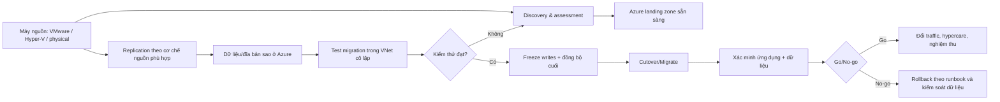
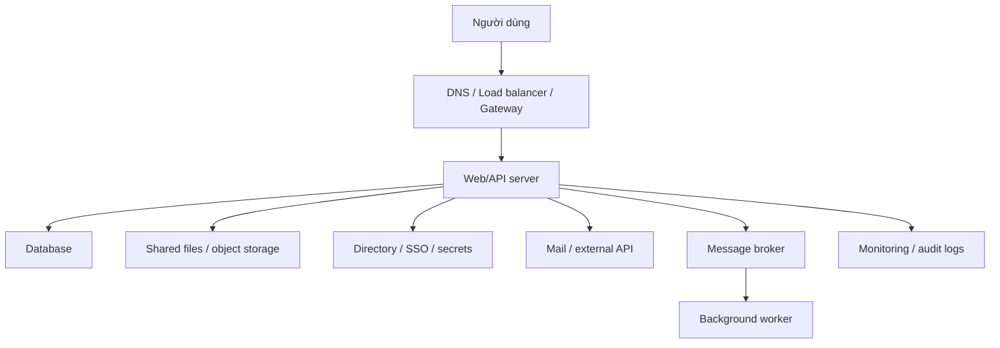
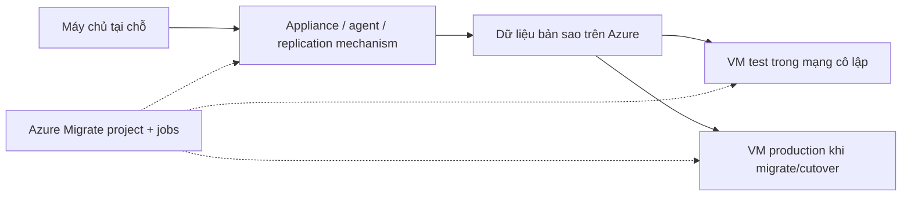
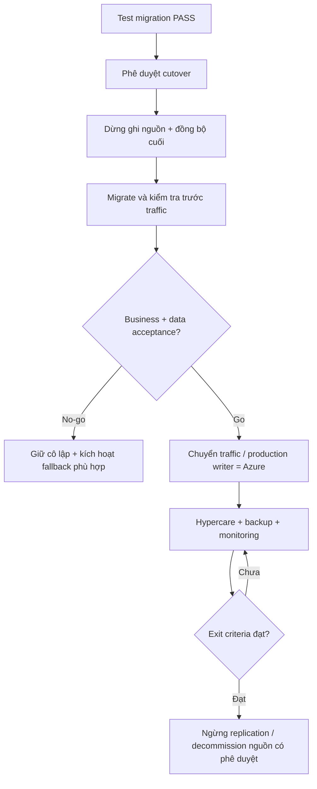

# Di chuyển máy chủ lên Azure và xác minh sau cutover

## 1. Bài toán: chuyển nơi chạy, giữ nguyên dịch vụ

Một doanh nghiệp đang vận hành ứng dụng đặt hàng trên máy chủ tại trung tâm dữ liệu riêng. Ứng dụng gồm máy chủ web/API, máy chủ xử lý công việc nền, cơ sở dữ liệu, thư mục chứa tệp tải lên và các tích hợp với hệ thống xác thực, email, thanh toán. Doanh nghiệp muốn chuyển các máy chủ sang **Microsoft Azure** để tăng tính linh hoạt, giảm phụ thuộc phần cứng và tận dụng giám sát, sao lưu, khả năng phục hồi và quản trị chi phí.

Đưa bản sao đĩa máy chủ lên Azure **không tự động đồng nghĩa ứng dụng đã được di chuyển thành công**. Sau khi máy ảo đích khởi động, ứng dụng còn phải kết nối được cơ sở dữ liệu, xác thực người dùng, truy cập secret, xử lý giao dịch, phục vụ qua tên miền và phát cảnh báo đúng nơi. Một bước đổi DNS sai hoặc để cả máy nguồn và máy đích cùng ghi dữ liệu có thể gây mất đơn hàng dù giao diện hệ thống vẫn phản hồi HTTP 200.

Trong chương **Hybrid cloud và di chuyển lên Azure**, bài học này tập trung vào **di chuyển máy chủ (server migration)** theo phương án phù hợp, **thực hiện cutover có kiểm soát** và **xác minh end-to-end sau cutover**. Nội dung nối tiếp kiến thức hệ sinh thái Azure từ subscription, resource group, Microsoft Entra ID đến mạng ảo, compute, storage, dữ liệu, triển khai, giám sát, bảo mật và chi phí.

### Mục tiêu học tập

Sau bài này, bạn có thể:

1. Phân biệt discovery, assessment, replication, test migration, cutover, hypercare và decommission.
2. Chọn cách di chuyển máy chủ phù hợp với VMware, Hyper-V, máy vật lý và workload khác mà không nhầm với di chuyển cơ sở dữ liệu hoặc chuyển đổi ứng dụng sang PaaS.
3. Lập danh mục phụ thuộc, đánh giá độ tương thích, sizing, vùng triển khai, mạng, quyền truy cập, license và chi phí.
4. Giải thích luồng Azure Migrate từ khám phá, đánh giá, sao chép, thử nghiệm đến di chuyển production.
5. Thiết kế runbook cutover có tiêu chí **go/no-go**, thời gian dừng ghi, xử lý delta dữ liệu, thay đổi traffic và kế hoạch rollback.
6. Xác minh OS, network, database, chức năng ứng dụng, tính toàn vẹn dữ liệu, hiệu năng, security, backup, monitoring và billing sau khi chuyển.
7. Lập biên bản nghiệm thu có số liệu RTO/RPO, bằng chứng và người chịu trách nhiệm.

## 2. Thuật ngữ và ranh giới của một đợt migration

| Thuật ngữ | Ý nghĩa | Bằng chứng cần có |
| --- | --- | --- |
| **Discovery** | Khám phá máy chủ, cấu hình, ứng dụng và phụ thuộc | Inventory và dependency map |
| **Assessment** | Đánh giá readiness, sizing, chi phí và rủi ro trước di chuyển | Báo cáo tương thích, đề xuất VM và cost estimate |
| **Rehost / lift-and-shift** | Đưa workload lên Azure VM với thay đổi ứng dụng hạn chế | VM đích chạy ứng dụng tương đương |
| **Replatform** | Thay đổi một phần nền tảng, như chuyển database lên managed service | Kế hoạch chuyển đổi ứng dụng và dữ liệu riêng |
| **Replication** | Sao chép thay đổi dữ liệu/hệ thống từ nguồn đến đích | Replication health, recovery point/lag |
| **Test migration** | Khởi tạo bản thử ở Azure để kiểm chứng, chưa chuyển production | Kết quả kiểm thử trong mạng cô lập |
| **Cutover** | Chuyển workload và luồng truy cập production sang đích | Quyết định phê duyệt, điểm đồng bộ, đổi traffic |
| **Rollback / fallback** | Trở lại phương án phục vụ an toàn khi cutover không đạt | Điều kiện, người phê duyệt, cách xử lý dữ liệu mới |
| **Hypercare** | Giai đoạn theo dõi sát sau chuyển đổi | Dashboard, incident log, acceptance checks |
| **Decommission** | Ngừng, xóa hoặc thu hồi hệ thống nguồn sau khi chấp nhận | Biên bản phê duyệt và bằng chứng lưu giữ phù hợp |

**Cutover** không chỉ là một nút bấm trong portal. Đó là thời điểm quyền phục vụ nghiệp vụ chuyển từ nguồn sang đích và cần quyết định rõ **hệ thống nào là nguồn ghi dữ liệu có thẩm quyền**.

### Mục tiêu thời gian: RTO, RPO và downtime

- **RTO (Recovery Time Objective):** mục tiêu thời gian dịch vụ ngừng phục vụ tối đa sau sự cố. Trong migration có kế hoạch, nhóm thường đặt **downtime window** và thời gian cutover mục tiêu tương tự, nhưng khái niệm không hoàn toàn đồng nhất.
- **RPO (Recovery Point Objective):** mức mất dữ liệu chấp nhận được trong kịch bản khôi phục. Với cutover production có kiểm soát, mục tiêu thường là **không mất giao dịch đã xác nhận**, đòi hỏi dừng ghi và đồng bộ lần cuối phù hợp.
- **Replication lag:** độ trễ giữa dữ liệu nguồn và bản sao đích. Lag thấp **không tự chứng minh** dữ liệu ứng dụng hoặc nhiều server đã nhất quán.
- **Cutover downtime:** khoảng thời gian người dùng không thể hoàn tất nghiệp vụ trong một đợt chuyển đổi theo kế hoạch.

Ví dụ: cửa sổ bảo trì 45 phút không có nghĩa Azure Migrate bảo đảm ứng dụng sẽ trở lại trong 45 phút. Phải tính cả quyết định cutover, đồng bộ delta, khởi động dịch vụ, kiểm thử, đổi định tuyến và quan sát.

## 3. Chọn công cụ và chiến lược phù hợp

Không có một công cụ Azure duy nhất tự động chuyển mọi workload. Các phương án cần phân biệt:

| Phương án/công cụ | Vai trò chính | Không nên kỳ vọng |
| --- | --- | --- |
| **Azure Migrate: Discovery and assessment** | Inventory, thu thập phụ thuộc, đánh giá readiness, sizing và ước tính chi phí | Không tự chuyển tất cả ứng dụng chỉ từ một báo cáo |
| **Azure Migrate: Server Migration** | Hỗ trợ sao chép/di chuyển máy chủ được hỗ trợ sang Azure VM | Không tự sửa logic ứng dụng, DNS, license hoặc tất cả dịch vụ dữ liệu ngoài VM |
| **Azure Site Recovery (ASR)** | Duy trì bản sao và điều phối failover phục vụ **disaster recovery** ở kịch bản được hỗ trợ | Không đồng nghĩa với một dự án migration có nghiệm thu/khử rủi ro cutover |
| **Azure Database Migration Service và công cụ dữ liệu** | Di chuyển/cắt chuyển cơ sở dữ liệu theo engine, nguồn, đích được hỗ trợ | Không thay thế việc di chuyển OS, web server và phụ thuộc mạng |
| **Azure Storage Mover/AzCopy và công cụ file** | Di chuyển dữ liệu tệp/object phù hợp | Không thay thế chuyển toàn bộ trạng thái máy chủ |
| **Bicep, ARM hoặc Terraform** | Chuẩn bị landing zone, mạng, tài nguyên, cấu hình hạ tầng | Không tự mang dữ liệu và ứng dụng từ nguồn sang đích |
| **Cài mới từ image/CI/CD** | Xây lại máy/app từ mã nguồn và cấu hình chuẩn | Không tự động giữ nguyên dữ liệu và tùy biến không được quản lý |

Trong bài, **luồng chính là rehost máy chủ tại chỗ sang Azure VM bằng Azure Migrate** theo khả năng hỗ trợ của môi trường. VMware, Hyper-V và máy vật lý có thể dùng **cơ chế khám phá, appliance, agent và replication khác nhau**. Không áp nguyên văn một đường thao tác cho mọi nguồn; phải đối chiếu ma trận hỗ trợ, yêu cầu appliance, OS và tính năng hiện hành trước khi triển khai.

### Cách chọn giữa rehost và replatform

Rehost thường hợp lý khi cần di chuyển nhanh, ứng dụng chưa sẵn sàng sửa lớn, hoặc phải giữ phần mềm legacy. Replatform phù hợp khi muốn giảm công vận hành, chẳng hạn đưa database lên Azure SQL và ứng dụng lên App Service. Có thể chọn **rehost trước, tối ưu sau**; tuy nhiên cần lập kế hoạch chi phí, backup, vá OS và khả năng phục hồi cho VM sau khi chuyển.

## 4. Mô hình end-to-end của một đợt di chuyển



Một máy chủ có thể là thành phần của nhiều luồng dữ liệu. Ví dụ:



Tách riêng những thành phần **nằm trên đĩa máy chủ** và những thành phần **được gọi qua network**. Chuyển đĩa `WEB` không bảo đảm `DB`, `FILE`, `ID` hoặc `MAIL` đã hoạt động ở môi trường Azure.

## 5. Discovery: lập inventory trước khi đánh giá

Trước khi thao tác replication, hãy lập danh mục từng máy với người sở hữu và thông số thực:

| Thuộc tính | Ví dụ `orders-api-01` | Tại sao cần? |
| --- | --- | --- |
| Business owner | Orders product team | Người quyết định nghiệm thu và downtime |
| Nguồn | VMware VM tại on-premises | Chọn cơ chế Azure Migrate tương ứng |
| OS/architecture | Windows Server/Linux, version cụ thể | Azure guest support, driver, kernel, license |
| CPU/RAM | 4 vCPU / 16 GiB | Sizing máy Azure đích |
| Disks | OS 128 GiB, data 500 GiB | Sizing, tốc độ replication, disk type |
| IP/DNS | `10.10.20.15`, `orders.internal` | Thiết kế NAT/routing/hostname và TTL |
| Ports | TCP 443 tới client, 1433 tới SQL | NSG, firewall, Private Endpoint, dependency |
| Services | API, scheduled job, local cache | Phân định process cần khởi động/dừng |
| Authentication | AD/LDAP/Entra, service account | Bảo vệ quyền và đổi endpoint |
| Data owner | DBA và ứng dụng | Quyết định consistency, freeze và backup |
| Performance | CPU p95, RAM, disk IOPS, network throughput | Right-size thay vì copy cấu hình máy cũ |
| Maintenance window | Ví dụ tối đa 60 phút | Kế hoạch cutover và checkpoint |
| Compliance | PII, retention, encryption | Region, policy, Key Vault, audit |
| Recovery | Backup, DR, RTO/RPO | Bảo vệ mới sau khi migrate |

### Thu thập phụ thuộc (dependency mapping)

Phân tích ít nhất:

1. Kết nối inbound và outbound, IP/port, DNS, proxy, load balancer, firewall.
2. Kết nối database, hàng đợi, SMB/NFS share, file uploads và lịch xử lý.
3. Tài khoản dịch vụ, domain join, Kerberos/SPN, certificate, secret, license server.
4. Thời điểm peak, tác vụ batch, backup window, maintenance jobs và lịch chốt dữ liệu.
5. Tài nguyên khác cần di chuyển cùng wave để ứng dụng không đứt phụ thuộc.

Azure Migrate có khả năng hỗ trợ **discovery/assessment** và phân tích phụ thuộc trong những kịch bản được hỗ trợ, nhưng dữ liệu công cụ cần được kiểm tra với owner. Network capture trong một cửa sổ quan sát ngắn có thể bỏ sót kết nối chỉ chạy cuối tháng.

## 6. Assessment: khả năng tương thích, sizing và chi phí

### 6.1. Khả năng chạy trên Azure

Một assessment nên kết luận cho từng máy:

- **OS và bản phát hành:** có được hỗ trợ trên Azure VM và bởi phương thức migration đã chọn không?
- **Boot/firmware/partition:** loại máy, BIOS/UEFI, Gen 1/Gen 2, cấu trúc OS disk có tương thích theo kịch bản?
- **Đĩa và mã hóa:** dung lượng, partition, filesystem, disk encryption, disk type, snapshots, shared disks và các hạn chế liên quan.
- **Drivers/agents:** yêu cầu Azure VM Agent, extension, mobility service hoặc replication appliance của phương thức tương ứng.
- **Ứng dụng và license:** hardcoded MAC/IP, license gắn phần cứng, dongle, driver riêng hoặc phụ thuộc kernel/hypervisor.
- **Network:** có thể kết nối domain controller, DNS, database và dịch vụ bên ngoài ở Azure không?
- **Mức sẵn sàng:** downtime cho phép có phù hợp thời gian đồng bộ cuối, khởi động máy và nghiệm thu không?

**Không coi mọi máy chủ cũ là đủ điều kiện chỉ vì nó chạy trên VMware.** Một OS đã hết hỗ trợ, dữ liệu trên loại đĩa đặc biệt hoặc dịch vụ yêu cầu phần cứng riêng có thể cần nâng cấp, chuyển đổi hoặc làm ngoại lệ có kiểm soát.

### 6.2. Right-size theo số đo

Chọn Azure VM dựa trên **utilization history** thay vì chỉ copy số vCPU/RAM. Nếu máy cũ được cấp 16 vCPU nhưng CPU p95 chỉ 20%, bạn có thể cân nhắc SKU nhỏ hơn; phải kiểm tra memory peak, thread capacity, disk IOPS, throughput, latency và cấu hình HA.

Ví dụ:

| Chỉ số máy nguồn | Giá trị giả định | Hành động |
| --- | --- | --- |
| CPU p95 | 35% của 8 vCPU | Đánh giá VM Azure nhỏ hơn, vẫn cần benchmark |
| RAM peak | 24 GiB | Tránh SKU có RAM dưới working set cần thiết |
| Disk read/write | 3.000 IOPS peak | Kiểm tra managed disk limits và VM IOPS ceiling |
| Network egress | 200 GB/tháng | Tính network charges phù hợp tuyến |
| OS | Linux phiên bản cũ | Xác minh support/driver và kế hoạch vá |
| Backup | Hàng ngày | Thiết kế Azure Backup/restore testing |

Azure Migrate assessment có thể gợi ý sizing và cost; bản estimate phải được so với **Azure Pricing Calculator, license, storage, backup, monitoring, network, vùng HA và chi phí phụ trợ**. SKU đề xuất không bảo đảm capacity hoặc quota có sẵn khi triển khai.

### 6.3. Sắp xếp theo wave

Không chuyển tất cả server trong một đêm. Nhóm theo **application dependency** và mức rủi ro:

| Wave | Nội dung minh họa | Mục đích |
| --- | --- | --- |
| 0 | Server test không chứa dữ liệu quan trọng | Xác nhận pipeline migration và mạng Azure |
| 1 | Ứng dụng nội bộ ít phụ thuộc | Chuẩn hóa runbook, monitoring và rollback |
| 2 | Orders API + worker + dữ liệu liên quan | Di chuyển theo nhóm dependency |
| 3 | Ứng dụng nghiệp vụ quan trọng hơn | Chỉ làm sau khi wave trước đã được nghiệm thu |

**Wave** phải có owner, lịch, điều kiện go/no-go, rủi ro còn mở và tài liệu nghiệm thu riêng. Không chia một ứng dụng có kết nối DB độ trễ nhạy cảm ra nhiều wave nếu kết nối hybrid tạm thời không đáp ứng yêu cầu.

## 7. Chuẩn bị Azure landing zone để máy đích có thể phục vụ

Trước khi bật replication, cần xác nhận vùng đích đã sẵn sàng về mạng, quyền và quản trị. Bảng sau mô tả một landing zone tối thiểu cho ứng dụng ví dụ.

| Thành phần Azure | Yêu cầu trước migration |
| --- | --- |
| Subscription/resource group | Phân tách môi trường, naming, tags, cost center và policy |
| Region/Availability Zone | Phù hợp data residency, latency, quota, SKU và thiết kế HA |
| VNet/subnet | Address space không trùng kết nối hybrid, NSG và route |
| DNS | Phân giải tên nội bộ/ngoài, DNS forwarders và kế hoạch TTL |
| Kết nối hybrid | VPN/ExpressRoute hoặc kênh phù hợp, băng thông và routing |
| Identity | Quyền Azure RBAC, domain join/Entra, service accounts |
| Storage/disk | Managed disks, encryption, performance tier, quota và backup |
| Security | Azure Policy, Defender, patching, bastion/JIT, Key Vault |
| Observability | Azure Monitor Agent, logs, dashboards, alert action groups |
| Resilience | Azure Backup, Availability Zones/sets và phương án DR nếu cần |
| Cost | Budget, tags, license/Azure Hybrid Benefit và lịch dọn tài nguyên thử |

### Thiết kế mạng trước, đừng chờ tới cutover

Giả sử on-premises có mạng `10.10.0.0/16`, Azure VNet dự kiến `10.40.0.0/16`. Cần kiểm tra subnet, tuyến BGP/UDR, NSG, Azure Firewall, NAT, DNS và kết nối domain controller. **Không tự chọn IP chỉ vì chưa thấy thiết bị dùng**: IP có thể thuộc quy hoạch mạng khác hoặc sẽ gây overlap khi nối VPN/ExpressRoute.

Nếu ứng dụng cũ dùng địa chỉ private IP cố định trong cấu hình, địa chỉ đó **không mặc nhiên được giữ nguyên** sau migration. Có thể cần cập nhật connection string, rule firewall, load balancer backend, DNS và monitoring. IP công khai của VM cũng không tự giữ nguyên khi chuyển vùng/đám mây.

### Quyền và điều kiện truy cập

Kỹ sư migration cần quyền cho project Azure Migrate, replication resources, target resource group, VM/disk/network và các công cụ phụ thuộc. Quản lý quyền sử dụng **Azure RBAC nguyên tắc tối thiểu**, dùng identity riêng cho pipeline, tránh gắn `Owner` trên toàn subscription chỉ để thử nghiệm.

Quyền trong Azure control plane không đồng nghĩa với quyền trong OS guest, database, Active Directory hay Key Vault. Cutover cần cả **đường truy cập hệ thống** và **quyền nghiệp vụ**.

## 8. Azure Migrate: khám phá và đánh giá máy nguồn

Trình tự minh họa khi dùng Azure Migrate:

1. Tạo **Azure Migrate project** trong subscription và region phù hợp quy tắc dịch vụ.
2. Chọn loại môi trường nguồn: VMware, Hyper-V, physical/other theo nguồn thực.
3. Thiết lập **discovery appliance hoặc thành phần khám phá** được yêu cầu cho nguồn đó; cấp quyền đọc hạ tầng nguồn và thông tin xác thực đã được phê duyệt.
4. Để discovery thu thập inventory và performance trong một khoảng đủ đại diện.
5. Nhóm máy theo ứng dụng và dependency; bổ sung các luồng hiếm dùng bằng phỏng vấn owner.
6. Tạo assessment về Azure readiness, VM sizing, disk, chi phí và phương án migration.
7. Review cảnh báo/unsupported configuration; điều chỉnh kiến trúc Azure và kế hoạch khắc phục trước khi replication.

Các tên nút trong Azure Portal thay đổi theo phiên bản. Hãy đối chiếu hướng dẫn chính thức cho **đúng source platform và replication method** trước khi cấu hình production.

### Khi nào không nên tin hoàn toàn vào assessment?

Nếu hệ thống ít tải trong thời gian quan sát nhưng đến cuối tháng có batch lớn, sizing có thể quá thấp. Nếu máy cũ có software license theo socket/core, assessment không thể thay thế xác nhận của bộ phận licensing. Nếu ứng dụng dùng raw device, cluster/shared disk hoặc OS lỗi thời, cần xem ma trận hỗ trợ và xử lý ngoại lệ.

## 9. Sao chép máy chủ bằng Azure Migrate: Server Migration

Sau khi assessment đạt, chọn **Server Migration** và quy trình replication tương ứng nguồn:

1. Chọn server được phê duyệt trong một wave.
2. Xác định subscription, resource group, target region, VNet/subnet, disk và các lựa chọn VM đích.
3. Cấu hình appliance/agent/credentials/replication theo phương thức phù hợp. Với VMware có thể có đường **agentless** trong môi trường đủ điều kiện; những nguồn khác có thể yêu cầu thành phần trên máy hoặc host.
4. Kiểm tra đường đi mạng, endpoint, dung lượng replication và quyền tạo resource đích.
5. Bật replication và theo dõi initial copy đến khi có recovery point/tình trạng phù hợp.
6. Giám sát delta replication trong thời gian ứng dụng vẫn chạy nguồn; ghi lại lag, lỗi và job.
7. Chỉ đưa máy vào cửa sổ cutover khi có test migration đạt và runbook được phê duyệt.



**Đường sao chép và nơi dữ liệu staging được lưu phụ thuộc nguồn và phiên bản phương thức migration.** Sơ đồ trên là mô hình logic, không phải thiết kế network chi tiết cho mọi VMware/Hyper-V/physical scenario.

### Những vấn đề cần giám sát

| Tín hiệu | Ý nghĩa | Phản ứng |
| --- | --- | --- |
| Initial replication vẫn đang chạy | Chưa có bản sao phù hợp để cutover | Xem bandwidth, kích thước đĩa, jobs |
| Replication unhealthy/lag cao | Delta chưa bắt kịp thay đổi nguồn | Kiểm tra log, agent/appliance/network và throughput |
| VM size/disk target không hợp lệ | Không thể tạo máy đúng nhu cầu | Sửa cấu hình và chạy assessment/test lại |
| OS không sẵn sàng boot trên Azure | Vấn đề driver/kernel, boot/config | Khắc phục theo hướng dẫn OS/migration tool |
| Source tiếp tục ghi dữ liệu | Điểm cắt chưa ổn định | Lên lịch quiesce và final sync |
| Quota/SKU không đủ ở đích | Cutover có nguy cơ không cấp phát được VM | Kiểm tra quota và capacity trước giờ migration |

**Replication healthy không phải bằng chứng ứng dụng có thể phục vụ.** Tài nguyên có thể boot nhưng không truy cập được domain, database, licensing server hoặc DNS.

## 10. Test migration: diễn tập trên mạng tách biệt

**Test migration** là bước giảm rủi ro bắt buộc với workload quan trọng. Mục tiêu là chạy bản VM thử tại Azure từ dữ liệu đã sao chép **mà không chuyển quyền phục vụ production**.

### Quy trình

1. Chuẩn bị **test VNet/subnet** có NSG, DNS và kết nối được kiểm soát.
2. Chọn server hoặc group đã replication đủ điều kiện trong Azure Migrate.
3. Thực hiện **Test migration**, chọn mạng thử và các tham số được hỗ trợ.
4. Xác minh VM boot, NIC, IP, driver, guest agent, disk mount, service và ứng dụng.
5. Thử dependency với dữ liệu/sandbox phù hợp; không để job nền gửi email, xuất hóa đơn hoặc ghi vào production.
6. Thu thập kết quả, thời gian và lỗi; sửa nguyên nhân rồi test lại.
7. **Cleanup test migration** qua cơ chế công cụ, xác minh VM/disk test không còn phát sinh phí ngoài kế hoạch và replication production vẫn hoạt động.

### Các điều không nên làm

- Không gắn bản VM test vào cùng mạng nơi server nguồn còn đang phục vụ nếu gây trùng hostname/IP hoặc tranh quyền domain.
- Không cho hai bản cùng đọc và **ack** chung queue production; không để scheduler, cron, batch hoặc payment job chạy ở cả hai bên.
- Không dùng snapshot test để xác nhận database có tính nhất quán giao dịch nếu chưa có kiểm tra ở cấp database.
- Không coi chỉ số “VM running” là test PASS; cần kiểm tra HTTP/API và nghiệp vụ người dùng.

Một số hệ thống phụ thuộc domain, license server, database hoặc tích hợp thật. Khi cần kết nối, hãy tạo **môi trường giả lập/copy dữ liệu** hoặc một phương án test có kiểm soát, được owner phê duyệt; không tự mở toàn bộ firewall test tới production để “cho chạy được”.

### Biểu mẫu ghi kết quả

```text
Test ID: MIG-ORDERS-TEST-001
Machine: orders-api-01
Source: VMware on-premises
Target: Azure Southeast Asia (ví dụ)
Test VNet: vnet-migrate-test
Recovery point / data timestamp: [ghi từ công cụ]
VM boot time: [UTC]
App ready time: [UTC]
Checks passed: OS / network / DNS / DB / API / auth / jobs / logs
Issues: [mô tả + owner + mức ưu tiên]
Cleanup performed: PASS/FAIL
Replication after cleanup: HEALTHY/UNHEALTHY
Business approval: [người duyệt]
```

## 11. Chuẩn bị cutover: kế hoạch dừng ghi, đồng bộ và quyền quyết định

Cutover cần một **runbook có thứ tự, checkpoint và điều kiện dừng**, không dựa vào trao đổi miệng.

### Phân vai RACI tối thiểu

| Vai trò | Trách nhiệm |
| --- | --- |
| Incident/change commander | Điều phối, quyết định go/no-go, mở/đóng cửa sổ |
| Azure/cloud engineer | Replication, target VM, resource group, VNet, NSG, cloud jobs |
| Network/DNS owner | VPN/ExpressRoute, firewall, DNS, traffic routing |
| OS/application owner | Dừng/start service, cấu hình app, health checks, job nền |
| DBA/data owner | Freeze dữ liệu, final consistency check, recovery/rollback dữ liệu |
| Security/IAM owner | Entra/AD, accounts, certificates, secrets, RBAC và kiểm toán |
| Business owner | Nghiệm thu luồng nghiệp vụ và chấp nhận downtime |
| Monitoring/on-call | Theo dõi SLO, alert và hypercare sau cutover |

### Bộ hồ sơ bắt buộc

1. **Nguồn sự thật về inventory:** máy nào, địa chỉ, OS, service owner, application owner.
2. **Bằng chứng test migration:** đã chạy VM test và đạt tiêu chí tối thiểu.
3. **Backup/restore:** có backup độc lập và kiểm tra restore, không chỉ replication.
4. **Kế hoạch final sync:** ai dừng ghi, ở đâu, cách kiểm tra transaction/queue và snapshot/delta.
5. **Kế hoạch traffic:** DNS TTL, gateway/load balancer, firewall, endpoint và người được quyền thay.
6. **Go/no-go gates:** ngưỡng thời gian, data lag, checksum/consistency và test nghiệp vụ.
7. **Rollback/fallback:** cách cô lập Azure, chuyển traffic lại, và xử lý **dữ liệu phát sinh ở đích** nếu đã mở ghi.
8. **Liên lạc:** stakeholder, bridge, phương án thông báo người dùng, escalation và ký nghiệm thu.

**Rollback không đơn giản là đổi DNS về nguồn.** Nếu người dùng đã tạo giao dịch mới trên Azure, nguồn cũ có thể thiếu dữ liệu. Cần xác định thời điểm rollback còn “đơn giản”, sau mốc nào chỉ được chuyển về nếu có phương án đồng bộ ngược/khôi phục dữ liệu được DBA phê duyệt.

### Thời gian DNS và phiên kết nối

Giảm DNS TTL trước sự kiện có thể giúp giảm thời gian chuyển nhưng không bảo đảm mọi client lập tức cập nhật: có cache, resolver, long-lived TCP/WebSocket sessions và kết nối theo IP hard-code. Cần kế hoạch xử lý load balancer health probes, reverse proxy, certificate và retry client trong giai đoạn chuyển.

## 12. Runbook cutover production theo thứ tự an toàn

Runbook minh họa cho Orders API gồm một web/API VM và một worker, với database có kế hoạch riêng. Các mốc phút bên dưới **là thời gian giả định để thực hành**, không phải cam kết thời gian của Azure Migrate.

| Giai đoạn | Ví dụ mốc | Công việc và bằng chứng |
| --- | --- | --- |
| T-7 ngày | Chuẩn bị | Xác nhận assessment, target, quota, test migration, backup, owner |
| T-1 ngày | Preflight | Recheck replication, DNS, TLS, secret, cảnh báo, lịch bảo trì |
| T-30 phút | Mở cầu điều phối | Kiểm tra người trực và dashboard, thông báo maintenance |
| T0 | Quiesce | Chặn traffic ghi mới, pause cron/worker/queue consumer, drain in-flight |
| T+5 | Data checkpoint | DBA xác nhận log/transaction commit, backup và final sync |
| T+10 | Final replication | Theo dõi delta/công cụ đến trạng thái cần thiết |
| T+20 | Migrate/cutover | Chạy tác vụ migrate đúng VM, cấu hình network/OS phù hợp |
| T+30 | Validation gate | Boot, service, data, security và health endpoint |
| T+40 | Traffic switch | Đổi gateway/DNS/routing khi được phê duyệt |
| T+50 | Business acceptance | Kiểm tra giao dịch thử, monitor, ký go/no-go |
| T+60 | Close / contingency | Công bố dịch vụ phục hồi hoặc kích hoạt fallback |

**Không bao giờ xem các mốc T+ như lệnh bắt buộc tiếp tục.** Nếu replication chưa sẵn sàng ở T+10, phải dừng và đánh giá theo tiêu chí no-go; không “đẩy nhanh” bằng cách bỏ kiểm tra dữ liệu.

### Chi tiết từng checkpoint

**Checkpoint A — Trước khi dừng nguồn**

- Target VM size/SKU/disk, subnet và subscription đúng như được duyệt.
- Azure Migrate jobs không lỗi, replication đủ điều kiện, storage/region quota còn headroom.
- Lệnh dừng và khởi động các dịch vụ được thử ở môi trường test.
- Backup được kiểm tra; runbook rollback có người quyết định và thời hạn còn hiệu lực.

**Checkpoint B — Chặn ghi và đồng bộ cuối**

- Hiển thị trang bảo trì hoặc bật read-only/mode tương đương.
- Pause scheduler, worker, queue consumer và batch có side effects.
- Kiểm tra in-flight transaction và flush dữ liệu ứng dụng/DB theo công nghệ thực.
- Chụp các mốc kiểm chứng: last order ID, timestamp UTC, queue offset, row counts phù hợp.
- Sau khi final sync, bảo đảm **không có writer ngoài ý muốn ở nguồn**.

**Checkpoint C — Thực thi migration**

Thực hiện thao tác **Migrate** trong Azure Migrate theo kịch bản nguồn được hỗ trợ, lựa chọn shutdown nguồn theo hướng dẫn của công cụ khi phù hợp với runbook. Nếu nền tảng không hỗ trợ shutdown có kiểm soát cho workload cụ thể, người vận hành phải thực hiện quiesce/shutdown đúng cách riêng. Không suy rằng mọi kịch bản migration có cùng nút, cùng trạng thái hoặc tự động quiesce database.

**Checkpoint D — Xác minh trước khi mở traffic**

- OS boot được, disk mount và dung lượng đúng; application service health.
- Database/data store được chuyển theo runbook; dữ liệu và schema hợp lệ.
- Internal dependency, AD/Entra, Key Vault, TLS, DNS, endpoint đều hoạt động.
- Một bộ thao tác canary có idempotency hoặc trong môi trường thử có thể chạy an toàn.

**Checkpoint E — Mở traffic và nghiệm thu**

Thay đổi gateway/load balancer/DNS theo kế hoạch. Quan sát request success rate, p95 latency, error rate, database connections, queue lag, transaction consistency. Business owner xác nhận các luồng chính, mới tăng dần traffic nếu kiến trúc cho phép.

## 13. Go/no-go và rollback: tránh hai hệ thống cùng ghi

Quyết định cutover phải có ngưỡng xác định trước:

| Tiêu chí | Go khi | No-go khi |
| --- | --- | --- |
| Replication | Data checkpoint và final sync được xác minh | Lag/mất nhất quán chưa giải quyết |
| VM/OS | VM đích boot, driver, disk và agent phù hợp | Boot lỗi, filesystem lỗi hoặc thiếu disk |
| Network | DNS, firewall, database route, TLS hoạt động | Không tới dependency thiết yếu |
| Data | DBA nghiệm thu integrity và consistency | Dữ liệu thiếu, stale hoặc duplicate |
| Application | Login, đặt hàng, đọc dữ liệu, worker đạt | Luồng nghiệp vụ cốt lõi lỗi |
| Security | Identity, quyền, logging và truy cập quản trị an toàn | Tài khoản đặc quyền/secret/certificate lỗi |
| Deadline | Còn đủ thời gian kiểm tra trong cửa sổ | Không đủ thời gian và rủi ro tăng |
| Rollback | Trạng thái ghi và điểm quay lui được biết rõ | Không có phương án xử lý dữ liệu ghi mới |

### Trường hợp 1: chưa cho Azure nhận ghi thật

Nếu ứng dụng đích chưa được mở cho production và không có transaction mới, có thể dừng migration, giữ traffic tại nguồn (hoặc đưa về nguồn sau khi khôi phục dịch vụ), sửa lỗi và lên lịch lại. Vẫn cần DBA xác nhận dữ liệu nguồn còn nguyên, reset các job test và bảo đảm không có hệ thống đích đang ghi.

### Trường hợp 2: Azure đã nhận giao dịch thật

Nguồn cũ có thể thiếu dữ liệu mới. Không bật cả hai hệ thống rồi cho người dùng chọn ngẫu nhiên. Cần:

1. Chặn ghi để có một source of truth rõ ràng.
2. Thu thập transaction IDs/offsets/timestamp để xác định chênh lệch.
3. Chọn kế hoạch **reverse sync, database restore, replay transaction hoặc tiếp tục vận hành trên Azure**, tùy kiến trúc và khả năng của hệ thống.
4. Chỉ mở traffic trở lại sau khi data owner xác nhận không mất/nhân đôi giao dịch.

**Một rollback bất khả thi về dữ liệu có thể khiến quyết định an toàn là tiếp tục khắc phục tại Azure**, thay vì quay về hệ thống đã lỗi thời. Tình huống này phải được thảo luận trước cửa sổ cutover.

## 14. Kiểm tra hạ tầng sau cutover: Azure VM, disk và mạng

Sau khi máy chủ được đưa lên Azure, xác minh cả **control plane** (tài nguyên tồn tại) và **guest plane** (OS/ứng dụng hoạt động). Một VM có `PowerState/running` vẫn có thể mất route tới database hoặc chưa start application.

### Ví dụ lệnh Azure CLI chỉ đọc

```bash
# Đăng nhập và chọn đúng subscription trước khi kiểm tra.
az login
az account set --subscription "<subscription-id>"

# Xác nhận VM, vùng, kích thước và power state.
az vm show \
  --resource-group "rg-orders-prod" \
  --name "vm-orders-api-01" \
  --show-details \
  --query "{name:name,location:location,vmSize:hardwareProfile.vmSize,powerState:powerState,privateIps:privateIps}" \
  --output json

# Liệt kê NIC và thông tin mạng từ resource group.
az network nic list \
  --resource-group "rg-orders-prod" \
  --query "[].{name:name,id:id,ipConfigs:ipConfigurations[].privateIPAddress}" \
  --output json

# Liệt kê managed disks để kiểm tra đúng tài nguyên đích.
az disk list \
  --resource-group "rg-orders-prod" \
  --query "[].{name:name,location:location,sizeGb:diskSizeGb,sku:sku.name}" \
  --output table
```

Thay tên resource group, VM, subscription bằng giá trị thật. Các lệnh trên **chỉ đọc metadata**, không tạo hay di chuyển server. Thuộc tính JSON/kết quả có thể khác theo phiên bản Azure CLI, quyền và loại resource; cần đối chiếu với portal hoặc truy vấn trực tiếp khi cần.

### Checklist OS và disk

| Kiểm tra | Kết quả mong đợi |
| --- | --- |
| OS boot và recovery mode | Không stuck ở boot loader, không vào emergency mode |
| Drivers/agent | Agent/extension phù hợp với OS và tình trạng healthy |
| CPU/RAM | Đúng sizing, không bị thiếu working set |
| Disks | Đúng số volume, mount point, filesystem, permission và encryption |
| Time sync | NTP/Windows time phù hợp, clock không lệch |
| Hostname | Đúng quy hoạch, không gây xung đột tên/domain |
| Network | Private IP, DNS, gateway, NSG, UDR, route đúng |
| Quản trị | Bastion/JIT/SSH/RDP theo chính sách, không mở Internet tùy tiện |
| Patch/security | OS support, patching, antimalware/Defender theo chính sách |

### Lệnh kiểm tra trong Linux guest (ví dụ)

```bash
hostnamectl
ip -br address
ip route
lsblk -f
df -h
free -h
systemctl --failed
systemctl status orders-api --no-pager

# Chỉ gọi endpoint nội bộ/sandbox mà bạn có quyền kiểm tra.
curl -fsS --max-time 5 http://127.0.0.1:8080/health
```

Không phải mọi VM dùng systemd hoặc service tên `orders-api`; điều chỉnh theo OS/distro và ứng dụng thực. Đối với Windows Server, có thể dùng **Get-Service**, **Get-Volume**, **Get-NetIPConfiguration**, **Resolve-DnsName**, **Test-NetConnection** từ PowerShell trong guest:

```powershell
Get-Service | Where-Object {$_.Status -ne 'Running'} | Select-Object -First 15
Get-Volume | Select-Object DriveLetter,FileSystem,Size,SizeRemaining
Get-NetIPConfiguration
Resolve-DnsName orders.internal.example
Test-NetConnection orders-db.internal.example -Port 1433
```

Không coi tất cả service `Stopped` là lỗi; nhiều dịch vụ Windows không cần chạy liên tục. Các hostname chỉ là mẫu, phải thay bằng endpoint hợp lệ.

## 15. Xác minh ứng dụng và dữ liệu sau cutover

Xác minh nên chia thành **smoke test**, **integration test** và **business acceptance**:

| Lớp kiểm tra | Câu hỏi | Bằng chứng gợi ý |
| --- | --- | --- |
| Health | Service trả 200 và các dependency thiết yếu reachable? | Endpoint health/readiness và logs |
| Authentication | Người dùng đúng role có đăng nhập và refresh token được? | Thao tác từ tài khoản thử |
| Read path | Đọc đơn hàng cũ, file đính kèm và lịch sử đúng? | ID bản ghi nguồn đã xác định |
| Write path | Tạo/cập nhật đơn hàng thử an toàn? | Idempotency key, order ID, transaction log |
| Background jobs | Worker xử lý message đúng một lần? | Queue offsets, dead-letter và job logs |
| Integration | Email, payment sandbox, webhook, đối tác hoạt động? | Event/correlation ID và phản hồi hệ thống ngoài |
| Database | Dữ liệu/schema/index/connection pool hợp lệ? | Consistency checks, query latency |
| File/data share | App truy cập đúng path, ACL và nội dung? | Hash/checksum mẫu, quyền đọc/ghi |
| TLS/DNS | Client tới đúng endpoint và certificate đúng? | DNS lookup, certificate chain, HTTPS request |
| Audit/monitoring | Log/traces đến đúng workspace; alert hoạt động? | Dashboard và test alert |

### Không chỉ so sánh số dòng

`COUNT(*)` bằng nhau chưa chắc dữ liệu nhất quán: có thể khác giá trị, thiếu transaction mới hoặc bản ghi bị nhân đôi. Các kỹ thuật kiểm chứng phù hợp bao gồm:

- So số **business key** duy nhất, transaction ID và row counts theo từng phân vùng/ngày.
- So hash/checksum của **tập dữ liệu mẫu có kiểm soát**, sau khi chuẩn hóa format và quyền truy cập.
- Kiểm tra thời điểm commit cuối được xác nhận ở nguồn và đầu tiên tại đích.
- Đối chiếu tổng tiền, số đơn hợp lệ và trạng thái thanh toán ở mức nghiệp vụ.
- Kiểm tra sequence/identity counters, stored procedures, users/permissions, scheduled tasks và các kết nối.
- Kiểm tra replay/dedup nếu một queue message có thể được xử lý lại.

Với database có khả năng transactional replication/CDC hay công cụ riêng, phải xác nhận **đúng cơ chế cutover dữ liệu**. Sao chép VM chứa file database không mặc định là an toàn để mở đồng thời hai bản database đang ghi.

### Mẫu acceptance test cho Orders API

```text
CHECK-01: GET /health -> 200; kiểm tra dependencies
CHECK-02: Đăng nhập tài khoản thử đúng role
CHECK-03: GET /orders/{known-id} -> dữ liệu trước cutover khớp
CHECK-04: POST /orders với idempotency key -> tạo đúng 1 đơn thử
CHECK-05: Gọi lại cùng idempotency key -> không tạo đơn trùng
CHECK-06: Worker xử lý message test và cập nhật trạng thái một lần
CHECK-07: Tải attachment giả lập -> hash đúng, ACL đúng
CHECK-08: Gửi notification tới sandbox, không gửi khách hàng thật
CHECK-09: Xem audit log và trace ID trong Azure Monitor
CHECK-10: Kiểm tra sau 15/30/60 phút về latency, lỗi, queue
```

Các endpoint và tiêu chí là ví dụ; cần map đúng contract sản phẩm. Với ứng dụng xử lý giao dịch tài chính, nên dùng tài khoản và payment sandbox hoặc dữ liệu giả lập đã được phê duyệt.

## 16. Kiểm tra hiệu năng, giám sát, bảo mật và chi phí

Di chuyển thành công về chức năng vẫn có thể gây **suy giảm chất lượng dịch vụ** nếu Azure VM sizing, disk throughput hoặc latency tới database không phù hợp.

### Đối chiếu trước/sau

| SLI hoặc chi phí | Baseline nguồn | Sau cutover | Ngưỡng chấp nhận |
| --- | --- | --- | --- |
| Request success rate | [đo thực tế] | [đo thực tế] | Theo SLO ứng dụng |
| p95 API latency | [ms] | [ms] | Không vượt ngưỡng owner phê duyệt |
| DB query p95 | [ms] | [ms] | Phù hợp connection path |
| Disk latency/IOPS | [ms/IOPS] | [ms/IOPS] | Trong giới hạn VM và disk SKU |
| CPU/memory | [mức] | [mức] | Không bão hòa kéo dài |
| Queue age/backlog | [số] | [số] | Drain theo tiêu chí |
| Authentication failures | [tỷ lệ] | [tỷ lệ] | Không tăng bất thường |
| Backup job/restore | [trạng thái] | [trạng thái] | Có bản bảo vệ mới và restore test |
| Security alerts | [số] | [số] | Không còn critical alert chưa xử lý |
| Cost/day | [ước tính] | [actual/forecast] | Nằm trong ngân sách đã duyệt |

### Những việc phải cấu hình ở Azure

1. Bật **Azure Monitor** và agent/diagnostic settings phù hợp, trỏ logs/metrics về workspace được quản trị.
2. Gắn action group với on-call; tạo alert theo SLO, heartbeat, CPU, disk, network và business KPI.
3. Thiết lập **Azure Backup**, retention, policy và kiểm tra restore phù hợp. Replication của migration **không thay backup**.
4. Thiết lập patching, Defender for Cloud, vulnerability management, Key Vault/certificate và OS hardening.
5. Kiểm tra role assignment tối thiểu, managed identity và luồng truy cập vào dữ liệu.
6. Xác định DR: zone redundancy, region recovery, Site Recovery hoặc giải pháp riêng theo kiến trúc.
7. Đánh dấu `environment`, `application`, `owner`, `costCenter`; tạo budget alerts và theo dõi phí VM, disk, IP, bandwidth, logs, backup.

**Đừng xóa monitoring và backup cũ trước khi khả năng tương đương đã hoạt động ở Azure.** Trong hypercare, có thể cần giữ cả nguồn và đích để so sánh, nhưng phải xác định cái nào đang nhận traffic và tránh thông báo incident trùng lặp.

## 17. Hypercare, rollback window và đóng đợt migration

### Hypercare sau khi traffic chuyển

Hypercare là giai đoạn tập trung theo dõi trong vài giờ hoặc vài ngày tùy mức quan trọng, không phải một khoảng thời gian Azure đặt cố định.

- Kiểm tra health dashboard theo lịch dày hơn bình thường.
- Theo dõi canary request và giao dịch thật có kiểm soát.
- Kiểm tra latency theo vùng, queue backlog, database locks, disk I/O và memory pressure.
- Xem log bất thường về login, certificate, DNS cache, firewall, integration endpoints.
- Ghi incident, owner, mức độ và rollback trigger theo thay đổi đã phê duyệt.
- Kiểm tra backup đầu tiên, alert đầu tiên và chi phí phát sinh sau khi máy chạy.

### Khi nào được dừng replication/thu hồi nguồn?

Chỉ sau khi:

1. Business owner nghiệm thu chức năng và dữ liệu.
2. Security/OS owner xác nhận baseline Azure và quyền truy cập.
3. Backup và restore procedure ở Azure đã được kiểm tra.
4. Monitoring, alerts, logging, support handoff hoạt động.
5. Không còn kế hoạch rollback phụ thuộc vào trạng thái nguồn, hoặc có phương án phục hồi khác được chấp thuận.
6. Data retention, legal hold, compliance và hợp đồng license được xem xét.
7. Người có thẩm quyền duyệt dừng replication, tắt nguồn và decommission theo thứ tự.

**Không xóa source VM hoặc tắt toàn bộ liên kết on-premises ngay sau khi thấy HTTP 200.** Một batch cuối tháng, file share cũ hoặc tác vụ tích hợp có thể chưa được kiểm tra trong cửa sổ hypercare ngắn.

### Dòng thời gian theo quyết định



Sau khi mở ghi ở Azure, **rollback phải xét dữ liệu mới ở đích**; không được đơn giản bật nguồn cũ để tiếp tục nhận giao dịch.

## 18. Troubleshooting theo giai đoạn

| Hiện tượng | Nguyên nhân hay gặp | Cách kiểm tra |
| --- | --- | --- |
| Máy không xuất hiện trong discovery | Appliance/credential/network hoặc loại máy không được hỗ trợ | Kiểm tra nguồn, quyền, kết nối và support matrix |
| Assessment báo unsupported | OS/boot/đĩa/ứng dụng không tương thích | Đánh giá upgrade, workaround được hỗ trợ hoặc phương án khác |
| Initial replication chậm | Disk lớn, tốc độ ghi cao, băng thông hạn chế | Phân tích throughput, job details và replication lag |
| Test VM không khởi động | Boot config, driver, disk type, OS compatibility | Kiểm tra boot diagnostics và lỗi migration job |
| Test VM boot nhưng không vào domain | DNS, route, firewall, AD site, clock skew | Kiểm tra DNS/domain controller/ports và time sync |
| App khởi động nhưng HTTP 500 | Connection string, secret, database/schema thiếu | Kiểm tra logs, Key Vault access và DB connection |
| User nhận certificate warning | Hostname/SAN, TLS cert, gateway termination sai | Kiểm tra chứng thư và cấu hình endpoint |
| DNS đã đổi nhưng client vẫn vào nguồn | Cache, TTL, persistent connection, hardcoded IP | Kiểm tra resolver, routing, proxy và connection draining |
| Job nền chạy trùng | Source và target cùng hoạt động | Dừng writer không có thẩm quyền, kiểm tra dedup |
| DB thiếu transaction sau cutover | Final sync sai, nguồn chưa quiesce, replication lag | Dừng ghi, đối chiếu checkpoints và khôi phục theo DBA |
| p95 tăng mạnh trên Azure | VM/disk SKU, network RTT, database vùng khác | So với baseline, kiểm tra IOPS/latency và topology |
| Backup/alert không chạy | Agent/policy/workspace/permissions chưa được nối | Kiểm tra protected status và test restore/alert |
| Chi phí vượt estimate | VM chạy liên tục, disk/network/log/backup chưa tính | Đối chiếu Cost Management theo resource/meter |

Đối với sự cố cần rollback, **ưu tiên ngăn mất dữ liệu** hơn việc chỉ làm DNS quay về nhanh. Không xóa disk, snapshot, dữ liệu staging hoặc nguồn cũ khi chưa được data owner đồng ý.

## 19. Bài thực hành: kế hoạch migration và xác minh Orders API

**Bối cảnh:** `orders-api-01` là một VM Linux tại trung tâm dữ liệu, chạy API trên port 8080. Worker chạy trên máy khác; cơ sở dữ liệu dùng SQL Server tại chỗ, không được tự động giả định là đã di chuyển cùng VM API. Mục tiêu là đưa API server lên Azure VM, kiểm tra phụ thuộc qua kết nối hybrid và chuẩn bị cutover trong một cửa sổ bảo trì. Đây là bài thực hành **trên giấy hoặc môi trường lab được phê duyệt**, không yêu cầu di chuyển production.

### Đầu vào mẫu

```yaml
# Phiếu thiết kế minh họa, KHÔNG phải cấu hình trực tiếp cho Azure Migrate.
application: orders-api-demo
source_platform: VMware
source_machine: orders-api-01
target_subscription: "<subscription-id>"
target_region: southeastasia
target_resource_group: rg-orders-migration-lab
target_vnet: vnet-orders-lab
target_subnet: snet-app
test_vnet: vnet-orders-migrate-test
database_dependency: sql-onprem.example.internal
authentication_dependency: ad.example.internal
planned_downtime_minutes: 60
validation_owner: orders-product-team
data_owner: orders-dba
rollback_trigger: business-check-failed
```

Giá trị là ví dụ; phải kiểm tra tên thật, vùng hỗ trợ, quota và quyền truy cập trước khi bật replication.

### Bước 1 — Inventory và dependency map

Điền OS, RAM, CPU, disks, network, ports, credentials, license và người phụ trách. Liệt kê luồng đến SQL, AD, email và các job nền. Chỉ ra rõ **database chưa chuyển**, nên kết nối Azure tới database tại chỗ cần latency và reliability phù hợp.

### Bước 2 — Assessment và target design

Lập phương án Azure VM size, disk SKU, region, subnet, NSG, route và DNS. Kiểm tra OS/boot/replication support theo nguồn VMware và quyền đặt appliance. Tính phí VM, disks, outbound, VPN/ExpressRoute, Monitor và backup.

### Bước 3 — Viết test migration plan

Chuẩn bị VNet thử cô lập, endpoint health, danh sách test read/write không gây tác động production và cách cleanup. Xác định phép thử domain/SQL có được phép trong lab hay cần mock dependency.

### Bước 4 — Mô phỏng replication và final sync

Trên giấy, mô tả trạng thái `initial replication -> incremental sync -> test migration PASS -> quiesce source -> final sync -> migrate`. Ghi checkpoints về dữ liệu và người xác minh. Nếu có lab Azure Migrate thực, sử dụng **đúng phương thức được hỗ trợ** và chỉ triển khai trong subscription cho phép.

### Bước 5 — Lập runbook theo timeline

Điền bảng T-7, T-1, T0, T+10, T+20, T+30, T+40, T+60 ở mục 12; đặt người phụ trách, lệnh/hành động, expected result, stop condition cho mỗi bước. Chỉ rõ khi nào dừng worker và khi nào bật worker tại đích.

### Bước 6 — Xác minh sau cutover

Thực hiện kiểm tra OS, disk, IP, route, DNS, AD/Entra, database connectivity, health endpoint, GET/POST test, logs và performance. Đối chiếu dữ liệu theo business key/transaction ID, không chỉ ping VM.

### Bước 7 — Diễn tập no-go

Giả sử `GET /health` trả 200 nhưng **API không đọc được SQL** sau cutover. Quyết định không mở traffic, kiểm tra DNS/route/NSG/SQL firewall, và chỉ chuyển tiếp nếu DBA xác nhận. Nếu không còn đủ thời gian, dùng phương án fallback đã phê duyệt, bảo đảm nguồn vẫn là writer duy nhất.

### Bước 8 — Tạo biên bản và hypercare plan

```text
Migration ID: MIG-ORDERS-WAVE-02
Change window UTC: [start] -> [end]
Application owner: [name/team]
Source machine(s): [list]
Target Azure resource IDs: [list]
Discovery/assessment result: PASS / exceptions
Test migration result: PASS / exceptions
Replication final checkpoint: [timestamp/status]
Source writes stopped at: [UTC]
Cutover started / completed at: [UTC]
Production traffic switched at: [UTC]
Data consistency: [proof, owner, timestamp]
OS/network/app/identity checks: [result]
Business acceptance: PASS/FAIL
Downtime observed: [minutes]
Rollback activated: YES/NO
Monitoring and backup confirmed: PASS/FAIL
Hypercare owner and end date: [values]
Source retirement approved: YES/NO
Open issues + owners: [list]
```

### Tiêu chí đạt

| Tiêu chí | Điều kiện |
| --- | --- |
| Preflight | Máy và phụ thuộc được inventory, assessment và review |
| Azure landing zone | Network, quota, RBAC, disk, DNS, security và cost sẵn sàng |
| Replication | Có checkpoint được kiểm chứng, không bỏ qua lag |
| Test migration | Khởi động app thử trong mạng cô lập và cleanup đầy đủ |
| Cutover runbook | Có freeze/final sync, owner, go/no-go và deadline |
| Dữ liệu | Có đối chiếu transaction và một nguồn ghi chính |
| Nghiệp vụ | API, auth, DB, worker, file và tích hợp thiết yếu đạt |
| Observability | Log, dashboards, alert, backup và restore procedure |
| Rollback | Phân biệt trước/sau khi có dữ liệu mới ở Azure |
| Handover | Có biên bản, hypercare, trách nhiệm và quyết định retire |

## 20. Câu hỏi tự kiểm tra

1. Vì sao replication healthy chưa chứng minh cutover production sẽ thành công?
2. Azure Migrate: Discovery and assessment khác Server Migration như thế nào?
3. VMware, Hyper-V và máy vật lý có nhất thiết dùng cùng appliance/agent hay không?
4. Khi nào nên chọn rehost trước replatform? Rủi ro vận hành VM còn lại là gì?
5. Một server chuyển sang Azure nhưng vẫn gọi database tại on-premises. Những chỉ số mạng nào cần kiểm tra?
6. Vì sao phải cô lập mạng test migration thay vì cho bản test chạy bên cạnh bản production cùng subnet?
7. Test migration đã chạy được máy ảo, nhưng worker test gửi email cho khách thật. Lỗ hổng thiết kế nằm ở đâu?
8. Trước final sync, tại sao cần pause job nền, quiesce writes và chụp transaction checkpoints?
9. Nếu đã có đơn hàng mới ở Azure sau cutover, có thể rollback chỉ bằng cách đổi DNS về nguồn không?
10. Tại sao DNS TTL giảm trước migration vẫn không bảo đảm mọi user chuyển ngay sang Azure?
11. Những kiểm tra nào ngoài HTTP 200 cần có để nghiệm thu Orders API?
12. Source VM chạy 8 vCPU nhưng p95 CPU thấp. Có nên copy nguyên SKU hay phải kiểm tra thêm những gì?
13. Vì sao resource group và Azure RBAC không thay thế quyền domain/SQL/Key Vault ở guest/application?
14. Backup và restore test khác migration replication ở mục tiêu như thế nào?
15. Một tuần sau cutover mới phát hiện batch cuối tháng chưa test. Bước quản trị nào đã thiếu?
16. Nếu Azure VM boot nhưng API latency tăng gấp đôi, nên kiểm tra những thành phần nào?
17. Khi nào được ngừng replication và decommission nguồn?
18. Những chi phí nào hay bị bỏ sót khi đưa VM lên Azure?

**Gợi ý:** (1) còn OS/app/network/data/business validation; (2) khám phá/đánh giá so với tạo bản sao và di chuyển; (3) không, tùy kịch bản; (4) thay đổi ít nhưng vẫn quản OS/patch/backup/DR; (5) DNS, RTT, bandwidth, packet loss, routing, firewall; (6) tránh trùng IP/writer/job; (7) thiếu sandbox và chặn side effects; (8) bảo đảm dữ liệu nhất quán; (9) không nếu chưa xử lý dữ liệu mới; (10) cache và long-lived connections; (11) auth, DB, data, queue, TLS, logs, performance; (12) RAM, disk IOPS, throughput, peak, HA; (13) quyền ở các plane khác; (14) phục hồi dữ liệu độc lập so với chuyển nơi chạy; (15) thiếu dependency/business cycle coverage; (16) disk SKU, VM size, network RTT, DB endpoint; (17) sau nghiệm thu, bảo vệ mới và hết nhu cầu rollback, có phê duyệt; (18) disks, network egress, gateways, logs, backup, licensing, DR.

## 21. Tổng kết và tài liệu tham khảo

Di chuyển máy chủ lên Azure là một chu trình **khám phá → đánh giá → chuẩn bị landing zone → replication → test migration → cutover có kiểm soát → xác minh nghiệp vụ và dữ liệu → hypercare → decommission có phê duyệt**. Azure Migrate giúp rút ngắn thao tác kỹ thuật, nhưng thành công phụ thuộc vào hiểu rõ luồng dữ liệu, quyền truy cập, mạng, đồng bộ và sự chấp nhận của business owner.

Nguyên tắc an toàn nhất là **không mở hai nguồn ghi dữ liệu đồng thời**, có checkpoint trước final sync, kiểm tra end-to-end trước và sau đổi traffic, đồng thời giữ một phương án xử lý dữ liệu khi cần fallback. Sau khi cutover, hệ thống Azure phải có đầy đủ Azure Monitor, backup, bảo mật, vận hành và kiểm soát chi phí; chỉ tắt nguồn cũ khi rủi ro và nghĩa vụ lưu trữ đã được giải quyết.

Tài liệu chính thức nên kiểm tra theo loại nguồn, sản phẩm, vùng và phiên bản công cụ tại thời điểm triển khai:

- [Microsoft Learn — Azure Migrate documentation](https://learn.microsoft.com/azure/migrate/)
- [Microsoft Learn — Azure Migrate: Discovery and assessment](https://learn.microsoft.com/azure/migrate/migrate-services-overview)
- [Microsoft Learn — Azure Migrate: Server Migration](https://learn.microsoft.com/azure/migrate/migrate-services-overview)
- [Microsoft Learn — Azure Migrate support matrices](https://learn.microsoft.com/azure/migrate/migrate-support-matrix)
- [Microsoft Learn — Azure Well-Architected Framework](https://learn.microsoft.com/azure/well-architected/)
- [Microsoft Learn — Azure Backup](https://learn.microsoft.com/azure/backup/)
- [Microsoft Learn — Azure Monitor](https://learn.microsoft.com/azure/azure-monitor/overview)
- [Azure Pricing Calculator](https://azure.microsoft.com/pricing/calculator/)
