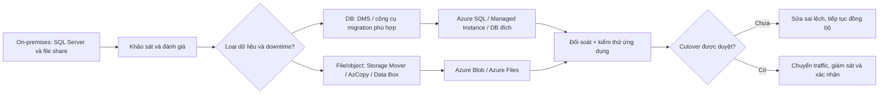

# Di chuyển dữ liệu và cơ sở dữ liệu bằng dịch vụ migration

> **Chương:** Hybrid cloud và di chuyển lên Azure  
> **Mô-đun:** `CLOUD_PROVIDERS_AZURE` — từ subscription, resource group, Microsoft Entra ID và mạng ảo đến các dịch vụ tính toán, lưu trữ, dữ liệu; triển khai, giám sát, bảo vệ và quản lý chi phí kiến trúc ứng dụng trên Microsoft Azure.

## Mục tiêu học tập

Sau bài học, người học có thể:

1. Phân loại **dữ liệu dạng file/object** và **cơ sở dữ liệu giao dịch**, xác định phụ thuộc, chủ sở hữu, mục tiêu RPO/RTO và thời gian ngừng dịch vụ cho phép.
2. Chọn dịch vụ phù hợp giữa **Azure Migrate**, **Azure Database Migration Service (DMS)**, các luồng migration tích hợp theo dịch vụ, **Azure Data Factory**, **Azure Storage Mover**, **AzCopy** và **Azure Data Box**.
3. Phân biệt di chuyển **offline**, **online/incremental**, bulk transfer, đồng bộ thay đổi và **cutover**; hiểu điều kiện để tránh mất hoặc ghi trùng dữ liệu.
4. Thiết kế đường mạng, danh tính, quyền truy cập, bảo vệ dữ liệu và chi phí trong quá trình chuyển từ on-premises/hybrid sang Azure.
5. Lập kế hoạch thí điểm, theo dõi tiến độ, đối soát tính toàn vẹn, thử nghiệm ứng dụng và rollback theo một runbook có thể kiểm chứng.
6. Áp dụng một ví dụ di chuyển file và cơ sở dữ liệu, biết điều gì cần kiểm tra trước khi chuyển traffic sang Azure.

## 1. Bài toán thực tế: chuyển dữ liệu cùng với ứng dụng

Một công ty vận hành hệ thống `orders` tại trung tâm dữ liệu riêng. Ứng dụng Java gọi SQL Server chứa đơn hàng, một file share SMB chứa hóa đơn PDF và dịch vụ báo cáo đọc file xuất CSV hằng đêm. Công ty muốn chuyển hệ thống lên Azure, sử dụng Azure SQL Managed Instance hoặc đích dữ liệu thích hợp, và Azure Storage cho tài liệu.

Di chuyển compute hoặc triển khai lại ứng dụng chưa giải quyết xong bài toán. Nếu database chuyển trước nhưng ứng dụng vẫn ghi vào nguồn cũ, dữ liệu sẽ phân kỳ. Nếu copy file nhưng thiếu ACL hoặc metadata, người dùng không truy cập được. Nếu đổi chuỗi kết nối khi đồng bộ chưa hoàn tất, có thể mất các giao dịch cuối. Ngay cả khi các tác vụ migration báo `Succeeded`, ứng dụng vẫn có thể lỗi vì khác phiên bản SQL, collation, timezone, chứng chỉ, mạng hoặc quyền truy cập.

**Migration là một quá trình có kiểm soát gồm khám phá, đánh giá, chuyển dữ liệu, đồng bộ, đối soát, cutover và hậu kiểm.** Dịch vụ migration giúp tự động hóa từng phần; quyết định dữ liệu nào là nguồn sự thật, khi nào dừng ghi và khi nào được phép chuyển dịch vụ vẫn thuộc trách nhiệm nhóm vận hành.



## 2. Phân loại dữ liệu trước khi chọn dịch vụ

### 2.1. Kiểm kê dữ liệu và phụ thuộc

Trước khi tạo bất kỳ migration job nào, cần lập danh sách:

| Thuộc tính | Câu hỏi cần trả lời | Ví dụ |
|---|---|---|
| **Nguồn dữ liệu** | SQL Server, PostgreSQL, MySQL, Oracle, NFS/SMB, object storage hay filesystem? | SQL Server 2019 trên VM nội bộ |
| **Đích mong muốn** | Azure SQL Database, Managed Instance, PostgreSQL Flexible Server, Azure Files, Blob hay dịch vụ khác? | Azure SQL Managed Instance |
| **Quy mô** | Dung lượng hiện tại, tốc độ tăng, số object/file, tốc độ thay đổi dữ liệu? | 600 GB SQL + 200 GB PDF |
| **Ứng dụng phụ thuộc** | Ai đọc/ghi, batch jobs, linked server, trigger, ETL, báo cáo, API? | App Java + báo cáo cuối ngày |
| **Yêu cầu downtime** | Có thể dừng ghi bao lâu? Có cần đọc liên tục không? | Tối đa 30 phút |
| **RPO/RTO** | Cho phép mất bao nhiêu dữ liệu và gián đoạn bao lâu? | RPO gần 0 trong lần cutover |
| **Độ nhạy dữ liệu** | PII, thông tin tài chính, mã hóa, khóa và lưu trú dữ liệu? | Hóa đơn có dữ liệu khách hàng |
| **Quyền và metadata** | ACL, chủ sở hữu, timestamp, collation, timezone, kiểu dữ liệu, index? | ACL SMB cần bảo toàn nếu có thể |
| **Phục hồi và rollback** | Có backup/restore đã kiểm tra? Trở về nguồn cũ thế nào? | Full backup + log backup, runbook |
| **Nguồn lực vận hành** | Ai approve, ai quan sát và ai có quyền đóng băng ghi? | DBA + SRE + app owner |

**Không chọn công cụ chỉ theo tên dịch vụ.** Dịch vụ đúng cho 100 TB file share có thể khác hẳn dịch vụ di chuyển 500 GB cơ sở dữ liệu giao dịch cần giữ transaction log.

### 2.2. Phân biệt chuyển dữ liệu và chuyển ngữ nghĩa

- Với **file/object**, cần xác minh bytes, đường dẫn, tên, metadata, ACL, file locking và ứng dụng truy cập kiểu SMB/NFS hay HTTP object API. Blob Storage **không** là hệ thống file SMB tương đương Azure Files.
- Với **database**, cần giữ schema, kiểu dữ liệu, primary/foreign keys, indexes, constraints, stored procedures, users/roles, jobs, timezone và tương thích ứng dụng. Copy table rows chưa phải di chuyển một hệ quản trị CSDL.
- Với **hệ thống nhiều nguồn**, có thể cần giữ một thứ tự giao dịch hoặc snapshot thống nhất giữa database, file và message queue. Hai công cụ chạy `Succeeded` độc lập chưa chứng minh dữ liệu tại cùng một mốc thời gian.

Một trường `CreatedAt` lưu theo giờ địa phương khác UTC có thể gây sai thứ tự báo cáo. Một database nguồn dùng SQL Server Agent job hoặc linked server có thể cần thiết kế lại nếu đích là Azure SQL Database. Vì vậy, ngoài copy dữ liệu, luôn có giai đoạn **đánh giá tương thích và thay đổi ứng dụng**.

## 3. Bản đồ các dịch vụ migration trên Azure

| Công cụ / dịch vụ | Vai trò chính | Khi phù hợp | Giới hạn / điều cần kiểm tra |
|---|---|---|---|
| **Azure Migrate** | Khám phá, đánh giá và lập kế hoạch di chuyển hạ tầng/workload, với khả năng migration cho các kịch bản được hỗ trợ | Lập inventory máy chủ, phụ thuộc, sizing và kế hoạch | Không phải công cụ copy thay thế cho mọi CSDL, file và object |
| **Azure Database Migration Service (DMS)** và luồng migration tích hợp | Điều phối di chuyển database theo cặp nguồn/đích được hỗ trợ, online/offline khi khả dụng | SQL Server hoặc DBMS khác lên Azure database đích phù hợp | Phải kiểm tra compatibility matrix, phương thức và hạn chế của đúng kịch bản |
| **Azure Data Factory (ADF)** | Pipeline ETL/ELT, Copy activity, mapping và điều phối theo lịch | Di chuyển/bổ sung dữ liệu giữa nguồn/đích được connector hỗ trợ | Copy activity riêng lẻ không bảo đảm một DB giao dịch nhất quán hoặc tự tạo CDC trong mọi trường hợp |
| **Azure Storage Mover** | Điều phối di chuyển dữ liệu file từ nguồn được hỗ trợ đến Azure Storage | File share NFS/SMB quy mô lớn lên Blob/Azure Files trong mô hình được hỗ trợ | Kiểm tra protocol, ACL/metadata, mapping đường dẫn, agent và khả năng đích |
| **AzCopy** | Công cụ copy hiệu năng cao dành cho dịch vụ Azure Storage được hỗ trợ | Chuyển file/object lên Blob/ADLS, copy giữa các nơi hỗ trợ, chạy lại theo job | Không chuyển đổi schema database; phải kiểm tra quyền, metadata và trạng thái job |
| **Azure Data Box** | Thiết bị chuyển dữ liệu vật lý cho dung lượng lớn khi mạng không đáp ứng | Initial seeding dữ liệu nhiều TB, WAN hạn chế | Logistics, mã hóa, quy trình vận chuyển; thay đổi phát sinh sau khi copy cần đồng bộ tiếp |
| **Azure Storage Explorer** | Công cụ giao diện quản lý/copy dữ liệu lưu trữ | Thử nghiệm nhỏ, xác minh container và object | Không phải cơ chế quản lý cutover DB hoặc điều phối quy mô doanh nghiệp |
| **Công cụ/schema migration theo hệ DB** | Assessment, chuyển schema, sửa điểm không tương thích, native backup/restore/replication | Nguồn/đích khác engine hoặc có tính năng DB đặc thù | Một công cụ chuyển schema có thể không chuyển hết dữ liệu, users hay jobs |

**DMS hay công cụ migration tích hợp nào được dùng phụ thuộc vào phiên bản sản phẩm, nguồn, đích, region, networking và hình thức online/offline được hỗ trợ tại thời điểm thực hiện.** Trong Azure Portal, hãy dùng phần migration của dịch vụ đích và tài liệu chính thức để kiểm tra yêu cầu hiện hành. Không suy rằng mọi cặp nguồn/đích đều có online migration chỉ vì có tên DMS.

### Chọn theo nhu cầu

- **SQL Server → Azure SQL Managed Instance:** đánh giá tính năng instance-level, schema và phụ thuộc; cân nhắc đường migration cho SQL MI được Azure hỗ trợ, có theo dõi đồng bộ và cutover.
- **SQL Server → Azure SQL Database:** kiểm tra những tính năng SQL Server truyền thống không có trong mô hình database-as-a-service; có thể cần sửa schema, SQL jobs, linked servers hoặc authentication.
- **PostgreSQL/MySQL → Azure Database for PostgreSQL/MySQL:** kiểm tra dịch vụ migration phù hợp engine/phiên bản, extensions, encoding, network và hỗ trợ online nếu cần.
- **File share SMB → Azure Files:** cần xem hỗ trợ SMB/ACL, identity và quyền share; sử dụng phương án Storage Mover/công cụ đồng bộ phù hợp thay vì giả định Blob thay thế SMB.
- **Folder chứa ảnh/PDF → Azure Blob/ADLS Gen2:** xem AzCopy, Storage Mover hoặc ADF; dùng Data Box cho initial transfer rất lớn khi mạng hạn chế.
- **Dữ liệu từ nhiều nguồn có chuyển đổi:** ADF Copy activity, mapping/transform hoặc công cụ xử lý dữ liệu phù hợp, sau đó đối soát theo từng batch.

## 4. Offline, online và kỹ thuật đồng bộ thay đổi

### 4.1. Offline migration

Một phương án offline thông thường:

1. Chọn thời điểm bảo trì và thông báo người dùng.
2. Dừng hoặc khóa đường ghi tại nguồn, chốt bản sao nhất quán.
3. Xuất backup/dump hoặc bản copy dữ liệu.
4. Chuyển và nạp vào đích, dựng schema/quyền và kiểm tra.
5. Chuyển cấu hình ứng dụng sang đích rồi mở lại ghi.

**Ưu điểm:** đơn giản hơn về trạng thái đồng bộ và tính nhất quán. **Nhược điểm:** thời gian downtime thường phụ thuộc quy mô dữ liệu, thời gian restore, kiểm thử và chuyển ứng dụng.

### 4.2. Online / near-online migration

Một phương án online khi công cụ và cặp nguồn/đích hỗ trợ:

1. Copy **dữ liệu gốc ban đầu** trong lúc nguồn tiếp tục phục vụ.
2. Dùng cơ chế phù hợp như **change data capture (CDC), transaction log, replication hoặc incremental sync** để chuyển các thay đổi mới.
3. Theo dõi **replication lag / change backlog** và các lỗi đồng bộ.
4. Tới cutover, **dừng ghi vào nguồn**, đợi delta còn lại đến đích và đối soát nhất quán.
5. Chuyển ứng dụng sang đích, kiểm tra nghiệp vụ rồi mới mở ghi.

Online migration giúp giảm downtime nhưng **không mặc nhiên đồng nghĩa zero downtime hoặc zero data loss**. Khả năng nhất quán và cutover phụ thuộc cơ chế migration, ứng dụng, mạng, kích thước backlog và quy trình đóng băng ghi.

**Không dùng hai cơ sở dữ liệu cùng làm primary có ghi song song** nếu hệ thống chưa thiết kế giải quyết xung đột. Việc đổi connection string dần từng instance mà không có cơ chế điều phối có thể tạo **split-brain**: một phần giao dịch mới ở nguồn, phần khác ở đích.

### 4.3. Bulk copy và delta copy khác nhau

Với file có thể thay đổi trong lúc sao chép:

- **Bulk copy** di chuyển dữ liệu ban đầu.
- **Delta copy** đồng bộ file mới/sửa/xóa theo khả năng công cụ và chính sách.
- **Final scan/freeze** giúp xác định nguồn không còn cập nhật trước khi tuyên bố đích hoàn tất.

Một công cụ có thể chép file mới và file đã sửa nhưng không tự xóa file đã xóa ở nguồn; một số lựa chọn sync có thể xóa ở đích. **Chế độ delete propagation phải được review riêng**, đặc biệt với thư mục chứa hồ sơ pháp lý.

## 5. Ước tính thời gian, băng thông và downtime

Một ước lượng tối thiểu cho tải dữ liệu qua đường mạng:

\[
T_{\text{lý tưởng}} =
\frac{\text{Dung lượng dữ liệu (bit)}}{\text{Thông lượng (bit/giây)}}
\]

Giả sử cần chuyển **1 TB theo hệ thập phân** (1.000 GB) qua đường truyền thực sự đạt **100 Mbps** liên tục:

\[
T = \frac{1.000 \times 10^9 \times 8}{100 \times 10^6}
\approx 80.000\;\text{giây} \approx 22{,}2\;\text{giờ}
\]

Đây chỉ là **thời gian lý tưởng của tải payload**. Thực tế còn overhead giao thức, số lượng file, retry, throttling, mã hóa, tốc độ đĩa, tốc độ import, quota dịch vụ và việc chia sẻ băng thông với nghiệp vụ.

| Thành phần | Cách ước lượng |
|---|---|
| Initial copy | Dung lượng / throughput thực đo bằng thử nghiệm nhỏ |
| Delta backlog | Tốc độ thay đổi tại nguồn trừ tốc độ xử lý đồng bộ |
| Schema/restore | Thời gian tạo indexes, import logs, xây dựng permissions và validation |
| Downtime cutover | Freeze writes + sync delta cuối + xác minh + đổi kết nối + smoke test |
| Rollback window | Khoảng cho phép quay lại trước khi đích phát sinh ghi mới không thể đồng bộ ngược |

Để thiết kế cutover, cần đo trong một **pilot** đại diện. Nếu dữ liệu tăng 50 GB/giờ nhưng công cụ đồng bộ chỉ xử lý 30 GB/giờ, backlog sẽ liên tục tăng và không thể đạt cutover bằng việc “chờ thêm một lúc”.

## 6. Di chuyển file/object bằng Azure Storage

### 6.1. Chọn Azure Files hay Blob

| Yêu cầu của ứng dụng | Đích nên đánh giá | Vấn đề phải kiểm tra |
|---|---|---|
| Truy cập qua SMB, path và file lock | **Azure Files** | Authentication, share ACL/permissions, SMB networking, latency |
| Ảnh, PDF, log truy cập bằng object API/HTTP | **Azure Blob Storage** | Container, object naming, metadata, lifecycle tier, SAS/RBAC |
| Dữ liệu analytics với namespace phân cấp | **ADLS Gen2** (tính năng Storage) | ACL, hierarchical namespace, connector và truy cập |
| Dung lượng lớn tại on-prem, mạng chậm | **Data Box** + đồng bộ cuối qua mạng | Tracking vận chuyển, import, delta sau thời điểm tạo bản offline |

**Đổi từ một file share SMB sang Blob có thể đòi sửa ứng dụng.** Copy file thành công không đồng nghĩa mọi thao tác như open/rename/locking/ACL có cùng ngữ nghĩa.

### 6.2. AzCopy: ví dụ copy file lên Blob

Giả sử có một Azure VM trung gian đã được cấp **managed identity**, có quyền `Storage Blob Data Contributor` ở đúng container hoặc phạm vi phù hợp, có đường truy cập mạng hợp lệ tới Storage. Container `import` trên storage account `storderslab` đã tồn tại. Thực hiện trên môi trường lab được phép:

```bash
# Chạy trên Azure VM đã có managed identity được cấp quyền vào Blob.
azcopy login --identity

# Thư mục /data/export/ chứa dữ liệu mẫu không nhạy cảm.
azcopy copy '/data/export/' \
  'https://storderslab.blob.core.windows.net/import' \
  --recursive=true

# Sau khi lệnh trả kết quả, kiểm tra lịch sử và job ID tương ứng.
azcopy jobs list
```

Các lệnh trên chỉ là mẫu: Azure VM, storage account, container, DNS, quyền RBAC và dữ liệu phải tồn tại. Kiểm tra bản AzCopy đang dùng, đường dẫn và cấu trúc prefix sau copy; không dùng lệnh này để chép dữ liệu thật khi chưa phê duyệt.

**Điều kiện thành công:** job không có file thất bại, số file/object và tổng bytes phù hợp nguồn, các file mẫu có SHA-256 trùng nhau, metadata cần thiết được bảo toàn theo khả năng công cụ và ứng dụng đọc được sau di chuyển.

Không đưa một SAS token dài hạn vào source control hoặc logs. Trên máy on-prem không có managed identity, chọn mô hình xác thực được tổ chức hỗ trợ và bảo vệ credential tương ứng.

### 6.3. Azure Storage Mover

Đối với file share lớn, Storage Mover giúp quản lý job và agent để di chuyển từ nguồn file được hỗ trợ sang Azure Storage. Một quy trình điển hình:

1. Xác minh loại nguồn (SMB/NFS), kiểu đích (Azure Files/Blob) và các cặp được dịch vụ hỗ trợ.
2. Tạo Storage Mover resource, triển khai **agent** trong môi trường có mạng tới nguồn và Azure.
3. Khai báo source/target endpoints, credentials và đường dẫn đúng, quản lý quyền tại từng hệ thống.
4. Tạo **migration project/job definition** theo giao diện và phiên bản dịch vụ.
5. Thử một dataset nhỏ: tên file, dấu tiếng Việt, timestamp, ACL, symbolic link/metadata nếu có và khả năng truy cập.
6. Chạy bulk, theo dõi kết quả/error, thực hiện các lần đồng bộ bổ sung theo mô hình dịch vụ hỗ trợ.
7. Đối soát cuối và chỉ chuyển ứng dụng đọc/ghi sang đích sau khi đủ bằng chứng.

**Không suy rằng mọi thuộc tính SMB/NFS đều được giữ nguyên.** Kiểm tra bảng khả năng bảo toàn ACL/metadata và đối chiếu quyền của người dùng thực tế trên đích.

### 6.4. Azure Data Box

Khi dữ liệu lên tới nhiều TB và WAN hạn chế, cân nhắc thiết bị Data Box theo cấu hình và quy trình dịch vụ đang hỗ trợ. Quá trình gồm đặt thiết bị, chuyển và mã hóa dữ liệu, vận chuyển, Azure ingest vào tài khoản Storage, xác minh, rồi thực hiện **delta sync** cho dữ liệu thay đổi sau khi tạo bản sao offline.

Data Box giải quyết **bài toán initial transfer**; nó không tự giải quyết database transaction consistency, đổi ứng dụng sang đích hoặc rollback.

## 7. Di chuyển cơ sở dữ liệu bằng DMS và công cụ phù hợp

### 7.1. Vì sao database cần quy trình riêng?

Cơ sở dữ liệu có cấu trúc và trạng thái giao dịch. Bên cạnh bản ghi, cần xác minh schema, indexes, constraints, stored procedures, sequences/identity, quyền người dùng, collation, timezone, extensions, replication settings và ứng dụng tương thích.

Một migration job chuyển xong table data nhưng bỏ SQL Agent jobs, login mappings hoặc một stored procedure có thể khiến ứng dụng lỗi ngay khi đổi connection string. Với database khác engine, **schema conversion** là công việc riêng bên cạnh data copy.

### 7.2. Workflow SQL Server sang Azure SQL Managed Instance

Ví dụ một tổ chức đang chạy SQL Server on-prem và muốn chuyển sang Azure SQL Managed Instance (MI) để giảm mức sửa đổi so với chuyển sang một nền tảng khác.

1. **Assessment:** thu thập SQL version, database size, workload, blocking, dependencies, linked servers, SQL Agent jobs, CLR, collation, authentication và yêu cầu HA/DR. Đánh giá tính năng nào được MI hỗ trợ.
2. **Chuẩn bị đích:** subscription, vNet/subnet theo yêu cầu của MI, endpoint/DNS, capacity, storage, security, backup và khả năng kết nối từ on-prem qua VPN/ExpressRoute theo kiến trúc.
3. **Chọn đường migration:** chọn luồng Azure SQL migration/DMS hoặc phương án native backup/restore phù hợp cặp nguồn–đích; xác minh online/offline support.
4. **Khởi tạo:** chạy backup hoặc initial copy; theo dõi DB objects, restore và dữ liệu.
5. **Đồng bộ thay đổi nếu được hỗ trợ:** quan sát log/CDC/replication progress và lag; kiểm tra sự cố nguồn/đích.
6. **Cutover có kiểm soát:** dừng nguồn ghi, hoàn thành các thay đổi cuối, xác nhận đích sẵn sàng, đổi chuỗi kết nối/đường đi ứng dụng.
7. **Validation và hậu kiểm:** ứng dụng kết nối bằng Entra ID/SQL authentication theo kiến trúc, kiểm thử ghi/đọc, query latency, jobs, backup, alerts và đóng migration sau thời hạn quan sát.

Các bước chi tiết, đặc biệt quyền backup/restore, cấu hình MI network và hỗ trợ online **phụ thuộc vào cặp nguồn–đích và phiên bản công cụ**; cần xem wizard và compatibility matrix tại thời điểm triển khai.

### 7.3. Azure SQL Database khác Azure SQL Managed Instance

Azure SQL Database thường có mô hình quản trị khác SQL Server full instance. Một số tác vụ ở instance-level, SQL Server Agent hoặc kiểu truy cập cross-database có thể cần thiết kế lại hoặc giải pháp thay thế. **Không quyết định đích chỉ theo giá hoặc tên “Azure SQL”.** Đánh giá mức thay đổi application, features, licensing, SLA và khả năng quản trị.

### 7.4. PostgreSQL/MySQL

Với PostgreSQL/MySQL, cần kiểm tra:

- Phiên bản engine, extensions/plugins, collation/character set và kiểu dữ liệu.
- Cơ chế replication/CDC hoặc migration service có hỗ trợ online cho cặp nguồn–đích không.
- DDL changes khi đang sync, sequence/current values, triggers, views, roles và quyền.
- Timezone, encoding UTF-8, prepared statements, transaction isolation và connection behavior.
- Bảo vệ dữ liệu, workload benchmark và rollback khi online cutover không đạt.

Với một số kịch bản, nền tảng database đích trên Azure có tính năng **migration tích hợp** trong giao diện riêng thay cho một DMS resource do bạn tự tạo. Chọn hướng dẫn đúng dịch vụ và phiên bản, tránh áp dụng quy trình SQL Server máy móc cho PostgreSQL/MySQL.

## 8. Azure Data Factory cho copy có điều phối và incremental load

**Azure Data Factory** cung cấp các khái niệm thường gặp:

| Thành phần | Vai trò trong migration |
|---|---|
| **Linked service** | Khai báo kết nối và phương thức xác thực nguồn/đích |
| **Dataset** | Thông tin cấu trúc/tập dữ liệu được copy |
| **Copy activity** | Đọc dữ liệu nguồn và ghi vào đích qua connector hỗ trợ |
| **Pipeline** | Điều phối copy, validation, retry, dependencies |
| **Integration runtime (IR)** | Hạ tầng thực thi/di chuyển dữ liệu; **self-hosted IR** thường dùng khi truy cập nguồn trong mạng riêng |
| **Trigger** | Lịch hoặc cách kích hoạt pipeline phù hợp |
| **Monitoring** | Activity runs, row count, throughput, duration, retry/failures |

ADF phù hợp khi cần copy từ nhiều nguồn có định dạng/connector khác nhau, transform khi cần, load data warehouse hoặc tạo quy trình incremental. Nhưng **ADF Copy activity không tự bảo đảm ảnh chụp database nhất quán giữa nhiều bảng khi nguồn vẫn ghi**, trừ khi bạn thiết kế snapshot/transaction boundary hoặc cơ chế CDC tương ứng.

### Ví dụ watermark incremental (mô hình logic)

Giả sử bảng nguồn `dbo.Orders` có cột `UpdatedAtUtc` tăng theo thay đổi và khóa chính `OrderId`. Một pipeline chạy định kỳ:

1. Đọc watermark `W_old` được **lưu bền vững** từ lần thành công trước.
2. Chốt watermark `W_new` tại mốc an toàn (có thể cần trừ độ trễ để tránh transaction chưa commit).
3. Đọc dữ liệu trong khoảng `(W_old, W_new]` và đưa vào staging table ở đích.
4. Dùng thao tác **upsert idempotent** theo khóa chính, có quy tắc xử lý xóa/update.
5. Xác minh số hàng, bản ghi lỗi và thay đổi; chỉ cập nhật `W_old = W_new` sau khi toàn bộ batch thành công.

Pseudo-SQL cho nguồn:

```sql
SELECT OrderId, CustomerId, TotalAmount, UpdatedAtUtc
FROM dbo.Orders
WHERE UpdatedAtUtc > @OldWatermark
  AND UpdatedAtUtc <= @NewWatermark;
```

**Cảnh báo:** watermark dựa trên `UpdatedAtUtc` có thể bỏ sót hàng bị xóa, transaction commit muộn, bản ghi đổi nhưng timestamp không cập nhật hoặc cùng timestamp tại ranh giới. Với dữ liệu giao dịch nghiêm ngặt, nên dùng CDC/transaction log hoặc cơ chế tương đương được hỗ trợ; luôn có test cho update/delete/late-arrival và idempotency.

## 9. Quy trình kiểm chứng dữ liệu sau migration

Một job báo `Completed` chỉ nói quá trình công cụ đã kết thúc theo tiêu chí của nó. Tiêu chí chấp nhận nghiệp vụ phải được viết **trước** lần di chuyển.

### 9.1. Đối soát file/object

- So sánh **số file/object**, tổng bytes và các lỗi/skip của job.
- So sánh mẫu **SHA-256** hoặc checksum nội dung được chuẩn bị từ nguồn và đích; chú ý khác biệt metadata và mã hóa khi so.
- Kiểm tra tên file Unicode, đường dẫn sâu, ký tự đặc biệt, metadata, quyền truy cập và timestamp cần giữ.
- Thử mở/đọc file qua **đường truy cập thực của ứng dụng**: SMB share hoặc API Blob tùy đích.
- Chạy delta scan sau thời điểm freeze, xác minh không còn thay đổi chờ đồng bộ.

Ví dụ với một file mẫu trên Linux (thực hiện ở nơi có bản nguồn và bản đích đã tải về hợp lệ):

```bash
sha256sum /data/source/sample-invoice.pdf
sha256sum /data/verified-target/sample-invoice.pdf
```

Hash trùng nhau chứng minh **nội dung của file mẫu** giống nhau, chưa chứng minh toàn bộ object collection, metadata và permissions đều đúng.

### 9.2. Đối soát database

Đối với SQL Server, có thể chạy truy vấn kiểm tra trên **cùng snapshot/mốc consistency** ở nguồn và đích:

```sql
SELECT
    COUNT_BIG(*) AS RowCount,
    MIN(OrderId) AS MinOrderId,
    MAX(OrderId) AS MaxOrderId,
    MAX(UpdatedAtUtc) AS LatestChange
FROM dbo.Orders;
```

Kiểm tra thêm: số dòng theo phân vùng/ngày, foreign-key violations, null rates, aggregates nghiệp vụ (tổng đơn theo ngày), số bản ghi bị thay đổi/xóa, identity/sequence, permissions và một tập record mẫu. **Đếm hàng bằng nhau chưa chứng minh dữ liệu đúng**: có thể có bản ghi khác nội dung nhưng count không đổi.

Đối với database lớn, dùng chiến lược **partitioned reconciliation**, checksums/hash của dữ liệu được chuẩn hóa và snapshot consistency phù hợp. Không áp đặt `DBCC CHECKDB` hoặc công cụ đặc thù engine này cho mọi database/đích nếu không được hỗ trợ.

### 9.3. Kiểm tra ứng dụng

| Lớp | Kiểm tra | Tiêu chí đạt |
|---|---|---|
| Kết nối | App nhận DNS, firewall, cert, auth và connection string mới | Kết nối ổn định, không lộ credentials |
| Đọc | API đọc đơn hàng và file hóa đơn mẫu | Đúng nội dung/permission |
| Ghi | Tạo một đơn hàng **test** và đọc lại | Không ghi vào nguồn cũ, không trùng khóa |
| Giao dịch | Cập nhật, rollback, concurrency và các job nền | Kết quả như thiết kế |
| Hiệu năng | p95/p99, request rate, DB CPU/IO và query plans | Không vượt SLO |
| Quan sát | Azure Monitor/Application Insights, migration job logs | Có metrics và alert cho lỗi cutover |
| Phục hồi | Backup, restore point và DR của đích | Đạt RPO/RTO được cam kết |

**Cutover chỉ hoàn tất khi có bằng chứng ứng dụng và nghiệp vụ đạt**, chứ không phải lúc đổi connection string.

## 10. Runbook cutover và rollback

### 10.1. Chuẩn bị trước cửa sổ cutover

1. Chốt danh sách application writers, batch jobs, scheduler, ETL, background workers và webhook có thể làm nguồn thay đổi.
2. Đảm bảo backup/restore đã được kiểm thử, kế hoạch khôi phục quyền và đường mạng hoạt động.
3. Kiểm tra initial copy và lag, chuẩn bị bộ số liệu đối soát với dữ liệu/transaction marker.
4. Đặt đường chuyển ứng dụng qua cấu hình có version/secret storage, có điều kiện rollback.
5. Xác định người **go/no-go**, người thay đổi mạng/DNS, DBA, SRE, application owner và kênh trao đổi sự cố.
6. Chốt thời điểm dừng ghi, phạm vi outage, tiêu chí đạt, timeout, phương án rollback và thời điểm kết thúc rollback an toàn.

### 10.2. Ví dụ lịch cutover có điều kiện

| Thời điểm tương đối | Hành động | Bằng chứng / quyết định |
|---|---|---|
| T−60 phút | Kiểm tra migration job, backup, metrics, script/permission | Tất cả điều kiện ban đầu đạt |
| T−30 phút | Thông báo, dừng batch không cần thiết, giảm TTL DNS nếu phù hợp | Danh sách writers đã kiểm kê |
| T0 | **Đặt ứng dụng vào read-only hoặc dừng ghi nguồn** | Chứng minh không còn writer ngoài luồng |
| T+5 | Chạy delta cuối, đợi đồng bộ log/CDC đạt điểm cuối | Lag không còn, không lỗi job |
| T+10 | Đối soát count/hash/business checks, kiểm tra kết nối đích | DBA + app owner ký xác nhận |
| T+15 | Chuyển app config/traffic sang đích | Chỉ một authoritative writer |
| T+20 | Smoke test đọc/ghi, API, báo cáo, permissions | SLO và chức năng chính đạt |
| T+30 trở đi | Giám sát, xác nhận có thể kết thúc cutover | Go/no-go đóng thay đổi |

Đây là **timeline giả định**, không phải cam kết thời gian của Azure. Thời lượng thực phải dựa trên dữ liệu pilot, số lượng writers và mức trễ đồng bộ quan sát được.

### 10.3. Rollback phức tạp hơn đổi DNS ngược

Nếu phát hiện lỗi **trước khi cho phép ghi vào đích**, có thể quay lại nguồn theo runbook khi nguồn vẫn toàn vẹn và không có dữ liệu mới ở đích.

Khi người dùng đã ghi giao dịch mới trên Azure, đổi connection string ngược về nguồn cũ **có thể làm mất các giao dịch mới**. Cần một chiến lược được thiết kế trước:

- Tạm ngừng ghi trên đích để tránh thêm phân kỳ.
- Đánh giá dữ liệu phát sinh sau cutover, có thể cần reverse synchronization, replay nghiệp vụ hoặc khôi phục dựa trên log theo công cụ hỗ trợ.
- Chỉ mở lại ghi khi đã xác lập **một nguồn sự thật** và đối soát được các thay đổi.
- Nếu không có cách chuyển ngược an toàn, chọn forward fix với điều hành sự cố thay vì rollback tùy tiện.

**Không chạy đồng thời hai nguồn ghi** để “phòng hờ” trừ khi kiến trúc đã có cơ chế đồng bộ hai chiều và xử lý xung đột rõ ràng.

## 11. Mạng, danh tính và bảo mật

### Kết nối

- Với dữ liệu on-prem, kiểm tra VPN/ExpressRoute hoặc kết nối được cho phép, DNS, route và băng thông. Đường truyền private vẫn cần thiết kế phân quyền và giám sát.
- Với Azure SQL Managed Instance và một số DB đích, yêu cầu VNet/subnet, NSG và endpoint khác nhau. Kiểm tra khả năng kết nối từ self-hosted integration runtime/DMS tới đúng nguồn và đích.
- Với Azure Storage, dùng private endpoint/firewall/network rules theo chính sách. Storage Mover agent và AzCopy phải truy cập được đường cần thiết.
- Không mở toàn bộ IP public, tắt TLS hoặc cấp tài khoản admin rộng chỉ để vượt qua lỗi migration.

### Danh tính và dữ liệu nhạy cảm

- Dùng **Microsoft Entra ID, managed identity, service principal có phạm vi hẹp hoặc xác thực nguồn phù hợp**; secret cần nằm trong kho được bảo vệ như Azure Key Vault khi tích hợp hỗ trợ.
- Cấp Azure RBAC/data-plane permissions và DB permissions tối thiểu cho công việc migration; tách người chạy job, người duyệt cutover và người quản lý hệ đích.
- Mã hóa dữ liệu truyền/đĩa lưu, xác minh certificates và không ghi connection string/password vào pipeline logs hoặc tài liệu.
- Giới hạn dữ liệu thử, bảo vệ PII, xem yêu cầu khu vực lưu trú dữ liệu và retention, bao gồm bản copy tạm/bản dump/backup.
- Theo dõi Azure Activity Log, logs công cụ migration và thay đổi cấu hình database. Hãy xác định nơi lưu nhật ký và ai được xem.

### Chi phí migration

Chi phí có thể gồm Azure DB/Storage chạy song song, VM/self-hosted IR, networking/egress, service migration, snapshot/backup, log ingestion và thời gian nhóm vận hành. Khi song song nguồn và đích để kiểm chứng, **chi phí trùng lặp tạm thời** là một phần của kế hoạch; không tắt nguồn trước khi hết rollback window chỉ để tiết kiệm.

## 12. Theo dõi migration và xử lý lỗi

### Bộ chỉ số cần quan sát

| Nhóm | Chỉ số |
|---|---|
| Tiến độ | Bytes/rows hoàn thành, số file, phần trăm, duration, data scanned |
| Chất lượng | Failed/skipped objects, rejected rows, schema errors, checksum mismatch |
| Đồng bộ | Change backlog, log position, last applied change, replication lag |
| Hạ tầng | CPU, disk IOPS, DB connections, throttling, network throughput, retries |
| Ứng dụng | p95/p99, HTTP errors, timeout, DB query performance và nghiệp vụ mẫu |
| Bảo mật | Access failures, permission changes, secret rotation, audit events |
| Chi phí | Compute/Storage chạy song song, egress, migration và observability |

### Lỗi phổ biến

| Triệu chứng | Nguyên nhân thường gặp | Hướng xử lý |
|---|---|---|
| Không kết nối được nguồn/đích | DNS, firewall, NSG, route, VPN, TLS hoặc quyền | Kiểm tra từng hop và logs agent/IR; cấp quyền tối thiểu |
| DMS báo incompatibility | Engine/version, schema, tính năng SQL không hỗ trợ | Chạy assessment, sửa schema/đích hoặc chọn phương thức khác |
| Copy activity hoàn thành nhưng thiếu bản ghi | Không chụp nhất quán, watermark sai, delete/late-arrival không xử lý | Đối soát mốc và tăng độ tin cậy bằng CDC/idempotency |
| Di chuyển file chậm | Nhiều file nhỏ, băng thông thấp, disk chậm, throttling | Thử chia batch, tăng parallelism có đo lường, cân nhắc Data Box |
| File copy xong nhưng ứng dụng không mở được | Khác SMB/Blob semantics, ACL, path, encoding hoặc identity | Thử bằng user/app thật, mapping và cấp quyền phù hợp |
| Lag không giảm | Tốc độ nguồn thay đổi lớn hơn tốc độ apply vào đích | Tối ưu throughput, giảm áp lực nguồn, kéo dài sync window |
| Đích nhiều hàng trùng | Retry không idempotent, upsert key sai, đồng bộ lại không có checkpoint | Dùng primary key, transaction boundary và dedup có kiểm chứng |
| App lỗi sau cutover | Connection string, cert, DB users, query compatibility, background jobs | Kiểm tra từ mạng ứng dụng, smoke test và dependencies |
| Phân kỳ dữ liệu sau rollback | Ghi đã bắt đầu ở đích và quay lại nguồn không đồng bộ ngược | Dừng ghi, xác minh single writer, reconcile và chọn forward fix/replay |
| Chi phí vượt kế hoạch | Cùng chạy hai hạ tầng lâu, logs/egress cao, bản copy tạm chưa xóa | Kiểm kê các nguồn phí và cleanup sau hết rollback window |

**Retry không luôn an toàn.** Có những job copy data idempotent, nhưng một transaction hoặc API tạo dữ liệu nếu chạy lại có thể sinh bản ghi trùng. Thiết kế watermark, retry, checkpoint, idempotent write và quy trình khởi chạy lại trước khi gặp sự cố.

## 13. Bài thực hành có hướng dẫn

**Bối cảnh lab:** Nhóm vận hành có thư mục `/data/export` chứa hóa đơn PDF mẫu và một SQL Server database `OrdersLab` tại môi trường thử nghiệm. Hệ đích gồm Azure Blob Storage và Azure SQL Managed Instance **hoặc Azure SQL Database phù hợp với đánh giá**. Ràng buộc: không copy PII thật; nguồn tiếp tục có thể thay đổi trong giai đoạn bulk; downtime giả định tối đa 30 phút.

### Bước 1 — Lập inventory

Điền dữ liệu mẫu: kích thước, file count, table count, số transaction/giờ, schema/dependencies, source/destination, RPO/RTO và owner. Ghi lý do chọn Blob thay vì Azure Files đối với hóa đơn nếu ứng dụng đọc bằng object API.

### Bước 2 — Chọn công cụ theo luồng

- Với `/data/export`, chọn **AzCopy** (hoặc Storage Mover nếu nguồn file share/agent và quy mô phù hợp). Bắt đầu bằng một thư mục nhỏ.
- Với `OrdersLab`, thực hiện assessment rồi chọn **luồng migration/DMS được Azure hỗ trợ cho cặp SQL Server–Azure SQL đích cụ thể**; mô tả điều kiện online/offline.
- Nếu cần chuyển đổi và nhập dữ liệu báo cáo CSV theo lịch, có thể thêm **ADF Copy activity** với self-hosted IR, nhưng không coi đây là thay thế cho đồng bộ transaction DB.

### Bước 3 — Đặt tiêu chí chấp nhận trước khi chạy

| Mục | Tiêu chí ví dụ |
|---|---|
| File | Tổng số file, bytes và 20 SHA-256 mẫu khớp; không còn file lỗi |
| Database | Count theo bảng/ngày, key ranges và aggregates nghiệp vụ khớp ở cùng mốc |
| Delta | Không còn backlog trước khi mở ghi đích |
| Ứng dụng | 5 luồng đọc/ghi chính thành công trên dữ liệu thử |
| Hiệu năng | p95 và tỷ lệ lỗi không vượt SLO đã thống nhất |
| Bảo mật | Azure RBAC, DB roles và private network hoạt động |
| Rollback | Có quyết định rõ nếu fail trước/sau khi đích nhận ghi |

### Bước 4 — Diễn tập

1. Copy 10 file mẫu bằng AzCopy, ghi job ID, hash và prefix kết quả.
2. Chạy assessment DB, liệt kê điểm không tương thích. Chọn một bảng nhỏ để minh họa đối soát count/key ranges.
3. Mô phỏng bulk + delta; cố ý sửa một file và thêm một row ở nguồn rồi xem cách pipeline nhận thay đổi.
4. Thực hiện cutover giả lập: khóa ghi nguồn, đồng bộ đợt cuối, đối soát, đổi connection string ở môi trường lab.
5. Thử đọc hóa đơn, tạo đơn hàng thử và truy vấn lại; kiểm tra Azure Monitor/DB metrics.
6. Ghi giờ bắt đầu/giờ dịch vụ hoạt động, vấn đề và quyết định go/no-go.
7. Dọn tài nguyên lab theo quyền sở hữu sau khi lưu bằng chứng; không xóa backup dùng để phục hồi.

### Mẫu báo cáo

| Trường | Giá trị cần ghi |
|---|---|
| Source → target | Database/file path, resource IDs và region |
| Dịch vụ migration | Công cụ và phiên bản, mode online/offline |
| Quy mô | GB, tables, file count, tốc độ thay đổi |
| Thông lượng / thời gian | Initial copy, lag, cutover, downtime thực đo |
| Đối soát | Rows, sums, hashes, mismatch và kết quả xử lý |
| App validation | Đọc/ghi, error rate, latency, permissions |
| Bảo mật | Identity, network, secret handling |
| Quyết định | Go/no-go, approver và trạng thái rollback |
| Sau cutover | Backup, alerts, owner, lịch decommission nguồn |

**Tiêu chí đạt:** chọn được dịch vụ đúng cho từng nguồn dữ liệu; giải thích được online/offline, thiết kế single-writer cutover; có kế hoạch đối soát dữ liệu bằng bằng chứng và phương án rollback tránh split-brain. Không có tài nguyên Azure thật thì có thể mô phỏng bảng kết quả và lệnh trên giấy; không được tự phát truy cập vào môi trường ngoài quyền quản lý.

### Câu hỏi tự kiểm tra

1. Azure Migrate, DMS, ADF và AzCopy giải quyết những phần nào khác nhau của quá trình migration?
2. Vì sao copy SQL table rows chưa đủ để chuyển cả cơ sở dữ liệu cùng ứng dụng?
3. Bulk copy và đồng bộ thay đổi có vai trò gì khi downtime chỉ 30 phút?
4. Vì sao không thể dùng `COUNT(*)` bằng nhau làm bằng chứng duy nhất về tính toàn vẹn?
5. Điều gì có thể xảy ra nếu ứng dụng ghi đồng thời vào SQL Server nguồn và Azure SQL đích?
6. Khi nào Data Box có lợi hơn truyền toàn bộ dữ liệu qua WAN, và phần việc nào vẫn phải làm sau đó?
7. Vì sao Azure Files và Blob Storage không thể thay thế trực tiếp cho mọi workload SMB?
8. Nếu rollback sau khi Azure đích đã có giao dịch mới, cần xử lý điều gì trước khi đổi kết nối về nguồn?
9. Những thông tin nào cần giám sát trong quá trình online migration ngoài trạng thái job `Succeeded`?
10. Dịch vụ migration có thể tự quyết định mọi thay đổi schema, kết nối ứng dụng, DNS, quyền và yêu cầu compliance không?

## 14. Ghi nhớ

Di chuyển lên Azure cần lựa chọn công cụ theo **kiểu dữ liệu và yêu cầu nghiệp vụ**. Azure Migrate hỗ trợ khám phá/đánh giá, Database Migration Service và các luồng migration tương ứng hỗ trợ di chuyển cơ sở dữ liệu, Azure Data Factory điều phối copy/transform, Azure Storage Mover và AzCopy xử lý file/object, còn Data Box giải quyết khối lượng dữ liệu lớn khi truyền qua mạng không phù hợp.

Quy trình đáng tin cậy gồm **inventory → assessment → pilot → bulk transfer → delta sync → freeze nguồn → cutover → đối soát và kiểm thử → giám sát và decommission có kiểm soát**. Người vận hành cần xác lập một nguồn ghi duy nhất, kiểm chứng dữ liệu bằng số liệu chứ không dựa vào trạng thái job, bảo vệ quyền và bí mật, đo downtime thực tế và chuẩn bị rollback trước khi cho ứng dụng sử dụng đích Azure.
