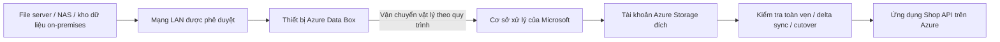
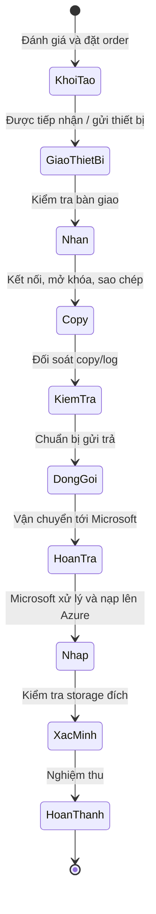
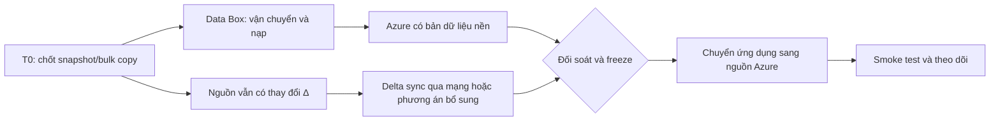

# Chuyển dữ liệu dung lượng lớn bằng Azure Data Box

## 1. Bài toán và mục tiêu học tập

Khi một doanh nghiệp chuyển hệ thống từ trung tâm dữ liệu on-premises lên Microsoft Azure, đường truyền Internet hoặc kết nối riêng có thể không đủ để đưa hàng chục đến hàng trăm terabyte dữ liệu lên cloud đúng thời hạn. Việc truyền liên tục qua mạng trong nhiều tuần còn chịu ảnh hưởng bởi băng thông dùng chung, độ trễ, lỗi đường truyền, chi phí truyền tải và yêu cầu tuân thủ. **Azure Data Box** giải quyết một nhóm tình huống đó bằng cách chuyển dữ liệu **ngoại tuyến (offline)** qua thiết bị vật lý được vận chuyển có kiểm soát, thay vì truyền toàn bộ dữ liệu gốc qua WAN.

Trong chương **Hybrid cloud và di chuyển lên Azure** thuộc mô-đun `CLOUD_PROVIDERS_AZURE`, bài học hướng dẫn lựa chọn, chuẩn bị và vận hành một đợt **import dữ liệu dung lượng lớn** với Azure Data Box. Kiến thức liên kết với subscription, resource group, Microsoft Entra ID, mạng, Azure Storage, quản lý quyền, bảo vệ dữ liệu, giám sát và chi phí của một kiến trúc ứng dụng trên Azure.

Sau bài học, bạn có thể:

- Phân biệt Azure Data Box với **AzCopy**, **Azure Storage Mover**, **Azure Migrate** và các phương án truyền qua mạng.
- Ước tính thời gian truyền theo khối lượng, băng thông thực tế và overhead; xác định khi nào vận chuyển thiết bị hợp lý hơn.
- Lập danh mục nguồn, chọn đích Azure Storage phù hợp và xây dựng manifest để đối soát dữ liệu.
- Mô tả vòng đời **đặt hàng → nhận thiết bị → cấu hình/copy → chuẩn bị gửi trả → Microsoft nạp dữ liệu → xác minh**.
- Tổ chức quyền Azure RBAC, bảo vệ thông tin mở khóa, kiểm soát vận chuyển và xử lý dữ liệu nhạy cảm.
- Kiểm chứng số lượng, dung lượng, cấu trúc thư mục/namespace, tính toàn vẹn và trạng thái ứng dụng sau import.
- Xây dựng kế hoạch **delta sync và cutover** nhằm tránh mất dữ liệu phát sinh trong thời gian vận chuyển.

**Tình huống xuyên suốt:** công ty có kho 60 TB ảnh sản phẩm, tài liệu và log lưu ở trung tâm dữ liệu. Ứng dụng đích `Shop API` dự kiến chạy trên Azure, đọc ảnh từ Azure Blob Storage và một số file chia sẻ từ Azure Files. Đội dự án có giới hạn 200 Mbps cho truyền dữ liệu lên cloud, trong khi cần hoàn tất bản dữ liệu nền trong thời gian ngắn hơn khả năng upload qua WAN. Nhóm phải chọn phương án, lập kế hoạch an toàn và kiểm chứng sau khi nhận dữ liệu.

> **Lưu ý về dịch vụ:** tên SKU, dung lượng hữu dụng, quốc gia giao thiết bị, dịch vụ đích được hỗ trợ, tính năng import/export, vùng Azure và giá có thể thay đổi. Trước khi đặt hàng thật, phải kiểm tra danh mục Azure Data Box và giới hạn áp dụng tại thời điểm triển khai; không chọn chỉ dựa trên con số dung lượng trong tài liệu cũ.

## 2. Azure Data Box là gì, và không phải là gì?

**Azure Data Box** là dịch vụ di chuyển dữ liệu dùng thiết bị vật lý để đưa một khối dữ liệu lớn tới/đi khỏi môi trường Azure theo workflow được hỗ trợ. Trong kịch bản **import**, Microsoft chuyển thiết bị tới địa điểm của bạn; dữ liệu được sao chép vào thiết bị qua kết nối cục bộ; sau đó thiết bị được gửi trả để dữ liệu được đưa vào tài khoản Azure Storage đã chỉ định. Quy trình có bước theo dõi trạng thái, bảo vệ thiết bị và nạp dữ liệu ở phía Microsoft.



Đây là **di chuyển dữ liệu ngoại tuyến**, không phải đường kết nối mạng liên tục giữa on-premises và Azure. Data Box **không tự**:

- Di chuyển cấu hình VM, identity, firewall, DNS, database engine hay toàn bộ ứng dụng.
- Cung cấp replication thời gian thực hoặc đồng bộ mọi thay đổi xảy ra sau khi đã sao chép bản đầu.
- Thay thế backup, disaster recovery hay cơ chế bảo vệ dữ liệu ở nguồn và ở Azure.
- Bảo đảm file metadata/ACL/ứng dụng được chuyển đổi nguyên vẹn trong mọi loại nguồn–đích.
- Bảo đảm mục tiêu RPO/RTO của một hệ thống đang phục vụ người dùng nếu không có kế hoạch freeze, delta sync và cutover.

### 2.1. Các lựa chọn sản phẩm và phương án thay thế

| Giải pháp | Cách vận chuyển | Tình huống hợp lý | Khác biệt quan trọng |
|---|---|---|---|
| **Azure Data Box** và các biến thể thiết bị/disk còn được cung cấp | Ngoại tuyến qua phần cứng vật lý | Dữ liệu rất lớn, WAN thiếu băng thông, cần chuyển bản dữ liệu nền | Có logistics, thời gian giao/nhận, bảo vệ chuỗi bàn giao và thao tác nạp sau khi trả |
| **AzCopy** | Online qua mạng | Nguồn/đích tương thích Azure Storage và có đủ băng thông | Hỗ trợ upload/sync theo cơ chế lệnh; cần kiểm soát kết nối và credential |
| **Azure Storage Mover** | Online, điều phối chuyển tệp từ nguồn được hỗ trợ | Migration file share có nhiều lần chạy và theo dõi tiến độ | Không phải thiết bị ngoại tuyến; tính năng nguồn–đích/metadata cần kiểm tra |
| **Azure Migrate** | Discovery, đánh giá và di chuyển workload được hỗ trợ | Chuyển server, VM, database hoặc ứng dụng ở tầng cao hơn | Không thay cho việc sao chép mọi tệp khổng lồ bằng Data Box |
| **VPN/ExpressRoute + công cụ copy** | Online qua kết nối tới Azure | Chuyển tăng dần, liên tục hoặc cần đồng bộ theo thời gian | Có thể chịu giới hạn băng thông, phí kết nối và yêu cầu vận hành mạng |
| **Azure Import/Export** nếu còn được hỗ trợ theo SKU/region | Ngoại tuyến với ổ đĩa do khách hàng chuẩn bị theo điều kiện dịch vụ | Phương án khác khi yêu cầu và hỗ trợ cho phép | Cơ chế chuẩn bị media, bảo mật, phạm vi và hỗ trợ khác Data Box |

Trong họ Data Box, các tên như **Data Box**, **Data Box Disk** và **Data Box Heavy** có thể xuất hiện trong tài liệu về các dòng sản phẩm. **Không mặc định tất cả SKU vẫn có thể đặt tại mọi quốc gia hoặc phục vụ mọi kiểu đích**. Chọn sản phẩm dựa trên capacity *sử dụng được*, khả năng đặt hàng, hỗ trợ khu vực và khối lượng thực tế, không chỉ tên SKU.

## 3. Tính thời gian: khi nào nên dùng thiết bị ngoại tuyến?

### 3.1. Ước tính thời gian upload qua mạng

Nếu biết dữ liệu phải chuyển là `D` byte và thông lượng thực tế là `R` bit/giây:

```text
Tối thiểu lý thuyết (giây) = D (byte) × 8 / R (bit/giây)

Thời gian gần đúng (ngày)
  = D × 8 / [băng thông danh nghĩa (bit/giây) × hệ số sử dụng thực] / 86.400
```

**Hệ số sử dụng thực** phản ánh thời gian rảnh, giới hạn chia sẻ, overhead giao thức, throttling, retransmission và tính chất file. Đây là một **giả định dự án**, phải đo thực tế; không phải thông số Azure cam kết.

Ví dụ **60 TB hệ thập phân** (`1 TB = 10^12 byte`), băng thông danh nghĩa **200 Mbps**, hệ số hiệu dụng giả định **60%**:

```text
D = 60 × 10^12 byte
R = 200 × 10^6 bit/giây × 0,60 = 120 × 10^6 bit/giây

T = (60 × 10^12 × 8) / (120 × 10^6)
  = 4.000.000 giây
  ≈ 46,3 ngày
```

Nếu băng thông dành riêng lên tới **1 Gbps** và vẫn chỉ khai thác được **60%**, cùng lượng dữ liệu cần khoảng **9,3 ngày**. Đây là thời gian truyền ước tính, **chưa bao gồm** thời gian kiểm tra dữ liệu, delta sync, retry hay test ứng dụng.

| Khối lượng ví dụ | Băng thông danh nghĩa | Hiệu dụng giả định | Thời gian online lý thuyết gần đúng |
|---|---:|---:|---:|
| 60 TB | 200 Mbps | 60% | 46,3 ngày |
| 60 TB | 1 Gbps | 60% | 9,3 ngày |
| 60 TB | 10 Gbps LAN nội bộ | 50% | 1,1 ngày |

Dòng LAN **không đồng nghĩa** đợt Data Box hoàn thành sau 1,1 ngày: thiết bị còn có giới hạn ghi, điều kiện giao nhận, công đoạn chuẩn bị và thời gian nạp dữ liệu ở trung tâm xử lý. **Nhiều file rất nhỏ** hoặc tệp có cấu trúc phức tạp có thể làm hiệu suất thấp hơn đáng kể so với phép tính theo byte.

### 3.2. So sánh tổng thời gian hai phương án

```text
Online end-to-end
  = thời gian chuẩn bị nguồn
  + upload qua WAN (có retry/throttling)
  + xác minh + đồng bộ phần thay đổi + cutover

Data Box end-to-end
  = chờ xét duyệt và giao thiết bị
  + copy nguồn vào thiết bị trong LAN
  + kiểm tra log + prepare-to-ship
  + vận chuyển trả + xử lý/nạp ở Azure
  + xác minh đích + delta sync + cutover
```

Tốc độ truyền vào thiết bị có thể rất cao nhưng **vận chuyển và nạp dữ liệu không diễn ra tức thời**. Dự án cần đặt timeline có biên dự phòng theo tình trạng giao nhận và thời gian xử lý thực tế, không hứa ngày hoàn tất chỉ từ tốc độ LAN. Nếu deadline quá sát và dữ liệu thay đổi liên tục, phương án lai (*bulk offline + delta online*) thường đáng đánh giá.

### 3.3. Phải kiểm tra kích thước hữu dụng và số thiết bị

Dung lượng **đã dùng trên NAS** không luôn bằng dung lượng cần chuyển: snapshot, hard link, sparse file, định dạng lưu trữ, dữ liệu nén, file tạm và deduplication làm lượng byte chuyển khác nhau. Nếu một thiết bị không đủ **usable capacity**, phải chia batch thành nhiều đơn hàng/thiết bị hoặc loại bỏ dữ liệu không cần thiết có phê duyệt.

Trước khi đặt hàng, thống kê tối thiểu:

- Dung lượng logic và dữ liệu thực sự cần copy; dung lượng mỗi share/container.
- Số lượng file và phân bố kích thước (rất nhiều file nhỏ hay ít file rất lớn).
- File đang mở, thay đổi liên tục, tên đường dẫn dài, ký tự đặc biệt, dữ liệu thưa và loại file.
- Kênh copy (SMB/NFS hoặc công cụ theo SKU), tốc độ LAN, cổng/kết nối được phép và tài nguyên máy nguồn.
- Khả năng hỗ trợ của Data Box đối với loại tài khoản Azure Storage và service đích ở **region thực tế**.

## 4. Kiến trúc đích: thiết kế trước khi đặt hàng

### 4.1. Chọn subscription, region và loại lưu trữ

`Shop API` có hai nhóm dữ liệu: ảnh sản phẩm muốn lưu dưới dạng object và file chia sẻ vẫn cần giao thức file. Phương án khởi đầu:

| Dữ liệu nguồn | Đích Azure đề xuất | Mục đích | Kiểm tra trước |
|---|---|---|---|
| Thư mục ảnh/tài liệu tĩnh | **Azure Blob Storage** | Object access, CDN, ứng dụng cloud | Kiểu blob, container/namespace, tên object, metadata và công cụ upload |
| Thư mục dùng chung cần file share | **Azure Files** | SMB/NFS share theo khả năng được hỗ trợ | Kiểu share, quota, ACL, UID/GID, SMB/NFS version, nhu cầu ứng dụng |
| Dữ liệu xuất từ database | Blob staging hoặc đích chuyên dụng theo migration plan | Backup/export hoặc import theo tool riêng | Consistency, định dạng, restore engine, schema, transaction log |
| VM disk image/VHD | Đích staging phù hợp với workflow hỗ trợ | Import/khôi phục disk theo phương án riêng | Định dạng và điều kiện hỗ trợ; không coi raw file copy là VM migration |

Không coi Data Box là công cụ biến **một database đang chạy** thành Azure SQL Database chỉ nhờ chép thư mục data. Database đang ghi cần backup/export **application-consistent**, phục hồi qua công cụ cơ sở dữ liệu phù hợp và cơ chế đồng bộ thay đổi sau snapshot.

**Checklist đích:** Azure subscription ID, resource group, storage account, region, loại account, container/share, replication/redundancy, quota, access control, network restrictions, encryption, tagging, chi phí và retention. Xác nhận Data Box hỗ trợ **đúng tổ hợp nguồn–đích** trước khi tạo order. Nếu đích đã có object cùng tên, phải định nghĩa hành vi ghi đè và chính sách versioning/backup.

### 4.2. Vùng dữ liệu và quyền

Đối với hệ thống production:

- Chọn region đáp ứng data residency, latency, disaster recovery và tính năng sản phẩm.
- Xác định người được **tạo order**, quản lý thiết bị, chọn storage account, xem thông tin kết nối và đọc/ghi/khôi phục dữ liệu.
- Dùng **Microsoft Entra ID** và **Azure RBAC** với quyền tối thiểu tại subscription/resource group và data plane của Storage; role chính xác phụ thuộc workflow Data Box/Storage.
- Phân tách **order operator**, **source data owner**, **Azure storage admin**, **security/compliance** và **application tester**.
- Không lưu mã mở khóa, khóa truy cập, token SAS hay mật khẩu share trong repository, chat công khai hoặc log không được bảo vệ.

Một người có quyền quản lý tài nguyên Azure không mặc nhiên được đọc **nội dung blob/file**. Azure Storage có ranh giới giữa quyền quản lý (control plane) và quyền dữ liệu (data plane); điều này cũng ảnh hưởng thao tác kiểm thử sau nhập liệu.

### 4.3. Đường mạng đến thiết bị không giống đường mạng đến Azure

Trong bước sao chép ngoại tuyến, máy nguồn truyền qua **LAN tới thiết bị Data Box tại cơ sở của bạn**, không upload trực tiếp cả 60 TB qua Internet. Tuy nhiên máy quản trị vẫn cần truy cập Azure Portal/dịch vụ quản lý theo yêu cầu để tạo order, cấu hình và theo dõi; các tính năng/tùy SKU có điều kiện mạng riêng.

Khi dữ liệu đã vào Azure Storage, ứng dụng đích có thể truy cập qua public endpoint được kiểm soát hoặc **Private Endpoint/VNet integration**. Đây là **bài toán kết nối ứng dụng sau migration**, không phải bằng chứng rằng Data Box dùng đường Private Endpoint để nạp dữ liệu. Với storage account hạn chế public network access, cần kiểm tra đường xử lý import của dịch vụ và quy tắc network được hỗ trợ trước khi đặt hàng.

## 5. Chuẩn bị nguồn: phần quyết định chất lượng migration

### 5.1. Inventory và phân loại

Lập bảng nguồn như sau:

| Dataset | Đường dẫn nguồn | Dung lượng giả định | Số file | Thay đổi trong ngày | Đích | Owner |
|---|---|---:|---:|---|---|---|
| `product-images` | `/srv/shop/images` | 38 TB | 12 triệu | Vừa | Blob container `images` | Team Shop |
| `documents` | `/srv/shop/docs` | 17 TB | 3 triệu | Thấp | Blob hoặc Azure Files tùy nhu cầu | Team Shop |
| `shared-reports` | `/srv/reports` | 5 TB | 350 nghìn | Cao | Azure Files share `reports` | Finance/Operations |
| **Tổng** | | **60 TB** | **15,35 triệu** | | | |

Đây là **số liệu giả định**. Việc có hàng triệu file nhỏ làm tăng số thao tác truy cập file và thời gian kiểm kê; có thể cần nhiều đợt copy, phân đoạn theo thư mục/đơn vị nghiệp vụ và theo dõi tiến độ bằng số file thay vì chỉ % bytes.

Kiểm tra:

1. **Chủ sở hữu và giá trị nghiệp vụ:** dữ liệu nào có thể xóa theo retention đã được phê duyệt, dữ liệu nào phải lưu theo quy định.
2. **Consistency:** file có bị ứng dụng ghi trong lúc copy? Database/dữ liệu giao dịch cần snapshot/backup nhất quán, không copy nóng một cách tùy tiện.
3. **Namespace:** đường dẫn dài, tên trùng sau chuẩn hóa, ký tự không hợp lệ ở đích, case sensitivity, file rỗng, symlink và hard link.
4. **Metadata/security:** quyền POSIX/NTFS ACL, owner, timestamp, extended attributes, encryption, sparse file; không giả định tất cả sẽ giữ nguyên sau chuyển sang Blob.
5. **Dữ liệu nhạy cảm:** PII, bí mật, tài liệu có yêu cầu mã hóa và xóa/retention.
6. **Bằng chứng:** số file, tổng byte, mẫu checksum, manifest, danh mục ngoại lệ và nơi lưu nhật ký.

### 5.2. Lập manifest và checksum

**Manifest** là danh sách đối tượng dự kiến nhập, lưu đường dẫn tương đối, kích thước, kiểu đối tượng, checksum khi phù hợp và trạng thái copy. Nó giúp phân biệt:

- File nguồn được chấp nhận nhưng chưa copy.
- File copy vào Data Box thất bại hoặc bị bỏ qua.
- File đã lên Azure nhưng thiếu/khác nội dung.
- File thay đổi sau thời điểm đóng băng dữ liệu và phải đưa vào delta sync.

Ví dụ trên **Linux**, khi chạy trong một cây dữ liệu ổn định, có đủ quyền và các tiện ích GNU:

```bash
cd /srv/shop/images

# Thống kê dung lượng và số file: chỉ là kết quả ở thời điểm quét.
du -sh .
find . -type f -print | wc -l

# Lưu manifest SHA-256 ở vị trí được bảo vệ, nằm ngoài thư mục đang copy.
# Chỉ chạy khi dữ liệu đang đứng yên hoặc dựa trên snapshot nhất quán.
find . -type f -print0 \
  | sort -z \
  | xargs -0 -r sha256sum \
  > /secure-manifests/shop-images.sha256
```

**Cảnh báo:** `find ... -print | wc -l` không chính xác với tên file chứa newline và việc quét có thể mất lâu; đó chỉ là kiểm tra sơ bộ. Manifest checksum giúp phát hiện thay đổi bit nhưng việc hash hàng triệu file có thể tiêu tốn CPU/I/O lớn. Trong production, chọn snapshot nhất quán, công cụ inventory chịu được tên file đặc biệt và vị trí manifest an toàn; có thể dùng hashing đầy đủ hoặc lấy mẫu có cơ sở rủi ro tùy mục tiêu kiểm chứng. **Không lưu thông tin nhạy cảm trong manifest được chia sẻ rộng**.

Đường dẫn trên là ví dụ; không có dữ liệu nguồn thật nào được thay đổi trong bài học. Nếu nguồn thay đổi trong lúc quét, các giá trị đếm/hash không còn là ảnh chụp trạng thái nhất quán.

### 5.3. Thử copy trên mẫu đại diện

Chọn mẫu gồm file lớn, file nhỏ, thư mục sâu, tên Unicode, file có quyền đặc biệt và các kiểu dữ liệu mà ứng dụng thật sự dùng. Chuyển thử và kiểm tra **cả nội dung lẫn cách ứng dụng truy cập**. Điều này giúp phát hiện vấn đề tên object/ACL/SMB trước khi đợt copy lớn đã đi quá xa.

## 6. Quy trình đặt hàng Data Box

Các nhãn menu có thể khác theo phiên bản Azure Portal hoặc loại hợp đồng; trình tự logic thường là:

1. **Đăng nhập Azure Portal** với danh tính được cấp phép, tìm dịch vụ **Azure Data Box** và bắt đầu một **order mới** theo workflow khả dụng.
2. **Chọn hướng dữ liệu:** import vào Azure. Không nhầm với export dữ liệu từ Azure về cơ sở.
3. **Chọn subscription, resource group và vùng đích**; xác định quốc gia/vùng gửi–nhận và kiểm tra khả năng cung cấp thiết bị tương ứng.
4. **Mô tả khối lượng/kịch bản:** chọn loại thiết bị/SKU dựa trên usable capacity, số lượng file, khối lượng và hỗ trợ đích theo thông tin hiện hành.
5. **Chọn storage account và container/file share đích** theo các lựa chọn mà order workflow thực sự hỗ trợ; xác minh quyền, account type, service và region tương thích.
6. **Nhập địa chỉ giao nhận, người liên hệ và thông tin vận chuyển**; chỉ dùng địa chỉ được tổ chức phê duyệt, xét quy định hải quan/vùng vận chuyển nếu áp dụng.
7. **Rà soát điều khoản và chi phí**: thời gian thuê/sử dụng, phí order, vận chuyển, phí phát sinh do trễ hạn hoặc đơn hàng thêm khi có; không tự dùng bảng giá cũ.
8. **Gửi order và theo dõi trạng thái** trong portal, ghi mã tham chiếu order và người chịu trách nhiệm.



**Sơ đồ là vòng đời khái niệm**, không phải tên trạng thái chính xác của API/Portal. Một order thật có thể có trạng thái chờ, lỗi, hủy, quay lại xử lý và cách vận chuyển khác tùy SKU. Không báo hoàn tất chỉ vì thiết bị được hãng vận chuyển nhận; cần xác minh dữ liệu đã đến đích và ứng dụng đã đọc được.

## 7. Nhận thiết bị và chuẩn bị copy tại cơ sở

### 7.1. Bảo mật vật lý và chain of custody

Khi nhận:

- Kiểm tra mã order, nhãn giao nhận, số serial/thông tin định danh và tình trạng bao bì; nếu có dấu hiệu hư hỏng/tamper, dừng quy trình và liên hệ hỗ trợ.
- Ghi ngày giờ, người nhận, vị trí đặt thiết bị và người có quyền thao tác. Đặt thiết bị tại khu vực kiểm soát truy cập; không cho nhân viên không liên quan dùng.
- Bảo đảm nguồn điện, làm mát, cổng mạng và điều kiện an toàn theo hướng dẫn của SKU được giao.
- Cấp IP/route/DNS trong LAN theo yêu cầu thiết bị; chỉ mở luồng SMB/NFS/cổng quản lý cần thiết từ máy copy đã được phê duyệt.
- Lấy **mật khẩu mở khóa/credential theo workflow bảo mật của order**; không chụp màn hình hoặc gửi plaintext vào ticket không bảo vệ.

Azure Data Box áp dụng các cơ chế mã hóa/bảo vệ thiết bị theo dòng sản phẩm và tài liệu dịch vụ. **Không tự tuyên bố thiết bị “không thể mất dữ liệu” hay “đã được mã hóa đầu cuối”** nếu chưa xác minh cách bảo vệ, quản lý khóa và quy trình xử lý thiết bị của SKU bạn dùng. Đưa các yêu cầu pháp lý về vận chuyển và xử lý dữ liệu nhạy cảm vào đánh giá rủi ro.

### 7.2. Kết nối và thử nghiệm truy cập share

Thiết bị cung cấp giao diện/quy trình cấu hình và **copy shares** theo phương thức được hỗ trợ, thường có các lựa chọn SMB/NFS phù hợp với loại Data Box và kiểu đích. Tên share, thông tin truy cập và quyền lấy từ giao diện/quy trình của thiết bị, **không tự suy ra** từ tên container Azure.

Kiểm thử với một số file không nhạy cảm:

1. Máy nguồn có thể truy cập đúng địa chỉ thiết bị trên mạng được phép.
2. Đã mở khóa và mount share bằng credential phù hợp.
3. File ghi vào share được thiết bị chấp nhận, không có lỗi định dạng/tên đường dẫn.
4. Log copy và báo cáo validation không phát hiện thiếu hoặc lỗi bất thường.
5. Hiệu năng và tải máy nguồn phù hợp; không làm đứt dịch vụ đang chạy.

### 7.3. Sao chép dữ liệu theo từng batch

Ví dụ **Windows** khi share SMB đã được mount/cấp quyền, và tên share được thay bằng giá trị trên thiết bị:

```powershell
$Source = 'D:\ShopAssets'
$Target = '\\<data-box-host>\<assigned-share>\ShopAssets'
$Log = 'D:\MigrationLogs\shop-assets.log'

# Không dùng /MIR trong ví dụ vì /MIR có thể xóa file ở đích.
# Thử với batch nhỏ trước; số thread phải phù hợp nguồn và thiết bị.
robocopy $Source $Target /E /Z /R:2 /W:5 /MT:16 /TEE "/LOG:$Log"

# Robocopy dùng mã thoát đặc thù; giá trị < 8 thường không phải lỗi copy nghiêm trọng.
# Cần đọc summary, các file failed/skipped và đối chiếu manifest.
```

Ví dụ **Linux** nếu share đã được mount tại đường dẫn hợp lệ và kiểu filesystem/giao thức được hỗ trợ:

```bash
# Chỉ là ví dụ ở máy nguồn; mount và quyền truy cập thiết bị phải cấu hình trước.
rsync -a --partial --info=progress2 \
  /srv/shop/images/ \
  /mnt/databox/assigned-share/shop-images/
```

**Giới hạn quan trọng:** chế độ `-a` của `rsync` hoặc hành vi mặc định `robocopy` **không bảo đảm** metadata/ACL/owner/time của nguồn được giữ nguyên tới Azure Blob hoặc Azure Files. Cần thử với nguồn–đích thực, đọc tài liệu Data Box về metadata mapping, các ký tự hợp lệ và giới hạn giao thức. Với hệ thống có hàng triệu file, giới hạn concurrency, chia batch và tránh nhiều tiến trình làm nghẽn NAS.

Không đặt lệnh xóa nguồn như `--remove-source-files` hoặc script dọn dẹp tự động vào cùng workflow copy. **Giữ nguồn nguyên vẹn** ít nhất đến khi có biên bản nghiệm thu Azure và kế hoạch retention được phê duyệt.

### 7.4. Ghi nhật ký và xử lý lỗi

Với mỗi batch, lưu:

| Trường | Ví dụ | Vì sao cần |
|---|---|---|
| Batch ID | `shop-images-001` | Truy ngược nguồn/đích |
| Snapshot hoặc mốc dữ liệu | `t0` | Xác định dữ liệu thuộc phiên bản nào |
| Source/target | NAS path → Data Box share | Phân tích lỗi route và mapping |
| Số file/byte dự kiến | Manifest | Đối soát |
| Số file/byte copy thành công | Log + kiểm tra | Đánh giá tiến độ |
| File lỗi/bỏ qua | Danh sách ngoại lệ | Có kế hoạch copy lại |
| Thời gian và throughput | Đo ở LAN | Dự báo deadline và quá tải |
| Người xác minh | Data owner/operator | Chốt chất lượng trước trả thiết bị |

Nếu gặp lỗi về tên file, quota, quyền hoặc copy timeout, **không sửa bừa dữ liệu gốc**. Chuyển vấn đề vào exception log, thực hiện mapping/đổi tên có biên bản và lưu liên hệ từ tên cũ sang tên mới để bảo đảm tính truy xuất.

## 8. Chuẩn bị gửi trả và Azure-side import

Sau khi copy:

1. **Ngừng ghi mới vào device shares** theo quy trình; chờ mọi tác vụ copy hoàn tất.
2. Đọc **copy logs, validation/error logs** mà thiết bị/SKU cung cấp. Kiểm tra số file, byte và danh sách lỗi; copy lại phần thiếu nếu còn trong thời gian được phép.
3. Lưu manifest, báo cáo số liệu và danh sách ngoại lệ **ngoài thiết bị**, ở nơi được bảo vệ.
4. Dùng thao tác **prepare-to-ship/shutdown** theo hướng dẫn của Data Box/SKU; không tắt đột ngột hoặc rút thiết bị khi vẫn ghi dữ liệu.
5. Hoàn tất nhãn vận chuyển và quy trình trả hàng do Microsoft chỉ định; duy trì **chain of custody** và mã theo dõi vận đơn.
6. Theo dõi trạng thái order trong Azure Portal. Sau khi thiết bị được tiếp nhận và xử lý, dịch vụ tiến hành **nạp dữ liệu lên tài khoản Azure Storage đích** theo workflow.
7. Xem báo cáo nạp dữ liệu, file thất bại/không hợp lệ, mã lỗi và thời điểm hoàn tất. Phối hợp hỗ trợ nếu có vấn đề cần xử lý.

**Không được xóa dữ liệu nguồn** tại thời điểm gửi thiết bị đi. Thiết bị có thể bị giao chậm, job import thất bại một phần hoặc có đối tượng bị từ chối do tên/định dạng/quyền; chỉ gỡ dữ liệu nguồn sau khi quy trình nghiệm thu và retention cho phép.

## 9. Xác minh dữ liệu sau khi import vào Azure Storage

### 9.1. Phải xác minh gì?

**Trạng thái order hoàn thành** và **tài nguyên tồn tại** là tín hiệu cần, nhưng chưa đủ để đưa ứng dụng hoạt động. Cần đối soát:

- **Coverage:** tập dataset nào được nạp, bao nhiêu file/object, bao nhiêu byte, có file thất bại/bỏ qua không.
- **Namespace:** container/share/path mapping, tên object, ký tự Unicode, folder hierarchy, file cùng tên, version/overwrite.
- **Integrity:** nội dung file đối chiếu hash/sampling theo yêu cầu, dung lượng và khả năng mở file, checksum/manifest độc lập.
- **Metadata/permissions:** timestamp, owner, ACL, file share permissions, object metadata, content type và khả năng ứng dụng đọc được.
- **Security:** Azure RBAC/data-plane permissions, network access, private endpoint/DNS khi ứng dụng đích cần và audit log.
- **Consistency:** dataset liên quan nhau có cùng snapshot/mốc dữ liệu không; log giao dịch phát sinh sau đó có được delta sync đúng không.

Tốt nhất dùng **full manifest reconciliation** ở tầng dữ liệu nếu công cụ và chi phí cho phép. Nếu không thể hash toàn bộ, phải có phương án sampling theo mức rủi ro và nêu rõ giới hạn của kết quả nghiệm thu.

### 9.2. Ví dụ xác minh một Azure Blob

Trên máy được phép truy cập Azure Storage, dùng Azure CLI và danh tính có **Storage Blob Data Reader** hoặc quyền dữ liệu tương đương:

```bash
az login

SUBSCRIPTION_ID="<subscription-id>"
STORAGE_ACCOUNT="<storage-account-name>"
CONTAINER="images"
BLOB_NAME="products/sample-001.jpg"

az account set --subscription "$SUBSCRIPTION_ID"

# Xác minh object đích, tên, độ dài nội dung và metadata được công bố.
az storage blob show \
  --account-name "$STORAGE_ACCOUNT" \
  --container-name "$CONTAINER" \
  --name "$BLOB_NAME" \
  --auth-mode login \
  --query '{name:name,size:properties.contentLength,contentType:properties.contentSettings.contentType}' \
  --output json

# Tải một object mẫu về thư mục kiểm chứng có quyền phù hợp.
mkdir -p ./verify
az storage blob download \
  --account-name "$STORAGE_ACCOUNT" \
  --container-name "$CONTAINER" \
  --name "$BLOB_NAME" \
  --file "./verify/sample-001.jpg" \
  --auth-mode login

# So sánh với SHA-256 của object nguồn đúng cùng phiên bản.
sha256sum ./verify/sample-001.jpg
```

**Các lệnh trên minh họa cho một object**, không xác nhận 60 TB dữ liệu. Không dựa vào MD5 metadata nếu nó không được dịch vụ cung cấp; không mặc định ETag của Blob là hash nội dung. Khi kiểm tra hàng triệu object, cần công cụ inventory/đối soát theo phân trang, có retry và log; không giả định `list` một lần đã lấy hết toàn bộ.

Với **Azure Files**, kiểm tra theo file share và giao thức được ứng dụng dùng (SMB/NFS), không dùng lệnh blob để kết luận quyền file share đã đúng. Phải đối chiếu những thuộc tính metadata mà workflow thực sự có thể giữ lại, và thử mở/ghi theo vai trò người dùng thực tế.

### 9.3. Chốt kết quả nghiệm thu

Một biên bản nghiệm thu nên có:

| Hạng mục | Bằng chứng | Điều kiện đạt |
|---|---|---|
| Danh mục dữ liệu | Inventory/manifest nguồn và Azure | Các dataset bắt buộc đều hiện diện |
| Dung lượng/số file | Tổng nguồn–đích, loại trừ khác biệt đã giải thích | Không có thiếu hụt chưa được chấp thuận |
| Tính toàn vẹn | Hash toàn bộ hoặc mẫu có thiết kế | Không có mismatch chưa xử lý |
| Permissions/metadata | Kết quả kiểm tra ứng dụng/SMB | Đúng theo yêu cầu và giới hạn đã chấp nhận |
| Import errors | Log Data Box/Azure và ticket | Không còn lỗi nghiêm trọng chưa xử lý |
| Application smoke test | Test đọc/ghi dữ liệu trên Azure | Thành công theo tiêu chí nghiệp vụ |
| Phần dữ liệu mới phát sinh | Delta sync journal/plan | Có lộ trình áp dụng và đối soát trước cutover |

## 10. Delta sync, đóng băng nguồn và cutover

### 10.1. Vì sao một chuyến Data Box chưa phải di chuyển hoàn chỉnh?

Giả sử đội copy dữ liệu ở thời điểm `T0`, trả thiết bị sau ba ngày và Azure nạp dữ liệu ở `T1`. Trong thời gian đó, hệ thống on-prem vẫn nhận ảnh sản phẩm mới, sửa tài liệu và xóa file. Bản import từ Data Box chỉ phản ánh dữ liệu **đã nằm trên thiết bị tại thời điểm copy**; dữ liệu mới không tự xuất hiện trên Azure.



Không dùng hai tiến trình **ghi độc lập lên cùng một dataset** trong thời gian chuyển giao nếu chưa có chính sách giải quyết xung đột. Việc một file bị xóa sau `T0` có thể yêu cầu **xóa có chủ đích trên Azure**, nhưng không được bật chế độ sync-delete trước khi kiểm tra manifest, quyền và quy trình phục hồi.

### 10.2. Cutover runbook mẫu

1. **Trước T0:** chốt dữ liệu nền, chuẩn hóa naming, quyền và quyết định giữ/xóa; lập snapshot/manifest có ID.
2. **T0 → T1:** copy vào Data Box; nguồn vẫn phục vụ theo quy trình ghi nhận thay đổi (*change journal, snapshot diff, timestamp có kiểm chứng*).
3. **Sau import:** đối soát nội dung nền và giải quyết toàn bộ exception ở mức cho phép.
4. **Delta online:** dùng AzCopy/Storage Mover hoặc công cụ phù hợp với nguồn/đích để chuyển đối tượng mới và đối tượng sửa; xử lý xóa/rename theo danh sách được kiểm soát.
5. **Final freeze:** đặt nguồn tạm read-only hoặc dừng ghi trong cửa sổ cutover đã phê duyệt; chạy delta cuối, chốt manifest và kiểm tra.
6. **Chuyển ứng dụng:** cập nhật cấu hình connection, quyền Storage data plane, private DNS/endpoint và kiểm tra đọc/ghi.
7. **Quan sát sau chuyển:** theo dõi lỗi, latency, throughput, logs, chi phí và vấn đề quyền; giữ đường rollback/dữ liệu nguồn theo khoảng thời gian đã thống nhất.
8. **Nghiệm thu:** người sở hữu nghiệp vụ và vận hành ký xác nhận trước khi gỡ hạ tầng cũ.

**RPO/RTO:** bulk import offline không đáp ứng yêu cầu RPO gần 0 hoặc cutover không gián đoạn nếu nguồn vẫn thay đổi mà không có cơ chế đồng bộ bổ sung. Tính RPO/RTO ở mức ứng dụng và kiểm chứng bằng diễn tập, không chỉ dùng tốc độ copy.

## 11. Chi phí và kế hoạch dự phòng

### 11.1. Các khoản cần lập ngân sách

| Khoản | Cần kiểm tra | Ghi chú |
|---|---|---|
| **Data Box order/SKU** | Loại thiết bị, mức phí dịch vụ, số thiết bị, điều khoản sử dụng | Chỉ lấy từ bảng giá/đề nghị hiện hành theo country/region |
| **Shipping/logistics** | Phí vận chuyển nếu áp dụng, địa chỉ, thời gian, xử lý chậm/hư hỏng | Có thể thay đổi theo quốc gia và điều kiện dịch vụ |
| **Vượt thời gian sử dụng hoặc phát sinh bổ sung** | Ngày sử dụng, order bổ sung, chính sách trả thiết bị | Dự trù buffer, không giả định miễn phí |
| **Máy copy và LAN** | NAS read IOPS, CPU hash, 10/40 GbE khi được hỗ trợ, ca làm việc | Tạo tải lên hệ thống nguồn |
| **Azure Storage** | Dung lượng lưu trữ, redundancy, tier, write/list/read transactions | Phát sinh sau import tùy loại đích; khác với phí vận chuyển |
| **Delta sync online** | Băng thông nguồn, công cụ, transfer/transactions, network path | Có thể phát sinh chi phí của dịch vụ liên quan |
| **Monitoring, bảo mật, xác minh** | Log, kiểm tra hash, recovery, quyền, test | Cần tính cho đến lúc nghiệm thu |
| **Rollback/retention on-prem** | Duy trì dữ liệu/hạ tầng cũ | Không xóa nguồn khi chưa xác nhận hoàn tất |

**Không áp một mức phí USD/TB cố định** cho mọi Data Box: tổng tiền phụ thuộc sản phẩm, vùng, thời gian, order và điều khoản. Truyền dữ liệu **vào Azure** có thể có chính sách bandwidth khác chiều **ra Azure**, nhưng điều đó không có nghĩa toàn bộ migration miễn phí. Phí lưu trữ, giao dịch và các dịch vụ sử dụng sau migration vẫn phải tính.

### 11.2. So sánh kinh tế offline và online

```text
Chi phí tương đối của online
  = công sức vận hành
  + kết nối/băng thông tăng thêm (nếu có)
  + compute/công cụ migration/transaction
  + chi phí cơ hội do kéo dài cutover

Chi phí tương đối của Data Box
  = order và logistics thực tế
  + công sao chép LAN/kiểm chứng
  + phí lưu trữ/transaction ở Azure
  + delta sync, rủi ro và thời gian chờ
```

Ví dụ nếu đường WAN 200 Mbps chỉ cho **120 Mbps hiệu dụng**, 60 TB cần khoảng **46,3 ngày** chỉ để upload. Nếu Data Box có thể chép vào LAN nhanh hơn nhưng phải chờ giao, vận chuyển và ingest, nhóm cần so **tổng lịch** chứ không so mỗi tốc độ mạng. Với một kho rất lớn nhưng tăng vài TB mỗi ngày, phần delta có thể là nút nghẽn mới; phải tính growth rate từ đầu.

### 11.3. Rủi ro cần có kế hoạch dự phòng

- Thiết bị đến trễ, sai địa chỉ hoặc không có SKU hỗ trợ địa điểm giao.
- Nguồn bị quá tải do quét/hash/copy; ứng dụng đang hoạt động chậm.
- Dung lượng Data Box không đủ vì đo thiếu; nhiều file nhỏ khiến copy kéo dài.
- Lỗi tên/đường dẫn/quyền khiến một phần dữ liệu không được nạp.
- Storage account/quota/region/permission không tương thích làm import bị trì hoãn.
- Data Box đã đi nhưng dữ liệu nguồn thay đổi quá nhanh, delta sync không kịp cửa sổ cutover.
- Không có kiểm thử khôi phục khi nhầm/xóa dữ liệu sau migration.

Mỗi rủi ro phải có **owner, tín hiệu cảnh báo, hành động ứng phó và ngày quyết định**. Một vài ngày dự phòng theo kế hoạch là giả định kinh doanh, không phải SLA giao hàng do Azure bảo đảm.

## 12. Sự cố thường gặp và cách chẩn đoán

| Triệu chứng | Nguyên nhân có thể | Xử lý hợp lý |
|---|---|---|
| Không đặt được Data Box tại quốc gia hoặc region đã chọn | SKU/service chưa được cung cấp cho tuyến logistics hoặc đích | Kiểm tra danh mục hỗ trợ và phương án online/khác; không tự đổi region trái yêu cầu cư trú dữ liệu |
| Không thấy storage account đích | Sai subscription/region/loại account, thiếu quyền hoặc không được hỗ trợ | Xác minh scope/permission, loại dữ liệu và điều kiện order |
| Không truy cập được device share | Chưa mở khóa, mạng LAN/DNS/port sai, credential hoặc giao thức không hỗ trợ | Kiểm tra hướng dẫn SKU, địa chỉ mạng, trạng thái thiết bị và cấu hình share |
| Copy rất chậm dù có mạng nhanh | Nguồn IOPS thấp, nhiều file nhỏ, CPU hash cao, giới hạn thiết bị hoặc concurrency chưa hợp lý | Đo throughput nguồn/LAN/thiết bị; chia batch và thử tuning có kiểm soát |
| File bị từ chối hoặc thiếu | Tên/ký tự/path không hợp lệ, file mở, quota hoặc lỗi copy | Xem validation logs, lập exception list và mapping tên có truy xuất |
| Mất metadata/permission khi đọc từ Azure | Blob không giữ nguyên filesystem semantics; cấu hình Azure Files không tương thích | Xác minh yêu cầu ACL/metadata; chọn đích/công cụ phù hợp hoặc tái tạo permission có kiểm soát |
| Thiết bị được trả nhưng Azure chưa có dữ liệu | Order vẫn đang vận chuyển/xử lý hoặc ingest chưa xong | Xem portal order status và upload/import logs; không cutover sớm |
| Số object Azure ít hơn nguồn | Chưa nạp hết, file bị bỏ qua, dữ liệu nguồn đổi sau manifest, cách đếm khác | So theo snapshot manifest, import logs, exception và loại namespace |
| Hash mẫu không khớp | File nguồn thay đổi, mapping sai object, hỏng/cắt nội dung hoặc phương pháp đọc khác | Xác nhận snapshot/version, download lại, truy vết copy log và khôi phục từ nguồn |
| App đọc Azure Storage bị 403/timeout | RBAC data plane, private endpoint, DNS, firewall hoặc connection string sai | Kiểm tra quyền và đường kết nối độc lập với trạng thái import |
| Phát hiện dữ liệu thiếu sau cutover | Delta chưa hoàn tất hoặc xử lý rename/delete sai | Quay lại manifest/journal, phục hồi từ nguồn/backup, dừng ghi xung đột |

**Quy trình khắc phục:** ưu tiên log và bằng chứng của đúng giai đoạn. Lỗi copy vào thiết bị khác với lỗi nạp vào Azure và khác với lỗi ứng dụng sau cutover. Không chạy lại toàn bộ 60 TB hoặc xóa dữ liệu đích khi chưa xác định phạm vi sai lệch.

## 13. Bảo mật, kiểm toán và quản lý vòng đời dữ liệu

### 13.1. Mô hình trách nhiệm

| Vai trò | Trách nhiệm |
|---|---|
| **Data owner** | Xác nhận danh mục, retention, dữ liệu nhạy cảm, điều kiện nghiệm thu |
| **Migration operator** | Thiết bị, mạng LAN, batch copy, logs và manifest |
| **Cloud administrator** | Subscription, Azure Storage, quota, data-plane access, networking đích |
| **Security/compliance** | Phê duyệt vận chuyển, mã hóa, chain of custody, credential và audit |
| **Application owner** | Kiểm thử dữ liệu, delta sync, cutover và rollback |
| **FinOps** | Theo dõi phí order, storage, vận hành và chi phí duy trì hai môi trường |

### 13.2. Các điểm kiểm soát

- **Trước đặt order:** phân loại dữ liệu, quy tắc residency, phê duyệt chuyển dữ liệu qua thiết bị vật lý.
- **Trước copy:** giới hạn người nhận credential và quyền truy cập thiết bị; bảo vệ manifest/hồ sơ.
- **Trong copy:** log lỗi, không xuất bí mật; kiểm soát việc tải tệp nhạy cảm từ nguồn.
- **Khi trả thiết bị:** có người xác nhận, ghi vận đơn, không chụp ảnh nhãn/credential vào kênh không phù hợp.
- **Sau import:** xác nhận Azure Storage encryption, access policy, private networking và backup/retention ứng dụng đích theo thiết kế.
- **Khi xử lý nguồn:** chỉ xóa sau nghiệm thu, có phê duyệt và quy trình hủy dữ liệu phù hợp chính sách.

Mã hóa của Data Box **không thay cho** bảo vệ dữ liệu ở Azure Storage, backup, Azure RBAC, audit hay quy trình thu hồi quyền ở hệ thống on-prem. Khi thiết bị có vấn đề bảo mật hoặc thất lạc, thực hiện quy trình sự cố và liên hệ đơn vị cung cấp, không tự phỏng đoán ảnh hưởng dữ liệu.

## 14. Bài thực hành: lập kế hoạch chuyển 60 TB

**Bài toán:** công ty cần đưa 60 TB dữ liệu từ NAS on-premises lên Azure, đường truyền chỉ có 200 Mbps và sử dụng hiệu quả khoảng 60%. 38 TB ảnh phục vụ Blob, 17 TB tài liệu và 5 TB báo cáo cần đánh giá Blob hoặc Azure Files. Nguồn vẫn ghi thêm dữ liệu mỗi ngày, do đó nhóm cần kế hoạch cutover.

### Bài tập A — Quyết định phương án

1. Tính lại thời gian upload **46,3 ngày** và giải thích ảnh hưởng của việc thay đổi băng thông hiệu dụng.
2. Liệt kê ít nhất năm yếu tố **ngoài tốc độ copy** cần đưa vào phép so sánh Data Box và AzCopy.
3. Chỉ ra trường hợp Data Box **không phù hợp** dù dữ liệu lớn (ví dụ nguồn liên tục thay đổi, không hỗ trợ logistics hoặc yêu cầu cutover theo phút).
4. Đề xuất số order/thiết bị **sau khi** có số liệu usable capacity và giới hạn sản phẩm hiện hành; không tự chọn bằng quảng cáo dung lượng danh nghĩa.

### Bài tập B — Inventory và bảo mật

Thiết kế một manifest cho `product-images`: relative path, byte count, SHA-256 khi thích hợp, snapshot ID, copy batch và exception status. Mô tả cách copy những file có tên đặc biệt, cách bảo vệ credential mở khóa và cách kiểm tra custody từ lúc nhận tới lúc gửi trả.

### Bài tập C — Nghiệm thu và delta sync

Giả sử Data Box import thành công 59,8 TB, nhưng manifest dự kiến là 60 TB:

- Liệu có thể kết luận **thiếu 0,2 TB** không? Cần kiểm tra khác biệt do đơn vị, deduplication, logical vs physical bytes, rename và tệp không hợp lệ.
- Cần lấy log nào và kiểm tra những nhóm file nào trước khi chấp nhận?
- Nếu 300 GB thay đổi sau thời điểm snapshot và 15 GB bị xóa có chủ đích, hãy mô tả kế hoạch delta/cutover **không xóa nhầm** dữ liệu Azure.
- Khi nào được phép xóa nguồn NAS hoặc giảm retention?

### Bài tập D — Kiểm tra ứng dụng

Viết một runbook smoke test gồm đăng nhập bằng Entra ID/Managed Identity, đọc một tập ảnh từ Blob, truy cập file share bằng giao thức đúng, kiểm tra private DNS/endpoint, ghi một object thử có quyền được cấp, và đối chiếu log lỗi. Nêu rõ phương án rollback nếu ứng dụng gặp 403 hoặc dữ liệu không đồng nhất.

**Tiêu chí hoàn thành:** học viên nêu được lý do chọn Data Box, thiết kế đích đúng loại storage, tính thời gian/chi phí ở mức hợp lý, mô tả trọn vẹn logistics và bảo mật, xác minh bằng manifest/log, đưa ra delta sync/cutover và phân biệt **import hoàn tất** với **migration ứng dụng hoàn tất**.

**Câu hỏi tự đánh giá:**

1. Vì sao Data Box không đồng nghĩa “dữ liệu đã được đồng bộ liên tục lên Azure”?
2. Một đường WAN 200 Mbps và 60 TB dữ liệu cho biết chính xác số ngày cần để hoàn thành migration chưa? Còn thiếu biến số nào?
3. Nếu Azure Portal báo order hoàn thành nhưng số file trên Blob thiếu, bạn nên làm gì trước khi cutover?
4. Vì sao copy nguyên tệp database đang mở có thể không tạo ra bản restore nhất quán?
5. Metadata/ACL trên NTFS hoặc NFS có tự được bảo toàn khi chuyển sang Blob object storage không?
6. Tại sao phải giữ dữ liệu nguồn sau khi thiết bị được gửi trả?
7. Điểm khác nhau giữa **bulk import**, **delta sync** và **final freeze/cutover** là gì?

## 15. Tài liệu tham khảo

- Microsoft Learn — [Azure Data Box documentation](https://learn.microsoft.com/azure/databox/).
- Microsoft Learn — [Azure Data Box overview](https://learn.microsoft.com/azure/databox/data-box-overview).
- Microsoft Learn — [Order and set up Data Box](https://learn.microsoft.com/azure/databox/data-box-deploy-ordered).
- Microsoft Learn — [Copy data to Data Box](https://learn.microsoft.com/azure/databox/data-box-deploy-copy-data).
- Microsoft Learn — [Prepare Data Box to ship](https://learn.microsoft.com/azure/databox/data-box-deploy-picked-up).
- Microsoft Learn — [Azure Storage and AzCopy](https://learn.microsoft.com/azure/storage/common/storage-use-azcopy-v10).
- Microsoft Learn — [Azure Storage Mover overview](https://learn.microsoft.com/azure/storage-mover/service-overview).
- Microsoft Learn — [Azure Storage Blob and Files](https://learn.microsoft.com/azure/storage/common/storage-introduction).

Trước khi triển khai thực tế, cần xác minh lại **loại Data Box/SKU còn được cung cấp**, quốc gia/region, dung lượng hữu dụng, nguồn–đích hỗ trợ, giới hạn giao thức, bảo mật và bảng giá hiện hành. Chất lượng một đợt migration được đo bằng **dữ liệu đúng, quyền đúng, ứng dụng hoạt động, thời gian cutover được kiểm soát và khả năng phục hồi**, không phải chỉ bằng số TB đã được vận chuyển.
