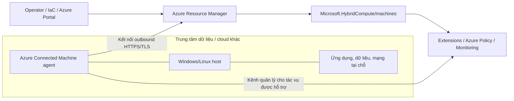
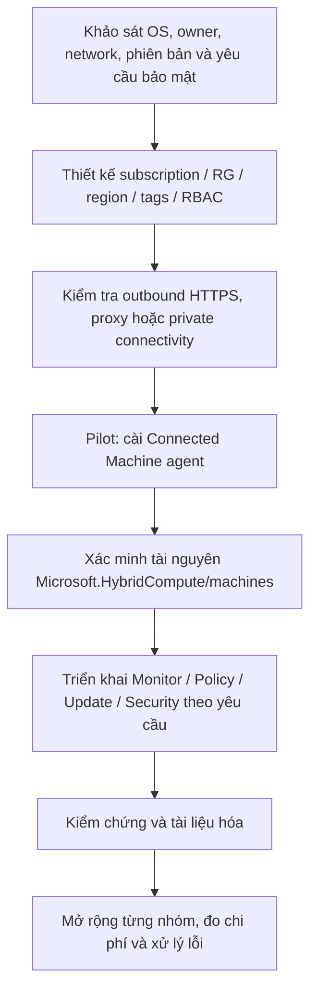
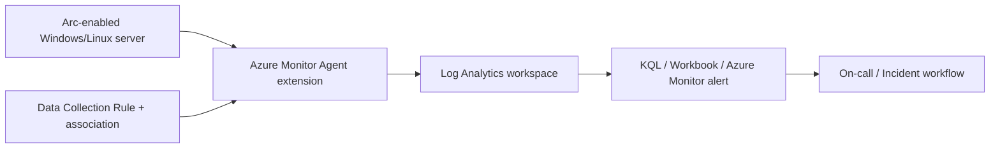

# Azure Arc-enabled Servers và quản trị máy chủ ngoài Azure

## 1. Bài toán hybrid cloud và mục tiêu học tập

Trong chương **Hybrid cloud và di chuyển lên Azure** của module **CLOUD_PROVIDERS_AZURE**, chúng ta tìm hiểu cách doanh nghiệp quản lý một kiến trúc trải rộng giữa Azure và hệ thống nằm ngoài Azure. Các kỹ năng về subscription, resource group, Microsoft Entra ID, mạng, máy tính, lưu trữ, dữ liệu, giám sát, bảo mật và kiểm soát chi phí vẫn cần thiết, nhưng không phải máy chủ nào cũng có thể hoặc nên chuyển lên Azure ngay.

Ví dụ, doanh nghiệp có:

- Một máy chủ **Windows Server** chạy ứng dụng kế toán tại trung tâm dữ liệu nội bộ.
- Hai máy chủ **Linux** chạy dịch vụ API trong hạ tầng VMware.
- Một VM thử nghiệm chạy ở nhà cung cấp cloud khác.

Đội vận hành muốn kiểm kê tập trung, áp dụng nhãn phân loại, theo dõi cấu hình tuân thủ, triển khai công cụ giám sát và quản lý bản vá mà **không phải di chuyển hệ điều hành hay ứng dụng vào Azure**. **Azure Arc-enabled Servers** giải quyết phần lớn nhu cầu quản trị này bằng cách đưa máy Windows/Linux bên ngoài Azure vào **Azure control plane** dưới dạng một tài nguyên Azure.

Sau bài học, bạn có thể:

1. Phân biệt máy chủ đã **Azure Arc-enable** với Azure VM và với dịch vụ di chuyển máy chủ.
2. Mô tả vai trò của **Azure Connected Machine agent**, resource provider `Microsoft.HybridCompute` và kết nối tới Azure.
3. Lập kế hoạch onboarding cho máy chủ on-premises, VMware hoặc cloud khác, bao gồm prerequisites, network, quyền và bảo mật.
4. Xác thực trạng thái kết nối, lập inventory bằng Azure Portal và Azure Resource Graph, sử dụng tags/resource groups một cách đúng đắn.
5. Tích hợp Azure Policy/Machine Configuration, Azure Monitor Agent, Azure Update Manager và Microsoft Defender for Cloud theo khả năng hỗ trợ.
6. Xây dựng quy trình vận hành có kiểm toán, xử lý máy disconnected, thay đổi agent, gỡ onboarding và kiểm soát chi phí.
7. Thực hành thiết kế quản trị một nhóm máy chủ ngoài Azure và hiểu rõ giới hạn kỹ thuật của Azure Arc.

**Phạm vi:** Windows/Linux server được Azure Arc-enabled thông qua Connected Machine agent. Các tên máy, resource group, subscription và region trong bài là ví dụ minh họa; việc cài agent thực tế cần quyền quản trị hệ điều hành và sự cho phép của chủ hệ thống.

## 2. Azure Arc-enabled Servers là gì — và không phải gì?

Azure Arc-enabled Servers cho phép đăng ký máy chủ Windows/Linux **vật lý hoặc ảo đang chạy bên ngoài Azure** vào Azure Resource Manager. Sau khi onboarding, một máy hiện diện trong Azure Portal như một resource loại `Microsoft.HybridCompute/machines`, có resource ID, subscription, resource group, tags, trạng thái kết nối và những khả năng quản lý được hỗ trợ.

| Câu hỏi | Azure Arc-enabled Servers | Azure Virtual Machines |
| --- | --- | --- |
| Máy đang chạy ở đâu? | On-premises, VMware, cloud khác hoặc môi trường được hỗ trợ bên ngoài Azure | Compute do Azure cấp phát và vận hành |
| Ai quản lý host/hypervisor? | Chủ hệ thống hoặc nhà cung cấp hiện tại | Azure quản lý lớp hạ tầng vật lý; người dùng quản lý guest OS |
| Có cần chuyển dữ liệu/OS lên Azure? | **Không** | Thường phải triển khai hoặc di chuyển workload lên Azure |
| Tài nguyên trong ARM | `Microsoft.HybridCompute/machines` | `Microsoft.Compute/virtualMachines` |
| Có thể dùng Azure tags, RBAC, Policy? | Có, với phạm vi và tính năng áp dụng cho Arc | Có, với tính năng của Azure VM |
| Có tự nhận Azure VM PowerState/Start/Stop? | **Không**; Arc không biến host ngoài Azure thành Azure VM | Có các thao tác VM control plane theo dịch vụ |
| Có thể cài extension quản trị được hỗ trợ? | Có, thông qua Arc/Connected Machine agent và điều kiện hỗ trợ | Có, qua nền tảng VM extensions của Azure |
| Ai trả phí compute gốc? | Nhà cung cấp/đơn vị vận hành máy chủ bên ngoài Azure | Theo mô hình tính phí Azure VM và tài nguyên liên quan |

**Ba hiểu nhầm cần tránh:**

1. **Arc không phải dịch vụ migration.** Một máy được Arc-enable vẫn chạy tại địa điểm cũ; storage, IP, domain, OS, hypervisor và mạng ứng dụng không tự được chuyển lên Azure.
2. **Arc không phải remote desktop/SSH mặc định.** Đăng ký resource không mở cổng inbound hay tự cấp tài khoản quản trị OS. Các tính năng kết nối từ xa, nếu sử dụng, cần cơ chế, quyền và cấu hình riêng được hỗ trợ.
3. **Arc không phải một công cụ quản trị duy nhất cho mọi loại máy.** Azure Arc-enabled Kubernetes, Arc-enabled VMware vSphere và Arc-enabled Servers là các nhóm khả năng khác nhau. Bài này chỉ nói về **máy chủ được onboarding bằng Connected Machine agent**.

## 3. Cơ chế hoạt động: control plane Azure, workload tại chỗ



Các phần:

- **Máy chủ Windows/Linux:** vẫn vận hành ứng dụng và dữ liệu tại địa điểm ban đầu, được quản trị bởi đội OS/network hoặc cloud provider sở hữu host.
- **Azure Connected Machine agent:** phần mềm cài trên host để thiết lập định danh/kết nối tới Azure, báo metadata/heartbeat và cung cấp nền tảng cho những tính năng quản trị được hỗ trợ.
- **Azure Resource Manager (ARM):** nơi người vận hành xem resource, gán tag, Azure RBAC và các thành phần quản trị tập trung.
- **Azure service extensions/agents:** tùy nhu cầu, có thể cài Azure Monitor Agent, extension Machine Configuration/Policy hoặc các extension bảo mật/kiểm kê được hỗ trợ.
- **Danh tính Microsoft Entra ID:** hỗ trợ đăng ký và xác thực tài nguyên; cùng Azure RBAC, nó quyết định chủ thể nào được thao tác trên resource trong Azure.

Một server có thể báo **Connected** nhưng ứng dụng của nó vẫn lỗi; ngược lại, server có thể tiếp tục chạy ứng dụng khi đường kết nối agent tới Azure gặp sự cố và trạng thái Arc là **Disconnected**. Trạng thái kết nối Arc **không thay thế** kiểm tra sức khỏe hệ điều hành, dịch vụ ứng dụng hoặc khả năng phục hồi dữ liệu.

### 3.1. Vị trí Azure của Arc resource khác nơi máy chủ vật lý đang chạy

Khi onboarding, bạn chọn **Azure region** để lưu metadata/tài nguyên quản trị Arc theo vùng được dịch vụ hỗ trợ. Trường `location` của resource Arc thể hiện vị trí Azure control-plane resource, **không khẳng định** host đang nằm vật lý tại region đó.

Ví dụ host đặt tại Hà Nội có thể được đăng ký thành resource Arc với `location=southeastasia` nếu kiến trúc quản trị và khả năng hỗ trợ cho phép. Tổ chức vẫn phải đánh giá yêu cầu lưu trữ metadata, residency, data governance và chính sách mạng.

## 4. Khi nào nên triển khai Azure Arc-enabled Servers?

Một số trường hợp phù hợp:

- **Kiểm kê hỗn hợp:** đồng nhất inventory máy chủ theo subscription/resource group/tags và xuất báo cáo đa môi trường.
- **Quản trị chuẩn cấu hình:** đánh giá baseline cấu hình OS và tuân thủ qua Azure Policy/Machine Configuration ở những hệ điều hành và kịch bản hỗ trợ.
- **Giám sát tập trung:** cài Azure Monitor Agent trên máy Arc và dùng Data Collection Rules để gửi dữ liệu phù hợp tới Log Analytics.
- **Quản lý bản vá:** đánh giá và điều phối patching bằng Azure Update Manager khi host/hệ điều hành đáp ứng điều kiện.
- **Bảo mật:** bật các thành phần Microsoft Defender for Cloud/Defender for Servers được hỗ trợ để đánh giá rủi ro và phát hiện mối đe dọa.
- **Quản trị nhiều đội:** phân quyền RBAC theo subscription/resource group, theo dõi thay đổi và gán tags phục vụ báo cáo chi phí/ownership.

Một số trường hợp **không được giải quyết chỉ nhờ Arc**:

- Di chuyển VM hoặc database nguyên trạng từ on-premises sang Azure.
- Cung cấp ngay mạng riêng từ host tới mọi tài nguyên Azure; cần VPN/ExpressRoute hoặc mô hình kết nối riêng khi workload yêu cầu.
- Thay thế hypervisor, Active Directory, công cụ backup, HA/DR hoặc cấu hình firewall tại chỗ.
- Cấp tính năng start/stop/resize của **Azure Compute VM** cho máy ngoài Azure.
- Tự bảo đảm OS được vá hoặc an toàn chỉ vì agent được cài và báo Connected.

## 5. Kiến trúc triển khai mẫu cho doanh nghiệp

Giả sử tổ chức cần quản trị 100 server qua ba nhóm:

| Nhóm máy | Môi trường chạy | Nhóm Azure quản trị | Tags ví dụ | Ưu tiên |
| --- | --- | --- | --- | --- |
| `onprem-fin-01` | Windows Server tại data center | `rg-arc-prod` | `environment=prod`, `owner=finance` | Security, update compliance, change control |
| `vmware-api-01` | Linux VM trên VMware | `rg-arc-prod` | `environment=prod`, `owner=platform` | Monitoring, machine baseline |
| `cloud-test-01` | Linux ở cloud khác | `rg-arc-nonprod` | `environment=test`, `owner=app-team` | Inventory, patch scheduling, cost control |

**Resource group không bắt buộc trùng cấu trúc mạng tại chỗ.** Đó là phạm vi quản lý trong Azure. Nhóm nên chọn subscription/resource groups theo owner, môi trường, permission boundary, yêu cầu compliance và chính sách phân bổ chi phí, đồng thời giữ tên/tag ổn định.

Một quy trình onboarding tốt bắt đầu bằng **pilot nhỏ**, xác định thành phần phụ thuộc và mở rộng dần:



## 6. Điều kiện tiên quyết trước khi kết nối máy

### 6.1. Kiểm tra hệ điều hành, host và quyền tại chỗ

- Host chạy **phiên bản Windows Server/Linux được Connected Machine agent hỗ trợ**; kiểm tra chính xác distribution, kernel/OS version, kiến trúc CPU và lifecycle hỗ trợ theo tài liệu hiện hành.
- Có quyền **local administrator/root** phù hợp để cài agent và thay đổi dịch vụ trên host.
- Máy có kết nối mạng/đường DNS và thời gian đồng hồ hệ thống đủ chính xác để xác thực TLS/token.
- Các hệ thống antivirus, EDR, firewall, proxy và quy định cài phần mềm cho phép agent/extension hoạt động.
- Nếu dùng proxy, phải cấu hình đúng cho agent và từng extension; không suy luận mọi extension sẽ tự nhận proxy setting giống nhau.
- Đã có owner, CMDB/inventory và kế hoạch thử nghiệm/rollback khi cài agent ảnh hưởng hệ điều hành.

### 6.2. Kiểm tra Azure tenant, subscription, resource group và region

- Subscription đang hoạt động và resource group đích đã tồn tại hoặc đã được tạo bởi người có quyền.
- Các resource providers cần thiết (đặc biệt `Microsoft.HybridCompute` và các providers của dịch vụ bổ sung) có thể được đăng ký theo yêu cầu.
- Người hoặc service principal onboarding có **Azure RBAC** phù hợp để tạo/đăng ký Arc-enabled server resource tại scope đích. Một role dành riêng cho onboarding máy Arc có thể phù hợp hơn Contributor toàn subscription.
- Azure region lựa chọn hỗ trợ Azure Arc-enabled Servers và đáp ứng yêu cầu residency/kiểm toán.
- Có chính sách đặt tên resource, tags, environment, owner, cost center và quy trình phê duyệt triển khai extension.

### 6.3. Kiểm tra network và endpoint

Connected Machine agent thường **khởi tạo kết nối outbound HTTPS trên TCP 443** tới các endpoint của Azure. Không cần mở inbound RDP/SSH từ Internet chỉ để Arc đăng ký và hoạt động nền tảng. Trước khi onboard, đánh giá:

1. DNS resolution và đường đi tới Microsoft Entra ID, Azure Resource Manager và các endpoint Arc cần thiết.
2. TLS 1.2 trở lên, đồng bộ thời gian, chứng chỉ tin cậy, proxy/firewall và chính sách TLS inspection tương thích.
3. Nếu dùng **Azure Arc Private Link Scope**, kiểm tra yêu cầu Private Endpoint, private DNS, routing, vùng/scope hỗ trợ và **các endpoint phụ trợ vẫn cần được xử lý riêng**. Private link không tự đưa toàn bộ mọi phụ thuộc Azure sang mạng riêng.
4. Azure Monitor Agent, Defender, Update Manager hoặc extension khác có **danh sách endpoint và điều kiện network riêng**; cho phép theo nhu cầu thực.
5. Có phương án vận hành khi mất Internet, lỗi proxy hoặc private DNS, không đồng nhất ngắt Arc với dừng ứng dụng.

**Nguyên tắc bảo mật:** không tắt xác minh TLS hoặc mở tất cả outbound/inbound chỉ để “thử cho chạy”. Dùng allowlist theo tài liệu chính thức và phối hợp đội network/security.

## 7. Onboarding máy chủ bằng Azure Portal: hướng dẫn từng bước

Bài này mô tả **một máy chủ đã được chủ sở hữu chấp thuận**; nó không thực thi cài đặt agent trên máy người học.

### 7.1. Chuẩn bị trong Azure Portal

1. Chọn subscription, resource group quản trị như `rg-arc-nonprod` và Azure region hỗ trợ.
2. Mở **Azure Arc → Machines → Add/Create** (tên menu cụ thể có thể thay đổi).
3. Chọn quy trình thêm một máy hoặc nhiều máy. Với pilot thủ công, dùng quy trình tạo **onboarding script** phù hợp cho Windows/Linux.
4. Chọn OS, subscription, resource group, region, loại kết nối/proxy và tags phù hợp.
5. Chọn cơ chế đăng nhập/đăng ký theo chính sách: người quản trị tương tác hoặc **service principal chuyên onboarding** với quyền giới hạn và cơ chế bảo vệ secret. Dùng danh tính không yêu cầu secret dài hạn khi tính năng/quy trình hỗ trợ.
6. Review nội dung script được Portal tạo: nguồn cài agent, tenant, resource group, location, những tham số network và quyền mà script yêu cầu.

**Không sao chép script onboarding có credential hoặc token vào Git, ticket công khai, email nhóm hoặc tài liệu học tập.** Service principal secret (nếu quy trình thực tế cần) phải được lưu và chuyển qua secret management an toàn, có hạn sử dụng ngắn và thu hồi sau đợt onboarding.

### 7.2. Thực thi trên máy ngoài Azure

1. Đăng nhập host qua kênh quản trị nội bộ được phê duyệt, với quyền cài software.
2. Kiểm tra host đang đúng tên/OS và chưa được onboarding bởi quy trình khác; kiểm tra network/proxy.
3. Chạy **script do Azure Portal sinh ra**, từ nguồn đáng tin, theo chỉ dẫn cho OS cụ thể.
4. Theo dõi quá trình cài **Azure Connected Machine agent** và bước đăng ký tài nguyên. Nếu thất bại, giữ log, không thử nhiều script từ nhiều tenant/resource group khác nhau.
5. Trên host, dùng lệnh thông tin/diagnostic của agent để xác minh:

```bash
# Lệnh dưới đây chỉ đọc trạng thái của Azure Connected Machine agent.
azcmagent show
```

`azcmagent` là lệnh của agent được cài trên máy. Trong Windows/Linux, đường dẫn executable và quyền sử dụng có thể khác nhau; gọi từ shell phù hợp. Kiểm tra subscription, resource group, tenant, resource name và **Agent Status** theo output thực tế của phiên bản agent.

6. Trong Azure Portal, mở **Azure Arc → Machines**, xác nhận resource mới xuất hiện với trạng thái kết nối dự kiến, đúng subscription/resource group và tags. Chờ trạng thái đồng bộ nếu vừa onboarding.
7. Đối chiếu CMDB/resource ID, chủ sở hữu, thời điểm và hệ điều hành; lưu bằng chứng pilot.

### 7.3. Mẫu câu lệnh onboarding cần hiểu, không nên copy bừa

Sau khi agent đã được cài, quy trình đăng ký thường đưa vào các tham số như dưới đây. **Cú pháp và cơ chế xác thực cụ thể phải lấy từ script do Azure tạo phù hợp với môi trường**, không sao chép một lệnh không có authentication context:

```text
TenantId         = <MICROSOFT_ENTRA_TENANT_ID>
SubscriptionId   = <AZURE_SUBSCRIPTION_ID>
ResourceGroup    = rg-arc-nonprod
AzureRegion      = <SUPPORTED_ARC_RESOURCE_REGION>
MachineName      = <AGREED_RESOURCE_NAME>
Authentication   = <INTERACTIVE_OR_APPROVED_ONBOARDING_PRINCIPAL>
```

Đây là **bảng tham số mô tả**, không phải lệnh chạy. Với onboarding số lượng lớn, cần thêm bảo vệ secret, tên máy duy nhất, tag, retry có giới hạn và cơ chế kiểm tra trạng thái đã kết nối.

## 8. Xác minh Arc resource và điều tra trạng thái Disconnected

### 8.1. Xem trên host và trên Azure

Có hai nguồn dữ liệu cần đối chiếu:

- **Trên host:** `azcmagent show`, trạng thái dịch vụ agent, các file log/diagnostic theo phiên bản và nền tảng; các lệnh kiểm tra kết nối của agent như `azcmagent check` khi được phiên bản hỗ trợ.
- **Trên Azure:** resource `Microsoft.HybridCompute/machines`, `status`, identity, extensions và Activity Log.

Nếu cần kiểm kê bằng Azure CLI (yêu cầu đăng nhập có quyền đọc subscription), có thể dùng lệnh ARM tổng quát:

```bash
az login
az account set --subscription "<SUBSCRIPTION_ID>"

az resource list \
  --resource-group "rg-arc-nonprod" \
  --resource-type "Microsoft.HybridCompute/machines" \
  --query "[].{name:name,id:id,location:location}" \
  --output table
```

**Lưu ý:** Lệnh trên chỉ liệt kê resource đã tồn tại trong ARM. Nó không chứng minh host đang healthy, ứng dụng đang chạy hoặc Azure Monitor/Policy đã được cấu hình.

### 8.2. Azure Resource Graph: inventory đa subscription

Ví dụ truy vấn **chỉ đọc**, có thể dùng trong Resource Graph Explorer với quyền phù hợp:

```kusto
Resources
| where type =~ 'microsoft.hybridcompute/machines'
| extend arcStatus = tostring(properties.status),
         osName = tostring(properties.osName),
         osVersion = tostring(properties.osVersion)
| project name, id, subscriptionId, resourceGroup,
          location, arcStatus, osName, osVersion, tags
| order by resourceGroup asc, name asc
```

Trường `properties.status` và thông tin OS có thể khác theo API/inventory; nếu rỗng, cần xác minh trạng thái trên Azure Portal/Resource API và dữ liệu do agent cung cấp. Resource Graph thể hiện bản ghi quản lý **ở một thời điểm**; nó không thay cho heartbeat ứng dụng hoặc metrics OS.

Ví dụ quy tắc review:

| Dấu hiệu | Hành động |
| --- | --- |
| Resource `Connected` | Tiếp tục kiểm tra Monitor/Policy/Update/Defender riêng |
| `Disconnected` sau thay đổi proxy | Kiểm tra DNS, outbound, certificate/TLS, agent service |
| Không thấy resource trong group | Xác minh subscription/tenant, RBAC, region, script có hoàn tất không |
| Có resource nhưng host đã gỡ agent | Điều tra vòng đời/offboarding, tránh xóa nhầm dữ liệu quản trị |
| Có hai resource cho một host | Phối hợp owner xử lý đăng ký trùng, không xóa ngẫu nhiên |
| Mất heartbeat giám sát nhưng Arc vẫn Connected | Kiểm tra Azure Monitor Agent, DCR, endpoints/Log Analytics độc lập |

### 8.3. Phân biệt ba loại “sức khỏe”

| Trạng thái | Nguồn kiểm chứng | Điều **không** thể kết luận |
| --- | --- | --- |
| **Arc connection** | Connected Machine agent và HybridCompute resource | Không đảm bảo app và DB khỏe |
| **Monitoring telemetry** | Azure Monitor Agent, Data Collection Rule, workspace và dữ liệu nhận | Không tự đảm bảo Arc/RBAC/Policy đã chuẩn |
| **Business availability** | Synthetic test, SLO, user journey, DB transaction và network | Không chứng minh agent có thể nhận cấu hình quản trị |

Chỉ khi cả ba lớp liên quan đạt điều kiện vận hành thì mới có thể công bố dịch vụ và quản trị đã ở trạng thái mong muốn.

## 9. Quản trị tập trung bằng Azure Policy và Machine Configuration

Azure Policy có thể đánh giá Azure Arc-enabled Servers theo **scope** và chính sách hỗ trợ. **Azure Machine Configuration** (từng được gọi là Guest Configuration trong một số tài liệu/công cụ) giúp đánh giá các yêu cầu cấu hình bên trong guest OS cho máy Arc trong những phiên bản và hệ điều hành hỗ trợ.

Ví dụ nhóm bảo mật muốn kiểm tra:

- Host có thuộc owner/environment và đang được giám sát không.
- Baseline OS: chính sách mật khẩu, dịch vụ/bảo mật cấu hình, những rule audit được hỗ trợ.
- Extension quản trị/giám sát bắt buộc đã được cài theo policy chưa.
- Các tài nguyên Arc có tags, location và thuộc nhóm quản trị mong muốn không.

**Không đánh đồng policy assignment với remediation:** một policy `audit` có thể chỉ báo không tuân thủ; `deny` có thể chặn một loại yêu cầu ARM phù hợp, nhưng không phải chính sách nào cũng chặn được các thay đổi **local OS** trên máy ngoài Azure. Các effect như `deployIfNotExists` hoặc `modify` đòi hỏi managed identity/role và điều kiện hỗ trợ riêng. Compliance scan có thể đến trễ.

### 9.1. Quy trình gắn policy có kiểm soát

1. Xác định đối tượng: Arc-enabled Windows/Linux, đúng OS version và khả năng Machine Configuration.
2. Chọn Azure Policy definition/initiative đã được kiểm chứng, gán ở resource group hoặc scope phù hợp.
3. Review effect, params, exclusions/exemptions và khả năng gây tác động lên host.
4. Bắt đầu bằng **audit/đánh giá** cho pilot; phân tích false positives và điều kiện cần.
5. Nếu có bước triển khai extension/remediation, kiểm tra quyền của assignment identity và tác động lên host.
6. Đọc compliance state sau chu kỳ đánh giá, tách **Not started/Unknown** khỏi **Compliant**.
7. Ghi owner của noncompliance, hạn xử lý và ngoại lệ có hạn sử dụng.

**Ví dụ:** policy yêu cầu cài monitoring extension trên một nhóm Arc-enabled Servers, nhưng host tắt nguồn trong thời gian bảo trì. Resource có thể hiện noncompliant hoặc chưa đánh giá được; nguyên nhân có thể là host không kết nối chứ không chỉ do cấu hình thiếu.

## 10. Azure Monitor: cài agent, DCR và xác minh dữ liệu

**Azure Monitor Agent (AMA)** có thể được triển khai lên Arc-enabled Server thông qua extension được hỗ trợ để thu thập dữ liệu OS/log theo **Data Collection Rules (DCR)** và Data Collection Rule Associations (DCRA). Tùy loại dữ liệu, đích có thể là Log Analytics workspace và các endpoint/dịch vụ tương ứng.



### 10.1. Triển khai theo quy trình

1. Chọn workspace, region, retention, RBAC và cơ chế network phù hợp, đặc biệt với host ở private network.
2. Xác nhận resource Arc **Connected** và OS có support AMA/extension.
3. Triển khai AMA extension qua Azure Portal, ARM/IaC hoặc policy theo quy trình được phê duyệt.
4. Tạo **DCR** thu thập metric/log cần thiết (ví dụ Windows Event Logs, Syslog, performance counters), tránh thu thập tất cả log không cần thiết.
5. Tạo association để DCR thực sự áp dụng cho đúng Arc-enabled machine.
6. Kiểm tra trạng thái extension, heartbeat và các bản ghi thực trong Log Analytics.
7. Tạo alert cho host mất dữ liệu, ứng dụng lỗi hoặc threshold phù hợp.

**Có AMA extension chưa chắc đã có dữ liệu:** có thể DCR chưa gán, network không đi được, workspace sai, table chưa nhận data hoặc data stream chưa được chọn. Trước khi kết luận health, đối chiếu dữ liệu mới nhất theo thời gian.

Một truy vấn minh họa trong Log Analytics để tìm lần heartbeat gần nhất (phụ thuộc việc bảng được thu thập và quyền workspace):

```kusto
Heartbeat
| summarize LastSeen = max(TimeGenerated) by Computer
| extend MinutesSinceLastSeen = datetime_diff('minute', now(), LastSeen)
| order by MinutesSinceLastSeen desc
```

Truy vấn chỉ đo dữ liệu trong bảng `Heartbeat`. Kết quả thiếu có thể do chưa cấu hình ingest, không có agent hoặc sự cố pipeline, không nhất thiết là hệ điều hành đã tắt. Đặt alert theo đúng host inventory và cửa sổ thời gian, tránh giả định mọi máy gửi heartbeat giống nhau.

## 11. Quản lý bản vá bằng Azure Update Manager

**Azure Update Manager** có khả năng quản lý việc đánh giá và cài bản vá cho Azure VMs và Arc-enabled Servers trong những kịch bản/hệ điều hành được hỗ trợ. Với máy ngoài Azure, cần xem điều kiện agent/extension, quyền quản trị guest, mạng tới nguồn bản vá và lịch bảo trì của tổ chức.

Một quy trình vận hành chuẩn:

1. **Inventory và phân nhóm:** OS, owner, môi trường, mức quan trọng, thời gian hoạt động và yêu cầu reboot.
2. **Assessment:** kiểm tra các bản vá còn thiếu và trạng thái gần nhất. Máy `Disconnected` có thể không cập nhật dữ liệu đánh giá.
3. **Maintenance configuration:** đặt cửa sổ theo nhóm, timezone, frequency, danh mục update và quy tắc restart phù hợp.
4. **Pilot:** cập nhật một nhóm không quan trọng trước; kiểm tra ứng dụng và khả năng rollback/restore.
5. **Phát hành rộng:** dùng approval theo loại máy; có thể chia theo ring/canary để hạn chế blast radius.
6. **Kiểm chứng:** patch result, reboot, OS version, service health, backup/monitoring và số máy chưa đạt.
7. **Báo cáo:** owner, deadline, exception có hạn, lỗ hổng còn tồn tại và tiến độ khắc phục.

**Quan trọng:** Update Manager không phải công cụ điều khiển mọi nguồn cập nhật và không tự tạo đường truy cập vào patch repository. Với Windows cần xem WSUS/Windows Update policy; với Linux cần nguồn package, repository/mirror và quyền OS phù hợp. Máy vẫn cần sao lưu, kế hoạch rollback và bảo vệ availability.

**Phân biệt với sản phẩm cũ:** tránh thiết kế mới theo những hướng dẫn **Azure Automation Update Management** đã thay thế; dùng tài liệu Azure Update Manager hiện hành tương ứng host Arc.

## 12. Microsoft Defender for Cloud và an toàn máy chủ Arc

**Microsoft Defender for Cloud** có thể đưa các máy Azure Arc-enabled Servers vào phạm vi đánh giá bảo mật và bảo vệ theo những plan/tính năng hỗ trợ, ví dụ các lựa chọn của Defender for Servers. Từng khả năng có thể yêu cầu agent/extension, cấu hình, quyền hoặc license riêng.

Một kiến trúc phòng vệ nhiều lớp:

| Lớp | Biện pháp | Ai chịu trách nhiệm |
| --- | --- | --- |
| On-prem/cloud khác | OS hardening, EDR hiện có, firewall, backup, IAM tại host | Đội hạ tầng và bảo mật |
| Arc control plane | RBAC, tags, policy, resource protections, Azure Activity Log | Cloud platform/governance |
| Monitoring | AMA, DCR, workspace, alerts, kiểm tra log lưu giữ | SRE/operations |
| Defender | Plan và workload protection được hỗ trợ, security recommendations | Security operations |
| Patching | Update Manager và lịch kiểm chứng | OS owner/patch manager |
| Ứng dụng/dữ liệu | Secrets, encryption, network ACLs, database audit và DR | App/data owner |

**Không nhầm Arc connection với trạng thái an toàn:** máy Arc Connected vẫn có thể chưa vá, cài extension thiếu bảo vệ hoặc có rủi ro mạng nội bộ. Cần chủ động kích hoạt và đánh giá dịch vụ bảo mật tương ứng.

## 13. Danh tính, phân quyền và trách nhiệm quản trị

### 13.1. Những danh tính khác nhau

- **Identity dùng để onboarding:** người quản trị hoặc service principal có quyền đăng ký Arc resource tại subscription/resource group đích.
- **Identity của máy Arc sau onboarding:** tài nguyên Arc có thể sử dụng managed identity cho những kịch bản tương thích, không đồng nghĩa với quyền Administrator/root của OS.
- **Identity quản lý Azure:** admin/pipeline điều khiển extensions, Azure Policy, Monitor hoặc Update Manager theo Azure RBAC.
- **Identity local OS:** tài khoản, domain user, sudoers và cơ chế phân quyền trên máy vật lý/VM vẫn do tổ chức quản lý.

Role `Azure Connected Machine Onboarding` là một lựa chọn quyền dùng cho thao tác đăng ký máy Arc; các role quản lý resource/extension/monitoring có thể cần quyền khác. Luôn kiểm tra scope/action thực sự cần dùng và tài liệu role definitions hiện hành. **Không cấp Owner toàn subscription chỉ để agent kết nối được.**

### 13.2. Vùng ảnh hưởng (blast radius)

Nếu cùng một identity hoặc service principal onboarding có quyền quá rộng trên 100 server, sai sót hoặc lộ secret có thể ảnh hưởng hàng loạt. Đề xuất:

1. Tách resource group theo production/nonproduction, team và yêu cầu tuân thủ.
2. Giới hạn quyền onboarding theo scope và thời hạn; đặt expiration cho credential nếu sử dụng.
3. Tách người có thể **đăng ký server** khỏi người có thể **triển khai extension, sửa policy và truy cập dữ liệu giám sát**, nếu quy trình yêu cầu.
4. Dùng MFA/Conditional Access/PIM cho người vận hành khi khả thi; dùng identity không phụ thuộc secret dài hạn cho automation được hỗ trợ.
5. Kiểm soát ai có quyền root/admin trên host; Azure RBAC không tự thay thế local OS permissions.
6. Lưu Activity Log, diagnostic logs và dấu vết deployment/extension.
7. Audit quyền, ngoại lệ, máy ngừng kết nối và tài nguyên không còn owner.

## 14. Quản lý vòng đời agent, extensions và offboarding

### 14.1. Quản lý phiên bản và thay đổi

Connected Machine agent và các extension cần được giữ tương thích với OS và dịch vụ Azure. Thực hiện theo quy trình:

- Theo dõi phiên bản agent, lịch hỗ trợ OS và các thông báo cập nhật.
- Thử nâng cấp trên nhóm pilot trước, tránh nâng cấp đồng thời toàn bộ máy quan trọng.
- Đảm bảo các thay đổi proxy/private DNS/endpoint không cắt đường ra Azure.
- Kiểm tra sau thay đổi: `azcmagent show`, resource Connected, extension provisioning state, AMA data, policy evaluation và chức năng ứng dụng.
- Theo dõi log/cảnh báo nếu agent bị gỡ, certificate/auth bị lỗi, extension lỗi hoặc mất kết nối dài.

Không cài extension mới chỉ vì có sẵn trong Portal; mỗi extension có thể chạy code trên host, tiêu thụ tài nguyên, tạo data egress và tăng phí.

### 14.2. Gỡ onboarding an toàn

Khi máy bị hủy, di chuyển quản trị sang tenant khác hoặc không còn thuộc phạm vi Azure Arc, cần một **offboarding runbook**:

1. Xác nhận đúng máy vật lý/VM, resource ID, subscription, owner và change approval.
2. Kiểm tra dữ liệu monitoring, bản ghi compliance, lịch patch, Defender và retention phải giữ.
3. Gỡ các extension/association hoặc cấu hình phụ thuộc theo yêu cầu; không tự xóa dữ liệu ứng dụng.
4. Thực hiện quy trình **disconnect/uninstall agent** phù hợp OS, quyền và phiên bản đang dùng; xác nhận kết quả trên host.
5. Xóa Arc resource trong Azure khi phù hợp và được phê duyệt; kiểm tra các role assignments, alerts, dashboard, policies hoặc automation tham chiếu ID cũ.
6. Cập nhật CMDB và thu hồi credential onboarding liên quan nếu không còn sử dụng.

**Không xóa riêng resource Arc trong Azure rồi mặc định agent tại host đã được gỡ**, hoặc ngược lại. Hai mặt của vòng đời phải được đối chiếu; nếu host đang offline, cần kế hoạch xử lý trạng thái orphan khi máy kết nối lại.

## 15. Chi phí: Arc control plane và dịch vụ bổ sung

Azure Arc-enabled Servers giúp dùng các dịch vụ quản trị Azure cho máy ngoài Azure, nhưng **không chuyển hóa đơn compute của máy ngoài Azure thành hóa đơn Azure VM**.

Các loại chi phí có thể liên quan:

| Thành phần | Điều cần đánh giá |
| --- | --- |
| Azure Arc-enabled Servers core registration | Kiểm tra mô hình giá hiện hành của tính năng quản trị nền tảng và vùng; các khả năng cơ bản có thể không tính phí Arc riêng |
| Azure Monitor / Log Analytics | Chi phí ingest, retention, query/alert và dữ liệu truyền mạng |
| Azure Update Manager | Chi phí/cấp quyền tính năng cho Arc machines theo chương trình hoặc loại license được hỗ trợ |
| Microsoft Defender for Servers | Plan, pricing, các extension/dịch vụ bảo mật bổ sung |
| Azure Policy Machine Configuration | Chi phí/điều kiện hỗ trợ nếu có theo licensing/tính năng |
| Private Link/network | Private endpoint, DNS, VPN/ExpressRoute, outbound data transfer và dịch vụ liên quan |
| Hạ tầng gốc | Compute, storage, license OS, network và backup vẫn trả cho đơn vị đang vận hành máy |

**Không đưa ra một đơn giá cố định cho mọi host/region/plan.** Kiểm tra **Azure Pricing Calculator**, bảng giá chính thức, entitlement của tổ chức và dữ liệu Cost Management theo scope. Một máy có thể đã kết nối Arc nhưng chưa được sử dụng monitoring hoặc security; mở các dịch vụ này cần dự toán riêng.

### 15.1. Cân bằng giá trị vận hành và chi phí

Ví dụ tổ chức quản trị 100 server ở nhiều nơi. Lợi ích có thể là giảm thời gian kiểm kê, chuẩn hóa patch, tăng độ phủ monitor và bảo mật. Nhưng chi phí có thể tăng nếu thu thập log verbose cho tất cả server, giữ retention quá dài hoặc chọn plan bảo vệ không phù hợp.

Đặt KPI:

- Tỷ lệ server dự kiến onboarding đã thực sự Connected và có owner.
- Tỷ lệ server có tags/RBAC/policy baseline được xác nhận.
- Độ trễ heartbeat/telemetry, số extension lỗi và thời gian khôi phục agent.
- Tỷ lệ patch compliance theo nhóm OS/criticality và số ngoại lệ tồn đọng.
- Chi phí Azure monitoring/security/update trên mỗi server theo tháng.
- Số sự cố do agent/extension/update tác động workload và thời gian phục hồi.

## 16. Xử lý lỗi thường gặp

| Hiện tượng | Nguyên nhân khả dĩ | Hướng khoanh vùng |
| --- | --- | --- |
| Agent cài xong nhưng không connect | Không tới Entra/ARM/Arc endpoints, DNS/proxy/firewall/TLS hoặc sai tenant/subscription | Kiểm tra network allowlist, thời gian hệ thống, agent logs và thông tin đăng ký |
| Resource không xuất hiện trên Azure Portal | Đăng ký chưa hoàn tất, sai scope/region, thiếu quyền đọc hoặc provider chưa đăng ký | Kiểm tra subscription/RG, ARM Activity Log, quyền và output agent |
| `AuthorizationFailed` / HTTP 403 | Onboarding principal thiếu action ở đúng resource group | Kiểm tra principal, role assignment và scope; không nâng Owner bừa |
| Agent báo Disconnected, ứng dụng vẫn chạy | Mất đường outbound, proxy đổi, agent service lỗi hoặc host offline | Kiểm tra OS service, network, certificate/TLS, version và thời điểm cuối kết nối |
| Duplicate resource/đổi tên máy | Script đăng ký lặp với tên khác hoặc resource ID lệch | Đối chiếu host identity/CMDB và quy trình cleanup có phê duyệt |
| Extension install fail | OS unsupported, runtime/dependency, quyền local hoặc endpoint extension bị chặn | Đọc extension provisioning/error details, agent logs và network matrix |
| Azure Policy báo NonCompliant | Rule chưa đáp ứng, audit evaluation trễ hoặc Machine Configuration chưa sẵn sàng | Đọc definition, assignment, effect, exemption và agent data |
| Arc Connected nhưng không có AMA logs | AMA/DCR association thiếu, endpoint workspace bị chặn hoặc chưa ingest | Kiểm tra extension, DCR, destination, workspace và logs thực |
| Update Manager đánh giá cũ | Host offline, extension không healthy hoặc hệ điều hành/update source lỗi | Kiểm tra Arc connection, patch agent, OS repo/WSUS và maintenance config |
| Host bị chậm sau extension | Agent/module dùng CPU/disk, cấu hình thu thập quá rộng | So sánh baseline, giảm scope, thay đổi có phê duyệt và rollback |
| Agent connection OK nhưng remote RDP/SSH không chạy | Arc connection không tự mở remote access | Kiểm tra mạng và cơ chế remote connectivity riêng |
| Azure Cost Management tăng sau onboarding | Log ingestion, Defender/Update/Policy plan hoặc network service mới | Tách charge theo service và plan, xem cấu hình telemetry và retention |

**Phương pháp điều tra:** xác định host, resource ID, OS, agent version, lỗi/điểm dừng gần nhất; phân loại thành **onboarding/auth**, **network**, **Arc agent**, **extension/service** hay **workload ứng dụng**. Không vô hiệu hóa TLS inspection, gỡ antivirus hoặc cấp Owner toàn subscription như một thủ thuật sửa lỗi không được kiểm chứng.

## 17. Bài thực hành: onboarding và quản trị ba máy ngoài Azure

**Tình huống:** Đội IT có một Windows Server on-premises, một Linux VM trên VMware và một Linux VM tại cloud khác. Yêu cầu đưa các máy vào inventory Azure và áp dụng kiểm soát không gián đoạn ứng dụng đang chạy.

### Giai đoạn A — Thiết kế

1. Chọn subscription, `rg-arc-nonprod` cho pilot, Azure region quản trị và tags `owner`, `environment`, `costCenter`, `datacenter`.
2. Lập bảng OS version/architecture, patch window, agent support, network route, proxy và người có quyền administrator/root cho từng host.
3. Thiết kế RBAC: danh tính onboarding có scope giới hạn; người triển khai monitoring/update/security có quyền riêng; OS admin không tự trở thành Azure Owner.
4. Đánh giá endpoint/outbound HTTPS 443, DNS, TLS và yêu cầu Private Link nếu doanh nghiệp dùng mạng riêng.
5. Xác định baseline thành công: Connected + đúng resource ID + tag + không ảnh hưởng ứng dụng.

### Giai đoạn B — Pilot một máy

1. Tạo script onboarding tại Azure Portal từ subscription/RG/region đã duyệt; review script và cách xác thực.
2. Cài Connected Machine agent trên **host lab có quyền** và chạy script được cấp; không lưu credentials vào repo.
3. Kiểm tra `azcmagent show` trên host, mở Arc Machines trên Portal và đối chiếu trạng thái Connected, tenant, resource group, tags.
4. Chạy truy vấn Resource Graph ở mục 8; xác nhận resource đã xuất hiện. Ghi hostname và Azure resource ID vào inventory nội bộ.
5. Nếu fail, thu thập diagnostic, network và Activity Log, phân loại lỗi theo mục 16 trước khi thử lại.

### Giai đoạn C — Mở rộng khả năng quản trị

1. Chọn **một** yêu cầu như gửi OS logs: triển khai AMA, DCR, association và xác nhận bản ghi trong Log Analytics.
2. Chọn Azure Policy/Machine Configuration dạng audit phù hợp host; chờ evaluation, kiểm tra compliance và owner của findings.
3. Đánh giá việc đưa một nhóm test vào Azure Update Manager: kiểm tra patch repo, thời gian bảo trì và phương án rollback.
4. Nếu cần Microsoft Defender for Servers, xem license/pricing, plan và điều kiện hỗ trợ trước khi bật cho toàn bộ fleet.
5. Đánh giá tác động CPU/memory/network trên host sau khi triển khai extension.

### Giai đoạn D — Vận hành và báo cáo

1. Xây dashboard/list cho Arc connection, monitoring telemetry và patch compliance, không trộn ba loại health.
2. Tạo quy trình nhận biết agent Disconnected, phân công owner và thời hạn xử lý.
3. Ước tính chi phí Monitor/Update/Defender và network cho 3 host rồi mở rộng lên 100 host.
4. Viết offboarding checklist để gỡ agent và xóa Azure resource theo change khi máy hết vòng đời.

**Tiêu chí đạt:** tài liệu hóa topology và quyền, bằng chứng agent Connected, đúng metadata/resource ID, một dịch vụ quản trị hoạt động được kiểm chứng, runbook xử lý Disconnected và báo cáo chi phí. Nếu không có host/subscription được phép, mô tả thao tác và kết quả dự kiến; **không chạy script cài agent trên máy sản xuất**.

## 18. Câu hỏi tự kiểm tra

**1. Sau khi Azure Arc-enable, VM Linux on-premises có trở thành Azure VM không?**  
Không. Máy vẫn chạy tại hạ tầng cũ. Azure chỉ quản lý một resource đại diện và các tính năng quản trị được hỗ trợ qua agent.

**2. Vì sao Azure Portal hiển thị `location=southeastasia` không chứng minh máy chủ đặt tại Singapore?**  
Đó là Azure region của Arc control-plane resource, không phải tọa độ vật lý của host.

**3. Máy Arc Connected có chứng minh ứng dụng và Log Analytics đang khỏe không?**  
Không. Cần kiểm tra riêng application SLO và data ingestion AMA/DCR. Arc connection chỉ là một phần trạng thái quản trị.

**4. Onboarding agent có cần mở inbound RDP/SSH từ Internet không?**  
Không phải để đăng ký cơ bản. Agent chủ động dùng outbound HTTPS/TLS tới các endpoint Azure được hỗ trợ; remote access là yêu cầu riêng.

**5. Vì sao role Reader trên resource group có thể chưa đủ để onboarding?**  
Onboarding tạo/đăng ký Arc resource, cần các action ghi phù hợp. Dùng role onboarding giới hạn scope, không tự cấp Owner toàn subscription.

**6. Azure Policy đánh giá Machine Configuration noncompliant có nghĩa policy đã tự sửa OS chưa?**  
Không. Evaluation/audit và remediation khác nhau; cần đúng effect, identity, extension, OS hỗ trợ và quy trình phê duyệt.

**7. Một host Arc không có AMA log dù agent báo Connected. Nên kiểm tra gì trước?**  
AMA extension, DCR association, workspace destination, endpoint/network và bản ghi ingest. Arc agent và AMA là hai lớp khác nhau.

**8. Xóa Arc resource trong Azure có đồng nghĩa máy chủ vật lý bị xóa hay phần mềm agent đã được gỡ không?**  
Không. Cần quy trình offboarding hai phía: host/agent và Azure resource, với owner và kiểm toán.

**9. Bật Defender/Update/Monitor trên toàn bộ fleet có thể tăng chi phí không?**  
Có. Các dịch vụ bổ sung có plan, data ingestion, licensing và retention riêng; cần kiểm tra bảng giá và chi phí thực tế.

## 19. Tài liệu chính thức để tra cứu

- Microsoft Learn — **Azure Arc-enabled Servers overview**: phạm vi, kiến trúc và khả năng quản lý.
- Microsoft Learn — **Prerequisites for Azure Arc-enabled Servers** và **Connected Machine agent requirements**: OS, mạng, TLS, proxy và RBAC.
- Microsoft Learn — **Connect hybrid machines to Azure from the Azure portal** và **Azure Connected Machine agent CLI reference**.
- Microsoft Learn — **Azure Arc Private Link Scope / network requirements** khi dùng kết nối private.
- Microsoft Learn — **Azure Policy Machine Configuration** và chính sách áp dụng cho Arc-enabled Servers.
- Microsoft Learn — **Azure Monitor Agent on Azure Arc-enabled Servers**, **Data Collection Rules** và **Log Analytics**.
- Microsoft Learn — **Azure Update Manager overview** cho máy Azure VMs và Arc-enabled Servers.
- Microsoft Learn — **Microsoft Defender for Servers** và **Microsoft Defender for Cloud pricing**.
- Microsoft Learn — **Azure Arc-enabled Servers pricing** và **Azure Well-Architected Framework** về Security, Operational Excellence, Cost Optimization.

Khả năng hỗ trợ OS/region, cách quản lý runtime/extension, network endpoints và bảng giá có thể thay đổi theo thời gian. Trước khi triển khai production, cần đối chiếu tài liệu chính thức cho đúng máy, subscription, cloud, phiên bản Connected Machine agent và gói dịch vụ được lựa chọn. **Azure Arc là lớp quản trị hybrid, không phải thao tác di chuyển workload hoặc lời cam kết rằng mọi máy ngoài Azure đã được bảo mật và phục hồi đầy đủ.**
