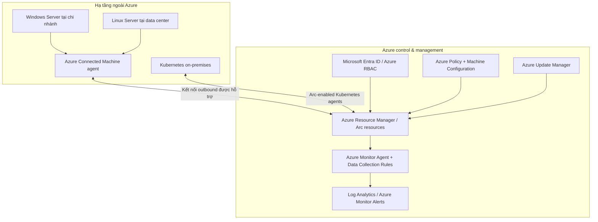
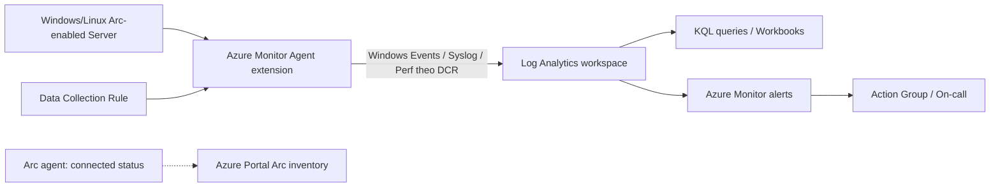
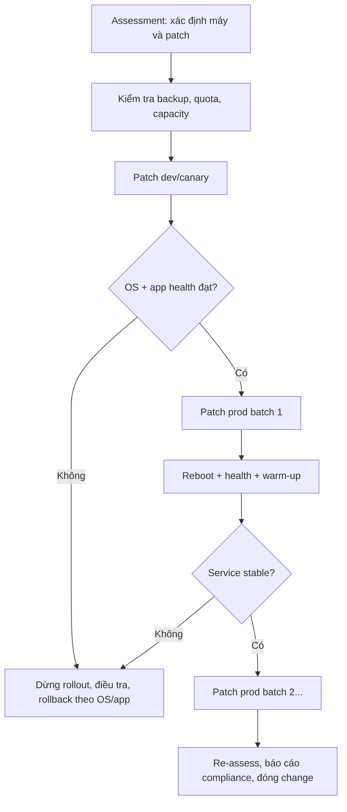

# Áp dụng policy, monitoring và cập nhật cho tài nguyên Azure Arc

## 1. Từ hạ tầng hybrid đến quản trị thống nhất trên Azure

Một doanh nghiệp chạy `orders-api` trên Microsoft Azure, nhưng còn máy chủ Windows và Linux ở trung tâm dữ liệu riêng, máy chủ ở chi nhánh và cụm Kubernetes đặt tại nhà máy. Mỗi nơi có công cụ quản lý bản vá, cấu hình bảo mật và giám sát riêng. Khi bộ phận vận hành muốn biết **máy nào thiếu tag, máy nào không gửi heartbeat, máy nào quá hạn cập nhật**, việc thu thập thủ công từ nhiều hệ thống mất thời gian và dễ bỏ sót.

**Azure Arc** mở rộng một số khả năng quản trị của Azure tới tài nguyên **nằm ngoài Azure**. Một máy chủ tại chỗ được kết nối thành **Azure Arc-enabled server** có tài nguyên đại diện trong Azure Resource Manager; từ đó doanh nghiệp có thể tổ chức theo subscription/resource group, gắn tags, phân quyền bằng Azure RBAC, đánh giá Azure Policy, gắn extension giám sát hoặc sử dụng dịch vụ quản lý cập nhật được hỗ trợ. Azure Arc không tự chuyển máy chủ lên Azure và không tự thay thế phần mềm quản trị, mạng hoặc hệ điều hành tại chỗ.

Bài này thuộc chương **Hybrid cloud và di chuyển lên Azure** trong lộ trình tìm hiểu hệ sinh thái Azure: từ subscription, resource group và Microsoft Entra ID đến mạng, tính toán, lưu trữ, dữ liệu, giám sát, bảo mật và kiểm soát chi phí. Trọng tâm là tổ chức **ba vòng kiểm soát liên kết với nhau**:

1. **Policy:** xác định cấu hình/quy tắc nào phải tuân thủ và báo cáo sai lệch.
2. **Monitoring:** thu thập telemetry, quan sát tình trạng máy và phát cảnh báo có thể hành động.
3. **Updates:** đánh giá thiếu bản vá, lên lịch cập nhật theo nhóm, kiểm chứng trạng thái sau bảo trì.

### Mục tiêu học tập

Sau bài học, bạn có thể:

- Phân biệt Azure Arc-enabled Servers, Azure Arc-enabled Kubernetes và các dịch vụ quản trị liên quan; xác định giới hạn tính năng của từng loại.
- Thiết lập mô hình tài nguyên Azure Arc an toàn với resource group, tags, managed identity, extension và Azure RBAC.
- Áp Azure Policy lên tài nguyên Arc và hiểu sự khác biệt giữa **policy trên metadata Azure** và **kiểm tra cấu hình bên trong OS** bằng Machine Configuration.
- Sử dụng Azure Monitor Agent (AMA), Data Collection Rule (DCR), Log Analytics, metrics, logs và alerts để theo dõi Arc-enabled servers.
- Lập kế hoạch đánh giá/cài đặt bản vá bằng Azure Update Manager theo nhóm máy, maintenance window, restart policy và tiêu chí nghiệm thu.
- Thiết kế rollout theo giai đoạn, đo compliance, giảm ảnh hưởng tới ứng dụng và phân tích chi phí vận hành hybrid.
- Thực hiện bài lab có thể kiểm tra bằng bằng chứng, tránh thay đổi trực tiếp máy production không được phê duyệt.

## 2. Azure Arc quản lý những loại tài nguyên nào?

Azure Arc không phải một loại máy ảo. Nó là tập hợp khả năng kết nối và quản lý nhiều kiểu tài nguyên:

| Loại tài nguyên | Tài nguyên Azure biểu diễn | Khả năng trọng tâm | Điều không nên mặc định |
| --- | --- | --- | --- |
| **Arc-enabled Servers** | Ví dụ resource type `Microsoft.HybridCompute/machines` | Inventory, metadata, extensions, Azure Policy và dịch vụ giám sát/cập nhật phù hợp | Không biến máy tại chỗ thành Azure VM; không có quyền quản lý guest chỉ nhờ tạo Azure resource |
| **Arc-enabled Kubernetes** | Ví dụ `Microsoft.Kubernetes/connectedClusters` | Inventory và quản trị cluster, một số extension, GitOps và policy/monitoring được hỗ trợ | Không áp nguyên quy trình Azure Update Manager cho Windows/Linux VM lên node Kubernetes |
| **Arc-enabled data services** | Resource/control plane riêng theo dịch vụ | Quản trị dịch vụ dữ liệu được hỗ trợ trong môi trường hybrid | Không đồng nghĩa sao chép database hoặc backup tự động |

**Phạm vi thực hành chính** của bài là **Arc-enabled Windows/Linux servers**, bởi Azure Update Manager và Azure Monitor Agent có quy trình quản lý máy chủ rõ ràng. Phần Arc-enabled Kubernetes được giới thiệu riêng để tránh nhầm extension, policy và phương pháp vá node.

Một resource Azure Arc tồn tại trong subscription không chứng minh máy nguồn đang online hoặc được bảo vệ đầy đủ. Cần quan sát trạng thái agent, extension, policy evaluation và telemetry thực tế.

## 3. Kiến trúc quản trị Azure Arc



Sơ đồ thể hiện **quan hệ quản trị**, không mô tả rằng mọi dòng telemetry đi qua ARM. Telemetry của Azure Monitor Agent đi qua luồng thu thập riêng theo DCR và các endpoint Azure Monitor được hỗ trợ. Azure Update Manager phối hợp đánh giá/cài đặt bản vá trên máy với extension/thành phần được yêu cầu theo kịch bản.

### Mô hình quản trị hai lớp

| Lớp | Dữ liệu/điều khiển | Ví dụ |
| --- | --- | --- |
| **Azure control plane** | Resource ID, tags, location metadata, policy assignments, RBAC, extension deployment | Audit máy thiếu tag `environment`; gắn AMA extension |
| **Guest OS/cluster plane** | Gói đã cài, dịch vụ Windows/Linux, cấu hình TLS, tài khoản, kernel, tác vụ cập nhật | Máy thiếu bản vá; dịch vụ không khởi động sau reboot |

Azure Arc nối hai lớp bằng agent/extension và các dịch vụ quản trị tương ứng. **Azure Policy không mặc nhiên có quyền thay đổi mọi thiết lập trong OS**; từng built-in policy hoặc machine configuration cần được hỗ trợ, có agent/extension và quyền thích hợp.

## 4. Bối cảnh thực tế: đội vận hành Orders Platform

Giả sử doanh nghiệp có 30 máy chủ ngoài Azure:

| Nhóm | Số lượng | Môi trường | Chính sách vận hành minh họa |
| --- | ---: | --- | --- |
| Windows API servers | 8 | `prod` | Giám sát 24/7; vá vào maintenance window được duyệt |
| Linux workers | 10 | `prod` | Rolling updates theo batch, tránh dừng đồng thời |
| Windows file/application servers | 6 | `stg` | Thử bản vá trước production |
| Linux development servers | 6 | `dev` | Cập nhật thường xuyên, quyền và cảnh báo ít nghiêm ngặt hơn |

Nhóm muốn thống nhất các tag `environment`, `application`, `owner`, `patchRing`, xác nhận máy gửi telemetry và đánh giá bản vá theo vòng `dev → stg → prod`. Từng tên và số lượng trong bảng là **dữ liệu giả định học tập**, không phải giới hạn của dịch vụ Azure.

Mục tiêu quản trị có thể là:

```text
Inventory coverage      >= 95% máy thuộc phạm vi được kết nối Arc
Required tags           100% tài nguyên Arc có environment + owner
Heartbeat monitoring    Cảnh báo khi một máy quan trọng mất tín hiệu theo ngưỡng
Patch assessment        Có dữ liệu đánh giá mới trong lịch đã phê duyệt
Patch window            Tuân thủ change calendar, có restart validation
Critical patch SLA      Theo chính sách an ninh nội bộ, không suy từ Azure
```

Các ngưỡng này là **mục tiêu do tổ chức đặt ra**. Một tỷ lệ compliance cao không thay thế kiểm tra số lượng máy mất kết nối hoặc chưa onboard: mẫu số phải bao gồm cả máy **chưa xuất hiện trong Azure**.

## 5. Điều kiện tiên quyết trước khi onboarding Azure Arc-enabled Servers

### 5.1. Hạ tầng và nền tảng được hỗ trợ

Trước khi đăng ký:

1. Kiểm tra OS Windows/Linux, kiến trúc CPU và phiên bản có nằm trong **support matrix của Arc-enabled Servers**.
2. Xác nhận máy truy cập được các endpoint Azure Arc, Microsoft Entra ID và các dịch vụ bổ sung sẽ dùng theo tài liệu networking hiện hành.
3. Chuẩn bị kết nối **outbound HTTPS 443** theo yêu cầu; kiểm tra proxy, TLS inspection, DNS, firewall và đường dẫn mạng riêng nếu dùng.
4. Xác định subscription, resource group và **region lưu metadata của Arc resource** theo yêu cầu data residency. Region metadata không làm thay đổi vị trí đặt máy vật lý.
5. Chuẩn bị đủ quyền cho người triển khai, danh tính onboarding và extension; không sử dụng tài khoản quyền cao dài hạn nếu có thể dùng service principal được quản trị hoặc phương thức identity được hỗ trợ.
6. Đánh giá máy có agent bảo mật, proxy, EDR hoặc quản trị bản vá khác không, để tránh lịch update xung đột.
7. Xác định người chịu trách nhiệm quản trị hệ điều hành, ứng dụng, chi phí và phản hồi sự cố.

### 5.2. Những quyền phải phân biệt

| Quyền | Phạm vi | Ví dụ |
| --- | --- | --- |
| **Azure RBAC** | Tài nguyên Arc, policy, DCR, workspace, maintenance configuration | Người quản lý extension có quyền trên Arc resource được giao |
| **Guest OS privilege** | Cài agent, dịch vụ, bản vá và khởi động lại OS | Administrator/root hoặc cơ chế quản trị máy được ủy quyền |
| **Data plane/monitoring access** | Xem logs, metrics hoặc dữ liệu workspace | Quyền query Log Analytics và cấu hình alert |
| **Billing/FinOps** | Xem chi phí và điều khoản dịch vụ | Cost Management scope thích hợp |

Không nên cho rằng `Contributor` ở resource group đồng nghĩa có quyền root trong máy Linux hoặc quyền đọc mọi log thuộc tất cả workspace.

### 5.3. Onboarding Connected Machine agent

**Azure Connected Machine agent** được cài trên máy chủ ngoài Azure và đăng ký máy thành tài nguyên Arc. Trong nhiều hướng dẫn, chương trình dòng lệnh cục bộ tên **`azcmagent`** dùng để kiểm tra và quản lý kết nối agent.

Ví dụ kiểm tra **trên chính máy đã cài agent**:

```bash
# Linux terminal (hoặc lệnh tương đương trên Windows với quyền phù hợp)
azcmagent show
azcmagent check
```

`show` hiển thị trạng thái kết nối và metadata agent, còn `check` hỗ trợ kiểm tra kết nối tới endpoint cần thiết tùy phiên bản agent. Tham số, danh sách endpoint và định dạng kết quả phải được xác nhận theo phiên bản đã triển khai. Không chia sẻ access token hoặc thông tin nhạy cảm từ đầu ra.

Quy trình onboarding được Azure Portal cung cấp có thể tạo script khác nhau cho Windows/Linux và phương thức xác thực. **Không tự sao chép lệnh có client secret hoặc service principal credential vào tài liệu công khai**; dùng cơ chế bảo vệ secret và luồng onboarding được phê duyệt.

## 6. Xác minh máy đã kết nối Azure Arc

Trong **Azure Portal → Azure Arc → Machines** (hoặc tên menu tương ứng), đối chiếu tên máy, resource group, subscription, region metadata, trạng thái kết nối, OS, tags và extensions.

Ví dụ Azure CLI **chỉ đọc metadata**, sau khi đăng nhập và chọn subscription đúng:

```bash
az login
az account set --subscription "<subscription-id>"

# Có thể cần CLI extension "connectedmachine", tùy phiên bản CLI.
az connectedmachine show \
  --resource-group "rg-arc-orders-prod" \
  --name "orders-worker-01" \
  --query "{name:name,id:id,status:status,location:location}" \
  --output json
```

Tên lệnh/extension CLI có thể thay đổi khi sản phẩm cập nhật; nếu môi trường không có lệnh, kiểm tra phiên bản Azure CLI và tài liệu chính thức. Không coi một lần `status: Connected` là bằng chứng tính liên tục: phải kiểm tra health theo thời gian.

### Tags và inventory

Các tags ví dụ:

```text
environment = prod
application = orders
owner       = platform-team
patchRing   = prod-wave-1
costCenter  = it-ops
```

Tags giúp lọc inventory, target policy, phân nhóm maintenance và phân bổ chi phí khi tính năng hỗ trợ. Tags **không nên chứa thông tin nhạy cảm**, credential, dữ liệu cá nhân hoặc cấu hình bí mật; Azure resource tags là metadata mà nhiều người có thể đọc nếu có quyền.

Nếu có máy offline nhiều ngày, cần điều tra **agent, DNS, proxy, firewall, certificate và máy nguồn** trước khi cho rằng nó vẫn được quản lý bình thường.

## 7. Azure Policy: định nghĩa, assignment và compliance

**Azure Policy** kiểm tra tài nguyên so với các **policy definitions** theo assignment được áp ở management group, subscription hoặc resource group. Một **initiative** nhóm nhiều định nghĩa để theo dõi một tập mục tiêu quản trị. Evaluation tạo thông tin **compliant/non-compliant** theo phạm vi hỗ trợ của từng policy và hiệu ứng được định nghĩa.

| Khái niệm | Vai trò | Ví dụ cho Arc |
| --- | --- | --- |
| Policy definition | Quy tắc và effect | Audit Arc server thiếu tag `environment` |
| Policy assignment | Gắn quy tắc vào scope, tùy chọn parameter/exemption | Gắn vào resource group chứa Arc prod |
| Initiative | Nhóm policy | Tags bắt buộc, theo dõi agent, cấu hình OS |
| Policy effect | Cách xử lý như audit/deny/modify/deployIfNotExists khi được hỗ trợ | Bắt đầu bằng `audit` để đo |
| Compliance state | Kết quả sau evaluation | Resource bị báo thiếu tag hoặc extension |
| Remediation task | Thực hiện sửa với các policy hỗ trợ remediation | Triển khai extension khi policy/identity cho phép |
| Exemption | Ngoại lệ có kiểm soát, lý do và thời hạn | Máy legacy chưa hỗ trợ extension cụ thể |

**Chú ý về effects:** một definition cần **hỗ trợ resource type, alias và effect cụ thể**. Không phải mọi policy của Azure VM đều áp được cho Arc-enabled Servers. `deployIfNotExists` hoặc `modify` có thể cần **managed identity của policy assignment và quyền RBAC** để remediation. Không mở rộng scope hoặc auto-remediate toàn production trước khi kiểm chứng tác động.

### Metadata compliance khác guest compliance

**Ví dụ A — Kiểm tra resource tag:** Azure Policy xem metadata của tài nguyên `Microsoft.HybridCompute/machines`, không cần đọc registry/file OS để biết máy thiếu `environment`.

**Ví dụ B — Kiểm tra cấu hình bên trong máy:** policy đánh giá chính sách mật khẩu, cấu hình audit hoặc thiết lập hệ điều hành có thể cần **Machine Configuration** và extension tương ứng. Một Arc resource đang Connected không tự động cung cấp mọi cấu hình guest.

**Ví dụ C — Triển khai agent:** một số built-in policy hỗ trợ việc gắn extension/association nếu resource phù hợp; cần kiểm tra identity, quyền và mạng. Policy assignment không tự làm máy offline nhận được extension.

## 8. Thực hành tạo policy kiểm tra tag của Arc-enabled Server

Để tránh thay đổi không mong muốn, bài tập đầu tiên dùng **Audit**, không dùng `Deny` hay remediation tự động.

### 8.1. Ví dụ policy definition JSON

Ví dụ dưới đây minh họa logic **audit resource Arc-enabled server thiếu `environment` tag** trong Azure Policy. Đây là **mẫu nội dung** để hiểu policy; khi tạo thực tế, phải đối chiếu API/schema, scope và quyền phù hợp.

```json
{
  "properties": {
    "displayName": "Audit Arc-enabled servers without environment tag",
    "description": "Kiểm tra tag environment trên Arc-enabled servers",
    "policyType": "Custom",
    "mode": "All",
    "metadata": {
      "category": "Tags"
    },
    "policyRule": {
      "if": {
        "allOf": [
          {
            "field": "type",
            "equals": "Microsoft.HybridCompute/machines"
          },
          {
            "field": "tags['environment']",
            "exists": "false"
          }
        ]
      },
      "then": {
        "effect": "audit"
      }
    }
  }
}
```

`mode: "All"` cho phép đánh giá rộng các loại resource theo định nghĩa; điều kiện `type` giới hạn lại Arc-enabled servers. Cách viết `tags['environment']` kiểm tra metadata Azure, không kiểm tra biến môi trường của tiến trình hệ điều hành.

**Policy này không tự thêm tag.** Để chuẩn hóa tag ở quy mô lớn, có thể thiết kế policy có parameter, effect phù hợp và remediation tách biệt sau khi review. Đừng nhầm policy `audit` với cơ chế tự sửa.

### 8.2. Các bước áp dụng tại Portal

1. Vào **Azure Policy → Definitions** và tạo policy custom trong phạm vi có quyền, hoặc chọn một built-in hỗ trợ đúng tài nguyên Arc.
2. Vào **Assignments**, chọn đúng management group/subscription/resource group chứa máy Arc thử nghiệm.
3. Chọn policy, cấu hình parameter nếu có, thêm mô tả và thông tin chủ sở hữu.
4. Ban đầu dùng policy **Audit**, không sửa máy khách.
5. Chờ evaluation hoặc kích hoạt scan theo cơ chế hỗ trợ; xem **Compliance** cùng danh sách resource không đạt.
6. Thêm `environment=dev` cho máy thử qua quy trình được phê duyệt; quan sát compliance được đánh giá lại.
7. Ghi kết quả và kiểm tra policy có bỏ qua VM hoặc resource ngoài Arc đúng như mục tiêu hay không.

Evaluation có thể **không xuất hiện ngay** sau khi chỉnh tag do chu kỳ quét và thời gian cập nhật kết quả. Đừng tự kết luận policy lỗi nếu dashboard chưa đổi tức thì; hãy kiểm tra timestamp của lần đánh giá.

### 8.3. Tổ chức scope và ngoại lệ

Nếu tất cả máy Arc nằm ở nhiều subscription, quản trị tập trung có thể dùng assignment ở scope cấp trên và lọc bằng parameter/resource selector phù hợp. Với hệ thống legacy chưa sẵn sàng, tạo exemption có **lý do, owner, hạn xem xét** thay vì bỏ policy cho toàn bộ subscription.

Điểm quan trọng: **Policy resource metadata chỉ thấy các máy đã onboard Arc**. Danh sách máy tại chỗ chưa kết nối cần được lấy từ CMDB/discovery riêng và đưa vào coverage dashboard.

## 9. Machine Configuration: kiểm tra cấu hình bên trong hệ điều hành

**Azure Machine Configuration** (trước đây gắn với khái niệm *Guest Configuration*) là khả năng giúp đánh giá một số thuộc tính cấu hình của Windows/Linux guest theo định nghĩa được hỗ trợ. Đối với Azure Arc-enabled Servers, cần kiểm tra điều kiện agent, extension và chính sách cụ thể.

| Mục tiêu | Lớp cần kiểm soát | Ví dụ |
| --- | --- | --- |
| Máy có tag `patchRing`? | Azure metadata | Policy audit tag |
| Máy có AMA extension? | Azure resource/extension | Policy kiểm tra extension hoặc inventory |
| Một cài đặt OS có đúng baseline? | Guest OS | Machine Configuration audit |
| Máy thiếu bản cập nhật bảo mật? | Patch assessment | Azure Update Manager |
| Có thực thi maintenance đúng lịch? | Job/result của update | Update Manager + logs |
| Ứng dụng còn khỏe sau reboot? | Application monitoring | Health probe, log và business checks |

### Các bước thiết kế compliance trong OS

1. Chọn **built-in Machine Configuration policy** có hỗ trợ OS, Arc và mục tiêu cần kiểm tra.
2. Kiểm tra prerequisites: Arc agent, Machine Configuration extension, outbound connectivity, identity/permission và phiên bản OS.
3. Gán policy vào **nhóm canary** trước; chờ evaluation và kiểm tra trạng thái extension.
4. Xác minh policy chỉ audit hay có khả năng enforce/remediate; nhiều baseline OS cần quy trình sửa riêng.
5. Thu thập evidence, định nghĩa exemption có hạn và phân công owner xử lý.
6. Nếu cần thay đổi OS, dùng công cụ cấu hình được phê duyệt và cơ chế change management riêng, sau đó kiểm tra lại compliance.

Không mặc định Machine Configuration có thể **sửa mọi cấu hình Linux/Windows**. Khả năng audit/remediation và danh sách policy phụ thuộc OS, định nghĩa và tính năng ở thời điểm triển khai. Với hardening, bảo đảm baseline tương thích ứng dụng: thay đổi firewall, TLS hoặc policy mật khẩu có thể gây lỗi nghiệp vụ.

## 10. Arc-enabled Kubernetes: policy và monitoring có đường triển khai riêng

Kubernetes cluster kết nối Azure Arc được biểu diễn dưới resource type riêng, quản lý qua **Kubernetes agents/extensions** thay vì Connected Machine agent của Arc-enabled server. Một số khả năng quản trị:

- **Azure Policy cho Kubernetes** dùng các thành phần/policy add-on hoặc extension được hỗ trợ để đánh giá các ràng buộc Kubernetes, thường liên quan đến admission và cơ chế như OPA Gatekeeper trong thiết kế dịch vụ.
- **GitOps/Flux** có thể triển khai cấu hình ứng dụng/cluster theo repository khi extension và phiên bản được hỗ trợ.
- **Container/cluster monitoring** cần cấu hình phần mềm thu thập, workspace, quyền và pipeline telemetry tương ứng với cụm.
- **Cập nhật cluster/nodes** phải theo lifecycle của distro Kubernetes, nhà cung cấp node và quy trình điều phối riêng; không suy rằng Azure Update Manager của Arc-enabled Servers sẽ vá toàn bộ Kubernetes cluster.

| Tình huống | Arc-enabled Server | Arc-enabled Kubernetes |
| --- | --- | --- |
| Đối tượng quản lý | OS machine | Kubernetes cluster và Kubernetes objects |
| Chính sách ví dụ | Tags, máy thiếu extension, OS baseline | Restrict privileged containers hoặc yêu cầu nhãn Pod theo policy được hỗ trợ |
| Monitoring | AMA, DCR, Windows Event/Syslog/Perf | Container/cluster metrics và logs theo giải pháp hỗ trợ |
| Patch/update | Windows Update/Linux package repositories qua Update Manager | Kubernetes/node image/OS upgrade theo cluster runbook |

Ví dụ này nhằm làm rõ **ranh giới**, không phải lời hứa mọi tính năng đều có mặt trên mọi distro/cluster. Trước khi áp dụng phải kiểm tra matrix extension, cloud region và phiên bản Kubernetes được hỗ trợ.

## 11. Azure Monitor cho Arc-enabled Servers: Agent, DCR và Workspace

Azure Arc cho phép máy ngoài Azure được tổ chức như một resource để triển khai các extension giám sát. Với Arc-enabled Servers, **Azure Monitor Agent (AMA)** có thể thu thập loại telemetry được hỗ trợ theo **Data Collection Rules (DCR)** rồi gửi đến Log Analytics hoặc đích được hỗ trợ.



### Vai trò mỗi thành phần

| Thành phần | Nhiệm vụ | Không thể thay thế |
| --- | --- | --- |
| Arc Connected Machine agent | Duy trì đăng ký và liên kết quản trị của máy với Azure | Không tự gom đầy đủ app logs hoặc mọi performance metric |
| Azure Monitor Agent | Thu thập dữ liệu được hỗ trợ ở guest và gửi theo cấu hình | Không tự bật patching |
| Data Collection Rule | Chọn data sources, filters/transforms, destinations phù hợp | Không phải workspace lưu dữ liệu |
| DCR association | Gắn DCR với tài nguyên đủ điều kiện | Không tự chứng minh agent khỏe |
| Log Analytics workspace | Lưu/query logs theo data plan và retention áp dụng | Không mặc định là kho backup hay CMDB |
| Azure Monitor alerts | Đánh giá điều kiện cảnh báo và thông báo | Không tự sửa lỗi ứng dụng nếu chưa tích hợp automation |

**DCR không giống diagnostic settings của một Azure PaaS resource**. Với Arc-enabled server, nhiều telemetry OS đi qua AMA và DCR; một số signal nền tảng như agent connection state có thể lấy từ Azure resource/status hoặc phương thức giám sát khác.

### Dữ liệu nên thu thập

- **Windows:** System/Application event logs phù hợp chính sách, counter CPU/memory/disk/network, heartbeat.
- **Linux:** Syslog facilities/severities, performance counters và heartbeat theo DCR.
- **Ứng dụng:** log ứng dụng `orders-api` cần phương án thu thập phù hợp (ví dụ cấu hình log stream/file collection được hỗ trợ hoặc OpenTelemetry/Application Insights); không mặc định AMA đọc mọi file log nếu chưa cấu hình.
- **Bảo mật:** dữ liệu security/audit cần quyền, retention và yêu cầu pháp lý riêng.

Thu thập quá nhiều log debug có thể tạo **chi phí ingestion lớn và thêm tải I/O** trên máy tại chỗ. Lọc loại log có giá trị và định nghĩa retention trước khi bật toàn bộ.

## 12. Thiết lập monitoring theo từng bước

### Bước 1 — Tạo hoặc chọn Log Analytics workspace

Chọn workspace đáp ứng region/data residency, quyền truy cập, thời gian lưu và ngân sách. Không dùng workspace production chứa dữ liệu nhạy cảm làm điểm đến thử nghiệm nếu chưa được phê duyệt.

### Bước 2 — Xác định dữ liệu và Data Collection Rule

Tạo DCR chọn đúng nguồn dữ liệu: Windows Event Logs hoặc Linux Syslog và performance counters cần thiết. Chọn stream/destination mà loại dữ liệu hỗ trợ; thiết kế polling frequency/counter coverage và tránh quá nhiều dữ liệu ít giá trị.

Một DCR **có thể phục vụ nhiều máy cùng cấu hình giám sát**. Tuy nhiên, phân nhóm theo OS hoặc mức độ quan trọng giúp tránh cấu hình nguồn Windows cho Linux và hạn chế tăng phí không kiểm soát.

### Bước 3 — Triển khai AMA extension

Với máy Arc-enabled Servers, chọn resource mục tiêu và triển khai AMA extension qua Portal, Azure Policy được hỗ trợ hoặc công cụ IaC/automation thích hợp. Kiểm tra kết quả extension provisioning và trạng thái máy.

Một số thiết lập cần **Data Collection Endpoint (DCE)** hoặc network/private-link design riêng tùy luồng thu thập. Đừng giả định Arc agent chỉ cần một whitelist endpoint cho tất cả Arc, AMA, Update Manager và workspace.

### Bước 4 — Gắn DCR association

Gắn DCR với máy đúng scope, kiểm tra association và đợi đủ thời gian để telemetry xuất hiện. Nếu resource ở nhiều subscription, phải kiểm tra quyền truy cập DCR/workspace, vị trí và giới hạn hỗ trợ.

### Bước 5 — Truy vấn và xác nhận

Trong Log Analytics, kiểm tra máy có bản ghi `Heartbeat`, `Event`, `Syslog` hoặc `Perf` tương ứng với OS và DCR. Các bảng/field còn phụ thuộc loại agent, cấu hình workspace và pipeline dữ liệu hiện hành; không suy máy lỗi chỉ vì query nhầm bảng.

Ví dụ KQL theo dõi heartbeat đã ghi nhận:

```kusto
Heartbeat
| where TimeGenerated >= ago(2h)
| summarize LastSeen = max(TimeGenerated) by Computer, _ResourceId
| extend MinutesSinceLastSeen = datetime_diff('minute', now(), LastSeen)
| order by MinutesSinceLastSeen desc
```

Truy vấn **chỉ hiển thị máy đã có heartbeat trong hai giờ**. Nếu máy hoàn toàn không gửi dữ liệu, nó có thể biến mất khỏi kết quả thay vì xuất hiện dưới dạng `0`. Để phát hiện mất heartbeat toàn bộ fleet, cần **join với danh sách máy kỳ vọng** từ inventory/Arc resources và dùng ngưỡng theo vai trò, không chỉ nhìn bảng Heartbeat.

KQL minh họa kiểm tra sự kiện lỗi Linux, chỉ áp dụng nếu DCR thực sự thu thập Syslog:

```kusto
Syslog
| where TimeGenerated >= ago(1h)
| where SeverityLevel in ("err", "crit", "alert", "emerg")
| summarize Count = count() by Computer, Facility, SeverityLevel
| order by Count desc
```

Thực tế `SeverityLevel` và giá trị có thể khác theo schema/nguồn; điều chỉnh theo log đã ingested. Các query trên không được dùng thay cho kiểm chứng định kỳ bằng cảnh báo thử.

## 13. Thiết kế alert: mất kết nối, tài nguyên bão hòa và nghiệp vụ

| Tín hiệu | Phát hiện qua | Hành động |
| --- | --- | --- |
| Arc connected status bất thường | Arc resource health/status, kiểm tra từ phía quản trị | Kiểm tra máy, agent, proxy và đường mạng |
| Không có heartbeat đúng lịch | Azure Monitor logs kết hợp inventory kỳ vọng | Kiểm tra AMA, DCR, network và OS |
| CPU/memory/disk bão hòa | Performance counters/metrics được thu thập | Điều tra tiến trình, disk, capacity |
| Windows critical events | Event logs theo DCR | Phân loại OS/app và escalations |
| Linux syslog lỗi | Syslog events theo DCR | Điều tra dịch vụ và OS |
| Patch assessment quá cũ | Azure Update Manager và báo cáo kỳ kiểm tra | Đảm bảo agent/update sources hoạt động |
| Patch maintenance thất bại | Job/result của Update Manager | Tạo incident, retry có kiểm soát sau kiểm tra |
| API hoặc worker unhealthy | Application telemetry/health checks | Ưu tiên phục hồi nghiệp vụ |

Alert tốt cần có **resource ID, environment, owner, severity, last seen, runbook và kênh nhận**. Cảnh báo telemetry mất không có nghĩa máy đã tắt: AMA có thể lỗi trong khi Arc connected status vẫn bình thường hoặc ngược lại.

### Tránh alert storm

Nếu cả một chi nhánh mất Internet, hàng chục máy có thể báo mất heartbeat cùng lúc. Nhóm cần cảnh báo ở mức **site/network dependency** và cơ chế grouping/dedup, thay vì tạo nhiều incident độc lập giống nhau. Mức cảnh báo nên khác giữa dev, staging và production.

## 14. Azure Update Manager: mục tiêu và cách hoạt động

**Azure Update Manager** hỗ trợ đánh giá trạng thái cập nhật và quản lý các tác vụ patch theo các kịch bản Azure VM/Arc-enabled server được hỗ trợ. Với Arc-enabled Servers, nó giúp nhóm vận hành quản lý patch ở cấp Azure dù máy vật lý nằm ngoài Azure.

### Hai hoạt động cần phân biệt

**Periodic assessment / kiểm tra cập nhật:** xác định các bản cập nhật thiếu và khả năng áp dụng theo nguồn cập nhật OS. Không đồng nghĩa máy đã được cài bản vá.

**Patch installation / cài bản vá:** lên lịch hoặc thực thi cập nhật được chọn trên máy, có thể yêu cầu khởi động lại. Kết quả thành công ở job-level phải được đối chiếu với tình trạng package, reboot và sức khỏe ứng dụng.

| Thành phần | Vai trò |
| --- | --- |
| Arc-connected machine | Đối tượng Azure để chọn máy được quản trị |
| Azure Update Manager | Inventory patch, assessment, lịch cài đặt và kết quả tác vụ |
| Maintenance configuration | Cấu hình lịch, maintenance window và tham số cập nhật được hỗ trợ |
| Dynamic scoping / nhóm mục tiêu | Lựa chọn fleet theo subscription/resource group/tags và điều kiện tương ứng |
| OS update source | Windows Update/WSUS hoặc package repositories Linux hợp lệ |
| Reboot policy | Kiểm soát cách và lúc restart theo cơ chế được hỗ trợ |
| Monitoring/health checks | Chứng minh service thực sự phục hồi sau cập nhật |

**Azure Update Manager không tự cung cấp toàn bộ gói bản vá Windows/Linux.** Máy vẫn cần truy cập update source tương ứng, có quyền OS hợp lệ, repo đáng tin cậy, disk space và cơ chế reboot an toàn.

### Phân biệt Windows và Linux

Windows thường chịu ảnh hưởng của Group Policy, WSUS hoặc cấu hình Windows Update tại máy. Linux phụ thuộc distro, package manager (ví dụ `apt`, `dnf` hoặc `yum`), repositories, khóa ký và package holds. Một máy thiếu bản vá có thể do repo lỗi hoặc OS đã hết hỗ trợ, không chỉ vì Update Manager không chạy.

Trước khi đưa OS legacy vào lịch tự động, xác minh **support matrix**, update classifications, reboot handling và quyền licensing/extended security updates nếu liên quan.

## 15. Lập patch rings và maintenance windows

Để giảm rủi ro cho ứng dụng Orders API, tạo ba vòng cập nhật:

| Vòng | Nhóm máy | Mục đích | Ví dụ tổ chức |
| --- | --- | --- | --- |
| **Ring 0 — Dev** | Máy lab/dev | Phát hiện sớm xung đột package và lỗi reboot | Chạy trước production, theo dõi 24–48 giờ |
| **Ring 1 — Staging/Canary** | Máy stg và 1 máy prod không thiết yếu | Kiểm tra tương thích workload thực | Business owner xác nhận |
| **Ring 2 — Production** | Máy còn lại | Triển khai theo batch, tránh dừng đồng loạt | Maintenance window được duyệt, HA/backup sẵn sàng |

Các khoảng 24–48 giờ chỉ là **ví dụ lịch canary**; điều chỉnh theo mức rủi ro, chu kỳ kinh doanh, thời gian phát hành bản vá và mức độ nghiêm trọng của lỗ hổng.

### Chiến lược cập nhật workload có HA



Ví dụ `orders-api` có 4 server sau load balancer. Không cập nhật cả 4 cùng lúc:

1. Drain một server khỏi load balancer, chờ in-flight requests hoàn thành.
2. Kiểm tra backup/snapshot được hỗ trợ và recovery plan đã sẵn sàng.
3. Cho phép maintenance configuration/Update Manager vá máy theo lịch.
4. Reboot khi cần theo runbook; xác minh OS, service, `GET /health`, data access và error rate.
5. Cho server vào lại load balancer sau khi warm-up.
6. Lặp lại cho máy còn lại; dừng nếu các ngưỡng SLO bị vi phạm.

Đối với database primary/secondary, cluster có quorum hoặc hệ thống cần phối hợp failover, **không dùng cùng công thức vá tuần tự đơn giản** nếu nhà cung cấp yêu cầu thứ tự riêng. Cần runbook theo công nghệ, kiểm tra consistency và phục hồi dữ liệu.

## 16. Tạo maintenance configuration và lịch cập nhật

### Bước 1 — Kiểm tra trạng thái máy

Trong Azure Portal, mở **Azure Update Manager**, chọn máy Arc-enabled server thuộc phạm vi thử nghiệm. Xác nhận máy được hỗ trợ, đang kết nối, đánh giá được bản vá và có quyền truy cập update source.

### Bước 2 — Đánh giá bản vá

Thực hiện hoặc kiểm tra **assessment** theo cơ chế của dịch vụ. Ghi số lượng missing updates, classifications, lỗi tải metadata và thời điểm đánh giá. Một máy không có dữ liệu đánh giá mới **không được tính là compliant chỉ vì dashboard trống**.

### Bước 3 — Chọn mục tiêu và lịch

Tạo **maintenance configuration** theo loại/scope được hỗ trợ, chọn patch classifications hoặc lựa chọn cập nhật, lịch, múi giờ, khoảng thời gian bảo trì và reboot setting. Gắn phạm vi máy bằng lựa chọn tĩnh hoặc dynamic targeting theo tags:

```text
environment = dev
patchRing   = ring-0
```

**Dynamic scope có thể chọn thêm máy mới trong tương lai** nếu chúng phù hợp điều kiện. Phải review bộ lọc, exclusions và preview danh sách mục tiêu trước khi bật lịch; một tag bị gắn sai có thể đưa máy production vào lịch dev.

### Bước 4 — Thực thi theo change window

Phê duyệt ngày giờ, thông báo owner, kiểm tra backup và phương án rollback. Không chạy job vá production trực tiếp ngoài lịch được phê duyệt chỉ vì portal có nút **Install updates**.

### Bước 5 — Xác minh và ghi nhận

Sau tác vụ:

- Đọc **patch installation results** của từng máy, không chỉ thông báo tổng.
- Kiểm tra máy đã reboot chưa, có cần reboot tiếp không và guest có online không.
- Kiểm tra package/version/kb theo hệ điều hành và tình trạng missing patches sau assessment mới.
- Chạy health checks và smoke tests của ứng dụng.
- Xác nhận AMA heartbeat, DCR telemetry và alerts còn hoạt động.
- Ghi ngoại lệ, failed KB/package, owner và lịch xử lý lại.

Tác vụ `Succeeded` ở control plane **không tự chứng minh mọi bản vá mong muốn đã cài** hoặc dịch vụ nghiệp vụ khỏe mạnh. Một số bản cập nhật có thể không áp được, bị superseded, bị hold hoặc cần khởi động lại.

## 17. Kiểm tra cục bộ sau cập nhật

Ví dụ các lệnh **chỉ đọc** trong máy thử nghiệm sau maintenance:

**Linux:**

```bash
# Điều chỉnh theo distro/permission thực tế.
uname -r
cat /etc/os-release
systemctl --failed
df -h
date -u
azcmagent show

# Chỉ kiểm tra dịch vụ/endpoint mà bạn quản lý.
systemctl status orders-worker --no-pager
curl -fsS --max-time 5 http://127.0.0.1:8080/health
```

**Windows PowerShell:**

```powershell
# Các lệnh chỉ đọc thông tin máy và dịch vụ.
Get-CimInstance Win32_OperatingSystem |
  Select-Object Caption, Version, LastBootUpTime
Get-Service | Where-Object Status -eq 'Running' |
  Select-Object -First 20 Name, Status
Get-HotFix | Sort-Object InstalledOn -Descending |
  Select-Object -First 10
Get-Volume | Select-Object DriveLetter, SizeRemaining
```

`Get-HotFix` không nhất thiết liệt kê đầy đủ mọi loại cập nhật Windows; kết luận patch compliance phải dựa thêm trên Windows Update/Update Manager và inventory hệ thống. Lệnh `systemctl status orders-worker` chỉ hợp lệ nếu ứng dụng thực chạy với service name tương ứng.

**Không chạy lệnh cài package, xóa file hoặc reboot trong bài lab chỉ để tạo bằng chứng** nếu máy không phải môi trường được phép thay đổi.

## 18. Bảo mật Azure Arc và tách quyền vận hành

Azure Arc kết nối máy ngoài Azure vào control plane nên cần bảo vệ cả đường quản trị Azure lẫn hệ điều hành nguồn.

### Nguyên tắc

1. **Least privilege:** tách người xem inventory, người gán policy, người sửa extension/DCR, người duyệt patch và người vận hành guest OS.
2. **Onboarding credentials ngắn hạn:** dùng phương thức đăng ký, rotation và secret storage được tổ chức phê duyệt.
3. **Đường mạng outbound tối thiểu:** chỉ mở endpoint cần thiết cho Arc agent, AMA, Update Manager và dịch vụ đang sử dụng; kiểm tra proxy và TLS.
4. **Managed identity của Arc resource:** sử dụng khi tính năng/extension hỗ trợ; không mặc định identity đó cấp quyền cục bộ root/admin.
5. **Kiểm soát extension:** extension có khả năng thay đổi phần mềm hoặc cấu hình guest; triển khai theo approval, inventory và policy phù hợp.
6. **Kiểm toán:** lưu Azure Activity Log, audit trail của policy assignments, maintenance job, user/identity và change records.
7. **Data governance:** log Windows/Linux và application traces có thể chứa dữ liệu nhạy cảm; giới hạn thu thập, retention, quyền query và chia sẻ.

### Các tình huống cần tránh

| Sai lầm | Rủi ro |
| --- | --- |
| Gán Owner toàn subscription cho người chỉ cần xem Arc | Có thể thay đổi tài nguyên và quyền vượt yêu cầu |
| Dùng một tài khoản onboarding có secret trong Git | Lộ quyền tạo/quản trị resource |
| Bật policy remediation trên toàn bộ fleet ngay | Thay đổi extension/cấu hình production ngoài ý muốn |
| Gửi mọi log bảo mật vào workspace quá rộng quyền | Rò rỉ dữ liệu và tăng chi phí |
| Bật lịch reboot đồng thời toàn bộ API servers | Mất sẵn sàng ứng dụng |
| Cho rằng Arc agent bảo vệ khỏi malware | Thiếu EDR, hardening và backup thực |
| Dùng tag để ghi token, password hoặc dữ liệu cá nhân | Metadata có thể bị truy cập bởi người có quyền đọc |

## 19. Giới hạn khi mất kết nối và ranh giới trách nhiệm

Azure Arc là mô hình quản trị hybrid, phụ thuộc khả năng máy liên lạc với Azure để nhận chính sách/extension hoặc gửi tín hiệu. Nếu một chi nhánh mất Internet:

- Một số tác vụ quản trị/assessment/extension có thể không hoàn thành hoặc bị trì hoãn.
- Telemetry Azure Monitor có thể gián đoạn tùy agent, bộ đệm và đường truyền.
- Azure Policy có thể hiển thị kết quả **stale**; không coi kết quả cũ là bằng chứng máy đang compliant.
- Job cập nhật theo lịch có thể bỏ lỡ máy không đáp ứng prerequisites; cần kiểm tra kết quả thực.
- Ứng dụng tại chỗ **không nhất thiết dừng chạy chỉ vì Arc bị mất kết nối**; cần đo business health độc lập.

Phân biệt rõ:

**Cloud governance plane:** policy, inventory, logs, patch orchestration, compliance reporting.

**Site operations plane:** OS local access, backup, update source, LAN, domain controller, database và ứng dụng. Khi cloud management mất kết nối, đội tại chỗ vẫn cần runbook vận hành phù hợp.

## 20. Chi phí và kế hoạch mở rộng fleet

Việc kết nối tài nguyên vào Arc và sử dụng từng dịch vụ quản lý **có thể có mô hình tính phí khác nhau**. Không được kết luận mọi tính năng Arc/Update Manager/Machine Configuration/Monitoring đều miễn phí hoặc đều có cùng mức giá.

| Nhóm | Điều cần kiểm tra khi lập dự toán |
| --- | --- |
| Arc-enabled Servers resource | Điều kiện/khả năng tính phí của kết nối cơ bản theo tài liệu hiện hành |
| Azure Update Manager | Khả năng tính phí theo Arc-enabled server, exemption/benefit nếu có và mô hình hợp đồng |
| Machine Configuration | Phạm vi tính phí/điều kiện quyền lợi theo tài nguyên và tính năng |
| Log Analytics | GB data ingested, retention, archive, query/export theo data plan |
| Azure Monitor alerts | Số rule, frequency/evaluation và signal tùy loại |
| Defender for Servers | Plan, entitlement, phạm vi máy được bảo vệ |
| Network | Proxy, kết nối Internet/private link, egress và các thành phần mạng liên quan |
| Operations | Công sức patch review, ứng cứu và kiểm chứng hệ thống ứng dụng |

Nếu một benefit đang có (ví dụ gói bảo mật hoặc quyền lợi cụ thể) làm thay đổi phí dịch vụ quản lý, phải kiểm tra **eligibility ở cấp tài khoản và resource**, không tự áp mức miễn phí cho cả fleet.

### Tính estimate đơn giản

Giả sử 30 máy mỗi máy tạo **0,3 GB dữ liệu log tính phí mỗi ngày**, tháng 30 ngày:

\[
V_{\mathrm{logs}}=30\times0{,}3\times30=270\ \mathrm{GB/tháng}
\]

Giả sử **đơn giá chỉ để minh họa** là 2 USD/GB ingest, phần ingest tương đương:

\[
C_{\mathrm{ingest}}\approx270\times2=540\ \mathrm{USD/tháng}
\]

Đây **không phải giá Log Analytics hiện hành** và chưa tính retention, alerts, Update Manager, Machine Configuration, Defender hoặc các điều kiện miễn phí/giảm giá. Mô hình giúp thấy việc tăng logging ở 30 máy có thể tạo khoản chi đáng kể. Giá thật phải lấy từ Azure Pricing Calculator, bảng giá theo vùng/offer và Azure Cost Management sau triển khai.

## 21. Thiết kế rollout ở quy mô lớn

Áp cả policy, DCR và patch schedule cho hàng trăm máy cùng lúc dễ gây alert storm, tăng log cost và làm quá tải support. Nên chia **deployment rings** có tiêu chí chuyển tiếp:

| Ring | Quy mô ví dụ | Hoạt động | Điều kiện sang vòng sau |
| --- | ---: | --- | --- |
| Pilot | 2 máy dev | Onboard, tag policy Audit, AMA + DCR, patch assessment | Agent, telemetry, query và cost đo được |
| Canary | 3 máy staging | Kiểm tra Machine Configuration, maintenance schedule thử | OS/app health và patch results đạt |
| First production ring | 5 máy ít rủi ro | Alert đúng owner, patch theo batch | SLO, backup và hậu kiểm đạt |
| Broad production | Các máy còn lại | Gắn policy/monitoring; updates theo wave | Không còn blocker quan trọng |

### Các chỉ số chất lượng rollout

- **Arc enrollment coverage:** máy đã kết nối / tổng máy theo CMDB.
- **Policy coverage:** máy được gán đúng initiative / máy nằm trong scope dự kiến.
- **Policy compliance:** máy compliant / máy đã được đánh giá, đồng thời báo số máy không có đánh giá mới.
- **Telemetry freshness:** tỷ lệ máy có dữ liệu gần đây trong workspace đúng.
- **Patch assessment freshness:** thời điểm đánh giá bản vá gần nhất và mức độ thiếu cập nhật theo severity/classification.
- **Patch installation success:** máy có job thành công và app health đạt / tổng máy trong đợt.
- **Reboot impact:** downtime thực và số sự cố nghiệp vụ.
- **Monthly management cost:** ingestion, policy/update/Defender và các meter khác theo scope.

Đừng chỉ đo số máy Arc hiển thị. Mục tiêu thực là **máy nằm trong inventory, compliance được kiểm chứng, logs đáng tin, patch đúng lịch và ứng dụng còn khỏe**.

## 22. Runbook xử lý sự cố phổ biến

| Hiện tượng | Nguyên nhân có thể | Kiểm tra và xử lý |
| --- | --- | --- |
| Máy Arc hiển thị `Disconnected` | Agent dừng, mất proxy/DNS/outbound, clock/certificate lỗi | Kiểm tra `azcmagent show/check`, log agent, kết nối và trạng thái OS |
| Policy không có kết quả mới | Resource ngoài scope, evaluation chưa chạy, assignment sai hoặc máy mất kết nối | Kiểm tra assignment/scope, timestamp, resource type và prerequisites |
| Policy OS báo non-compliant | Machine Configuration extension lỗi, baseline chưa phù hợp hoặc máy sai cấu hình | Xem compliance detail, extension, OS policy applicability |
| DCR association tồn tại nhưng không có log | AMA extension chưa chạy, DCR sai data source/destination, network blocked | Xem extension state, DCR, workspace, query bảng đúng OS |
| Một máy nhiều log nhưng máy khác không có | Data sources khác nhau hoặc policy/association thiếu | So sánh DCR và OS, kiểm tra agent health |
| Heartbeat query không thấy máy offline | Truy vấn chỉ nhìn bảng dữ liệu đã ingested | Join inventory expected và tìm máy thiếu record |
| Update Manager không đánh giá patch | OS/repo/WSUS network lỗi, agent/extension prerequisites chưa đạt | Kiểm tra update source, local errors và Arc connection |
| Job patch báo thành công nhưng app lỗi | Reboot/service không lên, package conflict | Runbook rollback, health checks và service logs |
| Maintenance config áp nhầm prod | Dynamic scope/filter/tags sai | Dừng rollout, sửa target, thêm approval và preview |
| Cả chi nhánh báo mất telemetry | WAN/proxy/Internet outage | Gộp alert ở site-level, kiểm tra local business health |
| Log Analytics bill tăng bất thường | Thu thập quá nhiều debug/Perf counters hoặc retention | DCR tuning, sampling/transform và Cost Management |

**Không “chữa” lỗi bằng cách cấp Owner rộng, tắt policy, xóa toàn bộ logs hoặc reboot tất cả máy**. Hãy khoanh vùng một canary và đo tác động trước khi mở rộng thay đổi.

## 23. Bài thực hành có hướng dẫn: quản trị hai máy Arc-enabled Servers

**Mục tiêu:** đưa hai máy Windows/Linux trong môi trường lab vào inventory Azure Arc, áp policy kiểm tra tag, bật giám sát với AMA/DCR, thực hiện **patch assessment** và thiết kế **maintenance schedule thử nghiệm**. Không cần thực thi cập nhật production hoặc khởi động lại máy quan trọng.

### Dữ liệu mô phỏng

```yaml
# Phiếu bài lab, KHÔNG phải template triển khai trực tiếp.
subscription: "<subscription-id>"
resource_group: rg-arc-orders-lab
arc_region: southeastasia
machines:
  - name: arc-win-lab-01
    os: Windows Server (phiên bản được hỗ trợ)
    environment: dev
    patchRing: ring-0
  - name: arc-linux-lab-01
    os: Linux (distro được hỗ trợ)
    environment: dev
    patchRing: ring-0
log_analytics_workspace: law-arc-orders-lab
policy: audit-missing-environment-tag
monitoring: AMA + DCR
patch_plan: assessment first; schedule only after approval
```

Tất cả tên đều giả định. Chỉ triển khai trong subscription và máy được phép, kiểm tra OS/region/support matrix trước khi bắt đầu.

### Bước 1 — Chuẩn bị resource và quyền

Chọn subscription/resource group, xác định role owner, network proxy/endpoints, máy thử có quyền admin/root và nguồn cập nhật OS. Ghi lại baseline application health và phương án phục hồi nếu có thay đổi hệ điều hành.

### Bước 2 — Onboard và xác minh kết nối

Sử dụng quy trình Azure Arc onboarding chính thức phù hợp với Windows/Linux. Sau đăng ký, kiểm tra Arc Machines, resource IDs, trạng thái agent và gắn tags `environment=dev`, `owner=lab-team`, `patchRing=ring-0`. Nếu một máy không kết nối, không triển khai tiếp extension trên máy đó cho đến khi xử lý kết nối.

### Bước 3 — Gán policy Audit

Tạo/chọn policy audit tag tương ứng mục 8; gán vào resource group lab. Thử bỏ tag `environment` trên máy test được phép, quan sát compliance, sau đó khôi phục tag. Ghi nhận **thời gian thực policy đánh giá lại**; không tự bật remediation.

### Bước 4 — Bật AMA và DCR

Tạo workspace lab và DCR có dữ liệu tối thiểu:

- Windows: một số System events và performance counters hữu ích.
- Linux: Syslog lỗi và performance counters phù hợp.
- Heartbeat theo cơ chế agent được hỗ trợ.

Triển khai AMA extension, gắn DCR associations, query lại các bảng sau khoảng thời gian hợp lý. Ghi bằng chứng có timestamp, resource ID và tên workspace.

### Bước 5 — Tạo cảnh báo

Thiết kế alert khi một máy không có heartbeat gần đây so với inventory; kiểm tra action group/owner và tránh cảnh báo nhầm máy đang được bảo trì có kế hoạch. Thử cảnh báo trên môi trường lab theo kịch bản được phê duyệt, không chủ đích làm gián đoạn production.

### Bước 6 — Kiểm tra Azure Update Manager

Xem patch assessment của hai máy, ghi số bản cập nhật thiếu và timestamp. Kiểm tra repo/WSUS, quyền và tình trạng máy. Tạo **bản thiết kế** maintenance configuration với lịch dev, classifications, window và reboot policy; **chưa chạy install** nếu chưa có quyền/chấp thuận.

### Bước 7 — Kiểm tra hậu thay đổi

Nếu môi trường lab được phép chạy maintenance, cập nhật một máy rồi thực hiện health checks cục bộ, logs, Arc status và assessment sau cập nhật. Nếu không được phép, mô phỏng kết quả bằng checklist để tránh ảnh hưởng đến máy thật.

### Bước 8 — Hoàn thiện biên bản

```text
Lab ID: ARC-ORDERS-GOV-001
Date/UTC: [timestamp]
Subscription/Resource group: [values]
Expected machines: 2
Arc Connected: [count] / 2
Tags complete: [count] / 2
Policy scope/definition/effect: [details]
Policy compliance & evaluation time: [values]
AMA extension health: [machine-by-machine]
DCR association and workspace: [values]
Heartbeat / Syslog / Event evidence: [timestamps]
Update Manager assessment age: [values]
Missing updates: [count + class]
Maintenance schedule: [draft + owner]
Patching executed: NO / approved LAB ONLY
Application health: [checks]
Known issues / owners / deadlines: [list]
Cost estimate: [usage assumptions]
Reviewer: [name/team]
```

### Tiêu chí hoàn thành

| Tiêu chí | Bằng chứng |
| --- | --- |
| Inventory | Hai máy có resource ID, region, RG và owner |
| Agent | `Connected` và kiểm tra cục bộ phù hợp |
| Policy | Assignment đúng scope, có evaluation và cách xử lý thiếu tag |
| Monitoring | AMA extension/DCR có dữ liệu xuất hiện ở workspace đúng |
| Alert | Có kênh nhận và runbook cho mất telemetry |
| Patching | Có assessment, lịch thử và quy tắc reboot |
| An toàn | Không đổi OS production khi chưa được phép |
| Chi phí | Ước tính log ingestion và dịch vụ quản lý liên quan |
| Handover | Ghi owner, kết quả, ngoại lệ và bước cải thiện |

## 24. Câu hỏi tự kiểm tra

1. Azure Arc-enabled Server khác Azure VM ở vị trí chạy compute và loại resource Azure như thế nào?
2. Vì sao một máy đã xuất hiện trong resource group vẫn có thể không được Azure Monitor hoặc Update Manager quản lý đầy đủ?
3. Policy gắn tag trong Azure có thể chứng minh cấu hình firewall bên trong Windows/Linux đạt baseline không?
4. Khi nào cần Azure Machine Configuration và điều kiện nào phải xác minh trước?
5. `audit`, `deny`, `modify` và `deployIfNotExists` khác nhau ở nguy cơ và khả năng tác động?
6. Vì sao không nên bật auto-remediation ngay trên toàn bộ production?
7. AMA, DCR, DCR association và Log Analytics workspace đóng vai trò khác nhau ra sao?
8. Truy vấn `Heartbeat | where TimeGenerated > ago(2h)` có liệt kê tất cả máy im lặng suốt ba ngày không?
9. Máy Arc báo `Connected` nhưng không có Syslog trên Log Analytics. Bạn kiểm tra gì trước?
10. Khi một chi nhánh mất Internet, ứng dụng tại chỗ có mặc định ngừng chạy vì Arc disconnected không?
11. Azure Update Manager `assessment` khác `patch installation` như thế nào?
12. Vì sao phải kiểm tra WSUS/Linux repo dù đã bật Azure Update Manager?
13. Dynamic scope dựa vào tag `patchRing` có thể gây rủi ro gì?
14. Trong nhóm 4 API server cùng phục vụ, bạn thiết kế patch window thế nào để giảm downtime?
15. Vì sao patch job báo thành công không đủ để business owner nghiệm thu?
16. Arc-enabled Kubernetes có thể áp cùng mô hình patch server để nâng cấp toàn bộ cluster không?
17. Hãy phân biệt policy compliance, telemetry freshness và patch compliance.
18. Phần chi phí nào có thể tăng đáng kể nếu DCR gửi quá nhiều logs từ 30 máy?
19. Azure RBAC Contributor có tự cấp quyền root/admin OS cho người dùng không?
20. Một built-in Azure Policy chỉ hỗ trợ `Microsoft.Compute/virtualMachines` có chắc áp dụng cho `Microsoft.HybridCompute/machines` không?

**Gợi ý:** (1) compute vẫn ở nơi nguồn, Arc tạo tài nguyên quản trị riêng; (2) thiếu agent/extension, DCR, network, update prerequisites; (3) không; (4) đánh giá cấu hình guest và yêu cầu extension/OS/support; (5) chỉ audit, ngăn, sửa, triển khai thêm khi được hỗ trợ; (6) rủi ro thay đổi rộng và downtime; (7) agent thu thập, DCR chỉ định, association gắn, workspace lưu/query; (8) không, cần inventory expected; (9) DCR, AMA, OS Syslog, destination, network và permission; (10) không; (11) kiểm tra thiếu so với cài; (12) OS cần update source; (13) gắn tag sai làm chọn nhầm máy; (14) drain/patch/reboot/health từng batch; (15) còn app health và missing patches; (16) không mặc định; (17) quy tắc Azure, dữ liệu giám sát và bản vá là ba phép đo khác; (18) Log Analytics ingestion/retention; (19) không; (20) không, phải kiểm tra applicability và alias.

## 25. Tổng kết và nguồn tham khảo

Azure Arc giúp tổ chức mang một số năng lực **quản trị chuẩn Azure** đến máy chủ và cluster nằm ngoài Azure. Tuy nhiên, quản trị hiệu quả không dừng ở việc đăng ký resource: phải kiểm tra agent, xác định rõ ranh giới giữa **Azure metadata policy** và **guest configuration**, triển khai telemetry bằng AMA/DCR có kiểm soát, quản lý update sources và lịch patch theo ứng dụng, đồng thời đo lường compliance, availability và chi phí.

Một quy trình an toàn là **inventory → onboard → tag policy ở chế độ Audit → monitoring pilot → patch assessment → maintenance canary → staged production rollout → xác minh OS và ứng dụng → báo cáo và cải thiện**. Với Azure Arc-enabled Kubernetes, áp dụng quy trình cluster, policy và updates riêng theo hỗ trợ chính thức thay vì sao chép runbook của server.

Tài liệu chính thức nên kiểm tra khi triển khai thực tế, vì danh sách OS, extension, regions, quota, pricing và policy definitions có thể thay đổi:

- [Microsoft Learn — Azure Arc-enabled servers overview](https://learn.microsoft.com/azure/azure-arc/servers/overview)
- [Microsoft Learn — Azure Arc-enabled servers prerequisites](https://learn.microsoft.com/azure/azure-arc/servers/prerequisites)
- [Microsoft Learn — Azure Arc-enabled Kubernetes](https://learn.microsoft.com/azure/azure-arc/kubernetes/overview)
- [Microsoft Learn — Azure Policy overview](https://learn.microsoft.com/azure/governance/policy/overview)
- [Microsoft Learn — Azure Machine Configuration](https://learn.microsoft.com/azure/governance/machine-configuration/overview)
- [Microsoft Learn — Azure Monitor Agent](https://learn.microsoft.com/azure/azure-monitor/agents/azure-monitor-agent-overview)
- [Microsoft Learn — Data Collection Rules](https://learn.microsoft.com/azure/azure-monitor/data-collection/data-collection-rule-overview)
- [Microsoft Learn — Azure Update Manager](https://learn.microsoft.com/azure/update-manager/overview)
- [Azure Pricing Calculator](https://azure.microsoft.com/pricing/calculator/)
