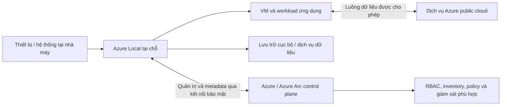
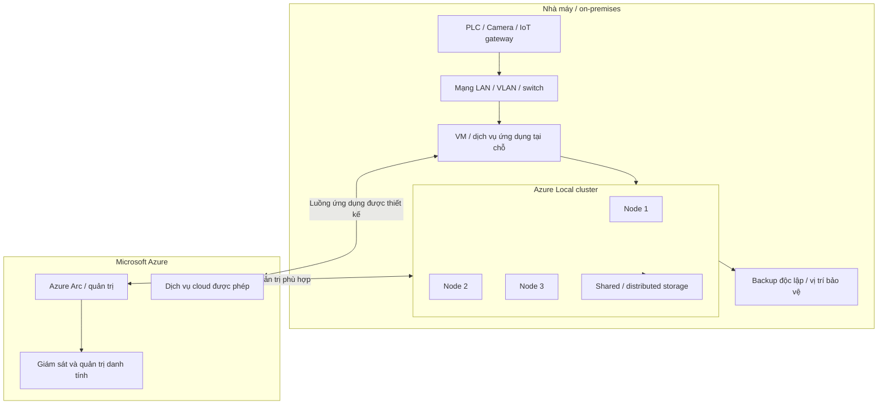

# Azure Local và lựa chọn hạ tầng hybrid tại chỗ

> **Chương:** Hybrid cloud và di chuyển lên Azure  
> **Mô-đun:** `CLOUD_PROVIDERS_AZURE` — khám phá hệ sinh thái Microsoft Azure từ subscription, resource group, Microsoft Entra ID đến mạng ảo, tính toán, lưu trữ và dữ liệu; học cách triển khai, giám sát, bảo vệ và kiểm soát chi phí một kiến trúc ứng dụng trên Azure.

## Mục tiêu học tập

Sau bài học này, người học có thể:

1. Giải thích **Azure Local** (tên mới của nền tảng trước đây gọi là **Azure Stack HCI**) và mối liên hệ giữa phần cứng tại chỗ, nền tảng ảo hóa, **Azure Arc** và Azure control plane.
2. So sánh Azure Local với **Azure Virtual Machines trên public cloud**, máy chủ **Azure Arc-enabled**, nền tảng ảo hóa tại chỗ và các sản phẩm hybrid khác để tránh chọn sai kiến trúc.
3. Xác định điều kiện phù hợp về **độ trễ, vị trí dữ liệu, kết nối mạng, phần cứng được xác thực, số nút, lưu trữ, tính sẵn sàng, quyền truy cập và chi phí**.
4. Mô tả quy trình lên kế hoạch, chuẩn bị, triển khai, đăng ký, quản trị và vận hành một hệ thống Azure Local có workload VM hoặc Kubernetes được hỗ trợ.
5. Thiết kế ranh giới bảo mật, phương án backup/DR, giám sát, cập nhật và tài liệu bàn giao cho hạ tầng hybrid.
6. Phân tích tình huống thực tế và lập **ma trận quyết định** chứng minh tại sao chọn hoặc không chọn Azure Local.

## 1. Bài toán: khi nào ứng dụng không thể chạy hoàn toàn trên Azure public cloud?

Một doanh nghiệp sản xuất có nhà máy tại Bình Dương. Hệ thống điều khiển dây chuyền đọc dữ liệu cảm biến, xử lý hình ảnh và ghi vào cơ sở dữ liệu nội bộ. Yêu cầu nghiệp vụ có thể bao gồm:

- Các vòng xử lý cần **độ trễ thấp và ổn định** giữa thiết bị sản xuất và ứng dụng.
- Một phần dữ liệu phải nằm trong cơ sở do doanh nghiệp vận hành theo chính sách đã phê duyệt.
- Ứng dụng cần tiếp tục một số chức năng tại nhà máy khi đường WAN gặp sự cố ngắn.
- Nhóm vận hành vẫn muốn có **cách quản lý, giám sát và chuẩn hóa** gần với mô hình Azure.
- Phần hạ tầng không thể chuyển lên public cloud cùng lúc vì thiết bị, hệ điều hành và phụ thuộc mạng.

Chạy toàn bộ ứng dụng trên Azure public cloud có thể làm tăng round-trip latency và phụ thuộc WAN. Giữ hoàn toàn nền tảng ảo hóa truyền thống tại nhà máy lại dẫn tới nhiều quy trình quản trị riêng biệt. Azure Local là **một lựa chọn cho phần compute và storage triển khai tại chỗ, kết hợp quản trị qua Azure**.

Điều này **không** có nghĩa mọi ứng dụng tại nhà máy nên đưa lên Azure Local. Cần phân biệt nhu cầu thực sự về latency, chủ quyền dữ liệu và vận hành địa phương với thói quen “có máy chủ thì giữ máy chủ”.

### Mô hình hybrid đơn giản



**Ranh giới cần nhớ:** dữ liệu và workload chạy trên thiết bị tại chỗ theo cấu hình của bạn; thông tin quản trị, đăng ký, tình trạng, telemetry và dữ liệu phát sinh bởi các dịch vụ tích hợp **có thể trao đổi với Azure**. Không được suy luận rằng “chạy tại chỗ” đồng nghĩa “không có thông tin nào ra khỏi địa điểm”.

## 2. Azure Local là gì?

**Azure Local** là nền tảng hạ tầng hybrid của Microsoft chạy trên **phần cứng tại chỗ được xác thực/hỗ trợ**, thường theo dạng hệ thống hyperconverged infrastructure (HCI). Nền tảng cung cấp môi trường chạy các workload được hỗ trợ như **virtual machines**, và trong những cấu hình thích hợp, **Kubernetes thông qua Azure Kubernetes Service (AKS) enabled by Azure Arc**. Nó kết nối với Azure để tích hợp quản trị, quản lý tài nguyên, giám sát và những năng lực được cung cấp cho phiên bản/kiểu triển khai tương ứng.

Tên **Azure Stack HCI** xuất hiện nhiều trong tài liệu, lệnh và loại tài nguyên cũ; Azure Local kế thừa dòng sản phẩm đó. **Azure Local không phải Azure Stack Hub**: hai nền tảng có phạm vi, kiến trúc và mô hình cung cấp dịch vụ khác nhau.

### Ba lớp cần phân biệt

| Lớp | Thành phần | Trách nhiệm |
|---|---|---|
| **Hạ tầng vật lý tại chỗ** | Máy chủ, CPU/RAM, NIC, ổ đĩa, switch, nguồn, tủ rack, hệ thống làm mát | Khả dụng, bảo trì, firmware, không gian và an ninh vật lý |
| **Nền tảng Azure Local** | OS và cluster/virtualization/storage/networking theo cấu hình được hỗ trợ | Chạy VM/container platform, chia sẻ tài nguyên, khả dụng nội bộ cluster |
| **Azure management plane** | Azure subscription, Azure Arc/integration, danh tính, RBAC, inventory, monitoring | Quản lý và tích hợp cloud theo phạm vi được hỗ trợ; yêu cầu kết nối và quyền |

Trong nhiều phiên bản/kiến trúc Azure Local, thành phần nền tảng dựa trên các công nghệ Windows Server Hyper-V, failover clustering và lưu trữ phần mềm định nghĩa như **Storage Spaces Direct**, kết hợp những thành phần quản lý của Azure. **Không thiết kế cluster bằng cách tự lắp các thành phần không được hỗ trợ**, dù bạn đã quen với Hyper-V.

### Những điều Azure Local không tự cung cấp

- Không biến toàn bộ Azure public cloud thành một bản sao chạy trong data center.
- Không có nghĩa mọi dịch vụ PaaS của Azure đều chạy tại chỗ.
- Không tự cung cấp backup/DR đầy đủ chỉ vì cluster có nhiều node và dữ liệu được nhân bản nội bộ.
- Không thay thế việc thiết kế ứng dụng, xử lý downtime, kết nối, danh tính hoặc tuân thủ.
- Không bảo đảm hệ thống hoàn toàn **disconnected** với Azure trong mọi phiên bản và gói sản phẩm.

Sự hỗ trợ đối với VM, Kubernetes, Azure Virtual Desktop và dịch vụ Azure Arc cụ thể **phụ thuộc phiên bản Azure Local, loại phần cứng, region, cấu hình và điều kiện cấp phép**. Khi triển khai thực tế phải kiểm tra tài liệu và danh sách hỗ trợ đang áp dụng cho giải pháp đã chọn.

## 3. So sánh Azure Local với các lựa chọn khác

| Giải pháp | Workload chạy ở đâu? | Điểm mạnh | Không nên hiểu nhầm |
|---|---|---|---|
| **Azure Virtual Machines** | Data center do Microsoft vận hành trên Azure public cloud | Mở rộng và vận hành tài nguyên cloud không phải sở hữu máy chủ vật lý | Phụ thuộc kết nối tới Azure đối với ứng dụng tại cơ sở |
| **Azure Local** | Phần cứng hỗ trợ do tổ chức vận hành tại chỗ/edge | Latency địa phương, đặt workload và dữ liệu theo yêu cầu, quản trị hybrid gắn Azure | Vẫn phải mua/vận hành phần cứng và đáp ứng điều kiện kết nối, phiên bản |
| **Azure Arc-enabled Servers** | Máy chủ hiện có (vật lý hoặc VM trên nền tảng khác) | Kết nối inventory, policy/monitoring và một số khả năng quản lý Azure | **Không** tự biến server thành Azure Local hoặc cung cấp hypervisor/storage cluster |
| **Hyper-V hoặc nền tảng ảo hóa truyền thống** | Data center của tổ chức | Linh hoạt khi đã có quy trình và phần cứng phù hợp | Không mặc nhiên có mô hình tích hợp/lifecycle Azure Local |
| **Azure Stack Hub** | Thiết bị/hạ tầng riêng theo mô hình sản phẩm tương ứng | Một tập dịch vụ/hành vi hybrid khác dành cho các yêu cầu cụ thể | Không đồng nghĩa Azure Local/Azure Stack HCI |
| **Azure Stack Edge** | Thiết bị edge theo mô hình được hỗ trợ | Xử lý và chuyển dữ liệu/edge workload theo phạm vi thiết bị | Không phải thay thế tổng quát cho cluster Azure Local |
| **Di chuyển toàn bộ workload lên cloud** | Azure public cloud | Giảm trách nhiệm vận hành phần cứng tại chỗ | Có thể không đạt yêu cầu latency, kết nối hoặc ràng buộc dữ liệu |

**Quy tắc phân biệt:** nếu mục tiêu chỉ là **quản trị các máy chủ đang có** qua Azure, hãy đánh giá Azure Arc-enabled Servers trước. Nếu cần **mua và triển khai một nền tảng compute/virtualization tại chỗ mới với mô hình Azure Local**, khi đó Azure Local mới là ứng viên trực tiếp.

### Ví dụ quyết định sơ bộ

- Ứng dụng web công cộng, có khả năng chạy trong region Azure gần người dùng, không bị ràng buộc on-prem → ưu tiên đánh giá Azure public cloud.
- Ứng dụng kết nối máy móc theo thời gian thực ở nhà máy, đã có yêu cầu giữ xử lý tại cơ sở, tổ chức sẵn sàng vận hành phần cứng hỗ trợ → đánh giá Azure Local.
- 300 VM trên VMware/Hyper-V hiện có, chỉ muốn thống nhất quản trị/kiểm kê mà chưa thay hạ tầng → đánh giá **Azure Arc** và các công cụ migration liên quan.
- Hệ thống phải hoạt động **không có bất cứ kết nối ra cloud trong thời gian dài** → kiểm tra kỹ điều kiện hỗ trợ disconnected operations của phiên bản/giải pháp cụ thể; không mặc định Azure Local thông thường phù hợp.

## 4. Ma trận quyết định kiến trúc

Trước khi chọn, lập bảng các điều kiện bắt buộc và tiêu chí so sánh. Một mô hình đơn giản:

| Tiêu chí | Câu hỏi kiểm chứng | Tác động tới lựa chọn |
|---|---|---|
| **Độ trễ** | p95 latency tối đa từ thiết bị tới ứng dụng là bao nhiêu? | Nếu WAN vượt ngưỡng, đặt xử lý tại chỗ có giá trị |
| **Vị trí dữ liệu** | Quy định nào buộc dữ liệu ở cơ sở/địa lý cụ thể? | Phải thiết kế đường đi, logs, backup và telemetry; không chỉ vị trí VM |
| **WAN/Internet** | Độ sẵn sàng, thời gian gián đoạn và yêu cầu outbound ra Azure? | Nếu không đáp ứng yêu cầu kết nối của sản phẩm, phải điều chỉnh kiến trúc |
| **Khả năng vận hành tại chỗ** | Có đội hardware/firmware, rack, nguồn, network, trực ca? | Thiếu năng lực này làm tăng rủi ro/chi phí của Azure Local |
| **Khả năng mở rộng** | Tăng tải theo tuần/tháng hay spike đột biến? | Cloud phù hợp hơn khi co giãn nhanh mà không muốn mua thiết bị |
| **Tính sẵn sàng/DR** | Cho phép hỏng node/site, RPO và RTO thế nào? | Cần thiết kế fault domains, backup, phục hồi độc lập |
| **License và TCO** | Tổng chi phí mua/vận hành trong 3–5 năm? | So sánh CAPEX+OPEX, không chỉ giá VM |
| **Tương thích workload** | OS, VM, AKS, network, storage, thiết bị ngoại vi có hỗ trợ? | Loại trừ lựa chọn nếu thiếu hỗ trợ chính thức |
| **Bảo mật** | Identity, phân tách vai trò, patch, encryption, auditing? | Cần cả cloud RBAC và quyền local/guest |
| **Tuổi thọ giải pháp** | Có vòng đời update, replacement, support rõ ràng không? | Tránh thiết kế gắn vào phần cứng/phiên bản sắp hết hỗ trợ |

**Tiêu chí loại trừ** phải được kiểm tra trước khi chấm điểm. Ví dụ, nếu một thiết bị phần cứng không nằm trong danh sách hệ thống được hỗ trợ hoặc môi trường hoàn toàn offline không đáp ứng điều kiện vận hành, điểm “giá rẻ” không cứu được phương án.

## 5. Kiến trúc tham chiếu Azure Local tại nhà máy

Một kiến trúc phổ biến về mặt ý tưởng gồm:

1. **Các node Azure Local** trên phần cứng được chứng nhận/hỗ trợ, nối qua switch và mạng quản trị/lưu trữ phù hợp thiết kế.
2. **Cluster virtualization và storage**, cung cấp tài nguyên cho VM cùng khả năng chịu lỗi nội bộ theo số node và chính sách dữ liệu.
3. **Mạng workload nội bộ**: VLAN/subnet, DNS, DHCP/static IP, gateway/firewall và kết nối tới thiết bị sản xuất.
4. **Kết nối Azure/hybrid**: các endpoint/route mà Azure Local và Azure Arc cần, có proxy/firewall nếu được hỗ trợ.
5. **Azure management**: subscription, resource group, danh tính, role, inventory, policy/monitoring và quản trị tài nguyên theo tính năng.
6. **Backup/DR**: bản sao độc lập, ở fault domain khác hoặc địa điểm được phê duyệt; thử phục hồi định kỳ.
7. **Ứng dụng**: VM Windows/Linux, cơ sở dữ liệu hoặc AKS-enabled workloads theo khả năng và tương thích sản phẩm.



Sơ đồ chỉ mô tả **vai trò logic**, không biểu diễn đầy đủ NIC, storage fabric, các mạng RDMA hoặc việc gắn từng VM lên node. Thiết kế thật phải bám theo kiến trúc phần cứng và triển khai Azure Local được hỗ trợ.

### Data plane và management plane

- **Data plane:** VM, disk, truy cập cảm biến, database và luồng ứng dụng. Nếu ứng dụng được thiết kế chạy nội bộ, nhiều đường truyền giữa máy móc và VM có thể ở trong mạng nhà máy.
- **Management plane:** đăng ký, quản lý cluster/resource, cập nhật, telemetry và các hoạt động Azure/Arc thích hợp. Đây là phần cần chính sách outbound connectivity và phân quyền.
- **Luồng ứng dụng sang Azure:** là lựa chọn thiết kế riêng, ví dụ đẩy kết quả tổng hợp lên cloud. Không nên đồng nhất nó với traffic mà nền tảng cần để duy trì quản trị.

Một số workload địa phương có thể tiếp tục hoạt động khi kết nối WAN tạm thời mất, **nhưng thời gian và chức năng có thể duy trì trong chế độ mất kết nối phụ thuộc dịch vụ, kiến trúc và phiên bản Azure Local**. Phải kiểm thử và xác nhận yêu cầu chính thức; không hứa khả năng offline vô hạn.

## 6. Phần cứng, số node và dung lượng

### 6.1. Hệ thống được xác thực/hỗ trợ

Azure Local không nên được triển khai tùy tiện trên những máy chủ bất kỳ chỉ vì có CPU hỗ trợ virtualization. Nên lựa chọn cấu hình từ **danh mục phần cứng và giải pháp đã được nhà cung cấp/Microsoft xác thực**, bao gồm:

- Model máy chủ, CPU, RAM, bộ điều khiển đĩa, SSD/NVMe, ổ đĩa, NIC và phiên bản firmware.
- Kiểu cluster, số node tối thiểu/tối đa và khả năng mở rộng của giải pháp.
- Switch, loại cổng, tốc độ, cấu hình RDMA và mạng lưu trữ khi kiến trúc yêu cầu.
- Phần mềm driver, BIOS, firmware và quy trình cập nhật được hỗ trợ.
- Khả năng hỗ trợ/chủ trách nhiệm của OEM, Microsoft và đội vận hành nội bộ.

Những cấu hình **single-node hoặc multi-node** có thể có điều kiện hỗ trợ khác nhau. Không áp số node “chuẩn” cho mọi thiết bị edge hoặc mọi phiên bản. Một node đơn lẻ không có khả năng chịu lỗi hỏng chính node đó như cluster nhiều node; cần đưa yêu cầu phục hồi vào quyết định.

### 6.2. Tính dung lượng với tình huống hỏng node

Giả sử mô hình **minh họa, không phải khuyến nghị SKU**:

- 3 node, mỗi node 32 core và 512 GB RAM.
- Tổng nguồn lực thô: 96 core, 1.536 GB RAM.
- Nếu yêu cầu vẫn phục vụ sau khi mất một node, chỉ còn tối đa 64 core và 1.024 GB RAM trên hai node, **trước khi trừ overhead, tài nguyên reserved, ràng buộc affinity và giới hạn khả dụng thực tế**.

Như vậy, không nên cấp phát để workload chỉ chạy được khi cả ba node đều khỏe.

| Nhóm dung lượng | Cần dự phòng |
|---|---|
| CPU/RAM | Nhu cầu peak của VM, khả năng chịu lỗi node, overhead hypervisor, growth |
| Storage | Dữ liệu đang dùng, số bản sao/parity, rebuild/rebalance, snapshot, tăng trưởng |
| Network | East-west traffic, storage traffic, latency và băng thông ra Azure |
| VM capacity | Giới hạn VM/node, anti-affinity, live migration và failover |
| Data services | IOPS/throughput, backup window, query latency và tính nhất quán |

**Dung lượng usable của storage không bằng dung lượng raw**. Resiliency kiểu mirror/parity, số fault domain, metadata và không gian để rebuild đều ảnh hưởng. Ví dụ “3 node × 10 TB = 30 TB usable” thường là kết luận sai nếu lưu trữ nhân bản để chịu lỗi.

### 6.3. Mạng vật lý và network fabric

Một thiết kế Azure Local cần kiểm tra khả năng:

- Tách luồng **management**, **storage**, **VM/application** theo topology được hỗ trợ.
- Cấu hình switch, VLAN, IP, DNS, NTP/time synchronization, MTU và routing đúng.
- Đáp ứng throughput và độ trễ storage fabric; nếu thiết kế cần RDMA, đảm bảo NIC/switch/driver tương thích.
- Tạo đường quản trị và cập nhật firmware khi network/workload đang chịu tải.
- Duy trì dự phòng khi mất một NIC, một switch hoặc một cổng theo mức fault tolerance mong muốn.

Các kỹ thuật như **Network ATC** và triển khai host networking có thể được hỗ trợ trên các phiên bản Azure Local nhất định. Không tự chuyển đổi mô hình network ngoài hướng dẫn của hệ thống/giải pháp được hỗ trợ.

## 7. Azure connectivity, danh tính và quyền truy cập

### 7.1. Kết nối quản trị không giống SSH/RDP vào VM

Trong mô hình được kết nối với Azure, cần chuẩn bị:

1. Subscription và resource group được phép quản lý Azure Local.
2. Microsoft Entra ID identities và các role cần thiết để tạo, đăng ký, xem hoặc vận hành tài nguyên Azure.
3. Đường **outbound connectivity** phù hợp từ hạ tầng/quản lý đến các endpoint Azure bắt buộc; cấu hình proxy, DNS và certificate inspection theo điều kiện hỗ trợ.
4. Đồng bộ thời gian và các dịch vụ tên miền/Active Directory cần thiết cho phiên bản/cách triển khai.
5. Phân đoạn mạng cho management, guest VMs, storage và ứng dụng; xác minh firewall theo **hướng đích/cổng cụ thể** thay vì mở toàn bộ.

Không kết luận “có Azure Portal” nghĩa không cần cấu hình mạng cục bộ. Trường hợp network bị chặn, trạng thái Azure resource và trạng thái cluster tại chỗ có thể khác nhau.

### 7.2. Các miền danh tính phải tách biệt

| Miền | Xác thực và quyền | Ví dụ |
|---|---|---|
| **Azure control plane** | Entra ID + Azure RBAC tại scope tương ứng | Ai xem/quản trị Azure Local resource, Arc-enabled VMs |
| **Cluster/host** | Quyền quản trị OS/cluster theo mô hình hỗ trợ | Ai được thao tác khẩn cấp trên node, network hoặc storage |
| **Guest VM** | Windows/Linux local accounts, AD DS/Entra integration theo kiến trúc | Ai đăng nhập VM và cài ứng dụng |
| **Workload/database** | Service identity, DB roles, secret và certificate | Ai được truy cập dữ liệu đơn hàng |
| **Hardware/network** | BMC/OOB, switch và firmware management | Ai có thể tắt nguồn, sửa boot order hoặc VLAN |

**RBAC trong Azure không tự thay thế quyền của hệ điều hành khách, Active Directory hoặc BMC**. Phải có bảng quyền, người sở hữu và quy trình nâng quyền tạm thời, đặc biệt trong tình huống sự cố.

### 7.3. Azure Arc liên quan thế nào?

Azure Arc là nhóm khả năng đưa tài nguyên ngoài public cloud vào mô hình quản lý Azure. Trong các kịch bản Azure Local được hỗ trợ, Azure Arc và những thành phần tích hợp có thể giúp:

- Hiển thị tài nguyên cùng metadata và resource IDs trong Azure.
- Quản lý vòng đời **Arc-enabled virtual machines** qua giao diện/API phù hợp.
- Kết nối với policy, tagging, monitoring hoặc các dịch vụ bảo mật được hỗ trợ.
- Triển khai Kubernetes/AKS-enabled workloads theo cấu hình hỗ trợ.

**Azure Arc-enabled Servers** chạy trên một VM hoặc máy chủ hiện có không biến host đó thành node Azure Local; còn **Azure Local** là nền tảng hạ tầng riêng cần triển khai đúng phần cứng, cluster và quản trị.

## 8. Workload: VM, Kubernetes và dữ liệu tại chỗ

### 8.1. Virtual machines

Đối với VM Windows/Linux, cần lập kế hoạch:

- OS image và phiên bản guest có trong danh sách hỗ trợ.
- vCPU, memory, disk sizing, mạng logical/virtual, static/DHCP IP và DNS.
- Azure Arc hoặc thành phần quản lý VM thích hợp của phiên bản Azure Local.
- Quyền tạo, start/stop, snapshot/backup và quản lý guest.
- Quota/overcommit, anti-affinity, failover và lịch bảo trì.

Không mặc định mọi thao tác **Azure VM public cloud** có cùng API, SKU hoặc hành vi đối với Azure Local VM. Nhiều workload trên Azure Local vẫn phụ thuộc công cụ/hệ quản trị local cùng phạm vi tích hợp Arc cụ thể.

### 8.2. AKS enabled by Azure Arc trên Azure Local

Một số triển khai Azure Local hỗ trợ chạy cluster Kubernetes được quản lý thông qua **AKS enabled by Azure Arc**, phù hợp cho ứng dụng containerized tại biên. Trước khi chọn cần kiểm tra:

- Phiên bản Azure Local và AKS integration được hỗ trợ.
- Yêu cầu network, IP pools, DNS, image registries và pull secrets.
- Storage classes/persistent volumes, cơ chế backup của stateful workloads.
- Khả năng nâng cấp cluster/control plane/worker node theo vòng đời được hỗ trợ.
- Identity, RBAC, container registry, chính sách image và telemetry.

**Không đưa database stateful quan trọng vào một cluster Kubernetes tại chỗ chỉ vì đã cài AKS.** Đánh giá lưu trữ, consistency, backup và yêu cầu vận hành chuyên sâu trước.

### 8.3. Workload chia giữa Azure Local và Azure public cloud

Ví dụ kiến trúc hợp lý:

- **Tại chỗ:** camera processing, máy móc, API xử lý sự kiện có latency rất thấp, hàng đợi buffer địa phương.
- **Trên Azure:** báo cáo tổng hợp, phân tích dài hạn, lưu trữ archive, dịch vụ public-facing, hệ thống quản lý đa địa điểm.

Cần thiết kế việc dữ liệu được đồng bộ qua WAN (batch/stream), retry, idempotency, thứ tự sự kiện, xử lý offline và chính sách lưu trữ. Giảm số lượng call đồng bộ qua WAN trên đường xử lý yêu cầu latency nghiêm ngặt.

## 9. Quy trình chuẩn bị và triển khai Azure Local

Các thao tác portal, wizard, định dạng cấu hình và API có thể thay đổi theo phiên bản Azure Local. Dưới đây là **runbook cấp kiến trúc**, không phải tập lệnh có thể áp vào mọi thiết bị.

### Giai đoạn A — Discovery và thiết kế

1. Kiểm kê workloads, OS, dung lượng, phụ thuộc database, network, backup, license và owner.
2. Xác định latency SLO, RPO/RTO, vùng dữ liệu, availability target và thời gian có thể bảo trì.
3. Chọn Azure Local hay Azure VMs/Arc/giải pháp khác dựa trên ma trận ở mục 4.
4. Chọn **validated solution/hardware** và phối hợp OEM về số node, SSD/NIC, switch, firmware và support.
5. Dựng thiết kế địa chỉ mạng, VLAN, DNS, proxy, AD DS/identity và yêu cầu Azure endpoints.
6. Tính sizing chịu lỗi node, storage usable, IOPS, backup capacity và tăng trưởng tối thiểu 3–5 năm theo chính sách doanh nghiệp.

### Giai đoạn B — Chuẩn bị subscription và hạ tầng

1. Xác minh subscription, resource group, quyền Entra ID/Azure RBAC, chính sách tagging và nơi chứa logs.
2. Cấu hình rack, power, uplink, quản lý ngoài băng, switching và đặt địa chỉ theo sơ đồ được duyệt.
3. Kiểm tra health, firmware, BIOS, NIC, storage, network theo hướng dẫn OEM và danh mục hỗ trợ.
4. Xác minh outbound DNS/TLS/route đến các endpoint bắt buộc, cùng AD DS và đồng bộ thời gian.
5. Chuẩn bị runbook bảo trì, backup/DR, tài khoản khẩn cấp, người duyệt và kế hoạch rollback của deployment.

### Giai đoạn C — Triển khai và đăng ký

1. Dùng quy trình triển khai **Azure Local** đúng phiên bản/giải pháp qua Azure Portal hoặc phương thức được hỗ trợ.
2. Chọn tên tài nguyên, subscription, resource group, vị trí quản lý và node của cluster theo wizard.
3. Cung cấp thông số host, mạng và storage theo validated configuration; để quá trình validation xác nhận trước khi deploy.
4. Triển khai/đăng ký các thành phần tích hợp Azure/Arc được yêu cầu.
5. Kiểm tra deployment health và kiểm tra từng node, virtual disk, cluster resources, identity và kết nối Azure.
6. Thiết lập workload network, image, VM provisioning/AKS integration **theo tính năng có trong môi trường**.

**Không bỏ qua validation errors bằng cách tắt cảnh báo để hoàn tất deployment.** Những sai lệch storage/network nhỏ có thể chỉ xuất hiện thành sự cố nghiêm trọng khi một node hỏng hoặc trong lúc cập nhật firmware.

### Giai đoạn D — Nghiệm thu

Tiêu chí hoàn thành:

- Cluster health ổn định; không có node, disk hoặc network path quan trọng ở trạng thái lỗi.
- Một VM thử chạy, boot, có mạng và storage đúng, ứng dụng demo đáp ứng latency SLO.
- Azure management có quyền đúng người/đúng scope và inventory thống nhất với cluster thực tế.
- Monitoring, alerting, logs và backup được cấu hình; thử restore ít nhất một workload mẫu.
- Kịch bản failover/bảo trì được diễn tập theo khả năng của cấu hình.
- Chi phí, hỗ trợ OEM và lịch update được bàn giao cho nhóm vận hành.

## 10. Thao tác kiểm tra chỉ đọc khi vận hành

Có thể dùng Azure Portal để xem tài nguyên Azure Local đã đăng ký và tình trạng theo tính năng tích hợp. Với Azure CLI, ví dụ **chỉ đọc danh sách tài nguyên** trong subscription đã được chọn:

```bash
az login
az account show --query "{subscription:id,name:name}" --output table

# Loại tài nguyên cluster thường thấy trong các phiên bản Azure Local/Azure Stack HCI.
az resource list \
  --resource-type "Microsoft.AzureStackHCI/clusters" \
  --query "[].{name:name,resourceGroup:resourceGroup,location:location}" \
  --output table
```

**Giới hạn:** loại tài nguyên và thông tin hiển thị phụ thuộc phiên bản Azure Local/đăng ký; danh sách ở Azure không thay thế kiểm tra tình trạng vật lý trong cluster. Không suy luận “Azure resource hiển thị Succeeded” nghĩa tất cả disks và VMs đều khỏe.

Trên host hoặc trạm quản trị Windows có module tương ứng và **được cấp quyền**, một nhóm lệnh PowerShell kiểm tra trạng thái có thể gồm:

```powershell
# Trên máy quản trị có module FailoverClusters và quyền thích hợp.
Get-Cluster
Get-ClusterNode | Select-Object Name, State

# Storage cmdlets: kiểm tra trạng thái, KHÔNG thay đổi pool/virtual disk.
Get-StoragePool | Select-Object FriendlyName, HealthStatus, OperationalStatus
Get-VirtualDisk | Select-Object FriendlyName, HealthStatus, OperationalStatus

# Network và VM khi cmdlet tương ứng có sẵn trong môi trường quản trị.
Get-NetAdapter | Select-Object Name, Status, LinkSpeed
Get-VM | Select-Object Name, State, CPUUsage, MemoryAssigned
```

Lệnh minh họa nhằm **đọc**, không triển khai cluster mới và không chỉnh sửa. Kết quả và cmdlet khả dụng phụ thuộc node, vai trò, module và phiên bản; **không thay đổi network/storage trực tiếp ngoài quy trình quản trị Azure Local được hỗ trợ**.

### Các chỉ số cần theo dõi

| Lớp | Ví dụ tín hiệu | Khi nào cần điều tra |
|---|---|---|
| Node/hardware | Health, CPU, RAM, nhiệt độ, firmware, nguồn | Nút bị degraded, ECC/đĩa lỗi, quá nhiệt |
| Cluster/storage | Resiliency health, free capacity, rebuild, latency, IOPS | Không đủ headroom chịu lỗi, rebuild lâu |
| Network | Link state, congestion, packet loss, storage network | Latency tăng, mất đường dự phòng |
| VM | Power state, CPU ready/pressure, memory, disk latency, guest health | VM không start/failover, SLO vi phạm |
| Azure/Arc | Registration, agent/integration health, policy/monitoring availability | Inventory mất cập nhật, kết nối quản trị lỗi |
| Ứng dụng | p95/p99, error rate, DB queries, queue, business transactions | Có thay đổi hạ tầng nhưng ứng dụng không còn đáp ứng |
| Backup/DR | Recovery point age, job failures, restore-test evidence | Không đạt RPO/RTO |

Azure Monitor, Azure Arc, Defender for Cloud hoặc dịch vụ liên quan chỉ hiển thị những dữ liệu và khả năng **đã cấu hình và được hỗ trợ**. Không coi thiếu cảnh báo là chứng minh mọi thành phần tại chỗ đang khỏe.

## 11. Bảo mật và phân chia trách nhiệm

### 11.1. Mô hình shared responsibility trong hybrid

| Trách nhiệm | Bên thực hiện chính |
|---|---|
| Nguồn điện, vật lý, switch, rack, firmware, bảo trì thiết bị | Tổ chức/OEM theo hợp đồng |
| Cấu hình Azure Local, network, cluster, update orchestration | Nhóm platform được ủy quyền theo phương thức hỗ trợ |
| Azure subscription, Entra ID, RBAC, policy và giám sát tích hợp | Nhóm cloud governance / security |
| Guest OS, application, dữ liệu, secret, patch ứng dụng | Nhóm workload |
| Backup, DR, restore tests và quản lý dữ liệu lưu giữ | Workload owner cùng platform/security |
| Hỗ trợ và escalation | Nhóm vận hành + Microsoft/OEM theo phạm vi hợp đồng |

Không giả định nhà cung cấp sẽ chịu trách nhiệm **khôi phục toàn bộ ứng dụng** chỉ vì đã bán thiết bị.

### 11.2. Biện pháp bảo mật cần thiết

- Tách quyền Azure subscription/resource group, quyền cluster/host, quyền guest VM, quyền AD DS và tài khoản quản trị BMC.
- Sử dụng **least privilege**, approval/PIM phù hợp với vai trò và không chia sẻ tài khoản local admin.
- Bảo vệ outbound management, DNS, TLS, network segmentation, firewall và routing; chỉ allow-list những đường cần thiết.
- Mã hóa dữ liệu lưu trữ và truyền tải theo cấu hình được hỗ trợ, quản trị khóa và các secrets ứng dụng.
- Theo dõi vulnerability/patch cho OS, firmware, guest và ứng dụng; bảo vệ chuỗi cung ứng image container/VM.
- Thiết kế audit: thay đổi Azure RBAC, cluster config, host/VM, quyền workload, backup và hành động quản trị khẩn cấp.
- Xem xét Azure Policy/Defender/monitoring qua Arc ở phạm vi **có hỗ trợ**; xác nhận coverage thay vì suy rằng mọi policy của Azure public cloud tự áp lên Azure Local.

### 11.3. Yêu cầu về data residency

Khi có ràng buộc “dữ liệu tại chỗ”, cần kiểm tra ít nhất: data disks, backups, snapshot, logs, traces, metadata, crash dumps, update diagnostics, cấu hình Azure Arc/monitoring và đường đồng bộ ứng dụng. Có những metadata/telemetry được gửi tới Azure như một phần quản trị; hợp đồng và khả năng cấu hình cần được đánh giá bởi nhóm bảo mật/pháp chế.

**Không đưa dữ liệu nhạy cảm vào diagnostic logs hoặc Azure tags/resource names** chỉ vì nó không nằm trong database.

## 12. High availability, backup và disaster recovery

**Cluster HA không phải là backup hoặc DR.** Một cluster có thể chịu một số lỗi node/disk, nhưng vẫn không tự phục hồi được dữ liệu bị xóa nhầm, mã độc mã hóa, lỗi ứng dụng, mất cả phòng máy hoặc mất nguồn diện rộng.

| Sự cố | Biện pháp cần đánh giá |
|---|---|
| Một disk/NIC/node lỗi | Resiliency của storage/network/cluster, failover, đủ capacity sau lỗi |
| Host cần cập nhật/firmware | Quy trình rolling maintenance/updates được hỗ trợ và health validation |
| User xóa dữ liệu hoặc DB corrupt | Backup độc lập, retention/immutability, restore test |
| Mất toàn bộ site | Bản sao/backup ở fault domain hoặc site khác, DR runbook |
| Mất WAN/management connectivity | Nghiệm thu ứng dụng địa phương, quản trị sự cố, điều kiện disconnected cụ thể |
| Lỗi logical của ứng dụng | Versioned artifacts, DB consistency, transactional restore và rollback |

### RPO/RTO vẫn là mục tiêu của ứng dụng

- **RPO**: lượng dữ liệu tối đa có thể mất, ví dụ 15 phút.
- **RTO**: khoảng gián đoạn tối đa, ví dụ 2 giờ.

Chỉ có ba node và lưu trữ phân tán **không chứng minh đạt RPO 15 phút hoặc RTO 2 giờ** khi mất cả site. Cần xác định nơi backup, phương thức replication, mức độ nhất quán, thời gian khởi động VM/DB và khả năng quay lại chạy thật.

### Checklist backup/DR

1. Kiểm kê toàn bộ VM, hệ CSDL, file, secrets, certificates và những phụ thuộc ngoài cluster.
2. Chọn backup/replication được **nhà cung cấp hỗ trợ cho phiên bản Azure Local và workload**; không mặc định mọi tính năng Azure Backup/ASR áp dụng như Azure public VM.
3. Tách bản backup khỏi cùng failure domain và áp dụng quyền/retention/immutability thích hợp.
4. Diễn tập restore tệp, VM và dữ liệu ứng dụng vào môi trường cô lập; đo thời gian thật.
5. Kiểm thử network, identity, DNS, certificate, database và các ứng dụng phụ thuộc khi chuyển site.
6. Viết và lưu runbook có ngưỡng go/no-go, rollback và người chịu trách nhiệm.

## 13. Update và vận hành vòng đời

Triển khai Azure Local không kết thúc khi VM đầu tiên chạy được. Đây là **một hệ thống vật lý có vòng đời**:

- Quản lý bản cập nhật platform, driver, firmware và thành phần tích hợp Azure theo **quy trình hỗ trợ của giải pháp/OEM**.
- Đọc release notes, kiểm tra compatibility, backup và sức khỏe cluster trước khi cập nhật.
- Lập lịch với yêu cầu ứng dụng, bảo đảm headroom nếu phải đưa một node vào maintenance.
- Theo dõi health trong/sau update và xác nhận failover/network/storage đúng.
- Không ép cập nhật firmware hoặc network stack thủ công ngoài ma trận hỗ trợ, kể cả khi một thao tác dường như làm “đỡ lỗi” tức thời.
- Chuẩn bị kế hoạch khi một node hỏng không sửa được: spare hardware, replacement, warranty, escalation và revalidation.

### Khi Azure/Arc hiển thị lỗi kết nối

Điều tra theo thứ tự:

1. Cluster, node và workload local còn chạy không?
2. DNS, thời gian, chứng chỉ, proxy, firewall/route outbound có thay đổi không?
3. Các endpoint Azure bắt buộc của phiên bản đang sử dụng có được phép truy cập không?
4. Arc integration/agent và resource registration có trạng thái lỗi hay hết hạn điều kiện nào không?
5. Có maintenance/incident phía Azure hoặc tenant/subscription/role assignment thay đổi không?

Không mở inbound public hay tắt toàn bộ firewall để “thử cho nhanh”. Hãy dùng bài kiểm tra kết nối tối thiểu đã được nhà sản xuất hỗ trợ và ghi lại thay đổi để rollback.

## 14. Chi phí và tổng chi phí sở hữu (TCO)

Azure Local thường có **CAPEX** phần cứng và các chi phí **OPEX** tại chỗ. So sánh với public cloud phải dùng tổng chi phí trong cùng thời gian và cùng SLO, không so đơn giá một VM cloud với giá server không tính điện, nhân sự và backup.

Một công thức tham khảo:

\[
\begin{aligned}
TCO_{\text{Local}} ={}&
C_{\text{hardware + maintenance}} +
C_{\text{software/license/subscription}}\\
&+ C_{\text{power + cooling + rack}}+
C_{\text{network/WAN}}\\
&+ C_{\text{backup + DR}}+
C_{\text{operations/security}}+
C_{\text{refresh}}
\end{aligned}
\]

Cách tính phí Azure Local có thể liên quan đến số **physical cores** và hình thức subscription/quyền lợi theo gói, còn Windows Server/SQL Server/AKS/AVD hoặc các dịch vụ bổ sung có thể có điều kiện cấp phép và phí riêng. Phải xác minh **bảng giá, Azure Hybrid Benefit, chính sách license của guest OS và hợp đồng hiện hành**, không suy đoán rằng license Azure Local đã bao gồm toàn bộ bản quyền ứng dụng.

### Mẫu so sánh 3–5 năm

| Khoản mục | Azure Local tại chỗ | Azure public cloud |
|---|---|---|
| Compute/Storage nền tảng | Đầu tư server/disk/switch, hợp đồng OEM | SKU, storage và các meter Azure |
| License | Azure Local và guest/workload theo điều kiện | OS/DB/VM/managed service theo phương án |
| Nguồn và không gian | Điện, làm mát, rack, vật lý | Đã được phản ánh gián tiếp trong giá dịch vụ cloud |
| Quản trị | Nhân sự hardware, cluster, update, security | Nhân sự cloud, governance và workload |
| Mở rộng | Mua thêm phần cứng, kiểm tra năng lực cluster | Scale theo quota/capacity và chính sách cloud |
| Network | LAN/storage/WAN, kết nối Azure | VPN/ExpressRoute/egress và truyền dữ liệu |
| DR/backup | Site/bản sao/thiết bị hoặc dịch vụ hỗ trợ | Backup/replication/region khác theo kiến trúc |
| Rủi ro | Hỏng thiết bị, chu kỳ thay thế, thiếu linh kiện | Thay đổi giá/SKU, phụ thuộc vùng và mạng |

### Ví dụ kinh tế giả định

Một ứng dụng xử lý 24/7 tại nhà máy có nhu cầu CPU/RAM tương đối ổn định, băng thông LAN cao và độ trễ thiết bị nghiêm ngặt. Azure Local có thể có lợi về **latency và kiểm soát vận hành địa phương**, nhưng cần thêm chi phí phần cứng/nhân sự/support. Một ứng dụng chỉ chạy theo đợt vài giờ mỗi tuần có thể phù hợp hơn với **compute cloud bật theo nhu cầu** nếu đường mạng đáp ứng.

Không kết luận phương án rẻ hơn khi chưa có đủ số liệu về **workload thực, utilization, dữ liệu truyền, chi phí cấp phép, downtime và chu kỳ thay thế phần cứng**.

## 15. Các tình huống lựa chọn và phản ví dụ

### Tình huống A — Dây chuyền sản xuất cần xử lý tại chỗ

**Điều kiện:** camera và thiết bị công nghiệp cần xử lý trong LAN; phần mềm chạy trên VM được hỗ trợ; có đội IT tại cơ sở; dữ liệu giao dịch cần đồng bộ tổng hợp lên Azure.

**Ứng viên:** Azure Local với VM hoặc container/Kubernetes theo hỗ trợ sản phẩm. Cần kiểm tra latency thực, thiết kế WAN outage, validated hardware, storage, HA, backup và chi phí.

**Không tự động đạt:** yêu cầu vận hành hoàn toàn offline kéo dài, giao diện điều khiển an toàn chức năng hoặc thiết bị phần cứng chuyên dụng chưa được chứng nhận. Các yêu cầu này cần đánh giá riêng.

### Tình huống B — Công ty chỉ muốn quản trị 100 máy chủ đang có

**Điều kiện:** nhiều VM trên hypervisor hiện tại, vận hành ổn, nhu cầu chủ yếu là inventory, governance, security visibility và logs.

**Ứng viên đầu tiên:** Azure Arc-enabled Servers và các dịch vụ quản trị phù hợp, không mặc định mua Azure Local. Nếu sau này cần refresh toàn bộ nền tảng ảo hóa, có thể đánh giá Azure Local trong dự án riêng.

### Tình huống C — Ứng dụng mới có lưu lượng biến động mạnh

**Điều kiện:** web/API chạy ngoài giờ cao điểm ít tải, không có yêu cầu xử lý gần thiết bị tại chỗ và dữ liệu được phép đặt ở Azure.

**Ứng viên:** App Service, AKS, Azure Container Apps hoặc Azure VMs trên public cloud tùy kiến trúc. Đầu tư cluster Azure Local có thể không phù hợp vì capacity cứng và yêu cầu vận hành vật lý.

### Tình huống D — Nơi triển khai không có kết nối ra Internet/Azure

**Điều kiện:** hạ tầng nằm trong vùng không thể kết nối ra cloud theo chính sách, không chỉ mất WAN vài giờ.

**Đánh giá:** không mặc định bản Azure Local connected phổ thông đáp ứng. Chỉ cân nhắc khả năng disconnected đã được hỗ trợ chính thức cho phiên bản/thiết bị/kiến trúc cụ thể; nếu không, chọn nền tảng local khác có điều kiện hỗ trợ rõ ràng.

## 16. Bài thực hành: lập phương án Azure Local cho một chi nhánh

**Đề bài:** Một chuỗi bán lẻ có kho trung chuyển cần ứng dụng đọc barcode và xử lý tồn kho tại cơ sở, kết nối tới Azure public cloud để tổng hợp. Mạng WAN mất kết nối ngắn vài lần mỗi tháng; hệ thống phải tiếp tục một số chức năng địa phương. Dữ liệu kho có yêu cầu backup và có thời hạn giữ.

### Bước 1 — Tạo bảng yêu cầu

| Yêu cầu | Giá trị giả định cho lab | Bằng chứng cần thu thập |
|---|---|---|
| Latency đọc barcode | p95 dưới 20 ms trong LAN | Đo thực từ thiết bị tới ứng dụng |
| Số VM / workload | 12 VM, 2 dịch vụ container | Compatibility, sizing từng dịch vụ |
| Dung lượng | 8 TB dữ liệu và tăng 20%/năm | Dung lượng usable và storage resiliency |
| WAN | Kết nối tới Azure nhưng có outage ngắn | Đo uptime, kiểm thử khi WAN mất |
| Availability | Chịu được lỗi một node | Capacity N−1, network/storage và failover test |
| Backup | RPO 1 giờ, RTO 4 giờ cho ứng dụng quan trọng | Phương án backup/restore có kiểm chứng |
| Bảo mật | Không public inbound vào các host | Segmentation, identity, logs, patching |
| Vòng đời | Dự toán TCO 3 năm | Quote phần cứng, software, support, điện và nhân sự |

Các số liệu trên chỉ là **mẫu bài tập**, không phản ánh cấu hình tối thiểu của Azure Local hay cam kết hiệu năng.

### Bước 2 — So sánh ba lựa chọn

Hãy điền ma trận sau cho **Azure Local**, **Azure public cloud** và **giữ hypervisor hiện tại + Azure Arc**:

| Tiêu chí | Azure Local | Azure public cloud | Hypervisor + Arc |
|---|---|---|---|
| Latency và phụ thuộc WAN | … | … | … |
| Dữ liệu tại chỗ / telemetry | … | … | … |
| Đầu tư phần cứng | … | … | … |
| Năng lực đội vận hành | … | … | … |
| Tính tương thích VM/K8s | … | … | … |
| Backup và RPO/RTO | … | … | … |
| Chi phí 3 năm | … | … | … |
| Điều kiện loại trừ | … | … | … |

### Bước 3 — Thiết kế kiến trúc

1. Chọn loại phần cứng được hỗ trợ **theo nhu cầu**, không tự xác nhận một SKU cụ thể là validated khi chưa có danh mục hỗ trợ.
2. Vẽ management network, storage fabric, workload VLAN, WAN route và đường ra Azure.
3. Mô tả Azure subscription/resource group, Azure RBAC, quyền cluster, quyền guest và người sở hữu.
4. Chọn một VM ứng dụng demo; ghi vCPU/RAM/disk/network, SLO và cách thử latency.
5. Thiết kế backup độc lập và diễn tập restore một bản ghi kho mẫu.
6. Xác định cách quản trị khi mất kết nối Azure và thời gian mất kết nối tối đa **đã kiểm tra được hỗ trợ**.
7. Ước tính TCO, xác định giới hạn về license, support, điện, rack, bandwidth.

### Bước 4 — Kiểm thử và nghiệm thu

Nếu có hệ thống lab được cấp quyền:

- Kiểm tra health cluster và các node bằng công cụ được hỗ trợ; không phá fault domain production để thử.
- Triển khai một VM hoặc workload demo theo quy trình được hỗ trợ.
- Đo latency và tính sẵn sàng khi tải bình thường; theo dõi CPU, storage latency, link errors và ứng dụng.
- Diễn tập phương án failover ở môi trường được phép, xác nhận headroom N−1.
- Thử mất **đường WAN trong lab theo quy trình phê duyệt**, quan sát chức năng nào còn chạy và chức năng Azure nào bị ảnh hưởng; không kết luận từ lý thuyết.
- Thử backup/restore dữ liệu demo và ghi RPO/RTO thực đo.

Nếu không có quyền triển khai Azure Local, hoàn thành dưới dạng **bản thiết kế và runbook mô phỏng**; không tự thực hiện thao tác trên hệ thống không thuộc quyền sở hữu.

### Tiêu chí đạt

Bài tập đạt khi chọn được phương án và nêu **lý do có thể kiểm chứng**, không vi phạm điều kiện phần cứng/kết nối/latency; có đủ network, identity, availability, backup, vận hành và TCO; xác định được những giả thuyết phải test trước khi production.

### Câu hỏi tự kiểm tra

1. Vì sao Azure Local khác Azure Arc-enabled Servers dù cả hai có thể xuất hiện trong Azure Portal?
2. Workload được chạy tại chỗ có đồng nghĩa mọi metadata và telemetry đều không ra khỏi cơ sở không?
3. Những điều kiện nào khiến Azure public cloud thích hợp hơn Azure Local?
4. Tại sao tổng RAM của ba node không phải là lượng RAM có thể cấp phát hết nếu muốn chịu lỗi một node?
5. Nếu lưu trữ đã nhân bản giữa các node, tại sao vẫn phải backup và diễn tập DR?
6. Quyền Azure RBAC có tự cho phép một người quản trị guest Windows VM và switch mạng không?
7. Khi WAN lỗi, có thể khẳng định mọi chức năng Azure Local hoạt động vô hạn mà không cần Azure không? Vì sao?
8. Nêu các nhóm chi phí phải tính khi so TCO Azure Local với Azure VMs.
9. Để triển khai AKS enabled by Azure Arc, cần kiểm tra những điều kiện nào?
10. Bốn nhóm tín hiệu quan trọng nhất trong lần nghiệm thu Azure Local là gì?

## 17. Tổng kết

**Azure Local** là một cách đưa năng lực compute/virtualization được hỗ trợ vào **địa điểm của doanh nghiệp**, đồng thời gắn với mô hình quản trị và hệ sinh thái Microsoft Azure. Nó phù hợp khi nhu cầu **xử lý địa phương, latency, dữ liệu và vận hành hybrid** đủ mạnh để biện minh cho phần cứng và công việc quản trị tại chỗ.

Lựa chọn đúng không bắt đầu từ tên sản phẩm mà từ các ràng buộc **workload, dữ liệu, kết nối, supported hardware, khả dụng, backup, security và TCO**. So sánh với Azure public cloud, Arc-enabled Servers và nền tảng ảo hóa hiện có; kiểm chứng trên pilot và thiết kế vận hành đầy đủ trước khi mở rộng production. Một cluster chạy được VM mới chỉ là điểm khởi đầu — hệ thống hybrid đáng tin cậy phải có quản trị quyền, giám sát, cập nhật, diễn tập phục hồi và người sở hữu rõ ràng.
