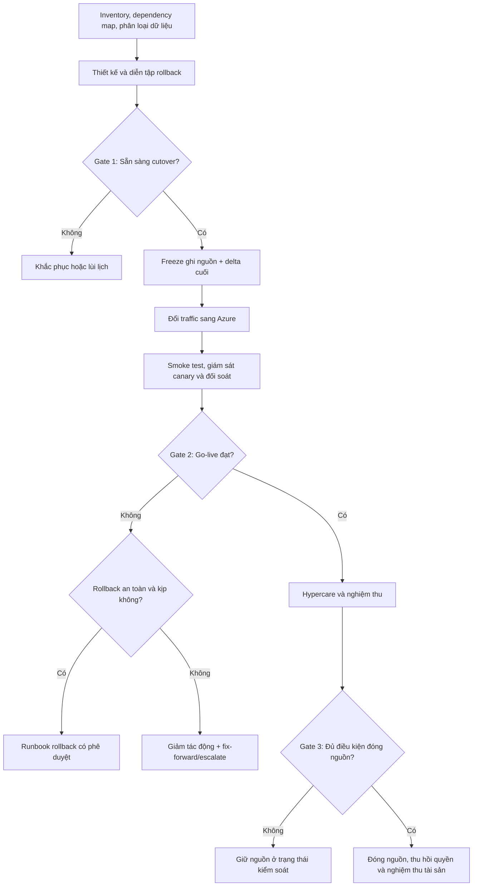
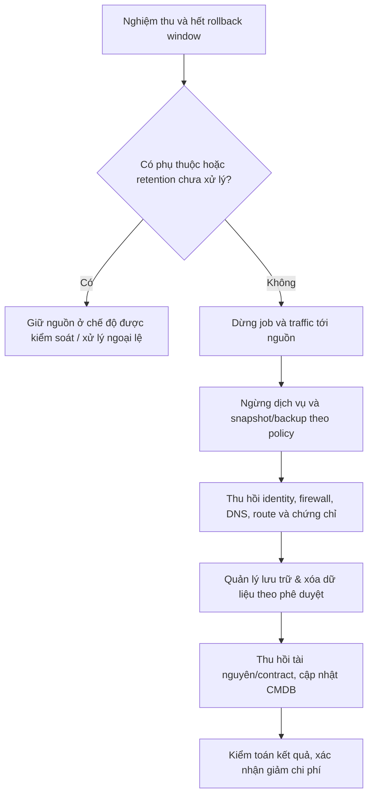

# Lập kế hoạch rollback, nghiệm thu và đóng hệ thống nguồn

## 1. Mục tiêu bài học và tình huống

Di chuyển hệ thống lên Microsoft Azure không kết thúc tại thời điểm máy ảo khởi động được hoặc dữ liệu xuất hiện trong Azure Storage. Một đợt migration chỉ thực sự thành công khi **người dùng làm việc được trên hệ thống mới**, dữ liệu đã được đối soát, quyền và bảo mật đáp ứng yêu cầu, các nhóm liên quan **ký nghiệm thu**, và hệ thống nguồn chỉ được ngừng hoạt động **sau khi không còn cần để rollback, đối soát hay tuân thủ**.

Trong chương **Hybrid cloud và di chuyển lên Azure** thuộc mô-đun `CLOUD_PROVIDERS_AZURE`, bài học này đưa ra một quy trình trọn vẹn cho ba hoạt động liên quan nhưng khác nhau: **lập kế hoạch rollback**, **nghiệm thu hệ thống đích** và **đóng hệ thống nguồn**. Các ví dụ gắn với subscription, resource group, Microsoft Entra ID, mạng ảo, compute, storage, database, giám sát, bảo vệ và kiểm soát chi phí của một kiến trúc ứng dụng trên Azure.

Sau bài học, bạn có thể:

- Phân biệt rollback migration với disaster recovery, failback và phương án **fix-forward**.
- Xác định các **điểm không thể quay lui dễ dàng** khi DNS, dữ liệu giao dịch, schema database hoặc quyền truy cập đã thay đổi.
- Viết runbook rollback có trigger, thời hạn quyết định, người phê duyệt, thứ tự thao tác và cách kiểm tra sau rollback.
- Xây dựng tiêu chí nghiệm thu gồm **tính toàn vẹn dữ liệu, tính năng nghiệp vụ, hiệu năng, bảo mật, backup/restore, vận hành và chi phí**.
- Thiết kế thời gian **hypercare/stabilization**, đóng băng hệ thống nguồn và quy trình ngừng sử dụng có thể kiểm toán.
- Đánh giá khi nào **không nên xóa nguồn** vì pháp lý, retention, dependency hoặc khả năng khôi phục chưa đầy đủ.

**Tình huống xuyên suốt:** doanh nghiệp chuyển `Shop API` từ cụm VM và cơ sở dữ liệu on-premises lên Azure App Service/VM, Azure SQL, Azure Storage. Trước cutover, dữ liệu nền đã được sao chép; sau cutover, đơn hàng mới phát sinh tại Azure. Nếu người dùng gặp lỗi thanh toán hoặc dữ liệu sai, nhóm phải quyết định **quay về nguồn** hay **sửa tiếp tại Azure** mà không làm mất đơn hàng. Sau một giai đoạn vận hành ổn định, nhóm mới xem xét tắt VM, tài khoản dịch vụ và đường kết nối on-premises không còn dùng.

> **Nguyên tắc xuyên suốt:** rollback chỉ khả thi khi có **đường trở lại được kiểm chứng** và có cách bảo toàn **dữ liệu mới phát sinh trên đích**. Một VM nguồn vẫn đang bật không phải bằng chứng rằng ứng dụng có thể quay về an toàn.

## 2. Định nghĩa và ranh giới trách nhiệm

| Khái niệm | Ý nghĩa | Điều kiện quan trọng |
|---|---|---|
| **Cutover** | Chuyển lưu lượng/nghiệp vụ sang hệ thống Azure | Đúng cấu hình, dữ liệu nền và delta, phê duyệt go-live |
| **Rollback migration** | Đưa hệ thống trở lại cấu hình/điểm phục vụ trước cutover do migration không đạt | Đường về nguồn, dữ liệu và dependency vẫn tương thích |
| **Failback** | Chuyển workload từ nơi đang chạy về vị trí ban đầu hoặc một vị trí được xác định sau failover | Phụ thuộc công cụ replication/DR và trạng thái dữ liệu |
| **Fix-forward** | Sửa lỗi ngay trên Azure để giữ kiến trúc mới hoạt động | Rủi ro sửa nhỏ hơn rủi ro quay lui; có phê duyệt và kế hoạch khôi phục |
| **Hypercare / stabilization** | Giai đoạn theo dõi tăng cường sau cutover | SLO, incident, dữ liệu, monitoring, backup, ownership |
| **Nghiệm thu (acceptance)** | Xác nhận hệ thống mới đáp ứng tiêu chí nghiệp vụ và kỹ thuật | Bằng chứng kiểm thử và chữ ký/approval |
| **Decommission** | Ngừng sử dụng và thanh lý có kiểm soát hệ thống nguồn | Hết phụ thuộc rollback, retention, pháp lý, bảo mật; có hồ sơ |

**Rollback không phải backup**: bản sao lưu là một đầu vào có thể dùng để khôi phục, nhưng rollback còn bao gồm định tuyến, identity, ứng dụng, database schema, cấu hình secrets, DNS, chứng chỉ, batch jobs, tích hợp đối tác và dữ liệu viết sau cutover. **Azure Site Recovery** hoặc các công cụ migration có thể hỗ trợ replication/failover trong những kịch bản cụ thể, nhưng không có cơ chế tự động đảo ngược mọi thay đổi ứng dụng hoặc transaction chỉ vì Azure có backup.

### 2.1. RPO và RTO trong migration

- **RPO (Recovery Point Objective)** đặt giới hạn lượng dữ liệu có thể mất, quy đổi về thời gian. Một yêu cầu RPO gần bằng 0 sau go-live thường đòi cơ chế đồng bộ hoặc ghi nhận thay đổi có khả năng quay về đã được kiểm thử; backup hằng ngày không đáp ứng.
- **RTO (Recovery Time Objective)** đặt giới hạn thời gian khôi phục dịch vụ sau quyết định rollback. RTO gồm thời gian phát hiện, phê duyệt, chuyển traffic, đưa dữ liệu về trạng thái nhất quán và kiểm chứng nghiệp vụ.
- **Rollback decision window** là khoảng cho phép đưa quyết định trước khi mức sai lệch dữ liệu/độ phức tạp tăng vượt khả năng quay về. Đây không nhất thiết là RTO.
- **Business impact** gồm đơn hàng bị tạm dừng, số giao dịch lỗi, thông tin tài chính lệch, người dùng ảnh hưởng và rủi ro bảo mật; không thể đo chỉ bằng uptime.

Ví dụ, đội đặt mục tiêu **RTO rollback 60 phút** nhưng chỉ có một database nguồn đã bị đóng ghi từ trước cutover. Nếu 500 đơn hàng mới đã được ghi tại Azure và **chưa có đường ghi ngược được xác minh**, thời gian đổi DNS 5 phút không chứng minh toàn bộ rollback đáp ứng 60 phút hay không mất dữ liệu. Nhóm phải **tạm dừng nhận giao dịch**, đánh giá khả năng đồng bộ ngược hoặc chuyển sang fix-forward/khôi phục theo kế hoạch đã được phê duyệt.

## 3. Điều kiện tiên quyết: biết chính xác mình đang di chuyển gì

Một kế hoạch rollback thiếu **inventory** thường bỏ sót dependency: job ban đêm vẫn chạy trên nguồn, đối tác vẫn gọi IP cũ, dữ liệu file chưa được đồng bộ, hoặc app mới dùng secret không có trên nguồn.

### 3.1. Inventory tối thiểu

| Hạng mục | Thông tin phải thu thập | Ví dụ `Shop API` |
|---|---|---|
| Ứng dụng | Chủ sở hữu, version, endpoint, transaction trọng yếu | `Shop API` checkout, catalog, fulfillment |
| Compute | VM/container/service đích, sizing, scale, startup | App Service, worker VM |
| Database | Engine/schema, dữ liệu gốc, CDC/replication, transaction log | On-prem SQL → Azure SQL phù hợp |
| File/object | File share, Blob container, kiểm tra ACL, manifest | 60 TB ảnh và tài liệu |
| Mạng | DNS, TTL, proxy, IP, NSG, VPN/ExpressRoute, route | `shop.example.com`, private endpoint |
| Danh tính | AD/Entra ID, Managed Identity, service account, RBAC | Ứng dụng lấy secret từ Key Vault |
| Ngoại vi | Payment, email, ERP, webhook, batch, scheduler | Payment gateway callback |
| Bảo vệ | Backup, restore test, encryption, monitoring, DR | Recovery points tại nguồn/đích |
| Tài chính | Subscription, resource group, tag, hợp đồng cũ | `rg-shop-prod`, cost center `shop` |
| Vận hành | Alert, dashboard, on-call, incident channel, escalation | Operations/SRE |

Không dựa riêng vào sơ đồ thiết kế: kiểm tra **dữ liệu cấu hình thực**, luồng network và các job có lịch chạy. Tên subscription, resource group, tenant ID và endpoint cần được ghi rõ để không thử rollback nhầm môi trường.

### 3.2. Xác định hệ thống giữ quyền ghi (single writer)

Trong lúc migration, nên định nghĩa **một hệ thống có thẩm quyền nhận ghi** cho từng dataset:

| Thời điểm | Hệ thống được ghi | Hệ thống còn lại | Ghi chú |
|---|---|---|---|
| Trước T0 | On-premises | Azure đang nhận dữ liệu nền | Bắt thay đổi bằng CDC/journal/snapshot diff khi cần |
| Trong final freeze | Tạm ngừng ghi nghiệp vụ | Cả hai ở trạng thái chuẩn bị | Áp delta cuối và đối soát |
| Sau go-live | Azure | Nguồn chỉ đọc/chế độ standby theo phương án | Không cho job cũ tự ghi lại |
| Khi rollback được phê duyệt | Trạng thái **đóng ghi tại đích** trước | Nguồn chỉ được mở ghi sau đồng bộ/xác minh | Tránh split-brain |

**Không bật ghi đồng thời tại nguồn và đích** nếu không có kiến trúc multi-master và cơ chế giải quyết xung đột được thiết kế, thử nghiệm và chấp thuận. Đồng bộ hai chiều không phải mặc định của Azure SQL, Azure Storage, Azure Migrate hay Data Box. Đồng bộ các thay đổi **đảo chiều** sau cutover có thể đòi công cụ riêng và xử lý transaction/deletes/identity một cách tường minh.

### 3.3. Ai được quyết định?

| Vai trò | Quyết định/đầu việc |
|---|---|
| **Migration lead** | Điều phối timeline, checkpoint và thực thi runbook |
| **Business owner / product owner** | Tiêu chí nghiệp vụ, mất dữ liệu chấp nhận được, ký go/no-go |
| **Database/data owner** | CDC, snapshot/backup, đối soát, tính nhất quán và xử lý ghi ngược |
| **Application owner** | Binary/config compatibility, rollback release, smoke test |
| **Network/DNS owner** | DNS, routing, load balancer, private connectivity |
| **Security/compliance** | Quyền, encryption, logging, retention và phê duyệt hủy |
| **Operations/SRE** | Giám sát, trực sự cố, incident commander, hypercare |
| **FinOps/asset owner** | Chi phí chạy song song, đóng tài nguyên/giấy phép hợp lệ |

Một người không được tự chuyển DNS, mở ghi nguồn và xóa dịch vụ đích trong lúc các nhóm dữ liệu chưa thống nhất điểm khôi phục.

## 4. Các cổng quyết định trong vòng đời migration



Đây là sơ đồ **quyết định**, không phải công cụ tự động failback. Mỗi gate phải có checklist, bằng chứng, người phê duyệt và thời điểm; không coi một biểu đồ Azure Monitor màu xanh là toàn bộ tiêu chí nghiệm thu.

## 5. Thiết kế kế hoạch rollback trước khi cutover

### 5.1. Xác định phạm vi và phương án quay về

Mỗi workload cần một câu trả lời cụ thể: quay về **chính nguồn cũ**, khôi phục sang **một nguồn thay thế**, hay không thể rollback an toàn sau khi cho phép ghi mới? Chọn rõ chiến lược:

- **Traffic rollback:** đưa người dùng trở lại hệ thống nguồn khi dữ liệu vẫn tương thích và nguồn sẵn sàng. Không đồng nghĩa database rollback.
- **Application rollback:** chạy lại version trước của ứng dụng trên Azure hoặc on-prem nếu tương thích schema, secrets và API.
- **Data rollback/reverse migration:** chuyển dữ liệu mới từ đích về nguồn hoặc khôi phục từ điểm phục hồi đã chọn; có thể khó hoặc bất khả thi nếu hệ thống nguồn không nhận được định dạng/transaction mới.
- **Fix-forward:** sửa lỗi trên Azure, giữ dữ liệu mới và tránh đảo chiều phức tạp. Phù hợp nếu sự cố có thể khắc phục mà vẫn đáp ứng giới hạn nghiệp vụ, cần phê duyệt và theo dõi.

**Lựa chọn phải xác định trước**, không giao cho người trực ca tự đoán khi incident đang xảy ra.

### 5.2. Ma trận rollback theo loại workload

| Workload | Điều phải giữ ở nguồn | Phương án rollback khả thi | Rủi ro then chốt |
|---|---|---|---|
| **VM/application server** | Image, version, config, system/service account, route | Khởi động hoặc chuyển traffic về VM nguồn đã kiểm tra | Data dependencies và endpoint đã thay đổi |
| **Database có giao dịch** | Backup/restore test, schema tương thích, transaction/change log, quyền DB | Reverse sync nếu được hỗ trợ và diễn tập; nếu không, cân nhắc fix-forward | Giao dịch ghi tại Azure sau cutover không có ở nguồn |
| **Azure Blob / file share** | Manifest, mapping tên/ACL, snapshot/changelog và nguồn còn lưu | Delta ngược có kiểm soát theo object/version hoặc phục hồi dataset | File sửa/xóa/rename, ACL, ghi đè nhầm, thứ tự cập nhật |
| **App Service / AKS** | Phiên bản artifact, Helm/manifest/config, secret references, môi trường đích | Rollback version hoặc routing/canary nếu dữ liệu cho phép | Schema không backward-compatible, config drift |
| **DNS/Front Door/LB** | Bản ghi, TTL, cert, health probes, backend nguồn | Đổi lại backend/routing với thời gian cache dự trù | Resolver cache, kết nối lâu sống, client cache |
| **Identity / secrets** | Liên kết Entra ID/AD, service principal, certificate và quyền nguồn | Khôi phục policy/credential theo quy trình kiểm soát | Mất quyền, token đang tồn tại, thay đổi key rotation |
| **Kết nối mạng** | VPN/ExpressRoute, firewall, allowlist, NAT, private DNS | Phục hồi route, rule và đích kết nối đã kiểm thử | Traffic bất đối xứng, DNS sai private endpoint |
| **Batch và tích hợp đối tác** | Scheduler, webhook/callback, queue offsets, idempotency keys | Bật lại đúng worker và điểm nhận sau xác minh | Xử lý đơn/notification hai lần |

Không coi snapshot VM là đủ để khôi phục **transaction-consistent database**; chọn backup/workload-aware replication khi cần. Với cơ sở dữ liệu managed trên Azure, khả năng PITR/backup là **phương án phục hồi dữ liệu của dịch vụ**, không mặc nhiên cung cấp quy trình đảo migration về engine on-premises.

### 5.3. Gate rollback: tiêu chí kích hoạt và quyền phê duyệt

Viết một bảng trigger có tính định lượng, kết hợp bằng chứng kỹ thuật với mức ảnh hưởng nghiệp vụ:

| Trigger minh họa | Mức ảnh hưởng | Hành động quyết định |
|---|---|---|
| Checkout không ghi nhận đơn đúng hoặc có giao dịch tiền không đối soát | Critical | Đóng ghi/đóng checkout để tránh tăng sai lệch; incident commander + business/data owner quyết định rollback hay fix-forward |
| HTTP 5xx cao hơn 5% trong 10 phút ở tuyến trọng yếu | Nghiêm trọng | Thu trace, có thể rollback khi phương án dữ liệu an toàn và đúng thời hạn |
| Không truy cập được Azure SQL hoặc Storage do RBAC/private DNS | Nghiêm trọng | Xem khả năng sửa nhanh, tác động khác hệ thống; rollback khi trigger/go-no-go phù hợp |
| p95 checkout tăng hơn 3 lần baseline, kéo dài và ảnh hưởng SLO | Theo mức người dùng | Can thiệp có kiểm soát; quyết định theo ngưỡng đã thống nhất |
| Batch ít quan trọng lỗi nhưng giao dịch chính vẫn đạt | Có thể kiểm soát | Fix-forward/giữ đích, không tự động rollback toàn hệ thống |

Các **giá trị phần trăm/thời gian chỉ là mẫu**, phải thay bằng SLO, nghĩa vụ hợp đồng và sức chịu đựng của hệ thống thật. Thêm một mốc rõ: *nếu đến T+30 phút chưa vượt Gate 2, nhóm điều hành phải ra quyết định và ghi biên bản*, chứ không chờ tới khi hết cửa sổ rollback mới phát hiện vấn đề.

### 5.4. Điểm không thể quay lui dễ dàng

**Point of no easy return** xuất hiện khi có dữ liệu hoặc thay đổi không có đường phục hồi về nguồn trong RPO/RTO đã chấp nhận: database schema phá tương thích, giao dịch mới chỉ tồn tại tại Azure, dữ liệu xóa/rename không có journal, token/khóa bị thu hồi, IP nguồn bị trả, hoặc contract/VM nguồn đã hủy.

Trước điểm này cần:

1. Giữ môi trường nguồn **khởi động được và cô lập quyền ghi**.
2. Giữ bản backup gần cutover, xác minh khả năng restore và nơi giữ key.
3. Xác nhận tuyến ghi ngược/change capture thực sự hỗ trợ **đúng schema và nghiệp vụ**; nếu không, công khai giới hạn rollback.
4. Đặt thời điểm đóng “rollback window” bằng **quyết định có chữ ký**, không để hết hạn ngầm.
5. Sau điểm này, ưu tiên incident plan/fix-forward hoặc disaster recovery đã thiết kế thay vì hứa “đổi DNS là quay lại”.

## 6. Diễn tập rollback trước production

Một runbook chưa được chạy thử chỉ là giả thuyết. Diễn tập trên **môi trường test đại diện**, gồm dữ liệu giả lập và luồng giao dịch quan trọng:

1. **Tạo phiên bản nguồn–đích** và dữ liệu kiểm thử có thể đo, bao gồm bản ghi tạo/sửa/xóa và file có metadata.
2. **Chạy thử cutover:** freeze nguồn, áp delta, chuyển một phần lưu lượng, ghi lại thời gian, job ID và metrics.
3. **Bơm lỗi có kiểm soát:** mô phỏng dependency timeout, cấu hình private DNS sai hoặc deployment lỗi trong lab (không phá production).
4. **Thực hiện quyết định rollback:** đóng ghi tại Azure trước; kiểm tra phương pháp đưa giao dịch mới về nguồn nếu có.
5. **Khôi phục nguồn và routing:** thử DNS, backend, certificate, firewall, tài khoản dịch vụ và queue workers; tránh tạo hai writer.
6. **Soát nghiệp vụ:** số đơn, tổng tiền, trạng thái thanh toán, file và event; phát hiện duplicate/thiếu.
7. **Đo thời gian thật:** so thời gian phát hiện + quyết định + restore + kiểm tra với RTO; so dữ liệu mất với RPO.
8. **Ghi lessons learned:** thiếu role/quyền, TTL chưa phù hợp, reverse sync không hoạt động, thao tác cần tự động hóa.

**Tiêu chí diễn tập đạt** không chỉ là “ứng dụng trả HTTP 200” mà còn có dữ liệu nhất quán và bằng chứng rằng nguồn có thể nhận ghi trở lại an toàn.

## 7. Runbook cutover và rollback có mốc thời gian

### 7.1. Giai đoạn T−7 ngày tới T−1 giờ

| Mốc gợi ý | Hành động | Owner | Bằng chứng/điều kiện dừng |
|---|---|---|---|
| T−7 ngày | Kiểm tra inventory, dependency và quyền; xác nhận owner của từng hệ | Migration lead | Danh sách hệ thống và phụ thuộc đã ký |
| T−5 ngày | Diễn tập restore/rollback, kiểm tra backup và schema compatibility | Data/app owner | Báo cáo rehearsal, RTO/RPO đạt mục tiêu |
| T−3 ngày | Xác nhận DNS, certificate, Azure RBAC, Key Vault, connectivity, monitoring | Network/security | Checklist bảo mật và kết nối |
| T−2 ngày | Đối chiếu baseline p95/error, traffic, công suất, dữ liệu | SRE/data owner | Dashboard và manifest |
| T−1 ngày | Chốt lịch, blackout, người trực, hotline/incident channel, freeze thay đổi | Business/migration lead | Biên bản go/no-go chuẩn bị |
| T−1 giờ | Xác nhận nguồn còn khởi động, backup mới nhất, delta tool và phương án quay về | Data/operations | Gate 1: đủ điều kiện cutover |

Trong thực tế timeline tùy hệ thống; mốc chỉ minh họa, không phải thời gian cam kết Azure. Các hành động rủi ro phải có quy trình change approval.

### 7.2. Giai đoạn T0: chuyển sang Azure

1. **Thông báo mở cửa sổ thay đổi** và xác nhận business owner, DBA, network owner, SRE đều có mặt.
2. **Đặt nguồn read-only hoặc tạm dừng ghi** theo cơ chế ứng dụng/database; dừng queue consumers và cron jobs gây ghi trùng.
3. **Ghi mốc dữ liệu:** snapshot ID, transaction LSN/offset nếu phù hợp, object version/manifest, thời gian UTC và kết quả backup.
4. **Thực hiện delta cuối**, đọc log lỗi và so số bản ghi, các tổng kiểm soát nghiệp vụ (tiền, trạng thái, số lượng) giữa nguồn/đích.
5. **Chuyển routing**: DNS/Front Door/Application Gateway/load balancer hoặc configuration switch; giữ tuyến cũ có thể phục hồi trong cửa sổ.
6. **Chạy smoke test** nghiệp vụ trên Azure: đăng nhập, tìm sản phẩm, tạo đơn thử, truy cập ảnh, gửi callback/queue, rollback test data nếu được phép.
7. **Theo dõi canary** và các dịch vụ phụ thuộc, xác nhận ứng dụng chỉ ghi vào **một hệ thống dữ liệu có thẩm quyền**.
8. **Ghi quyết định Gate 2**: tiếp tục Azure, điều tra/fix-forward hay rollback; kèm người phê duyệt và bằng chứng.

**Không chỉ giảm TTL DNS rồi tuyên bố đổi hướng tức thời**: resolver, client, SDK, kết nối TCP lâu sống và cache của dịch vụ có thể tiếp tục dùng tuyến cũ. Có thể cần điều chỉnh backend health/traffic routing và kiểm tra từng loại client. TTL cần được giảm **trước** cutover khi phù hợp với hệ thống DNS hiện có.

### 7.3. Giai đoạn T+N: thực thi rollback khi được phê duyệt

Trình tự an toàn phụ thuộc workload, nhưng checklist tối thiểu:

1. **Incident commander công bố quyết định rollback**, lý do, thời điểm, ngưỡng tác động, RPO/RTO và người phê duyệt nghiệp vụ.
2. **Ngừng ghi mới ở Azure** bằng cơ chế ứng dụng phù hợp: maintenance mode, tạm dừng worker, queue consumers, cron và intake thanh toán khi cần. Không cắt traffic đột ngột khi các transaction chưa hoàn tất.
3. **Chốt trạng thái Azure:** backup/snapshot/recovery point thích hợp, transaction logs, change events, offset và manifest. Bảo vệ bằng chứng cho đối soát.
4. **Đánh giá dữ liệu đã ghi sau cutover:** giao dịch nào chỉ có ở Azure? Có reverse sync đã kiểm thử không? Các bản ghi có ID khác nhau hay duplicate?
5. **Đồng bộ ngược hoặc reconcile** bằng phương pháp đã được phê duyệt; tuyệt đối không sao chép ngược thô và ghi đè database nguồn đang có dữ liệu lệch. Nếu không thể đạt giới hạn mất dữ liệu, **dừng rollback**, báo business owner để quyết định fix-forward/ứng phó khác.
6. **Khởi động nguồn trong chế độ kiểm soát**, xác minh cấu hình, chứng chỉ, quyền, dữ liệu, dependency, khả năng nhận ghi và status của scheduler.
7. **Chuyển traffic về nguồn** bằng route/backend/DNS theo runbook; theo dõi client cache và network path.
8. **Mở ghi tại nguồn chỉ sau khi xác minh single writer**; giữ Azure ở trạng thái khóa ghi/điều tra để tránh split-brain.
9. **Smoke test và đối soát sau rollback**: checkout, tổng giao dịch, kết nối thanh toán, queue replay, callback, ảnh/file và quyền.
10. **Ghi kết quả và thông báo** cho người dùng/đối tác; giữ dữ liệu Azure theo retention và bằng chứng sự cố, không tự xóa.

Một lần rollback **không thành công** phải có đường escalation và quyết định tiếp theo, không tự thử lại nhiều lần nếu làm tăng nguy cơ ghi trùng hoặc mất dữ liệu.

### 7.4. Bảng điều khiển quyết định

| Trường | Ví dụ cần điền trong incident |
|---|---|
| Migration ID / change ticket | `MIG-SHOP-2026-XXX` |
| Thời gian UTC | T0, thời điểm phát hiện, mốc ra quyết định |
| Trạng thái ghi | Source read-only; Azure đang ghi / đã đóng ghi |
| Recovery point nguồn | Snapshot/backup ID và kiểm tra restore |
| Dữ liệu mới tại đích | Số giao dịch / manifest / event offset |
| RPO/RTO | Mục tiêu và ước tính hiện tại |
| Phương án | Rollback / fix-forward / chuyển DR |
| Phê duyệt | Business owner + data owner + incident commander |
| Bước thực thi | Link runbook và người chạy từng bước |
| Xác minh | Kết quả smoke test, báo cáo đối soát |

## 8. Tiêu chí nghiệm thu: kỹ thuật và nghiệp vụ

**Nghiệm thu** là đánh giá tại một mốc xác định với bằng chứng lưu được, không phải lời xác nhận “không thấy lỗi”. Nên tách hai tầng: **Gate go-live** (đủ để chuyển traffic) và **Final acceptance** (đủ để bàn giao vận hành, kết thúc hypercare).

### 8.1. Ma trận nghiệm thu mẫu

| Nhóm tiêu chí | Cách kiểm tra | Bằng chứng | Người xác nhận |
|---|---|---|---|
| **Nghiệp vụ cốt lõi** | Đặt hàng, thanh toán, hoàn tiền mẫu, tra cứu, xuất báo cáo | UAT test cases, order IDs và kết quả | Product/QA/Finance |
| **Toàn vẹn dữ liệu** | Record counts, business totals, checksum/manifest, dữ liệu lỗi/thiếu | Báo cáo source–target reconciliation, ngoại lệ được chấp nhận | Data owner |
| **Tính nhất quán giao dịch** | Đối soát ID, trạng thái, log, duplicate và thứ tự event | Báo cáo transaction reconciliation | DBA/Finance |
| **Hiệu năng** | p50/p95/p99, throughput, 5xx, dependency, peak load | So với baseline/SLO cùng khung giờ | SRE/Product |
| **Độ sẵn sàng** | Health probes, canary, fail/restart tình huống đại diện | Test log, dashboard, incident log | Operations |
| **Bảo mật** | Entra ID, RBAC, secret access, TLS, private network, logging | Security checklist và findings đã xử lý | Security |
| **Backup và restore** | Backup policy/instance, restore thử, key/permissions | Recovery point và restore test | Data/SRE |
| **Vận hành** | Alert, dashboards, runbook, ownership, on-call, quota | Handover và drill result | Operations |
| **Chi phí và governance** | Subscription/RG/tag, budgets, nguồn/tài nguyên chưa tắt | Báo cáo dự toán và inventory | FinOps/Platform |
| **Hệ thống ngoài** | Payment, ERP, email, webhooks, batch, IP allowlist | Integration test và xác nhận đối tác | Integration owner |

Các test về bảo mật, dữ liệu và thanh toán **không được đánh đổi lấy tỷ lệ đạt tổng**. Ví dụ 99/100 test qua nhưng case “ghi nhận thanh toán chính xác” thất bại thì Gate 2 vẫn có thể là **NO-GO**.

### 8.2. Ví dụ ngưỡng đo và giới hạn

Đội `Shop API` có thể đặt mục tiêu minh họa:

- Tỷ lệ thành công luồng **checkout** đạt mức SLO đã ký; không có giao dịch thiếu/nhân đôi trong mẫu đối soát trọng yếu.
- p95 checkout không cao hơn **baseline được duyệt** quá một ngưỡng có thời gian quan sát rõ ràng.
- Không có phát hiện bảo mật mức critical/high chưa được chấp thuận ngoại lệ.
- Ít nhất một lần **restore thử** dữ liệu quan trọng trên đích và xác nhận ứng dụng đọc được.
- Các tích hợp thanh toán/webhook/queue xử lý **idempotently** và có bằng chứng đối soát.
- Dữ liệu thiếu/khác không vượt ngưỡng doanh nghiệp chấp thuận; một số loại dữ liệu trọng yếu phải **khớp tuyệt đối**.

Không có bộ ngưỡng số nào phù hợp mọi hệ thống. Tỷ lệ thành công, thời gian đo và phạm vi kiểm tra phải được phê duyệt **trước migration** để tránh điều chỉnh tiêu chí sau khi đã gặp lỗi.

## 9. Cách thu thập bằng chứng nghiệm thu trên Azure

### 9.1. Xác nhận subscription, resources và topology

Các lệnh dưới đây **chỉ đọc**, dùng ví dụ trong subscription đã được cấp quyền:

```bash
az login
SUBSCRIPTION_ID="<subscription-id>"
RG_NAME="rg-shop-prod"

az account set --subscription "$SUBSCRIPTION_ID"
az account show --query '{name:name,id:id,tenantId:tenantId}' --output table

# Kiểm tra danh sách tài nguyên được deploy vào group đích.
az resource list \
  --resource-group "$RG_NAME" \
  --query '[].{name:name,type:type,location:location}' \
  --output table

# Kiểm tra private endpoints thực tế, nếu kiến trúc có sử dụng.
az network private-endpoint list \
  --resource-group "$RG_NAME" \
  --output table
```

Việc thấy tài nguyên `Succeeded/Running` không có nghĩa nghiệp vụ hoặc dữ liệu đã đúng. Đối chiếu inventory mong đợi và xác nhận resource ID, region, SKU, certificate, mạng và quyền theo từng workload.

### 9.2. Quan sát request bằng Application Insights

Nếu hệ thống dùng **workspace-based Application Insights** và dữ liệu nằm ở Log Analytics, có thể dùng Kusto Query Language (KQL):

```kusto
AppRequests
| where TimeGenerated >= ago(2h)
| summarize
    count_requests = count(),
    failures = countif(Success == false),
    p50_ms = percentile(DurationMs, 50),
    p95_ms = percentile(DurationMs, 95),
    p99_ms = percentile(DurationMs, 99)
  by AppRoleName, bin(TimeGenerated, 5m)
| extend error_rate_pct = 100.0 * failures / count_requests
| order by TimeGenerated asc
```

Với **dependency** chậm hoặc lỗi:

```kusto
AppDependencies
| where TimeGenerated >= ago(2h)
| summarize
    calls = count(),
    failures = countif(Success == false),
    p95_ms = percentile(DurationMs, 95)
  by AppRoleName, Target, Type
| order by p95_ms desc
```

Schema bảng/cột có thể khác nếu bạn dùng classic Application Insights hoặc pipeline telemetry khác; kiểm tra workspace thực tế. Sampling, thiếu instrumentation hoặc traffic thấp làm percentile/tổng số chưa chắc phản ánh toàn bộ người dùng. So biểu đồ **trước–sau theo cùng service, timezone và thời lượng**, có ghi phiên bản release.

### 9.3. Đối soát dữ liệu

Ví dụ với Azure Blob Storage, khi có quyền **Storage Blob Data Reader** phù hợp:

```bash
STORAGE_ACCOUNT="<storage-account-name>"
CONTAINER="product-images"
BLOB_NAME="products/sample-001.jpg"

az storage blob show \
  --account-name "$STORAGE_ACCOUNT" \
  --container-name "$CONTAINER" \
  --name "$BLOB_NAME" \
  --auth-mode login \
  --query '{name:name,size:properties.contentLength,etag:properties.etag}' \
  --output json
```

Đối chiếu `size` với manifest của **cùng phiên bản dữ liệu**. **ETag không phải SHA-256 của nội dung** và không thể thay việc hash/đọc kiểm chứng khi cần phát hiện khác biệt dữ liệu. Với Azure SQL, dùng truy vấn read-only và tổng kiểm soát nghiệp vụ được DBA duyệt; so row count đơn lẻ không đủ khi có insert/delete bù trừ hoặc giao dịch chưa hoàn tất. Đối với dữ liệu nhạy cảm, không đưa bản ghi thật hoặc token vào ticket.

### 9.4. Mẫu báo cáo nghiệm thu

```text
Migration: Shop API / change ticket: <id>
Source: <site/on-prem system>
Destination: <Azure subscription/resource group/service>
Cutover UTC: <timestamp>
Test evidence version / release: <commit-or-artifact-id>

Functional: <pass/fail, critical cases>
Data reconciliation: <counts, business totals, exceptions>
Security: <critical findings, approval>
Performance: <baseline, p95/p99, errors, sampling period>
Backups: <policy, recent recovery point, restore test>
Operations: <alert/on-call/runbook/ownership>
Known issues: <id, severity, owner, due date>
Decision: ACCEPT / CONDITIONAL ACCEPT / REJECT
Approvers: <business/data/security/operations>
```

**Conditional accept** phải liệt kê ngoại lệ, thời hạn sửa, người chịu trách nhiệm và rủi ro được phê duyệt. Không dùng trạng thái này để lách điều kiện toàn vẹn giao dịch hoặc bảo mật không thể chấp nhận.

## 10. Hypercare và quyết định đóng cửa sổ rollback

Sau cutover, giữ **giai đoạn tăng cường quan sát** đủ để trải qua các chu kỳ quan trọng: giờ cao điểm, job ban đêm, ngày khóa sổ, thay đổi lịch thanh toán, đồng bộ đối tác. Khoảng thời gian có thể là vài ngày hoặc vài tuần tùy hệ thống; **không có số ngày Azure bắt buộc chung**.

### 10.1. Chỉ số theo dõi

| Nhóm | Theo dõi hằng ngày | Lý do |
|---|---|---|
| Khách hàng | Checkout success, 4xx/5xx có ý nghĩa, p95/p99 | Đo trải nghiệm thực |
| Dữ liệu | Đối soát giao dịch, số bản ghi thiếu/duplicate, sync lag | Phát hiện bất nhất sau go-live |
| Đơn hàng & batch | Queue age, failed jobs, dead-letter messages, webhook retry | Tránh lỗi chỉ xuất hiện sau vài giờ/ngày |
| Năng lực | CPU/memory, disk IO, SQL DTU/vCore/log IO, storage transactions | Kiểm tra sizing/quotas |
| Kết nối | Private DNS, VNet path, gateway, partner callback, TLS cert | Đảm bảo đường tích hợp còn sống |
| Bảo vệ | Backup success, restore test, Alerts, Azure Activity Log | Bảo đảm có đường khôi phục |
| Chi phí | Azure Cost Management actual/forecast, resource running both sites | Dự báo chi phí chạy song song |

Khi một lỗi xuất hiện, ghi rõ **severity, tác động, điểm dữ liệu, root-cause candidate, phương án sửa, thời hạn**; chỉ chốt trạng thái hypercare khi các vấn đề trọng yếu đã xử lý hoặc có ngoại lệ ký nhận.

### 10.2. Gate đóng rollback

Trước khi ngừng khả năng rollback về nguồn, cần đồng ý về:

1. **Không còn giao dịch đích chưa được bảo vệ** hoặc cần đảo về nguồn; dữ liệu Azure đã có backup/restore và DR theo yêu cầu.
2. **Đã qua đầy đủ chu kỳ nghiệp vụ đại diện**, không còn Sev1/Sev2 migration-related chưa giải quyết, hoặc có phê duyệt ngoại lệ rõ.
3. **Các tích hợp và job định kỳ chạy đúng** trên Azure; nguồn không còn là writer thầm lặng.
4. **Runbook vận hành, on-call và tài liệu** đã bàn giao cho owner mới.
5. **Business owner, data owner, security, operations** đã ký nghiệm thu và quyết định chấm dứt rollback window.
6. Các yêu cầu **bảo lưu dữ liệu và quy định** đã có phương án lưu trữ thay thế trước khi hủy tài nguyên cũ.

Không nên chuyển “hết cửa sổ rollback” thành “xóa ngay nguồn”. Có thể giữ nguồn **read-only, cô lập mạng, dừng compute nhưng giữ backup được kiểm chứng** trong thời gian retention đã được phê duyệt.

## 11. Đóng hệ thống nguồn: từ dừng dịch vụ đến hủy tài sản

### 11.1. Decommission là một dự án riêng

Mục tiêu là loại bỏ tài nguyên **không còn cần thiết**, giảm chi phí và bề mặt tấn công nhưng không làm mất dữ liệu pháp lý hay dependency. Đóng nguồn bao gồm **ứng dụng, compute, dữ liệu, mạng, danh tính, bảo mật, vận hành, hợp đồng và tài sản vật lý**.



### 11.2. Checklist thực thi theo thứ tự

| Bước | Hành động | Bằng chứng bắt buộc |
|---|---|---|
| 1 | Có quyết định decommission được ký, danh mục tài nguyên chính xác, không còn rollback dependency | Change approval, migration acceptance |
| 2 | Khảo sát **dependency cuối**: API callbacks, batch, cron, file share, DNS, IP allowlists, monitoring, firewall | Traffic/log và xác nhận các đội liên quan |
| 3 | Đóng các tác vụ nguồn: scheduler, batch, ETL, queue consumers, webhook listeners; bảo đảm không còn writer | Log job, trạng thái xử lý và đối soát |
| 4 | Giữ dữ liệu nguồn **read-only hoặc snapshot** theo retention/hold | Backup ID, restore test, retention plan |
| 5 | Chuyển/thu hồi traffic: DNS, backend pool, firewall/NAT, VPN/ExpressRoute nếu không còn ai dùng | Network change ticket và monitoring |
| 6 | Thu hồi/rotate credential **không còn cần**, service principal, certificate, access keys và RBAC | Secret rotation record, identity audit |
| 7 | Gỡ monitoring/alerts của nguồn khỏi vận hành chính **sau** khi kiểm tra không cần giữ audit log | Cấu hình alert, log archive theo policy |
| 8 | Tắt VM/app/database server nguồn theo kế hoạch, quan sát lỗi phụ thuộc trong cửa sổ thử | Shutdown record, on-call approval |
| 9 | Đảm bảo backup/lưu trữ archive tồn tại và có thể phục hồi theo yêu cầu; xử lý media/disk theo chính sách | Retention proof, backup test |
| 10 | Xóa/thanh lý tài nguyên nguồn và hợp đồng/giấy phép khi **đã được phê duyệt** | Asset disposal certificate, procurement record |
| 11 | Cập nhật CMDB, runbook, sơ đồ mạng, disaster recovery, business continuity và owner | Tài liệu phiên bản mới |
| 12 | Đối soát hóa đơn on-premises/Azure sau decommission, xác minh không còn chi phí rò rỉ | FinOps report và owner sign-off |

Đây là **trình tự logic**, không phải lệnh xóa tự động. Từng hạng mục có thể cần change window và người phê duyệt khác nhau. Đặc biệt, **xóa resource group/VM/disk, hủy VPN, thu hồi khóa mã hóa** có thể khiến dữ liệu không phục hồi được; không được chạy khi chưa có quyết định lưu trữ và thử restore.

### 11.3. Phân biệt dừng, giữ và xóa

- **Stop/service disabled:** ứng dụng nguồn không tiếp tục phục vụ, nhưng tài nguyên và dữ liệu vẫn có thể còn. Một VM đã tắt không phải toàn bộ tài nguyên đã hết phí; disk, backup và license có thể tiếp tục tính.
- **Read-only/isolated:** giữ nguồn phục vụ đối soát/retention, chặn ghi và hạn chế truy cập; phải có owner và lịch xem lại.
- **Archive:** lưu bản dữ liệu/backup theo retention, legal hold, mã hóa và khả năng restore; kiểm tra vị trí, key và phân quyền.
- **Delete/sanitize:** xóa bản sao không còn cần theo chính sách lưu trữ/hủy dữ liệu; với thiết bị vật lý, áp dụng quy trình media sanitization phù hợp và lưu bằng chứng.

Trong môi trường Azure, không nên giữ nguồn ở trạng thái “để đó” vô thời hạn vì sẽ phát sinh **rủi ro bảo mật, cấu hình lỗi thời và chi phí**. Ngược lại, không xóa nguồn ngay sau go-live nếu chưa có nghiệm thu.

### 11.4. Bảo vệ hồ sơ và dữ liệu nhạy cảm

Không lưu mật khẩu, connection string hoặc khóa bí mật vào biên bản migration. Lưu manifest, dashboard, log, kết quả restore, chứng từ vận chuyển và biên bản nghiệm thu ở kho có **RBAC, encryption, retention và audit**. Đối với dữ liệu cần bảo lưu theo pháp luật, legal hold hoặc hợp đồng, chính sách này có thể **ưu tiên hơn lịch decommission**.

Với bí mật đã dùng tại cả nguồn và Azure, thay đổi khóa phải được điều phối: rotate quá sớm có thể phá rollback hoặc tích hợp đối tác; rotate quá muộn có thể để lại thông tin truy cập không cần thiết. Ghi **ai, khi nào, ở scope nào và test gì sau rotation**.

## 12. Chi phí của giai đoạn chuyển tiếp và đóng nguồn

Để rollback an toàn, một thời gian có thể phải giữ **hai hệ thống** đồng thời. Đây là chi phí cố ý, không phải luôn là lãng phí:

| Chi phí | Nguồn có thể phát sinh | Khi nào giảm |
|---|---|---|
| Hệ thống on-premises | VM host, storage, license, backup, điện, network | Sau khi tắt và hoàn tất quy trình thu hồi/hợp đồng |
| Azure production | App Service/VM, SQL, Storage, private endpoint, logging | Chi phí vận hành hệ thống mới, cần tối ưu theo tải |
| Đồng bộ và kết nối | VPN/ExpressRoute, data transfer, migration tool | Khi hết nhu cầu delta/rollback và được phê duyệt |
| Bảo vệ kép | Backup, snapshots, archive, DR | Theo retention và yêu cầu bảo vệ sau nghiệm thu |
| Hypercare | Nhân sự trực, kiểm thử, báo cáo và khắc phục | Sau khi operational handover hoàn tất |

Ví dụ giả định một tháng chuyển tiếp có 10 đơn vị chi phí on-prem mỗi ngày, 14 đơn vị Azure mỗi ngày và 2 đơn vị đường kết nối mỗi ngày. Nếu giữ song song 14 ngày:

```text
Chi phí chuyển tiếp giả định = (10 + 14 + 2) × 14 = 364 đơn vị

Nếu gia hạn thêm 7 ngày:
Chi phí phát sinh thêm giả định = (10 + 14 + 2) × 7 = 182 đơn vị
```

Đây **không phải giá Azure hiện hành**; phép tính giúp đội dự án đánh đổi giữa chi phí giữ nguồn và **rủi ro xóa quá sớm**. Khi làm báo cáo thật, phải tách fixed vs variable cost, hợp đồng đã trả trước, phí vận hành và currency. Trong Azure Cost Management, dùng cùng scope, cost type, period; chú ý resource group/tag không bao phủ mọi chi phí on-prem hoặc hợp đồng. Budget chỉ cảnh báo, không tự bảo đảm hệ thống dừng tính tiền.

## 13. Sự cố thường gặp và cách xử lý

| Vấn đề | Nguyên nhân | Cách xử lý |
|---|---|---|
| “Đổi DNS về nguồn là xong rollback” | Dữ liệu mới chỉ có trên Azure; cache client còn trỏ đích | Đóng ghi, reconcile dữ liệu, kiểm tra routing thực rồi mới mở nguồn |
| Không thể khôi phục DB on-prem | Schema đích không tương thích hoặc chưa chuẩn bị reverse migration | Kiểm thử hướng ngược trước; cân nhắc fix-forward nếu rollback mất dữ liệu |
| Checkout ghi hai lần sau rollback | Worker/queue consumer cùng chạy tại nguồn và đích | Single-writer control, idempotency, offset và đối soát transaction |
| UAT đạt nhưng batch ban đêm thất bại | Chỉ kiểm tra luồng ban ngày | Hypercare bao phủ đủ chu kỳ và các job nền |
| Dữ liệu tổng count khớp nhưng giao dịch lệch | Insert/delete bù trừ, trạng thái và giá trị khác | So checksum, business totals, IDs và versions được phê duyệt |
| Monitoring xanh nhưng người dùng lỗi | Thiếu instrumentation/end-to-end test, alert sai scope | Synthetic tests, App Insights, logs và business checks |
| Tắt nguồn làm mất webhook đối tác | Endpoint/IP cũ còn trong allowlist hoặc callback | Inventory tích hợp, chuyển routing và kiểm tra thực tế |
| Thu hồi quyền sớm làm rollback thất bại | Key/certificate/service account nguồn bị rotate/hủy | Gắn lịch rotation với Gate đóng rollback |
| Xóa nguồn trước khi legal hold kết thúc | Không rà soát retention/compliance | Tạm dừng decommission, kiểm tra chính sách và giữ bằng chứng |
| Tắt VM nhưng hóa đơn không giảm tương ứng | Disk/storage, backup, license và kết nối còn tính | Kiểm tra tài nguyên/hợp đồng, phân tích cost và owner |
| Lỗi trên Azure nhưng không thể rollback kịp | RTO giả định; runbook chưa diễn tập hoặc reverse sync chậm | Đánh giá đường sửa tiếp/giảm tải, công bố ảnh hưởng và cải tiến kế hoạch |

## 14. Bài thực hành: chuẩn bị runbook hoàn chỉnh cho Shop API

### Bài tập A — Xác định rollback boundary

`Shop API` có `orders` database trên Azure, ảnh trong Blob, callback thanh toán và worker queue. Tại T+20 phút sau cutover, 600 đơn mới đã ghi ở Azure nhưng nguồn chỉ đọc.

1. Có thể chỉ đổi DNS về nguồn mà không mất dữ liệu không? Vì sao?
2. Liệt kê dữ liệu cần đồng bộ ngược: đơn hàng, thanh toán, event queue, email đã gửi, file/ảnh thay đổi.
3. Nếu không có reverse replication được kiểm thử, bạn sẽ đề xuất rollback hay fix-forward? Ghi rõ tiêu chí và nhóm phải phê duyệt.
4. Thiết kế bước **đóng ghi và đối soát** để không tạo đơn hàng trùng.
5. Đặt decision deadline, cách ghi ticket, cách thông báo khách hàng và tiêu chí kết luận đã phục hồi.

### Bài tập B — Viết ma trận nghiệm thu

Chọn tối thiểu tám nhóm tiêu chí ở mục 8. Với mỗi nhóm, ghi:

- Tên bài test và dữ liệu test.
- Mục tiêu định lượng/định tính đã thống nhất trước cutover.
- Công cụ đo (Azure Monitor, App Insights, Azure SQL, Azure Storage, log ứng dụng, smoke test).
- Bằng chứng ở đâu, ai phê duyệt và lý do có thể **NO-GO**.

**Ví dụ:** checkout vừa có HTTP 200 vừa phải tạo đơn có cùng mã, đúng tổng tiền, không nhân đôi thanh toán; chỉ kiểm tra mã HTTP là không đủ.

### Bài tập C — Quyết định đóng nguồn

Sau 10 ngày hypercare, p95 và error đạt SLO, nhưng một batch cuối tháng chưa chạy thử; Azure backup vẫn chưa có restore test. Chủ dự án muốn tắt toàn bộ nguồn trong ngày.

1. Gate đóng rollback đã đạt chưa? Những bằng chứng nào còn thiếu?
2. Có thể dừng tạm nguồn theo chế độ read-only/isolated không, và rủi ro là gì?
3. Cần ai ký phê duyệt trước khi xóa dữ liệu/thu hồi IP/secret?
4. Nếu hợp đồng lưu log giao dịch 7 năm, những lưu trữ và khóa nào cần giữ mà không phải duy trì VM nguồn đang chạy?
5. Lập kế hoạch giảm chi phí song song nhưng vẫn đáp ứng compliance.

### Bài tập D — Tabletop drill

Trong nhóm, phân vai migration lead, DBA, SRE, security và business owner. Giả lập lỗi kết nối private DNS 15 phút sau cutover, trong khi 200 giao dịch đã vào Azure. Chạy diễn tập quyết định, ghi timeline, phân biệt sự cố network có thể fix-forward với tình trạng bắt buộc rollback, cuối cùng trình bày bằng chứng nghiệm thu sau khắc phục.

**Tiêu chí hoàn thành:** học viên viết được runbook có trigger/owner/gate/time window, chứng minh hiểu dữ liệu sau cutover, không giả định DNS rollback giải quyết DB, thiết kế bằng chứng UAT/technical acceptance, nêu đủ điều kiện đóng nguồn, có phương án retention và giảm chi phí có kiểm soát.

**Câu hỏi tự đánh giá:**

1. Rollback migration khác Azure backup hoặc Azure Site Recovery ở điểm nào?
2. Vì sao việc có VM nguồn chạy được không chứng minh rollback giao dịch an toàn?
3. “Single writer” giúp tránh lỗi nào tại cutover và rollback?
4. Vì sao `ETag` của Azure Blob không thể coi là checksum SHA-256 của file?
5. Giai đoạn hypercare phải bao phủ những chu kỳ nghiệp vụ nào ngoài lưu lượng HTTP ban ngày?
6. Điều kiện nào có thể ngăn decommission dù SLO Azure đã đạt?
7. Trong trường hợp nào fix-forward an toàn hơn rollback?
8. Vì sao tắt VM nguồn không nhất thiết làm chi phí nguồn bằng 0?

## 15. Checklist ngắn trước khi ký

**Trước cutover**

- [ ] Danh mục workload/dependency đầy đủ; tất cả owner xác nhận.
- [ ] Nguồn còn khả dụng; backup và restore test đã thực hiện; credential chưa bị thu hồi.
- [ ] Kịch bản rollback/reverse data đã diễn tập và phù hợp RPO/RTO.
- [ ] Delta sync/freeze/single-writer được mô tả; DNS và routing có đường quay về.
- [ ] Go/no-go, decision deadline, hotline và người phê duyệt đã chốt.

**Trước final acceptance**

- [ ] Nghiệp vụ trọng yếu, đối soát dữ liệu, quyền và tích hợp đạt ngưỡng.
- [ ] Monitoring, backup, restore, DR và on-call của Azure hoạt động.
- [ ] Hypercare đã bao phủ job/chu kỳ nghiệp vụ cần thiết; ngoại lệ có owner.
- [ ] Business/data/security/operations ký nghiệm thu và đóng rollback window.

**Trước decommission**

- [ ] Không còn dependency nguồn và không cần quay lui hệ thống cũ.
- [ ] Dữ liệu cần bảo lưu, audit log và khóa đã có nơi lưu/khôi phục được.
- [ ] Đã dừng writer/jobs; quản trị network và secret theo change approval.
- [ ] Có biên bản asset disposal, cập nhật tài liệu/CMDB, đối soát chi phí.

## 16. Tài liệu tham khảo

- Microsoft Learn — [Azure Migrate documentation](https://learn.microsoft.com/azure/migrate/).
- Microsoft Learn — [Azure Site Recovery documentation](https://learn.microsoft.com/azure/site-recovery/).
- Microsoft Learn — [Azure Backup documentation](https://learn.microsoft.com/azure/backup/).
- Microsoft Learn — [Azure Well-Architected Framework: Reliability](https://learn.microsoft.com/azure/well-architected/reliability/).
- Microsoft Learn — [Azure Monitor overview](https://learn.microsoft.com/azure/azure-monitor/overview).
- Microsoft Learn — [Azure Storage data protection](https://learn.microsoft.com/azure/storage/blobs/data-protection-overview).
- Microsoft Learn — [Azure DNS overview](https://learn.microsoft.com/azure/dns/dns-overview).
- Microsoft Learn — [Azure Cost Management overview](https://learn.microsoft.com/azure/cost-management-billing/costs/overview-cost-management).

Các khả năng failback, replication, backup/restore, giới hạn migration và hỗ trợ workload **khác nhau theo dịch vụ/phiên bản/cấu hình**. Khi làm dự án thật, xác minh tài liệu tương ứng, nhưng giữ nguyên nguyên tắc: **rollback phải bảo toàn dữ liệu; nghiệm thu phải có bằng chứng; đóng hệ thống nguồn phải có phê duyệt, retention và kế hoạch xử lý phụ thuộc**.
