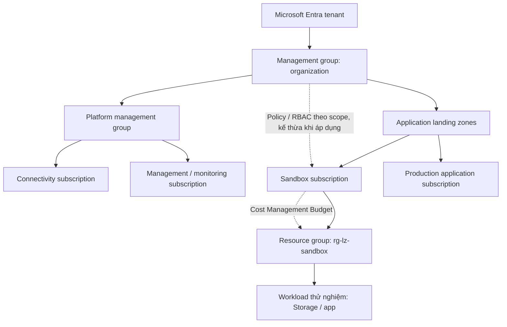
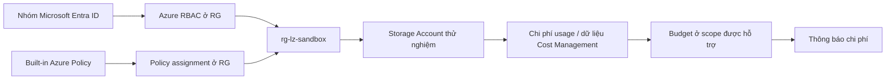

# Thực hành landing zone có policy, ngân sách và phân quyền

## 1. Mục tiêu của bài thực hành tổng hợp

Trong chương **Kiến trúc và thực hành tổng hợp** của module **CLOUD_PROVIDERS_AZURE**, chúng ta ghép các kiến thức về **subscription, resource group, Microsoft Entra ID, Azure RBAC, mạng, compute, storage, Azure Policy, giám sát và chi phí** để chuẩn bị một môi trường triển khai ứng dụng có thể quản trị được ngay từ đầu.

Giả sử nhóm phát triển một dịch vụ thương mại điện tử muốn triển khai môi trường thử nghiệm tại Azure. Nếu chỉ tạo VM hoặc Storage Account rồi bắt đầu lập trình, nhóm dễ gặp các vấn đề: tài nguyên được tạo tại vùng không được phép, không biết ai chịu trách nhiệm, người triển khai có quyền quá rộng, chi phí vượt ngân sách mà không có cảnh báo và thiếu bằng chứng khi kiểm toán.

**Azure landing zone** là môi trường Azure được thiết kế và chuẩn bị theo các nguyên tắc về quản trị, bảo mật, tổ chức tài nguyên, kết nối, vận hành và chi phí để các workload có thể triển khai nhất quán. Một landing zone không phải một dịch vụ duy nhất hay một nút bấm; nó là tập hợp lựa chọn về **cấu trúc tenant/subscription, danh tính, policy, phân quyền, mạng, monitoring và quản lý vòng đời**.

Trong bài này, người học tạo một **mini landing zone trong subscription sandbox** để thực hành ba nhóm kiểm soát bắt buộc:

1. **Policy:** chỉ triển khai tài nguyên ở vị trí được phép và yêu cầu metadata quản trị.
2. **Phân quyền:** dùng nhóm Microsoft Entra ID và Azure RBAC theo vai trò, đúng phạm vi.
3. **Ngân sách:** thiết lập budget, ngưỡng cảnh báo và cách kiểm chứng mức tiêu dùng.

Sau bài học, bạn có thể đọc mô hình landing zone, thiết kế scope quản trị, thực hành Azure CLI/Portal, kiểm tra các tình huống được phép và bị từ chối, trình bày bằng chứng nghiệm thu và dọn dẹp môi trường an toàn.

> **Ranh giới quan trọng:** mini landing zone dùng resource group để học **không tương đương** Azure landing zone production theo Cloud Adoption Framework, thường có nhiều subscription, management groups và nền tảng mạng/giám sát tập trung. Các thao tác gán policy, role và tạo ngân sách có thể cần quyền quản trị riêng; nếu tài khoản chỉ có quyền Reader, hãy làm phần thiết kế và kiểm chứng mà không tự nâng quyền.

## 2. Mô hình landing zone cấp doanh nghiệp

Một thiết kế landing zone thường phân tách:

- **Platform landing zones:** các subscription dành cho nền tảng chung như identity, connectivity, management/security monitoring. Ví dụ VPN/ExpressRoute, Azure Firewall, hub VNet, DNS, logging và các dịch vụ chia sẻ.
- **Application landing zones:** các subscription chạy ứng dụng/nhóm workload; được đặt dưới đúng management group và hưởng policy, RBAC, mạng, observability đã chuẩn hóa.
- **Management group hierarchy:** quản trị nhiều subscriptions, gán Azure Policy/Azure RBAC ở phạm vi thích hợp để các cấu hình được kế thừa.
- **Governance và lifecycle:** quy tắc đặt tên, tags, ngân sách, ownership, cấp phát subscription, thay đổi qua IaC và quy trình ngừng sử dụng.



Sơ đồ minh họa quan hệ tổ chức, **không phải mẫu bắt buộc với đúng tên/nhánh**. Trong thực tế, nền tảng có thể cần nhóm quản lý riêng cho sandbox, decommissioned, online/corp, region hoặc compliance. Không tự tạo/sửa management group trên tenant công ty để làm bài tập.

### 2.1. Bốn scope cần phân biệt

| Scope | Mục đích | Ví dụ trong bài |
| --- | --- | --- |
| **Management group** | Quản trị tập nhiều subscription; policy và RBAC có thể kế thừa xuống dưới | Phần kiến trúc, **không sửa thật** trong lab |
| **Subscription** | Ranh giới billing và nhiều giới hạn/quota, nơi chạy các workload và quản lý chi phí | Subscription sandbox được chỉ định |
| **Resource group** | Nhóm tài nguyên có vòng đời và quyền quản lý phù hợp | `rg-lz-sandbox` |
| **Resource** | Một dịch vụ cụ thể như Storage Account, VNet, VM | Storage Account mẫu dùng để thử policy |

**Azure Policy**, **Azure RBAC** và **Cost Management Budget** đều có scope, nhưng không cùng cơ chế. Policy đánh giá cấu hình tài nguyên, RBAC quyết định danh tính nào có action nào, còn budget theo dõi chi phí và gửi cảnh báo theo khả năng dịch vụ. Không thể đặt budget thay thế policy hoặc role assignment.

### 2.2. Phạm vi mini landing zone của bài lab



Để giảm quyền yêu cầu, chúng ta **không tạo subscription mới**, **không thay đổi policy toàn tenant** và **không triển khai workload production**. Một người hoặc nhóm quản trị đã được ủy quyền thực hiện các bước liên quan Azure Policy, RBAC và Cost Management; người học dùng subscription sandbox để kiểm chứng.

## 3. Tiêu chí đầu ra và quyền cần có

Trước khi thao tác, thống nhất kết quả của bài:

| Nhóm | Tiêu chí đạt | Bằng chứng cần lưu |
| --- | --- | --- |
| Cấu trúc | RG lab trong đúng subscription/region, có tags | Resource ID, Azure Portal/CLI output |
| Azure Policy | Policy vị trí và metadata được assign đúng scope | Policy assignment ID, parameters, compliance |
| Positive test | Resource đúng vùng/tag có thể được tạo bởi identity được phép | Deployment result và cấu hình resource |
| Negative test | Resource sai vùng/thiếu metadata bị policy chặn theo rule đang hiệu lực | Mã lỗi, assignment gây deny |
| Azure RBAC | Nhóm đọc chỉ đọc; nhóm triển khai chỉ tạo/sửa ở scope được giao | Role assignment và phép thử có/không có quyền |
| Ngân sách | Budget/alert gắn đúng scope hoặc filter, có owner liên hệ | Budget ID, số tiền, period, threshold, recipients |
| Quan sát | Có Activity Log và cách theo dõi spend/compliance | Ảnh chụp dữ liệu hoặc báo cáo có thời điểm |
| Cleanup | Chỉ gỡ tài nguyên lab đã được chủ sở hữu đồng ý | Inventory trước/sau và change record |

### 3.1. Tiền đề tài khoản và hệ thống

Cần có:

- Một **Azure subscription sandbox** đang hoạt động, không chứa tài nguyên production dùng chung trong RG lab.
- Quyền tạo resource group và workload thử nghiệm ở subscription; quyền thao tác policy/role/budget được người quản trị cấp riêng nếu cần.
- Azure CLI và công cụ Bicep tương thích hoặc Azure Portal; tài khoản đăng nhập Microsoft Entra ID vào đúng tenant.
- Ít nhất một **nhóm Entra ID dành cho người đọc** và một nhóm dành cho người triển khai để thực hành RBAC. Không đưa ID thật của người dùng vào tài liệu.
- Kênh liên hệ FinOps/owner nhận thông báo ngân sách và phương án xử lý khi vượt ngưỡng.
- Thỏa thuận giới hạn chi phí lab, vùng triển khai và thời gian tồn tại tài nguyên.

**Phân tách quyền:** tạo role assignment thường cần role có các quyền như **Role Based Access Control Administrator**, **User Access Administrator** hoặc Owner tại đúng scope; tạo policy assignment cần các quyền `Microsoft.Authorization/policyAssignments/write` và thao tác liên quan; quản lý budget cần quyền Cost Management/Consumption phù hợp. **Contributor ở resource group không mặc nhiên được phép cấp role assignment.** Không tự nâng quyền chỉ để hoàn thành bài lab.

### 3.2. Bộ biến giả định

| Biến trong hướng dẫn | Giá trị minh họa | Quy tắc |
| --- | --- | --- |
| `SUBSCRIPTION_ID` | `<SANDBOX_SUBSCRIPTION_ID>` | Không dùng subscription production |
| `RG` | `rg-lz-sandbox` | Tên riêng, không chia sẻ với workload khác |
| `LOCATION` | `southeastasia` | Chỉ sử dụng vùng có dịch vụ hỗ trợ |
| `READER_GROUP_OBJECT_ID` | `<ENTRA_GROUP_OBJECT_ID>` | Object ID, **không phải tên hiển thị** |
| `DEPLOYER_GROUP_OBJECT_ID` | `<ENTRA_GROUP_OBJECT_ID>` | Nhóm triển khai được phê duyệt |
| `FINOPS_EMAIL` | `<APPROVED_FINOPS_EMAIL>` | Địa chỉ do tổ chức cấp, không dùng email giả |
| `MONTHLY_BUDGET` | `100 USD` (ví dụ) | Số tiền minh họa, không phải giá thực của bài |

Trong các code block dưới đây, các lệnh **Bash** sử dụng biến shell. Nếu chạy trong PowerShell, cú pháp khai báo/tham chiếu biến khác; không dán nguyên các dấu `$VAR` vào PowerShell.

## 4. Bước 1 — Xác định scope và tạo resource group

Đầu tiên, kiểm tra tenant, subscription và quyền của người thực thi. Chạy trong shell Bash đã đăng nhập Azure CLI:

```bash
az login

az account list --output table
az account set --subscription "<SANDBOX_SUBSCRIPTION_ID>"

az account show \
  --query "{subscription:id,tenant:tenantId,name:name}" \
  --output json
```

**Dừng nếu subscription/tenant sai.** Sử dụng một subscription sandbox riêng quan trọng hơn việc hoàn thành thao tác nhanh, vì policy/RBAC có thể tác động tới những người khác.

Sau khi được phép tạo RG, chạy:

```bash
RG="rg-lz-sandbox"
LOCATION="southeastasia"

az group create \
  --name "$RG" \
  --location "$LOCATION" \
  --tags environment=sandbox owner=platform-team \
         costCenter=training managedBy=landing-zone-lab

RG_ID="$(az group show --name "$RG" --query id --output tsv)"
echo "$RG_ID"

az group show \
  --name "$RG" \
  --query "{id:id,location:location,tags:tags}" \
  --output json
```

Lưu `RG_ID` đúng định dạng `/subscriptions/<id>/resourceGroups/rg-lz-sandbox`. Tag trên RG phục vụ phân loại, **không tự bảo đảm** tất cả resource con kế thừa tag; cần cấu hình Azure Policy hoặc IaC của resource nếu muốn áp dụng nhất quán.

**Điểm kiểm soát:** RG đúng subscription, location và tags. Nếu Azure Policy có sẵn tại subscription ngăn tạo RG hoặc giới hạn vùng, không tắt policy: ghi mã lỗi và báo người quản trị.

## 5. Bước 2 — Xây dựng Azure Policy guardrails

### 5.1. Azure Policy khác Azure RBAC ở đâu?

- **Azure Policy**: xác định loại/cấu hình tài nguyên nào được phép hoặc phải được đánh giá; các effect phổ biến gồm `deny`, `audit`, `modify`, `deployIfNotExists`.
- **Azure RBAC**: danh tính nào được phép thực hiện action ở scope nào.
- Một người có Contributor tại RG **vẫn có thể bị policy deny** khi tạo tài nguyên không hợp lệ.
- Một tài nguyên thỏa policy **vẫn không thể được tạo** nếu danh tính thiếu Azure RBAC.
- `audit` không chặn như `deny`; trạng thái compliance có thể đến sau do đánh giá bất đồng bộ.

Một guardrail phù hợp cho lab gồm:

1. **Allowed locations:** chỉ cho workload region được phê duyệt (ví dụ `southeastasia`); kiểm tra các ngoại lệ cho tài nguyên global và policy definition được chọn.
2. **Require tag on resources:** bắt buộc có `costCenter` ở những loại tài nguyên mà policy áp dụng, tùy built-in definition/effect cụ thể.

**Chú ý:** Built-in policy **Allowed locations** khác với **Allowed locations for resource groups**. Loại đầu kiểm soát vị trí của tài nguyên theo rule/field áp dụng; loại thứ hai nhắm tới vị trí RG. Trong lab, RG được tạo trước khi gán policy cho RG; chúng ta thử policy trên một Storage Account nằm trong RG.

### 5.2. Tìm policy definition theo display name

Người có quyền có thể đọc danh sách built-in policies trong Azure Portal **Policy → Definitions**. Nếu dùng Azure CLI, chạy:

```bash
az policy definition list \
  --query "[?displayName=='Allowed locations'].{name:name,id:id}" \
  --output table

az policy definition list \
  --query "[?displayName=='Require a tag on resources'].{name:name,id:id}" \
  --output table
```

Lấy **definition ID chính xác** từ môi trường thực, đừng tự suy đoán GUID hoặc dùng definition khác có tên tương tự. Đọc lại rule, mode, các parameters, effect, metadata và assignment scope. Nếu tổ chức đã có policy tương đương ở subscription/management group, **không gán thêm bản trùng không cần thiết**.

### 5.3. Gán policy Allowed locations tại resource group

Ví dụ sau giả định tổ chức cho phép lab tạo policy assignment trên RG và built-in policy có parameter `listOfAllowedLocations`. Thay definition ID bằng ID vừa tra cứu:

```bash
POLICY_ID="<ALLOWED_LOCATIONS_POLICY_DEFINITION_ID>"
POLICY_ASSIGNMENT="lz-lab-allowed-locations"

az policy assignment create \
  --name "$POLICY_ASSIGNMENT" \
  --display-name "Landing zone lab allowed locations" \
  --scope "$RG_ID" \
  --policy "$POLICY_ID" \
  --params '{"listOfAllowedLocations":{"value":["southeastasia"]}}'

az policy assignment show \
  --name "$POLICY_ASSIGNMENT" \
  --scope "$RG_ID" \
  --output json
```

Bước này **không** tạo một resource ở vùng khác; nó thiết lập quy tắc được Azure Policy dùng khi đánh giá các yêu cầu phù hợp. Việc đánh giá policy có độ trễ lan truyền; sau khi assign, hãy kiểm tra trạng thái assignment và chờ đủ thời gian theo quy trình dịch vụ trước khi thử.

**Nếu lỗi quyền:** kiểm tra action/scope của principal triển khai. Không thay role Reader thành Owner một cách tùy tiện. Nhờ người quản trị có quyền áp dụng assignment trong đúng RG sandbox.

### 5.4. Policy yêu cầu tag tài nguyên

Ở Azure Portal **Policy → Assignments**, có thể gán built-in **Require a tag on resources** tại RG lab với parameter `tagName=costCenter` nếu definition và effect phù hợp. Trước khi gán:

- Kiểm tra built-in policy có đúng **resource scope** dự kiến và đúng parameter.
- Kiểm tra tài nguyên exempt hoặc bị loại khỏi rule; không áp dụng lên những resource đặc biệt không hỗ trợ tag nếu rule không phù hợp.
- Xác nhận effect là `deny` nếu mục tiêu của bài là chặn tạo resource thiếu tag.
- Nếu chọn `modify` để bổ sung tags tự động, cần hiểu managed identity/remediation permissions và sự khác biệt giữa create/update và existing resources.

Một ví dụ phân biệt:

| Resource | Vùng | Tag `costCenter` | Kết quả kỳ vọng theo hai policy deny |
| --- | --- | --- | --- |
| Storage A | `southeastasia` | `training` | Đạt các guardrails được mô tả |
| Storage B | `eastus` | `training` | Bị giới hạn vị trí chặn |
| Storage C | `southeastasia` | Không có | Bị policy tag chặn nếu definition áp dụng |
| Resource global được hỗ trợ | `global` | Theo rule | Cần xem rule/exception của policy thật; không suy đoán |

**Gán policy không biến tất cả tài nguyên hiện hữu thành compliant tức thời.** Những resource đã tồn tại có thể tiếp tục tồn tại dù noncompliant; policy effect và remediation quyết định hành vi. Đọc kết quả thực trong Azure Policy Compliance.

## 6. Bước 3 — Phân quyền bằng Microsoft Entra groups và Azure RBAC

### 6.1. Thiết kế nhóm theo nhiệm vụ

Tối thiểu phân biệt:

| Nhóm / vai trò | Scope | Azure role minh họa | Quyền nên có |
| --- | --- | --- | --- |
| `grp-lz-readers` | `rg-lz-sandbox` | **Reader** | Xem inventory và cấu hình resource |
| `grp-lz-deployers` | `rg-lz-sandbox` | **Contributor** trong lab | Tạo/sửa workload thử nghiệm, không tự cấp role |
| `grp-lz-governance` | Scope quản trị phù hợp, do platform team cấp | Role có policy/role assignment permissions phù hợp | Quản trị policy và RBAC với review |
| `grp-lz-finops` | Subscription/budget scope | Quyền Cost Management/Consumption phù hợp | Tạo/xem budget, theo dõi cost và alerts |

**Contributor là role rộng cho lab**; ở production có thể cần custom role giới hạn loại resource/action. Role **Reader** không đồng nghĩa người xem được mọi dữ liệu data plane: quyền đọc blob trong Storage cần role/data permissions khác, và việc đọc secret Key Vault cần quyền riêng.

### 6.2. Gán Reader và Contributor ở đúng RG

Người quản trị có quyền cấp role assignment sử dụng **object ID của các Entra groups**, không sử dụng account cá nhân trong tài liệu:

```bash
READER_GROUP_OBJECT_ID="<READER_GROUP_OBJECT_ID>"
DEPLOYER_GROUP_OBJECT_ID="<DEPLOYER_GROUP_OBJECT_ID>"

az role assignment create \
  --assignee-object-id "$READER_GROUP_OBJECT_ID" \
  --assignee-principal-type Group \
  --role "Reader" \
  --scope "$RG_ID"

az role assignment create \
  --assignee-object-id "$DEPLOYER_GROUP_OBJECT_ID" \
  --assignee-principal-type Group \
  --role "Contributor" \
  --scope "$RG_ID"
```

Kiểm tra các role assignment trong và trên scope:

```bash
az role assignment list \
  --scope "$RG_ID" \
  --include-inherited \
  --output table
```

**Điểm cần nhớ:** role từ subscription/management group có thể được **kế thừa**. Một thành viên nhóm Reader vẫn có thể có quyền khác từ assignment nơi khác. Vì vậy, muốn chứng minh “không được deploy” phải thử bằng một danh tính kiểm thử thực sự **không có role ghi thừa kế hoặc qua nhóm khác**, và lưu dấu vết của identity test.

### 6.3. Ma trận phân quyền để nghiệm thu

| Hoạt động | Reader-only | Deployer (Contributor ở RG) | Governance admin |
| --- | --- | --- | --- |
| Xem RG và resources | Thường được | Được | Theo role của admin |
| Tạo Storage Account tại RG | Không | Được nếu thỏa policy/quota | Phụ thuộc role và scope |
| Tạo resource sai allowed location | Không có quyền ghi | **Policy có thể deny** dù có Contributor | Policy áp dụng nếu không có ngoại lệ |
| Tạo role assignment | Không | **Không theo role Contributor thông thường** | Cần quyền role assignment phù hợp |
| Sửa Azure Policy assignment | Không | Không mặc nhiên | Cần policy assignment permissions |
| Đọc/ghi blob data | Không tự động | Không tự động từ control-plane Contributor | Cần data-plane permission riêng |
| Tạo budget | Không mặc nhiên | Không mặc nhiên | Cần Cost/Consumption permissions phù hợp |

Trong bài lab, việc một hành động bị `403 AuthorizationFailed` khác về bản chất so với bị `RequestDisallowedByPolicy`. Cần ghi mã lỗi và kiểm tra action/scope trước khi sửa.

## 7. Bước 4 — Thiết lập budget và cảnh báo chi phí

### 7.1. Ngân sách Azure làm được gì?

**Azure Cost Management Budget** theo dõi chi phí/usage theo scope và period được hỗ trợ, gửi thông báo ở các ngưỡng đã thiết lập. Budget có thể giúp:

- Phát hiện chi tiêu lớn hơn dự kiến.
- Gửi cảnh báo đến FinOps, workload owner hoặc Action Group nếu tính năng/scope hỗ trợ.
- So sánh chi phí thực tế với ngưỡng và cảnh báo dự báo khi dữ liệu/thiết lập cho phép.
- Tạo quy trình phê duyệt điều chỉnh ngân sách, rightsizing hoặc dừng lab.

**Budget không phải hard spending cap.** Vượt budget **không tự động chặn** Azure Resource Manager tạo tài nguyên hay tắt subscription. Dữ liệu chi phí có thể cập nhật trễ; một tài nguyên có thể tiếp tục phát sinh phí trước khi alert được gửi và con người xử lý. Muốn dừng resource theo cảnh báo cần thiết kế workflow riêng có guardrails và authorization.

### 7.2. Tạo ngân sách trong Azure Portal

Người có quyền quản lý budget vào **Cost Management + Billing → Cost Management → Budgets** (tên đường dẫn có thể khác tùy loại tài khoản/scope) và:

1. Chọn **subscription sandbox** và phạm vi budget được tổ chức cho phép; nếu giao diện hỗ trợ, chọn resource group scope hoặc tạo budget trên subscription rồi dùng **filter theo Resource group `rg-lz-sandbox`**.
2. Chọn period `Monthly` và ngày bắt đầu/kết thúc hợp lệ; không dùng giá trị thời gian đã hết hiệu lực.
3. Đặt tên gợi nhớ như `budget-lz-sandbox-monthly` và số tiền ví dụ **100 USD/tháng**. Đây là ngưỡng học tập, không phải dự toán Azure đã xác nhận.
4. Tạo cảnh báo **Actual cost 80%** và **Actual cost 100%**; cân nhắc cảnh báo **Forecasted cost 100%** khi scope và tính năng hỗ trợ.
5. Nhập **địa chỉ email owner/FinOps được tổ chức phê duyệt**, có thể tích hợp Action Group theo khả năng và quy trình hiện hành.
6. Lưu budget, kiểm tra lại currency, số tiền, time grain, filter, dates, recipients và chủ sở hữu phản ứng với cảnh báo.
7. Ghi budget ID hoặc thông tin cấu hình vào báo cáo nghiệm thu.

Không dùng email không thuộc người nhận thật; không dùng email ghi trong tài liệu đào tạo như một địa chỉ liên hệ sản xuất.

### 7.3. Mức phản ứng theo ngưỡng

| Điều kiện | Phản ứng của nhóm | Tác động tự động |
| --- | --- | --- |
| Actual ≥ 80% budget | FinOps thông báo owner, kiểm tra trend/biến động, rà soát tài nguyên lab | **Thông báo**, không tắt resources |
| Actual ≥ 100% budget | Escalate, đánh giá nguồn phí, cân nhắc ngừng workload không quan trọng | Theo runbook đã được phê duyệt nếu có |
| Forecast ≥ 100% budget | Chủ động thay đổi cấu hình/tài nguyên hoặc đề xuất tăng ngân sách | Không tự bảo đảm forecast chuẩn ở mọi subscription |
| Dữ liệu cost chưa cập nhật | Đánh dấu trạng thái chưa xác minh, sử dụng Activity Log/usage bổ trợ | Không kết luận ngân sách an toàn chỉ vì chưa thấy alert |

**Cost Management không cập nhật chi phí theo giây.** Không kiểm thử budget bằng cách cố ý tiêu vượt ngưỡng. Có thể nghiệm thu bằng việc cấu hình hợp lệ, kiểm tra người nhận và sử dụng test workflow phù hợp với tổ chức.

## 8. Bước 5 — Tạo workload thử nghiệm bằng Bicep và xem trước thay đổi

Để chứng minh ba lớp quản trị phối hợp, dùng một Storage Account đơn giản có tag `costCenter`. Đây là **workload lab**, không phải mọi thành phần cần có của landing zone production.

### 8.1. Tệp `storage.bicep` trong thư mục thực hành riêng

Mẫu Bicep dưới đây triển khai tại **resource group scope**:

```bicep
targetScope = 'resourceGroup'

@description('Ten Storage Account phai gom 3-24 ky tu a-z0-9 va duy nhat tren Azure.')
param storageName string

@description('Region do lab duoc phep trien khai; Azure Policy se kiem chung.')
param location string = resourceGroup().location

@allowed([
  'sandbox'
  'dev'
])
param environment string = 'sandbox'

resource storage 'Microsoft.Storage/storageAccounts@2023-05-01' = {
  name: storageName
  location: location
  tags: {
    environment: environment
    owner: 'platform-team'
    costCenter: 'training'
    managedBy: 'landing-zone-lab'
  }
  sku: {
    name: 'Standard_LRS'
  }
  kind: 'StorageV2'
  properties: {
    supportsHttpsTrafficOnly: true
    minimumTlsVersion: 'TLS1_2'
    allowBlobPublicAccess: false
    allowSharedKeyAccess: false
  }
}

output storageAccountId string = storage.id
```

**Giải thích các quyết định:**

- `storageName` phải là **tên duy nhất toàn Azure**, chữ thường/số, dài 3–24 ký tự; tên xung đột sẽ khiến deployment thất bại, không liên quan tới policy.
- `location` được truyền từ bên ngoài để kiểm tra policy. Chúng ta **không khóa region bằng `@allowed`** trong ví dụ này, nhằm thấy sự khác biệt giữa validation trong Bicep và policy được gán tại Azure.
- `costCenter=training` đáp ứng policy yêu cầu tag khi rule đó được cấu hình đúng.
- Các thuộc tính HTTPS/TLS và public blob access là một phần baseline an toàn, **chưa cấu hình toàn bộ networking/private endpoints** của một workload production.
- Tạo Storage Account có thể phát sinh phí; không mặc định resource rỗng là hoàn toàn miễn phí.

### 8.2. Validate và what-if trước khi deploy

Giả sử bạn lưu mã vào `storage.bicep` trên máy lab và đã đăng nhập đúng subscription:

```bash
STORAGE_NAME="<GLOBALLY_UNIQUE_LOWERCASE_STORAGE_NAME>"

az bicep build --file storage.bicep

az deployment group validate \
  --resource-group "$RG" \
  --template-file storage.bicep \
  --parameters storageName="$STORAGE_NAME" location="southeastasia"

az deployment group what-if \
  --resource-group "$RG" \
  --template-file storage.bicep \
  --parameters storageName="$STORAGE_NAME" location="southeastasia"
```

- **Build** kiểm tra cú pháp/kiểu ở lớp Bicep.
- **Validate** kiểm tra đầu vào và một số điều kiện triển khai, nhưng không thay mọi kiểm tra thực tế khi Azure Resource Provider xử lý request.
- **What-if** hiển thị tài nguyên dự kiến tạo/sửa/xóa theo khả năng tính toán của ARM; nó là **dự báo**, không phải cam kết tuyệt đối rằng deployment sẽ thành công.
- Chính sách ở subscription hoặc management group có thể vẫn áp dụng thêm, dù lab chỉ gán policy tại RG.

Sau khi reviewer xác nhận scope, tags, region, SKU và rủi ro, người triển khai được phép chạy:

```bash
az deployment group create \
  --name "lz-sandbox-storage" \
  --resource-group "$RG" \
  --template-file storage.bicep \
  --parameters storageName="$STORAGE_NAME" location="southeastasia"

az deployment group show \
  --name "lz-sandbox-storage" \
  --resource-group "$RG" \
  --query "properties.provisioningState" \
  --output tsv
```

**Không tiếp tục nếu lệnh validate/what-if báo lỗi quyền hoặc vi phạm policy.** Nếu deployment thành công, kiểm tra Storage Account thực tế: đúng region, tags, TLS, public access và resource ID; không chỉ dựa trên dòng `Succeeded`.

## 9. Bước 6 — Kiểm thử ba lớp kiểm soát

Một lab có chất lượng cần **positive tests** và **negative tests** có giới hạn, thay vì chỉ chụp ảnh Portal.

### 9.1. Kiểm thử Policy: location

Đối với template `storage.bicep`, có thể chạy một phép thử đầu vào khác **chỉ validate/what-if** trong sandbox:

```bash
az deployment group validate \
  --resource-group "$RG" \
  --template-file storage.bicep \
  --parameters storageName="$STORAGE_NAME" location="eastus"
```

Nếu policy Allowed locations với `deny` đã có hiệu lực trên Storage Account, yêu cầu tạo/cập nhật ở vùng bị cấm có thể bị từ chối, ví dụ mã liên quan `RequestDisallowedByPolicy`. **Nếu validate không phát hiện**, không được kết luận policy vô hiệu: hiệu quả policy được thể hiện ở request triển khai thật và compliance theo điều kiện Azure. Chỉ thử tạo resource trái policy bằng danh tính/đích lab được phê duyệt và có người giám sát; không dùng production để kiểm chứng deny.

**Không làm phép thử bằng cách sửa vị trí của Storage Account đã chứa dữ liệu.** Azure Storage Account không hỗ trợ “move region” đơn giản bằng thay property; test create với **tên Storage Account mới** và scope lab, hoặc sử dụng validation/test chuyên biệt phù hợp.

### 9.2. Kiểm thử Policy: yêu cầu tag

Tạo **bản Bicep thử nghiệm riêng trong môi trường lab** bỏ tag `costCenter` (hoặc dùng tài nguyên mới chưa tồn tại), chạy validate trước. Nếu đã gán policy "Require a tag on resources" với `deny` phù hợp, Azure có thể chặn thao tác. Ghi assignment ID, resource ID và error details.

Đừng nhầm việc Bicep build thành công với policy compliant: Bicep kiểm tra mã; policy phụ thuộc assignment/effect tại scope thực. Nếu policy chỉ là `audit`, có thể deploy thành công nhưng tài nguyên được đánh dấu noncompliant về sau.

### 9.3. Kiểm thử Azure RBAC

Dùng hai danh tính kiểm thử **đã biết quyền hiệu lực**:

| Persona | Thử nghiệm | Kết quả mong đợi |
| --- | --- | --- |
| Reader-only | `az group show` hoặc xem Storage Account | Đọc được nếu quyền hiệu lực cho phép |
| Reader-only | Tạo Storage Account trong RG lab | Bị chặn vì thiếu quyền ghi (`AuthorizationFailed`/403), kể cả cấu hình hợp lệ |
| Deployer | Triển khai Storage hợp lệ tại `southeastasia` | Được phép nếu không bị quota/policy/other controls chặn |
| Deployer | Tạo resource ở vị trí bị policy deny | Bị policy từ chối nếu assignment đúng |
| Deployer | Tạo role assignment mới | Contributor thông thường **không có quyền** cấp vai trò |
| Governance admin | Đọc/gán policy trong scope được ủy quyền | Phụ thuộc role thực, không tự xem là Owner |

Nếu người thử Reader vẫn tạo được resource, **không kết luận RBAC lỗi** ngay; kiểm tra họ có quyền kế thừa từ subscription, membership nhóm khác, role kích hoạt qua PIM hoặc principal không đúng hay không.

### 9.4. Kiểm thử budget

Không cần cố ý phát sinh phí để vượt budget. Xác nhận:

- Scope/filter đúng `rg-lz-sandbox` hoặc subscription phù hợp.
- Currency, amount, start date và time grain đúng.
- Threshold actual 80%/100% và forecast (nếu có) đúng.
- Địa chỉ recipient/Action Group đã được chủ sở hữu xác nhận.
- Có trách nhiệm xử lý alert và quy trình kiểm tra chi phí theo tuần.

**Ngân sách không chặn một lệnh ARM deploy**; nếu cần chặn SKU đắt tiền/region không được phép, phải dùng Azure Policy, approvals hoặc kiểm soát khác.

## 10. Quan sát trạng thái, audit và đo tuân thủ

### 10.1. Azure Policy Compliance

Từ **Azure Policy → Compliance**, lọc scope và assignment của lab; xem trạng thái tài nguyên theo từng policy. Một số kết quả có thể cập nhật chậm sau deployment; nếu chưa thấy state, kiểm tra assignment/scope, quyền đọc Policy Insights và thời điểm evaluation.

Không coi một truy vấn trả về **rỗng** là chứng nhận “compliant”. Có thể chưa có đối tượng, chưa đánh giá hoặc thiếu quyền truy vấn.

### 10.2. Azure Activity Log và RBAC audit

Activity Log giúp tìm người/principal đã thực hiện request tạo RG, policy assignment, role assignment hoặc deployment, thời điểm và mã kết quả. Với các thay đổi chính sách hoặc quyền, cần liên kết **change ticket → người phê duyệt → resource scope → thực thi → kết quả**.

### 10.3. Cost Management và ngân sách

Theo dõi chi phí theo `resourceGroup`, tags, service type và usage. Việc dữ liệu chưa xuất hiện ngay sau khi tạo resource là bình thường; chu kỳ ingest/billing có độ trễ. Một budget cảnh báo 80% không chứng minh chi tiêu an toàn khi resource có thể tiêu thụ nhanh hoặc cost data chậm.

### 10.4. Bảng nghiệm thu mẫu

| Mã | Kiểm tra | Kết quả cần ghi | Pass khi |
| --- | --- | --- | --- |
| `LZ-01` | RG đúng subscription, region, tags | Resource ID, output | Không sai scope |
| `LZ-02` | Policy location assignment | ID, scope, parameters, effect | Đúng rule và scope |
| `LZ-03` | Policy tag assignment | ID, tagName, effect | Rule đúng, có thể đánh giá |
| `LZ-04` | Role Reader | Group object ID, assignment scope | Reader không có quyền ghi ngoài dự kiến |
| `LZ-05` | Role deployer | Group object ID, assignment scope | Có quyền lab, không tự cấp role |
| `LZ-06` | Budget | Scope/filter, amount, period, contact | Có thông báo đúng cấu hình |
| `LZ-07` | IaC deployment | Commit/template, what-if, deployment result | Resource hợp lệ, đầy đủ tags |
| `LZ-08` | Negative policy test | Assignment/error code | Lỗi policy đúng nguyên nhân |
| `LZ-09` | Negative RBAC test | Principal/action/scope/error | Lỗi quyền đúng nguyên nhân |
| `LZ-10` | Cleanup | Inventory trước/sau, approvals | Không còn resource lab ngoài kế hoạch |

Không ghi client secret, access token, connection string hoặc danh sách user nhạy cảm vào báo cáo nghiệm thu. Group object IDs, resource IDs và email thông báo cũng nên được lưu trong kho tài liệu nội bộ được phân quyền.

## 11. Lỗi thường gặp và cách xử lý

| Hiện tượng | Nguyên nhân khả dĩ | Cách xử lý đúng |
| --- | --- | --- |
| `AuthorizationFailed`/403 khi tạo RG | Người chạy không có quyền ở subscription | Xác nhận principal/scope; nhờ người quản trị cấp quyền tối thiểu |
| Không tạo được policy assignment | Thiếu `policyAssignments/write` hoặc assignment scope sai | Kiểm tra role quản trị policy và scope RG |
| Không tạo được role assignment | Contributor không có quyền cấp role | Dùng người có quyền quản lý RBAC ở đúng scope |
| `RequestDisallowedByPolicy` khi tạo Storage | Vi phạm location/tag hoặc policy khác kế thừa | Đọc definition/assignment, sửa IaC; không tắt policy tùy tiện |
| Storage Account name đã dùng | Tên phải duy nhất toàn Azure, quy tắc ký tự nghiêm ngặt | Chọn tên mới hợp lệ và chạy validate/what-if |
| What-if PASS nhưng create lỗi | Provider/quota/policy/runtime khác dự báo | Đọc deployment operations và Azure Activity Log |
| Policy compliance rỗng/chưa cập nhật | Delay, thiếu Policy Insights permission hoặc sai scope | Kiểm tra assignment, quyền và thời điểm evaluation |
| Reader vẫn tạo được resource | Có role thừa kế/nhóm khác hoặc đang dùng sai identity | Xác minh effective access, group membership, PIM |
| Budget không gửi email | Sai scope/recipient/threshold, chưa có usage hoặc delay | Kiểm tra cấu hình budget, alert conditions, delivery path |
| Vượt budget nhưng Azure vẫn tạo VM | Budget là cảnh báo, không là hard spending cap | Kích hoạt quy trình FinOps, policy/approval hoặc automation được duyệt |
| Cost tăng dù chỉ tạo ít resource | Storage/network/log/retention hoặc workload đã chạy | Xem Cost Analysis theo resource/charge và ngày |
| Dọn lab xóa nhầm tài nguyên | RG chứa tài nguyên ngoài bài | Kiểm kê và xác nhận ownership trước khi xóa |

Phân loại lỗi trước khi hành động: **syntax/IaC**, **RBAC**, **Azure Policy**, **provider/quota**, **budget/cost data** hay **dữ liệu chưa được đồng bộ**. Không nâng quyền Owner hay vô hiệu policy nhằm né một lỗi chưa hiểu.

## 12. Dọn dẹp môi trường và hoàn tác an toàn

Tài nguyên thử nghiệm có thể phát sinh phí. Trước khi cleanup:

1. Liệt kê toàn bộ resources trong `rg-lz-sandbox` và xác nhận **không chứa workload ngoài lab**.
2. Lưu evidence đã được phép giữ, kiểm tra dữ liệu/backup/retention.
3. Xác nhận owner của các resource và scope policy/role/budget do lab tạo.
4. Gỡ các assignment hoặc budget **chỉ khi chúng được tạo riêng cho lab**; không xóa policy/budget đang dùng chung.
5. Nếu RG riêng hoàn toàn và được phê duyệt, xóa RG qua Portal/CLI; đây là hành động **phá hủy tất cả resources trong RG** và có thể không hoàn tác được.
6. Kiểm tra Cost Analysis/Resource Graph theo chu kỳ và bảo đảm không còn chi phí bất ngờ.

Ví dụ lệnh kiểm kê **chỉ đọc** trước khi cleanup:

```bash
az resource list \
  --resource-group "$RG" \
  --query "[].{name:name,type:type,id:id}" \
  --output table

az role assignment list \
  --scope "$RG_ID" \
  --output table

az policy assignment list \
  --scope "$RG_ID" \
  --output table
```

Nếu RG thực sự **chỉ dành cho lab**, chủ sở hữu đã xác nhận và dữ liệu không cần giữ, một thao tác cleanup cuối cùng có thể là:

```bash
# LENH PHA HUY: chi chay sau khi kiem ke va duoc phe duyet.
az group delete --name "$RG" --yes
```

Lệnh trên không phải hướng dẫn dọn tự động cho mọi subscription; nó có thể xóa dữ liệu và resource được dùng chung nếu bạn chọn sai RG. **Subscription-level budget** hoặc các assignment ở scope ngoài RG có thể cần gỡ riêng bởi người có quyền; xóa RG không tự đảm bảo đã dọn mọi cấu hình ngoài scope đó. Sau lab nên báo cho người quản trị giải phóng những RBAC/policy artifacts tạm nếu còn tồn tại.

## 13. Nâng cấp mini landing zone thành landing zone gần production

Khi mở rộng từ lab tới môi trường thật, cần xem xét các điểm chưa có trong mini landing zone:

| Năng lực | Mini lab đã làm | Production cần bổ sung |
| --- | --- | --- |
| Tổ chức | Một subscription và RG | Management groups, platform/application subscriptions, subscription vending |
| Danh tính | Entra groups + RBAC mẫu | PIM, Conditional Access, access reviews, identity lifecycle, break-glass |
| Policy | Location và tags | Security baseline, encryption, network, allowed SKUs, diagnostic settings, drift/exception management |
| Kết nối | Chưa triển khai mạng đầy đủ | Hub-spoke/vWAN, DNS, private endpoints, egress filtering, hybrid connectivity |
| Bảo mật | Minimal storage properties | Defender for Cloud, SIEM, Key Vault, logging và incident response |
| Quan sát | Activity Log và compliance | Azure Monitor/Log Analytics, alert routing, backup và operational dashboards |
| Chi phí | Budget và ngưỡng email | Chargeback/showback, forecasts, rightsizing, tagging compliance và automated review |
| IaC | Bicep workload nhỏ | Versioned platform modules, pipeline, approvals, what-if, CI tests |
| Độ tin cậy | Không có DR thật | Multi-zone/region khi cần, RTO/RPO, backups, failover drills |
| Vòng đời | Cleanup lab thủ công | Governance cho provisioning, nâng cấp, exception, decommission |

Một landing zone tốt phải giữ quyền thay đổi và chi phí **có thể giải thích được**. Không nên dồn mọi workloads vào một RG hoặc một nhóm Contributor chung chỉ để thuận tiện.

## 14. Bài tập thực hành và câu hỏi đánh giá

### 14.1. Yêu cầu nộp bài

Đội học viên nhận một subscription sandbox và đề bài: “Cho phép triển khai Storage Account thử nghiệm tại Southeast Asia, yêu cầu tag costCenter, phân nhóm người đọc/người triển khai, đồng thời theo dõi ngân sách 100 USD/tháng với cảnh báo 80% và 100%”.

Cần nộp:

1. Sơ đồ scope từ subscription đến RG, vị trí policy, role assignments và budget.
2. Resource ID và tags của `rg-lz-sandbox`.
3. Policy assignment names/IDs, parameters và effect thực tế.
4. Role assignments theo group object IDs, cùng diễn giải vì sao Reader và Contributor khác nhau.
5. Screenshot hoặc mô tả cấu hình budget: scope/filter, period, ngưỡng và owner.
6. Tệp Bicep hợp lệ, kết quả validate/what-if và kết quả deployment được cho phép.
7. Bằng chứng negative test: lỗi Azure Policy khác lỗi Azure RBAC.
8. Bảng nghiệm thu theo mã `LZ-01` đến `LZ-10` và kế hoạch cleanup.

Nếu không có quyền gán policy/role/budget, học viên có thể **thiết kế manifest và tài liệu chờ người quản trị áp dụng**, thực hiện các bước đọc được phép và ghi rõ kiểm thử nào chưa thể chạy; không tự khẳng định PASS đối với những thao tác chưa kiểm chứng.

### 14.2. Bốn tình huống phải giải thích được

**Tình huống A:** Nhóm deployer được cấp Contributor tại RG nhưng tạo Storage Account ở `eastus` bị từ chối.  
**Giải thích:** RBAC cho phép hành động ghi trong RG, nhưng Azure Policy ở scope tương ứng có thể `deny` cấu hình sai location. Cách sửa là đổi vùng hoặc xin exemption có phê duyệt, không nâng quyền bừa.

**Tình huống B:** Tài khoản Reader chỉ đọc resource được nhưng không thể tạo Storage Account hợp lệ.  
**Giải thích:** Reader không có action ghi; resource thỏa policy vẫn cần Azure RBAC phù hợp. Nếu Reader bất ngờ tạo được, phải kiểm tra các role kế thừa/nhóm khác và danh tính đang dùng.

**Tình huống C:** Subscription có budget 100 USD nhưng chi phí thực tế vượt 100 USD.  
**Giải thích:** Budget gửi thông báo, **không cắt chi tiêu cứng**. Cần theo dõi usage, phản ứng theo runbook và thiết lập policy/approvals/auto-remediation có bảo vệ nếu muốn kiểm soát khác.

**Tình huống D:** Azure Policy đã gán nhưng trang Compliance chưa thấy tài nguyên.  
**Giải thích:** dữ liệu evaluation có thể đến trễ, scope sai hoặc identity thiếu quyền đọc kết quả. Không kết luận compliant chỉ vì chưa thấy bản ghi.

## 15. Câu hỏi tự kiểm tra

**1. Landing zone khác một resource group như thế nào?**  
Landing zone là thiết kế tổng thể để workload có nền tảng governance, danh tính, mạng, quan sát, bảo mật và chi phí. RG chỉ là một scope tổ chức tài nguyên; mini lab ở RG chưa thể thay thế landing zone production.

**2. Azure Policy và Azure RBAC khác nhau ở điểm nào?**  
RBAC quyết định ai có quyền thực hiện action nào ở scope nào. Policy đánh giá cấu hình/yêu cầu tài nguyên theo assignment và effect. Một request cần đáp ứng cả các lớp kiểm soát liên quan.

**3. Vì sao không gán Owner ở subscription cho mọi lập trình viên?**  
Owner có quyền rất rộng và có thể quản lý quyền truy cập. Least privilege và tách nhiệm vụ giảm blast radius, hạn chế cấp quyền ngoài ý muốn và làm audit rõ ràng.

**4. Budget 100 USD có đảm bảo Azure dừng tính phí ở mức 100 USD không?**  
Không. Budget là công cụ theo dõi/cảnh báo, không phải hạn mức thanh toán cưỡng chế.

**5. Gán tag trên RG có đảm bảo Storage Account bên trong tự có tag đó không?**  
Không. Có thể dùng tag trực tiếp trong IaC hoặc Azure Policy hiệu ứng phù hợp để quản lý/áp dụng; không mặc định tự kế thừa.

**6. What-if cho kết quả NoChange nghĩa là đã kiểm tra xong mọi policy và quota?**  
Không. What-if là dự báo; deployment còn phụ thuộc role, provider, policy runtime, quota và trạng thái thực khi request được xử lý.

**7. Policy assignment ở RG có chặn tài nguyên tại RG khác trong subscription không?**  
Không theo chính assignment đó. Policy có phạm vi áp dụng; các assignment khác ở scope subscription/management group có thể vẫn tác động.

**8. Có thể dọn lab bằng cách xóa RG mà không kiểm tra gì thêm?**  
Không. Xóa RG có thể xóa toàn bộ workload/dữ liệu trong đó; cần inventory, xác nhận owner và kiểm tra các policy/role/budget nằm ngoài RG.

## 16. Tài liệu chính thức nên tham khảo

- Microsoft Learn — **Cloud Adoption Framework: Azure landing zones** và **Design areas**: kiến trúc enterprise-scale, platform/application landing zones, subscription vending.
- Microsoft Learn — **Management groups**, **Resource groups** và **Azure Resource Manager scope**.
- Microsoft Learn — **Azure Policy overview**, **Built-in policy definitions**, **Assign a policy** và **Compliance data**.
- Microsoft Learn — **Azure RBAC overview**, **Assign Azure roles using Azure CLI** và **Check access to Azure resources**.
- Microsoft Learn — **Cost Management Budgets**, **Create budgets** và **Cost Analysis**.
- Microsoft Learn — **Azure Bicep overview** và **ARM deployment what-if**.
- Microsoft Learn — **Azure Activity Log** và **Azure Well-Architected Framework**: Security, Operational Excellence, Reliability, Cost Optimization.

Trước khi áp dụng vào tenant hoặc subscription thật, đối chiếu cú pháp Azure CLI, policy definition IDs, effect/parameters, quyền quản trị và phạm vi ngân sách với môi trường hiện tại. **Bài thực hành thành công khi chứng minh được các guardrails hoạt động đúng, chi phí được theo dõi và quyền được giới hạn — không chỉ khi đã tạo được tài nguyên.**
