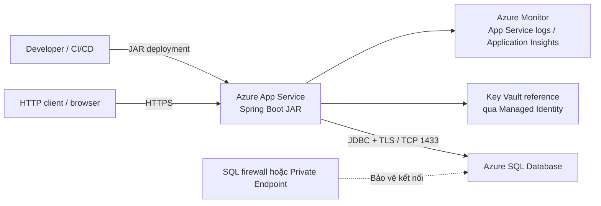
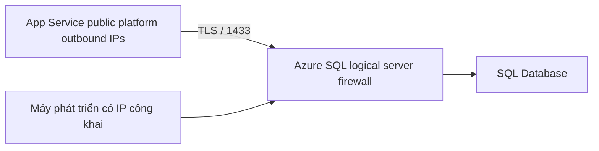
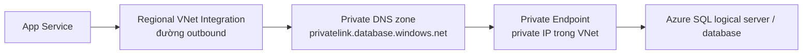
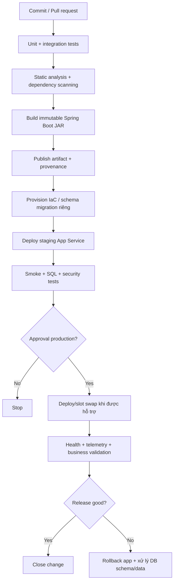

# Thực hành ứng dụng Spring Boot trên App Service với Azure SQL

## 1. Bài toán capstone: đưa Orders API từ máy lập trình lên Azure

Bạn được giao xây dựng một API Java nhỏ để lưu danh sách công việc xử lý đơn hàng. Ứng dụng chạy tốt trên laptop, nhưng nhóm sản phẩm muốn cung cấp API qua Internet, lưu dữ liệu bền vững, giám sát sức khỏe dịch vụ và chuẩn bị cho tăng tải. Thay vì tự quản lý máy chủ Java, ta triển khai **Spring Boot trên Azure App Service** và lưu dữ liệu bằng **Azure SQL Database**.

Bài học thuộc chương **Kiến trúc và thực hành tổng hợp** trong lộ trình Microsoft Azure. Nó kết hợp những kiến thức từ **subscription, resource group, Microsoft Entra ID, mạng ảo, dịch vụ tính toán, lưu trữ và dữ liệu**, tới triển khai, giám sát, bảo mật và quản lý chi phí. Đây là một bài thực hành end-to-end: viết mã, cấu hình database, đưa ứng dụng lên App Service, xác minh rồi làm sạch môi trường.

### Kết quả cần tạo ra

- Một Spring Boot REST API Java 21 có hai endpoint nghiệp vụ: liệt kê và tạo `work_items`.
- Một Azure SQL Database chứa bảng `dbo.work_items`; tài khoản ứng dụng chỉ có quyền đọc/ghi phù hợp.
- Một Azure App Service trên Linux với runtime Java được hỗ trợ, chạy tệp JAR của Spring Boot.
- Cấu hình kết nối SQL bằng **App Service application settings**, không hardcode mật khẩu vào Git; có hướng bảo vệ bằng Azure Key Vault reference.
- Health endpoint, logs và phép kiểm tra chức năng sau triển khai.
- Một bảng tiêu chí nghiệm thu, kế hoạch bảo mật/mạng và cách xóa tài nguyên lab để tránh phát sinh phí.

### Mục tiêu học tập

Sau bài học, bạn có thể:

1. Giải thích vai trò của App Service plan, web app, Azure SQL logical server, database, firewall, identity và Key Vault.
2. Tạo một Spring Boot ứng dụng có JDBC access tới Azure SQL với SQL parameterization và input validation.
3. Xây JAR bằng Maven, triển khai lên App Service và điều chỉnh cấu hình bằng environment variables.
4. Phân biệt kết nối SQL qua **public endpoint + IP allowlist** trong lab với **VNet Integration + Private Endpoint + Private DNS** cho hệ thống nghiêm ngặt hơn.
5. Sử dụng managed identity và Key Vault references để giảm nguy cơ lộ secret; nhận biết đường chuyển sang passwordless database authentication.
6. Kiểm tra health, logs, HTTP behavior, dữ liệu SQL, network, quyền và chi phí sau deploy.
7. Thiết kế hướng mở rộng với autoscale, connection pool, database sizing, monitoring, backup và rollback.

> **Lưu ý:** đây là hướng dẫn tạo tài nguyên có thể **phát sinh chi phí Azure**. Tất cả lệnh chỉ là tài liệu để người học thực hiện trong subscription lab được phép, **không được chạy trên production nếu chưa được phê duyệt**. Tên SKU, runtime, giao diện Portal và tính năng ở từng region cần kiểm tra theo tài liệu hiện hành. Bài không triển khai tài nguyên thật.

## 2. Kiến trúc, ranh giới và luồng request



**App Service** là nền tảng PaaS chạy ứng dụng web/API. **App Service plan** quyết định tầng compute, kích thước, số worker, đặc tính scale và phần chi phí compute. **Web app** chứa cấu hình runtime, app settings, deployment và hostname. Nhiều web app có thể chia sẻ một App Service plan; không được mặc định mỗi app có một VM riêng.

**Azure SQL Database** là database engine dạng PaaS. Một **logical SQL server** cung cấp tên host dạng `<server>.database.windows.net`, cấu hình quản trị, network và authentication; **database** nằm bên trong logical server. Không nhầm Azure SQL logical server với Azure VM chạy SQL Server.

**Key Vault** giữ bí mật nếu chọn cơ chế SQL authentication cho lab. **Managed identity** của web app cho phép truy xuất secret mà không gắn credential truy cập Key Vault vào code. Đây là mô hình lab có dùng SQL password; trong hệ thống sản xuất, nên đánh giá **Microsoft Entra authentication bằng managed identity trực tiếp tới Azure SQL**, nếu driver, tính năng và quy trình phân quyền đã được xác minh.

**Azure Monitor/Application Insights** giúp theo dõi request, exception, logs và dependency. App Service platform log và Spring Boot application log không phải cùng nguồn dữ liệu; cần bật đúng chức năng và cấu hình retention/chi phí.

### Ranh giới của lab

| Trong phạm vi | Ngoài phạm vi hoặc chỉ giới thiệu |
| --- | --- |
| Spring Boot REST API đơn giản | Ứng dụng thương mại với domain nghiệp vụ đầy đủ |
| JDBC qua Microsoft SQL Server driver | ORM phức tạp, distributed transactions |
| SQL schema tạo trước bởi tài khoản quản trị | Pipeline migration schema production nhiều môi trường |
| SQL auth riêng cho ứng dụng + Key Vault | Demo triển khai đầy đủ passwordless Entra SQL |
| Một web app và một database trong một region | Kiến trúc đa vùng active-active |
| Kiểm tra thủ công và phương án CI/CD | Triển khai pipeline thật trên GitHub/Azure DevOps |

## 3. Chuẩn bị tài khoản, runtime và bộ công cụ

### 3.1. Công cụ cần có

| Thành phần | Yêu cầu và mục đích |
| --- | --- |
| JDK | Java 21 LTS trong máy phát triển và runtime App Service tương thích |
| Maven | Build JAR, chạy test và quản lý dependency |
| IDE/editor | IntelliJ IDEA, VS Code hoặc editor phù hợp |
| Azure CLI | Đăng nhập, tạo App Service, triển khai JAR, xem metadata |
| SQL client | Azure Data Studio, `sqlcmd`, SSMS hoặc client phù hợp để chạy T-SQL |
| Azure subscription | Quyền tạo resource group, App Service, SQL, Key Vault, role assignment theo phạm vi |
| HTTP client | `curl` hoặc công cụ gọi REST API |

Kiểm tra cục bộ:

```bash
java -version
mvn -version
az version
az login
az account show --query "{id:id,name:name,tenantId:tenantId}" --output table
```

Các lệnh trong bài dùng **Bash** (Linux/macOS/WSL/Azure Cloud Shell). Trên Windows PowerShell, cú pháp biến môi trường, nối dòng và dấu nháy khác; không copy nguyên mọi lệnh Bash sang PowerShell.

### 3.2. Chọn region và kiểm tra khả năng cung cấp

Giả sử:

```bash
RG="rg-orders-spring-lab"
LOCATION="southeastasia"
PLAN="asp-orders-spring-lab"
APP="<ten-web-app-duy-nhat-toan-cuc>"
SQL_SERVER="<ten-sql-logical-server-duy-nhat>"
SQL_DB="orderslab"
KV="<ten-key-vault-duy-nhat>"
```

Giá trị trong dấu `<...>` phải được thay bằng tên thật hợp lệ; hostname App Service, SQL logical server và Key Vault chịu ràng buộc định danh/khả dụng riêng. **Không dùng những chuỗi này làm mật khẩu hoặc tài nguyên production.**

Region ở đây là ví dụ. Hãy kiểm tra Linux Java runtime, App Service SKU, Azure SQL service tier và Key Vault có khả dụng trong region/subscription của bạn hay không. Các lựa chọn có thể thay đổi và có thể chịu quota.

### 3.3. Quyền và ngân sách

Chuẩn bị:

1. Một subscription lab và resource group riêng.
2. Quyền tạo resource, quyền thực hiện role assignment cho managed identity nếu sử dụng Key Vault RBAC, và quyền quản trị SQL khi tạo user.
3. Ngân sách/cảnh báo chi phí; tài nguyên App Service plan và Azure SQL vẫn có thể phát sinh tiền khi không có request.
4. Tài khoản ứng dụng SQL **riêng biệt** với SQL server administrator.
5. Quyết định mạng: lab dùng IP allowlist giới hạn; production ưu tiên private networking nếu yêu cầu.

## 4. Phác thảo cấu trúc dự án Spring Boot

Ta xây một ứng dụng `orders-lab` sử dụng `spring-boot-starter-web`, `spring-boot-starter-jdbc`, Bean Validation và Spring Boot Actuator. Sử dụng **JdbcTemplate** thay cho Hibernate/JPA để người học nhìn rõ câu lệnh SQL và quyền database. Schema được tạo trước, ứng dụng chỉ có `SELECT` và `INSERT`.

```text
orders-lab/
├── pom.xml
└── src/
    └── main/
        ├── java/
        │   └── com/example/orders/
        │       ├── OrdersApplication.java
        │       └── WorkItemController.java
        └── resources/
            └── application.yml
```

Đây là **cấu trúc minh họa có thể tự tạo**, không yêu cầu đọc bất kỳ repository sẵn có nào. Các đoạn mã bên dưới mô tả đầy đủ các tệp tối thiểu.

## 5. Tạo `pom.xml`: Spring Boot, JDBC và Actuator

Ví dụ chọn nhánh Spring Boot 3.5 với Java 21. **`3.5.6` là phiên bản minh họa cần đối chiếu chính sách hỗ trợ và security updates của tổ chức trước khi triển khai**, không phải yêu cầu khóa phiên bản của bài học.

```xml
<?xml version="1.0" encoding="UTF-8"?>
<project xmlns="http://maven.apache.org/POM/4.0.0"
         xmlns:xsi="http://www.w3.org/2001/XMLSchema-instance"
         xsi:schemaLocation="http://maven.apache.org/POM/4.0.0
                             https://maven.apache.org/xsd/maven-4.0.0.xsd">
  <modelVersion>4.0.0</modelVersion>

  <parent>
    <groupId>org.springframework.boot</groupId>
    <artifactId>spring-boot-starter-parent</artifactId>
    <version>3.5.6</version>
    <relativePath/>
  </parent>

  <groupId>com.example</groupId>
  <artifactId>orders-lab</artifactId>
  <version>0.0.1-SNAPSHOT</version>
  <name>orders-lab</name>
  <description>Spring Boot App Service + Azure SQL laboratory</description>

  <properties>
    <java.version>21</java.version>
  </properties>

  <dependencies>
    <dependency>
      <groupId>org.springframework.boot</groupId>
      <artifactId>spring-boot-starter-web</artifactId>
    </dependency>
    <dependency>
      <groupId>org.springframework.boot</groupId>
      <artifactId>spring-boot-starter-jdbc</artifactId>
    </dependency>
    <dependency>
      <groupId>org.springframework.boot</groupId>
      <artifactId>spring-boot-starter-validation</artifactId>
    </dependency>
    <dependency>
      <groupId>org.springframework.boot</groupId>
      <artifactId>spring-boot-starter-actuator</artifactId>
    </dependency>
    <dependency>
      <groupId>com.microsoft.sqlserver</groupId>
      <artifactId>mssql-jdbc</artifactId>
      <scope>runtime</scope>
    </dependency>
    <dependency>
      <groupId>org.springframework.boot</groupId>
      <artifactId>spring-boot-starter-test</artifactId>
      <scope>test</scope>
    </dependency>
  </dependencies>

  <build>
    <plugins>
      <plugin>
        <groupId>org.springframework.boot</groupId>
        <artifactId>spring-boot-maven-plugin</artifactId>
      </plugin>
    </plugins>
  </build>
</project>
```

Spring Boot parent quản lý các phiên bản dependency tương thích trong BOM, gồm nhiều JDBC drivers. Khi thay Spring Boot version hoặc Java runtime, hãy kiểm tra `mssql-jdbc` đã được resolve đúng và hỗ trợ phương thức authentication mà dự án chọn. **Không cần nhúng Azure SQL password hay JDBC URL vào `pom.xml`.**

## 6. Viết ứng dụng REST API tối thiểu

Tạo `src/main/java/com/example/orders/OrdersApplication.java`:

```java
package com.example.orders;

import org.springframework.boot.SpringApplication;
import org.springframework.boot.autoconfigure.SpringBootApplication;

@SpringBootApplication
public class OrdersApplication {
    public static void main(String[] args) {
        SpringApplication.run(OrdersApplication.class, args);
    }
}
```

Tạo `src/main/java/com/example/orders/WorkItemController.java`:

```java
package com.example.orders;

import jakarta.validation.Valid;
import jakarta.validation.constraints.NotBlank;
import jakarta.validation.constraints.Size;
import java.net.URI;
import java.sql.ResultSet;
import java.sql.SQLException;
import java.time.LocalDateTime;
import java.util.List;
import java.util.Optional;
import org.springframework.http.ResponseEntity;
import org.springframework.jdbc.core.JdbcTemplate;
import org.springframework.jdbc.core.RowMapper;
import org.springframework.web.bind.annotation.GetMapping;
import org.springframework.web.bind.annotation.PathVariable;
import org.springframework.web.bind.annotation.PostMapping;
import org.springframework.web.bind.annotation.RequestBody;
import org.springframework.web.bind.annotation.RequestMapping;
import org.springframework.web.bind.annotation.RestController;

@RestController
@RequestMapping("/api/work-items")
public class WorkItemController {

    public record CreateWorkItem(
            @NotBlank @Size(max = 200) String title) {}

    // createdUtc nhận giá trị UTC từ cột DATETIME2; đây là LocalDateTime
    // mang quy ước UTC, không phải kiểu dữ liệu kèm múi giờ.
    public record WorkItem(
            long id, String title, String state, LocalDateTime createdUtc) {}

    private static final RowMapper<WorkItem> MAPPER =
            (rs, rowNum) -> mapWorkItem(rs);

    private final JdbcTemplate jdbc;

    public WorkItemController(JdbcTemplate jdbc) {
        this.jdbc = jdbc;
    }

    private static WorkItem mapWorkItem(ResultSet rs) throws SQLException {
        return new WorkItem(
                rs.getLong("id"),
                rs.getString("title"),
                rs.getString("state"),
                rs.getObject("created_utc", LocalDateTime.class));
    }

    @GetMapping
    public List<WorkItem> list() {
        return jdbc.query(
                "SELECT TOP (100) id, title, state, created_utc "
                + "FROM dbo.work_items ORDER BY id DESC",
                MAPPER);
    }

    @GetMapping("/{id}")
    public ResponseEntity<WorkItem> find(@PathVariable long id) {
        List<WorkItem> rows = jdbc.query(
                "SELECT id, title, state, created_utc "
                + "FROM dbo.work_items WHERE id = ?",
                MAPPER, id);
        Optional<WorkItem> item = rows.stream().findFirst();
        return item.map(ResponseEntity::ok)
                .orElseGet(() -> ResponseEntity.notFound().build());
    }

    @PostMapping
    public ResponseEntity<WorkItem> create(
            @Valid @RequestBody CreateWorkItem request) {
        Long id = jdbc.queryForObject(
                "INSERT INTO dbo.work_items (title) "
                + "OUTPUT INSERTED.id VALUES (?)",
                Long.class, request.title().trim());
        if (id == null) {
            throw new IllegalStateException("SQL did not return inserted ID");
        }
        List<WorkItem> rows = jdbc.query(
                "SELECT id, title, state, created_utc "
                + "FROM dbo.work_items WHERE id = ?",
                MAPPER, id);
        if (rows.isEmpty()) {
            throw new IllegalStateException("Inserted item not found");
        }
        return ResponseEntity
                .created(URI.create("/api/work-items/" + id))
                .body(rows.get(0));
    }
}
```

### Phân tích mã

- `JdbcTemplate` truyền `?` và tham số độc lập, **không nối trực tiếp input vào SQL**, giúp tránh SQL injection ở các truy vấn này.
- Bean Validation đảm bảo `title` không rỗng và không quá 200 ký tự; validation errors được Spring chuyển thành response lỗi phù hợp.
- `GET` giới hạn 100 bản ghi để tránh vô tình đọc toàn bộ bảng. Ứng dụng thật cần phân trang/cursor, authorization và query filtering.
- `POST` trả `201 Created` với `Location`. Với tình huống người dùng gửi lại request do timeout, **nên bổ sung idempotency key** để tránh tạo hai work item.
- Bài lab không có xác thực người dùng; **không đưa hai endpoint ghi/đọc này lên public production** khi chưa có Entra ID/OAuth2, authorization, rate limiting và audit.
- `DATETIME2` không mang timezone. Lab lưu dữ liệu theo quy ước UTC từ `SYSUTCDATETIME()`; hệ thống thật cần định nghĩa rõ kiểu dữ liệu thời gian, serialization và offset.

## 7. Cấu hình `application.yml` và connection pool

Tạo `src/main/resources/application.yml`:

```yaml
spring:
  application:
    name: orders-lab
  datasource:
    url: ${SPRING_DATASOURCE_URL}
    username: ${SPRING_DATASOURCE_USERNAME}
    password: ${SPRING_DATASOURCE_PASSWORD}
    hikari:
      maximum-pool-size: ${DB_POOL_MAX:5}
      minimum-idle: 1
      connection-timeout: 30000
  sql:
    init:
      mode: never

management:
  endpoints:
    web:
      exposure:
        include: health,info
  endpoint:
    health:
      show-details: never
  health:
    probes:
      enabled: true

server:
  port: ${PORT:8080}
```

JDBC URL mẫu:

```text
jdbc:sqlserver://<sql-server>.database.windows.net:1433;databaseName=orderslab;encrypt=true;trustServerCertificate=false;loginTimeout=30
```

Ý nghĩa:

| Phần | Mục đích |
| --- | --- |
| `databaseName=orderslab` | Kết nối đúng database, không dùng nhầm `master` |
| `encrypt=true` | Bật mã hóa kết nối SQL |
| `trustServerCertificate=false` | Yêu cầu xác thực chứng thư máy chủ |
| `loginTimeout=30` | Giới hạn thời gian thử kết nối ban đầu theo driver |
| `maximum-pool-size=5` | Giới hạn tối đa kết nối trong mỗi instance ứng dụng |

**Không sử dụng `encrypt=false` hoặc `trustServerCertificate=true` để sửa lỗi kết nối TLS một cách vội vàng.** Kiểm tra đúng FQDN, trust chain, DNS, proxy và cấu hình JDBC driver.

### Vì sao không chạy `ddl-auto=update`?

Lab dùng `JdbcTemplate` và schema được tạo riêng. Cách này giúp tách:

- **Schema migration**: DBA/CI migration tool có quyền `CREATE/ALTER` theo quy trình.
- **Runtime app**: chỉ đọc/ghi bảng được cho phép.

Khi dự án lớn hơn, thêm Flyway hoặc Liquibase vào pipeline và triển khai migration schema **trước** khi đưa bản ứng dụng phụ thuộc schema mới vào production. Không cho tài khoản runtime quyền `db_owner` chỉ để Spring tự tạo bảng.

## 8. Tạo Azure SQL logical server và database

### Bước 1 — Chọn cấu hình Azure SQL Database

Trong **Azure Portal → Azure SQL → SQL databases** (hoặc mục tương đương), tạo:

1. Subscription và resource group lab.
2. Database name `orderslab`.
3. SQL logical server mới với tên global-unique và region phù hợp.
4. Authentication model. Lab minh họa **SQL authentication** nhưng không dùng SQL administrator làm user runtime.
5. Compute/service tier đủ cho lab, storage vừa phải và phương án backup mặc định của dịch vụ.
6. Network access theo mục 9; nên tránh bật quyền truy cập quá rộng.

**Tầng miễn phí/ưu đãi/trial, tên SKU và giới hạn có thể thay đổi.** Kiểm tra Pricing Calculator trước khi tạo. Azure SQL logical server không phải một SQL Server VM và cách tính phí thường chủ yếu ở database/compute/storage theo cấu hình.

### Bước 2 — Tạo schema bằng tài khoản quản trị được phê duyệt

Kết nối tới **database `orderslab`**, không phải `master`, bằng SQL client được phép. Chạy:

```sql
CREATE TABLE dbo.work_items (
    id BIGINT IDENTITY(1,1) NOT NULL
        CONSTRAINT PK_work_items PRIMARY KEY,
    title NVARCHAR(200) NOT NULL,
    state NVARCHAR(20) NOT NULL
        CONSTRAINT DF_work_items_state DEFAULT N'OPEN',
    created_utc DATETIME2(3) NOT NULL
        CONSTRAINT DF_work_items_created_utc DEFAULT SYSUTCDATETIME()
);
```

`SYSUTCDATETIME()` ghi thời gian UTC; `IDENTITY` chỉ tạo khóa tăng dần, **không phải cơ chế ngăn request nghiệp vụ bị gửi lại**. Trong lab tạo bảng đúng một lần; nếu đã tồn tại, kiểm tra schema trước khi thay đổi, không tùy tiện drop bảng chứa dữ liệu.

### Bước 3 — Tạo SQL login riêng cho ứng dụng

Với phương thức **SQL authentication lab**:

```sql
-- Chạy trong database master với tài khoản có quyền tạo login.
CREATE LOGIN orders_app_login
WITH PASSWORD = '<mat-khau-manh-duoc-cap-qua-kenh-an-toan>';
```

Chuyển kết nối SQL client sang database `orderslab`:

```sql
-- Chạy trong database orderslab.
CREATE USER orders_app_user FOR LOGIN orders_app_login;

-- Chỉ cấp quyền mà hai endpoint trong lab thực sự cần:
GRANT SELECT, INSERT ON OBJECT::dbo.work_items TO orders_app_user;
```

**Đừng đưa mật khẩu thật vào Git, issue, ảnh chụp hoặc script CI/CD công khai.** Cú pháp trên dùng placeholder để hướng dẫn; khi vận hành thật nên sử dụng công cụ quản lý secret, tài khoản DBA và audit trail thích hợp. Một SQL login riêng cho ứng dụng an toàn hơn việc dùng SQL administrator có quyền lớn, nhưng vẫn phải quản lý vòng đời và rotation của mật khẩu.

Nếu doanh nghiệp **không cho phép SQL authentication**, dùng Microsoft Entra administrator và user từ external provider theo hướng dẫn chính thức; xem mục 16 về đường triển khai passwordless.

### Bước 4 — Xác minh từ SQL client

```sql
SELECT DB_NAME() AS current_database;

SELECT
    name, type_desc
FROM sys.database_principals
WHERE name = N'orders_app_user';

SELECT TOP (10)
    id, title, state, created_utc
FROM dbo.work_items
ORDER BY id DESC;
```

Đảm bảo client kết nối database `orderslab` bằng đúng quyền được cấp. Nếu chưa có bản ghi, truy vấn có thể trả tập rỗng và vẫn hợp lệ.

## 9. Thiết kế kết nối từ App Service tới Azure SQL

Có hai mô hình cần hiểu rõ. **Không tạo rule firewall quá rộng chỉ để làm bài chạy được.**

### Phương án A — Public endpoint với SQL firewall allowlist (lab)



Ở mô hình này, SQL logical server cho phép public network access theo chính sách, nhưng firewall chỉ cho qua **các IP outbound App Service và IP máy phát triển được phép**. App Service có thể có nhiều outbound IP và dải IP khả dĩ thay đổi khi scale plan, đổi SKU hoặc thay đổi nền tảng. Lệnh chỉ đọc giúp xem IP hiện tại:

```bash
az webapp show \
  --resource-group "$RG" \
  --name "$APP" \
  --query "{outbound:outboundIpAddresses,possible:possibleOutboundIpAddresses}" \
  --output json
```

Sau khi biết các IP thực, chủ động cấu hình firewall rule đúng địa chỉ trong Azure Portal hoặc bằng lệnh quản trị phù hợp. **Không dùng rule `0.0.0.0` kiểu “Allow Azure services and resources to access this server” như một cách chữa lỗi phổ quát**, vì có thể mở quyền truy cập từ nhiều tài nguyên Azure không thuộc ứng dụng của bạn.

Khi IP laptop thay đổi, quyền truy cập local SQL client có thể ngừng hoạt động; không nên mở dải IP lớn không cần thiết.

### Phương án B — VNet Integration + SQL Private Endpoint (khuyến nghị cho yêu cầu cách ly mạng)



Cấu hình cần:

1. App Service plan/tier hỗ trợ **Regional VNet Integration**; chọn subnet ủy quyền (delegated) phù hợp cho tích hợp outbound.
2. VNet/subnet và network security/routing cho phép ứng dụng kết nối private IP của Azure SQL.
3. Tạo **Private Endpoint cho SQL logical server**, dùng subnet thích hợp và kiểm tra private endpoint connection.
4. Tạo/liên kết **Private DNS zone `privatelink.database.windows.net`** theo mô hình DNS thực; hostname bình thường `<server>.database.windows.net` phải phân giải tới private IP trong môi trường ứng dụng.
5. Nếu policy yêu cầu, tắt public network access trên SQL logical server sau khi đường private hoạt động.
6. Kiểm tra DNS, network route và authentication từ App Service, không chỉ kiểm tra Private Endpoint đã tồn tại.

**Regional VNet Integration của App Service dành cho lưu lượng outbound; nó không tự làm inbound của web app thành private.** Nếu cần private inbound, phải đánh giá **Private Endpoint cho App Service** và cách công bố API riêng. App Service và Azure SQL có hai loại Private Endpoint với mục đích khác nhau.

Ứng dụng vẫn dùng hostname SQL chuẩn trong JDBC URL và yêu cầu TLS verification. **Không đổi SQL JDBC hostname sang IP private** rồi tắt xác minh certificate.

## 10. Chuẩn bị App Service plan và web app

### Bước 1 — Tạo resource group

```bash
az group create \
  --name "$RG" \
  --location "$LOCATION"
```

### Bước 2 — Xem danh sách runtime Java Linux hiện có

```bash
az webapp list-runtimes --os linux
```

Từ danh sách trả về, chọn runtime **Java 21 / Java SE** được hỗ trợ ở khu vực/plan của bạn. Chuỗi `--runtime` cụ thể có thể thay đổi theo phiên bản CLI và dịch vụ; ví dụ trong một số môi trường có dạng `JAVA:21-java21`. **Không dùng một chuỗi runtime chỉ vì nó xuất hiện trong tài liệu cũ**: xác minh từ danh sách ở bước trên.

### Bước 3 — Tạo App Service plan Linux

```bash
az appservice plan create \
  --resource-group "$RG" \
  --name "$PLAN" \
  --location "$LOCATION" \
  --sku B1 \
  --is-linux
```

`B1` chỉ là SKU lab thường gặp; **có thể tính phí ngay cả khi web app không có traffic**. Các khả năng như scaling, VNet Integration, Always On, Health Check hoặc vùng triển khai phụ thuộc tier/OS/tính năng, nên phải kiểm tra nhu cầu trước khi tạo.

### Bước 4 — Tạo web app với runtime đã kiểm tra

```bash
# Lấy giá trị phù hợp từ output list-runtimes, ví dụ:
RUNTIME="JAVA:21-java21"

az webapp create \
  --resource-group "$RG" \
  --plan "$PLAN" \
  --name "$APP" \
  --runtime "$RUNTIME"
```

Web app có hostname mặc định dạng `https://<app>.azurewebsites.net` theo quy ước đặt tên hiện hành của nền tảng. App Service Linux chạy **Spring Boot executable JAR** theo runtime đã chọn; kiểm tra startup logs nếu có sai khác về Java version hoặc command khởi động.

### Bước 5 — Kiểm tra tài nguyên vừa tạo

```bash
az webapp show \
  --resource-group "$RG" \
  --name "$APP" \
  --query "{name:name,location:location,state:state,host:defaultHostName}" \
  --output table
```

`state=Running` ở control plane chưa chứng minh ứng dụng Java có thể kết nối tới database. Phải hoàn tất các bước cấu hình, deploy và kiểm thử.

## 11. Quản lý SQL password bằng App Service Key Vault reference

Đối với lab SQL authentication, **không lưu mật khẩu ở `application.yml` hay câu lệnh chứa secret plaintext trong tài liệu**. Một phương án phổ biến là để password trong Azure Key Vault, sau đó đặt application setting thành **Key Vault reference**; Spring Boot nhìn thấy giá trị qua environment variable được nền tảng giải quyết.

### 11.1. Tạo và chuẩn bị Key Vault

Tạo một vault bằng Azure Portal hoặc IaC được phê duyệt, chọn region và permission model phù hợp. Thêm secret có tên ví dụ `orders-sql-password` và giá trị là mật khẩu của **`orders_app_login`**. Không sử dụng SQL administrator password làm runtime secret.

Trong bài lab không đưa ra lệnh `az keyvault secret set --value "<password>"` để tránh người học vô tình ghi plaintext vào shell history hoặc log. Hãy nhập secret bằng kênh bảo vệ được tổ chức chấp thuận.

### 11.2. Bật system-assigned managed identity cho App Service

```bash
PRINCIPAL_ID="$(az webapp identity assign \
  --resource-group "$RG" \
  --name "$APP" \
  --query principalId \
  --output tsv)"

echo "Managed identity object ID đã được cấp."
```

System-assigned managed identity được liên kết vòng đời với web app. Nó giúp App Service đọc secret theo Azure role/access policy nhưng **không tự tạo user SQL hay cấp quyền vào database**.

### 11.3. Cấp quyền đọc secret ở phạm vi hẹp

Nếu Key Vault đang dùng **Azure RBAC permission model**, một người có quyền cấp role phù hợp có thể thực hiện:

```bash
VAULT_ID="$(az keyvault show \
  --name "$KV" \
  --query id \
  --output tsv)"

az role assignment create \
  --assignee-object-id "$PRINCIPAL_ID" \
  --assignee-principal-type ServicePrincipal \
  --role "Key Vault Secrets User" \
  --scope "$VAULT_ID"
```

Trong hệ thống có nhiều secret, scope ở **secret cụ thể** hoặc thiết kế vault riêng cho một ứng dụng có thể giúp hạn chế quyền hơn nữa. **Nếu vault dùng access policy model**, quy trình quyền khác; không trộn role assignment với access policy rồi mong tự hoạt động. Cần kiểm tra firewall/private endpoint của Key Vault và thời gian propagation role khi troubleshooting.

### 11.4. Đặt Application Settings

Lấy **Secret URI** từ Key Vault theo kênh được phép (ví dụ trong Portal hoặc CLI metadata):

```bash
SECRET_URI="$(az keyvault secret show \
  --vault-name "$KV" \
  --name orders-sql-password \
  --query id \
  --output tsv)"

SQL_JDBC_URL="jdbc:sqlserver://${SQL_SERVER}.database.windows.net:1433;databaseName=${SQL_DB};encrypt=true;trustServerCertificate=false;loginTimeout=30"

az webapp config appsettings set \
  --resource-group "$RG" \
  --name "$APP" \
  --settings \
  "SPRING_DATASOURCE_URL=$SQL_JDBC_URL" \
  "SPRING_DATASOURCE_USERNAME=orders_app_login" \
  "SPRING_DATASOURCE_PASSWORD=@Microsoft.KeyVault(SecretUri=$SECRET_URI)" \
  "DB_POOL_MAX=5"
```

Ở trên, người chạy CLI cần quyền đọc metadata secret tương ứng. `SECRET_URI` có thể chứa phiên bản; quy tắc tự refresh/rotation của Key Vault reference phụ thuộc cách tham chiếu và cơ chế nền tảng. **Không mặc định rotate secret xong kết nối JDBC tự đổi không gián đoạn**: cần kế hoạch rotate secret, làm mới cấu hình, connection pool và kiểm thử.

**Không in toàn bộ app settings hoặc JDBC connection string chứa thông tin nhạy cảm vào CI log**. Trong ví dụ, JDBC URL không chứa password nhưng vẫn bộc lộ hostname/tên database; cần kiểm soát log theo chính sách nội bộ.

### 11.5. Kiểm tra trạng thái Key Vault reference

Trong Azure Portal, xem **App Service → Environment variables / Configuration** và trạng thái giải quyết Key Vault reference theo giao diện hiện có. Nếu App Service không giải quyết được secret, cần kiểm tra:

- Managed identity đang bật và đúng principal.
- Quyền `get` secret trong permission model đang dùng.
- Secret URI và tên vault chính xác.
- Network path từ App Service tới Key Vault; vault dùng private endpoint cần VNet/DNS phù hợp.
- Vai trò vừa cấp đã propagation đủ thời gian.

Một Key Vault reference ở trạng thái unresolved có thể khiến Spring nhận chuỗi reference thay vì mật khẩu hợp lệ hoặc không nhận được giá trị mong muốn. **Phải kiểm tra kết nối SQL thực**, không chỉ việc app setting đã được lưu.

## 12. Chạy Spring Boot cục bộ

Trước khi deploy, từ thư mục dự án:

```bash
mvn clean package
```

Maven cần truy cập repository dependency được tổ chức cho phép. Nếu `mssql-jdbc` không resolve, kiểm tra BOM/repositories, network, Java version và cấu hình Maven. Không giải quyết bằng cách tải JAR không rõ nguồn vào thư mục dự án.

### Thiết lập môi trường local an toàn

Các biến cần được cấp từ terminal/IDE secret store riêng, ví dụ minh họa:

```bash
export SPRING_DATASOURCE_URL="jdbc:sqlserver://<sql-server>.database.windows.net:1433;databaseName=orderslab;encrypt=true;trustServerCertificate=false;loginTimeout=30"
export SPRING_DATASOURCE_USERNAME="orders_app_login"

# Nhập password tương tác, không hiện ký tự trên terminal Bash.
read -rs -p "SQL app password: " SPRING_DATASOURCE_PASSWORD
echo
export SPRING_DATASOURCE_PASSWORD

mvn spring-boot:run
```

Lệnh `read -rs` chỉ là cách thao tác trong terminal lab; password vẫn tồn tại tạm thời trong môi trường process. Trong CI/CD hoặc môi trường thật, dùng secret store/identity chuyên dụng. **Không đặt mật khẩu trong `.env` có thể bị commit**, và xóa biến/đóng terminal khi kết thúc lab theo quy trình.

Khi chạy local, SQL firewall cần cho phép IP public của máy phát triển hoặc đường truy cập private phù hợp. Nếu kết nối bị timeout, chưa chắc username/password sai; trước tiên kiểm tra DNS, TCP 1433, public/private routing và firewall.

### Gọi endpoint

```bash
curl -i http://localhost:8080/actuator/health

curl -i http://localhost:8080/api/work-items

curl -i -X POST http://localhost:8080/api/work-items \
  -H "Content-Type: application/json" \
  -d '{"title":"Kiểm tra kết nối Azure SQL"}'

curl -i http://localhost:8080/api/work-items/1
```

Trong lab mới, ID đầu tiên thường là `1`, **nhưng không nên giả định điều đó ở môi trường đã có dữ liệu**. Hãy đọc `Location` hoặc `id` từ response `201 Created` rồi dùng ID thực.

Nếu `GET /actuator/health` trả `DOWN` do `db` indicator, xác định lỗi kết nối database trước khi deploy. Actuator health không thay cho business-level transaction test.

## 13. Build JAR và triển khai lên App Service

### 13.1. Kiểm tra JAR

```bash
mvn -DskipTests package
```

Đầu ra theo cấu hình `pom.xml` ở mục 5 sẽ có dạng:

```text
target/orders-lab-0.0.1-SNAPSHOT.jar
```

Trong bài lab có thể dùng `-DskipTests` sau khi đã chạy test, nhưng production pipeline không nên bỏ qua unit/integration/security tests chỉ để deploy nhanh.

### 13.2. Đưa JAR lên App Service

```bash
az webapp deploy \
  --resource-group "$RG" \
  --name "$APP" \
  --src-path target/orders-lab-0.0.1-SNAPSHOT.jar \
  --type jar
```

Lệnh này triển khai **artifact JAR đã build**; nó không tự tạo database hay schema, không tự cấp quyền SQL và không tự chỉnh SQL firewall. Trên App Service Java SE, nền tảng khởi chạy ứng dụng theo runtime/packaging được hỗ trợ. Nếu App Service không nhận JAR hay port, xem deployment/startup logs và runtime configuration trước khi đổi bừa Java version.

### 13.3. Kiểm tra trạng thái deploy và log

```bash
az webapp show \
  --resource-group "$RG" \
  --name "$APP" \
  --query "{state:state,host:defaultHostName}" \
  --output table

# Sau khi cấu hình App Service logging phù hợp:
az webapp log tail \
  --resource-group "$RG" \
  --name "$APP"
```

Một số luồng log cần bật **App Service logs** hoặc Application Insights trước; cách lấy logs có thể khác nhau theo Linux runtime và phương thức deploy. Không coi log stream trống là bằng chứng ứng dụng ổn định.

### 13.4. Gọi API trên Azure

```bash
BASE="https://${APP}.azurewebsites.net"

curl -i "$BASE/actuator/health"
curl -i "$BASE/api/work-items"

curl -i -X POST "$BASE/api/work-items" \
  -H "Content-Type: application/json" \
  -d '{"title":"Đơn thử nghiệm từ Azure App Service"}'
```

**Các endpoint này chưa có xác thực ứng dụng.** Chỉ dùng trong lab tạm thời hoặc mạng bảo vệ phù hợp; trước khi công bố production cần thiết kế Entra ID/OAuth2, API access policies, chống lạm dụng và kiểm tra dữ liệu nhạy cảm.

## 14. Diễn giải các lỗi thường gặp khi mới triển khai

| Triệu chứng | Khả năng | Cách xác minh |
| --- | --- | --- |
| `az webapp create` báo runtime không hợp lệ | Runtime string hoặc tier/region không hỗ trợ | Chạy `az webapp list-runtimes --os linux`, xem hỗ trợ hiện tại |
| App Service trả 502/503 sau deploy | Java không khởi động hoặc chưa listen đúng port | Xem startup log, Java version, `PORT`, JAR packaging |
| `/actuator/health` là `DOWN` | DB health contributor không kết nối | Kiểm tra exception, DNS/firewall/TLS/auth |
| SQL JDBC connection timeout | Firewall, route, Private DNS, TCP 1433 | Test network path và SQL server networking |
| SQL login failed | Password, username, database user, secret reference | Test SQL login bằng client, xem trạng thái Key Vault reference |
| `The server was not found or was not accessible` | Sai hostname hoặc DNS | Dùng FQDN `<server>.database.windows.net`, kiểm tra phân giải |
| TLS/PKIX validation failure | Certificate chain, proxy, hostname sai | Giữ `trustServerCertificate=false`, sửa trust/DNS/proxy |
| SQL error `Invalid object name` | Schema chưa tạo hoặc nhầm database | `SELECT DB_NAME()`, kiểm tra `dbo.work_items` |
| SQL permission denied | User ứng dụng thiếu `SELECT/INSERT` | Kiểm tra `GRANT` trong database đích |
| `POST` trả 400 | `title` trống, vượt 200 ký tự, JSON sai | Xem validation response và payload |
| `POST` trả 500 | SQL schema/quyền/connection pool hoặc exception | Xem application logs và SQL diagnostics |
| Request timeout sau scale | SQL connection pool/sizing chưa phù hợp | Đo pool, số instance, query latency, DB limits |
| Không thấy app logs | Logs chưa được bật/chọn sai workspace | Kiểm tra App Service logging và DCR/diagnostics phù hợp |
| Dữ liệu mất sau restart | Ứng dụng dùng DB khác, H2 in-memory hoặc local files | Xác nhận Azure SQL databaseName và kiểm tra trực tiếp dữ liệu |

Để tránh làm lộ thông tin, logging nên ghi **HTTP status, trace ID, thời điểm, operation name và mã lỗi**, không ghi SQL password, toàn bộ connection string có secret, access token hoặc dữ liệu đơn hàng.

## 15. Giám sát App Service, Azure SQL và trải nghiệm người dùng

### 15.1. Các chỉ số nên đo

| Thành phần | SLI/metric | Tại sao cần |
| --- | --- | --- |
| App Service | HTTP 2xx/4xx/5xx, RPS, response time | Theo dõi chất lượng API |
| Java/JVM | Heap, GC, CPU, threads, connection pool | Nhận diện resource pressure |
| Azure SQL | CPU/vCore/DTU utilization, sessions, storage, deadlocks, query duration | Phát hiện DB bottleneck |
| Network | SQL connect failures, DNS resolution, TCP timeouts | Tách lỗi mạng khỏi lỗi SQL login |
| Application | `POST` success, duplicate detection, business error rate | Kiểm tra nghiệp vụ thực |
| Security | Login failures, identity/secret access errors | Cảnh báo quyền và cấu hình |
| Cost | App Service plan, SQL compute/storage, logs, outbound | Kiểm soát ngân sách |

### 15.2. App Service Health Check

Với Spring Boot Actuator, đường kiểm tra phổ biến là:

```text
/actuator/health
```

Trong Azure Portal, xem chức năng **App Service → Health check** (khi tier hỗ trợ), đặt đường dẫn phù hợp. Cần:

- Response `200` khi application có thể phục vụ.
- Cấu hình health indicator theo nhu cầu và kiểm tra database connection.
- Không bật `show-details=always` công khai vì có thể lộ cấu trúc hệ thống.
- Hiểu rằng Health Check của App Service giúp đánh giá instance; **không thay thế synthetic business transaction test**.

Nếu `db` health indicator làm mọi instance unhealthy trong đợt database bảo trì ngắn, hãy thiết kế readiness/liveness thận trọng theo SLO và cơ chế retry. Không đơn giản bỏ mọi dependency check để làm dashboard xanh.

### 15.3. Application Insights và correlation

Kết nối telemetry theo cách hỗ trợ cho Java/Spring Boot/App Service ở phiên bản hiện hành (ví dụ agent/instrumentation được duyệt, Azure Monitor OpenTelemetry Distro hoặc integration phù hợp). Quan sát:

- HTTP request và response codes.
- Exception và stack traces đã che dữ liệu nhạy cảm.
- SQL dependency duration/failure rate.
- Trace/correlation ID qua API, backend và database.
- Thời điểm deploy để so sánh trước và sau phát hành.

Ví dụ KQL trên bảng `requests` nếu nguồn telemetry sử dụng schema Application Insights tương ứng:

```kusto
requests
| where timestamp >= ago(1h)
| summarize
    Total = count(),
    Failures = countif(success == false)
    by bin(timestamp, 5m), cloud_RoleName
| extend FailureRatePct =
    iff(Total == 0, 0.0, 100.0 * todouble(Failures) / Total)
| order by timestamp asc
```

Trong workspace-based Application Insights, bảng và cột có thể là `AppRequests`, `TimeGenerated`, `Success`, `AppRoleName`. **Chỉ chạy KQL sau khi kiểm tra schema thực**. Không suy kết luận từ một biểu đồ thiếu data; xác minh agent, sampling và retention.

### 15.4. Thiết kế cảnh báo

Đặt ngưỡng theo baseline: tỷ lệ HTTP 5xx vượt mức bình thường trong nhiều phút, p95 latency tăng, Azure SQL resource pressure kéo dài hoặc database health thất bại. Gửi Action Group tới on-call với link runbook, resource ID, region và thời điểm bắt đầu. Alert không nên chỉ dựa trên tổng CPU vì SQL connection failures có thể xảy ra khi CPU còn thấp.

## 16. Nâng cấp bảo mật: Microsoft Entra và Managed Identity với Azure SQL

Mẫu lab dùng SQL username/password trong Key Vault để làm rõ cấu trúc connection. Với production, một thiết kế quan trọng là **passwordless authentication** bằng **system-assigned hoặc user-assigned managed identity**, kết hợp Microsoft Entra authentication của Azure SQL, nếu phiên bản JDBC driver và môi trường hỗ trợ.

### 16.1. Những bước phải có

1. Bật managed identity của App Service (mục 11).
2. Cấu hình **Microsoft Entra administrator** cho SQL logical server theo quy trình bảo mật được phê duyệt.
3. Trong database `orderslab`, người có quyền phù hợp tạo **contained database user từ Microsoft Entra principal** đại diện cho identity ứng dụng, cấp đúng quyền.
4. Cấu hình Microsoft JDBC driver/Spring datasource để lấy token qua managed identity theo phương pháp được hỗ trợ.
5. Gỡ `SPRING_DATASOURCE_USERNAME` và `SPRING_DATASOURCE_PASSWORD` của phương án SQL auth sau khi kiểm chứng đường token mới.
6. Kiểm tra kết nối và permission trong database, rotation/token refresh, app restart và tình trạng log.

SQL minh họa ở **database `orderslab`**, thực thi bởi Microsoft Entra admin hợp lệ:

```sql
-- Thay <ten-managed-identity> bằng principal tương ứng được xác minh.
CREATE USER [<ten-managed-identity>] FROM EXTERNAL PROVIDER;

GRANT SELECT, INSERT ON OBJECT::dbo.work_items
TO [<ten-managed-identity>];
```

Tên principal, object ID và cách Azure SQL phân giải Microsoft Entra identities có thể cần các bước riêng, đặc biệt khi tên bị trùng hoặc khác tenant. Không xem tên App Service tự động là username hợp lệ nếu chưa tra identity thực và kiểm thử.

### 16.2. JDBC authentication với managed identity

Microsoft JDBC Driver for SQL Server có các chế độ Microsoft Entra/Managed Identity được hỗ trợ ở những phiên bản nhất định, chẳng hạn tên phương thức `ActiveDirectoryMSI` hoặc `ActiveDirectoryManagedIdentity` theo driver. Một JDBC URL **minh họa** có thể có dạng:

```text
jdbc:sqlserver://<sql-server>.database.windows.net:1433;databaseName=orderslab;encrypt=true;trustServerCertificate=false;authentication=ActiveDirectoryMSI
```

**Không chuyển sang URL này chỉ bằng thao tác copy**: phải kiểm tra phiên bản JDBC driver, các dependency bổ sung theo driver, cloud environment, system-assigned/user-assigned identity, cách khai báo user/client ID và quyền Azure SQL. Với user-assigned identity, client ID cần được cung cấp theo contract cụ thể của JDBC driver. Đừng kết hợp cả SQL password và token mode không rõ mục đích.

Khi dùng Azure SQL private endpoint, cơ chế DNS/VNet và Entra authorization **vẫn cần đúng**: managed identity không thể vượt qua SQL firewall hoặc sửa lỗi đường mạng.

### 16.3. Phân biệt các loại identity

| Identity | Dùng cho | Lưu ý |
| --- | --- | --- |
| App Service managed identity | Web app đọc Key Vault, xác thực Azure SQL với Entra | Phải cấp quyền theo từng dịch vụ |
| SQL login | Kết nối SQL password-based trong lab | Không dùng SQL admin làm runtime |
| Microsoft Entra database principal | User được cấp SELECT/INSERT tại Azure SQL | Quyền SQL tách biệt Azure RBAC |
| Developer CLI identity | Tạo/quản trị Azure resources và chạy lab | Không mặc nhiên có quyền dữ liệu trong Azure SQL |
| GitHub Actions/Azure DevOps identity | CI/CD deploy | Nên dùng OIDC/workload identity federation và RBAC tối thiểu |

## 17. Quản lý connection pool, scale và sự cố dữ liệu

### 17.1. Pool nhân theo số App Service instances

Spring Boot dùng HikariCP khi `spring-boot-starter-jdbc` và runtime tương ứng khả dụng. Giả sử:

```text
DB_POOL_MAX = 5
App Service instances = 3
Max application DB connections (xấp xỉ) = 3 × 5 = 15
```

Đây là giới hạn phía ứng dụng theo từng instance, không phải cam kết Azure SQL luôn có 15 session còn trống. Database còn các kết nối từ admin, background jobs và hệ thống khác. Nếu `DB_POOL_MAX` quá cao, scale out có thể tăng số connection vượt ngưỡng của SQL service tier; nếu quá thấp, request bị xếp hàng và p95 tăng.

### 17.2. Các thực hành cần áp dụng

- Cấp phát pool theo số instance tối đa và giới hạn database; không scale out vô hạn.
- Đo connection acquisition time, active/idle connections, SQL query duration và timeout.
- Tối ưu index và transaction scope; tránh giữ kết nối khi chờ HTTP call ra hệ thống ngoài.
- Sử dụng retry **có giới hạn**, backoff và idempotency cho operation có thể được thử lại; không retry mù `POST`.
- Với operation đòi hỏi độ tin cậy cao, dùng transaction/outbox và cơ chế xử lý lặp phù hợp.
- Scale up/down và thay service tier có thể làm gián đoạn ngắn; thiết kế connection resilience và lịch thay đổi.

### 17.3. Schema migration trong CI/CD

Khi thêm cột `priority` vào `dbo.work_items`, không nên yêu cầu SQL admin thao tác thủ công ở mọi release. Dùng Flyway/Liquibase:

1. Viết migration versioned, review và thử trên staging.
2. Kiểm tra tương thích ngược giữa application version cũ/mới (expand-and-contract).
3. Chạy migration với identity có quyền DDL trong pipeline được phê duyệt.
4. Chỉ sau khi migration đạt, triển khai JAR mới.
5. Theo dõi SQL logs và health; chuẩn bị rollback application **và** data/schema.

Không cho runtime API `db_owner` chỉ vì pipeline chưa tách được bước migration.

## 18. Độ tin cậy: Azure SQL, App Service và phương án DR

Một App Service web app và Azure SQL Database trong cùng region là mô hình lab đơn giản. Đối với sản xuất cần đánh giá:

| Thành phần | Quyết định kiến trúc |
| --- | --- |
| App Service | Số instance tối thiểu, zone redundancy khi tier/region hỗ trợ, autoscale, deployment slots nếu có |
| Azure SQL | Service tier, HA/zone redundancy, backup retention, restore và geo-replication/failover group nếu cần DR |
| Network | Private Endpoint, DNS, VNet Integration, firewall, dự phòng đường truyền |
| Identity | Managed identity, Entra admin, secret rotation, break-glass |
| Observability | Application Insights, Azure Monitor Alerts, SQL monitoring |
| Release | Deployment slots, health check, smoke test, rollback artifact |
| Data | PITR, backup, restore rehearsal, schema migration plan |

**Deployment slot swap** có thể giảm rủi ro release nếu tier hỗ trợ, nhưng nó không rollback được database schema hoặc dữ liệu đã thay đổi. Chiến lược rollback cần tính đến tương thích schema và giao dịch sau deployment.

Nếu vùng Azure gặp sự cố lớn, App Service không tự kéo database theo sang region khác. Cần xây kế hoạch **regional DR** riêng cho compute, Azure SQL, DNS/traffic routing, credentials và dependencies. Backup là một lớp bảo vệ nhưng không thay thế mọi trường hợp cần failover nhanh.

## 19. Kiểm thử và nghiệm thu sau deployment

### Bảng tiêu chí

| Kiểm tra | Cách đo | Điều kiện đạt |
| --- | --- | --- |
| App Service running | Portal/CLI và startup logs | JAR khởi động thành công |
| HTTPS endpoint | `curl` tới hostname mặc định | Chứng thư hợp lệ, status mong đợi |
| Health | `/actuator/health` | 200/UP theo tiêu chí thiết kế |
| GET items | `GET /api/work-items` | JSON list, không lỗi SQL |
| POST item | Request `title` hợp lệ | 201, Location và bản ghi SQL |
| Invalid input | `title` trống hoặc >200 ký tự | 400, không thêm dữ liệu |
| SQL data consistency | Query database `orderslab` | Record tạo từ API tồn tại |
| Least privilege | User app có SELECT/INSERT nhưng không DDL | DDL bị chặn với app user |
| Secret | Mật khẩu không có trong Git/log | Key Vault reference được resolve |
| Network | SQL kết nối đúng firewall/private path | Không mở rule toàn Azure không cần thiết |
| Monitoring | Có logs và trace/correlation | Đội vận hành điều tra được |
| Cost | Có ước tính, budget, owner | Không bỏ quên App Service plan/SQL |

### Kiểm tra dữ liệu ngay trong SQL

```sql
SELECT TOP (20)
    id, title, state, created_utc
FROM dbo.work_items
ORDER BY id DESC;

SELECT COUNT(*) AS total_items
FROM dbo.work_items;
```

Kiểm tra **databaseName** hiện tại để không đối chiếu nhầm. Nếu API trả 201 nhưng không thấy bản ghi, xác minh host SQL, database, transaction và môi trường đang dùng.

### Quan sát sau deploy

Đo tối thiểu:

```text
Deployment start/end time (UTC): [timestamp]
JAR/version/build commit:          [value]
App Service instance count:       [count]
Azure SQL database/service tier:  [value]
GET success and p95 latency:      [result]
POST success and SQL row ID:      [result]
Validation error returns 400:     [PASS/FAIL]
Actuator health:                 [PASS/FAIL]
Logs/trace correlation:          [PASS/FAIL]
Key Vault reference:             [resolved/unresolved]
SQL connection network path:     [public allowlist/private]
Rollback artifact:               [build reference]
Owner/approver:                   [team]
```

## 20. An toàn phát hành và CI/CD mở rộng

Một pipeline production nên có các giai đoạn:



- Sử dụng **OIDC/workload identity federation** hoặc cơ chế identity an toàn được hỗ trợ cho pipeline, tránh lưu Azure service principal secret dài hạn.
- Dùng artifact version hoặc image digest cố định, không deploy bản `latest` không thể truy vết.
- Tách identity triển khai ứng dụng khỏi identity migration schema và runtime identity.
- Không cho pipeline in SQL password, full app settings hoặc dữ liệu production.
- Thiết lập quality gate theo HTTP error rate, database health, telemetry và thao tác nghiệp vụ.
- Thực hiện canary/slot swap theo support tier và thiết kế phiên ứng dụng tương thích cùng database.

## 21. Phân tích chi phí và dọn môi trường lab

### Chi phí chính

| Nhóm | Meter cần kiểm tra |
| --- | --- |
| App Service plan | Tier, instance count, uptime và vùng triển khai |
| Azure SQL Database | Compute tier/size, storage, backup/HA/DR phụ thuộc cấu hình |
| Azure Key Vault | Secret/key operations và các tính năng/tier phù hợp |
| Logs/Application Insights | Ingestion, retention và alerting |
| Network | VNet components, private endpoint, outbound và dịch vụ gateway nếu có |
| Storage/deployment | Artifact storage, backup/snapshot nếu phát sinh |

Khi chỉ làm bài tập, không nên chọn SKU production lớn hoặc giữ tài nguyên 24/7 sau khi xong. Dùng [Azure Pricing Calculator](https://azure.microsoft.com/pricing/calculator/) ước tính trước khi tạo; sau khi tạo dùng Azure Cost Management/budget alert để kiểm soát.

### Dọn dẹp an toàn

**Chỉ xóa resource group lab riêng do bạn tạo và không có tài nguyên dùng chung**, sau khi xác nhận không cần giữ dữ liệu và đã sao lưu bằng chứng học tập:

```bash
# Kiểm tra tên và danh sách tài nguyên trước.
az resource list \
  --resource-group "$RG" \
  --query "[].{name:name,type:type}" \
  --output table

# Chỉ thực thi sau khi người sở hữu xác nhận RG là lab riêng.
az group delete \
  --name "$RG" \
  --yes
```

Lệnh xóa resource group là **thao tác phá hủy**; không dùng nếu group chứa SQL/database, Key Vault hoặc VNet dùng chung. Một số dịch vụ có soft-delete/purge-protection và tài nguyên/chi phí ngoài group cần kiểm tra riêng. Sau dọn dẹp, xem lại billing/Cost Management để chắc chắn không còn thành phần lab phát sinh phí.

## 22. Bài thực hành có hướng dẫn: hoàn thành capstone

**Mục tiêu:** tạo từ đầu một REST API Spring Boot lưu dữ liệu Azure SQL, triển khai JAR lên Azure App Service, xác minh trước/sau deploy và ghi báo cáo. Nếu không có subscription được phê duyệt, làm phần viết mã/thiết kế/runbook và dừng trước bước tạo tài nguyên.

### Pha A — Thiết kế và chuẩn bị

1. Chọn subscription, resource group, region, App Service plan, Java runtime, SQL tier và người chịu trách nhiệm chi phí.
2. Chọn network path: SQL public endpoint với IP allowlist chặt cho lab; nêu phương án Private Endpoint cho production.
3. Chọn authentication: SQL app login tối thiểu cho lab, mật khẩu trong Key Vault; mô tả kế hoạch chuyển sang Entra managed identity cho database.
4. Lập bảng `resource → role → owner → cost meter` và tiêu chí nghiệm thu.

### Pha B — Viết và kiểm thử mã

1. Tạo `pom.xml`, `OrdersApplication.java`, `WorkItemController.java` và `application.yml` từ các mục 4–7.
2. Tạo bảng `dbo.work_items` bằng SQL admin, tạo SQL login/user runtime có quyền `SELECT, INSERT`.
3. Cấp môi trường local an toàn và chạy `mvn clean package`, `mvn spring-boot:run`.
4. Kiểm tra health, GET, POST hợp lệ, POST không hợp lệ và SQL record. Ghi lại id được trả về.

### Pha C — Triển khai Azure

1. Tạo resource group, App Service plan, web app Linux/Java.
2. Bật managed identity của web app và tạo Key Vault reference cho `SPRING_DATASOURCE_PASSWORD`.
3. Thiết lập App Service application settings bằng JDBC URL đúng SQL host/database; xác minh quyền secret.
4. Thiết lập SQL networking theo kiến trúc; kiểm tra kết nối thực.
5. Deploy JAR bằng `az webapp deploy --type jar`; xem deployment log/startup log.
6. Thử HTTPS endpoint, health, GET/POST; xác nhận dữ liệu trong Azure SQL.

### Pha D — Vận hành và kiểm tra ngoại lệ

1. Tạo dashboard/alert cơ bản cho HTTP 5xx, latency và SQL dependency errors.
2. Cố tình gửi `title` rỗng trong lab để thấy validation 400, không nên tạo lỗi SQL ở production.
3. Mô tả đường xử lý khi Key Vault reference không resolve hoặc SQL firewall chặn TCP 1433.
4. Tính số kết nối pool tối đa khi App Service scale từ 1 lên 3 instance.
5. Viết phương án rollback JAR và rollback schema nếu bản phát hành mới không tương thích.

### Pha E — Bàn giao, lưu bằng chứng và cleanup

```text
Lab ID: AZ-SPRING-SQL-003
Date/UTC: [timestamp]
Git commit/build artifact: [identifier]
Java/Spring Boot version: [values]
Azure subscription + RG: [values]
App Service plan + runtime: [values]
Azure SQL database + tier: [values]
SQL network path: public allowlist / Private Endpoint
Authentication: SQL app login + Key Vault / Entra managed identity
Key Vault reference status: [resolved/unresolved]
Health endpoint result: [HTTP status]
GET work-items result: [HTTP status + count]
POST work-item result: [HTTP 201 + id]
Invalid POST result: [HTTP 400]
SQL data verification: [query result]
Monitoring/log evidence: [links/timestamps]
Estimated monthly cost: [amount or TBD]
Known issues: [list]
Production-readiness gaps: [list]
Reviewer/approval: [team]
Lab resources cleaned: [YES/NO]
```

### Tiêu chí chấm bài

| Tiêu chí | Đạt khi |
| --- | --- |
| Spring Boot code | Build JAR được và các lớp/route đúng |
| SQL schema | `dbo.work_items` tồn tại và dữ liệu persist |
| SQL access | App không dùng SQL administrator và không có DDL privilege |
| Configuration | Không hardcode secret vào source/repository |
| Azure deploy | Web app Java được tạo và triển khai đúng artifact |
| Connectivity | JDBC kết nối TLS, firewall/private DNS phù hợp |
| Validation | API GET/POST hoạt động và request lỗi trả 400 |
| Observability | Có health, log và kịch bản alert |
| Identity | Managed identity/Key Vault được kiểm tra hoặc có phương án passwordless |
| Security | Ghi rõ thiếu authentication public endpoint của lab |
| Reliability | Có connection pool, backup, scale/rollback strategy |
| Cost | Có dự toán và cleanup đúng phạm vi |

## 23. Câu hỏi tự kiểm tra

1. App Service plan và web app khác nhau thế nào? Nếu tắt riêng API, chi phí plan có tự biến mất?
2. Azure SQL logical server khác Azure SQL Database và VM chạy SQL Server ra sao?
3. Vì sao JDBC URL phải dùng SQL FQDN và bật `encrypt=true;trustServerCertificate=false`?
4. Một web app có managed identity đã đọc được Key Vault secret chưa? Cần thêm điều kiện nào?
5. Vì sao không dùng SQL server administrator làm runtime user?
6. `GRANT SELECT, INSERT ON dbo.work_items` hạn chế những thao tác nào so với `db_owner`?
7. Nếu App Service có 3 instances và mỗi instance HikariCP có pool 5, tổng số kết nối tối đa từ ứng dụng là bao nhiêu?
8. Vì sao public SQL firewall không nên bật rule rộng `0.0.0.0` chỉ để lab hoạt động?
9. VNet Integration của App Service và Private Endpoint cho SQL có cùng chức năng inbound/outbound hay không?
10. Dùng SQL Private Endpoint thì JDBC URL nên đổi sang IP private hay giữ hostname SQL chuẩn?
11. Spring Boot Actuator health trả UP có đủ chứng minh chức năng `POST /api/work-items` hoạt động?
12. Vì sao `JdbcTemplate` với `?` bảo vệ khỏi một dạng SQL injection?
13. Tại sao `POST` trả 201 nhưng client timeout có thể tạo dữ liệu trùng nếu retry?
14. Khi Key Vault reference unresolved, bạn sẽ kiểm tra identity, RBAC và network theo thứ tự nào?
15. Vì sao một lỗi `Login failed` và một lỗi `connection timed out` thường có nhóm nguyên nhân khác nhau?
16. Vì sao `application.yml` dùng biến môi trường thay vì mật khẩu trực tiếp?
17. Khi nâng Spring Boot/Spring JDBC driver, những phần nào cần regression test?
18. Có nên cho ứng dụng quyền tạo bảng để tránh chạy Flyway/Liquibase trong pipeline?
19. Deployment slot rollback có tự rollback dữ liệu/schema Azure SQL không?
20. Những chi phí nào vẫn phát sinh khi lab không có request HTTP?
21. Vì sao API ví dụ không được công bố production public nguyên trạng?
22. Điều kiện nào cho phép xóa resource group lab mà không ảnh hưởng tài nguyên khác?

**Gợi ý:** (1) plan là compute, web app là cấu hình/deployment, tắt app không mặc định ngừng phí plan; (2) logical server quản lý host/chính sách, database lưu dữ liệu, SQL VM là IaaS; (3) bảo mật TLS và xác thực server; (4) cần quyền secret, network và identity đúng; (5) giảm blast radius; (6) không cho DDL/truy cập bảng khác theo quyền này; (7) 15; (8) mở phạm vi lớn từ Azure; (9) khác: App Service VNet Integration là outbound, SQL PE là inbound private tới SQL; (10) giữ FQDN; (11) không; (12) tham số tách khỏi SQL text; (13) cần idempotency; (14) identity, role/access policy, secret URI và Private DNS/firewall; (15) authentication so với connectivity; (16) tránh lộ secret và tách config; (17) JDBC, TLS, auth, schema, dependency, port, health; (18) không, tách quyền; (19) không; (20) App Service plan, SQL compute/storage, log và hạ tầng phụ trợ; (21) chưa có auth/authorization/rate limiting; (22) RG riêng có chủ sở hữu xác nhận và không chứa tài nguyên chung.

## 24. Tổng kết và tài liệu tham khảo

Đưa Spring Boot lên Azure App Service cùng Azure SQL Database là một bài tổng hợp giúp kết nối **mã Java**, **PaaS compute**, **database**, **network**, **managed identity/Key Vault**, **giám sát**, **khả năng mở rộng** và **chi phí**. Một deployment thành công không chỉ là App Service hiển thị `Running`, mà phải chứng minh API trả response đúng, dữ liệu SQL tồn tại, secret được giải quyết, kết nối bảo mật và log đủ để xử lý sự cố.

Chuỗi thực hành cần nhớ:

**Viết API → tạo schema/SQL user quyền tối thiểu → cấu hình JDBC bằng environment variables → tạo App Service/SQL networking → triển khai JAR → kiểm tra HTTP và dữ liệu → bật monitoring/budget → đánh giá bảo mật/DR → dọn lab.**

Với sản xuất, mở rộng bài lab bằng **Microsoft Entra managed identity trực tiếp tới Azure SQL, Private Endpoint, schema migrations trong CI/CD, authentication/authorization cho API, deployment slots, autoscale có kiểm soát, backup/restore test và kế hoạch regional DR**.

Các nguồn chính thức để kiểm tra runtime, driver, CLI, mạng và tính năng ở phiên bản mới:

- [Microsoft Learn — Java on Azure App Service](https://learn.microsoft.com/azure/app-service/configure-language-java)
- [Microsoft Learn — Deploy files to Azure App Service](https://learn.microsoft.com/azure/app-service/deploy-zip)
- [Microsoft Learn — App Service application settings](https://learn.microsoft.com/azure/app-service/configure-common)
- [Microsoft Learn — Key Vault references for App Service](https://learn.microsoft.com/azure/app-service/app-service-key-vault-references)
- [Microsoft Learn — App Service VNet Integration](https://learn.microsoft.com/azure/app-service/overview-vnet-integration)
- [Microsoft Learn — Private Endpoint for Azure SQL Database](https://learn.microsoft.com/azure/azure-sql/database/private-endpoint-overview)
- [Microsoft Learn — Microsoft Entra authentication for Azure SQL](https://learn.microsoft.com/azure/azure-sql/database/authentication-aad-overview)
- [Microsoft Learn — Microsoft JDBC Driver for SQL Server](https://learn.microsoft.com/sql/connect/jdbc/overview-of-the-jdbc-driver)
- [Microsoft Learn — Azure Monitor for App Service](https://learn.microsoft.com/azure/app-service/monitor-app-service)
- [Microsoft Learn — Azure Pricing Calculator](https://azure.microsoft.com/pricing/calculator/)
