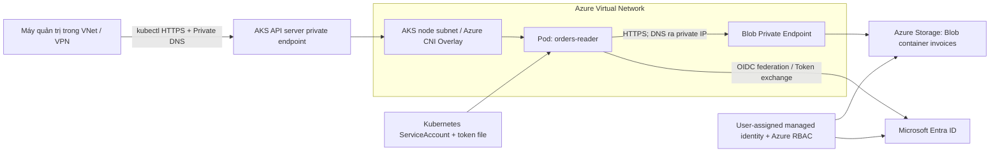

# Thực hành nền tảng AKS có mạng riêng và Workload Identity

> **Chương:** Kiến trúc và thực hành tổng hợp  
> **Mô-đun:** `CLOUD_PROVIDERS_AZURE` — học hệ sinh thái Microsoft Azure từ subscription, resource group và Microsoft Entra ID đến mạng ảo, compute, storage, dữ liệu; triển khai, giám sát, bảo vệ và kiểm soát chi phí kiến trúc ứng dụng trên Azure.

## Mục tiêu học tập

Hoàn thành bài thực hành, người học có thể:

1. Giải thích **AKS private cluster** bảo vệ đường truy cập **Kubernetes API server** như thế nào, và phân biệt với node subnet, private workload và outbound traffic.
2. Thiết kế **Azure Virtual Network (VNet)**, subnet, phân giải **Private DNS**, đường quản trị và egress cho nền tảng AKS.
3. Triển khai AKS bật **OIDC issuer** và **Microsoft Entra Workload ID**, không lưu client secret/service principal password trong Pod.
4. Liên kết **Kubernetes ServiceAccount** với **user-assigned managed identity** bằng **federated identity credential**, rồi cấp Azure RBAC đúng data-plane.
5. Kiểm chứng Pod lấy token bằng OIDC federation và truy cập **Azure Blob Storage** qua **Private Endpoint**.
6. Chẩn đoán lỗi DNS, mạng, quyền, federation và webhook; quan sát chi phí, bảo mật, triển khai thay đổi và dọn lab an toàn.

## 1. Đề bài capstone

Một đội ứng dụng có API `orders-api` chạy trên AKS. API cần đọc hóa đơn mẫu từ Azure Blob Storage. Đội bảo mật đưa ra các yêu cầu:

- Kubernetes API server **không được công khai trên Internet**.
- Node, Pod và kho dữ liệu ứng dụng nằm trong những subnet/phạm vi được kiểm soát; dịch vụ lưu trữ không cần public data endpoint.
- Pod được Azure cấp quyền đọc object thông qua **Microsoft Entra Workload ID**, **không** dùng storage account key hoặc client secret.
- Chỉ workload có danh tính phù hợp được quyền đọc container `invoices`.
- Nhóm quản trị dùng một máy quản trị trong mạng riêng hoặc đường kết nối phù hợp để chạy `kubectl`.
- Có cách kiểm tra end-to-end, phát hiện lỗi và thu hồi tài nguyên lab tránh phát sinh chi phí lâu dài.

Đây là bài **thực hành kiến trúc**, không chỉ chạy một lệnh `az aks create`. Thành công nghĩa là cả **đường quản trị**, **đường dữ liệu** và **đường lấy danh tính** đều đúng và đã được kiểm tra độc lập.

### Kiến trúc mục tiêu



Sơ đồ biểu diễn quan hệ logic. **OIDC issuer là thành phần AKS phát hành token cho ServiceAccount**, còn **Microsoft Entra ID** kiểm tra federated credential và đổi token đó thành access token phù hợp cho Azure resource. Đường kết nối tới endpoint Entra và các dependency cần thiết vẫn phải được thiết kế.

## 2. Phân biệt bốn lớp “private” và danh tính

| Khái niệm | Bảo vệ điều gì? | Không đồng nghĩa |
|---|---|---|
| **Private AKS cluster** | API server của Kubernetes được truy cập qua private endpoint/đường mạng riêng theo cấu hình | Mọi Pod và service đều không có public access |
| **Node subnet / Azure CNI** | IP/routing của node và Pod, địa chỉ workload nội bộ | Tất cả egress tự động đi qua Azure Firewall |
| **Private Endpoint + Private DNS** | Truy cập một dịch vụ PaaS bằng IP riêng trong VNet | Tự cấp quyền dữ liệu cho Pod |
| **Workload Identity + Azure RBAC** | Xác định Pod/ServiceAccount nào có thể lấy token và thực hiện thao tác Azure | Mạng riêng, DNS, firewall hoặc Kubernetes RBAC |

Ví dụ Pod có token hợp lệ cho Blob nhưng DNS vẫn trả IP public trong khi Storage chặn public network → **truy cập thất bại vì network**. Ngược lại, Pod tới được private IP nhưng thiếu `Storage Blob Data Reader` → **truy cập thất bại vì quyền**.

### Control plane, data plane và egress

- **Kubernetes control plane:** đường `kubectl`, kube-apiserver, resource management. Private cluster hạn chế endpoint API theo mạng.
- **Ứng dụng/data plane:** HTTP giữa Pod và database/storage, ingress/egress. Cần định nghĩa subnet, Private Link, ingress controller và network policies riêng.
- **Egress ra Azure dependencies:** node có thể cần lấy image, token, giao tiếp với các endpoint vận hành và dịch vụ Azure. Private API **không có nghĩa cluster air-gapped**; không chặn mọi outbound khi chưa có thiết kế thay thế được hỗ trợ.
- **Azure RBAC và Kubernetes RBAC:** hai miền ủy quyền khác nhau. Azure role cấp cho managed identity chỉ quyết định quyền đối với Azure resource; ServiceAccount/Role/RoleBinding hoặc Azure RBAC for Kubernetes Authorization (nếu bật) quyết định quyền trên Kubernetes API.

## 3. Chuẩn bị và các giả định cho lab

Để tránh dùng nhầm production, toàn bộ ví dụ chọn:

| Biến | Giá trị minh họa | Ghi chú |
|---|---|---|
| Resource group | `rg-aks-private-lab` | Tạo mới riêng cho bài thực hành |
| Region | `southeastasia` | Phải hỗ trợ SKU/tính năng tại thời điểm chạy |
| VNet | `vnet-aks-lab`, `10.42.0.0/16` | Không trùng mạng on-prem/VPN/peered VNet |
| Subnet node | `snet-aks`, `10.42.0.0/22` | Cấp phát đủ địa chỉ node và tăng trưởng |
| Subnet Private Endpoint | `snet-private-endpoints`, `10.42.8.0/24` | Tách khỏi node subnet để quản trị |
| AKS cluster | `aks-private-lab` | Private API; không tạo public endpoint cho ứng dụng |
| Managed identity AKS | `id-aks-control` | Dành cho control plane quản trị hạ tầng |
| Workload identity | `id-invoices-reader` | Dành riêng cho Pod đọc Blob |
| Namespace/ServiceAccount | `orders` / `invoices-reader` | Phải khớp federated credential |
| Storage account | `stakslabexample01` | **Phải thay bằng tên duy nhất trên Azure** |
| Blob container | `invoices` | Chỉ chứa dữ liệu giả |
| Pod CIDR (Overlay) | `10.244.0.0/16` | Không chồng lấn các mạng cần định tuyến |

**Điều kiện đầu vào:** Azure CLI có extension/chức năng AKS cần thiết, `kubectl`, tài khoản đã được ủy quyền và quota compute/network đủ cho lab. Các phiên bản CLI, AKS và cách đặt tham số có thể thay đổi; kiểm tra `az version`, `az aks create --help`, `az identity federated-credential create --help` trước khi áp dụng.

### Chi phí và phạm vi quyền

Lệnh trong bài là **mẫu thực thi cho subscription lab**, không phải thao tác đã được chạy. Tạo AKS, VM nodes, storage, NAT/public outbound, Private Endpoint, private DNS và máy quản trị có thể phát sinh chi phí. Chỉ chạy khi được cho phép, có ngân sách và thời điểm dọn tài nguyên. Người triển khai cần quyền tạo resource, tạo role assignment khi cần và quyền Kubernetes tương ứng; không cấp Owner toàn subscription chỉ để hoàn thành lab nếu có phương án quyền hẹp hơn.

## 4. Bước 1 — Chuẩn bị subscription và VNet

Thực hiện trong **Bash/Azure Cloud Shell** để tạo phần hạ tầng Azure. Cloud Shell có thể tạo cluster qua Azure API, **nhưng thông thường không nằm trong VNet để truy cập trực tiếp private kube-apiserver**. Các lệnh `kubectl` ở những bước sau phải chạy từ máy quản trị có DNS và route tới private API.

```bash
# Sửa subscription và storage account trước khi chạy.
SUBSCRIPTION_ID="<subscription-id>"
RG="rg-aks-private-lab"
LOCATION="southeastasia"
VNET="vnet-aks-lab"
AKS="aks-private-lab"
AKS_SUBNET="snet-aks"
PE_SUBNET="snet-private-endpoints"

az login
az account set --subscription "$SUBSCRIPTION_ID"
az account show --query "{id:id,name:name}" --output table

az group create --name "$RG" --location "$LOCATION"

az network vnet create \
  --resource-group "$RG" \
  --name "$VNET" \
  --location "$LOCATION" \
  --address-prefixes 10.42.0.0/16 \
  --subnet-name "$AKS_SUBNET" \
  --subnet-prefixes 10.42.0.0/22

az network vnet subnet create \
  --resource-group "$RG" \
  --vnet-name "$VNET" \
  --name "$PE_SUBNET" \
  --address-prefixes 10.42.8.0/24

AKS_SUBNET_ID=$(az network vnet subnet show \
  --resource-group "$RG" --vnet-name "$VNET" \
  --name "$AKS_SUBNET" --query id --output tsv)

VNET_ID=$(az network vnet show \
  --resource-group "$RG" --name "$VNET" \
  --query id --output tsv)
```

**Thiết kế IP:** Azure CNI Overlay sử dụng dải Pod riêng (`10.244.0.0/16` trong ví dụ), trong khi node có IP từ `snet-aks`. Khi chọn Overlay, cần kiểm tra không chồng lấn giữa pod CIDR, VNet, service CIDR, VPN và các mạng peered/on-prem. Overlay **không** thay cho network policy; muốn kiểm soát Pod-to-Pod hoặc egress phải thiết kế chính sách mạng được AKS hỗ trợ.

Tùy môi trường, cần thêm NSG, UDR, firewall, NAT Gateway, DNS resolver và subnet quản trị. Những thành phần này **không** được tự động tạo thành kiến trúc production chỉ bằng lệnh mẫu ở trên.

## 5. Bước 2 — Tạo managed identity cho control plane AKS

Đây là danh tính để AKS quản lý những tài nguyên hạ tầng cần thiết. **Không dùng nó làm danh tính cho ứng dụng `orders-api`.**

```bash
az identity create \
  --resource-group "$RG" \
  --name id-aks-control \
  --location "$LOCATION"

AKS_CONTROL_ID=$(az identity show \
  --resource-group "$RG" --name id-aks-control \
  --query id --output tsv)

AKS_CONTROL_PRINCIPAL=$(az identity show \
  --resource-group "$RG" --name id-aks-control \
  --query principalId --output tsv)

# Cấp quyền thao tác mạng ở phạm vi subnet node.
az role assignment create \
  --assignee-object-id "$AKS_CONTROL_PRINCIPAL" \
  --assignee-principal-type ServicePrincipal \
  --role "Network Contributor" \
  --scope "$AKS_SUBNET_ID"
```

Lệnh role assignment đòi quyền quản lý Azure RBAC như `Microsoft.Authorization/roleAssignments/write` ở scope thích hợp. Quyền có thể cần một thời gian để có hiệu lực. Với thiết kế thực tế có custom Private DNS, route/firewall hoặc hạ tầng share, cần đánh giá thêm các quyền theo hướng dẫn triển khai AKS tương ứng; không tự cấp rộng trên toàn subscription.

## 6. Bước 3 — Tạo AKS private cluster có OIDC issuer và Workload Identity

```bash
az aks create \
  --resource-group "$RG" \
  --name "$AKS" \
  --location "$LOCATION" \
  --enable-managed-identity \
  --assign-identity "$AKS_CONTROL_ID" \
  --enable-private-cluster \
  --enable-oidc-issuer \
  --enable-workload-identity \
  --network-plugin azure \
  --network-plugin-mode overlay \
  --pod-cidr 10.244.0.0/16 \
  --vnet-subnet-id "$AKS_SUBNET_ID" \
  --node-count 2 \
  --node-vm-size Standard_D2s_v5 \
  --generate-ssh-keys
```

**Ý nghĩa các cờ quan trọng:**

| Cờ | Tác dụng |
|---|---|
| `--enable-private-cluster` | Kích hoạt kiểu API server private, dùng private endpoint/DNS theo triển khai AKS |
| `--enable-oidc-issuer` | Tạo OIDC issuer cho token ServiceAccount được sử dụng trong federation |
| `--enable-workload-identity` | Bật hỗ trợ Microsoft Entra Workload ID trên cluster |
| `--enable-managed-identity --assign-identity` | Chỉ định identity cho AKS control plane |
| `--network-plugin azure --network-plugin-mode overlay` | Chọn Azure CNI Overlay cho Pod networking |
| `--vnet-subnet-id` | Đặt node vào subnet đã chuẩn bị |
| `--node-count 2` | Hai worker nodes cho lab, **chưa** đủ để chứng minh HA end-to-end |

Đây là mẫu **tối giản về quản trị**, không phải cấu hình production đạt mọi yêu cầu bảo mật. Tùy chính sách, AKS còn cần Entra integration, Azure RBAC/Kubernetes RBAC, tắt local admin accounts khi hỗ trợ, network policy, Azure Policy, image security, autoscaling, availability zones, backup, logging và egress được quản trị.

**Quan trọng về outbound:** nếu không cấu hình kiểu egress khác, mô hình AKS có thể sử dụng **load balancer outbound** theo mặc định được phiên bản hỗ trợ, dẫn tới outbound qua IP public. Cluster private API **không** đồng nghĩa “không có public outbound”. Để dùng Azure Firewall/NAT/UDR và lọc FQDN, cần thiết kế `outbound-type`, route, SNAT, DNS và các endpoint bắt buộc theo tài liệu cho phiên bản AKS cụ thể. Không chặn toàn bộ Azure dependencies một cách tùy tiện.

### Xác minh sau tạo

```bash
az aks show \
  --resource-group "$RG" \
  --name "$AKS" \
  --query "{name:name,privateFqdn:privateFqdn,privateCluster:apiServerAccessProfile.enablePrivateCluster,oidc:oidcIssuerProfile.issuerUrl,wi:securityProfile.workloadIdentity.enabled}" \
  --output json

OIDC_ISSUER=$(az aks show \
  --resource-group "$RG" --name "$AKS" \
  --query "oidcIssuerProfile.issuerUrl" \
  --output tsv)

printf 'OIDC issuer: %s\n' "$OIDC_ISSUER"
```

Mô hình AKS private DNS có thể do AKS quản lý hoặc dùng custom zone theo cấu hình. Khi AKS quản lý zone, có thể thấy resource Private DNS trong **node resource group** do AKS điều phối. Không tự sửa/xóa các tài nguyên do AKS quản lý chỉ để thay một bản ghi DNS.

## 7. Bước 4 — Truy cập Kubernetes API từ mạng riêng

Một AKS private cluster cần **máy quản trị/jumpbox/runner** có route và DNS tới API private. Có thể dùng Azure VM trong VNet, mạng peered hoặc mạng on-prem qua VPN/ExpressRoute đã cấu hình phù hợp. Azure Bastion có thể hỗ trợ phiên quản trị tới VM nếu triển khai đúng; nó không tự biến Cloud Shell thành máy nằm trong VNet.

Trên **máy quản trị đã được cấp quyền, có Azure CLI/kubectl và mạng hợp lệ**:

```bash
az account set --subscription "<subscription-id>"

az aks get-credentials \
  --resource-group rg-aks-private-lab \
  --name aks-private-lab

kubectl cluster-info
kubectl get nodes -o wide
kubectl get namespaces
```

Nếu dùng Microsoft Entra authentication/Azure RBAC cho cluster, cần đăng nhập đúng tenant và có role tương ứng cho Kubernetes. **`az aks get-credentials` thành công chỉ chứng minh lấy được kubeconfig**, không chứng minh DNS và kết nối tới API hoạt động; `kubectl get nodes` mới kiểm tra đường đến API và quyền truy cập.

### Kiểm tra mạng từng lớp

| Phép kiểm tra | Kỳ vọng |
|---|---|
| Phân giải `privateFqdn` từ máy quản trị | Trả private IP hoặc chuỗi DNS đúng mô hình AKS private |
| Route/TCP tới API endpoint | Đi qua VPN/peering/VNet hợp lệ và NSG/firewall cho phép |
| `kubectl get nodes` | API hoạt động, principal được xác thực và được Kubernetes ủy quyền |
| Thử từ máy không có đường mạng riêng | **Không** vào được API private; không coi đây là lỗi cluster |
| Kiểm tra inbound ứng dụng | Chưa có public Service/Ingress nếu chưa chủ động tạo |

Có thể dùng `az aks command invoke` như một cơ chế thực hiện lệnh quản lý từ Azure trong những môi trường được hỗ trợ, nhưng **không đồng nhất** với việc nhà quản trị đã có đường mạng private cho `kubectl`. Run command phải được kiểm soát quyền và audit riêng; mục tiêu capstone vẫn là kiểm tra DNS/route từ mạng quản trị thực.

## 8. Bước 5 — Tạo storage account và dữ liệu mẫu

Để minh họa cả network isolation và identity, ta dùng Blob Storage. **Tên Storage Account phải duy nhất trên Azure toàn cầu**, chỉ chứa chữ thường/số, dài 3–24 ký tự. Thay biến `STORAGE` bằng tên hợp lệ chưa được sử dụng.

```bash
STORAGE="stakslabexample01"
CONTAINER="invoices"

az storage account create \
  --resource-group "$RG" \
  --name "$STORAGE" \
  --location "$LOCATION" \
  --sku Standard_LRS \
  --kind StorageV2 \
  --allow-blob-public-access false

STORAGE_ID=$(az storage account show \
  --resource-group "$RG" \
  --name "$STORAGE" \
  --query id --output tsv)

# Tài khoản đang chạy lệnh phải có quyền data-plane tạo container.
az storage container create \
  --account-name "$STORAGE" \
  --name "$CONTAINER" \
  --auth-mode login

# Dữ liệu mẫu được tạo sẵn cục bộ, không chứa thông tin khách hàng thật.
# Ví dụ: upload từ file /tmp/invoice-lab.txt đã được chuẩn bị.
az storage blob upload \
  --account-name "$STORAGE" \
  --container-name "$CONTAINER" \
  --name invoice-lab.txt \
  --file /tmp/invoice-lab.txt \
  --auth-mode login \
  --overwrite false
```

Việc `az storage account create` thành công không tự cấp **Storage Blob Data Contributor** cho người gọi: Azure management-plane `Contributor` và Storage **data-plane RBAC** là hai phạm vi quyền khác nhau. Tài khoản dùng ở bước tạo container/upload cần được cấp quyền thích hợp. Đừng dùng storage account key để “chữa” việc thiếu data-plane RBAC.

**Vì sao tạo dữ liệu trước khi khóa public network?** Nếu chạy Azure CLI từ Cloud Shell ngoài VNet và khóa public Storage trước, các lệnh data-plane `container create`/`blob upload` có thể bị network chặn dù quyền đúng. Dữ liệu lab cần được tạo qua đường kết nối được phép trước khi tắt public, hoặc chạy từ máy trong VNet.

## 9. Bước 6 — Private Endpoint và Private DNS cho Blob

### 9.1. Tạo Private Endpoint

```bash
az network private-endpoint create \
  --resource-group "$RG" \
  --name pe-invoices-blob \
  --location "$LOCATION" \
  --vnet-name "$VNET" \
  --subnet "$PE_SUBNET" \
  --private-connection-resource-id "$STORAGE_ID" \
  --group-id blob \
  --connection-name conn-invoices-blob
```

Private Endpoint tạo network interface có private IP trong `snet-private-endpoints`. Chỉ có endpoint **chưa đủ**: DNS cần đưa tên `<account>.blob.core.windows.net` về private IP thông qua cơ chế CNAME/Private DNS tương ứng.

### 9.2. Tạo và link Private DNS zone

```bash
BLOB_ZONE="privatelink.blob.core.windows.net"

az network private-dns zone create \
  --resource-group "$RG" \
  --name "$BLOB_ZONE"

az network private-dns link vnet create \
  --resource-group "$RG" \
  --zone-name "$BLOB_ZONE" \
  --name link-blob-aks-vnet \
  --virtual-network "$VNET_ID" \
  --registration-enabled false

az network private-endpoint dns-zone-group create \
  --resource-group "$RG" \
  --endpoint-name pe-invoices-blob \
  --name zonegroup-blob \
  --private-dns-zone "$BLOB_ZONE" \
  --zone-name blob
```

Tên zone `privatelink.blob.core.windows.net` là dành cho subresource `blob`. Nếu cần Azure Files, DFS/ADLS, Queue hoặc Table thì có các subresource và DNS zone tương ứng, **không** dùng lại zone Blob cho mọi dịch vụ.

Nếu VNet dùng custom DNS, cần cấu hình forwarder/resolver phù hợp để có thể giải mã tên private endpoint. Private DNS zone link chỉ giải quyết một phần; DNS on-prem, peering hoặc custom resolver cần được kiểm tra riêng.

### 9.3. Khóa public access sau khi đã kiểm tra kết nối private

Sau khi tạo đúng endpoint/DNS và xác nhận có đường truy cập riêng, có thể đặt:

```bash
az storage account update \
  --resource-group "$RG" \
  --name "$STORAGE" \
  --public-network-access Disabled
```

**Cảnh báo:** đây là thao tác thay đổi khả năng truy cập data-plane. Chỉ thực hiện sau khi xác minh đường private từ nơi quản trị và ứng dụng; lệnh Azure management-plane vẫn có thể thành công trong khi data-plane từ Cloud Shell bị chặn. Nếu DNS hoặc route chưa đúng, Pod sẽ không đọc được dữ liệu dù Workload Identity hoàn toàn hợp lệ.

## 10. Bước 7 — Tạo user-assigned managed identity cho Pod

Danh tính này **khác** `id-aks-control` ở bước 5. Nó đại diện cho workload, không đại diện cả cluster.

```bash
az identity create \
  --resource-group "$RG" \
  --name id-invoices-reader \
  --location "$LOCATION"

APP_CLIENT_ID=$(az identity show \
  --resource-group "$RG" \
  --name id-invoices-reader \
  --query clientId --output tsv)

APP_PRINCIPAL_ID=$(az identity show \
  --resource-group "$RG" \
  --name id-invoices-reader \
  --query principalId --output tsv)

# Chỉ cấp quyền đọc Blob ở phạm vi container invoices.
CONTAINER_SCOPE="$STORAGE_ID/blobServices/default/containers/$CONTAINER"

az role assignment create \
  --assignee-object-id "$APP_PRINCIPAL_ID" \
  --assignee-principal-type ServicePrincipal \
  --role "Storage Blob Data Reader" \
  --scope "$CONTAINER_SCOPE"
```

**Nguyên tắc least privilege:** Pod chỉ cần đọc file nên role `Storage Blob Data Reader` tại container phù hợp hơn `Contributor` cho toàn Storage Account hoặc subscription. Nếu ứng dụng cần ghi, xem xét role data-plane khác và giới hạn scope, không tự nâng quyền ngoài yêu cầu.

Azure RBAC có thời gian đồng bộ. Nếu một Pod vừa tạo identity gặp 403, cần xem **token, network và quyền tại đúng scope** cùng thời gian role assignment có hiệu lực trước khi thay đổi quyền quá rộng.

## 11. Bước 8 — Federated credential liên kết ServiceAccount

### 11.1. OIDC trust hoạt động thế nào?

AKS phát hành một projected ServiceAccount token được ký bởi issuer của cluster. **Microsoft Entra ID** dùng **federated identity credential (FIC)** trong user-assigned managed identity để kiểm tra ba điều kiện quan trọng:

| Trường | Giá trị trong bài lab | Tác dụng |
|---|---|---|
| `issuer` | URL lấy từ `oidcIssuerProfile.issuerUrl` của đúng AKS cluster | Chỉ tin token từ issuer đó |
| `subject` | `system:serviceaccount:orders:invoices-reader` | Chỉ tin ServiceAccount thuộc namespace/name chính xác |
| `audiences` | `api://AzureADTokenExchange` | Giới hạn mục đích token exchange |

**Sai một ký tự trong namespace/ServiceAccount/issuer/audience cũng có thể làm token exchange thất bại.** Không dùng subject quá rộng hoặc dùng chung một identity có quyền mạnh cho nhiều ứng dụng không liên quan.

### 11.2. Tạo federated credential

```bash
az identity federated-credential create \
  --resource-group "$RG" \
  --identity-name id-invoices-reader \
  --name fic-orders-invoices \
  --issuer "$OIDC_ISSUER" \
  --subject "system:serviceaccount:orders:invoices-reader" \
  --audiences "api://AzureADTokenExchange"

az identity federated-credential list \
  --resource-group "$RG" \
  --identity-name id-invoices-reader \
  --output table
```

FIC không tạo token bí mật lâu dài; nó cấu hình **quan hệ tin cậy**. Quá trình ứng dụng trao đổi token mới dùng projected token trong Pod. Một Pod không chạy tự nhiên với Azure identity chỉ vì FIC đã tồn tại: nó còn cần **ServiceAccount annotation**, **Pod label**, hỗ trợ webhook và SDK/client sử dụng workload identity.

## 12. Bước 9 — Kubernetes ServiceAccount, Pod và token exchange

Các bước này chạy bằng `kubectl` **từ máy quản trị có đường tới private AKS API** (mục 7), không phải từ Cloud Shell ngoài VNet.

### 12.1. Namespace và ServiceAccount

Tạo file `orders-identity.yaml` trong thư mục bài thực hành:

```yaml
apiVersion: v1
kind: Namespace
metadata:
  name: orders
---
apiVersion: v1
kind: ServiceAccount
metadata:
  name: invoices-reader
  namespace: orders
  annotations:
    azure.workload.identity/client-id: "REPLACE_WITH_APP_CLIENT_ID"
```

Thay `REPLACE_WITH_APP_CLIENT_ID` bằng `APP_CLIENT_ID` lấy từ identity, **không** thay bằng object ID/principal ID. Trên cluster thuộc tenant khác tenant mặc định của identity, cấu hình tenant ID theo mô hình được hỗ trợ và xác minh trust; ví dụ lab giả định cùng tenant.

Áp dụng:

```bash
kubectl apply -f orders-identity.yaml
kubectl -n orders get serviceaccount invoices-reader -o yaml
```

### 12.2. Pod thử lấy Azure token và đọc Blob

Để không phải viết cả ứng dụng mới trong lab, có thể dùng một container **đã được nhóm phê duyệt** có sẵn Azure CLI phù hợp. Ví dụ Deployment dạng Job chạy một lần; ảnh và phiên bản phải được thay bằng ảnh đã kiểm tra, có `az login` hỗ trợ `--federated-token`.

Tạo file `blob-reader-job.yaml`:

```yaml
apiVersion: batch/v1
kind: Job
metadata:
  name: verify-blob-identity
  namespace: orders
spec:
  backoffLimit: 1
  template:
    metadata:
      labels:
        azure.workload.identity/use: "true"
    spec:
      serviceAccountName: invoices-reader
      restartPolicy: Never
      containers:
        - name: verify
          image: "REPLACE_WITH_APPROVED_AZURE_CLI_IMAGE"
          command: ["/bin/sh", "-c"]
          env:
            - name: STORAGE_ACCOUNT
              value: "REPLACE_WITH_STORAGE_ACCOUNT_NAME"
            - name: BLOB_CONTAINER
              value: "invoices"
          args:
            - |
              set -eu
              test -n "$AZURE_CLIENT_ID"
              test -n "$AZURE_TENANT_ID"
              test -f "$AZURE_FEDERATED_TOKEN_FILE"
              az login --service-principal \
                --username "$AZURE_CLIENT_ID" \
                --tenant "$AZURE_TENANT_ID" \
                --federated-token "$(cat "$AZURE_FEDERATED_TOKEN_FILE")" \
                --allow-no-subscriptions >/dev/null
              az storage blob list \
                --account-name "$STORAGE_ACCOUNT" \
                --container-name "$BLOB_CONTAINER" \
                --auth-mode login \
                --query "[].name" \
                --output tsv
```

**Vì sao bắt buộc có label?** `azure.workload.identity/use: "true"` ở **Pod template metadata.labels** giúp workload identity mutating webhook inject các biến môi trường/token volume cần thiết. ServiceAccount annotation chỉ ra **client ID**. Cần cả hai đúng và cluster đã bật Workload Identity.

**Không ghi token trong log.** Câu lệnh chỉ kiểm tra token file tồn tại và dùng nó để token exchange, không in nội dung token. Azure CLI `az login` có thể dùng cho chứng minh nguyên lý; ứng dụng production nên dùng **Azure Identity SDK** được hỗ trợ để quản lý token tự động, không thực hiện login shell liên tục.

Job chỉ có ý nghĩa sau khi thay placeholder, có quyền pull image và đường network tới Blob/Entra. Không lưu client secret hoặc storage key trong YAML. Đối với production, pin digest image, triển khai pod security controls và hạn chế quyền ServiceAccount.

### 12.3. Chạy và quan sát

```bash
kubectl apply -f blob-reader-job.yaml
kubectl -n orders get jobs,pods
kubectl -n orders wait --for=condition=complete job/verify-blob-identity --timeout=300s
kubectl -n orders logs job/verify-blob-identity
```

**Kết quả kỳ vọng:** log liệt kê tên file mẫu `invoice-lab.txt` mà không hiện client secret hay account key. Phải xác minh Storage Private Endpoint đúng IP mạng riêng và blob không public. Job `Complete` chỉ xác nhận script kết thúc theo logic; cần xem output và thử negative tests.

Nếu Job thất bại, kiểm tra `kubectl -n orders describe pod <pod-name>`, events, Azure identity/FIC, RBAC và network thay vì tăng quyền tùy tiện. Sau khi sửa ServiceAccount annotation hoặc Pod label, **tạo Job/Pod mới** để webhook inject lại cấu hình; Pod cũ có thể không tự đổi token projection theo mong đợi.

### 12.4. Python SDK trong ứng dụng thật

Trong ứng dụng có thư viện `azure-identity` và `azure-storage-blob`, sử dụng identity tự động:

```python
import os
from azure.identity import DefaultAzureCredential
from azure.storage.blob import BlobServiceClient

account = os.environ["STORAGE_ACCOUNT"]
container = os.environ.get("BLOB_CONTAINER", "invoices")

credential = DefaultAzureCredential()
service = BlobServiceClient(
    account_url=f"https://{account}.blob.core.windows.net",
    credential=credential,
)

for blob in service.get_container_client(container).list_blobs():
    print(blob.name)
```

SDK phiên bản hỗ trợ Workload Identity nhận các biến `AZURE_CLIENT_ID`, `AZURE_TENANT_ID` và `AZURE_FEDERATED_TOKEN_FILE` do webhook cung cấp. Khi môi trường có nhiều nguồn credentials, cần kiểm tra chain của `DefaultAzureCredential`; trong tình huống yêu cầu rõ một cơ chế, có thể dùng `WorkloadIdentityCredential` để loại bỏ fallback không mong muốn. Image production phải kiểm soát dependency versions và không in secret trong logs.

## 13. Bước 10 — Xác minh đồng thời network và identity

Ba nhóm kiểm tra nên được làm độc lập để phân biệt chính xác nguyên nhân:

| Lớp kiểm tra | Lệnh/đối tượng | Kỳ vọng |
|---|---|---|
| Kubernetes API | `kubectl get nodes` từ máy quản trị private | Truy cập API, danh sách node hiện diện |
| Pod DNS | Resolve `<account>.blob.core.windows.net` trong Pod | Trả private IP của Private Endpoint |
| Pod HTTPS | Kết nối TCP/443 tới Blob qua DNS được phép | Không bị NSG/firewall/route chặn |
| Workload token projection | `AZURE_FEDERATED_TOKEN_FILE` trong Pod | File có mặt, không đưa nội dung ra logs |
| Entra token exchange | Azure SDK hoặc `az login --federated-token` | Cấp được access token hợp lệ |
| Azure RBAC data-plane | List blobs bằng identity reader | Chỉ đọc container `invoices` được cấp quyền |
| Public network denial | Truy cập data-plane từ môi trường ngoài VNet không được cho phép | Bị từ chối do network, không mở public fallback |
| Kubernetes permission | Thử một API verb theo RBAC đã cấp | Không được đặc quyền cluster-admin ngoài nhu cầu |

**Không dùng “đọc blob được” làm bằng chứng duy nhất rằng đường đi private.** Nếu Storage vẫn cho phép public endpoint hoặc DNS trả public IP, test có thể thành công sai mục tiêu. Và không dùng “DNS ra private IP” làm bằng chứng Workload Identity hợp lệ.

### Kiểm tra DNS từ Pod

Trên Pod có `nslookup` hoặc công cụ DNS tương ứng:

```bash
# Thực hiện trong Pod thử có công cụ DNS đã được phê duyệt.
nslookup stakslabexample01.blob.core.windows.net
```

Tên account phải khớp biến `STORAGE` thực tế. Nếu Pod không có tiện ích DNS, dùng một **diagnostic Pod** được phép với network policy tương đương; không cài debug tools lên image production chỉ để thử.

Private DNS có thể trả chuỗi CNAME dẫn tới bản ghi `privatelink.blob.core.windows.net`. Điều cần xác nhận là **đích cuối cùng là private IP đúng của Private Endpoint** từ phía mạng AKS.

### Negative test có kiểm soát

Một kiểm tra quyền hữu ích: tạo **một ServiceAccount khác** không có FIC/role và xác nhận Pod đó không thể dùng workload identity để đọc Blob. Không cấp quyền rồi chỉ dựa vào màn hình portal để khẳng định isolation. **Không** giả lập negative test bằng cách xóa role của ứng dụng production hoặc mở tài khoản Storage công khai.

## 14. Troubleshooting theo tầng

| Triệu chứng | Nhóm nguyên nhân | Cách xử lý có chứng cứ |
|---|---|---|
| `kubectl` timeout từ Cloud Shell | API là private; Cloud Shell không có route/DNS tới VNet | Chạy từ jumpbox/VPN/peered network được phép, kiểm tra DNS private |
| `az aks get-credentials` thành công nhưng `kubectl` lỗi | Kubeconfig có nhưng private DNS/route/RBAC chưa đạt | Kiểm tra FQDN resolve, TCP/443, Azure/Kubernetes RBAC |
| Node `NotReady` hoặc image pull fail | DNS, outbound/FQDN, route/firewall, quota hoặc CNI | Kiểm tra node events, AKS dependencies, egress và image registry |
| Pod không có `AZURE_FEDERATED_TOKEN_FILE` | Thiếu Pod label, SA annotation, webhook hoặc Pod chưa được tái tạo | Kiểm tra `azure.workload.identity/use`, webhook và ServiceAccount |
| Token exchange lỗi issuer/subject | FIC sai OIDC issuer, namespace/SA hoặc audience | So ba giá trị chính xác và issuer của cluster hiện tại |
| Token exchange thành công nhưng Blob 403 | Data-plane RBAC sai identity/scope hoặc role chưa propagate | Xem principalId, container scope, `Storage Blob Data Reader` và thời gian đồng bộ |
| Blob request timeout/network denied | Private Endpoint/DNS chưa đúng, Storage public disabled, firewall/NSG/route | Resolve từ Pod, kiểm tra PE status và network path |
| DNS của Blob ra public IP | Chưa link Private DNS zone hoặc custom DNS không forward | Kiểm tra `privatelink.blob.core.windows.net` và VNet/custom DNS |
| Pod không thể đọc Blob khi đã có FIC | Thiếu Entra outbound, thư viện/CLI chưa hỗ trợ hoặc role sai | Phân biệt bước login/token và bước data access |
| Pod bị `ImagePullBackOff` | Registry không truy cập được, sai image/tag hoặc credential | Kiểm tra private registry, outbound path và imagePullSecret/managed identity |
| Role assignment bị `AuthorizationFailed` | Caller thiếu quyền quản lý RBAC | Nhờ người có quyền ở đúng scope, không nâng quyền toàn subscription |
| Ingress/Service vô tình công khai | Tạo `LoadBalancer`/Ingress public mặc định hoặc sai annotation | Kiểm tra service annotations, frontend IP và policy trước triển khai |
| Chi phí vượt dự kiến | VM nodes, Private Endpoint, network egress, LB, logs, idle resources | Cost Analysis theo RG, lịch cleanup và budget alerts |

### Quy trình phân lớp

1. **Control plane:** cluster có private API, OIDC issuer đúng, workload identity đã bật? Máy quản trị tới API chưa?
2. **Kubernetes:** Pod được scheduling, DNS hoạt động, webhook inject token, ServiceAccount đúng?
3. **Microsoft Entra:** issuer + subject + audience khớp FIC và identity có đúng `clientId`?
4. **Azure resource authorization:** đã gán đúng data role/scope và đã propagation xong?
5. **Data network:** Blob hostname ra private IP, đường HTTPS đi qua PE, public access đã disabled?
6. **Ứng dụng:** tên container/blob đúng, SDK hỗ trợ, logic truy vấn không phát sinh lỗi khác?

Không sửa đồng thời toàn bộ DNS, RBAC và identity trong cùng một thử nghiệm; làm như vậy sẽ khó biết thay đổi nào giải quyết nguyên nhân.

## 15. Những ràng buộc production cần bổ sung

Bài lab chứng minh các nguyên lý, **chưa** phải blueprint production đầy đủ.

### Mạng và ingress/egress

- Quyết định dùng **hub-spoke**, Azure Firewall/UDR, NAT Gateway và thiết kế DNS tập trung hay không.
- Với custom DNS và mạng on-prem, thiết kế Azure DNS Private Resolver/conditional forwarder phù hợp.
- Phân biệt private Kubernetes API và **private application ingress**. Nếu ứng dụng chỉ dùng nội bộ, chọn internal load balancer/ingress controller và kiểm tra annotations của dịch vụ. Không dùng mặc định `type: LoadBalancer` rồi giả định sẽ được IP private.
- Áp dụng network policy (Azure CNI powered by Cilium hoặc giải pháp được AKS hỗ trợ) khi cần giới hạn giao tiếp Pod-to-Pod hoặc namespace.
- Kiểm tra outbound cần thiết cho image registry, OIDC/token exchange, control-plane dependencies, monitoring và patching; không mặc định “private” là offline.

### Identity và quyền

- Tách AKS control identity, kubelet identity, workload identities cho từng ứng dụng và data-plane roles.
- Giới hạn FIC theo `namespace:serviceaccount` cụ thể; dùng ServiceAccount riêng cho từng ranh giới tin cậy.
- Dùng Microsoft Entra/Kubernetes RBAC phù hợp và tránh dùng admin kubeconfig rộng trong CI/CD.
- Xem lifecycle khi đổi namespace, xóa/tạo lại cluster, đổi OIDC issuer hoặc chuyển managed identity.
- Dùng policy/guardrails ngăn Pod privileged, hostPath không cần thiết, image không rõ nguồn, network exposure và secret plaintext.

### Độ tin cậy và vận hành

- Lập kế hoạch availability zones, autoscaler, pod disruption budget, node pool sizing, image/update strategy, persistent volumes và backup/restore.
- Quan sát AKS/node readiness, CoreDNS, kube-system, webhook, IP exhaustion, Private DNS, Azure Monitor/Application Insights và chi phí.
- Ghi lại resource IDs, private endpoint DNS, RBAC assignments, FIC, runbooks, owner và chu kỳ cập nhật.
- Thử phục hồi khi node hỏng, một role bị gỡ, DNS sai hoặc một dependency không tới được; không thực hiện phá dịch vụ production để thử.

## 16. Kiểm soát chi phí và thu hồi lab

Các nguồn chi phí cần kiểm kê:

| Thành phần | Có thể phát sinh phí | Ghi chú |
|---|---|---|
| AKS nodes/managed disks | Compute, OS disks, data disks | Hai node chạy liên tục dù ít Pod |
| AKS control-plane tier | Tùy tier/chính sách | Kiểm tra giá hiện hành và SLA |
| Load Balancer/NAT/Firewall | Public outbound, SNAT, firewall processing | Private API không xóa nhu cầu egress |
| Private Endpoint và DNS | Endpoint resource, xử lý dữ liệu, query/zone | Phụ thuộc cấu hình |
| Storage | Capacity, operations, private access traffic | Dữ liệu demo vẫn có phí nhỏ |
| Jumpbox/Bastion/VPN | VM/đường quản trị, public IP nếu dùng | Cần kế hoạch cleanup riêng |
| Monitor/Logs | Ingestion, retention, alerts | Tránh bật thu thập verbose không kiểm soát |

**Dọn lab chỉ sau khi đã lưu bằng chứng và xác nhận scope.** Xóa resource group lab sẽ xóa AKS, Storage và nhiều thành phần khác do bạn tạo; **tuyệt đối không chạy** một lệnh xóa chỉ dựa trên tên trông giống lab mà chưa đối chiếu resource IDs và owner.

Một phương án dọn an toàn:

1. Kiểm tra và lưu danh sách resources trong `rg-aks-private-lab`, cả node resource group do AKS tạo.
2. Ghi lại kết quả test, logs không nhạy cảm, role assignments và các vấn đề phát sinh.
3. Kiểm tra resource group không có tài nguyên dùng chung hoặc tài nguyên production.
4. Được owner phê duyệt thu hồi; dùng Azure Portal hoặc CLI phù hợp để xóa **đúng** tài nguyên lab.
5. Kiểm tra role assignments/FIC hoặc tài nguyên ngoài RG còn tồn tại và chi phí trong các ngày sau.

Không xóa tài nguyên/Private DNS link đang dùng chung với VNet khác. Budget alert chỉ cảnh báo, không tự ngăn hóa đơn vượt ngưỡng.

## 17. Bài tập nghiệm thu capstone

**Bối cảnh:** Nhóm platform cần bàn giao AKS riêng cho nhóm `orders`. Cluster có private API; ứng dụng chạy trong namespace `orders`, đọc file hóa đơn từ Blob container `invoices` bằng identity của chính workload, không có account key.

### Bộ tiêu chí chấp nhận

| ID | Bằng chứng cần cung cấp | Tiêu chí đạt |
|---|---|---|
| N1 | `az aks show` và DNS từ máy quản trị | Private API, không public endpoint quản trị |
| N2 | `kubectl get nodes` từ mạng được phép | Node Ready, kubeconfig/RBAC hoạt động |
| N3 | Truy vấn DNS Blob từ Pod | Hostname trỏ về private IP của Blob PE |
| N4 | Storage network configuration | Public network access disabled sau khi PE hoạt động |
| I1 | OIDC issuer và Workload Identity trong AKS | Hai tính năng đã bật |
| I2 | FIC và ServiceAccount annotation | Issuer, subject, audience và client ID khớp |
| I3 | Pod token projection | Webhook inject token file, không lộ token ra log |
| A1 | `az role assignment list` tại đúng scope | Workload identity chỉ có quyền đọc container |
| A2 | Job/ứng dụng đọc Blob | List file mẫu thành công, không dùng key/secret |
| S1 | Kiểm thử truy cập trái phép | Danh tính không được cấp quyền bị từ chối |
| O1 | Monitor, event/log và Cost Analysis | Có owner, cảnh báo và kế hoạch cleanup |

### Bảng kết quả

| Kiểm tra | Kết quả thực tế | Bằng chứng / điều chỉnh |
|---|---|---|
| Private API và DNS quản trị | … | … |
| Node/Pod readiness | … | … |
| Blob Private Endpoint | … | … |
| OIDC, FIC và ServiceAccount | … | … |
| Token exchange và role | … | … |
| Positive/negative access test | … | … |
| Egress, policy và logs | … | … |
| Chi phí, backup và kế hoạch dọn | … | … |

### Câu hỏi tự kiểm tra

1. Vì sao bật `--enable-private-cluster` chưa bảo đảm ứng dụng hoặc toàn bộ outbound đều private?
2. Tại sao `az aks get-credentials` thành công từ Cloud Shell không chứng minh `kubectl` tới được private API?
3. OIDC issuer, federated subject và audience đóng vai trò gì trong Workload Identity?
4. Phân biệt `clientId` và `principalId` của user-assigned managed identity trong manifest và role assignment.
5. Lý do cần **Pod label** và **ServiceAccount annotation** là gì? Thiếu một trong hai thì điều gì có thể xảy ra?
6. Nếu Blob trả 403, vì sao không nên cấp ngay `Contributor` toàn subscription?
7. Làm sao chứng minh traffic tới Blob thật sự đi qua Private Endpoint chứ không phải public endpoint?
8. Vì sao Pod có token hợp lệ vẫn có thể bị timeout khi truy cập Blob?
9. Cluster private có cần một cơ chế egress ra endpoint Microsoft Entra/AKS dependencies không?
10. Nếu đổi namespace `orders` thành `billing`, federated credential cần thay đổi gì và tại sao?

## 18. Tổng kết

Nền tảng AKS mạng riêng cần thiết kế **cả ba đường**: **private Kubernetes API và đường quản trị**, **network tới dịch vụ dữ liệu bằng VNet/Private Endpoint/DNS**, và **Workload Identity dựa trên OIDC issuer + ServiceAccount + federated credential + Azure RBAC**. Ba lớp này độc lập nhưng phải cùng đúng để ứng dụng chạy an toàn.

Nguyên tắc cốt lõi: **không đồng nhất private API với private toàn bộ hệ thống; không đồng nhất token hợp lệ với quyền dữ liệu; không dùng account keys/client secrets khi Workload Identity đáp ứng; luôn kiểm chứng bằng negative test, telemetry và đường mạng thực tế**. Khi mở rộng production, bổ sung network/egress policy, Entra/Kubernetes RBAC, bảo vệ supply chain, HA, backup, giám sát, ngân sách và quy trình thu hồi có kiểm soát.
