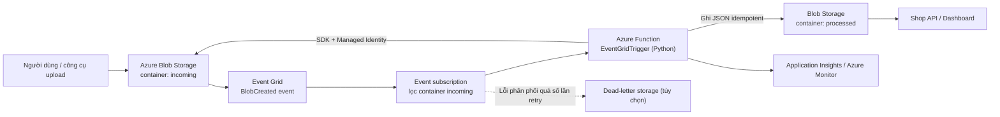
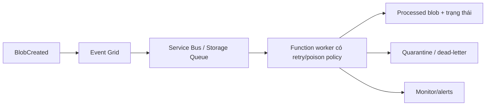

# Thực hành xử lý tệp bằng Blob Storage, Event Grid và Functions

## 1. Bài toán và mục tiêu

Một hệ thống thương mại điện tử cần tiếp nhận tệp CSV đơn hàng, kiểm tra nội dung và sinh báo cáo để ứng dụng khác sử dụng. Nếu ứng dụng liên tục quét thư mục lưu trữ để tìm tệp mới, nó sẽ tạo các lần kiểm tra không cần thiết, khó mở rộng và có thể bỏ sót thay đổi. Kiến trúc **event-driven** giải quyết bài toán bằng cách cho dịch vụ lưu trữ phát sự kiện khi có tệp mới, sau đó một thành phần xử lý serverless phản ứng với sự kiện.

Trong chương **Kiến trúc và thực hành tổng hợp** của mô-đun `CLOUD_PROVIDERS_AZURE`, chúng ta xây dựng một lab thực tế với **Azure Blob Storage → Azure Event Grid → Azure Functions**. Bài tập kết hợp những kiến thức về subscription, resource group, Microsoft Entra ID, Azure RBAC, lưu trữ, tính toán, mạng, triển khai, giám sát, bảo mật và chi phí trong một kiến trúc ứng dụng trên Microsoft Azure.

Sau bài học, bạn có thể:

- Vẽ luồng upload tệp, phát sự kiện, kích hoạt Function và lưu kết quả xử lý.
- Tạo Storage Account và các blob container phù hợp cho một ứng dụng.
- Hiểu **Event Grid event subscription**, lọc sự kiện `Microsoft.Storage.BlobCreated`, payload và cách phân phối sự kiện.
- Viết một **Python Azure Function theo programming model v2** nhận Event Grid event, tải blob bằng **Managed Identity**, đọc CSV/TXT và ghi kết quả JSON.
- Thiết kế **idempotency**, giới hạn kích thước tệp, xử lý lỗi, retry và dead-letter.
- Thực hành triển khai, upload tệp thử, xác minh kết quả và kiểm tra log/metric.
- Nhận diện rủi ro về quyền dữ liệu, network, lưu lượng, chi phí và vận hành khi mở rộng.

**Tình huống xuyên suốt:** ứng dụng `Shop API` cho phép nhân viên upload tệp `orders.csv` chứa danh sách đơn hàng. Hệ thống cần tự tạo một bản tóm tắt gồm số dòng, số dòng không rỗng, kích thước và SHA-256 của nội dung. Kết quả được ghi vào một container khác để dashboard/ứng dụng đọc. Lab chỉ **tóm tắt tệp**, không thực hiện giao dịch tài chính hoặc thay đổi đơn hàng thật.

## 2. Kiến trúc tham chiếu



**Vai trò và ranh giới:**

| Thành phần | Vai trò | Điều cần hiểu |
|---|---|---|
| **Storage Account** | Lưu dữ liệu tệp và container | Blob Storage có data plane riêng với quyền của Azure Resource Manager |
| **Container `incoming`** | Nhận CSV/TXT nguồn | Tên blob có thể là đường dẫn logic, ví dụ `batch-01/orders.csv` |
| **Event Grid system topic / event subscription** | Phát và phân phối sự kiện từ Storage tới endpoint | Sự kiện là **thông báo**, không chứa toàn bộ nội dung tệp |
| **Azure Function** | Nhận Event Grid event và thực thi code | Function vẫn cần tự tải blob, xử lý và lưu kết quả |
| **Container `processed`** | Lưu JSON kết quả | Tách nguồn/đích giúp tránh chu trình sự kiện vô hạn |
| **Managed Identity + RBAC** | Cho phép Function đọc/ghi dữ liệu không cần nhúng key | Phân biệt quyền tạo hạ tầng và quyền truy cập nội dung blob |
| **Azure Monitor/Application Insights** | Theo dõi số lần chạy, lỗi, thời gian xử lý | Cần cấu hình log, cảnh báo, retention và quyền truy cập |

Khi một blob mới được **commit** vào container `incoming`, Storage phát `Microsoft.Storage.BlobCreated` (theo trường hợp được hỗ trợ). Event Grid chuyển thông báo tới Function. Code đọc URL/ETag trong sự kiện, xác minh nguồn là Storage Account dự kiến, tải nội dung và lưu một tệp JSON ở container `processed`.

**Không nhầm ba cách kích hoạt:**

1. **Event Grid trigger:** Function nhận sự kiện trực tiếp từ Event Grid; chúng ta dùng cách này trong lab.
2. **Blob trigger:** Azure Functions cũng có cơ chế tự theo dõi blob, bao gồm chế độ nguồn sự kiện dựa trên Event Grid ở các phiên bản/plan hỗ trợ. Cấu hình binding của nó khác Event Grid trigger.
3. **HTTP trigger:** một endpoint HTTP do ứng dụng gọi; không tự động thay thế kết nối Event Grid nếu không tạo subscription/validation phù hợp.

Bài này dùng **Event Grid trigger tường minh** để thấy rõ event schema, filtering và quy tắc xử lý trùng.

## 3. Thiết kế yêu cầu và luồng dữ liệu

### 3.1. Hợp đồng dữ liệu cho lab

Giả sử tệp upload tên `orders.csv` có nội dung:

```csv
order_id,amount,currency
SO-1001,120000,VND
SO-1002,350000,VND
SO-1003,90000,VND
```

Function **không thực hiện nghiệp vụ xác nhận đơn**; nó tạo JSON mô tả tệp:

```json
{
  "sourceBlob": "orders.csv",
  "sourceETag": "\"0xEXAMPLE\"",
  "eventId": "<event-id>",
  "sizeBytes": 86,
  "lineCount": 4,
  "nonEmptyLineCount": 4,
  "sha256": "<sha256-cua-noi-dung>",
  "processedAtUtc": "<utc-timestamp>"
}
```

Các giá trị `sizeBytes`, ETag, hash và thời gian trong ví dụ chỉ **minh họa cấu trúc**; kết quả thật được sinh từ dữ liệu thực tế. Việc đếm dòng gồm cả header CSV, không tự suy ra số đơn hàng; để thống kê đơn phải parse CSV, kiểm tra schema và loại header.

### 3.2. Những ràng buộc phải chốt

- **Chỉ nhận `.csv` hoặc `.txt` UTF-8**; file binary và extension khác được bỏ qua có log. Đây là quy ước của lab, không phải giới hạn Blob Storage.
- **Giới hạn 5 MiB/tệp** để tránh tải quá nhiều dữ liệu vào RAM của Function mẫu. Production cần thiết kế streaming/queue/chunk cho file lớn.
- **Nguồn và đích ở hai container khác nhau**; event subscription lọc `incoming` để không tự kích hoạt từ `processed`.
- **At-least-once delivery:** cùng event có thể được giao nhiều lần, có thể đến trễ và không bảo đảm thứ tự. Code cần idempotent.
- **Không tin URL bất kỳ** trong event như một địa chỉ có thể tải tùy ý: chỉ đọc blob tại account/container được cấu hình.
- **Nếu blob bị ghi đè sau khi event phát**, ETag có thể đã đổi. Với dữ liệu cần xử lý từng phiên bản, nên bật blob versioning và thiết kế lấy đúng version, hoặc dùng blob name bất biến.
- **Bảo mật dữ liệu:** không ghi nội dung đơn hàng, access key, token hoặc connection string vào log.

## 4. Điều kiện tiên quyết và giới hạn lab

Bạn cần một Azure subscription thử nghiệm, quyền tạo resource group/Storage/Function/Event Grid event subscription, quyền cấp Azure RBAC nếu dùng Managed Identity, cùng máy phát triển có Azure CLI, Python phù hợp và Azure Functions Core Tools v4. Chọn region hỗ trợ tổ hợp Storage/Event Grid/Functions và hosting plan bạn dùng.

**Khuyến nghị triển khai:** dùng subscription và resource group dành riêng cho lab, đặt Azure Budget/alert để theo dõi chi phí. Tạo Function App bằng giao diện Azure Portal với Python runtime được hỗ trợ ở region và plan đã chọn (ví dụ một phiên bản Python 3.x được hỗ trợ bởi Functions v4); giao diện và hosting plans có thể thay đổi theo thời gian. Chỉ chạy upload trên dữ liệu giả lập; không dùng tệp production.

Các giá trị mẫu dưới đây là placeholders, cần thay bằng tên thực. Storage account name phải **toàn chữ thường và số, dài 3–24 ký tự và duy nhất toàn cục**. Function App name cũng phải hợp lệ và duy nhất trong phạm vi DNS của dịch vụ.

```bash
az login
az account list --output table

SUBSCRIPTION_ID="<subscription-id>"
RG="rg-shop-file-lab"
LOCATION="southeastasia"
STORAGE_ACCOUNT="<storageaccountduynhat>"
FUNCTION_APP="<function-app-duy-nhat>"
INPUT_CONTAINER="incoming"
OUTPUT_CONTAINER="processed"
EVENT_SUB_NAME="es-shop-blob-created"

az account set --subscription "$SUBSCRIPTION_ID"
az account show --query '{name:name,id:id,tenantId:tenantId}' --output table
```

Lệnh ví dụ dùng cú pháp Bash. Trong PowerShell, chuyển cú pháp biến `VAR=...`, `$(...)` thành cú pháp tương ứng như `$VAR = '...'` và `(Get-...)`; đừng trộn hai shell khi sao chép.

## 5. Bước 1 — Tạo Storage Account và containers

### 5.1. Tạo tài nguyên

```bash
az group create \
  --name "$RG" \
  --location "$LOCATION"

az storage account create \
  --resource-group "$RG" \
  --name "$STORAGE_ACCOUNT" \
  --location "$LOCATION" \
  --sku Standard_LRS \
  --kind StorageV2 \
  --allow-blob-public-access false \
  --min-tls-version TLS1_2

STORAGE_ID=$(az storage account show \
  --resource-group "$RG" \
  --name "$STORAGE_ACCOUNT" \
  --query id --output tsv)
```

`--allow-blob-public-access false` chặn **anonymous public blob access**, không đồng nghĩa tắt hoàn toàn public network endpoint. Production cần thiết kế thêm firewall/private endpoint và đường truy cập của Function/Event Grid phù hợp. Mặc định LRS dùng cho lab đơn giản; lựa chọn ZRS/GRS và backup/versioning thực tế phụ thuộc độ tin cậy và chi phí yêu cầu.

### 5.2. Cấp quyền data plane cho người thực hành

Nếu lệnh `az storage container create --auth-mode login` trả `403`, tài khoản của bạn có thể chưa được cấp quyền dữ liệu. Người quản trị phù hợp cần cấp, chẳng hạn **Storage Blob Data Contributor** ở scope Storage Account hoặc container theo nguyên tắc quyền tối thiểu. Role `Contributor` của Azure Resource Manager không phải lúc nào cũng cấp quyền Blob data plane bằng Microsoft Entra ID.

Sau khi quyền có hiệu lực:

```bash
az storage container create \
  --account-name "$STORAGE_ACCOUNT" \
  --name "$INPUT_CONTAINER" \
  --auth-mode login

az storage container create \
  --account-name "$STORAGE_ACCOUNT" \
  --name "$OUTPUT_CONTAINER" \
  --auth-mode login

az storage container list \
  --account-name "$STORAGE_ACCOUNT" \
  --auth-mode login \
  --query "[].name" --output table
```

**Tại sao tách hai container?** Sự kiện ghi một JSON ở `processed` sẽ không thỏa điều kiện `subjectBeginsWith` dành cho `incoming`; nếu Function xử lý cả kết quả của chính nó, hệ thống có thể tạo vòng lặp, tăng số lần gọi, phí storage/event và quá tải.

## 6. Bước 2 — Tạo Function App và định danh quản lý

### 6.1. Tạo Function App

Trong **Azure Portal → Create resource → Function App**, chọn:

1. Subscription và resource group `rg-shop-file-lab`.
2. Function App name, region tương thích với lab và runtime stack **Python**.
3. Một hosting plan hỗ trợ Functions v4, Python và **Event Grid trigger** trong điều kiện tài khoản/region của bạn; kiểm tra đặc điểm scale, outbound networking và chi phí trước khi chọn.
4. Storage host theo yêu cầu của Function App, giám sát bằng Application Insights khi khả dụng. Storage của Functions runtime có thể dùng **cùng account lab** cho đơn giản nếu cấu hình được hỗ trợ; production nên đánh giá tách host storage khỏi dữ liệu ứng dụng.
5. Sau khi tạo, xác nhận Function App hoạt động và chưa có Function xử lý tệp nào khác cùng tên.

**Azure Functions host storage không giống app data access.** Host cần cấu hình `AzureWebJobsStorage`/identity-based connection phù hợp runtime/hosting. Đoạn code dưới đây truy cập blob nghiệp vụ qua `DefaultAzureCredential` bằng Managed Identity, không dùng một storage account key nhúng vào mã.

### 6.2. Bật System-assigned Managed Identity

```bash
az functionapp identity assign \
  --resource-group "$RG" \
  --name "$FUNCTION_APP"

PRINCIPAL_ID=$(az functionapp identity show \
  --resource-group "$RG" \
  --name "$FUNCTION_APP" \
  --query principalId --output tsv)

echo "$PRINCIPAL_ID"
```

Trong lab, để giảm số lần thiết lập, gán **Storage Blob Data Contributor** cho Function Identity tại Storage Account đích:

```bash
az role assignment create \
  --assignee-object-id "$PRINCIPAL_ID" \
  --assignee-principal-type ServicePrincipal \
  --role "Storage Blob Data Contributor" \
  --scope "$STORAGE_ID"
```

**Production:** cấp `Storage Blob Data Reader` tại `incoming` và `Storage Blob Data Contributor` tại `processed` theo đúng container scope nếu kiến trúc hỗ trợ, không mở quyền ghi/xóa tất cả dữ liệu nguồn. Phân biệt identity của **ứng dụng** với identity dùng cho **deploy**; tài khoản tạo Event Grid subscription cũng cần quyền quản lý đúng scope.

RBAC có thể mất một khoảng thời gian để có hiệu lực. Nếu Function trả 403 ngay sau khi gán role, chờ propagation hợp lý và kiểm tra scope/identity, không vội chèn storage key vào code.

### 6.3. Cấu hình ứng dụng

Đặt app settings **không chứa secret**, đủ để Function biết Storage Account và container nào được phép xử lý:

```bash
az functionapp config appsettings set \
  --resource-group "$RG" \
  --name "$FUNCTION_APP" \
  --settings \
    DATA_STORAGE_ACCOUNT="$STORAGE_ACCOUNT" \
    IN_CONTAINER="$INPUT_CONTAINER" \
    OUT_CONTAINER="$OUTPUT_CONTAINER" \
    MAX_FILE_BYTES="5242880"
```

Giá trị 5.242.880 byte = 5 MiB, chỉ là giới hạn bảo vệ memory trong lab. Đảm bảo giữ nguyên các app settings của Azure Functions runtime; **không xóa `AzureWebJobsStorage`, `FUNCTIONS_WORKER_RUNTIME` hoặc cấu hình hosting** nếu app đang cần.

## 7. Bước 3 — Viết Azure Function xử lý sự kiện

### 7.1. Khởi tạo dự án Python Functions v2

Trên máy phát triển đã có Azure Functions Core Tools v4 và runtime Python tương thích:

```bash
func init shop-file-lab --python
cd shop-file-lab
```

Dự án Python programming model v2 thường dùng `function_app.py` khai báo decorator. Tạo/chỉnh sửa **các tệp trong dự án lab của người học** theo các khối mã dưới đây; các tệp này là ví dụ, không phải sản phẩm được tạo bởi bài học Markdown.

Nội dung `requirements.txt`:

```text
azure-functions
azure-storage-blob
azure-identity
```

Trong dự án thật, khóa phiên bản package đã kiểm thử và kiểm tra khả năng tương thích runtime/SDK để bảo đảm build có thể lặp lại.

### 7.2. Mã `function_app.py`

```python
import hashlib
import json
import logging
import os
from datetime import datetime, timezone
from urllib.parse import unquote, urlsplit

import azure.functions as func
from azure.core import MatchConditions
from azure.core.exceptions import ResourceExistsError, ResourceModifiedError
from azure.identity import DefaultAzureCredential
from azure.storage.blob import BlobServiceClient, ContentSettings

app = func.FunctionApp()

ACCOUNT = os.environ["DATA_STORAGE_ACCOUNT"]
IN_CONTAINER = os.getenv("IN_CONTAINER", "incoming")
OUT_CONTAINER = os.getenv("OUT_CONTAINER", "processed")
MAX_BYTES = int(os.getenv("MAX_FILE_BYTES", "5242880"))

credential = DefaultAzureCredential()
blob_service = BlobServiceClient(
    account_url=f"https://{ACCOUNT}.blob.core.windows.net",
    credential=credential,
)


@app.function_name(name="ProcessIncomingBlob")
@app.event_grid_trigger(arg_name="event")
def process_incoming_blob(event: func.EventGridEvent) -> None:
    if event.event_type != "Microsoft.Storage.BlobCreated":
        logging.info("Ignored event type: %s", event.event_type)
        return

    data = event.get_json()
    if not isinstance(data, dict):
        raise ValueError("Event Grid data must be an object")

    # Chỉ đọc URL thuộc account đã cấu hình, tránh tải URL tùy ý.
    url = urlsplit(data.get("url", ""))
    expected_host = f"{ACCOUNT}.blob.core.windows.net"
    if url.scheme != "https" or url.hostname != expected_host:
        raise ValueError("Unexpected blob account or URL")

    parts = url.path.lstrip("/").split("/", 1)
    if len(parts) != 2 or unquote(parts[0]) != IN_CONTAINER:
        logging.info("Ignored event outside incoming container")
        return

    blob_name = unquote(parts[1])
    if not blob_name.lower().endswith((".csv", ".txt")):
        logging.info("Ignored unsupported extension")
        return

    event_etag = data.get("eTag")
    if not event_etag:
        raise ValueError("Missing source ETag")

    source_client = blob_service.get_blob_client(
        container=IN_CONTAINER, blob=blob_name
    )
    props = source_client.get_blob_properties()

    # Sự kiện cũ có thể đến sau khi tên blob đã bị ghi đè.
    if props.etag != event_etag:
        logging.warning("Source changed; skipping stale event")
        return
    if props.size > MAX_BYTES:
        raise ValueError("Blob exceeds lab file-size limit")

    try:
        # Điều kiện If-Match ngăn tải nhầm phiên bản vừa bị ghi đè.
        raw = source_client.download_blob(
            etag=event_etag,
            match_condition=MatchConditions.IfNotModified,
        ).readall()
    except ResourceModifiedError:
        logging.warning("ETag changed during read; skip stale event")
        return

    if len(raw) > MAX_BYTES:
        raise ValueError("Blob exceeded size limit while downloading")

    text = raw.decode("utf-8-sig")  # Có thể có UTF-8 BOM
    lines = text.splitlines()

    # Cùng tên + cùng ETag -> cùng output key; retry không nhân bản kết quả.
    fingerprint = hashlib.sha256(
        f"{blob_name}\0{event_etag}".encode("utf-8")
    ).hexdigest()
    output_name = f"{fingerprint}.json"

    result = {
        "sourceBlob": blob_name,
        "sourceETag": event_etag,
        "eventId": str(event.id),
        "sizeBytes": len(raw),
        "lineCount": len(lines),
        "nonEmptyLineCount": sum(1 for line in lines if line.strip()),
        "sha256": hashlib.sha256(raw).hexdigest(),
        "processedAtUtc": datetime.now(timezone.utc).isoformat(),
    }

    destination = blob_service.get_blob_client(
        container=OUT_CONTAINER, blob=output_name
    )
    try:
        destination.upload_blob(
            json.dumps(result, ensure_ascii=False).encode("utf-8"),
            overwrite=False,
            content_settings=ContentSettings(
                content_type="application/json"
            ),
        )
        logging.info("Processed blob summary: %s", output_name)
    except ResourceExistsError:
        # Khi nhận lại cùng sự kiện, output đã tồn tại là thành công.
        logging.info("Duplicate event already handled: %s", output_name)
```

**Giải thích các quyết định quan trọng:**

1. `@app.event_grid_trigger` nhận **event metadata**; code tự tải tệp qua Azure Storage SDK.
2. `DATA_STORAGE_ACCOUNT` và `IN_CONTAINER` giới hạn nguồn dữ liệu. Code **không fetch URL bên ngoài**, kể cả nếu payload sự kiện bị giả mạo.
3. `DefaultAzureCredential` ưu tiên identity phù hợp môi trường. Khi chạy trong Azure với System-assigned Managed Identity, role được gán tại Storage cho phép đọc/ghi. Trên máy cá nhân có thể dùng danh tính Azure CLI, với **quyền dữ liệu riêng**.
4. So sánh ETag trước khi tải và dùng conditional read giúp tránh xử lý nhầm nội dung **đã bị ghi đè**. Nếu nghiệp vụ phải xử lý mọi version, cần Blob Versioning và chiến lược version-aware; việc bỏ qua stale event trong lab **không đáp ứng** yêu cầu đó.
5. `sha256(blob_name + ETag)` làm **idempotency key**; một event giao lại sẽ tạo cùng tên JSON. Hai phiên bản khác ETag của cùng blob sẽ có kết quả khác. `overwrite=False` tránh ghi đè kết quả khi có hai invocation cạnh tranh.
6. `raw.decode("utf-8-sig")` là ví dụ cho tệp văn bản; file không đúng encoding hoặc quá lớn sẽ gây lỗi. Production cần **quarantine/dead-letter** và cảnh báo, không chỉ retry mãi.
7. `processedAtUtc` giúp quan sát, **không dùng làm khóa idempotency** vì mỗi retry có thời gian khác nhau. `eventId` phục vụ truy vết, không được coi là duy nhất cho một phiên bản dữ liệu trong mọi đường ghi.

Mã mẫu chủ ý không thực hiện SQL insert, không ghi sự kiện thanh toán và không xóa file nguồn. Với nghiệp vụ có side effect không thể lặp lại, cần một **state store/transactional outbox** hoặc cơ chế idempotency được lưu **trước/trong cùng transaction** với thay đổi nghiệp vụ; chỉ dùng tên file kết quả là chưa đủ.

### 7.3. Cấu hình local và host

`host.json` tối thiểu:

```json
{
  "version": "2.0",
  "logging": {
    "applicationInsights": {
      "samplingSettings": {
        "isEnabled": true
      }
    }
  }
}
```

Ví dụ `local.settings.json` dành cho **môi trường lab**, không commit vào Git:

```json
{
  "IsEncrypted": false,
  "Values": {
    "AzureWebJobsStorage": "UseDevelopmentStorage=true",
    "FUNCTIONS_WORKER_RUNTIME": "python",
    "DATA_STORAGE_ACCOUNT": "<storageaccountduynhat>",
    "IN_CONTAINER": "incoming",
    "OUT_CONTAINER": "processed",
    "MAX_FILE_BYTES": "5242880"
  }
}
```

Giá trị `UseDevelopmentStorage=true` yêu cầu **Azurite** hoặc storage emulator tương thích đang chạy để làm host storage local; nó **không** khiến dữ liệu nghiệp vụ tự chuyển sang Azurite vì code dùng `DATA_STORAGE_ACCOUNT` và Azure Identity. Tệp local settings có thể chứa secrets nếu bạn thay đổi cấu hình, vì vậy phải đưa vào `.gitignore`.

Với Event Grid trigger, `func start` ở local không có nghĩa Azure Event Grid trên cloud có thể tự gửi event đến localhost. Để thử end-to-end, nên triển khai Function App vào Azure trước, tạo event subscription tới endpoint Azure Function và upload file test.

## 8. Bước 4 — Deploy function và tạo Event Grid subscription

### 8.1. Triển khai Function

Đảm bảo đang ở thư mục dự án có `host.json`, `function_app.py` và `requirements.txt`; chạy:

```bash
func azure functionapp publish "$FUNCTION_APP"
```

Sau deploy, kiểm tra trong Azure Portal → **Function App → Functions** đã xuất hiện `ProcessIncomingBlob` với trigger type Event Grid. Nếu không thấy, kiểm tra Python runtime, app settings, logs của host và dependencies. **Chưa tạo event subscription** thì chỉ deploy code vẫn chưa có đường nhận BlobCreated event.

### 8.2. Tạo subscription lọc đúng container

Sử dụng Portal:

1. Mở **Storage Account** dùng cho tệp → **Events** và tạo Event Subscription.
2. Đặt tên `es-shop-blob-created`, event type **Blob Created**.
3. Chọn **Endpoint Type = Azure Function**, chỉ định Function App và `ProcessIncomingBlob`.
4. Trong **Filters**, đặt Subject Begins With:

   ```text
   /blobServices/default/containers/incoming/blobs/
   ```

5. Không đăng ký sự kiện từ container `processed`. Nếu cần, thêm suffix filter `.csv` nhưng như vậy sẽ bỏ qua `.txt`; trong lab để Function tự kiểm tra extension.
6. Xác nhận subscription đã được tạo và Event Grid có thể gửi đến Function endpoint. Kiểm tra quyền người tạo subscription và network restrictions nếu gặp lỗi validation/delivery.

Có thể dùng Azure CLI thay cho thao tác Portal khi phiên bản CLI/Event Grid extension hỗ trợ endpoint loại Azure Function:

```bash
FUNCTION_RESOURCE_ID="/subscriptions/$SUBSCRIPTION_ID/resourceGroups/$RG/providers/Microsoft.Web/sites/$FUNCTION_APP/functions/ProcessIncomingBlob"

az eventgrid event-subscription create \
  --name "$EVENT_SUB_NAME" \
  --source-resource-id "$STORAGE_ID" \
  --endpoint-type azurefunction \
  --endpoint "$FUNCTION_RESOURCE_ID" \
  --included-event-types Microsoft.Storage.BlobCreated \
  --subject-begins-with "/blobServices/default/containers/incoming/blobs/"
```

Nếu chạy Portal **đã tạo subscription**, không chạy lệnh CLI lần nữa với cùng tên như một bước bắt buộc. Các tham số/extension có thể thay đổi theo Azure CLI đang dùng; tra `az eventgrid event-subscription create -h` và tài liệu của phiên bản cài đặt khi có thông báo không hỗ trợ.

**Bảo mật endpoint:** chọn Azure Function như loại đích giúp Azure/Event Grid thiết lập giao thức giao nhận/validation phù hợp; đừng public một HTTP endpoint tự chế rồi chấp nhận payload không xác thực. Nếu Function App chặn public ingress hoặc chỉ cho phép private networking, phải kiểm tra **khả năng delivery của Event Grid tới đúng hosting/network topology**, thay vì giả định Private Endpoint của Storage cũng là Private Endpoint của Function.

### 8.3. Event Grid gửi thông tin gì?

Ví dụ **lược giản** của một sự kiện Storage:

```json
{
  "id": "<event-id>",
  "eventType": "Microsoft.Storage.BlobCreated",
  "subject": "/blobServices/default/containers/incoming/blobs/orders.csv",
  "eventTime": "2026-11-20T08:00:00Z",
  "data": {
    "api": "PutBlob",
    "url": "https://<storageaccount>.blob.core.windows.net/incoming/orders.csv",
    "contentLength": 86,
    "eTag": "\"0xEXAMPLE\""
  }
}
```

Schema thực tế còn có các trường như `topic`, `dataVersion`, `metadataVersion` hoặc đặc tính sự kiện theo API/resource provider. **Không dựa vào `contentLength` trong event để xử lý không giới hạn**: luôn xác minh properties/size của blob trước khi tải, như đoạn code ở trên. Event có thể đến sau khi blob đã bị ghi đè/xóa.

## 9. Bước 5 — Chạy thử end-to-end

### 9.1. Upload tệp mẫu

Trên máy phát triển chạy Bash:

```bash
cat > orders.csv <<'EOF'
order_id,amount,currency
SO-1001,120000,VND
SO-1002,350000,VND
SO-1003,90000,VND
EOF

az storage blob upload \
  --account-name "$STORAGE_ACCOUNT" \
  --container-name "$INPUT_CONTAINER" \
  --name "orders.csv" \
  --file "orders.csv" \
  --auth-mode login \
  --overwrite false
```

Tệp nhỏ hơn 5 MiB và có mã hóa UTF-8. Nếu `--overwrite false` từ chối vì blob đã tồn tại, đặt tên mới như `orders-run-02.csv`. Lệnh upload **không** đợi Function xử lý xong; Event Grid giao sự kiện **bất đồng bộ**.

### 9.2. Quan sát

Kiểm tra **Storage Account → Events/Event Subscriptions** và Event Grid metrics nếu có lỗi delivery; trong **Function App → Monitor / Application Insights**, xem invocation/log và exception. Chờ quá trình xử lý phù hợp với điều kiện thực tế, sau đó liệt kê kết quả:

```bash
az storage blob list \
  --account-name "$STORAGE_ACCOUNT" \
  --container-name "$OUTPUT_CONTAINER" \
  --auth-mode login \
  --query "[].{name:name,size:properties.contentLength}" \
  --output table
```

Tên output là SHA-256 của tên blob và ETag, **không cố định** là `orders.json`. Dùng tên thật trong danh sách để tải tệp JSON:

```bash
RESULT_BLOB="<ten-blob-ket-qua>.json"

az storage blob download \
  --account-name "$STORAGE_ACCOUNT" \
  --container-name "$OUTPUT_CONTAINER" \
  --name "$RESULT_BLOB" \
  --file "./summary.json" \
  --auth-mode login
```

Mở JSON và kiểm tra: `sourceBlob` phải là `orders.csv`; `lineCount = 4`, `nonEmptyLineCount = 4`, `sizeBytes` bằng số byte thực tế; `sha256` đúng với nội dung nguồn. Nếu muốn kiểm tra hash tại local:

```bash
sha256sum orders.csv
```

Đảm bảo so **đúng phiên bản dữ liệu** (trùng ETag/event) khi nguồn có thể bị ghi đè. Nếu không có output, lần lượt kiểm tra Storage event, Event Grid subscription filter/delivery, Function invocation và RBAC của Managed Identity. Không nên đăng ký thêm nhiều event subscriptions chỉ để “thử” vì sẽ dễ tạo việc xử lý trùng.

### 9.3. Kiểm chứng hành vi không mong muốn

| Thử nghiệm | Kỳ vọng | Lý do |
|---|---|---|
| Upload `.csv` vào `incoming` | Một bản summary đúng nội dung/ETag xuất hiện ở `processed` | Happy path |
| Upload `.txt` vào `incoming` | Có summary mới | Hỗ trợ hai định dạng |
| Upload `.jpg` vào `incoming` | Function log bỏ qua extension, không ghi summary | Không xử lý binary |
| Upload `.csv` vào `processed` | **Không** kích hoạt pipeline nhờ subject filter | Tránh event loop |
| Giao lại event cũ cùng ETag | Không nhân đôi output | Idempotency |
| Ghi đè cùng blob name với nội dung mới | ETag mới; tạo output riêng nếu event mới còn trỏ đến version hiện tại | Xử lý event theo phiên bản |
| Upload tệp quá 5 MiB | Function ném lỗi có dấu vết, cần xử lý dead-letter/quarantine | Bảo vệ memory |
| Bỏ role Blob Data Contributor khỏi identity trong lab | Invocation có khả năng gặp 403 | Hiểu quyền data plane; khôi phục role sau kiểm thử |

Các kiểm thử gây lỗi hoặc thay đổi quyền **chỉ thực hiện trong môi trường lab được phép**, không dùng production. Đừng suy rằng “Function chạy một lần trên dashboard” là đã đạt at-least-once/idempotency; cần mô phỏng retry và kiểm tra output/side effects.

## 10. Độ tin cậy: retry, duplicate, thứ tự và dead-letter

**Event Grid có mô hình phân phối at-least-once**, không cam kết chỉ gửi một lần hoặc bảo đảm thứ tự tuyệt đối. Khi endpoint không nhận được sự kiện trong điều kiện thành công, Event Grid có retry theo policy và các loại lỗi; sau khi hết điều kiện giao lại, có thể đẩy sự kiện vào **dead-letter destination** nếu đã cấu hình và điều kiện hỗ trợ.

### 10.1. Vì sao idempotency quan trọng?

Nếu một Function gửi email xác nhận rồi timeout trước khi được ghi nhận thành công, Event Grid có thể gửi lại event; nếu không có idempotency, email hoặc đơn hàng bị xử lý nhiều lần. Trong lab:

```text
Idempotency key = SHA256(blobName + sourceETag)
Output object = processed/<idempotency-key>.json
Upload with overwrite = false
```

Khi hai invocation cùng xử lý một blob version, chỉ một lần tạo output thành công; lần còn lại bắt `ResourceExistsError`. **Đây là cách chống trùng cho đầu ra Blob trong ví dụ**, không thay thế transaction/idempotency store khi Function làm nhiều side effects bên ngoài.

### 10.2. Lỗi tạm thời và lỗi vĩnh viễn

| Loại lỗi | Ví dụ | Cách xử lý |
|---|---|---|
| **Tạm thời** | Storage 503/throttling, network timeout, token chưa propagate | Retry có exponential backoff/jitter theo giới hạn dịch vụ, theo dõi số lần |
| **Dữ liệu không hợp lệ** | CSV sai encoding, file quá lớn, schema không đúng | Đưa thông tin sang khu cách ly/quarantine hoặc dead-letter; không retry vô hạn |
| **Không có quyền** | Identity thiếu Storage Blob Data Reader/Contributor | Sửa RBAC/scope/config; không đưa secret/key vào log |
| **Nguồn không còn như event** | Blob bị xóa/ghi đè trước khi Function đọc | Theo policy: skip có log, hoặc xử lý đúng blob version nếu đã bật versioning |
| **Event endpoint lỗi** | Function chưa deploy, trigger sai, inbound restriction | Kiểm tra Event Grid delivery failure/validation và Function host logs |

**Retry của giao nhận và retry của xử lý nghiệp vụ không phải một khái niệm duy nhất.** Khi dùng Azure Function làm Event Grid destination, phải kiểm tra chính sách retry/delivery của Event Grid và cơ chế xử lý lỗi cụ thể của Functions hosting/trigger đang dùng. Nếu yêu cầu **không mất bất kỳ file nào** dù code lỗi dài hạn, cân nhắc đưa event qua **Azure Service Bus Queue hoặc Storage Queue** với dead-letter/poison handling thay vì phụ thuộc duy nhất vào webhook trigger.

### 10.3. Dead-letter và replay có kiểm soát

Cấu hình dead-letter storage destination tại **Event Grid Event Subscription → Additional Features** khi có hỗ trợ; cấp quyền và bảo vệ container dead-letter theo khuyến nghị dịch vụ. Cảnh báo khi số sự kiện dead-letter tăng, lưu metadata về event ID, subject, lỗi và thời gian.

**Dead-letter của Event Grid chủ yếu giải quyết sự kiện không giao được tới đích**, không tự thay thế việc lưu/quarantine các lỗi nghiệp vụ nếu Function đã nhận event thành công nhưng file sai nội dung. Khi replay, nên xác minh blob vẫn tồn tại, ETag/version phù hợp, idempotency key đã xử lý chưa và liệu retry có tạo side effect lặp không.

## 11. Bảo mật: Managed Identity, network và dữ liệu

| Biện pháp | Vì sao quan trọng | Triển khai trong lab / sản phẩm thật |
|---|---|---|
| **Managed Identity** | Không lưu Storage Account key trong source | Function Identity được cấp Azure RBAC ở scope tối thiểu |
| **Role dữ liệu** | ARM Reader/Contributor không thay thế data-plane role | Tách `incoming` read và `processed` write khi triển khai production |
| **Tắt anonymous blob access** | Không để ai cũng tải file | `--allow-blob-public-access false`; kiểm tra container access policy |
| **Network firewall/private endpoint** | Giới hạn đường truy cập Storage và Function | Thiết kế VNet Integration/private endpoint và Event Grid delivery tương thích; kiểm thử DNS/route |
| **Validation và giới hạn kích thước** | Tránh memory exhaustion, xử lý binary nhầm | Giới hạn 5 MiB, ETag check, extension filter; production cần kiểm tra MIME/schema |
| **Không ghi PII/secrets** | Giảm rủi ro trong logs và dead-letter | Log ID, loại lỗi, độ dài, duration; không log nội dung file hoặc token |
| **Bảo vệ output** | Summary có thể mang thông tin từ input | Container private, data RBAC, encryption, retention, lifecycle |
| **Defender/scan nếu cần** | File người dùng tải lên có thể độc hại | Cân nhắc malware scanning, quarantine và approval trước downstream processing |

**Sự kiện do Event Grid gửi không đồng nghĩa Function có quyền tải nội dung**; quyền truy cập blob được kiểm soát riêng qua data-plane RBAC. Nếu sử dụng storage keys/SAS trong môi trường cũ, ưu tiên xoay vòng và giảm quyền; không hard-code secret vào source hoặc YAML triển khai.

**Production cần xác thực đầu vào CSV thật:** parsing bằng thư viện `csv`, xác minh cột bắt buộc, số dòng tối đa, dữ liệu trùng, giá trị tiền tệ và giới hạn ứng dụng. Mã mẫu đếm dòng không tự chống CSV formula injection nếu sau đó xuất sang Excel; không dùng nội dung chưa làm sạch để thực thi command, SQL hay template.

## 12. Giám sát, alert và kiểm soát chi phí

### 12.1. Các tín hiệu vận hành

| Nơi theo dõi | Metric/log cần quan sát | Câu hỏi |
|---|---|---|
| **Event Grid** | Published/delivered/failed/dead-letter events, delivery attempts theo tính năng | Event đã phát? Có tới Function không? |
| **Azure Functions** | Invocation count, success/failure, duration, cold start khi phù hợp | Code có chạy, lỗi ở đâu và mất bao lâu? |
| **Application Insights** | Trace, exception, dependency, operation correlation | Có `403`, timeout, ETag conflict hoặc ValueError không? |
| **Blob Storage** | Transactions, ingress/egress, capacity, throttling | Có upload và output thật không? |
| **Chi phí** | Cost Analysis theo subscription/RG/tag/service | Số event, Function executions, storage operations/log ingestion có tăng không? |

**Nên theo dõi độ trễ end-to-end** từ `eventTime`/thời điểm upload đến lúc output JSON được tạo, thay vì chỉ đo Function duration. Cảnh báo khi upload thành công nhưng không thấy output sau ngưỡng phù hợp với SLO; với input bị loại hoặc thất bại, cần sổ/quarantine để phân biệt “chưa xử lý” với “đã từ chối”.

### 12.2. Đối chiếu một lần xử lý

Dùng `event.id`, source blob name, ETag, fingerprint và invocation ID để liên kết các lớp. Khi có incident:

1. Tìm blob nguồn bằng tên và ETag/version.
2. Xem Event Grid publish/delivery metrics ở cùng khoảng UTC.
3. Tìm Function invocation/exception theo thời điểm, trace hoặc correlation.
4. Kiểm tra summary output có fingerprint tương ứng.
5. Nếu có 403, kiểm tra Managed Identity, RBAC scope/propagation và firewall.
6. Nếu có lỗi do dữ liệu, không retry hàng nghìn lần; đưa sang quarantine và báo owner.

Nếu Azure Functions có workspace-based Application Insights, có thể truy vấn các trace gần đây bằng KQL:

```kusto
AppTraces
| where TimeGenerated > ago(1h)
| where Message contains "Processed blob summary"
   or Message contains "Duplicate event"
   or Message contains "Source changed"
| project TimeGenerated, AppRoleName, Message, SeverityLevel
| order by TimeGenerated desc
```

Tên bảng/trường có thể khác giữa workspace-based và classic Application Insights; sampling có thể khiến một số trace không xuất hiện. **Không suy chỉ từ log** rằng mọi event đã xử lý; đối soát thêm dữ liệu đầu vào và đầu ra.

### 12.3. Nhận diện các meter chi phí

Chi phí phụ thuộc hosting plan, số lần thực thi, duration/memory, Blob capacity/requests, Event Grid operations, network data transfer, Application Insights ingestion/retention và các tính năng bổ sung nếu có. Ví dụ một lần upload có thể tạo:

```text
1 Blob write (input)
→ 1 BlobCreated event (có thể được giao nhiều lần)
→ 1 hoặc nhiều Function invocations
→ 1 Blob read + 1 Blob write (output)
→ log/metrics và chi phí mạng theo kiến trúc
```

Đây là **luồng logic**, không phải số meter cố định áp dụng cho mọi SKU hay hợp đồng. Đặt Azure Budget cảnh báo, gắn tag `application=shop`, `environment=lab`, và đọc Azure Cost Management theo subscription/resource group; không để event subscription chạy vô hạn sau khi lab kết thúc.

## 13. Troubleshooting: lỗi thường gặp

| Triệu chứng | Nguyên nhân khả dĩ | Cách kiểm tra và khắc phục |
|---|---|---|
| Upload thành công, không có Function invocation | Chưa tạo event subscription, filter sai hoặc Function chưa đăng ký | Xem Event Grid subscription, event type, prefix và Function endpoint |
| Event Grid báo delivery failure | Function endpoint validation/network/host lỗi | Kiểm tra trạng thái Function, Event Grid metrics và endpoint accessibility |
| Function báo `403 AuthorizationFailure` | Managed Identity thiếu Storage Blob Data role hoặc firewall chặn | Kiểm tra principal ID, role assignment scope, network route và propagation |
| `DefaultAzureCredential` không lấy token | System-assigned identity chưa bật, local chưa `az login`, identity sai | Kiểm tra identity, app settings và quyền của môi trường đang chạy |
| Không có JSON dù có invocation thành công | Event bị filter trong code, extension khác hoặc stale ETag | Đọc logs, source URL, ETag và extension |
| JSON được tạo hai lần ở hai tên khác nhau | Blob được ghi đè sinh ETag mới hoặc khóa idempotency sai | So blob version/ETag; định nghĩa dedup theo nghiệp vụ |
| Một event xử lý nhiều lần | At-least-once delivery/retry hoặc nhiều subscriptions | Kiểm tra subscription count, event IDs, overwrite=False, state store |
| Function timeout/memory cao | Tệp quá lớn, nhiều lượt xử lý đồng thời, đọc toàn bộ vào RAM | Giữ giới hạn nhỏ trong lab; chuyển streaming/queue/chunk cho production |
| CSV lỗi UTF-8 | File nguồn không đúng encoding hoặc nội dung hỏng | Quarantine và xác minh định dạng/encoding, không đọc ngẫu nhiên |
| Upload vào `processed` vẫn tạo event processing | Event subscription filter quá rộng hoặc đăng ký thêm trigger | Giới hạn subject prefix đúng `incoming`, rà soát subscriptions |
| Không tải được Blob qua Private Endpoint | DNS/route/VNet Integration sai hoặc storage firewall chặn | Kiểm tra host resolution, đường kết nối và quyền, không mở public vô điều kiện |
| Hóa đơn tăng | Retry storm, loop, nhiều lần upload, logs quá nhiều | Xem số event/invocation, xử lý lỗi, tag/budget và retained logs |

## 14. Mở rộng kiến trúc cho sản phẩm thật

Lab xử lý tệp nhỏ trực tiếp trong Function. Với hệ thống production, nên xem xét:

### 14.1. Tách nhận event và xử lý nặng



Queue tách tốc độ event đến khỏi tốc độ xử lý, giúp kiểm soát concurrency và khả năng giữ các công việc thất bại. Chọn Azure Service Bus khi cần tính năng dead-letter, duplicate detection/ordering theo mô hình phù hợp; hoặc Storage Queue cho nhu cầu đơn giản. **Không giả định thêm queue sẽ tự tạo exactly-once processing**; vẫn cần idempotency.

### 14.2. Versioning, bảo vệ nguồn và vòng đời

- Bật Blob Versioning/soft delete hoặc cơ chế backup phù hợp nếu cần khôi phục file trước khi ghi đè.
- Nếu phải xử lý **mọi phiên bản**, dùng version ID trong event/cơ chế tra cứu để tải **đúng version**, không chỉ blob name hiện tại.
- Dùng immutable naming cho upload, ví dụ mã công việc/timestamp/UUID đáng tin; chỉ cho phép nguồn được ghi sau khi hoàn tất kiểm tra.
- Áp chính sách lifecycle cho input/output/log theo retention và quy định pháp lý; không xóa dữ liệu khi sự kiện đang chờ.
- Phân tách dev/test/prod theo subscription/resource group, identity, containers và quyền phù hợp.
- Dùng IaC như Bicep/Terraform cho Storage, Function App, identity, role assignment, event subscription, monitoring để tránh cấu hình thủ công bị drift.

### 14.3. Kiểm thử tải, an toàn và chi phí

Đánh giá throughput, concurrency, rate limits của Event Grid, Function hosting plan, Storage transactions và network. Xác định kích thước file trung bình/p99, số upload mỗi phút, thời gian xử lý và yêu cầu latency. Với file rất lớn, đọc theo stream/chunk hoặc đưa công việc vào worker phù hợp; tránh `readall()` và timeout. Với dữ liệu nhạy cảm, lập quy trình kiểm tra virus, schema, PII, encryption, retention, access review và audit.

## 15. Bài tập và tiêu chí nghiệm thu

### Bài tập A — Hoàn thành pipeline

1. Tạo một Storage Account có hai container `incoming`, `processed`.
2. Tạo Function App Python và bật Managed Identity có quyền tối thiểu.
3. Deploy `ProcessIncomingBlob` rồi tạo event subscription `BlobCreated` có subject prefix `incoming`.
4. Upload `orders.csv`, tìm output JSON và so `lineCount`, `sizeBytes`, `sha256`.
5. Chụp bằng chứng từ Function Monitor/Application Insights và Event Grid metrics cho một lần chạy.

### Bài tập B — Chống xử lý trùng

Giải thích vì sao Event Grid có thể giao cùng event nhiều lần. Thử gọi lại logic với cùng event hoặc mô phỏng hai invocation cạnh tranh trên cùng blob version trong môi trường test. Kiểm chứng chỉ có một output cho cùng `blob_name + ETag`, không dựa vào số invocation mà kết luận dữ liệu đã bị ghi trùng.

### Bài tập C — Phân tích lỗi có chủ đích

Tạo một file `.csv` không phải UTF-8 và một file `.csv` vượt 5 MiB trong môi trường lab. Ghi lại loại lỗi, sự khác biệt giữa lỗi **Event Grid delivery** và lỗi **Function business logic**, khả năng retry và thiết kế quarantine/dead-letter; đề xuất cách thông báo người upload để họ sửa file.

### Bài tập D — Thiết kế hệ thống thực

Giả sử 50.000 file/ngày, kích thước biến thiên 10 KiB đến 2 GiB, yêu cầu không mất sự kiện và không ghi trùng đơn hàng. Hãy đề xuất một kiến trúc có queue, worker, Blob Versioning, state store idempotency, giới hạn concurrency, dead-letter, monitoring, security review và ngân sách; giải thích tại sao không thể chỉ tăng RAM cho hàm mẫu để đạt yêu cầu.

**Tiêu chí nghiệm thu lab:**

| Tiêu chí | Bằng chứng đạt |
|---|---|
| Nguồn được bảo vệ | `incoming` không public, Function dùng identity không hard-code key |
| Định tuyến đúng | Subscription chỉ chọn `BlobCreated` của `incoming` |
| Xử lý đúng | JSON khớp tệp nguồn, số dòng/byte/hash đúng |
| Idempotent trong phạm vi bài tập | Một output cho mỗi blob name + ETag |
| Có thể vận hành | Xem được invocation/exception, biết cách tìm event thất bại |
| Không loop | Upload vào `processed` không kích hoạt processing |
| Có hiểu biết về production | Chỉ ra giới hạn size, schema, replay, RBAC, chi phí và network |

**Câu hỏi tự đánh giá:**

1. Vì sao Event Grid event không chứa toàn bộ nội dung tệp?
2. Event Grid trigger khác Blob trigger dựa trên Event Grid như thế nào về cách cấu hình?
3. Vì sao Function có `Contributor` ở resource group vẫn có thể nhận `403` khi đọc blob bằng Entra ID?
4. Tại sao phải dùng ETag và/hoặc Blob Versioning khi cho phép ghi đè tên tệp?
5. Một Function chỉ chạy một lần khi bạn thử có chứng minh exactly-once delivery không?
6. Vì sao `processed` nên nằm ngoài subject filter của event subscription?
7. Lỗi dữ liệu sai định dạng có nhất thiết phải retry như lỗi network tạm thời không?
8. Bạn sẽ giám sát gì nếu Event Grid đã delivered nhưng business result chưa được tạo?

## 16. Dọn dẹp lab có kiểm soát

Sau khi đã lưu kết quả học tập và xác nhận resource group **chỉ chứa tài nguyên lab**, có thể ngừng event subscription trước rồi dọn tài nguyên:

```bash
az eventgrid event-subscription delete \
  --name "$EVENT_SUB_NAME" \
  --source-resource-id "$STORAGE_ID"

# Chỉ dành cho resource group lab độc lập đã được người quản trị xác nhận.
# XÓA CẢ FUNCTION APP, STORAGE ACCOUNT VÀ DỮ LIỆU BÊN TRONG.
# Không chạy nếu group chứa tài nguyên hay dữ liệu cần giữ.
# az group delete --name "$RG" --yes
```

Đối với dữ liệu có retention, audit hoặc mục đích kiểm thử tiếp theo, không xóa khi chưa phê duyệt. Nếu không xóa ngay, ít nhất vô hiệu hóa đường event gây invocation ngoài ý muốn và kiểm tra chi phí lưu trữ, Functions hosting, Application Insights.

## 17. Tài liệu tham khảo

- Microsoft Learn — [Azure Blob Storage overview](https://learn.microsoft.com/azure/storage/blobs/storage-blobs-overview).
- Microsoft Learn — [Blob Storage event schema](https://learn.microsoft.com/azure/event-grid/event-schema-blob-storage).
- Microsoft Learn — [Event Grid concepts and delivery](https://learn.microsoft.com/azure/event-grid/concepts).
- Microsoft Learn — [Azure Functions Event Grid trigger](https://learn.microsoft.com/azure/azure-functions/functions-bindings-event-grid-trigger).
- Microsoft Learn — [Azure Functions Python developer guide](https://learn.microsoft.com/azure/azure-functions/functions-reference-python).
- Microsoft Learn — [Azure Storage Python Blob SDK](https://learn.microsoft.com/azure/storage/blobs/storage-blob-python-get-started).
- Microsoft Learn — [Azure Blob data access roles](https://learn.microsoft.com/azure/storage/blobs/assign-azure-role-data-access).
- Microsoft Learn — [Azure Event Grid retry and dead-letter](https://learn.microsoft.com/azure/event-grid/delivery-and-retry).
- Microsoft Learn — [Monitor Azure Functions](https://learn.microsoft.com/azure/azure-functions/functions-monitoring).

**Kết luận:** Blob Storage lưu nội dung, Event Grid thông báo thay đổi, Functions thực thi xử lý bất đồng bộ. Một pipeline đáng tin cậy phải có **lọc đúng nguồn, quyền dữ liệu tối thiểu, kiểm tra ETag/version, idempotency, kiểm soát lỗi, logging, test end-to-end và ngân sách**. Chỉ khi nắm được cả luồng thành công lẫn luồng thất bại, ta mới có thể mở rộng từ lab sang kiến trúc production trên Azure.
