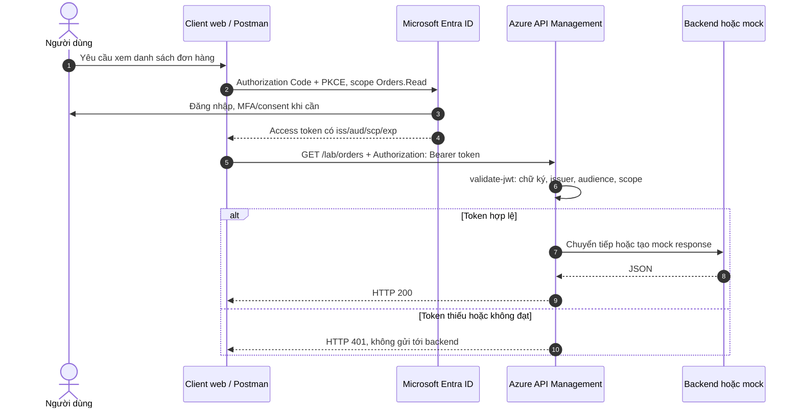
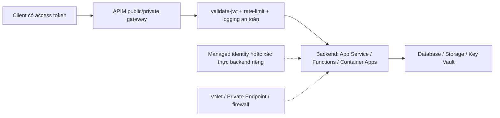
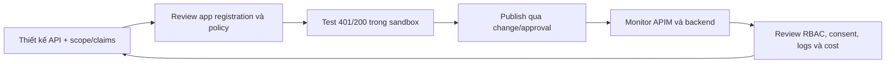

# Thực hành cổng API có Microsoft Entra ID và API Management

## 1. Bối cảnh bài thực hành và kết quả cần đạt

Trong chương **Kiến trúc và thực hành tổng hợp** của module **CLOUD_PROVIDERS_AZURE**, chúng ta kết hợp kiến thức về subscription, resource group, Microsoft Entra ID, dịch vụ tính toán, mạng, lưu trữ/dữ liệu, giám sát, bảo mật và chi phí để xây dựng một điểm vào API có thể quản trị được. Một ứng dụng thường có nhiều client: web, mobile, tác vụ tự động và hệ thống đối tác. Nếu từng backend tự xử lý xác thực, hạn mức gọi API, logging và công bố endpoint theo cách khác nhau, khả năng bảo mật và vận hành sẽ khó nhất quán.

**Microsoft Entra ID** đóng vai trò **identity provider**: xác thực người dùng hoặc workload, cấp OAuth 2.0 access token cho API khi client được cho phép. **Azure API Management (APIM)** là **API gateway và management plane**: công bố API, định tuyến đến backend và áp dụng policy để kiểm tra token, giới hạn lưu lượng, ghi telemetry, biến đổi request hoặc phản hồi. Backend vẫn phải thực thi kiểm tra nghiệp vụ và bảo vệ đường truy cập trực tiếp theo kiến trúc.

**Bài lab:** công bố API `GET /lab/orders` trên gateway APIM; chỉ request có **access token được Entra ID cấp cho đúng API** và mang quyền `Orders.Read` mới nhận phản hồi JSON. Để tập trung vào cơ chế xác thực, bước đầu sử dụng **mock response tại gateway**, chưa cần tạo database hoặc backend. Sau đó người học hiểu cách thay mock bằng một backend thật có bảo vệ.

Kết thúc bài, bạn cần có các bằng chứng:

1. **Hai app registrations** trong cùng tenant Entra ID: một đại diện API và một đại diện client dùng Authorization Code + PKCE.
2. **API scope** `Orders.Read` được công bố và client có permission/consent phù hợp.
3. **API và operation** trong Azure API Management; policy `validate-jwt` xác minh token trước khi trả mock response.
4. Kiểm thử phân biệt **401 khi không có token**, **401 khi token sai/scope không đạt**, và **200 với token hợp lệ**.
5. Sơ đồ luồng OAuth, RBAC quản trị và kế hoạch giám sát, bảo vệ backend, kiểm soát chi phí và dọn môi trường.

**Phạm vi:** Azure public cloud, một tenant và subscription sandbox được phép thực hành. Các tên tài nguyên, host, ID và JSON mẫu chỉ minh họa. Không đưa token, secret hoặc thông tin khách hàng thật vào báo cáo bài tập.

## 2. Kiến trúc end-to-end: danh tính, gateway và backend



Có ba ranh giới bảo vệ khác nhau:

| Ranh giới | Cơ chế | Không có nghĩa là… |
| --- | --- | --- |
| **Người dùng/client → Entra ID** | OAuth 2.0/OpenID Connect, đăng nhập, consent, token | Client được phép tự gọi bất kỳ API nào |
| **Client → APIM gateway** | HTTPS, `validate-jwt`, policy và có thể subscription key/rate limit | APIM tự bảo vệ backend khỏi mọi đường gọi trực tiếp |
| **APIM → backend** | TLS, private network, managed identity/mTLS hoặc phương án auth phù hợp | Chỉ vì APIM xác minh JWT thì backend được phép tin mọi nguồn mạng |

**Authentication** trả lời "client/người dùng là ai?"; **authorization** trả lời "được làm gì?". Access token hợp lệ về chữ ký nhưng không có `Orders.Read` vẫn **không đủ quyền** để gọi operation của lab.

### 2.1. Các khái niệm phải phân biệt

| Thuật ngữ | Ý nghĩa trong bài |
| --- | --- |
| **Tenant ID** | Định danh thư mục Entra ID cấp/kiểm tra token |
| **API app registration** | Định nghĩa resource API, Application (client) ID, App ID URI, exposed scopes/app roles |
| **Client app registration** | Đại diện ứng dụng xin access token để gọi API |
| **Delegated permission** | Quyền đại diện người dùng, thường thể hiện ở claim `scp` của access token |
| **Application permission/app role** | Quyền cấp cho workload ứng dụng trong luồng client credentials, thường ở claim `roles` |
| **Access token** | Token được **API tài nguyên** sử dụng để quyết định quyền; có `aud` trỏ tới API |
| **ID token** | Token cho client biết thông tin đăng nhập của người dùng; **không dùng thay access token** để gọi API |
| **Issuer (`iss`)** | Bên phát hành token, phụ thuộc tenant và phiên bản token |
| **Audience (`aud`)** | API/resource được phép nhận token |
| **Expiration (`exp`)** | Thời điểm hết hiệu lực token; token quá hạn phải bị từ chối |
| **APIM subscription key** | Khóa sản phẩm/gói APIM để quản lý consumer/quota; **không thay OAuth access token** |
| **Azure RBAC** | Quyền quản trị Azure resources như APIM service/API/policy; khác quyền gọi operation `GET /orders` |

## 3. Chuẩn bị subscription, tài nguyên và quyền

### 3.1. Nguồn lực và giả định

| Thành phần | Tên minh họa | Ghi chú |
| --- | --- | --- |
| Tenant Microsoft Entra ID | `TENANT_ID_GUID` | Dùng **tenant cụ thể**, không dùng `common` cho lab một tenant |
| Subscription sandbox | `SUBSCRIPTION_ID_GUID` | Do tổ chức cấp, không dùng production |
| Resource group | `rg-apim-identity-lab` | Chỉ chứa tài nguyên riêng bài tập |
| API Management service | `apim-orders-lab-unique` | Tên phải hợp lệ và khả dụng; host gateway lấy từ service thực |
| APIM API | `Orders Lab API` | API URL suffix `lab` |
| Operation | `GET /orders` | Full path dự kiến `/lab/orders` |
| API app registration | `orders-api-lab` | Expose scope `Orders.Read` |
| Client app registration | `orders-client-lab` | Public/native client phục vụ PKCE trong lab |
| Backend | Mock JSON tại APIM | Không có database hoặc backend public cần cấu hình |
| Test tool | Postman hoặc OAuth client tương đương | Nhận token qua Authorization Code + PKCE |

**Chi phí:** Azure API Management thường phát sinh phí theo tier, thời gian và mức sử dụng. Không giả định service miễn phí. Kiểm tra SKU, khu vực và bảng giá ngay trong Azure Pricing Calculator/Portal; dùng tier sandbox được tổ chức chấp thuận, đặt budget và xóa resource đúng quy trình khi xong.

### 3.2. Ai cần quyền gì?

- Người tạo resource group/APIM cần **Azure RBAC** phù hợp trên subscription/RG; thao tác import API, operation và policy cần quyền quản trị APIM tương ứng.
- Người tạo **app registrations** cần được tenant cho phép đăng ký ứng dụng; nếu tenant hạn chế, cần vai trò/quy trình của Entra administrator.
- Việc **admin consent** cho delegated permissions hoặc application permissions có thể yêu cầu quản trị viên theo tenant policy; không tự cấp quyền thay người có thẩm quyền.
- Client test cần có tài khoản được phép đăng nhập và lấy delegated token, không nhất thiết có Contributor trên Azure subscription.
- Người có quyền sửa APIM policy có thể thay cơ chế bảo vệ API; cấp quyền quản trị hẹp, review policy và lưu lịch sử thay đổi.

**Chú ý:** Microsoft Entra app registration và Azure Resource Manager APIM service thuộc **hai hệ thống quyền quản trị khác nhau**. Contributor trên một resource group không mặc nhiên có quyền tạo app registration hay đồng ý quyền tenant-wide.

## 4. Thiết kế OAuth và cách chọn token

### 4.1. Vì sao chọn Authorization Code + PKCE?

Với ứng dụng web/mobile hoặc Postman chạy tương tác, **Authorization Code + PKCE** cho phép client yêu cầu access token thay mặt người dùng mà **không nhúng client secret vào ứng dụng public**. Quy trình gồm:

1. Client chuyển người dùng tới Entra authorization endpoint với client ID, redirect URI, scope và PKCE challenge.
2. Người dùng đăng nhập và được yêu cầu consent nếu cần.
3. Entra chuyển về authorization code tại redirect URI đã đăng ký.
4. Client trao đổi authorization code + PKCE verifier lấy access token.
5. Client gọi APIM với HTTP header `Authorization: Bearer ...`.

Đây là luồng **delegated**: quyền của người dùng và client cùng được xét. Trong một hệ thống thực, còn có thể cần kiểm tra claims như `tid`, `oid`, `azp`, groups/roles và authorization nghiệp vụ theo đơn hàng. Bài lab chỉ kiểm tra một scope đơn giản để thấy ranh giới bảo vệ.

### 4.2. Không trộn các loại token

- **Access token cho Microsoft Graph** có audience là Graph, nên **không được dùng** để gọi API Orders dù token đó do cùng Entra tenant phát hành.
- **ID token** không có ý nghĩa cấp phép truy cập API Orders, ngay cả khi người dùng đăng nhập thành công.
- **Access token cho Orders API** cần đúng audience, issuer/tenant, chữ ký và claim `scp` chứa `Orders.Read`.
- Access token **v1.0** và **v2.0** có thể khác issuer/audience/claims. Ví dụ policy ở mục 8 nhắm tới **v2 access token cho API của lab**; nếu cấu hình nhận v1 hoặc đa tenant, phải thiết kế policy riêng được kiểm chứng, không tự nới lỏng.

### 4.3. Phân biệt delegated và service-to-service

| Luồng | Chủ thể đăng nhập | Permission thường kiểm tra | Bài lab |
| --- | --- | --- | --- |
| Authorization Code + PKCE | Người dùng + client app | `scp=Orders.Read` | **Có**, policy mẫu yêu cầu `scp` |
| Client Credentials | Service principal/ứng dụng | `roles` (app roles) nếu API định nghĩa và cấp quyền phù hợp | Không dùng trong policy mẫu |
| On-Behalf-Of | Backend thay mặt người dùng gọi downstream API | Quyền và token audience của API đích | Nêu kiến trúc, chưa thực hành |
| Managed identity từ Azure workload | Workload Azure không lưu client secret | Access token cho resource và quyền app được gán | Mở rộng, chưa dùng để đăng nhập client public |

**Không cho phép client-credentials đi qua policy đang bắt buộc `scp` bằng cách tắt kiểm tra scope.** Nếu cần app-only, định nghĩa **app role**, cấp admin consent và viết gate kiểm tra `roles` riêng cho endpoint/workload đó.

## 5. Bước 1 — Tạo resource group và API Management

### 5.1. Xác minh Azure context

Có thể thực hiện trong Azure Portal hoặc Azure CLI. Trong Bash đã cài CLI:

```bash
az login
az account set --subscription "SUBSCRIPTION_ID_GUID"
az account show \
  --query "{subscription:id,tenant:tenantId,name:name}" \
  --output json
```

Dừng nếu tenant/subscription không đúng sandbox. Người không có quyền tạo APIM có thể thực hành trên APIM sandbox do quản trị viên cấp, **không xin Owner toàn subscription chỉ để chạy bài**.

### 5.2. Tạo Azure API Management

Trong Azure Portal:

1. Vào **API Management services → Create**.
2. Chọn subscription sandbox, resource group `rg-apim-identity-lab`, region, organization/contact email và một service name hợp lệ, duy nhất.
3. Chọn **pricing tier** và tính năng phù hợp bài lab; khả năng VNet, custom domain, diagnostics, scale và giá khác nhau giữa các tier.
4. Review + Create, chờ provisioning hoàn tất và lưu **gateway URL thực tế** từ APIM service.
5. Ghi nhận resource ID, region, SKU, tên người phụ trách và kế hoạch dọn lab.

**Kế hoạch network cho lab:** dùng gateway HTTPS có thể truy cập từ máy thử nghiệm theo cấu hình của tier. Nếu APIM chỉ có private ingress hoặc IP restrictions, cần chạy client test từ mạng được phép; không tự mở public endpoint production chỉ để thử.

### 5.3. Tạo API và operation chưa có backend

Mở APIM service → **APIs** → thêm **HTTP API/Blank API** (tùy phiên bản Portal):

- Display name: `Orders Lab API`.
- Name/internal ID: `orders-lab`.
- API URL suffix: `lab`.
- Thêm operation: **GET**, URL template `/orders`, tên `List orders`.
- Nếu wizard yêu cầu backend URL, sử dụng backend lab được tổ chức cho phép hoặc cấu hình service URL tạm phù hợp; **policy mock ở mục 8 sẽ trả response trước khi gọi backend**.
- Với riêng API lab, thiết lập **Subscription required = false** nếu được policy/tier của tổ chức cho phép, để việc kiểm thử tập trung vào JWT. Trong production có thể dùng cả subscription key và OAuth, nhưng đây là hai lớp khác nhau.

**Không nhầm endpoint:** API URL suffix `lab` + operation path `/orders` tạo endpoint `https://YOUR_APIM_GATEWAY_HOST/lab/orders`. Giá trị gateway hostname phải lấy từ service, không tự suy từ resource group.

## 6. Bước 2 — Đăng ký Orders API trong Microsoft Entra ID

### 6.1. Tạo API app registration

Trong Microsoft Entra admin center hoặc Azure Portal → **Microsoft Entra ID → App registrations → New registration**:

1. Name: `orders-api-lab`.
2. Supported account types: chọn **Accounts in this organizational directory only** (single tenant) cho bài lab.
3. Redirect URI: API resource không cần redirect URI chỉ để nhận access token.
4. Create và lưu **Application (client) ID** của API và **Directory (tenant) ID**. Không nhầm với **Object ID** của enterprise application/service principal.

Tiếp theo, mở **Expose an API**:

1. Đặt **Application ID URI** theo giá trị được Portal chấp nhận, ví dụ `api://API_APP_CLIENT_ID_GUID`.
2. Chọn **Add a scope**:
   - Scope name: `Orders.Read`.
   - Who can consent: theo chính sách tổ chức, thường admin nếu dữ liệu nhạy cảm.
   - Admin consent display name: `Read orders from lab API`.
   - State: **Enabled**.
3. Lưu scope đầy đủ: `api://API_APP_CLIENT_ID_GUID/Orders.Read`.

**Quan trọng:** token mà APIM nhận sẽ được cấp **cho API resource đã đăng ký**, không phải cho APIM service resource hoặc cho client app. APIM là gateway sẽ validate token rồi xử lý request.

### 6.2. Chọn access token v2 và audience

Bài lab sẽ dùng Microsoft Entra **v2.0 authorization/token endpoints** và policy có OpenID configuration v2. Nếu tenant/app cần cấu hình phiên bản access token cho API, người quản trị kiểm tra thuộc tính manifest của API app như `api.requestedAccessTokenVersion` và thiết lập **v2** theo cơ chế/khả năng hiện hành.

Với access token v2 phát cho API custom, audience thường là **Application (client) ID GUID của API**. Một số kịch bản phiên bản token/resource có thể cho audience khác như App ID URI. **Không đoán audience**: xem claim `aud` từ access token thực tế trong công cụ kiểm tra cục bộ đáng tin cậy, đối chiếu token version/issuer, rồi dùng chính giá trị hợp lệ trong `validate-jwt`. Mẫu policy ở mục 8 giả định audience bằng API app client ID GUID.

**Không tải token thật lên các website giải mã JWT công khai.** JWT payload có thể đọc cục bộ để xem claims nhưng **việc giải mã không chứng minh chữ ký hợp lệ**. Chỉ policy xác thực dựa trên khóa/issuer/audience phù hợp mới đưa ra quyết định.

## 7. Bước 3 — Tạo client app và cấp delegated permission

### 7.1. Tạo đăng ký ứng dụng client

Tạo một app registration khác:

- Name: `orders-client-lab`.
- Supported account types: single tenant.
- Redirect URI: chọn loại **Mobile and desktop applications/public client** hoặc loại phù hợp với công cụ OAuth test đã được phê duyệt, với **callback URL chính xác mà công cụ cung cấp**.
- Không tạo hoặc nhúng client secret cho client public.
- Ghi **Client Application ID** của client app, phân biệt với Application ID của API.

Trong **API permissions → Add a permission → My APIs**, chọn `orders-api-lab` và quyền **Delegated: Orders.Read**. Lưu; nếu tenant yêu cầu admin consent, nhờ người quản trị có quyền xử lý, không dùng tài khoản đặc quyền riêng ngoài quy trình.

### 7.2. Phân tích quyền và consent

Cho dù client app đã được cấp delegated permission, việc lấy token còn phụ thuộc:

- Tài khoản người dùng có được phép đăng nhập/được gán quyền truy cập ứng dụng theo tenant policy hay không.
- Permission đã được consent đúng kiểu (user/admin) chưa.
- Client xin đúng **scope**, đúng tenant, redirect URI và luồng OAuth.
- API có điều kiện authorization nghiệp vụ riêng không.

Nếu client chưa consent, Entra có thể báo lỗi như `consent_required`/`interaction_required` hoặc hiển thị consent prompt; **đừng sửa bằng cách tắt API validation**.

### 7.3. Bảng giá trị cần điền

| Giá trị | Lấy từ đâu? | Mục đích |
| --- | --- | --- |
| `TENANT_ID_GUID` | Entra tenant Overview | Metadata/OAuth endpoints |
| `API_APP_CLIENT_ID_GUID` | API app registration Overview | Audience của access token v2 trong lab |
| `API_APP_ID_URI` | Expose an API | Prefix scope, ví dụ `api://...` |
| `CLIENT_APP_ID_GUID` | Client app registration Overview | OAuth client ID |
| `CLIENT_REDIRECT_URI` | Client app Authentication | Callback URI dùng cho PKCE |
| `ORDERS_READ_SCOPE` | Expose an API | `api://API_APP_CLIENT_ID_GUID/Orders.Read` |
| `APIM_GATEWAY_HOST` | APIM Gateway URL | Đích gọi `GET /lab/orders` |

Đây là định danh/cấu hình phục vụ lab, không phải credential bí mật. Tuy nhiên báo cáo nội bộ có thể chứa chi tiết kiến trúc nên vẫn cần quyền xem phù hợp.

## 8. Bước 4 — Cấu hình API Management validate-jwt và mock response

### 8.1. Policy ở cấp operation

Trong APIM → **APIs → Orders Lab API → GET /orders → Inbound processing / Code editor** (tên menu tùy Portal), đặt một policy kiểm tra token trước khi trả dữ liệu. Mẫu dùng **tenant cụ thể**, audience API app ID và delegated scope `Orders.Read`:

```xml
<policies>
  <inbound>
    <base />
    <validate-jwt
      header-name="Authorization"
      require-scheme="Bearer"
      require-signed-tokens="true"
      require-expiration-time="true"
      failed-validation-httpcode="401"
      failed-validation-error-message="Unauthorized">
      <openid-config
        url="https://login.microsoftonline.com/TENANT_ID_GUID/v2.0/.well-known/openid-configuration" />
      <audiences>
        <audience>API_APP_CLIENT_ID_GUID</audience>
      </audiences>
      <required-claims>
        <claim name="scp" match="any" separator=" ">
          <value>Orders.Read</value>
        </claim>
      </required-claims>
    </validate-jwt>

    <!-- Mock only: the request does not reach any backend. -->
    <return-response>
      <set-status code="200" reason="OK" />
      <set-header name="Content-Type" exists-action="override">
        <value>application/json; charset=utf-8</value>
      </set-header>
      <set-header name="Cache-Control" exists-action="override">
        <value>no-store</value>
      </set-header>
      <set-body>{"orders":[{"id":"demo-001","status":"ready"}]}</set-body>
    </return-response>
  </inbound>
  <backend>
    <base />
  </backend>
  <outbound>
    <base />
  </outbound>
  <on-error>
    <base />
  </on-error>
</policies>
```

**Cần thay đúng hai placeholder trong XML:** `TENANT_ID_GUID` và `API_APP_CLIENT_ID_GUID`. Đừng thay chúng bằng chuỗi có dấu `<`/`>` trong attribute XML vì sẽ làm hỏng cú pháp. Khi dùng token thực có `aud` khác GUID do cấu hình đã được xác nhận, cần cập nhật đúng audience và kiểm thử lại; không thêm audience không liên quan chỉ để bỏ qua lỗi.

### 8.2. Policy thực hiện những gì?

| Kiểm tra | Thành phần policy | Ý nghĩa |
| --- | --- | --- |
| Có bearer token | `header-name=Authorization`, `require-scheme=Bearer` | Không nhận request thiếu chuẩn Authorization |
| Token đã được ký | `require-signed-tokens=true` | Không chấp nhận JWT không có chữ ký |
| Hết hạn token | `require-expiration-time=true` và kiểm tra thời gian | Token hết hạn không được đi qua |
| Issuer/keys của tenant | `openid-config` từ metadata Entra v2 của tenant | Gateway dùng metadata và signing keys để kiểm chứng |
| Đúng API nhận token | `audiences` | Token dành cho API khác bị từ chối |
| Có quyền đọc đơn hàng | `required-claims` với `scp=Orders.Read` | Token delegated thiếu quyền không qua |
| Mock để học | `return-response` | Chỉ trả JSON sau khi vượt qua gate JWT |

Với OpenID configuration tenant cụ thể, APIM có thể lấy metadata và signing keys, cache và làm mới theo hành vi dịch vụ. Không nên đưa khóa ký thủ công vào policy nếu có nguồn metadata đáng tin và được hỗ trợ. **Không** bỏ `validate-jwt` khi backend lỗi: việc đó biến lỗi vận hành thành lỗ hổng xác thực.

**Kết quả mặc định của ví dụ:** khi `validate-jwt` thất bại vì thiếu token, sai chữ ký, issuer, audience, token hết hạn hoặc thiếu scope, gateway trả **401** vì `failed-validation-httpcode="401"`. HTTP **403 Forbidden** có thể hợp lý trong thiết kế authorization riêng, nhưng **ví dụ này cố ý dùng 401 cho mọi thất bại tại policy JWT**. Không ghi 403 là kết quả chắc chắn của negative test thiếu scope.

### 8.3. Phạm vi áp dụng policy và thứ tự xử lý

APIM policy có các scope như global/product/API/operation, có thể kế thừa qua `<base />`. Trong lab, cấu hình tại **operation GET /orders** để không làm ảnh hưởng các API khác. Trong production, nhóm thường xây policy base ở API/product/global để không bỏ quên những operation cần bảo vệ.

**Điều cần kiểm tra:** nếu tồn tại policy ở scope cao hơn hoặc cấu hình subscription key bắt buộc, chúng có thể từ chối request **trước** hoặc ngoài gate JWT của operation. Để bài tập đo riêng JWT, xác minh inherited policies và thiết lập `Subscription required` đúng như phần 5. Khi mở rộng production, review chính sách kế thừa như rate limit, CORS, IP restriction và diagnostics.

`return-response` ở đây kết thúc xử lý và **không gọi backend**. Đừng nhầm kết quả mock 200 với kết luận backend thực đã được bảo vệ hoặc sẵn sàng.

## 9. Bước 5 — Lấy delegated access token bằng Postman/PKCE

### 9.1. Cấu hình OAuth 2.0

Dùng Postman hoặc client OAuth khác được tổ chức cho phép. Trong một request mới, chọn **Authorization → OAuth 2.0** và các thông số tương đương:

| Trường | Giá trị |
| --- | --- |
| Grant Type | **Authorization Code (with PKCE)** |
| Auth URL | `https://login.microsoftonline.com/TENANT_ID_GUID/oauth2/v2.0/authorize` |
| Access Token URL | `https://login.microsoftonline.com/TENANT_ID_GUID/oauth2/v2.0/token` |
| Client ID | `CLIENT_APP_ID_GUID` |
| Client Secret | **Để trống** đối với public client dùng PKCE |
| Code Challenge Method | `S256` |
| Scope | `api://API_APP_CLIENT_ID_GUID/Orders.Read`; thêm `openid profile` chỉ nếu client cần đăng nhập/hiển thị người dùng |
| Callback / Redirect URL | **Trùng chính xác** redirect URI đã đăng ký ở client app |
| Client Authentication | Loại phù hợp **public client không có secret** |

Tên trường có thể thay đổi theo phiên bản Postman. Khi bấm **Get New Access Token**, đăng nhập bằng tài khoản lab được phép và xử lý consent theo chính sách tenant. Dùng **access token** được trả về cho request API, không dùng ID token hoặc token của resource khác.

### 9.2. Kiểm tra claims trước khi thử gateway

Quan sát access token bằng công cụ kiểm tra **cục bộ** phù hợp, không đưa token thật lên trang web công khai. Nội dung payload minh họa:

```json
{
  "ver": "2.0",
  "iss": "https://login.microsoftonline.com/TENANT_ID_GUID/v2.0",
  "aud": "API_APP_CLIENT_ID_GUID",
  "tid": "TENANT_ID_GUID",
  "scp": "Orders.Read",
  "azp": "CLIENT_APP_ID_GUID",
  "oid": "USER_OBJECT_ID_GUID",
  "exp": 1893456000
}
```

Đây chỉ là **ví dụ claims**, không phải access token thật hoặc token đã được ký. Một token hợp lệ có thể chứa thêm claims hoặc cách biểu diễn khác. Cần kiểm tra phiên bản, audience, tenant, scope và thời gian rồi để APIM thực sự xác minh chữ ký/issuer/claims. Claim `scp` có thể là chuỗi nhiều scope phân tách bằng dấu cách; policy ở mục 8 chỉ yêu cầu có `Orders.Read`.

**Không gửi access token vào log, chat, Git hoặc bug report.** Nếu cần bằng chứng, chỉ lưu tên claims/giá trị không nhạy cảm đã được che, cùng request ID/status; không sao chép JWT đầy đủ.

## 10. Bước 6 — Gọi gateway và kiểm thử positive/negative

### 10.1. Test bằng curl

Lấy **gateway URL** từ APIM service. Ví dụ chạy trong Bash:

```bash
APIM_URL="https://YOUR_APIM_GATEWAY_HOST/lab/orders"

# 1. Thiếu Authorization => dự kiến 401 từ validate-jwt.
curl -i "$APIM_URL"

# 2. Chuỗi token không hợp lệ => dự kiến 401.
curl -i "$APIM_URL" \
  -H "Authorization: Bearer invalid-token"

# 3. Token delegated thật cho Orders API có Orders.Read => dự kiến 200.
# ACCESS_TOKEN do công cụ OAuth được phép cung cấp trong phiên làm việc.
curl -i "$APIM_URL" \
  -H "Authorization: Bearer $ACCESS_TOKEN"
```

**Lưu ý về bảo mật shell:** access token là credential ngắn hạn nhưng vẫn nhạy cảm. Không đưa token vào command history bằng một lệnh gán literal, không bật `set -x`, không chia sẻ terminal/log hoặc lưu tệp plaintext công khai. Có thể dùng tính năng quản lý token trong Postman/HTTP client thay vì paste token vào shell.

Nếu API yêu cầu **APIM subscription key**, request có thể thất bại vì thiếu key ở một tầng khác; đừng nhầm đó là lỗi token. Với lab, kiểm tra thiết lập `Subscription required=false` hoặc dùng key hợp lệ do APIM cấp theo quy định. Subscription key **không thay** bearer token.

### 10.2. Ma trận kiểm thử

| Mã | Điều kiện đầu vào | Kết quả mong đợi trong lab | Bằng chứng |
| --- | --- | --- | --- |
| `API-01` | Không có `Authorization` | **401** | Response status và policy scope |
| `API-02` | Bearer token sai cấu trúc/chữ ký | **401** | Không có mock JSON |
| `API-03` | Access token đã hết hạn | **401** | Claim `exp` của token test, không lưu token |
| `API-04` | Token do tenant khác cấp | **401** nếu issuer không khớp tenant | Token issuer/metadata kiểm chứng |
| `API-05` | Token cho Microsoft Graph/API khác | **401** vì audience sai | Claim `aud` |
| `API-06` | Token cho Orders nhưng thiếu `Orders.Read` | **401** theo policy ví dụ | Claim `scp` và required-claims |
| `API-07` | Access token hợp lệ đúng API/scope | **200** với JSON mock | Response và gateway request ID |
| `API-08` | Client có token nhưng không có APIM key khi key bắt buộc | Có thể **401/403** từ tầng subscription/policy tùy cấu hình | Phân biệt nguyên nhân với JWT |
| `API-09` | Backend thật bị down (khi bỏ mock) | Không thể coi 200 mock là health của backend | Backend health/5xx/log độc lập |

Các bài thử liên quan issuer/scope/audience cần dùng token test do môi trường lab thực sự cấp theo cấu hình được cho phép; không cố giả mạo chữ ký hoặc thay payload token rồi coi đó là token hợp lệ.

### 10.3. Chẩn đoán khi token thật vẫn bị 401

Theo trình tự:

1. API đã tắt **subscription required** cho lab chưa? Có inherited policy chặn request không?
2. Request gửi đúng **Authorization: Bearer** tới đúng gateway hostname và operation path?
3. Token là **access token**, không phải ID token? Token có đúng `aud` cho API app?
4. Token v2 có `iss` của tenant cụ thể khớp metadata URL, và `exp` chưa hết hạn?
5. `scp` có chứa `Orders.Read`? Client đã xin đúng scope và consent?
6. Entra metadata/JWKS và outbound connectivity của APIM có truy cập được không?
7. Policy XML đã lưu ở đúng operation và không bị policy cấp cao thay đổi hành vi?

Không giải quyết bằng cách xóa `audiences`, bỏ issuer validation hoặc chuyển sang chấp nhận mọi token đã đăng nhập. Một token có chữ ký hợp lệ **không có nghĩa** nó được phát cho API đang nhận.

## 11. Bước 7 — Chuyển từ mock sang backend thật

Bài lab sử dụng `return-response` để tránh tạo backend và database. Khi xây dựng hệ thống thực:



Lộ trình nâng cấp:

1. Triển khai backend qua IaC/CI/CD đã review, có health checks và telemetry. Backend có thể trả JSON đơn hàng giả lập trước khi nối database.
2. Cấu hình APIM **backend service URL** và bỏ phần `return-response`, nhưng giữ `validate-jwt` ở inbound.
3. Giới hạn đường đi từ Internet tới backend: private network/Private Endpoint/VNet hoặc quy tắc ingress được hỗ trợ theo tier, kết hợp kiểm soát danh tính backend.
4. Với backend sử dụng Entra ID, cân nhắc APIM **managed identity** để lấy token riêng tới backend theo resource/audience phù hợp; **đừng dùng lại access token của client cho mọi downstream service** khi không đúng mục đích.
5. Backend vẫn kiểm tra quyền dữ liệu theo user/tenant, và quản lý `orders` theo owner; gateway chỉ kiểm tra quyền gọi API tổng quát.
6. Kiểm tra retry, timeouts, rate limit/quota, CORS cho browser clients, caching với dữ liệu nhạy cảm và bảo mật request/response headers.
7. Cấu hình diagnostics, WAF/Front Door nếu kiến trúc yêu cầu, phân tách dev/test/prod và triển khai policy có kiểm soát.

**CORS không phải cơ chế authentication.** CORS giúp browser giới hạn các request cross-origin theo chính sách trình duyệt; client ngoài browser có thể bỏ qua. Cần tiếp tục kiểm tra OAuth token và bảo vệ backend.

### 11.1. API gateway không thay quyền dữ liệu

Ví dụ `Orders.Read` chỉ chứng minh client được phép gọi loại operation đọc đơn hàng. Không thể từ đó suy ra người dùng A được xem đơn hàng của người dùng B. Backend cần thực thi **object-level authorization**, tenant isolation, ownership checks, audit và tránh lỗi IDOR/BOLA. Trong mô hình multi-tenant, thiết kế issuer/audience/tenant validation và mapping claims phức tạp hơn lab single-tenant.

## 12. Phân quyền Azure và bảo mật quá trình phát hành

### 12.1. Các vai trò độc lập

| Vai trò | Quyền cần thiết | Không tự được cấp |
| --- | --- | --- |
| Entra app administrator | Tạo/cấu hình app registration/API scope, xử lý consent theo policy | Azure APIM Contributor mặc định |
| APIM administrator/deployer | Quản lý APIM service/APIs/operations/policies trong scope | Quyền đăng ký app trong tenant |
| Client test user | Đăng nhập, consent/quyền delegated Orders.Read | Azure RBAC trên resource group |
| Backend workload identity | Gọi database/Key Vault/Storage theo data-plane permissions | Tự có quyền chỉ vì gateway đã xác thực |
| Security reviewer | Review token validation, logs, policies, application threat model | Tự có mọi quyền ghi trong Azure |

### 12.2. Quy tắc production

- Đặt APIM policies, API definition/OpenAPI, backend config và các biến quan trọng dưới **version control**; test policy trên môi trường nonproduction trước khi publish.
- Không lưu client secret, subscription key, signing key hay bearer token trong file policy, pipeline YAML hoặc báo cáo công khai. Dùng named values tham chiếu Key Vault theo tính năng hỗ trợ và RBAC phù hợp nếu cần.
- Giới hạn quyền sửa policy; nếu ai đó có thể xóa `validate-jwt`, họ có thể mở API. Bảo vệ branch, deployment pipeline, approvals và thay đổi cấp global/API/operation.
- Dùng **tenant-specific issuer**, audience đúng, signature validation và quyền `scp`/`roles` phù hợp. Không sử dụng `common` metadata cho một lab single-tenant mà không có chiến lược issuer validation riêng.
- Bật TLS/HTTPS, không gửi token qua query string; bảo vệ refresh token ở client theo mô hình OAuth.
- Tách các quyền của client app khỏi tài khoản con người và nguyên tắc least privilege; xem xét Conditional Access, MFA, consent governance và lifecycle của app registrations.
- Nếu có nhiều client được cấp cùng scope mà chỉ một số được phép dùng API, kiểm tra thêm **authorized client**/claim `azp` hoặc kiểm soát dịch vụ riêng, không chỉ dựa vào `scp`.

## 13. Quan sát, cảnh báo và kiểm soát chi phí

### 13.1. Dữ liệu vận hành cần thu thập

Sau khi chính sách hoạt động, cấu hình APIM diagnostics/Azure Monitor theo tier và tổ chức để theo dõi:

| Chỉ số / sự kiện | Câu hỏi | Cảnh báo gợi ý |
| --- | --- | --- |
| `401` theo API/operation | Token sai audience, issuer, expired, consent hay client lỗi? | Tăng đột biến 401 so với baseline |
| `403` nếu có chính sách authorization riêng | Token hợp lệ nhưng không đủ quyền? | Spike sau phát hành policy |
| `429` / throttling | Client vượt rate limit/quota? | Nhiều request vượt ngưỡng |
| `5xx` và backend latency | Gateway hay backend gặp lỗi? | Error rate/latency vượt SLO |
| Request count và bandwidth | Lưu lượng tăng so với năng lực/tier? | Dự báo capacity/cost |
| Policy deployment/audit | Ai thay `validate-jwt`, audience, issuer? | Thay đổi policy không đúng quy trình |

**Bảo vệ dữ liệu giám sát:** không bật log toàn bộ `Authorization` header, client secret, subscription key, cookies hoặc dữ liệu đơn hàng thật. Các log cần có retention, quyền truy cập và masking phù hợp. Việc APIM phát sinh 401 chưa cho biết chắc lỗi do JWT; phải đọc thông tin chẩn đoán đã được làm sạch và đối chiếu thứ tự policy.

### 13.2. Chi phí APIM và phụ thuộc

APIM có mô hình tính phí thay đổi theo tier, region, thời gian, năng lực/vận hành và lượng request tùy lựa chọn. Ngoài APIM có thể phát sinh:

- Log Analytics, Application Insights, diagnostic ingestion/retention.
- Backend App Service/Functions/Container Apps và tài nguyên database/storage.
- Network, private endpoints, Front Door/WAF, egress, custom domains/certificates.
- Dịch vụ bảo mật, secrets và chi phí vận hành liên quan.

Trước khi tạo APIM, hãy dùng **Pricing Calculator** và chính sách sandbox để chọn tier phù hợp, đặt **Cost Management Budget** cho subscription/RG khi được hỗ trợ và thiết lập alert. Budget là **cảnh báo**, không phải giới hạn cứng tự dừng mọi khoản phí.

### 13.3. Chu trình cải tiến



## 14. Xử lý lỗi thường gặp

| Triệu chứng | Nguyên nhân khả dĩ | Hướng xử lý |
| --- | --- | --- |
| Entra báo `redirect_uri_mismatch` | Redirect URI của client khác callback OAuth tool | Cấu hình trùng chính xác URI/type, không tắt PKCE |
| Entra báo `invalid_scope` | API scope chưa tạo/enabled hoặc client xin sai URI | Kiểm tra Expose an API và permission |
| `consent_required` hoặc admin approval cần thiết | Consent chưa được cấp theo tenant policy | Nhờ admin có quyền xử lý, không dùng token của API khác |
| APIM trả 401 khi thiếu token | Policy validate-jwt hoạt động | Kiểm tra test `API-01` đạt |
| APIM trả 401 dù token đã có | Sai `aud`, `iss`, `scp`, token v1/v2 hoặc hết hạn | So sánh claims với metadata/policy, không tắt validator |
| APIM trả 401 khi APIM key bắt buộc | Subscription required/product setting hoặc inherited policy | Tách lỗi gateway subscription key khỏi OAuth |
| APIM trả 404 | Sai gateway hostname, URL suffix hoặc operation path | Kiểm tra APIs/operations và URL cụ thể |
| APIM báo lỗi policy XML | Placeholder không được thay đúng, XML không hợp lệ hoặc sai scope | Xem policy editor validation và cấu trúc XML |
| Không nhận signing keys từ Entra | Metadata URL sai hoặc network/TLS outbound bị hạn chế | Kiểm tra tenant endpoint và connectivity APIM |
| Token đúng nhưng API khác vẫn truy cập được | Policy chỉ gắn một operation/API, endpoint khác chưa bảo vệ | Kiểm tra effective policy ở mọi operation |
| Sau bỏ mock, backend trả 500/502/504 | URL, DNS, auth backend, private networking hoặc timeout | Kiểm tra backend health, APIM diagnostics và network |
| Chi phí tăng dù ít request | Tier APIM, capacity hoặc tài nguyên phụ trợ | Xem Cost Analysis theo service/charge, budget và thời gian provision |

**Thứ tự khoanh vùng:** xác định lỗi ở **lấy token từ Entra**, **gateway/operation**, **validate-jwt claims**, **APIM subscription/network**, hay **backend**. Không kết luận mọi lỗi 401 đều do một nguyên nhân.

## 15. Bài thực hành theo nhóm và tiêu chí nghiệm thu

### 15.1. Đề bài

Đội phát triển ứng dụng bán hàng cần công bố danh sách đơn hàng qua một cổng API. Người dùng nội bộ phải đăng nhập bằng Entra ID, xin quyền `Orders.Read` và gọi gateway. Không có token hoặc token sai không được nhận JSON. Đội platform phải có bằng chứng về phân quyền quản trị và ngân sách, còn backend thật được để ngoài phạm vi lab.

### 15.2. Các bước thực hiện

1. Tạo hoặc dùng APIM sandbox được cấp phép, RG riêng và chọn tier theo ngân sách.
2. Đăng ký `orders-api-lab` single-tenant, đặt App ID URI và tạo delegated scope `Orders.Read`.
3. Đăng ký `orders-client-lab` dạng public client, khai báo redirect URI của OAuth tool và thêm delegated permission.
4. Lấy token bằng Authorization Code + PKCE, xác minh claims cục bộ; không đưa token vào báo cáo.
5. Tạo API URL suffix `lab` và operation `GET /orders` trong APIM.
6. Áp policy XML ở mục 8 với **đúng tenant ID và audience**; dùng mock response, không cần backend.
7. Kiểm thử `API-01` tới `API-07`; phân biệt lỗi thiếu token, sai audience, thiếu scope và token hợp lệ.
8. Xem inherited policies/subscription required; nếu sai kỳ vọng, xác định nguyên nhân trước khi sửa.
9. Kiểm tra Azure RBAC, quyền app registrations, consent, logging ẩn token và budget.
10. Lưu evidence, cleanup resource và thu hồi các quyền/đăng ký tạm đúng quy trình.

### 15.3. Bảng chấm điểm

| Nhóm | Điều kiện PASS | Bằng chứng |
| --- | --- | --- |
| Entra resource API | Single tenant; scope `Orders.Read` enabled | API app ID URI và scope name |
| Entra client | Public client PKCE + delegated permission đúng | Client ID, redirect URI, consent status |
| APIM API | `GET /lab/orders` tồn tại | Operation URL và policy scope |
| Token validation | Signature/issuer/audience/exp/scope được kiểm | Policy XML và code review |
| Negative tests | Thiếu/sai token trả 401, không lộ JSON mock | HTTP status và test IDs |
| Positive test | Token hợp lệ trả 200 JSON mock | Status/response không chứa token |
| Azure RBAC | Quyền quản trị phân tách khỏi quyền gọi API | Role assignments + review |
| Operations | Monitoring/alert có kế hoạch, không ghi bí mật | Dashboard/diagnostic config |
| Cost/cleanup | Có cost owner và kế hoạch xóa lab | Budget/Cost Analysis và inventory cleanup |

**Bằng chứng tối thiểu không chứa credential:** tenant/API/client ID ở mức được cho phép trong tài liệu nội bộ, scope name, APIM resource/operation ID, trạng thái consent, policy đã che thông tin nhạy cảm, HTTP status và kết quả cleanup. Không nộp JWT, client secret, subscription key, refresh token hoặc danh tính người dùng thực.

## 16. Dọn dẹp môi trường thực hành an toàn

APIM service có thể tiếp tục phát sinh phí cho tới khi được xóa hoặc quản lý theo quy định. Trước khi xóa:

1. Kiểm tra APIM service/RG **chỉ dùng cho lab**, không có API hoặc product chung với nhóm khác.
2. Lưu các bằng chứng đã cho phép giữ; xác minh không có backend hoặc dữ liệu thử cần lưu.
3. Nếu APIM thuộc RG riêng và được chủ sở hữu phê duyệt, xóa service/RG theo quy trình Azure; xóa RG **có thể phá hủy tất cả resource bên trong**.
4. Trong Entra ID, xóa app registrations/service principals **chỉ khi chắc chắn chúng được tạo riêng cho lab**; việc xóa app có thể ảnh hưởng client/permission đang dùng.
5. Thu hồi các consent, role assignments, access hoặc webhook/keys tạm thời theo khả năng và quy trình được cho phép.
6. Kiểm tra Cost Management sau độ trễ dữ liệu để phát hiện khoản phí còn tiếp tục; một budget hoặc service đăng ký ở scope khác có thể cần cleanup riêng.

Một lệnh kiểm kê Azure **chỉ đọc** trước khi cleanup:

```bash
az resource list \
  --resource-group "rg-apim-identity-lab" \
  --query "[].{name:name,type:type,id:id}" \
  --output table
```

**Không dùng lệnh xóa cả RG trong bài mà không kiểm kê và xác nhận chủ sở hữu.** Cần kiểm tra APIM service có đang phục vụ API của người khác và các app registrations có được tái sử dụng ngoài lab hay không.

## 17. Câu hỏi tự kiểm tra

**1. Microsoft Entra ID và API Management có làm cùng một việc không?**  
Không. Entra ID xác thực/cấp token; APIM gateway quản lý API và dùng policy để xác minh token, quản lý lưu lượng và chuyển request. Backend vẫn chịu trách nhiệm bảo vệ dữ liệu.

**2. Vì sao không dùng ID token thay access token để gọi API?**  
ID token dành cho client xác nhận việc đăng nhập; access token dành cho resource API được chỉ rõ bằng audience và quyền.

**3. Một JWT có chữ ký hợp lệ nhưng `aud` là Microsoft Graph có thể gọi Orders API không?**  
Không. Policy phải từ chối vì token được phát cho resource khác.

**4. Khi dùng Authorization Code + PKCE, quyền `Orders.Read` thường nằm ở claim nào?**  
`scp` trong access token delegated. Client credentials dùng app roles/`roles`, cần thiết kế khác.

**5. Tại sao ví dụ trả 401 khi token thiếu `Orders.Read`, không phải 403?**  
Vì `validate-jwt` được cấu hình `failed-validation-httpcode=401` cho mọi trường hợp validation thất bại. Một policy authorization riêng có thể chọn 403, nhưng không phải hành vi mặc định của mẫu.

**6. Tắt “Subscription required” có vô hiệu JWT validation không?**  
Không. APIM subscription key và Entra access token là hai cơ chế độc lập; policy JWT vẫn kiểm tra request.

**7. `return-response` thành công có chứng minh database và backend khỏe không?**  
Không. Nó trả mock tại gateway và không chuyển request tới backend. Khi bỏ mock, phải kiểm tra backend auth, network, SLO và quyền dữ liệu riêng.

**8. Một khách hàng có `Orders.Read` có thể đọc mọi đơn hàng của mọi người dùng không?**  
Không nên. Backend phải kiểm tra ownership/tenant/object-level authorization, không dùng scope chung làm quyền đọc tất cả bản ghi.

**9. Budget APIM có tự ngừng phí khi đạt ngưỡng không?**  
Không. Azure Cost Management Budget gửi cảnh báo theo cấu hình; không phải hard spending cap.

**10. Vì sao APIM service có RBAC và client app có permissions khác nhau?**  
Azure RBAC quản lý tài nguyên APIM; Entra delegated/application permissions cho phép client xin token gọi resource API. Cả hai cần được cấu hình đúng nhưng ở các lớp khác nhau.

## 18. Tài liệu chính thức nên đối chiếu

- Microsoft Learn — **Microsoft identity platform OAuth 2.0 authorization code flow** và **PKCE**.
- Microsoft Learn — **Expose a web API**, **Configure an app to access a web API**, **Scopes and application roles**.
- Microsoft Learn — **Access tokens in the Microsoft identity platform**, **Token validation** và **App registration manifest**.
- Microsoft Learn — **Azure API Management overview**, **Create an HTTP API** và **Configure API/operation policies**.
- Microsoft Learn — **API Management validate-jwt policy**, **Policy expressions**, **API subscription keys** và **Mock API responses**.
- Microsoft Learn — **Azure API Management managed identity for backend authentication** và **Virtual network / private endpoint considerations**.
- Microsoft Learn — **Monitor Azure API Management** và **Azure Cost Management Budgets**.
- Microsoft Learn — **Azure Well-Architected Framework**: Security, Operational Excellence, Reliability và Cost Optimization.

Cấu hình Portal, tên thuộc tính manifest, loại APIM tier, giá và hành vi của OAuth client có thể thay đổi theo thời điểm/tenant. Khi thực hành trên Azure thật, đối chiếu tài liệu chính thức cho đúng phiên bản và kiểm tra bằng **token access thực, audience/issuer/scope thực, effective APIM policy và kết quả HTTP**. Một cổng API chỉ được coi đạt yêu cầu khi đúng người có đúng quyền truy cập, request sai bị chặn và backend/dữ liệu được bảo vệ độc lập với gateway.
