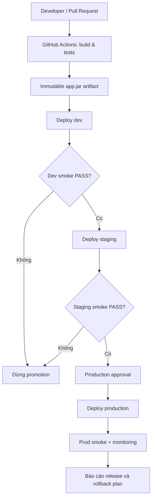
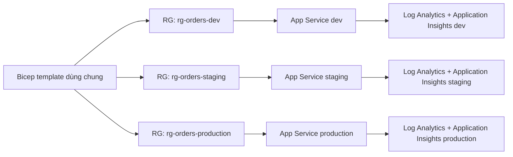
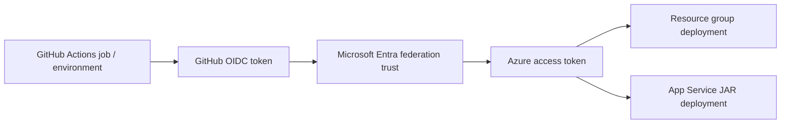

# Thực hành pipeline IaC và triển khai ứng dụng đa môi trường

## 1. Bài toán capstone: một ứng dụng, ba môi trường, một quy trình đáng tin cậy

Đội phát triển **Orders API** đang triển khai thủ công lên Microsoft Azure. Người phụ trách dev tạo App Service trong Portal, người phụ trách staging đặt một SKU khác, còn production dùng cấu hình mạng và giám sát không được ghi lại. Khi phát hành bản Java mới, nhóm phải tải JAR lên từng môi trường, tự nhớ các bước kiểm tra. Có lần staging chạy đúng nhưng production lỗi vì thiếu application setting.

Bài thực hành này xây một **pipeline Infrastructure as Code (IaC) và triển khai ứng dụng đa môi trường**: hạ tầng được mô tả bằng **Azure Bicep**, ứng dụng mẫu là **Spring Boot Java 21**, còn **GitHub Actions** dùng Microsoft Entra workload identity federation (OIDC) để đăng nhập Azure. Một artifact đã build và kiểm tra được lần lượt triển khai qua `dev → staging → production`; mỗi môi trường có cấu hình, quyền và điều kiện phê duyệt riêng.

Đây là bài trong chương **Kiến trúc và thực hành tổng hợp**, kết nối lộ trình học Azure từ subscription, resource group, Microsoft Entra ID, mạng, compute, storage và dữ liệu tới triển khai, giám sát, bảo mật và kiểm soát chi phí. Chúng ta tập trung vào **kiến trúc, mã IaC, workflow CI/CD, xác minh kết quả và runbook** chứ không thực thi thay đổi trên subscription của người học.

### Kết quả cần tạo

1. Một ứng dụng Spring Boot có endpoint `GET /api/hello` và `/actuator/health`, trả về tên môi trường và mã bản phát hành.
2. Bicep template tạo App Service plan Linux, Web App với managed identity, Log Analytics workspace và Application Insights.
3. Bộ tham số `dev`, `staging`, `production` chỉ khác dữ liệu cấu hình; không sao chép ba bản template hạ tầng.
4. Pipeline build và test **một lần**, xuất artifact cố định `app.jar`, sau đó quảng bá cùng artifact sang ba môi trường.
5. Workflow deployment dùng OIDC với quyền tối thiểu, `validate`, `what-if`, `create`, deploy JAR và smoke test.
6. GitHub Environments tách cấu hình/quyền và **yêu cầu review production** khi được bảo vệ đúng cách.
7. Runbook xác minh, xử lý drift, rollback và dọn lab có kiểm soát.

### Mục tiêu học tập

Sau bài học, bạn có thể giải thích khác biệt giữa CI, CD, IaC và GitOps; thiết kế isolation và promotion giữa các environment; nhận diện drift/secret leakage; đọc deployment diff trước thay đổi; kiểm tra một bản phát hành ở cả hạ tầng và ứng dụng; đồng thời phân biệt rollback code với rollback schema/dữ liệu.

> **Giới hạn:** các tên API version, runtime, Azure SKU và GitHub Actions version dưới đây là **ví dụ để học**. Trước khi chạy thật cần kiểm tra hỗ trợ hiện hành bằng công cụ/tài liệu chính thức, khóa action theo commit SHA được duyệt và đánh giá giá dịch vụ. Không tự động tạo tài nguyên Azure, cấp quyền hoặc chạy lệnh phá hủy trong khi đọc bài.

## 2. Các khái niệm nền tảng

| Khái niệm | Vai trò | Đầu ra |
| --- | --- | --- |
| **IaC** | Khai báo trạng thái mong muốn của tài nguyên Azure trong mã | Bicep/ARM template, parameters |
| **CI (Continuous Integration)** | Build, unit test, kiểm tra chất lượng mỗi thay đổi | Artifact có version và bằng chứng test |
| **CD (Continuous Delivery/Deployment)** | Quảng bá artifact đã kiểm tra qua môi trường với policy/gate | Release đã triển khai và log |
| **Pipeline** | Tập jobs/steps và quan hệ phụ thuộc có thể lặp lại | Workflow run có trạng thái |
| **Environment** | Không gian triển khai với tài nguyên, quyền, dữ liệu và policy riêng | `dev`, `staging`, `production` |
| **Promotion** | Chuyển chính artifact sang môi trường tiếp theo sau khi qua gate | Cùng checksum/build ID |
| **Drift** | Trạng thái Azure khác trạng thái mô tả trong IaC | Chênh lệch `what-if`, báo cáo |
| **Immutable artifact** | File build không sửa sau khi đã kiểm tra | `app.jar` + commit/digest |
| **Idempotent deployment** | Áp cùng khai báo nhiều lần không tạo tài nguyên trùng ngoài dự kiến | ARM incremental deployment hội tụ về cấu hình |
| **Rollback** | Khôi phục bản hoạt động đã biết, kèm xem xét hạ tầng/dữ liệu | Release được xác minh |

Đừng nhầm **Continuous Delivery** (sẵn sàng phát hành, có thể cần phê duyệt) với **Continuous Deployment** (tự đưa đến production khi đủ điều kiện). Bài này dùng **delivery có cổng phê duyệt production**.

### Tại sao không dựng môi trường bằng các bước click?

Một thao tác click có thể được ghi nhớ không đầy đủ. IaC giúp code review, tái lập cấu hình, trace thay đổi theo Git commit và kiểm tra trước khi triển khai. Tuy nhiên IaC không tự bảo đảm hệ thống an toàn: template có thể sai quyền, sai region, gây xóa dữ liệu hoặc đặt secret trong deployment history. Phải có review, policy, tests và cách rollback.

## 3. Kiến trúc triển khai và phạm vi lab



Mỗi môi trường có nhóm tài nguyên riêng:



**Thiết kế lab:** các resource group được **bootstrap trước** bởi platform owner trong một subscription lab hoặc ở nhiều subscription nếu có. Pipeline chỉ triển khai tài nguyên trong resource group được phép. Với production thật, nên cân nhắc **subscription riêng** cho production, Azure Policy/RBAC/tags, hạn chế đường mạng và chính sách data residency.

### Bảng cấu hình mục tiêu

| Thuộc tính | Dev | Staging | Production |
| --- | --- | --- | --- |
| Resource group | `rg-orders-dev` | `rg-orders-staging` | `rg-orders-production` |
| App Service SKU ví dụ | B1 | B1 | P1v3 |
| Số instance ví dụ | 1 | 1 | 2 |
| Application setting | `APP_ENVIRONMENT=dev` | `staging` | `production` |
| Monitoring | Workspace riêng | Workspace riêng | Workspace riêng, alert nghiêm ngặt |
| Quyền pipeline | Scoped dev | Scoped staging | Scoped production |
| Deployment gate | CI + smoke | Dev PASS + smoke | Staging PASS + reviewer |
| Data | Dữ liệu giả | Dữ liệu ẩn danh/sandbox | Dữ liệu thật, quyền hạn nghiêm |

SKU và số instance chỉ minh họa, **không phải bảo đảm có sẵn hoặc mức chi phí mặc định**. Nếu subscription hoặc region không hỗ trợ `P1v3`, chọn SKU tương ứng sau khi kiểm tra quota, chi phí và các yêu cầu khả dụng.

## 4. Quyết định cách cô lập môi trường

Một **resource group riêng** giúp phân định lifecycle nhưng chưa phải hàng rào bảo mật tuyệt đối. Các môi trường có thể chung subscription, tenant, network và quota. Production nên được xem xét độc lập về:

- **Subscription/billing scope:** trách nhiệm, quota, budgets và phạm vi quyền quản trị.
- **Networking:** VNet/subnet, inbound restrictions, private endpoints, DNS, WAF và truy cập dữ liệu.
- **Identity:** service principal/workload identity từng môi trường; runtime managed identity của mỗi web app.
- **Secrets:** secret riêng theo môi trường trong Key Vault, không copy database password production xuống dev.
- **Data:** production không được dùng như môi trường thử; staging có thể dùng dữ liệu giả lập/ẩn danh.
- **Monitoring:** alert/retention/workspace tương ứng mức quan trọng và yêu cầu tuân thủ.
- **Change control:** review trước khi thay đổi production và có runbook/rollback.

GitHub Environment variables **không tự cách ly Azure**. Nếu một pipeline principal có quyền trên mọi resource group, việc đổi `AZURE_RESOURCE_GROUP` nhầm vẫn có thể gây tác động rộng. **Azure RBAC và federated identity trust** mới là phần giới hạn thực thi.

## 5. Cấu trúc repository của bài lab

Tạo repository mẫu `orders-azure-capstone` như sau:

```text
orders-azure-capstone/
├── pom.xml
├── src/main/java/com/example/orders/
│   └── OrdersApplication.java
├── src/main/resources/
│   └── application.yml
├── infra/
│   ├── main.bicep
│   └── parameters/
│       ├── dev.json
│       ├── staging.json
│       └── production.json
└── .github/workflows/
    ├── release.yml
    └── deploy-env.yml
```

Đường dẫn trong ví dụ là **các tệp người học tự tạo trong repository của mình**. Hợp đồng bài học này chỉ yêu cầu ghi đúng tài liệu Markdown; không tạo những tệp dự án thật trong workspace đang được Worker quản lý.

### Quy tắc một nguồn chân lý

- `infra/main.bicep` chứa cấu trúc tài nguyên dùng chung.
- `infra/parameters/<environment>.json` chứa những khác biệt hạ tầng **không nhạy cảm**.
- GitHub Environment variables chứa tên resource group, web app, subscription và identity của từng môi trường.
- Secrets **không** được hardcode trong Bicep, JSON parameters, GitHub Actions logs hay `application.yml`.
- Artifact build một lần và dùng lại nguyên vẹn ở các environment.

## 6. Ứng dụng Spring Boot tối thiểu để kiểm tra promotion

Để tập trung vào pipeline, ứng dụng chỉ trả về tên môi trường và revision. Nó **không cần database**; sau khi hoàn thành có thể mở rộng sang Azure SQL, Storage hoặc message queue với IaC và kiểm thử riêng.

### `pom.xml`

```xml
<?xml version="1.0" encoding="UTF-8"?>
<project xmlns="http://maven.apache.org/POM/4.0.0"
         xmlns:xsi="http://www.w3.org/2001/XMLSchema-instance"
         xsi:schemaLocation="http://maven.apache.org/POM/4.0.0
                             https://maven.apache.org/xsd/maven-4.0.0.xsd">
  <modelVersion>4.0.0</modelVersion>
  <parent>
    <groupId>org.springframework.boot</groupId>
    <artifactId>spring-boot-starter-parent</artifactId>
    <version>3.5.6</version>
    <relativePath/>
  </parent>
  <groupId>com.example</groupId>
  <artifactId>orders-lab</artifactId>
  <version>1.0.0</version>
  <properties>
    <java.version>21</java.version>
  </properties>
  <dependencies>
    <dependency>
      <groupId>org.springframework.boot</groupId>
      <artifactId>spring-boot-starter-web</artifactId>
    </dependency>
    <dependency>
      <groupId>org.springframework.boot</groupId>
      <artifactId>spring-boot-starter-actuator</artifactId>
    </dependency>
    <dependency>
      <groupId>org.springframework.boot</groupId>
      <artifactId>spring-boot-starter-test</artifactId>
      <scope>test</scope>
    </dependency>
  </dependencies>
  <build>
    <finalName>app</finalName>
    <plugins>
      <plugin>
        <groupId>org.springframework.boot</groupId>
        <artifactId>spring-boot-maven-plugin</artifactId>
      </plugin>
    </plugins>
  </build>
</project>
```

Phiên bản Spring Boot trên chỉ là **bản mẫu**, cần nâng theo chính sách hỗ trợ và bản vá bảo mật hiện hành. `<finalName>app</finalName>` giúp pipeline không phụ thuộc filename chứa version; artifact sản xuất có thể đặt tên kèm checksum/tag để truy vết.

### `src/main/java/com/example/orders/OrdersApplication.java`

```java
package com.example.orders;

import java.util.Map;
import org.springframework.beans.factory.annotation.Value;
import org.springframework.boot.SpringApplication;
import org.springframework.boot.autoconfigure.SpringBootApplication;
import org.springframework.web.bind.annotation.GetMapping;
import org.springframework.web.bind.annotation.RestController;

@SpringBootApplication
@RestController
public class OrdersApplication {

    @Value("${APP_ENVIRONMENT:local}")
    private String environment;

    @Value("${APP_RELEASE:local}")
    private String release;

    @GetMapping("/api/hello")
    public Map<String, String> hello() {
        return Map.of(
                "service", "orders-lab",
                "environment", environment,
                "release", release);
    }

    public static void main(String[] args) {
        SpringApplication.run(OrdersApplication.class, args);
    }
}
```

Ứng dụng dùng biến môi trường `APP_ENVIRONMENT` và `APP_RELEASE`, **không biên dịch riêng JAR theo environment**. Đây là ví dụ của nguyên tắc **build once, configure at runtime**.

### `src/main/resources/application.yml`

```yaml
server:
  port: ${PORT:8080}

management:
  endpoints:
    web:
      exposure:
        include: health,info
  endpoint:
    health:
      show-details: never
```

`/actuator/health` dùng cho kiểm tra HTTP cơ bản. Ứng dụng thật cần authentication/authorization và readiness phù hợp; API demo công khai này không chứa dữ liệu nhạy cảm, nhưng **không phải mẫu bảo mật production hoàn chỉnh**.

### Chạy local

```bash
mvn -B -ntp clean verify
APP_ENVIRONMENT=local APP_RELEASE=dev java -jar target/app.jar

# Ở terminal khác:
curl -fsS http://localhost:8080/api/hello
curl -fsS http://localhost:8080/actuator/health
```

Ví dụ response:

```json
{
  "service": "orders-lab",
  "environment": "local",
  "release": "dev"
}
```

Khi đưa lên Azure, cùng JAR này sẽ hiển thị `dev`, `staging` hoặc `production` dựa vào application settings do Bicep tạo.

## 7. Bicep quản lý hạ tầng theo trạng thái mong muốn

**Bicep** là ngôn ngữ khai báo cho Azure Resource Manager (ARM). Một template có thể được triển khai nhiều lần với tham số khác nhau và cùng quy tắc. Bài lab dùng **resource group deployment scope**: resource group đã tồn tại; template tạo các tài nguyên bên trong.

### Phạm vi tài nguyên

| Resource | Dùng làm gì? |
| --- | --- |
| `Microsoft.Web/serverfarms` | App Service plan cho compute Linux |
| `Microsoft.Web/sites` | Web App chạy Java SE/Spring Boot JAR |
| `Microsoft.OperationalInsights/workspaces` | Log Analytics workspace cho logs |
| `Microsoft.Insights/components` | Workspace-based Application Insights |
| System-assigned managed identity | Identity của runtime web app, để mở rộng truy cập Key Vault/dịch vụ khác |

Chưa tạo Azure SQL, Private Endpoint hoặc role assignment ở đây, nhằm giữ bài tập triển khai pipeline tương đối gọn. Khi bổ sung cơ sở dữ liệu, phải thêm network, quyền, secrets/identity và migration schema theo runbook riêng.

## 8. Viết `infra/main.bicep`

```bicep
targetScope = 'resourceGroup'

@allowed([
  'dev'
  'staging'
  'production'
])
param environment string

@description('Tên web app phải duy nhất trong phạm vi namespace App Service áp dụng.')
param webAppName string

@allowed([
  'B1'
  'S1'
  'P1v3'
])
param planSku string = 'B1'

@minValue(1)
param instanceCount int = 1

@description('Commit SHA của artifact phát hành.')
param releaseId string = 'unreleased'

param location string = resourceGroup().location

var tags = {
  application: 'orders-lab'
  environment: environment
  managedBy: 'bicep'
}

resource plan 'Microsoft.Web/serverfarms@2023-12-01' = {
  name: 'asp-orders-${environment}'
  location: location
  kind: 'linux'
  tags: tags
  sku: {
    name: planSku
    capacity: instanceCount
  }
  properties: {
    reserved: true
  }
}

resource workspace 'Microsoft.OperationalInsights/workspaces@2022-10-01' = {
  name: 'law-orders-${environment}'
  location: location
  tags: tags
  properties: {
    sku: {
      name: 'PerGB2018'
    }
    retentionInDays: 30
  }
}

resource insights 'Microsoft.Insights/components@2020-02-02' = {
  name: 'appi-orders-${environment}'
  location: location
  kind: 'web'
  tags: tags
  properties: {
    Application_Type: 'web'
    WorkspaceResourceId: workspace.id
  }
}

resource webApp 'Microsoft.Web/sites@2023-12-01' = {
  name: webAppName
  location: location
  kind: 'app,linux'
  tags: tags
  identity: {
    type: 'SystemAssigned'
  }
  properties: {
    serverFarmId: plan.id
    httpsOnly: true
    siteConfig: {
      linuxFxVersion: 'JAVA|21-java21'
      alwaysOn: true
      ftpsState: 'Disabled'
      minTlsVersion: '1.2'
      appSettings: [
        {
          name: 'APP_ENVIRONMENT'
          value: environment
        }
        {
          name: 'APP_RELEASE'
          value: releaseId
        }
        {
          name: 'APPLICATIONINSIGHTS_CONNECTION_STRING'
          value: insights.properties.ConnectionString
        }
      ]
    }
  }
}

output appResourceId string = webApp.id
output appUrl string = 'https://${webApp.properties.defaultHostName}'
output runtimePrincipalId string = webApp.identity.principalId
```

**Điều cần kiểm tra khi dùng thật:**

- `JAVA|21-java21` là **giá trị runtime minh họa**. Kiểm tra bằng `az webapp list-runtimes --os linux` và sửa Bicep nếu API hỗ trợ runtime string khác.
- Kiểm tra API versions của resource types, region/SKU availability, quota và điều kiện Linux App Service. Giá có thể thay đổi.
- `APPLICATIONINSIGHTS_CONNECTION_STRING` **chỉ cấu hình endpoint telemetry**; ứng dụng Java vẫn cần instrumentation/agent tương thích thì mới gửi request/dependency traces đầy đủ. Không mặc định có telemetry ứng dụng chỉ vì resource Insights đã được tạo.
- Tên `law-orders-<environment>` chỉ cần duy nhất trong scope quy định; nếu deploy nhiều lần cùng tenant/subscription, bổ sung prefix để tránh đụng tên và phù hợp naming policy.
- `appSettings` ở IaC là **nguồn chân lý**: chỉnh thủ công trong Portal có thể bị lần triển khai sau ghi đè. Các cài đặt hệ thống/secret mới phải được quản lý qua cách được thiết kế, không đặt mật khẩu trong Bicep hoặc deployment output.
- Web app có system-assigned managed identity nhưng **chưa được cấp role** lên Storage/Key Vault. Identity của web app khác **OIDC identity của pipeline**.

### Vì sao `httpsOnly`, `ftpsState` và `alwaysOn`?

`httpsOnly` ép truy cập HTTPS; `ftpsState: 'Disabled'` giảm bề mặt truy cập FTP/FTPS không cần thiết; `alwaysOn` giúp ứng dụng chạy trên tier hỗ trợ, nhưng không thay thế Health Check hay autoscaling. Những tùy chọn như TLS minimum version, VNet integration, private inbound và authentication cần xem chính sách bảo mật thực tế.

## 9. Tách tham số cho từng môi trường

Tạo ba tệp **ARM deployment parameters JSON**. Chúng không chứa secret. `webAppName` và `releaseId` được workflow cung cấp khi deploy để đảm bảo tên khác nhau và mã phát hành có thể truy vết.

### `infra/parameters/dev.json`

```json
{
  "$schema": "https://schema.management.azure.com/schemas/2019-04-01/deploymentParameters.json#",
  "contentVersion": "1.0.0.0",
  "parameters": {
    "environment": { "value": "dev" },
    "planSku": { "value": "B1" },
    "instanceCount": { "value": 1 }
  }
}
```

### `infra/parameters/staging.json`

```json
{
  "$schema": "https://schema.management.azure.com/schemas/2019-04-01/deploymentParameters.json#",
  "contentVersion": "1.0.0.0",
  "parameters": {
    "environment": { "value": "staging" },
    "planSku": { "value": "B1" },
    "instanceCount": { "value": 1 }
  }
}
```

### `infra/parameters/production.json`

```json
{
  "$schema": "https://schema.management.azure.com/schemas/2019-04-01/deploymentParameters.json#",
  "contentVersion": "1.0.0.0",
  "parameters": {
    "environment": { "value": "production" },
    "planSku": { "value": "P1v3" },
    "instanceCount": { "value": 2 }
  }
}
```

**Điểm khác biệt:** chỉ **cấu hình**, không copy/paste ba bản hạ tầng. Nếu đổi cách bật App Insights hoặc thêm tag bắt buộc, sửa `main.bicep` một lần và để pipeline kiểm tra tác động lên cả ba môi trường.

Trong ví dụ, mỗi environment ở **resource group khác**, nên `asp-orders-dev`, `asp-orders-staging`, `asp-orders-production` tách lifecycle. Nếu dùng nhiều subscription hoặc deploy đa region, hãy thêm biến và quy tắc naming để không trùng tên workspace/web app toàn cục.

## 10. Kiểm tra IaC ở máy phát triển

Sau khi cài Azure CLI và Bicep CLI tương thích, chạy:

```bash
az bicep version
az bicep build --file infra/main.bicep
```

`build` kiểm tra cú pháp/type ở mức Bicep và tạo ARM JSON trong thư mục tương ứng; đó **chưa phải xác nhận mọi policy, quota và dependency đều hợp lệ**.

Với một resource group lab **đã tồn tại**, có quyền phù hợp:

```bash
az login
az account set --subscription "<subscription-id>"

RG="rg-orders-dev"
APP="<web-app-name-unique-for-dev>"
SHA="local-validation"

az deployment group validate \
  --resource-group "$RG" \
  --template-file infra/main.bicep \
  --parameters @infra/parameters/dev.json \
  webAppName="$APP" releaseId="$SHA"

az deployment group what-if \
  --resource-group "$RG" \
  --template-file infra/main.bicep \
  --parameters @infra/parameters/dev.json \
  webAppName="$APP" releaseId="$SHA"
```

**`what-if` là bản xem trước thay đổi**, có thể báo `Create`, `Modify`, `Delete`, `NoChange` hoặc các trường hợp không thể phân tích đầy đủ. Nó **không thực thi thay đổi**. Dù vậy, không nên coi kết quả what-if là chứng minh chắc chắn không có tác dụng ngoài dự kiến: các thuộc tính computed, provider behavior, quyền và drift có thể làm sai khác.

### Bảng đọc diff

| Dòng what-if | Cách review |
| --- | --- |
| `Create App Service plan` | Có đúng SKU, instance count, region và chi phí? |
| `Create Web App` | Đúng hostname, runtime, identity, HTTPS? |
| `Modify appSettings` | Có ghi đè secret/config production do chỉnh tay không? |
| `Modify plan SKU` | Có thay đổi chi phí, capacity và hỗ trợ Always On không? |
| `Delete resource` | Có nhầm scope hoặc thay đổi rủi ro dữ liệu không? |
| `NoChange` | Vẫn phải chạy smoke test artifact khi phát hành code mới |

**Trước khi áp IaC vào production, cần review diff của đúng cấu hình và đúng scope.** Bản lab ở mục 15 chạy `what-if` bên trong job được bảo vệ; trong quy trình production nghiêm ngặt nên có một **preview/plan job độc lập chạy trước approval**, lưu diff/artifact đã review, rồi triển khai đúng commit/parameters sau approval. Điều này tránh phê duyệt một thay đổi không nhìn thấy kết quả dự kiến.

## 11. GitHub OIDC: xác thực pipeline mà không lưu Azure client secret

GitHub Actions có thể yêu cầu **OIDC token ngắn hạn** thông qua `permissions: id-token: write`. Microsoft Entra ID xác minh token theo **federated identity credential** được cấu hình cho application/service principal hoặc user-assigned managed identity. Nếu subject/issuer/audience khớp, Azure cấp quyền theo role assignment của identity đó.



### Phân quyền khuyến nghị

| Môi trường | Identity pipeline | Phạm vi quyền Azure |
| --- | --- | --- |
| Dev | App registration/identity `gha-orders-dev` | Resource group dev |
| Staging | `gha-orders-staging` | Resource group staging |
| Production | `gha-orders-production` | Resource group production |

Với lab, role **Contributor** ở resource group mục tiêu có thể đủ cho các thao tác tạo App Service/Log Analytics/Insights và deploy JAR. Production nên đánh giá role chi tiết hơn hoặc custom role; **không cấp Owner toàn subscription** để sửa lỗi nhanh. Việc tạo role assignment trong Bicep, nếu mở rộng, cần quyền riêng như `Role Based Access Control Administrator` theo scope thích hợp, không tự nằm trong quyền Contributor.

### Thiết lập federation

Trên Microsoft Entra, tạo một identity tin cậy cho mỗi môi trường; cấu hình issuer/token audience và **subject** theo mô hình GitHub Environment. Một dạng subject thường gặp:

```text
repo:<github-org>/<github-repo>:environment:dev
repo:<github-org>/<github-repo>:environment:staging
repo:<github-org>/<github-repo>:environment:production
```

**Các subject trên là mẫu.** Giá trị thực phải đúng chữ hoa/chữ thường, repo, environment và kiểu workflow. Đừng tạo trust rộng `repo:*` hoặc dùng chung identity production cho mọi branch. Khi dùng environments, cần cấu hình **branch restrictions và required reviewers** tại GitHub Environment, nếu plan/repository hỗ trợ.

### Các giá trị cần ghi vào GitHub Environments

Tạo ba Environment có tên chính xác `dev`, `staging`, `production` trong repository. Mỗi Environment cung cấp các **variables** (không chứa mật khẩu):

```text
AZURE_CLIENT_ID       = <client-id-cua-identity-env>
AZURE_TENANT_ID       = <tenant-id>
AZURE_SUBSCRIPTION_ID = <subscription-id-env>
AZURE_RESOURCE_GROUP  = <rg-env-da-co>
AZURE_WEBAPP_NAME     = <ten-webapp-unique-env>
```

`AZURE_CLIENT_ID` là định danh công khai, **không phải client secret**. Nếu có API keys/connection strings, lưu trong Azure Key Vault hoặc GitHub Environment secrets theo quy trình quyền tối thiểu; không ghi chúng trong `vars`, Bicep parameters hoặc workflow log.

## 12. Bootstrap và quyền thay đổi hạ tầng

Pipeline trong bài **không tạo resource group**, nhằm tránh phải cấp quyền tạo resource ở scope subscription. Platform owner tạo sẵn mỗi resource group và kiểm tra tags, budgets, policy, quota, region:

```bash
# Ví dụ do platform owner chạy trong subscription lab được phê duyệt.
az group create --name "rg-orders-dev" --location "southeastasia"
az group create --name "rg-orders-staging" --location "southeastasia"
az group create --name "rg-orders-production" --location "southeastasia"
```

Đây là lệnh có thay đổi Azure, **không được tự chạy khi chỉ học**. Nếu cần quy trình tự động hoàn toàn, tạo một pipeline **bootstrap** có scope và approval riêng để sinh resource groups/policies rồi chuyển quyền deploy nhỏ hơn cho application pipeline.

### Preflight trước một lần release

1. RG nằm đúng subscription và region; không trùng môi trường.
2. Principal OIDC của mỗi GitHub Environment chỉ có quyền cần thiết trên RG đó.
3. Không có secret nằm trong repo, params JSON hoặc build artifact.
4. Azure Policy không chặn SKU/region/tags và quota đủ cho instance count.
5. App Service Java runtime được xác minh là hợp lệ cho Linux/region/tier.
6. IaC owner đã review `what-if`, đặc biệt khi đổi SKU, số instance, app settings.
7. Production environment có reviewers và restrictions phù hợp.

## 13. GitHub Actions CI: build một lần và lưu artifact

Tạo `.github/workflows/release.yml`. Workflow này chạy khi commit lên `main` hoặc có yêu cầu phát hành thủ công. Jobs dùng **reusable deployment workflow** để tránh copy logic deploy ba lần.

```yaml
name: orders-build-and-promote

on:
  push:
    branches: [main]
  workflow_dispatch:

permissions:
  contents: read
  id-token: write

jobs:
  build:
    runs-on: ubuntu-latest
    steps:
      - name: Checkout exact revision
        uses: actions/checkout@v4

      - name: Configure JDK
        uses: actions/setup-java@v4
        with:
          distribution: temurin
          java-version: '21'
          cache: maven

      - name: Unit tests and package
        run: mvn -B -ntp clean verify

      - name: Verify artifact exists
        run: test -s target/app.jar

      - name: Record artifact checksum
        run: sha256sum target/app.jar

      - name: Store build artifact
        uses: actions/upload-artifact@v4
        with:
          name: orders-app
          path: target/app.jar
          if-no-files-found: error
          retention-days: 14

  deploy_dev:
    needs: build
    uses: ./.github/workflows/deploy-env.yml
    with:
      target_environment: dev

  deploy_staging:
    needs: deploy_dev
    uses: ./.github/workflows/deploy-env.yml
    with:
      target_environment: staging

  deploy_production:
    needs: deploy_staging
    uses: ./.github/workflows/deploy-env.yml
    with:
      target_environment: production
```

### Đọc workflow

- `build` kiểm thử và đóng gói **duy nhất một lần**. Ba job deploy tải đúng artifact `orders-app` của **cùng workflow run**.
- `needs` buộc staging chờ dev PASS và production chờ staging PASS. Nếu một job thất bại, các job sau **không chạy** theo luồng mặc định.
- `permissions: id-token: write` phục vụ OIDC login, **không** cấp quyền Azure nếu chưa có federation trust và Azure RBAC.
- GitHub Environment `production` phải được cấu hình **required reviewers/branch restrictions** riêng. Việc chỉ ghi tên `production` trong YAML **không tự tạo approval gate**.
- `actions/checkout@v4`, `setup-java@v4` và các actions dùng version tag cho ngắn gọn. **Production phải pin về commit SHA đã xác minh**, quản trị cập nhật action và kiểm tra rủi ro supply chain.

**Giới hạn của ví dụ:** đây là luồng promotion theo từng deploy, không có PR preview job độc lập, kiểm tra artifact signature/provenance, SAST, dependency/SBOM scan hoặc concurrency gate ở workflow gọi. Các yêu cầu production được thảo luận trong mục 18–20; không coi ví dụ lab là pipeline đã được harden đầy đủ.

## 14. Reusable workflow: validate, what-if, apply, deploy, smoke

Tạo `.github/workflows/deploy-env.yml`:

```yaml
name: deploy-one-environment

on:
  workflow_call:
    inputs:
      target_environment:
        required: true
        type: string

permissions:
  contents: read
  id-token: write

jobs:
  deploy:
    runs-on: ubuntu-latest
    environment: ${{ inputs.target_environment }}
    concurrency:
      group: orders-${{ inputs.target_environment }}
      cancel-in-progress: false
    env:
      ENVIRONMENT: ${{ inputs.target_environment }}
      RG: ${{ vars.AZURE_RESOURCE_GROUP }}
      APP: ${{ vars.AZURE_WEBAPP_NAME }}

    steps:
      - name: Checkout infrastructure at same commit
        uses: actions/checkout@v4

      - name: Download built JAR
        uses: actions/download-artifact@v4
        with:
          name: orders-app
          path: artifact

      - name: Preflight parameters
        shell: bash
        run: |
          set -euo pipefail
          case "$ENVIRONMENT" in
            dev|staging|production) ;;
            *) echo "Unexpected environment"; exit 1 ;;
          esac
          test -n "$RG"
          test -n "$APP"
          test -s artifact/app.jar
          command -v jq >/dev/null
          sha256sum artifact/app.jar

      - name: Login to Azure via OIDC
        uses: azure/login@v2
        with:
          client-id: ${{ vars.AZURE_CLIENT_ID }}
          tenant-id: ${{ vars.AZURE_TENANT_ID }}
          subscription-id: ${{ vars.AZURE_SUBSCRIPTION_ID }}

      - name: Validate Bicep
        shell: bash
        run: |
          set -euo pipefail
          az bicep build --file infra/main.bicep
          az deployment group validate \
            --resource-group "$RG" \
            --template-file infra/main.bicep \
            --parameters @"infra/parameters/${ENVIRONMENT}.json" \
            webAppName="$APP" releaseId="$GITHUB_SHA"

      - name: Preview infrastructure changes
        shell: bash
        run: |
          set -euo pipefail
          az deployment group what-if \
            --resource-group "$RG" \
            --template-file infra/main.bicep \
            --parameters @"infra/parameters/${ENVIRONMENT}.json" \
            webAppName="$APP" releaseId="$GITHUB_SHA"

      - name: Apply infrastructure
        shell: bash
        run: |
          set -euo pipefail
          az deployment group create \
            --name "orders-${GITHUB_RUN_ID}-${GITHUB_RUN_ATTEMPT}" \
            --resource-group "$RG" \
            --template-file infra/main.bicep \
            --parameters @"infra/parameters/${ENVIRONMENT}.json" \
            webAppName="$APP" releaseId="$GITHUB_SHA"

      - name: Deploy same JAR
        uses: azure/webapps-deploy@v3
        with:
          app-name: ${{ vars.AZURE_WEBAPP_NAME }}
          package: artifact/app.jar

      - name: Smoke test app and release
        shell: bash
        run: |
          set -euo pipefail
          HOST="$(az webapp show \
            --resource-group "$RG" \
            --name "$APP" \
            --query defaultHostName --output tsv)"
          test -n "$HOST"
          URL="https://${HOST}/api/hello"

          for n in $(seq 1 12); do
            RESPONSE="$(curl -fsS --max-time 10 "$URL" || true)"
            if printf '%s' "$RESPONSE" | jq -e \
              --arg env "$ENVIRONMENT" \
              --arg sha "$GITHUB_SHA" \
              '.environment == $env and .release == $sha' \
              >/dev/null 2>&1; then
              echo "Smoke PASS: $ENVIRONMENT / $GITHUB_SHA"
              exit 0
            fi
            sleep 5
          done
          echo "Smoke FAILED for $ENVIRONMENT"
          exit 1
```

### Các điểm quan trọng về hành vi

1. `environment: ${{ inputs.target_environment }}` khiến job dùng **GitHub Environment của tên đó**. Variables `AZURE_*` được đọc theo environment khi cấu hình đúng; reviewer/branch rules có thể trì hoãn job trước khi nhận quyền.
2. Mỗi job dùng `azure/login@v2` riêng: **không truyền access token qua artifacts** hoặc từ dev sang production.
3. `what-if` **không thay thế review thủ công**, nhưng cho log xem thay đổi trước `create` trong cùng job.
4. `az deployment group create` thực thi Bicep theo ARM deployment; nếu môi trường có policy hoặc quota chặn, job phải thất bại và **không deploy JAR**.
5. `azure/webapps-deploy@v3` dùng `app.jar` từ build, không rebuild. `releaseId="$GITHUB_SHA"` cho phép API tự khai báo đúng revision.
6. Smoke test lấy hostname thực từ Azure, kiểm tra HTTP và JSON `environment`/`release`. Một phản hồi 200 từ ứng dụng cũ **không đủ** nếu revision không khớp.
7. `concurrency` chỉ tuần tự hóa các job **cùng environment** trong phạm vi khóa này; không thay thế quyền Azure và các release gate.

**Chú ý:** sau khi GitHub Environment được cấu hình protected, **approval diễn ra trước toàn bộ job**, bao gồm `what-if` trong ví dụ. Nếu chính sách yêu cầu reviewer phải thấy chính bản IaC diff **trước khi bấm Approve**, cần tách một **plan/preview job chạy trước environment gate**, lưu output/PR comment với quyền thích hợp, review rồi chỉ chạy `apply` theo đúng commit và parameter digest. Ví dụ hiện tại thích hợp để học cơ chế; production cần nâng cấp quy trình này.

### Điểm thận trọng với shell và quyền

Pipeline trên dùng runner Ubuntu Bash. Cú pháp `@file.json` của Azure CLI và biến shell phụ thuộc môi trường thực thi; với PowerShell phải viết lại. Tránh bật `set -x` ở bước có credential, không in `az account get-access-token`, không đưa `secureString` vào log của `what-if`.

## 15. Vì sao build-once, deploy-many giảm rủi ro?

Giả sử cùng một commit `abc123` nhưng mỗi môi trường chạy `mvn package` riêng:

- Dev dùng dependency cache cũ.
- Staging lấy dependency mới vì version không khóa.
- Production build với JDK khác.

Khi đó các file JAR có thể **khác checksum** dù cùng source commit. Lỗi production sẽ khó tái hiện. Build-once lưu JAR từ một job và tải nguyên file sang dev/staging/prod giúp loại bỏ một loại sai khác.

### Những gì cần gắn với artifact

| Trường | Ví dụ | Mục đích |
| --- | --- | --- |
| Git commit | Full SHA | Truy vết source |
| Build run | GitHub run ID/attempt | Truy vết pipeline |
| Checksum | SHA-256 của `app.jar` | Phát hiện file bị thay đổi |
| JDK/Maven | Version thực dùng | Khả năng tái lập |
| Dependency lock/BOM | Version và nguồn dependency | Giảm rủi ro dependency drift |
| Test report | Unit/integration tests | Bằng chứng build đạt |
| SBOM/provenance | Nếu tổ chức yêu cầu | Kiểm tra software supply chain |

**Cùng artifact không đồng nghĩa cùng trạng thái vận hành.** Môi trường vẫn khác SKU, network, secret, dữ liệu, version DB và policies; do đó vẫn cần smoke/integration tests ở từng nơi.

## 16. Quy trình pull request trước khi merge

Một workflow release chỉ chạy trên `main` là chưa đủ để ngăn IaC nguy hiểm vào nhánh chính. Thêm quy trình PR:

1. Branch protection: chỉ merge khi reviewers/required checks đạt, không cho bypass trái phép.
2. CI chạy `mvn clean verify` và `az bicep build`, phân tích Bicep lint/type.
3. Dùng secret scanning, dependency vulnerability scanning và SAST phù hợp.
4. Review thay đổi parameters của mọi môi trường, đặc biệt `instanceCount`, `planSku`, identity, public endpoint và retention.
5. Review chính sách Azure Policy/Defender/cost nếu template mở rộng.
6. Không cấp Azure production credentials cho workflow chạy từ **untrusted forks**.
7. Sau merge, chạy promotion với artifact cố định; không sửa thông số ngoài Git ngay giữa release.

### Quy tắc với IaC thay đổi phá hủy

Không phải mọi thay đổi ARM đều có thể đảo ngược an toàn. Xóa resource group, database, Key Vault, storage account hoặc cập nhật cấu hình gây recreate cần:

- Đánh giá impact/cost, backup/restore và retention.
- Kế hoạch migrate dữ liệu và dependency.
- Bằng chứng reviewer hiểu tác động.
- Triển khai canary hoặc song song khi có thể.
- Đường rollback/recovery đã kiểm chứng.

Một `what-if` xuất hiện `Delete` phải là **tín hiệu dừng review**, không tự động áp tiếp chỉ vì pipeline chạy theo lịch.

## 17. GitHub Environments: approvals và promotion

Tạo `dev`, `staging`, `production` tại **Settings → Environments** của repository. Mỗi environment có variables tương ứng và **federated identity trust theo subject đó**.

| Environment | Gợi ý rule | Tác động |
| --- | --- | --- |
| Dev | Cho phép `main`, tự deploy | Phản hồi nhanh |
| Staging | Chỉ `main`, có thể cần reviewer QA | Kiểm thử tích hợp và UAT |
| Production | Required reviewers + branch/tag restrictions + quy tắc change window | Người được phân quyền duyệt trước deploy |

Phải kiểm tra tính năng required reviewers có sẵn theo **GitHub plan, loại repository và policy tổ chức**. Nếu không hỗ trợ, cần dùng hệ thống approval thay thế được doanh nghiệp phê duyệt; không giả định chỉ tên `production` trong YAML là đã bảo vệ.

### Tại sao production nên tách quyền?

Một sự cố ở dev không nên giúp tác nhân có được quyền sửa production. Chia identity theo environment kết hợp Azure RBAC scope hẹp, federated subject và GitHub environment rules giúp thu hẹp ảnh hưởng. Tài khoản triển khai production không cần quyền sửa management groups hoặc subscription policy nếu chỉ triển khai trong một RG.

### Promotion có nghĩa gì?

Ở bài này, cùng một JAR được chuyển tiếp, nhưng **IaC và parameters có thể khác theo environment**. Khái niệm promotion phải được ghi rõ:

- Application artifact: cố định.
- IaC source revision: cố định cùng commit.
- Environment parameters: khác nhau nhưng được version hóa.
- Secrets và dữ liệu: khác nhau, không copy.
- Người phê duyệt: khác nhau.

Nếu một stage có lỗi, **không bỏ qua rồi deploy production**. Ghi nguyên nhân và tạo release mới hoặc rerun sau khi xử lý, với bằng chứng artifact còn nguyên vẹn.

## 18. Xác minh sau triển khai: infrastructure và application

### Xác minh hạ tầng

```bash
az webapp show \
  --resource-group "<rg-env>" \
  --name "<app-env>" \
  --query "{name:name,state:state,host:defaultHostName}" \
  --output json

az appservice plan show \
  --resource-group "<rg-env>" \
  --name "<plan-env>" \
  --query "{name:name,sku:sku.name,capacity:sku.capacity}" \
  --output json
```

Kiểm tra tags, identity, HTTPS và Application Insights/Log Analytics. **Resource state `Running` không đảm bảo runtime Java hoạt động đúng**.

### Xác minh ứng dụng

```bash
HOST="<hostname-thuc-te-tu-az-webapp-show>"
curl -i "https://${HOST}/actuator/health"
curl -i "https://${HOST}/api/hello"
```

Response phải chứa **đúng môi trường và Git SHA vừa phát hành**. Điều này giúp phát hiện lỗi deploy vào sai app hoặc kiểm tra nhầm hostname.

### Bảng acceptance

| Kiểm tra | Dev | Staging | Production |
| --- | --- | --- | --- |
| IaC validate và `what-if` review | PASS | PASS | PASS + approval |
| App Service plan/SKU đúng | Xác minh | Xác minh | Xác minh |
| `GET /actuator/health` | 200 | 200 | 200 |
| `GET /api/hello` | `dev` | `staging` | `production` |
| SHA trên response | Trùng artifact | Trùng artifact | Trùng artifact |
| HTTPS/TLS | Hợp lệ | Hợp lệ | Hợp lệ |
| App Insights/logs | Có cấu hình và telemetry kiểm chứng | Như dev | Có alert/on-call |
| Identity/RBAC | Chỉ dev RG | Chỉ staging RG | Chỉ production RG |
| Cost/budget | Có owner | Có owner | Có dự báo/alert |

Mục tiêu lab có thể chấm PASS trên hai endpoint. Với sản xuất, bổ sung **database, authentication, downstream APIs, performance, accessibility và business transactions**.

## 19. Observability và phát hiện drift sau release

### Quan sát hạ tầng và runtime

| Tín hiệu | Công cụ | Điều tra |
| --- | --- | --- |
| ARM deployment status | Azure deployment history/Activity Log | Thao tác IaC thành công, thất bại và actor |
| App Service HTTP error rate | Azure Monitor/App Service metrics | Lỗi runtime và rollback trigger |
| Spring Boot logs | App Service logs/agent hỗ trợ | Startup errors, exceptions |
| Application requests/dependencies | Application Insights khi instrumentation bật | p95/p99 latency, dependencies |
| Resource drift | `az deployment group what-if` định kỳ | Sai khác so với Bicep |
| Budget | Azure Cost Management | SKU/instance/log cost tăng |

### Một lưu ý về Application Insights

Bicep đã tạo **Application Insights resource** và đặt connection string, nhưng Spring Boot demo **chưa tích hợp Java instrumentation**. Vì vậy không được nói rằng request trace chắc chắn xuất hiện. Có thể bổ sung Azure Monitor OpenTelemetry Distro/Java agent theo hướng dẫn phiên bản hiện hành; đánh giá tác động lên hiệu năng, privacy và ingestion cost.

### Drift detection

Giả sử một người vào Portal tăng instance count từ 1 lên 3. Trong Git, `dev.json` vẫn ghi 1. Một lần `what-if` sau đó có thể báo `Modify` đưa capacity về 1. Đây là **drift**. Xử lý:

1. Xác nhận ai thay đổi, vì lý do gì, có phải emergency change không.
2. Quyết định cập nhật IaC nếu thay đổi hợp lệ, hoặc khôi phục cấu hình mong muốn nếu không.
3. Review thay đổi trên PR, đặc biệt rủi ro downtime và chi phí.
4. Chạy `what-if` lại và lập hồ sơ drift.

Không tự ý “sửa drift” bằng cách áp IaC khi production đang cần capacity khẩn cấp; reconcile có kiểm soát với incident commander.

## 20. Rollback: code, config, infrastructure và database

Rollback an toàn là một **kịch bản được thiết kế trước**, không phải thao tác tùy tiện.

| Loại thay đổi | Khả năng rollback | Rủi ro |
| --- | --- | --- |
| JAR ứng dụng | Deploy lại artifact đã biết tốt nếu còn lưu và tương thích | Cấu hình/schema mới có thể không tương thích |
| App settings | Reapply IaC/config được phê duyệt | Secret rotation, auth/endpoint có thể đổi |
| App Service SKU/instance | Đổi lại trong phạm vi hỗ trợ/quota | Downtime, capacity, giá, behavior |
| Networking/identity | Phục hồi cấu hình theo PR/recovery plan | Firewall, Private DNS và quyền có thể gián đoạn |
| Database schema | Không mặc nhiên rollback bằng deploy JAR cũ | Mất/biến đổi dữ liệu nếu downgrade |
| Storage data | Cần backup/versioning/restore và data owner | IaC không tự khôi phục dữ liệu đã xóa |

### Runbook rollback application

1. Dừng promotion; thông báo người chịu trách nhiệm thay đổi.
2. Xác định artifact/release trước có smoke PASS và còn khả dụng.
3. Kiểm tra schema, environment variables và hạ tầng đang tương thích với JAR cũ.
4. Deploy lại **đúng artifact** bằng workflow hoặc cơ chế được kiểm soát, không build lại từ source “tương tự”.
5. Kiểm tra health, `/api/hello`, metrics và giao dịch nghiệp vụ.
6. Ghi thời điểm, nguyên nhân, owner và phương án sửa triệt để.

Ví dụ lệnh deploy lại một JAR **chỉ dùng khi được phê duyệt**:

```bash
az webapp deploy \
  --resource-group "<rg-env>" \
  --name "<app-env>" \
  --src-path "<duong-dan-artifact-da-duoc-xac-minh>.jar" \
  --type jar
```

**Không lấy một artifact cùng tên nhưng checksum khác** rồi gọi là rollback. Với production, hãy lưu build manifest, checksum, chữ ký hoặc provenance nếu chính sách yêu cầu.

### Triển khai không gián đoạn

Ở các tier hỗ trợ, App Service **deployment slots** có thể dùng cho blue-green hoặc slot swap; cần xem giới hạn slot, sticky app settings, warm-up và database migrations. Bài lab chọn direct JAR deploy để dễ hiểu, **không tuyên bố zero downtime**. Khi chuyển sang production, bổ sung slot/canary và health-based promotion nếu phù hợp.

## 21. Bảo mật và software supply chain

### Những rủi ro thường gặp

| Sai lầm | Hậu quả | Cách phòng tránh |
| --- | --- | --- |
| Lưu Azure client secret trong workflow | Secret bị lộ qua Git/log | OIDC federation và least privilege |
| Dùng một identity chung cho mọi env | Dev có thể tác động production | Identity và RBAC riêng từng env |
| Cho workflow từ fork không tin cậy truy cập prod | Kẻ tấn công chạy code với quyền cloud | Branch/environment restrictions, review |
| Đưa password vào `.json` params | Lộ qua Git và deployment history | Key Vault/secure parameters có kiểm soát |
| Không khóa action/dependency | Rủi ro thay đổi hành vi/supply chain | Pin SHA, dependency scanning, provenance |
| Bỏ qua `what-if` | Gây drift, thay SKU hoặc xóa resource không lường trước | Review plan trước apply |
| Không kiểm tra SHA response | Deploy nhầm bản cũ/nhầm app | Smoke xác minh artifact revision |
| Build lại ở production | Không còn đảm bảo cùng artifact đã test | Build once/deploy many |
| Không có rollback strategy | Incident kéo dài khi deploy lỗi | Giữ artifact và data recovery plan |
| Cấp Owner toàn subscription | Quyền thừa, blast radius lớn | Scope RG, custom roles nếu cần |
| Chỉ bật App Insights resource, không cài agent | Thiếu request traces dù tưởng đã monitoring | Xác minh telemetry end-to-end |

### Bổ sung cho production

Production pipeline nên có **secret scanning**, SAST, dependency audit, SBOM, artifact signing/provenance, runner hardening, pin actions SHA, PR protection, IaC security checks và policy-as-code phù hợp. Workflow OIDC cần tránh quyền từ trigger không tin cậy; token được phát cho job theo chính sách chứ không phải ai có quyền đọc repo cũng có quyền deploy.

## 22. Chi phí và quota cho ba môi trường

Multi-env không miễn phí dù chạy cùng JAR:

| Nguồn phí | Dev/Staging | Production |
| --- | --- | --- |
| App Service plan | B1 minh họa, tính phí khi được cấp phát | P1v3 × 2 instance minh họa |
| Log Analytics | Ingestion/retention theo data plan | Có thể cao hơn do traffic/alert |
| Application Insights | Ingestion và các meter liên quan | Tùy sampling và request volume |
| Network | Egress/dịch vụ mạng phát sinh | Thường có thêm WAF/Private Endpoint/gateway |
| Azure SQL/Storage | Chưa có trong lab | Thêm chi phí khi mở rộng ứng dụng |
| Deployment | Pipeline minutes/retention artifacts theo GitHub plan; thay đổi Azure resources | Chi phí cơ sở hạ tầng không mất khi không có user |

### Ước tính nhanh

Nếu môi trường có \(N\) instances chạy \(H\) giờ, unit price giả định \(P\), chi phí compute ước tính:

\[
C_{\mathrm{compute}}\approx N\times H\times P
\]

Ví dụ hoàn toàn giả định: 1 instance × 730 giờ × 0,10 USD/giờ = **73 USD/tháng**. Con số này **không phải giá Azure App Service B1 hiện hành** và chưa gồm log, network, backup hoặc thuế.

Trước khi tạo tài nguyên, dùng **Azure Pricing Calculator** cho đúng region/SKU và Azure Cost Management để theo dõi usage thật. Kiểm tra quota, App Service plan availability và giới hạn số instance. Không tăng production SKU/số instance chỉ để “cho chắc” nếu không có thử tải hoặc cơ sở chi phí.

## 23. Troubleshooting pipeline và Azure

| Triệu chứng | Nguyên nhân có thể | Cách kiểm tra |
| --- | --- | --- |
| `azure/login` báo federation mismatch | Subject/issuer/audience không khớp GitHub Environment | So sánh trust ở Microsoft Entra và job environment |
| Token OIDC không có quyền deploy | RBAC thiếu trên resource group hoặc scope nhầm | Xem role assignment, subscription/resource ID |
| `az deployment group validate` thất bại | Bicep type/API version, parameter, policy/quota | Xem error code và resource provider |
| `what-if` báo nhiều `Modify` bất ngờ | Config drift hoặc deployment metadata | Review diff, tránh tự apply mù |
| Plan SKU không khả dụng | Region/subscription/quota hoặc tên SKU | Kiểm tra product availability |
| Web app không khởi động Java | Runtime string, packaging, port hoặc startup | Xem Java runtime và App Service log |
| `azure/webapps-deploy` lỗi | Azure RBAC, app chưa được tạo hoặc package sai | Xem deploy logs và artifact path |
| JAR không tìm thấy | Maven output không phải `target/app.jar` | Kiểm tra `<finalName>` và artifact upload |
| Smoke trả 200 nhưng sai SHA | Bản cũ đang phục vụ, cấu hình chưa áp hoặc nhầm hostname | Query app resource, release setting và deployment history |
| App Insights không có requests | Chưa bật instrumentation hoặc log pipeline | Kiểm tra agent/SDK, connection string, workspace |
| Production job không chờ approval | Environment rules chưa bật/hạn chế plan | Kiểm tra GitHub Settings → Environments |
| Production deploy nhầm RG | `vars`/scope identity bị cấu hình sai | Kiểm tra env settings, Azure RBAC và subject |
| Bicep deploy ghi đè manual settings | IaC coi cấu hình cũ là drift | Chuyển thay đổi hợp lệ vào Git, review |
| Release bị kẹt khi staging fail | Smoke/infrastructure/app lỗi | Dừng promotion, điều tra, rerun có kiểm soát |

### Khi troubleshooting

Ghi **run ID, commit SHA, môi trường, resource group, deployment name, thời điểm UTC và mã lỗi**. Không in access tokens, GitHub secrets, Key Vault secret values hoặc toàn bộ environment variables. Không dùng `--debug` công khai cho job có secret nếu chưa kiểm tra nội dung đầu ra.

## 24. Bài thực hành: hoàn tất pipeline đa môi trường

**Mục tiêu:** tự dựng repository lab và trình bày bằng chứng một commit được build một lần, triển khai lần lượt qua dev, staging và production có cổng kiểm tra. Nếu không có tài khoản Azure/GitHub được cấp quyền, vẫn có thể hoàn thành phần **thiết kế, mã Bicep, GitHub Actions và checklist** mà không tạo tài nguyên.

### Pha A — Kiến trúc và quyền

1. Vẽ sơ đồ ba resource groups và tên web apps dự kiến.
2. Chọn subscription/region, xác minh SKU và pricing.
3. Tạo ba GitHub Environments, gắn variables không nhạy cảm.
4. Chuẩn bị Entra identities, OIDC federation subject và RBAC phù hợp.
5. Cấu hình production approval nếu GitHub plan/policy hỗ trợ; nếu không, ghi phương án approval thay thế.

### Pha B — Mã nguồn

1. Tạo `pom.xml`, `OrdersApplication.java`, `application.yml` từ mục 6.
2. Chạy local test; xác minh JSON `environment=local`, `release=dev`.
3. Viết `infra/main.bicep` và ba parameter JSON files.
4. Chạy Bicep build; đọc errors về API version, SKU, property names.
5. Commit vào branch và tạo pull request để review.

### Pha C — Build và deploy

1. Thêm `release.yml` và `deploy-env.yml`.
2. Tạo `build` job xuất `orders-app` artifact.
3. Review OIDC permissions, `needs`, environment variables và concurrency.
4. Merge vào `main` theo quy trình repository.
5. Quan sát dev job: `validate → what-if → create → JAR deploy → smoke`.
6. Sau khi dev PASS, quan sát staging; kiểm tra đúng JAR checksum và revision.
7. Với production, yêu cầu reviewer (nếu được cấu hình) kiểm tra thay đổi trước khi cho phép job.
8. Xác minh response `environment=production` và `release=<commit SHA>`.

### Pha D — Kiểm thử lỗi có chủ đích

Trong lab hoặc bằng mô phỏng review, thử các tình huống:

| Tình huống | Kết quả mong đợi |
| --- | --- |
| Bicep sai syntax | `az bicep build`/`validate` fail, không deploy JAR |
| `AZURE_RESOURCE_GROUP` rỗng | Preflight fail |
| OIDC subject sai | `azure/login` fail, không apply IaC |
| `app.jar` mất | Build/artifact gate fail |
| Health endpoint 500 | Smoke fail, dừng promotion |
| Environment trả sai giá trị | Smoke JSON check fail |
| Production required reviewers | Job chờ người có quyền phê duyệt |
| Manual scale ngoài Git | `what-if` phát hiện cấu hình cần reconcile |

Không cố tình phá production để tạo bằng chứng. Sử dụng environment lab, pull request hoặc mô phỏng lỗi an toàn.

### Pha E — Báo cáo và cleanup

```text
Lab ID: AZ-IAC-MULTIENV-011
Date/UTC: [timestamp]
Repository + commit SHA: [values]
Build run ID + artifact SHA-256: [values]
Bicep version/API versions: [values]
Environment scopes: dev / staging / production
OIDC federation: [configured + scoped, no secrets]
Resource group & app name per env: [values]
What-if reviewed by: [owner + timestamp]
Dev deploy/smoke result: [PASS/FAIL]
Staging deploy/smoke result: [PASS/FAIL]
Production gate/approval: [evidence]
Production deploy/smoke result: [PASS/FAIL]
Runtime release SHA verified: [PASS/FAIL]
Monitoring data verified: [status]
Cost/budget review: [status]
Rollback artifact and owner: [values]
Open risks / follow-up: [list]
Lab cleanup approved/performed: [status]
```

### Tiêu chí chấm

| Hạng mục | Đạt khi |
| --- | --- |
| Code ứng dụng | JAR build/test thành công, endpoint trả env/revision |
| IaC | Bicep chung, parameters khác nhau đúng môi trường |
| Validation | Build/validate/what-if trước apply |
| Identity | OIDC, RBAC scope và Environment trust đúng |
| Artifact | Build once, deploy same JAR qua 3 môi trường |
| Promotion | Staging phụ thuộc dev, production phụ thuộc staging |
| Approval | Production gate thực sự được cấu hình hoặc mô tả hạn chế rõ |
| Smoke | Health + env/revision đúng, fail thì chặn |
| Observability | Có plans/logs và bằng chứng telemetry theo khả năng thực |
| Security | Không secret trong code/template; action security được review |
| Operations | Có rollback/runbook/drift reconciliation |
| Cost | Có estimate, owner, phương án cleanup lab |

## 25. Dọn tài nguyên lab an toàn

**Không xóa resource group nếu chứa tài nguyên dùng chung, dữ liệu quan trọng hoặc production.** Chỉ dọn môi trường lab sau khi có owner phê duyệt và đã giữ bằng chứng cần thiết.

```bash
# Chỉ đọc: xem tài nguyên trước khi quyết định xóa.
az resource list \
  --resource-group "rg-orders-dev" \
  --query "[].{name:name,type:type}" \
  --output table
```

Nếu platform owner xác nhận RG **chỉ chứa tài nguyên lab** và không còn cần:

```bash
# Lệnh phá hủy: KHÔNG chạy nếu thiếu phê duyệt.
az group delete --name "rg-orders-dev" --yes
```

Làm tương tự với các RG lab khác **chỉ khi được phép**. Production không bị xóa chỉ vì bài thực hành kết thúc. Việc xóa resource group có thể ảnh hưởng Log Analytics workspace, web app và các dữ liệu liên quan; retention/soft-delete hoặc tài nguyên liên kết ngoài RG có quy tắc riêng. Kiểm tra Azure Cost Management và GitHub artifacts/retention sau cleanup.

Nếu cần lưu lại môi trường để học các bài tiếp theo, có thể chỉ scale và dừng thành phần đủ điều kiện, nhưng nhớ **App Service plan trả phí và một số resource vẫn có phí dù không có request**.

## 26. Câu hỏi tự kiểm tra

1. Vì sao Bicep là IaC còn GitHub Actions là công cụ orchestration CI/CD? Hai thứ phối hợp ra sao?
2. Tại sao không nên tạo ba bản sao `main.bicep` cho dev/staging/production?
3. Resource group riêng có tự tạo isolation về identity/network/billing không?
4. Build once/deploy many ngăn loại drift nào? Nó không ngăn drift nào?
5. GitHub OIDC khác publish profile hoặc client secret dài hạn ra sao?
6. Vì sao cần cả GitHub Environment restrictions lẫn Azure RBAC scope?
7. `AZURE_CLIENT_ID` có phải client secret không? Có thể commit SQL password vào variables không?
8. `az bicep build`, `az deployment group validate`, `what-if` và `create` có tác dụng khác nhau thế nào?
9. Vì sao `what-if` báo không đổi không có nghĩa bản ứng dụng mới đã được deploy?
10. Vì sao smoke test phải kiểm tra `APP_RELEASE` thay vì chỉ HTTP 200?
11. Với workflow có `needs: deploy_staging`, production có chạy khi staging fail không?
12. Nếu GitHub Environment `production` chưa cấu hình reviewer, YAML có tự đòi approval không?
13. Bicep provision Application Insights nhưng không có request traces. Vấn đề có thể nằm ở đâu?
14. Khi một admin tăng instance count trong Portal nhưng JSON param vẫn là 1, đó là hiện tượng gì?
15. Tại sao identity pipeline và runtime managed identity của App Service phải phân biệt?
16. Có nên chạy `az group delete` chỉ để làm sạch lỗi Bicep validation không?
17. Tại sao rollback JAR cũ không tự rollback Azure SQL schema?
18. Nếu prod chạy P1v3 × 2, dev B1 × 1, có thể lấy tổng chi phí theo mỗi web app như nhau không?
19. Một pipeline với action dùng tag `@v4` đã đạt mọi yêu cầu supply-chain security chưa?
20. Nếu production approval phải xét `what-if`, vì sao đặt toàn bộ preview bên trong job protected chưa đủ?
21. Những gì cần kiểm tra nếu OIDC login thành công nhưng ARM deployment báo `AuthorizationFailed`?
22. Làm sao xác minh ba environment thực sự chạy **cùng artifact** mà không tin mỗi `release` string?

**Gợi ý:** (1) Bicep khai báo, Actions chạy/gate; (2) tránh cấu hình lệch và bảo trì trùng; (3) chưa đủ; (4) ngăn khác biệt build artifact, không ngăn runtime config/drift; (5) token ngắn hạn theo federation; (6) một bên gate workflow, bên kia giới hạn tài nguyên Azure; (7) không, secret phải ở kênh bảo mật; (8) biên dịch/kiểm tra/xem trước/thực thi; (9) code nằm trong JAR khác IaC; (10) biết đúng phiên bản; (11) không theo mặc định; (12) không; (13) thiếu Java instrumentation; (14) drift; (15) quyền deploy khác quyền app truy cập dữ liệu; (16) không; (17) schema/data là trạng thái riêng; (18) không; (19) chưa, nên pin SHA/scan; (20) approval xảy ra trước job; (21) RBAC role, scope, subscription, propagation; (22) so checksum artifact, run ID và artifact provenance.

## 27. Tổng kết và tài liệu tham khảo

Pipeline IaC đa môi trường đáng tin cậy không chỉ là một file GitHub Actions dài. Nó là chuỗi **mã nguồn → CI → immutable artifact → IaC validation/preview → deploy dev → smoke → deploy staging → smoke → approval → deploy production → xác minh và monitoring**. Azure Bicep giúp hạ tầng nhất quán; GitHub Environments và Microsoft Entra OIDC giúp kiểm soát thay đổi và quyền; Azure Monitor, runbook rollback và Cost Management giúp vận hành sau phát hành.

Điểm cần ghi nhớ:

- **Một Bicep template, nhiều parameter sets**; secret phải được quản lý bên ngoài source code.
- **Một artifact đã test**, dùng lại ở mọi môi trường.
- **Preview và approval** trước thay đổi quan trọng; hạn chế những gì principal có thể sửa.
- **Kiểm tra đúng environment/release**, không chỉ thấy trang web phản hồi.
- **Rollback dữ liệu, schema, mạng và code là những việc khác nhau**, cần runbook phù hợp.
- **Chỉ hoàn tất release khi có bằng chứng**: status, deployment logs, health, telemetry, owner và chi phí.

Tài liệu chính thức để đối chiếu syntax, API versions, runtime và security requirements đang áp dụng:

- [Microsoft Learn — Azure Bicep overview](https://learn.microsoft.com/azure/azure-resource-manager/bicep/overview)
- [Microsoft Learn — Bicep parameter files](https://learn.microsoft.com/azure/azure-resource-manager/bicep/parameter-files)
- [Microsoft Learn — ARM deployment what-if](https://learn.microsoft.com/azure/azure-resource-manager/templates/deploy-what-if)
- [Microsoft Learn — Azure App Service Java configuration](https://learn.microsoft.com/azure/app-service/configure-language-java)
- [Microsoft Learn — Azure App Service deployment](https://learn.microsoft.com/azure/app-service/deploy-zip)
- [Microsoft Learn — Application Insights](https://learn.microsoft.com/azure/azure-monitor/app/app-insights-overview)
- [Microsoft Learn — Workload identity federation](https://learn.microsoft.com/entra/workload-id/workload-identity-federation)
- [GitHub Docs — Deploying to Azure](https://docs.github.com/actions/deployment/deploying-to-your-cloud-provider/deploying-to-azure/deploying-to-azure)
- [GitHub Docs — Environments for deployment](https://docs.github.com/actions/deployment/targeting-different-environments/using-environments-for-deployment)
- [Azure Pricing Calculator](https://azure.microsoft.com/pricing/calculator/)
