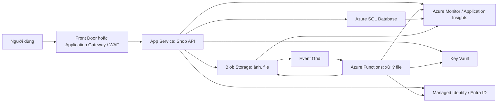
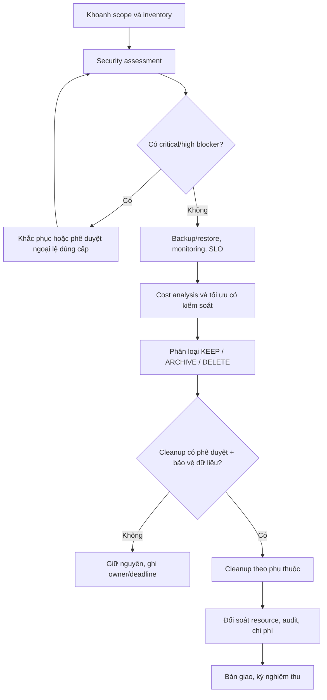
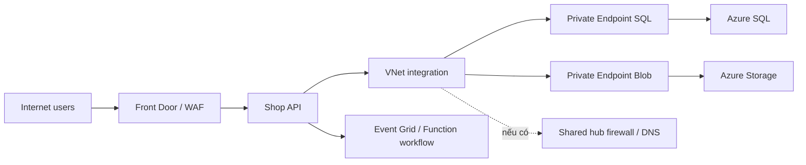
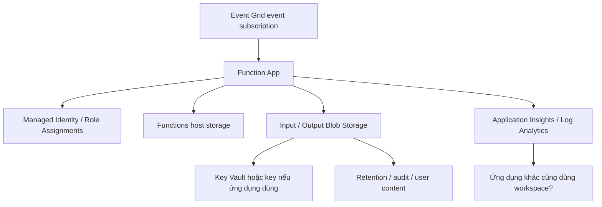

# Rà soát bảo mật, chi phí và dọn dẹp dự án Azure hoàn chỉnh

## 1. Bài toán tổng kết và mục tiêu

Một dự án Microsoft Azure không hoàn thành chỉ vì website trả HTTP 200 hoặc triển khai hạ tầng bằng Bicep thành công. Trước khi bàn giao, đội dự án phải trả lời: **ai được truy cập tài nguyên và dữ liệu**, các luồng mạng có được bảo vệ không, hệ thống có thể phục hồi khi xảy ra sự cố không, **chi phí thực tế có phù hợp ngân sách**, và những tài nguyên thử nghiệm nào cần **xóa, giữ lại hoặc lưu trữ**?

Đây là bài thực hành tổng hợp cuối chương **Kiến trúc và thực hành tổng hợp** trong mô-đun `CLOUD_PROVIDERS_AZURE`. Người học vận dụng subscription, resource group, Microsoft Entra ID, Azure RBAC, VNet, compute, storage, database, Azure Monitor, Azure Policy, Microsoft Defender for Cloud và Cost Management để kiểm tra trọn vẹn một kiến trúc ứng dụng trên Azure.

Sau bài học, bạn có thể:

- Lập **inventory** ở đúng subscription, resource group và môi trường; phân loại tài nguyên production, lab, dùng chung và cần lưu giữ.
- Thực hiện **security review có bằng chứng** ở các lớp identity, quyền, mạng, dữ liệu, secret, monitoring, backup và governance.
- Phân biệt **security finding**, rủi ro được chấp nhận, việc phải khắc phục và điểm chặn nghiệm thu.
- Đọc chi phí theo scope, service, resource group và tag; phân biệt actual, amortized, forecast và khoản chưa phân bổ.
- Ưu tiên tối ưu tài nguyên nhàn rỗi, lựa chọn SKU, retention log/storage và lưu lượng mạng mà không hạ chuẩn bảo mật.
- Xây dựng **cleanup plan** với quyền phê duyệt, lưu trữ bằng chứng, thứ tự xóa phụ thuộc và kiểm tra không còn chi phí rò rỉ.
- Hoàn thành báo cáo nghiệm thu có owner, deadline, rollback/restore proof, thay đổi đã làm và việc tồn đọng.

**Tình huống:** dự án `Shop API` đã được triển khai ở Azure, gồm App Service chạy API, Azure Functions xử lý tệp, Blob Storage, Azure SQL Database, Key Vault, VNet, Private Endpoint, Application Insights và Log Analytics. Production nằm trong subscription riêng; dev/test ở subscription non-production. Đội vận hành vừa thử nghiệm thành công xử lý tệp bằng Event Grid và muốn bàn giao bản production nhưng vẫn còn tài nguyên lab, log có dung lượng lớn và một số quyền được cấp rộng trong giai đoạn xây dựng.

**Nguyên tắc an toàn:** nội dung các lệnh dưới đây chủ yếu là **đọc/điều tra**. Bài học không yêu cầu xóa bất kỳ tài nguyên thật nào. Hành động thay đổi quyền, cấu hình mạng, retention, khóa hoặc xóa tài nguyên chỉ thực hiện trên môi trường được phép, có xác minh đích và phê duyệt theo quy trình.

## 2. Chốt phạm vi: dự án hoàn chỉnh gồm những gì?

### 2.1. Sơ đồ kiến trúc tham chiếu



Các thành phần trong sơ đồ là **tham chiếu**, không có nghĩa mọi hệ thống đều dùng đủ các dịch vụ hoặc tất cả đường đi đều trực tiếp/public. Trong kiến trúc có Private Endpoint, cần kiểm tra App Service VNet Integration, route, Private DNS, quyền truy cập và firewall; **không** suy ra Private Endpoint của Storage bảo vệ luôn đầu vào của App Service.

### 2.2. Phân chia môi trường và ownership

| Scope | Tài nguyên ví dụ | Người chịu trách nhiệm | Cách xử lý cuối dự án |
|---|---|---|---|
| Subscription production | `rg-shop-prod`, `rg-shop-monitoring` | Product owner, SRE và Security | Giữ vận hành; bàn giao và giám sát |
| Subscription non-production | `rg-shop-dev`, `rg-shop-test` | Nhóm phát triển/QA | Giữ đúng nhu cầu, tối ưu lịch sử dụng |
| Resource group lab riêng | `rg-shop-capstone-lab` | Người thực hành | Xóa **sau khi** xác minh chỉ có tài nguyên lab và được phê duyệt |
| Shared platform | DNS zone, firewall, hub VNet, Log Analytics dùng chung | Platform/Security | Không xóa theo yêu cầu cleanup của một ứng dụng |
| Backup/audit/archive | Recovery Services/Backup vault, logs, snapshot, legal hold | Data owner/compliance | Giữ theo retention, kiểm chứng restore trước khi thay đổi |

**Subscription**, **resource group** và **tag** là ba chiều quản trị khác nhau. Resource group không phải ranh giới billing độc lập, tag không tự giới hạn quyền/chi phí, và tag trên resource group không tự lan xuống mọi tài nguyên con.

Đặt trước bộ tag thống nhất, chẳng hạn:

```text
application = shop
environment = dev | test | prod | lab
owner = team-shop | team-platform
costCenter = cc-042 | shared
dataClass = public | internal | confidential
managedBy = bicep | terraform | portal
expiryDate = YYYY-MM-DD (chỉ dành cho tài nguyên tạm)
```

Không lưu access key, email cá nhân, password hoặc dữ liệu nhạy cảm vào tag. `expiryDate` chỉ là metadata cho việc kiểm tra; **không tự xóa** tài nguyên khi đến ngày, và không được dùng làm sự cho phép xóa production.

## 3. Quy trình rà soát theo từng cổng quyết định



Gợi ý **bốn gate** để thực hành:

1. **Gate A – Scope & ownership:** biết chính xác tài nguyên, subscription, region, owner, môi trường và dependency. Thiếu inventory thì không được xóa.
2. **Gate B – Security & reliability:** không có lỗ hổng critical chưa được xử lý hoặc chấp thuận theo chính sách; các hành trình nghiệp vụ và restore test đạt yêu cầu.
3. **Gate C – Cost & cleanup approval:** chi phí được giải thích và tài nguyên cần xóa đã qua kiểm tra dữ liệu, lock, shared dependency, retention, bằng chứng và người phê duyệt.
4. **Gate D – Final handover:** có báo cáo sau cleanup, kiểm tra service còn hoạt động, người nhận vận hành và kế hoạch theo dõi hóa đơn sau khi đóng dự án.

**Không đánh dấu “PASS” từ một dòng số liệu đơn độc.** Ví dụ Microsoft Defender for Cloud không báo khuyến nghị cao không đủ chứng minh toàn bộ ứng dụng bảo mật; vẫn phải xét API authorization, dependency, secrets, access review và điều kiện nghiệp vụ.

## 4. Inventory: bắt đầu từ dữ liệu thật của Azure

### 4.1. Đảm bảo chọn đúng subscription

Các lệnh dưới đây dùng **Bash**, chỉ dành cho subscription đã được cấp quyền:

```bash
az login
az account list --output table

SUBSCRIPTION_ID="<subscription-id>"
RG_NAME="rg-shop-capstone-lab"

az account set --subscription "$SUBSCRIPTION_ID"
az account show \
  --query '{subscription:name,id:id,tenantId:tenantId}' \
  --output table

# Xác nhận nhóm có tồn tại và vùng metadata của resource group.
az group show \
  --name "$RG_NAME" \
  --query '{name:name,id:id,location:location,tags:tags}' \
  --output json
```

`az account show` là bước bắt buộc trước khi kiểm tra/xóa bất cứ thứ gì. Một người có thể đăng nhập nhiều tenant/subscription; cùng tên `rg-shop-capstone-lab` ở subscription khác nhau sẽ là **hai tập tài nguyên hoàn toàn khác**.

### 4.2. Inventory resource, tag và dependency

```bash
RG_ID=$(az group show --name "$RG_NAME" --query id --output tsv)

az resource list \
  --resource-group "$RG_NAME" \
  --query '[].{name:name,type:type,location:location,id:id,tags:tags}' \
  --output json

# Tổng số resource chỉ dùng để rà soát, không thay danh sách dependency.
az resource list \
  --resource-group "$RG_NAME" \
  --query 'length(@)' --output tsv

# Kiểm tra tài nguyên có lock bảo vệ.
az lock list --resource-group "$RG_NAME" --output table

# Kiểm tra role assignments ở scope group, gồm role kế thừa khi được hỗ trợ.
az role assignment list \
  --scope "$RG_ID" \
  --include-inherited \
  --output table
```

Danh sách này phản ánh **thời điểm gọi** và phạm vi được phép xem. Có thể có dependency ở group/subscription khác (DNS shared, logging workspace, Storage đích, public IP, identity, Key Vault) hoặc tài nguyên quản lý bên ngoài Azure. Một số dịch vụ còn có child resources hoặc tài nguyên theo control plane đặc thù; đừng dùng `length(@)` làm tiêu chí duy nhất.

### 4.3. Bảng inventory có thể ký nhận

| Resource ID / tên | Môi trường | Owner | Dữ liệu/secret | Dependency | Xếp loại tạm | Bằng chứng |
|---|---|---|---|---|---|---|
| Function App `func-shop-lab` | lab | Team Shop | Không có dữ liệu lâu dài | Storage host, MI, Event Grid | DELETE? | Portal/resource ID |
| Storage `stshop...` | lab | Team Shop | Có file upload và JSON test | Functions, Event Grid | REVIEW | Container inventory/retention |
| Log Analytics workspace | shared | Platform | Telemetry/audit | Nhiều ứng dụng | KEEP | Danh sách data sources |
| Key Vault production | prod | Security | Secrets/keys | API, SQL, CI/CD | KEEP | Access review và rotation |
| Private DNS Zone | shared | Platform | Không lưu dữ liệu nghiệp vụ | Nhiều VNets | KEEP | VNet links |

Dấu **DELETE?** chỉ là đề xuất chờ phê duyệt. Tên `lab`, tag `expiryDate` hay việc resource có CPU bằng 0 không chứng minh rằng xóa là an toàn.

## 5. Rà soát identity và Azure RBAC

### 5.1. Phân biệt control plane với data plane

**Azure Resource Manager** kiểm soát việc tạo/sửa tài nguyên, còn **data plane** kiểm soát đọc/ghi dữ liệu trong các dịch vụ như Blob Storage, Key Vault hoặc Azure SQL. Một tài khoản có `Reader` ở resource group không đương nhiên được đọc Blob, và `Contributor` của resource group cũng không phải lựa chọn đúng để cấp quyền dữ liệu qua Microsoft Entra ID cho mọi dịch vụ.

| Chủ thể | Quyền cần kiểm tra | Mục tiêu |
|---|---|---|
| Nhân viên triển khai | Quyền deploy đúng resource group, không Owner toàn subscription | Giảm blast radius |
| Function Managed Identity | Read blob `incoming`, write blob `processed` theo phạm vi hỗ trợ | Không dùng storage account key trong code |
| App Service Managed Identity | Chỉ đọc secret cần dùng, truy cập SQL theo cơ chế phù hợp | Không hard-code secret |
| Người dùng ứng dụng | Identity/RBAC ở tầng ứng dụng và nghiệp vụ | Không suy Azure RBAC thay kiểm soát API |
| Security/operations | Quyền xem logs, xử lý incident, thực thi emergency runbook | Có thể kiểm toán và thực thi nhiệm vụ |
| Automation/CI-CD | Federated workload identity hoặc secret quản trị an toàn | Không giữ client secret dài hạn nếu có giải pháp phù hợp |

### 5.2. Những câu hỏi bắt buộc

- Có danh tính không còn sử dụng, service principal cũ, nhóm có quyền `Owner`/`Contributor` rộng hoặc role assignment tại subscription mà chỉ cần resource group không?
- Production có dùng **MFA/Conditional Access** cho người quản trị theo chính sách tổ chức, và có quy trình emergency access/break-glass được kiểm soát không?
- Có **Microsoft Entra Privileged Identity Management (PIM)** cho vai trò đặc quyền khi giấy phép và quy trình cho phép không?
- App có dùng **Managed Identity** để lấy token, thay vì lưu account key/password trong source, variable, pipeline log hoặc local settings không?
- Có áp dụng **least privilege** cho Storage Blob Data Reader/Contributor, Key Vault Secrets User và database roles theo đúng workload không?
- Quyền `User Access Administrator` hoặc `Owner` có được giới hạn và được review định kỳ không?

Với bất kỳ thay đổi RBAC nào, lưu **principal ID, scope, role, lý do, người phê duyệt và ngày hết hạn quyền tạm thời**. Việc thu hồi quyền có thể làm Function hoặc deployment pipeline mất kết nối; phải kiểm thử ở môi trường phù hợp và có kế hoạch rollback.

### 5.3. Một quy tắc quyền ít hơn không có nghĩa ứng dụng chắc chắn an toàn

Giảm một vai trò từ `Owner` thành `Reader` có thể là bước đúng, nhưng một API vẫn có thể bị **broken object-level authorization** nếu người dùng A tải được đơn hàng của B. Vì vậy review còn phải có **threat model, kiểm tra phân quyền nghiệp vụ, input validation, dependency/vulnerability scanning** theo phạm vi và độ rủi ro dự án.

## 6. Rà soát mạng và bề mặt phơi lộ

### 6.1. Vẽ lại đường đi thật của request



Trong thực tế, **VNet Integration của App Service thường liên quan đường outbound**, còn đường inbound của App Service cần biện pháp tương ứng như access restrictions, private endpoint, gateway/Front Door và host validation khi được hỗ trợ. Không tự suy một VNet là ranh giới bảo mật cho mọi dịch vụ.

### 6.2. Checklist mạng

| Vấn đề | Cần xác minh | Bằng chứng |
|---|---|---|
| Public exposure | App/API, Storage, SQL, Key Vault có public endpoint/access không? Có cần thiết không? | Resource settings và thử kết nối từ mạng được phép |
| NSG/route | Rule inbound/outbound, effective routes, subnet association, deny mặc định | Effective security rules/Network Watcher khi hỗ trợ |
| Private Endpoint | Kết nối approved, IP riêng, VNet/subnet đúng, data-plane truy cập thành công | Private endpoint connection + DNS test từ client |
| Private DNS | Tên Blob/SQL/Key Vault phân giải đúng địa chỉ trên **client thực tế** | Resolver response và connectivity test |
| Egress | Có route qua NAT Gateway, firewall, allowlist đối tác nếu yêu cầu? | Route/topology, metrics và logs |
| TLS/cert | Certificate hợp lệ, TLS policy đủ mạnh, không có secret trong URL | Cấu hình và thử nghiệm HTTPS |
| WAF/DDoS | Bảo vệ phù hợp với mức phơi lộ và threat model | Rules, alerts, test an toàn |
| Logs | Có tín hiệu đủ để phát hiện inbound deny, dependency timeout, bất thường? | Diagnostic settings/monitoring dashboard |

Ví dụ đọc danh mục tài nguyên mạng:

```bash
az network nsg list --resource-group "$RG_NAME" --output table
az network public-ip list --resource-group "$RG_NAME" --output table
az network private-endpoint list --resource-group "$RG_NAME" --output table
az network vnet list --resource-group "$RG_NAME" --output table
```

Lệnh này **không chứng minh** một tài nguyên không có Internet exposure nếu điểm vào nằm ở group khác, hoặc dịch vụ có public endpoint riêng. Kiểm tra cả app/service settings và test trên đúng đường đi. Khi thấy một public IP không cần thiết, đánh giá dependency trước khi xóa; public IP có thể được dùng bởi NAT Gateway, load balancer hoặc dịch vụ khác.

## 7. Rà soát dữ liệu, secrets, backup và khả năng phục hồi

### 7.1. Dữ liệu trong Blob, SQL và file shares

| Nhóm bảo vệ | Câu hỏi | Bằng chứng đạt |
|---|---|---|
| **Encryption** | Dữ liệu được mã hóa khi lưu/truyền? CMK có cần không? Ai quản lý key? | Cấu hình storage/database/key và quy trình key recovery |
| **Access** | Public anonymous access đã hạn chế? RBAC/data-plane permissions đúng? | Audit principal/role và test truy cập có quyền/không quyền |
| **Data protection** | Có soft delete, versioning, backup/PITR/retention đúng workload? | Policy, recovery point và thử restore |
| **Schema/data quality** | Blob/SQL data hợp lệ, migration đã đối soát? | Manifest, checksum, row/business totals |
| **Residency/compliance** | Region và retention có đúng cam kết? | Data classification và policy |
| **Key/secret lifecycle** | Key Vault permission, rotation, expiration, logging, soft delete/purge protection? | Access review và rotation test |

**Soft delete, replication và backup là những lớp khác nhau.** Một bản sao địa lý có thể đồng bộ dữ liệu bị xóa nhầm; điểm phục hồi theo thời gian mới giúp khôi phục trạng thái trước sự cố. Với Azure SQL Database, backup/PITR native khác với backup SQL Server chạy trong Azure VM; chọn đúng workload trước khi khẳng định có khả năng restore.

### 7.2. Key Vault và Managed Identity

- Ứng dụng truy cập Key Vault qua Managed Identity khi phù hợp; không nhúng secret vào repository, container image hoặc log.
- Giới hạn data plane role hoặc access policy theo mô hình quyền thực tế; không cấp toàn bộ Secrets Officer nếu ứng dụng chỉ đọc secret cần dùng.
- Kiểm tra **soft delete/purge protection** và quy trình khôi phục khóa trước khi thay đổi. Nếu xóa khóa đang dùng để giải mã dữ liệu, backup có thể trở nên không phục hồi được.
- Secret rotation phải được diễn tập và phối hợp với ứng dụng/CI-CD; thay key ngay trước cleanup mà không kiểm tra dependency có thể gây outage.
- Với dữ liệu nhạy cảm, lưu bằng chứng ở kho có phân quyền, encryption, audit và retention; không xuất plaintext credential vào báo cáo.

### 7.3. Restore test là tiêu chí nghiệm thu

Chỉ nhìn backup job `Succeeded` không đủ chứng minh hệ thống khôi phục được. Chọn một điểm phục hồi, **restore vào môi trường cô lập**, kiểm tra dữ liệu và quyền, đo **RPO/RTO**, xác minh kết nối ứng dụng, secret và file. Lưu thời điểm bắt đầu/kết thúc, lỗi, owner và kết quả.

Không xóa Storage Account, Key Vault, DNS hoặc nguồn dữ liệu trong lúc backup/restore đang dùng chúng hoặc trước khi retention/legal hold được xử lý.

## 8. Microsoft Defender for Cloud và Azure Policy

### 8.1. Security posture: rà soát có ngữ cảnh

**Microsoft Defender for Cloud** cung cấp đánh giá tư thế bảo mật, khuyến nghị, cảnh báo và các gói bảo vệ theo khả năng được bật. Xem dashboard cho đúng subscription/workload và phân loại:

- **Critical/high cần xử lý ngay**: phơi lộ tài nguyên hoặc cấu hình rủi ro có đường khai thác phù hợp threat model.
- **Khuyến nghị chưa phù hợp**: một số resource lab/ngắn hạn có thể cần ngoại lệ có thời hạn, owner và lý do; không đánh dấu “không áp dụng” chỉ để làm đẹp điểm số.
- **Gói bảo vệ tính phí**: xác định plan nào được bật, coverage, nhu cầu và tác động tài chính; không tắt bảo vệ production chỉ vì báo cáo chi phí tăng.
- **Alert/threat**: xem bằng chứng, triage, hướng khắc phục và log; không suy security score cao nghĩa là không bị tấn công.

**Secure Score là tín hiệu ưu tiên**, không phải chứng chỉ đảm bảo bảo mật. Kết hợp với Azure Policy compliance, vulnerability scan, code/dependency review, kiểm tra ứng dụng và audit.

### 8.2. Governance bằng Azure Policy

| Policy intent | Mục đích | Điểm cần chú ý |
|---|---|---|
| Allowed locations / SKUs | Giới hạn vùng/SKU theo quản trị | Phải xét DR và ngoại lệ hợp lý |
| Require tags | Gắn owner/environment/cost center | Tag không tự chứng minh charge đã được phân bổ |
| Deny public access khi phù hợp | Giảm phơi lộ dữ liệu | Phải kiểm tra private connectivity và các dịch vụ có ngoại lệ |
| Audit/Deploy diagnostic settings | Tăng khả năng phát hiện | Có thể phát sinh chi phí log/ingestion |
| Require encryption/backup | Đưa ra chuẩn bảo vệ dữ liệu | Tùy loại workload và chính sách áp dụng |

Các policy effect như `audit`, `deny`, `modify`, `deployIfNotExists` có điều kiện và quyền khác nhau. Ví dụ **modify** hoặc **deployIfNotExists** có thể cần managed identity và remediation; policy không đương nhiên sửa toàn bộ resource lịch sử. Kiểm tra **assignment scope, exclusions, exemptions, compliance evaluation và quyền** thay vì chỉ hỏi “đã bật policy chưa?”.

Một thay đổi `deny` ở production có thể ngăn deployment hợp lệ trong lúc incident. Triển khai theo giai đoạn audit → xử lý ngoại lệ → enforcement có rollback/điều phối.

## 9. Observability và khả năng vận hành sau bàn giao

### 9.1. Có metric/log nhưng phải đúng đường chạy

**Azure Monitor** và **Application Insights** giúp quan sát request, dependency, exception, CPU, memory, storage IO, mạng và queue khi telemetry được bật. **Log Analytics** là nơi lưu/truy vấn log phù hợp, có chi phí ingestion và retention. Thiếu bản ghi không có nghĩa hệ thống khỏe; có thể chưa cấu hình hoặc sampling.

Trước nghiệm thu, kiểm tra:

1. Mỗi luồng quan trọng (`checkout`, upload tệp, truy vấn SQL, đọc ảnh) có dashboard SLO: **latency p95/p99, traffic, error rate và saturation**.
2. Cảnh báo 5xx, queue age, Event Grid delivery failure/dead-letter, Function failures và SQL/storage throttling có người trực, severity, runbook và escalation.
3. Alert của hệ thống backup, key expiration, Defender for Cloud findings và budget được chuyển đúng kênh.
4. Log không chứa password, SAS token, raw PII hoặc dữ liệu thanh toán; retention theo yêu cầu kiểm toán.
5. Có synthetic/smoke test từ đường người dùng thật, không chỉ health check tự trả `200`.

### 9.2. KQL mẫu đo request sau triển khai

Nếu Application Insights dùng **workspace-based** schema tại Log Analytics:

```kusto
AppRequests
| where TimeGenerated > ago(24h)
| summarize
    requests = count(),
    failures = countif(Success == false),
    p50_ms = percentile(DurationMs, 50),
    p95_ms = percentile(DurationMs, 95)
  by AppRoleName, bin(TimeGenerated, 15m)
| extend failure_rate_pct = iff(requests == 0, real(null), 100.0 * failures / requests)
| order by TimeGenerated asc
```

Tìm dependency chậm:

```kusto
AppDependencies
| where TimeGenerated > ago(24h)
| summarize calls = count(), errors = countif(Success == false),
            p95_ms = percentile(DurationMs, 95)
  by AppRoleName, Target, Type
| order by p95_ms desc
```

Tên bảng/cột có thể khác với classic Application Insights hoặc pipeline đã tùy biến; phải kiểm tra schema thực tế. Sampling có thể khiến số `requests` khác tổng request thực; đối chiếu ở tầng front door/gateway khi cần.

### 9.3. Diagnostic settings và log ownership

Khi có resource ID hợp lệ, kiểm tra cấu hình xuất log/metrics:

```bash
RESOURCE_ID="<full-azure-resource-id>"

az monitor diagnostic-settings list \
  --resource "$RESOURCE_ID" \
  --output json
```

Diagnostic settings chỉ cho biết **routing/loại log được cấu hình**; chưa chứng minh có dữ liệu, cảnh báo hoạt động hoặc retention đúng. Nếu Log Analytics workspace nằm ở shared resource group, **không xóa cùng nhóm lab** chỉ vì ứng dụng thử nghiệm đã kết thúc.

## 10. Phân tích chi phí dự án và lập baseline

### 10.1. Phân biệt những số tiền quan trọng

| Loại | Dùng để làm gì | Cảnh báo |
|---|---|---|
| **Actual cost** | Theo dõi chi phí đã ghi nhận trong kỳ theo dữ liệu billing | Không đồng nghĩa hóa đơn đã chốt; dữ liệu có độ trễ |
| **Amortized cost** | Phân bổ các khoản cam kết trả trước như reservation/savings plan theo thời gian khi hỗ trợ | Không cộng cùng actual để tạo tổng mới |
| **Forecast** | Dự báo xu hướng dựa trên dữ liệu hiện có | Không phải khoản tiền đã được chốt |
| **Invoice/billed** | Đối chiếu kế toán theo hợp đồng | Thuế, credit, marketplace, adjustment có thể khác biểu đồ |

Trong Azure Portal, mở **Cost Management → Cost analysis** ở scope đã được cấp quyền; thống nhất **subscription, time range, cost type, currency**, sau đó Group by `Service name`, `Resource group`, `Resource` hoặc tag `application`, `environment`, `costCenter`. Dùng cùng kỳ/loại cost khi so sánh, giữ nhóm **unallocated/untagged**.

**Giá công khai và giá thực tế của hợp đồng có thể khác** theo region, SKU, tier, reservations, Savings Plans, currency và kỳ. Để giải thích hóa đơn cần xem meter, usage quantity, unit price và điều khoản; không chỉ nhìn số vCPU.

### 10.2. Bảng chi phí giả định của Shop API

Giả sử bảng dưới đây là `Actual cost` của một tháng hoàn chỉnh, dùng đơn vị USD **chỉ để luyện tính toán**, không phải giá Azure thực:

| Hạng mục | Chi phí giả định/tháng | Rủi ro hoặc câu hỏi điều tra |
|---|---:|---|
| App Service compute | 240 USD | Plan có dư capacity, chạy cả ngày dù traffic thấp? |
| Azure SQL Database | 320 USD | Compute tier/auto-pause nếu phù hợp, IO/backup/storage? |
| Blob Storage và giao dịch | 85 USD | Tier, lifecycle, version/retention, transactions |
| Private Link, network và egress | 65 USD | Endpoint-hours, GB xử lý, NAT/peering/data transfer |
| Application Insights và Log Analytics | 95 USD | Log quá nhiều, sampling/retention chưa phù hợp? |
| Key Vault | 15 USD | Transactions và tính năng liên quan |
| Event Grid / Functions / phần khác | 40 USD | Số event, executions, failures/retries |
| **Tổng** | **860 USD** | Baseline để tối ưu và theo dõi |

Nếu ngân sách tháng giả định là **900 USD**, actual 860 USD chưa vượt ngưỡng; nhưng forecast 940 USD (nếu có) có thể cảnh báo nguy cơ vượt kế hoạch. **Budget chủ yếu cung cấp cảnh báo, không tự tắt App Service hoặc SQL**.

Một kịch bản tối ưu **giả định và phải kiểm nghiệm**:

- Điều chỉnh App Service Plan sau khi đo tải: giảm 25 USD/tháng.
- Tối ưu SQL compute/query hoặc thời gian dùng môi trường non-production: giảm 30 USD/tháng.
- Loại log debug không cần thiết trong lab, vẫn giữ security/audit: giảm 12 USD/tháng.

```text
Tổng giảm dự kiến = 25 + 30 + 12 = 67 USD/tháng
Chi phí dự kiến mới = 860 - 67 = 793 USD/tháng
Tỷ lệ tiết kiệm dự kiến = 67 / 860 × 100 ≈ 7,79%
```

Những con số này **không phải kết quả đã đạt**. Phải xem giá hợp đồng, chi phí phát sinh từ việc thay đổi, mùa vụ và dữ liệu billing sau khi cập nhật. Không tối ưu đến mức vi phạm SLO, backup, logging bắt buộc hay an ninh.

### 10.3. Truy vấn Cost Management API (tham khảo)

Khi cần báo cáo tự động ở scope subscription, Cost Management Query API có thể dùng để tổng hợp theo resource group:

```json
{
  "type": "ActualCost",
  "timeframe": "Custom",
  "timePeriod": {
    "from": "2026-10-01T00:00:00Z",
    "to": "2026-11-01T00:00:00Z"
  },
  "dataset": {
    "granularity": "None",
    "aggregation": {
      "cost": {
        "name": "PreTaxCost",
        "function": "Sum"
      }
    },
    "grouping": [
      { "type": "Dimension", "name": "ResourceGroup" }
    ]
  }
}
```

Tệp JSON là **body minh họa**, không phải dữ liệu hóa đơn. API version, metric name, khả năng query, scope và định nghĩa tiền tệ phải được kiểm tra theo hợp đồng/phiên bản dịch vụ. Không giả định kết quả về một resource group bằng tổng toàn bộ subscription: có charge không có group/tag hoặc thuộc loại phí khác.

## 11. Những nguồn chi phí thường bị bỏ sót

### 11.1. Compute

- **App Service Plan** có thể tiếp tục tính theo plan/instance dù app ít request; kiểm tra app khác đang chia sẻ plan trước khi hạ hoặc xóa.
- **Azure VM** sau khi stop trong guest có thể vẫn tính compute tùy trạng thái; `Stopped (deallocated)` khác `Stopped`, nhưng **disk, snapshot, IP, backup và các dịch vụ liên quan** có thể tiếp tục tính.
- **AKS** có chi phí node pool, storage, networking, monitoring và tính năng khác theo loại cluster; xóa pod không làm node pool tự biến mất.
- **Functions** phụ thuộc hosting plan, thời gian thực thi, memory, số invocation và kết nối/monitoring theo SKU.

### 11.2. Storage và dữ liệu

- Blob versioning, soft delete, snapshots và backup có thể giữ nhiều bản sao. Lifecycle cần cân bằng tiền lưu trữ với retention/pháp lý và khả năng restore.
- Tier Cool/Cold/Archive có chính sách retrieval/minimum retention/giao dịch tùy dịch vụ; chuyển xuống tier rẻ hơn không phải luôn giảm **tổng** chi phí.
- Xóa một resource group có Storage Account còn dữ liệu quan trọng **không phải** biện pháp tối ưu; cần backup/manifest và phê duyệt.

### 11.3. Mạng và monitoring

- Private Endpoint thường có **phí theo giờ và data processing** khi áp dụng; VNet peering, NAT, Firewall, gateway, public IP và egress có meter riêng.
- Đặt dịch vụ khác region có thể làm tăng data transfer charge và latency; cần cân nhắc data residency/DR trước khi đưa toàn bộ về một region.
- Application Insights/Log Analytics, diagnostics và flow logs có phí ingestion/retention hoặc tính năng; xóa log/alert có thể làm mất khả năng điều tra incident.
- Defender for Cloud plans có chi phí theo dịch vụ/bảo vệ được chọn; quyết định thay đổi phải do security owner cùng FinOps đánh giá.

## 12. Ưu tiên tối ưu theo giá trị và rủi ro

| Hành động | Lợi ích tiềm năng | Rủi ro/điều kiện cần |
|---|---|---|
| Dừng/tắt môi trường **dev/test nhàn rỗi** theo lịch | Giảm compute ngoài giờ | Có owner, không phá CI/nightly jobs; disk/IP vẫn có thể tính |
| Right-size App Service/VM/SQL theo p95 và peak-hour | Giảm capacity dư | Kiểm thử performance và autoscale headroom |
| Dọn log debug, điều chỉnh sampling/retention | Giảm ingestion/storage log | Giữ log bảo mật, forensic và yêu cầu pháp lý |
| Lifecycle/tier Blob hợp lý | Giảm storage trung–dài hạn | Chi phí retrieval, tính toàn vẹn và retention |
| Tắt Event Grid subscription lab không dùng | Ngăn event/invocation ngoài ý muốn | Xác minh không còn workflow production phụ thuộc |
| Giảm endpoint/network không cần thiết | Có thể giảm phí giờ/GB | Không mở public access hoặc phá DNS/segmentation |
| Reservations/Savings Plans khi phù hợp | Tối ưu tải ổn định | Rủi ro cam kết, dự báo usage và tính linh hoạt |
| Gỡ tài nguyên thử nghiệm hết hạn | Giảm chi phí, bề mặt tấn công | Kiểm tra data/owner/dependency và phê duyệt xóa |

**Thứ tự khuyến nghị:** đo → tìm nguyên nhân → đề xuất thay đổi → thử ở môi trường phù hợp → kiểm tra SLO/security → áp dụng theo change management → đối soát chi phí sau kỳ. Tránh áp dụng “tối ưu” chỉ vì bảng giá mà không có bằng chứng vận hành.

## 13. Cleanup: phân loại trước khi đụng tới nút Delete

### 13.1. Bốn nhóm tài nguyên

| Trạng thái | Định nghĩa | Hành động |
|---|---|---|
| **KEEP** | Tài nguyên production/shared còn phục vụ nghiệp vụ | Bàn giao owner, alert, budget, backup; không xóa |
| **ARCHIVE/RETENTION** | Dữ liệu/log cần bảo lưu nhưng compute không cần hoạt động | Lưu tại nơi phù hợp, chứng minh restore/đọc được, xem lại retention |
| **DELETE CANDIDATE** | Tài nguyên lab/ephemeral có owner và không còn dependency | Lập danh sách, phê duyệt, cleanup theo thứ tự |
| **UNKNOWN/BLOCKED** | Chưa rõ owner, dependency, dữ liệu hoặc legal hold | Không thao tác; tạo ticket điều tra và deadline |

**Delete candidate không phải Delete approved.** Một tag `environment=lab` hoặc tài nguyên được tạo hôm trước không đủ bằng chứng. Yêu cầu tối thiểu: scope đúng, chủ sở hữu xác nhận, tài nguyên không còn được ứng dụng khác sử dụng, dữ liệu đã được xử lý, log/audit cần giữ có bản sao và có phê duyệt.

### 13.2. Ma trận dependency cho pipeline xử lý tệp



Đây là đồ thị **phụ thuộc**, không phải thứ tự xóa áp dụng cho mọi nguồn. Khi ngừng lab, trước hết cần dừng **đường sinh event và nhận ghi**; sau đó kiểm tra kết quả và dữ liệu, xác nhận Function không còn consumer, role assignment không được dùng bởi ứng dụng khác, rồi mới xóa những tài nguyên riêng của lab. Host storage và Log Analytics có thể là tài nguyên dùng chung, không được xóa theo tên ứng dụng.

### 13.3. Lưu bằng chứng ở ngoài phạm vi định xóa

Trước cleanup, giữ bản ghi inventory, số liệu chi phí, chính sách lưu trữ, kết quả restore test, quyết định phê duyệt và danh sách resource IDs trong **hệ thống hồ sơ được quản trị**, không nằm duy nhất trong resource group sắp xóa. Nếu Log Analytics workspace/audit storage bị xóa theo group, bằng chứng có thể mất cùng tài nguyên.

## 14. Runbook cleanup an toàn cho resource group lab

### 14.1. Gate bắt buộc trước mọi thao tác thay đổi

Kiểm tra và ghi vào change ticket:

1. **Scope:** subscription ID, tenant ID, resource group ID chính xác; `az account show` trùng kế hoạch.
2. **Owner:** ai xác nhận đây là lab riêng và không chia sẻ với production?
3. **Dependency:** app, Function, Event Grid, DNS, firewall, Managed Identity, pipelines, monitoring và người dùng nào còn trỏ tới tài nguyên này?
4. **Dữ liệu:** Blob/SQL/Files có dữ liệu cần giữ? Có soft delete/versioning/backup/legal hold không? Ai ký giải quyết?
5. **Khả năng phục hồi:** có restore proof/manifest, khóa và quyền phục hồi ở nơi không bị xóa?
6. **Lock/Policy:** có Delete Lock, policy hay yêu cầu quản trị ngăn xóa không? Không gỡ lock nếu chưa được chủ sở hữu phê duyệt.
7. **Bằng chứng:** sơ đồ trạng thái trước, danh sách tài nguyên, chi phí, alert và thông tin thay đổi đã lưu.
8. **Phê duyệt:** người chịu trách nhiệm nguồn dữ liệu, ứng dụng, security/compliance và change approver theo quy định.

### 14.2. Lệnh chỉ đọc để kiểm tra lại một lần cuối

```bash
az account show \
  --query '{name:name,id:id,tenantId:tenantId}' \
  --output json

az group show --name "$RG_NAME" --query '{id:id,tags:tags}' --output json

az resource list \
  --resource-group "$RG_NAME" \
  --query '[].{name:name,type:type,id:id}' \
  --output table

az lock list --resource-group "$RG_NAME" --output table

# Những lệnh xem dưới đây chỉ kiểm tra loại resource nếu có trong group:
az functionapp list --resource-group "$RG_NAME" --output table
az storage account list --resource-group "$RG_NAME" --output table
az network private-endpoint list --resource-group "$RG_NAME" --output table
```

**Không** tự gọi `az group delete` chỉ sau khi các lệnh trên trả về danh sách. Cần so sánh danh sách với **allowlist trong change ticket** và tìm dependency ngoài group; một lệnh xóa nhóm có thể xóa nhiều resource con cùng lúc, bao gồm dữ liệu lưu trữ không thể phục hồi.

### 14.3. Thứ tự cleanup mang tính nguyên tắc

**Giai đoạn A – Ngăn phát sinh dữ liệu/chi phí mới**

1. Tạm ngừng người dùng upload vào lab và mọi job/CI tạo lại resource.
2. Vô hiệu hóa/xóa Event Grid event subscription **được xác nhận là lab**, có phê duyệt; theo dõi không còn event cần xử lý.
3. Chờ Function processing kết thúc hoặc ghi nhận backlog và phương án xử lý; không cắt ngang khi đang ghi dữ liệu.

**Giai đoạn B – Chốt dữ liệu và dependency**

4. Export/giữ các output, log và báo cáo đúng chính sách ở nơi **ngoài group dự kiến xóa**.
5. Xác minh Blob/SQL, backup, Key Vault secret/key dependency, role assignments, DNS/PE, CI-CD và logging shared.
6. Với tài nguyên shared hoặc chưa rõ, chuyển sang `KEEP/UNKNOWN` thay vì lặng lẽ xóa.

**Giai đoạn C – Xóa tài nguyên riêng của lab**

7. Thực hiện thay đổi theo change ticket, **chỉ vào resource IDs đã được phê duyệt**, với người chịu trách nhiệm theo dõi và rollback/fallback cho thay đổi cấu hình có thể đảo.
8. Không xóa toàn resource group nếu còn tài nguyên `KEEP`, `ARCHIVE` hoặc `UNKNOWN`; tách/quy hoạch lại tài nguyên cần giữ theo quy trình được hỗ trợ trước.
9. Khi lab group đã được xác nhận **chỉ chứa tài nguyên có thể xóa**, có thể dùng thao tác xóa group theo quy trình tổ chức. Đây là hành động phá hủy, **không thực hiện trong bài học này**.

Ví dụ cú pháp tham khảo, **để ở dạng chú thích**:

```bash
# CHỈ DÙNG SAU PHÊ DUYET BANG VAN BAN VA KIEM TRA DUNG SUBSCRIPTION / RG.
# LENH NAY CO THE XOA TAT CA TAI NGUYEN VA DU LIEU TRONG RESOURCE GROUP.
# KHONG CHAY TREN PRODUCTION, SHARED GROUP, HOAC GROUP CO LEGAL HOLD.
#
# az account set --subscription "<approved-subscription-id>"
# az group delete --name "<approved-lab-resource-group>" --yes
```

**Tại sao không cung cấp một lệnh xóa chạy ngay?** Scope và owner của môi trường người học là khác nhau; việc xóa production/shared resources, storage data, Key Vault keys, backups hoặc audit logs có thể gây mất dữ liệu vĩnh viễn. Một runbook đúng luôn yêu cầu kiểm tra **resource IDs thực tế** và quyền phê duyệt.

### 14.4. Kiểm tra sau cleanup

- Xác minh những **resource IDs được duyệt để xóa** thực sự không còn xuất hiện trong ARM khi quá trình bất đồng bộ đã kết thúc.
- Kiểm tra **Shop API production** còn hoạt động: login, checkout, SQL/Blob access, xử lý event, network và alert.
- Kiểm tra còn tài nguyên liên quan ngoài group không: public IP, snapshot, disk, diagnostic storage, private DNS link, backup item, key, role assignment hoặc monitoring.
- Kiểm tra các policy/locks được giữ đúng, không có principal/credential tạm thời còn quyền quá mức.
- Xem **cost data sau khi có đủ thời gian ghi nhận**, so trước–sau cùng cost type/scope/currency; không kết luận chi phí đã về 0 ngay lập tức.
- Ghi hồ sơ cleanup, bằng chứng owner/approval, hậu kiểm bảo mật và chi phí, cập nhật CMDB/IaC/runbook.

## 15. Báo cáo nghiệm thu và xử lý ngoại lệ

### 15.1. Mẫu bảng kết quả kiểm tra

| Kiểm tra | Mục tiêu | Bằng chứng | Kết quả/owner |
|---|---|---|---|
| Subscription & inventory | Đúng scope, owner, region, tag | ARM export/resource IDs | PASS/FAIL |
| RBAC & Entra | Least privilege, no orphan principals | Role assignment và access review | PASS/FAIL |
| Network | Public/private access và DNS đúng thiết kế | NSG/PE/route/connectivity proof | PASS/FAIL |
| Data & secrets | Encryption, versioning, retention, Key Vault | Data plane test và secret policy | PASS/FAIL |
| Backup/restore | Recovery point usable, RPO/RTO đạt | Restore test và ứng dụng kiểm chứng | PASS/FAIL |
| Defender & Policy | Critical blockers được xử lý | Findings, policy compliance và ngoại lệ | PASS/FAIL |
| SLO & monitoring | Logs, alerts, on-call đáp ứng | Dashboard/KQL/test alerts | PASS/FAIL |
| FinOps | Actual/forecast, tag coverage, cost owner | Cost Analysis/billing snapshot | PASS/FAIL |
| Cleanup | Chỉ xóa tài nguyên lab có phê duyệt | Change ticket/after inventory | PASS/FAIL |
| Handover | Runbook, owner, incident escalation | Biên bản bàn giao | PASS/FAIL |

**Không dùng điểm trung bình** để hợp thức hóa một lỗi critical: 9/10 hạng mục đạt nhưng **backup chưa restore test** hoặc Storage dữ liệu nhạy cảm công khai có thể khiến dự án **NO-GO**.

### 15.2. Mẫu biên bản tổng kết

```text
Project: Shop API - Azure Capstone
Subscription(s): <IDs>
Resource group(s): <IDs>
Review window (UTC): <start> to <end>
Architecture version / IaC commit: <id>

Security:
  Critical blockers: <count, owner, due date>
  Accepted exceptions: <ticket, approver, expiration>
  RBAC / network / data protection evidence: <links>

Reliability:
  SLO and availability: <metrics>
  Backup/restore test: <result, timestamp, RPO/RTO>
  Monitoring/on-call: <owner>

Cost:
  Period / currency / actual or amortized: <...>
  Current cost, forecast and budget: <...>
  Unallocated or untagged share: <...>
  Proposed/verified savings: <...>

Cleanup:
  KEEP resource IDs: <...>
  ARCHIVE/RETENTION resource IDs: <...>
  DELETE-approved resource IDs: <...>
  UNKNOWN/BLOCKED: <ticket, owner, deadline>
  Before/after inventories and approvals: <links>

Decision: ACCEPT / CONDITIONAL ACCEPT / REJECT
Approvers: business / platform / data / security / operations
Final handover date and next review: <...>
```

**Conditional acceptance** chỉ hợp lệ khi rủi ro còn lại được phê duyệt theo thẩm quyền, có deadline và owner. Không dùng nó để bỏ qua vi phạm dữ liệu/tuân thủ chưa được phép, hoặc che đi lỗ hổng nghiêm trọng.

## 16. Thực hành tổng hợp cho người học

### Bài tập A — Audit dự án

Giả sử bạn có tài nguyên lab `rg-shop-capstone-lab` và các tài nguyên production/shared ở group khác. Hãy:

1. Ghi subscription/tenant ID, liệt kê tài nguyên lab và gắn owner.
2. Dùng danh sách RBAC và thông tin Managed Identity để tìm **ít nhất ba rủi ro** quyền quá rộng hoặc thiếu quyền.
3. Đối chiếu network settings: public IP, Storage public access, Private Endpoint, Private DNS và App Service ingress/egress.
4. Kiểm tra backup/restore, monitoring, Defender/Policy và vấn đề security theo hạng mục.
5. Lập bảng finding: **severity – bằng chứng – tác động – chủ sở hữu – hành động – deadline – ngoại lệ**.

### Bài tập B — Tối ưu chi phí

Dùng bảng giả định ở mục 10:

- Kiểm tra tổng **860 USD**.
- Tính số tiền và tỷ lệ tiết kiệm dự kiến nếu ba hành động giảm 25, 30 và 12 USD/tháng.
- Nếu `Log Analytics` đang chiếm 95 USD, giải thích vì sao không nên xóa log/audit hoặc ngắt monitoring production ngay lập tức.
- Giải thích sự khác nhau giữa `actual cost` và `forecast`, và vì sao budget 900 USD không tự dừng tài nguyên khi vượt ngưỡng.
- Nêu cách xác minh khoản tiết kiệm sau thay đổi: kỳ, scope, loại cost, meter, currency, tải/SLO và dữ liệu mới cập nhật tới thời điểm nào.

### Bài tập C — Phân loại cleanup

Bạn có năm đối tượng: (1) Function App lab, (2) Storage Account chứa ảnh khách hàng thật, (3) Private DNS Zone chia sẻ giữa production và lab, (4) workspace Log Analytics production dùng chung, (5) Event Grid subscription chỉ phục vụ pipeline thử nghiệm đã được dừng.

Với mỗi đối tượng, quyết định **KEEP / ARCHIVE / DELETE CANDIDATE / UNKNOWN** và nêu bằng chứng cần trước khi xóa. Thiết kế một runbook cleanup có **thứ tự theo dependency**, chỗ lưu log/manifest và bước hậu kiểm hoạt động production.

### Bài tập D — Tabletop incident

Sau khi dọn lab, API production báo lỗi 403 khi đọc Blob; investigation cho thấy Managed Identity từng có role cấp ở resource group lab dùng chung. Hãy lập timeline:

1. Tạm dừng cleanup nào và giữ những bằng chứng nào?
2. Xác định scope role bị thu hồi, principal, Storage data plane và network access.
3. Khôi phục quyền **đúng scope tối thiểu**, tránh cấp `Owner` toàn subscription để sửa nhanh.
4. Kiểm thử chức năng, security, monitoring và lưu postmortem.
5. Đề xuất cách tổ chức ownership/tag/dependency để không tái diễn.

### Tiêu chí đánh giá hoàn thành

| Mức | Kết quả mong đợi |
|---|---|
| **Đạt cơ bản** | Inventory đúng scope, chỉ ra công cụ security/cost và phân loại tài nguyên cần giữ/xóa |
| **Đạt thực hành** | Có checklist kiểm chứng RBAC/network/data/backup, Cost Analysis đối soát và cleanup plan có approval |
| **Đạt mức vận hành** | Có risk register, bằng chứng restore/SLO, xử lý shared dependencies, chứng minh tiết kiệm sau thay đổi và biên bản bàn giao |

**Câu hỏi tự đánh giá:**

1. Vì sao resource group và tag không phải một ranh giới bảo mật hoặc billing riêng biệt?
2. Role `Contributor` ở resource group có đủ cho Managed Identity đọc nội dung Blob bằng Entra ID không?
3. Một Private Endpoint của Storage có tự bảo vệ cổng inbound của App Service không?
4. Vì sao backup báo `Succeeded` vẫn cần restore test?
5. Actual cost 860 USD và forecast 940 USD khác nhau về ý nghĩa nào?
6. Tại sao xóa một Function App có thể chưa làm hết chi phí/ảnh hưởng của pipeline Event Grid?
7. Vì sao không được xóa Log Analytics workspace dùng chung chỉ vì ứng dụng lab đã kết thúc?
8. Điều kiện nào khiến tài nguyên `environment=lab` **chưa thể xóa**?
9. Có thể kết luận chi phí về 0 ngay sau khi xóa group không? Vì sao?
10. Những bằng chứng nào chứng minh dự án đủ điều kiện nghiệm thu và bàn giao?

## 17. Checklist trước khi kết thúc dự án

**Security và reliability**

- [ ] Subscription/region/owner/dependency đã được xác nhận.
- [ ] Azure RBAC và data-plane permissions theo least privilege; tài khoản đặc quyền được rà soát.
- [ ] Public/private network, NSG, WAF, DNS, egress và TLS được kiểm tra.
- [ ] Storage/database/Key Vault encryption, retention, backup/restore có bằng chứng.
- [ ] Microsoft Defender for Cloud và Azure Policy findings được xử lý hoặc có ngoại lệ hợp lệ.
- [ ] SLO, alerts, incident runbook và on-call có người tiếp nhận.

**Cost và cleanup**

- [ ] Chi phí theo subscription/RG/tag, actual/forecast/currency/kỳ rõ ràng.
- [ ] Chi phí chưa phân bổ và shared services có owner và phương pháp đối soát.
- [ ] Tối ưu đề xuất có tác động tới SLO/security được đánh giá.
- [ ] Tài nguyên chia nhóm KEEP/ARCHIVE/DELETE CANDIDATE/UNKNOWN.
- [ ] Phê duyệt cleanup, retention, backup, identity, shared dependency đã chốt.
- [ ] Chỉ thay đổi tài nguyên trong allowlist; lưu inventory/bằng chứng ngoài phạm vi xóa.
- [ ] Hậu kiểm production hoạt động và chi phí sau khi dữ liệu billing cập nhật.

**Handover**

- [ ] Biên bản nghiệm thu có business/data/security/platform/operations owners.
- [ ] Hồ sơ còn tồn đọng có severity, người xử lý, hạn hoàn thành.
- [ ] IaC, CMDB, architecture diagram, runbook và ngân sách được cập nhật.

## 18. Tài liệu tham khảo

- Microsoft Learn — [Azure Well-Architected Framework](https://learn.microsoft.com/azure/well-architected/).
- Microsoft Learn — [Azure security best practices](https://learn.microsoft.com/azure/security/fundamentals/best-practices-and-patterns).
- Microsoft Learn — [Azure RBAC overview](https://learn.microsoft.com/azure/role-based-access-control/overview).
- Microsoft Learn — [Microsoft Defender for Cloud documentation](https://learn.microsoft.com/azure/defender-for-cloud/).
- Microsoft Learn — [Azure Policy overview](https://learn.microsoft.com/azure/governance/policy/overview).
- Microsoft Learn — [Azure Monitor overview](https://learn.microsoft.com/azure/azure-monitor/overview).
- Microsoft Learn — [Azure Cost Management](https://learn.microsoft.com/azure/cost-management-billing/costs/overview-cost-management).
- Microsoft Learn — [Azure Backup overview](https://learn.microsoft.com/azure/backup/backup-overview).
- Microsoft Learn — [Azure Key Vault overview](https://learn.microsoft.com/azure/key-vault/general/overview).
- Microsoft Learn — [Azure Blob Storage data protection](https://learn.microsoft.com/azure/storage/blobs/data-protection-overview).

**Kết luận:** một dự án Azure hoàn chỉnh phải có **bảo mật được kiểm chứng, chi phí có thể giải thích và vận hành có người chịu trách nhiệm**. Dọn dẹp dự án là hoạt động quản trị có điều kiện, không phải xóa cho sạch màn hình: **giữ dữ liệu cần thiết, không phá shared dependency, chỉ xóa khi có bằng chứng và phê duyệt, rồi đo lại trạng thái sản phẩm và hóa đơn**.
