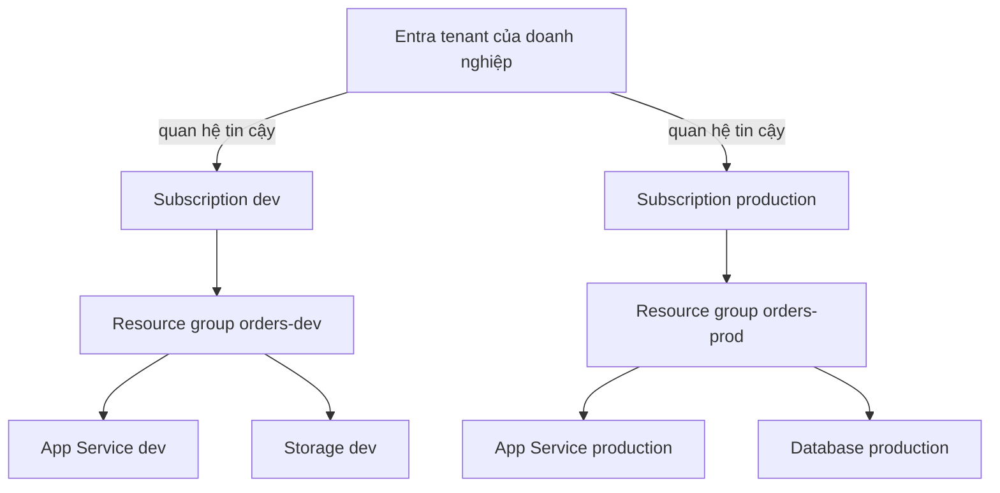
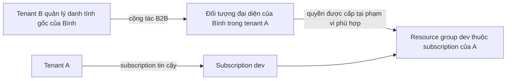

# Tenant Microsoft Entra ID và quan hệ với Azure subscription

## 1. Vì sao phải phân biệt tenant với subscription?

Khi sử dụng Azure, người học thường gặp hai thông báo tưởng như mâu thuẫn: đăng nhập thành công nhưng không thấy subscription, hoặc quản lý được tài nguyên nhưng không quản lý được người dùng trong Microsoft Entra ID. Nguyên nhân là danh tính, quyền trên tài nguyên và quan hệ thanh toán thuộc những phạm vi khác nhau.

**Tenant Microsoft Entra ID là thư mục danh tính; Azure subscription là phạm vi quản lý tài nguyên và ghi nhận mức sử dụng Azure.** Chúng liên kết với nhau qua quan hệ tin cậy, nhưng không phải cùng một đối tượng. Hiểu quan hệ này giúp triển khai ứng dụng vào đúng môi trường, cấp quyền đúng người và tránh thay đổi nhầm cấu hình quản trị.

Trong phạm vi hệ sinh thái Azure, kiến thức này là nền tảng để tổ chức subscription, resource group, danh tính ứng dụng và quyền truy cập mạng, compute, Storage hay cơ sở dữ liệu. Nó cũng ảnh hưởng đến cách giám sát hoạt động quản trị và bàn giao một kiến trúc ứng dụng cho nhóm vận hành.

Sau bài học, bạn cần có khả năng:

- Giải thích tenant chứa những gì và khác subscription ở điểm nào.
- Mô tả quan hệ một tenant với nhiều subscription.
- Phân biệt Tenant ID, Subscription ID và Object ID.
- Tách quyền quản trị Microsoft Entra khỏi quyền quản trị tài nguyên Azure.
- Hiểu vì sao người dùng khách có thể truy cập tài nguyên mà subscription vẫn chỉ gắn với một tenant.
- Kiểm tra đúng tenant và subscription trong Portal hoặc Azure CLI.
- Phân biệt đổi ngữ cảnh đăng nhập với thay đổi tenant liên kết của subscription.

## 2. Tenant Microsoft Entra ID là gì?

### 2.1. Một thư mục dành cho danh tính và cấu hình truy cập

Microsoft Entra ID là dịch vụ quản lý danh tính và truy cập trên đám mây. Một tenant là phiên bản thư mục phục vụ một tổ chức hoặc một phạm vi tổ chức được thiết kế riêng. Trong tài liệu và giao diện, từ **directory** thường được dùng để nói đến thư mục này.

Microsoft Entra ID cung cấp chức năng xác thực, chính sách truy cập và bảo vệ danh tính cho người dùng, ứng dụng, thiết bị và tài nguyên. Mỗi thư mục mới có tên miền ban đầu dạng `ten-to-chuc.onmicrosoft.com`, đồng thời có thể được cấu hình thêm tên miền tùy chỉnh của tổ chức. [Microsoft Learn: Microsoft Entra và Entra ID](https://learn.microsoft.com/en-us/entra/fundamentals/what-is-entra).

Các đối tượng thường gặp trong tenant gồm:

| Đối tượng | Vai trò trong hệ thống |
| --- | --- |
| User | Đại diện người dùng, gồm người dùng nội bộ và những người bên ngoài được đưa vào ngữ cảnh cộng tác |
| Group | Tập hợp thành viên để phục vụ quản lý và cấp quyền theo thiết kế |
| Application object | Mô tả cấu hình đăng ký của một ứng dụng |
| Service principal | Đại diện một ứng dụng hoặc danh tính workload trong tenant |
| Device | Đại diện thiết bị trong các kịch bản quản lý danh tính thiết bị |

Không phải có đối tượng trong tenant là đã có quyền vào mọi tài nguyên. Đối tượng danh tính là cơ sở để hệ thống nhận diện chủ thể; quyền vẫn cần được cấp theo cơ chế và phạm vi phù hợp.

### 2.2. Tenant không phải máy chủ hay vùng triển khai

Tenant không phải một VM, một mạng ảo hoặc một resource group. Bạn không chọn tenant thay cho việc chọn vùng khi tạo VM, và không đưa cơ sở dữ liệu “vào tenant” theo nghĩa giống đưa nó vào resource group.

Ví dụ, một tenant có thể phục vụ danh tính cho nhóm ứng dụng triển khai tài nguyên ở nhiều vùng. Vị trí triển khai của từng tài nguyên là vấn đề khác với thư mục danh tính mà subscription tin cậy. Các yêu cầu cụ thể về vị trí dữ liệu của từng dịch vụ vẫn phải được đánh giá riêng.

Cũng không nên đồng nhất Entra ID với một máy chủ Active Directory Domain Services tự cài trong mạng nội bộ. Entra Domain Services là một dịch vụ khác, hỗ trợ các nhu cầu như LDAP và Kerberos/NTLM cho những kịch bản phù hợp. [Microsoft Learn: các sản phẩm trong Microsoft Entra](https://learn.microsoft.com/en-us/entra/fundamentals/what-is-entra).

### 2.3. Một công ty không nhất thiết chỉ có một tenant

Một doanh nghiệp có thể chọn một tenant chính cho nhân viên và nhiều subscription cho các môi trường ứng dụng. Do sáp nhập, phân tách tổ chức hoặc yêu cầu quản trị đặc biệt, doanh nghiệp cũng có thể tồn tại nhiều tenant.

Mỗi tenant bổ sung kéo theo công việc về tài khoản, chính sách, ứng dụng và quan hệ cộng tác. Vì vậy, việc tách một bài thực hành hoặc một môi trường dev khỏi production chưa đủ để kết luận phải tạo tenant mới; cần xác định ranh giới nào thực sự cần tách.

Tạo tenant mới còn phụ thuộc quyền và điều kiện hiện hành của tài khoản. Bài học này dùng tenant sẵn có hoặc môi trường được quản trị viên cấp để quan sát quan hệ, không yêu cầu tạo tenant phụ. [Microsoft Learn: điều kiện tạo tenant](https://learn.microsoft.com/en-us/entra/fundamentals/create-new-tenant).

## 3. Quan hệ giữa tenant, subscription và tài nguyên

### 3.1. Quy tắc cốt lõi: mỗi subscription tin cậy một tenant

Mỗi Azure subscription gắn với một Microsoft Entra tenant để sử dụng các danh tính của thư mục đó trong quá trình truy cập tài nguyên. Một subscription chỉ tin cậy một thư mục tại một thời điểm; một tenant có thể được nhiều subscription tin cậy. [Microsoft Learn: liên kết subscription với tenant](https://learn.microsoft.com/en-us/entra/fundamentals/how-subscriptions-associated-directory).

Điều này có nghĩa:

- Một tenant có thể phục vụ `sub-learning`, `sub-orders-dev` và `sub-orders-prod`.
- Tạo thêm subscription không nhất thiết phải tạo thêm tenant.
- Mời người từ tổ chức khác tham gia không biến subscription thành đối tượng đồng thời gắn với hai tenant.
- Việc chuyển giữa những directory được phép truy cập trong Portal không tự đổi quan hệ của subscription.

Quan hệ tin cậy cung cấp ngữ cảnh danh tính. Nó không phải thao tác cấp quyền toàn bộ cho mọi người dùng của tenant.

### 3.2. Subscription tổ chức tài nguyên theo một chiều khác

Subscription là phạm vi quan trọng để quản lý tài nguyên, gán Azure RBAC và tổng hợp mức dùng phục vụ thanh toán. Bên trong subscription, resource group giúp nhóm các tài nguyên theo vòng đời và mục đích quản trị.

Ví dụ minh họa một tổ chức dùng chung tenant cho dev và production:



Sơ đồ biểu diễn quan hệ, không có nghĩa mọi người trong tenant đều được đọc dữ liệu production. Nhóm phát triển có thể được cấp quyền chỉ trong môi trường dev, còn quyền production theo một quy trình khác.

Management group có thể tổ chức các subscription trong phạm vi tenant để áp quản trị ở cấp cao hơn. Lựa chọn loại thỏa thuận mua và cách tổ chức quản trị subscription cần được xem xét song song. [Microsoft Learn: tenant và Azure billing offers](https://learn.microsoft.com/en-us/azure/cloud-adoption-framework/ready/landing-zone/design-area/azure-billing-microsoft-entra-tenant).

### 3.3. Tenant và billing không tạo thành một cây đơn giản giống nhau

Quan hệ với tenant trả lời câu hỏi về danh tính được dùng để cấp quyền vào tài nguyên. Quan hệ thanh toán trả lời chi phí được ghi nhận theo thỏa thuận nào. Các subscription trong cùng tenant có thể có quan hệ thanh toán với các hợp đồng khác nhau. [Microsoft Learn: billing và tenant relationship](https://learn.microsoft.com/en-us/azure/cost-management-billing/understand/understand-billing-tenant-relationship).

Vì vậy, đừng suy ra rằng người quản trị một tenant là người trực tiếp thanh toán mọi tài nguyên, hoặc tất cả subscription cùng tenant bắt buộc dùng một thẻ thanh toán. Muốn xác định trách nhiệm chi phí, cần kiểm tra thỏa thuận và quyền billing tương ứng.

Ví dụ, `sub-orders-dev` và `sub-orders-prod` cùng dùng danh tính doanh nghiệp, nhưng nhóm tài chính vẫn có thể theo dõi chi phí theo subscription và theo cấu trúc hóa đơn của tổ chức. Tách subscription giúp tổ chức quản trị tài nguyên; nó không tự tạo một thư mục nhân viên mới.

## 4. Nhận diện đúng các ID

### 4.1. Tenant ID và Subscription ID

**Tenant ID**, còn gọi là Directory ID trong một số ngữ cảnh, định danh tenant. **Subscription ID** định danh một subscription Azure. Cả hai thường có dạng GUID, nên chỉ nhìn hình thức chuỗi không thể biết đang dùng đúng loại ID hay chưa.

| Giá trị | Định danh cái gì? | Ví dụ sử dụng |
| --- | --- | --- |
| Tenant ID | Thư mục Microsoft Entra | Chọn ngữ cảnh xác thực hoặc đối chiếu directory |
| Subscription ID | Phạm vi subscription Azure | Chọn nơi triển khai và truy vấn tài nguyên |
| Object ID | Một đối tượng danh tính cụ thể trong ngữ cảnh thư mục | Chỉ đúng user, group hoặc service principal khi làm việc với quyền |
| Application/Client ID | Định danh ứng dụng đã đăng ký | Cấu hình client tích hợp nền tảng danh tính |
| Resource ID | Đường dẫn quản lý một tài nguyên Azure | Xác định Storage, App Service hoặc tài nguyên cụ thể |

Tên hiển thị của tenant hay subscription phục vụ con người đọc. Trong một hệ thống có nhiều môi trường gần giống nhau, cần đối chiếu ID thay vì chỉ dựa vào tên `Default Directory` hoặc `Production`.

Ví dụ Resource ID minh họa:

```text
/subscriptions/11111111-1111-1111-1111-111111111111/resourceGroups/rg-orders-dev/providers/Microsoft.Storage/storageAccounts/stordersdemo
```

Đường dẫn chỉ ra subscription và resource group của tài nguyên. Nó không thay thế Tenant ID khi ứng dụng hoặc công cụ cần xác định ngữ cảnh danh tính.

### 4.2. Cùng người dùng chưa chắc cùng Object ID ở các tenant

Một người có thể dùng danh tính của tổ chức mình để tham gia tenant khác theo cơ chế cộng tác. Đối tượng đại diện cho người đó trong tenant tài nguyên là đối tượng riêng, không nên giả định có cùng Object ID với đối tượng ở tenant gốc.

Tương tự, một ứng dụng có thể có Application/Client ID và nhiều service principal ở những tenant khác nhau. Client ID của ứng dụng không phải Object ID của mọi service principal đại diện cho ứng dụng đó. [Microsoft Learn: application object và service principal](https://learn.microsoft.com/en-us/entra/identity-platform/app-objects-and-service-principals).

Khi xử lý lỗi quyền, hãy hỏi “Object ID của đối tượng nào trong tenant nào?” thay vì chỉ hỏi địa chỉ email hoặc tên ứng dụng. Khi chia sẻ thông tin chẩn đoán, không gửi mật khẩu, client secret, private key hay token truy cập; các thông tin đó có vai trò khác hẳn ID định danh.

## 5. Ba phạm vi quyền cần tách biệt

### 5.1. Microsoft Entra roles: quản trị thư mục

Microsoft Entra roles quản lý các chức năng liên quan đến thư mục, chẳng hạn người dùng, nhóm, tên miền và ứng dụng. Global Administrator là một vai trò quản trị có phạm vi ảnh hưởng lớn trong tenant.

Azure roles và Microsoft Entra roles là hai hệ thống phân quyền có mục đích khác nhau. Quyền quản lý subscription không tự biến một người thành Global Administrator của tenant. [Microsoft Learn: Azure roles và Microsoft Entra roles](https://learn.microsoft.com/en-us/azure/role-based-access-control/rbac-and-directory-admin-roles).

Ví dụ, người quản trị tài nguyên có thể triển khai App Service nhưng không có quyền sửa một cấu hình thư mục. Đây có thể là phân tách nhiệm vụ có chủ đích, không phải lỗi của Portal.

### 5.2. Azure RBAC: quản trị tài nguyên và các quyền dữ liệu được hỗ trợ

Azure RBAC xác định chủ thể nào được thực hiện hành động nào ở phạm vi tài nguyên nào. Một role assignment gồm ba thành phần chính:

```text
Security principal + Role definition + Scope
Chủ thể            + Tập quyền       + Phạm vi
```

Chủ thể có thể là user, group, service principal hoặc managed identity. Phạm vi có thể là management group, subscription, resource group hay tài nguyên. [Microsoft Learn: Azure RBAC](https://learn.microsoft.com/en-us/azure/role-based-access-control/overview).

Các vai trò thường gặp:

| Vai trò Azure | Khả năng khái quát tại phạm vi được gán |
| --- | --- |
| Reader | Xem tài nguyên |
| Contributor | Quản lý tài nguyên; không được gán Azure RBAC roles chỉ nhờ vai trò này |
| Owner | Quản lý tài nguyên và gán Azure RBAC roles |

Quyền hiệu lực còn phải xét phạm vi, quyền kế thừa và các ràng buộc áp dụng. Một người có quyền rộng ở cấp subscription không bị giới hạn trở lại chỉ vì được gán thêm Reader ở một resource group. [Microsoft Learn: vai trò Azure](https://learn.microsoft.com/en-us/azure/role-based-access-control/rbac-and-directory-admin-roles), [cách các role assignment kết hợp](https://learn.microsoft.com/en-us/azure/role-based-access-control/overview).

Quyền quản lý tài nguyên cũng cần được phân biệt với quyền truy cập dữ liệu. Chẳng hạn, xem cấu hình Storage và đọc một blob là hai loại hành động; vai trò và cơ chế dữ liệu cụ thể phải được kiểm tra theo dịch vụ.

### 5.3. Global Administrator không mặc định là Owner của mọi subscription

Theo mặc định, quyền Entra không tự cấp quyền quản lý tài nguyên Azure. Tuy nhiên, Global Administrator có cơ chế nâng quyền truy cập Azure ở root scope để hỗ trợ quản trị và khôi phục truy cập, nhận vai trò User Access Administrator theo quy trình tương ứng. Đây là thao tác rõ ràng, không phải quyền Owner tự xuất hiện trên mọi subscription. [Microsoft Learn: nâng quyền quản lý Azure của Global Administrator](https://learn.microsoft.com/en-us/azure/role-based-access-control/elevate-access-global-admin).

Điểm thiết kế cần lưu ý: tách subscription giúp phân chia quyền vận hành, nhưng không tạo ra một ranh giới hoàn toàn độc lập với quyền quản trị danh tính ở tenant. Tổ chức phải bảo vệ các tài khoản quản trị tenant phù hợp với phạm vi ảnh hưởng của chúng.

Không nên xử lý mọi lỗi truy cập bằng cách xin Global Administrator hoặc bật cơ chế nâng quyền. Trước tiên, xác định tài nguyên cần thao tác, hành động cần thực hiện và phạm vi quyền phù hợp.

### 5.4. Quyền billing: quản lý quan hệ thanh toán

Quyền billing phục vụ các tác vụ theo thỏa thuận mua, chẳng hạn quản lý cấu trúc hóa đơn và một số thông tin thanh toán. Cơ chế này cần được kiểm tra riêng với quyền thư mục và quyền tài nguyên; khả năng cụ thể còn tùy loại tài khoản thanh toán. [Microsoft Learn: quan hệ billing, hợp đồng và tenant](https://learn.microsoft.com/en-us/azure/cost-management-billing/understand/understand-billing-tenant-relationship).

Ví dụ, Minh quản lý một resource group dev để triển khai ứng dụng, bộ phận IT quản trị tài khoản nhân viên, còn bộ phận tài chính nhận hóa đơn. Cả ba cùng tham gia một hệ thống nhưng không cần được gán cùng tập quyền.

## 6. Người dùng nội bộ, người dùng khách và truy cập nhiều tenant

### 6.1. Home tenant và resource tenant

Trong kịch bản cộng tác giữa hai tổ chức, **home tenant** là tenant gốc quản lý danh tính của người dùng; **resource tenant** là tenant nơi tài nguyên hoặc ứng dụng cần truy cập được quản lý. Một người có thể dùng thông tin xác thực của tổ chức mình để cộng tác với tổ chức khác qua Microsoft Entra B2B.

Tenant tài nguyên có đối tượng người dùng đại diện cho người cộng tác, thường là guest. Tổ chức chủ tài nguyên vẫn kiểm soát việc truy cập theo cấu hình và chính sách của mình. [Microsoft Learn: Microsoft Entra B2B collaboration](https://learn.microsoft.com/en-us/entra/external-id/what-is-b2b).

Member hoặc Guest mô tả loại người dùng trong ngữ cảnh thư mục; không nên dùng tên loại đó để suy ra toàn bộ quyền Azure. Muốn biết một người có thể sửa Storage hay không, cần kiểm tra quyền hiệu lực đối với Storage đó.

### 6.2. Ví dụ: chuyên gia bên ngoài hỗ trợ nhóm dev

Công ty An Phát có tenant A và subscription `sub-orders-dev` gắn với A. Bình làm việc cho công ty đối tác, có danh tính gốc ở tenant B.

Cách tổ chức cộng tác minh họa:

1. An Phát cho phép và thiết lập cộng tác với Bình theo chính sách của mình.
2. Bình hoàn tất quy trình tham gia bằng đúng danh tính được mời.
3. Người quản trị An Phát cấp quyền cần thiết cho đối tượng của Bình ở tenant A tại resource group `rg-orders-dev`.
4. Bình dùng đúng ngữ cảnh tenant A khi quản lý tài nguyên được giao.
5. Khi kết thúc hợp đồng, An Phát thu hồi quyền và xử lý vòng đời đối tượng cộng tác theo quy trình.

Subscription vẫn tin cậy tenant A. Việc Bình có danh tính gốc ở B không tạo thêm quan hệ tin cậy thứ hai cho subscription.



Sơ đồ mô tả quan hệ cộng tác và cấp quyền, không phải toàn bộ giao thức đăng nhập. Người cộng tác có thể cần đáp ứng các điều kiện truy cập của những tổ chức tham gia.

### 6.3. Mời được vào tenant chưa đủ để dùng tài nguyên

Một lời mời hoặc đối tượng guest chỉ giải quyết một phần bài toán hiện diện danh tính. Nếu Bình chưa được cấp quyền tại resource group, đăng nhập thành công vẫn không cho phép triển khai ứng dụng.

Ngược lại, nếu Bình có quyền ở `rg-orders-dev`, điều đó không tự cho phép Bình quản trị toàn bộ tenant A hay sửa dữ liệu production. Trong ví dụ này, các kết quả được xác định bởi quyền cấp cụ thể và những chính sách áp dụng.

Cần rà soát cả quyền cấp trực tiếp và quyền qua nhóm. Xóa một role assignment không đủ nếu người đó còn nhận cùng quyền qua một đường khác.

## 7. Tenant còn là ngữ cảnh danh tính của ứng dụng

### 7.1. Application object và service principal

Một ứng dụng đăng ký trong Entra có application object tại tenant gốc của nó. Service principal là đại diện của ứng dụng trong một tenant cụ thể, dùng trong ngữ cảnh quyền và truy cập tại tenant đó. Với ứng dụng hỗ trợ nhiều tenant, có thể có nhiều service principal đại diện tại những tenant sử dụng ứng dụng. [Microsoft Learn: application và service principal objects](https://learn.microsoft.com/en-us/entra/identity-platform/app-objects-and-service-principals).

Vì vậy, ứng dụng hỗ trợ người dùng nhiều tổ chức không đồng nghĩa subscription chạy ứng dụng phải gắn với tất cả tenant của khách hàng. Một bên mô tả mô hình danh tính của ứng dụng; bên kia mô tả quan hệ quản trị của subscription.

### 7.2. Ví dụ API Java triển khai trên Azure

Giả sử API đơn hàng được triển khai trên App Service trong `sub-orders-prod` của tenant A. API gọi Storage và cơ sở dữ liệu, đồng thời xác thực người dùng theo thiết kế của doanh nghiệp.

Có ít nhất ba câu hỏi độc lập:

| Câu hỏi | Điều cần xác định |
| --- | --- |
| Ai được triển khai hoặc sửa App Service? | Danh tính quản trị và quyền Azure tại tài nguyên hoặc phạm vi cha |
| Ai được đăng nhập vào API và thực hiện nghiệp vụ? | Cấu hình danh tính của ứng dụng và quy tắc phân quyền trong API |
| API dùng danh tính nào để gọi dịch vụ khác? | Danh tính workload, cách cấp quyền và cấu hình của dịch vụ đích |

Không nên cấp quyền quản trị subscription cho người dùng chỉ vì họ cần đăng nhập vào ứng dụng. Tương tự, quyền triển khai App Service không tự thay thế quyền nghiệp vụ như được xem đơn hàng nào.

Nếu dùng managed identity cho kết nối được hỗ trợ, ứng dụng vẫn cần được cấp đúng quyền với dịch vụ đích. Mục tiêu là sử dụng danh tính workload đúng phạm vi, thay vì gắn mọi kết nối vào một tài khoản quản trị cá nhân.

### 7.3. Xác thực thành công vẫn cần kiểm tra quyền

Trong luồng quản trị khái quát:

1. Người dùng hoặc workload xác thực trong ngữ cảnh danh tính phù hợp.
2. Client nhận access token dành cho dịch vụ đích.
3. Client gửi yêu cầu kèm token.
4. Dịch vụ kiểm tra token và áp dụng cơ chế phân quyền của mình.
5. Yêu cầu chỉ được thực hiện nếu đáp ứng các điều kiện truy cập cần thiết.

Access token dành cho một tài nguyên hoặc API cụ thể; ID token phục vụ ngữ cảnh đăng nhập của client. Ứng dụng cần kiểm tra token theo đúng giao thức và mục đích sử dụng, thay vì chỉ thấy một chuỗi token rồi coi là đủ quyền. [Microsoft Learn: tokens và claims](https://learn.microsoft.com/en-us/entra/identity-platform/security-tokens).

Ví dụ, người dùng đã được xác thực ở tenant A nhưng chỉ có Reader tại `rg-orders-dev` vẫn không được phép sửa App Service trong resource group đó. Lỗi quyền ở đây không được giải quyết bằng cách đăng nhập lại vào một tenant bất kỳ khác.

## 8. Kiểm tra tenant và subscription trong môi trường thực tế

### 8.1. Kiểm tra bằng Portal

Bài thực hành này chỉ cần xem thông tin trong tenant và subscription sẵn có hoặc đã được cấp quyền.

**Bước 1: xác nhận danh tính đăng nhập.** Mở [Azure Portal](https://portal.azure.com/) và kiểm tra tài khoản hiện tại. Nếu có tài khoản cá nhân lẫn tài khoản cơ quan dùng tên gần giống nhau, chọn đúng loại đã được cấp quyền.

**Bước 2: xem tenant hiện tại.** Mở Microsoft Entra ID hoặc [Microsoft Entra admin center](https://entra.microsoft.com/), tìm thông tin tổng quan của thư mục và đối chiếu Tenant ID, tên tenant và tên miền hiển thị theo quyền được cấp. Giao diện có thể thay đổi vị trí; mục tiêu là xác định được thư mục thực tế đang làm việc.

**Bước 3: xem subscription đích.** Trong Azure Portal, mở Subscriptions, chọn subscription được giao và đối chiếu Subscription ID cùng directory liên kết trong thông tin của subscription.

**Bước 4: kiểm tra quyền tại phạm vi cần thao tác.** Dùng Access control (IAM) ở subscription hoặc resource group phù hợp để xem quyền của mình theo khả năng được cung cấp. Khi cần xác nhận quyền thư mục, dùng chức năng quản lý Entra roles, không suy ra từ IAM của resource group.

**Bước 5: so sánh với phạm vi công việc.** Nếu bài yêu cầu tạo tài nguyên trong dev, xác nhận bạn đang ở subscription dev và resource group đã được giao. Đừng dùng tên gần giống nhau để thay cho việc đối chiếu ID.

Nếu không thấy subscription, kiểm tra danh tính, directory đang chọn, bộ lọc subscription và quyền được cấp. Không tự đổi tenant liên kết của subscription để giải quyết việc Portal chưa hiển thị môi trường được giao.

### 8.2. Kiểm tra bằng Azure CLI

Nếu đã cài và đăng nhập Azure CLI bằng danh tính phù hợp, có thể liệt kê những subscription tài khoản hiện thấy:

```bash
az account list --query "[].{subscription:name,subscriptionId:id,tenantId:tenantId,state:state,isDefault:isDefault}" --output table
```

Chọn subscription đích và đọc lại thông tin:

```bash
az account set --subscription "<SUBSCRIPTION_ID>"
az account show --query "{subscription:name,subscriptionId:id,tenantId:tenantId,state:state}" --output json
```

Thay placeholder bằng ID thật trước khi sử dụng. `az account set` chọn subscription mặc định cho ngữ cảnh CLI; nó không di chuyển tài nguyên và không thay tenant liên kết. `az account list` cũng không phải danh sách mọi subscription của toàn doanh nghiệp bất kể quyền. [Microsoft Learn: az account](https://learn.microsoft.com/en-us/cli/azure/account).

Ví dụ kết quả minh họa:

```json
{
  "subscription": "sub-orders-dev",
  "subscriptionId": "11111111-1111-1111-1111-111111111111",
  "tenantId": "aaaaaaaa-aaaa-aaaa-aaaa-aaaaaaaaaaaa",
  "state": "Enabled"
}
```

Nếu subscription production có Subscription ID khác nhưng cùng `tenantId`, hai subscription đang dùng cùng một ngữ cảnh thư mục. Điều đó chưa nói lên bạn có cùng quyền ở cả hai.

Các ID trong ví dụ là giả. Portal và CLI có thể có lựa chọn hiện tại khác nhau, nên cần kiểm tra trong chính công cụ sẽ thực hiện yêu cầu quản trị.

### 8.3. Kết quả mong đợi của bài quan sát

Người học hoàn thành khi trả lời được:

- Danh tính đang dùng là gì và đang làm việc trong tenant nào?
- Subscription đích có ID nào và liên kết với Tenant ID nào?
- Quyền được cấp nằm ở subscription, resource group hay một tài nguyên?
- Có đang dùng đối tượng người dùng khách trong tenant tài nguyên không?
- Ai là đầu mối cấp quyền thư mục, quyền Azure và xử lý thanh toán?

Không cần tạo user, mời guest, tạo tenant hoặc cấp quyền rộng chỉ để hoàn thành phần quan sát. Nếu thiếu quyền xem một mục, nhờ quản trị viên xác nhận thông tin cần thiết theo quy trình của tổ chức.

## 9. Phân biệt đổi ngữ cảnh với thay đổi kiến trúc

### 9.1. Bốn thao tác có tên dễ gây nhầm

| Thao tác | Thứ thực sự thay đổi | Điều không thể suy ra |
| --- | --- | --- |
| Chọn directory khác trong phiên Portal | Ngữ cảnh thư mục đang làm việc của người dùng | Subscription đã được chuyển tenant |
| Chọn subscription bằng `az account set` | Subscription mặc định trong ngữ cảnh CLI | Tài nguyên đã được di chuyển |
| Thay tenant liên kết của subscription | Directory cung cấp ngữ cảnh danh tính cho subscription | Quyền và mọi kết nối ứng dụng tự được giữ nguyên |
| Chuyển quan hệ hoặc quyền sở hữu thanh toán | Quan hệ thương mại theo thao tác được hỗ trợ | Tenant luôn thay đổi theo cùng một cách |

Ví dụ, Hương có quyền trong tenant A và B. Khi Hương chuyển Portal sang B để xem một dự án khác, các subscription đang liên kết với A vẫn liên kết với A. Đây là thay đổi nơi Hương đang quan sát, không phải thay đổi kiến trúc tài nguyên.

### 9.2. Chuyển tenant của subscription là thay đổi có tác động đến quyền

Một subscription đang tin cậy tenant A có thể có nhiều role assignment tham chiếu người dùng, nhóm và workload ở A. Khi thay sang tenant khác, không thể giả định các đối tượng có cùng tên ở tenant mới sẽ tự tiếp nhận các quyền đó.

Tài liệu chuyển directory nêu role assignment và custom role không được mang sang tenant đích theo cách giữ nguyên, đồng thời managed identity và các dịch vụ phụ thuộc danh tính cần được xử lý riêng. Khả năng chuyển còn phụ thuộc loại subscription và những dịch vụ đang dùng; một số trường hợp không được hỗ trợ. [Microsoft Learn: chuyển subscription sang directory khác](https://learn.microsoft.com/en-us/azure/role-based-access-control/transfer-subscription).

Vì vậy, trước một kế hoạch chuyển thực tế, tổ chức cần kiểm kê danh tính, quyền, cấu hình dịch vụ phụ thuộc tenant và cách kiểm tra ứng dụng sau chuyển. Trường hợp API mất quyền gọi Storage không chỉ là chuyện người quản trị đăng nhập được hay chưa.

Chuyển directory và chuyển billing ownership là các quyết định riêng; không nên coi thao tác đổi directory tự hoàn thành việc bàn giao trách nhiệm thanh toán. [Microsoft Learn: quan hệ directory của subscription](https://learn.microsoft.com/en-us/entra/fundamentals/how-subscriptions-associated-directory).

Bài học tập trung nhận diện ranh giới và tác động, không yêu cầu thực hiện thao tác chuyển trên subscription đang có tài nguyên.

## 10. Tình huống tổng hợp: một tenant, hai subscription

Công ty An Phát dùng tenant `anphat.onmicrosoft.com`. Ứng dụng đơn hàng có môi trường dev và production tách subscription. Nhân viên và danh tính workload được quản trị trong tenant theo thiết kế của công ty.

| Chủ thể | Quyền hoặc nhiệm vụ minh họa | Kết quả mong muốn |
| --- | --- | --- |
| Nhóm phát triển | Contributor tại `rg-orders-dev` | Triển khai và thử nghiệm dev |
| Nhóm vận hành production | Quyền quản lý tài nguyên production theo công việc | Vận hành ứng dụng thật theo quy trình riêng |
| Nhóm quản trị danh tính | Entra roles phù hợp | Quản lý người dùng, nhóm và cấu hình danh tính được giao |
| Bình từ đối tác | Quyền được duyệt tại phạm vi dev | Hỗ trợ dev trong thời gian hợp đồng |
| Danh tính của API production | Quyền cần thiết trên dịch vụ dữ liệu đích | API truy cập dữ liệu theo phạm vi công việc |
| Đầu mối tài chính | Quyền billing theo thỏa thuận | Theo dõi và xử lý trách nhiệm thanh toán |

Thiết kế này minh họa việc dùng chung nền tảng danh tính nhưng phân chia quyền vận hành. Các dòng trong bảng không tự tạo quyền; quản trị viên phải thiết lập, kiểm tra và quản lý vòng đời các quyền tương ứng.

Ba thay đổi nghiệp vụ cho thấy vì sao tenant và subscription cần được hiểu riêng:

- **Có nhân viên mới:** tổ chức xử lý tài khoản và nhóm theo quy trình danh tính, sau đó kiểm tra người đó nhận những quyền Azure nào. Không cần tạo subscription riêng chỉ vì có thêm nhân viên.
- **Có dự án mới:** tổ chức quyết định resource group hoặc subscription phù hợp, cùng ngân sách và người quản trị. Không nhất thiết tạo một tenant mới.
- **Đối tác hết hợp đồng:** tổ chức thu hồi các đường truy cập đã cấp cho đối tác. Đổi tên subscription không thu hồi quyền của người cộng tác.

Đối với theo dõi hệ thống, nên phân biệt sự kiện đăng nhập, thay đổi đối tượng danh tính và thay đổi tài nguyên. Khi điều tra một lỗi, ghi đúng thời điểm, danh tính, Tenant ID, Subscription ID và hành động thất bại giúp tìm đúng nhóm xử lý.

## 11. Những hiểu lầm thường gặp

| Hiểu lầm | Cách hiểu đúng |
| --- | --- |
| Tenant và subscription là hai tên của cùng đối tượng | Tenant phục vụ danh tính; subscription tổ chức tài nguyên và mức dùng |
| Một tenant chỉ có một subscription | Một tenant có thể được nhiều subscription tin cậy |
| Mọi người trong tenant được dùng mọi subscription | Quyền phải được cấp theo chủ thể, hành động và phạm vi |
| Owner của subscription mặc nhiên quản trị toàn bộ Entra | Quyền Azure không tự trở thành quyền quản trị thư mục |
| Global Administrator mặc định là Owner của tất cả tài nguyên | Vai trò thư mục và quyền Azure cần phân biệt; cơ chế nâng quyền là thao tác riêng |
| Guest chỉ có thể xem tài nguyên | Quyền thực tế phụ thuộc những gì được cấp và các chính sách áp dụng |
| Người ngoài truy cập làm subscription gắn thêm tenant của họ | Cộng tác danh tính khác với quan hệ tin cậy tenant của subscription |
| Cùng email nghĩa là cùng đối tượng ở mọi tenant | Cần xác định đối tượng và Object ID trong đúng tenant |
| Ứng dụng multi-tenant yêu cầu subscription tin cậy nhiều tenant | Mô hình đăng nhập của ứng dụng khác quan hệ quản trị của subscription |
| Switch directory trong Portal là chuyển subscription | Đó là đổi ngữ cảnh phiên làm việc |
| Chuyển tenant sẽ tự giữ nguyên mọi quyền và kết nối | Cần đánh giá tác động và xử lý từng phụ thuộc danh tính |

## 12. Bài tập tự kiểm tra

### Bài tập 1: Vẽ quan hệ của hai môi trường

Một doanh nghiệp có 40 nhân viên, một tenant và ba subscription dành cho dev, test, production. Hãy vẽ sơ đồ thể hiện tenant, subscription, resource group và nhóm nhân viên.

**Gợi ý đối chiếu:** sơ đồ có một tenant được ba subscription tin cậy. Người dùng hoặc nhóm được gán quyền ở phạm vi cụ thể, không cần nhân bản thư mục nhân viên chỉ để có ba môi trường. Giải thích thêm nhóm nào được phép thay đổi production.

### Bài tập 2: Phân loại yêu cầu quyền

Phân loại bốn yêu cầu: sửa cấu hình App Service, đặt lại thông tin xác thực người dùng nội bộ, đọc blob của ứng dụng và xem hóa đơn.

**Gợi ý đối chiếu:** sửa tài nguyên thuộc phạm vi quyền Azure; quản trị tài khoản thuộc phạm vi danh tính; đọc blob cần cơ chế quyền dữ liệu phù hợp; hóa đơn thuộc quyền billing theo loại thỏa thuận. Không chọn một vai trò quản trị rộng để thay cho việc xác định từng nhu cầu.

### Bài tập 3: Chẩn đoán người dùng khách

Bình đã nhận lời mời của An Phát, đăng nhập được nhưng không thấy resource group dev. Hãy liệt kê thứ tự thông tin cần xác nhận.

**Gợi ý đối chiếu:** kiểm tra đúng danh tính nhận lời mời, tenant tài nguyên, subscription và bộ lọc đang chọn; sau đó đối chiếu đúng đối tượng của Bình trong tenant An Phát, role assignment và phạm vi được cấp. Nếu đã có đủ thông tin mà vẫn lỗi, chuyển bằng chứng cụ thể cho quản trị viên thay vì tạo thêm tài khoản tùy ý.

### Bài tập 4: Phân biệt hai loại thay đổi

Hương chọn tenant B trong Portal; sau đó chọn `sub-project-b` trong CLI. Một đồng nghiệp nói rằng các tài nguyên cũ của Hương đã được chuyển khỏi tenant A. Nhận định đó có đủ cơ sở không?

**Gợi ý đối chiếu:** không. Những thao tác lựa chọn ngữ cảnh không chứng minh việc chuyển tài nguyên hoặc chuyển tenant liên kết của subscription. Muốn xác nhận, cần đọc quan hệ hiện tại của đúng subscription và lịch sử thay đổi phù hợp.

### Bài tập 5: Đánh giá kế hoạch bàn giao

Một nhóm dự định đưa subscription của dự án sang tenant công ty và cho rằng chỉ cần người nhận đăng nhập được là bàn giao xong. Hãy nêu ít nhất bốn nhóm thông tin còn thiếu.

**Gợi ý đối chiếu:** quyền người dùng và nhóm; danh tính workload; cấu hình dịch vụ phụ thuộc tenant; cách kiểm tra ứng dụng sau thay đổi; đầu mối vận hành; quan hệ thanh toán. Đây là bài đánh giá kế hoạch, không yêu cầu thực hiện chuyển tenant.

## 13. Kiến thức cần ghi nhớ

Tenant Microsoft Entra ID cung cấp ngữ cảnh danh tính, còn subscription là phạm vi quản lý tài nguyên Azure có quan hệ tin cậy với một tenant tại một thời điểm. Nhiều subscription có thể dùng chung tenant mà vẫn phân chia quyền vận hành và trách nhiệm chi phí.

Khi xử lý một yêu cầu truy cập, hãy xác định đúng danh tính, tenant, subscription, loại quyền và phạm vi. Khi làm việc bằng Portal hoặc CLI, đối chiếu ID trước thao tác. Khi kiến trúc thay đổi tenant, cần đánh giá lại quyền và các phụ thuộc danh tính; đổi directory đang xem trong phiên làm việc không thực hiện thay đổi kiến trúc đó.
