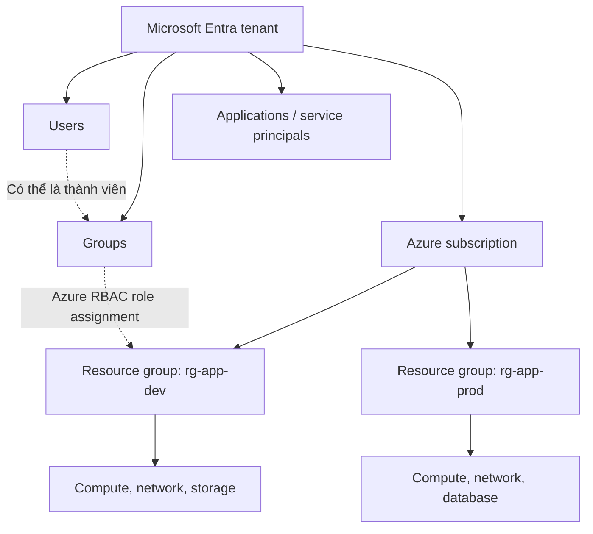
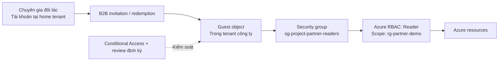

# User, group và quản lý danh tính bên ngoài

Trong hệ sinh thái Microsoft Azure, tài nguyên như subscription, resource group, máy ảo, hệ thống mạng và cơ sở dữ liệu cần được truy cập bởi đúng người, đúng ứng dụng và đúng mức quyền. **Microsoft Entra ID** (tên trước đây là Azure Active Directory) cung cấp dịch vụ danh tính để xác thực người dùng, quản lý nhóm và hợp tác với người ngoài tổ chức. Kết hợp Entra ID với Azure Role-Based Access Control (Azure RBAC), doanh nghiệp có thể cấp quyền theo vai trò và phạm vi thay vì chia sẻ tài khoản quản trị cho nhiều người.

Bài học này tập trung vào ba thành phần: **user**, **group** và **external identities**. Bạn sẽ học cách tổ chức danh tính nội bộ, phân quyền qua nhóm, mời đối tác bên ngoài, bảo vệ phiên đăng nhập và thu hồi quyền khi kết thúc hợp tác.

## Mục tiêu học tập

Sau bài học, bạn có thể:

1. Giải thích sự khác nhau giữa tenant, user, group và Azure subscription.
2. Phân biệt người dùng nội bộ, tài khoản khách (guest) và các cơ chế hợp tác liên tenant.
3. Chọn loại group, kiểu membership và chiến lược phân quyền phù hợp.
4. Mời, cấp quyền, rà soát và thu hồi quyền truy cập của người ngoài tổ chức.
5. Áp dụng MFA, Conditional Access và nguyên tắc least privilege trong quản trị danh tính.
6. Kiểm tra user và group bằng Microsoft Graph, phân biệt quyền trên thư mục với quyền trên tài nguyên Azure.

## 1. Các khái niệm nền tảng

**Microsoft Entra tenant** là một phiên bản thư mục danh tính của tổ chức. Tenant lưu các đối tượng như user, group, application, service principal và thông tin cấu hình xác thực, truy cập. **Azure subscription** là ranh giới dùng cho thanh toán, quota và quản lý tài nguyên; subscription được liên kết với một tenant Entra ID để thực hiện xác thực và cấp quyền. Một tenant có thể liên kết với nhiều subscription.



Sơ đồ cho thấy group trong tenant có thể được gán Azure RBAC tại resource group. Người dùng là thành viên của group nhận các quyền tương ứng theo role assignment, tùy chính sách và các điều kiện kiểm soát truy cập khác.

| Khái niệm | Chức năng chính | Ví dụ |
|---|---|---|
| **User** | Đại diện một danh tính người dùng được quản lý hoặc tham chiếu trong tenant. | Nhân viên vận hành, chuyên gia tư vấn bên ngoài. |
| **Group** | Tập hợp danh tính để cộng tác hoặc quản lý quyền hàng loạt. | `sg-azure-dev-readers`, nhóm dự án trên Microsoft 365. |
| **Directory role** | Quyền quản trị đối tượng và chức năng trong Microsoft Entra ID. | User Administrator, Groups Administrator. |
| **Azure RBAC role** | Quyền thực hiện các hành động trên tài nguyên Azure tại scope cụ thể. | Reader, Contributor, Virtual Machine Contributor. |
| **Service principal / managed identity** | Danh tính workload hoặc ứng dụng, không phải tài khoản con người. | Pipeline triển khai, ứng dụng trên Azure Functions. |

Hai hệ thống quyền cần phân biệt rõ: **Microsoft Entra roles** quản trị thư mục danh tính, còn **Azure RBAC roles** quản trị tài nguyên Azure. Một người có quyền tạo user trong Entra ID không tự động có quyền sửa VM; một người có quyền Contributor trên resource group không tự động được tạo user trong tenant.

## 2. User trong Microsoft Entra ID

Mỗi user là một đối tượng danh tính trong tenant, có **object ID** riêng. Một số thuộc tính thường gặp:

- `displayName`: tên hiển thị trong giao diện và ứng dụng.
- `userPrincipalName` (UPN): tên đăng nhập theo định dạng tương tự địa chỉ email, ví dụ `lan@contoso.com`; UPN không nhất thiết là địa chỉ email nhận thư.
- `mail`: địa chỉ email liên hệ khi có, có thể khác UPN.
- `id`: object ID dạng GUID, thường dùng khi tự động hóa qua Microsoft Graph và Azure CLI.
- `userType`: thường có giá trị `Member` hoặc `Guest`, phản ánh cách đối tượng được phân loại trong tenant.
- `accountEnabled`: trạng thái cho phép hoặc chặn đăng nhập của user theo cấu hình.

**Object ID** là định danh ổn định trong phạm vi tenant, phù hợp hơn tên hiển thị hoặc email khi tạo role assignment tự động. Nếu một người được biểu diễn ở hai tenant, mỗi tenant có thể lưu một object ID khác nhau cho đối tượng tương ứng.

### 2.1. User nội bộ (member)

Member thường là người thuộc tổ chức, có tài khoản trong tenant và sử dụng dịch vụ công ty. Tổ chức có thể tạo tài khoản theo hai mô hình:

- **Cloud-only identity**: user được tạo và quản lý trực tiếp trong Microsoft Entra ID; phù hợp với tổ chức vận hành hoàn toàn trên đám mây.
- **Hybrid identity**: đối tượng được đồng bộ từ hệ thống danh tính tại chỗ như Active Directory Domain Services bằng Microsoft Entra Connect Sync hoặc Cloud Sync. Một số thuộc tính có nguồn quản lý chính ở hệ thống tại chỗ, do đó không thể luôn sửa trực tiếp trên đám mây.

Tạo user mới chỉ là một phần của onboarding. Cần bổ sung đúng giấy phép dịch vụ, nhóm, phương thức xác thực, quy định MFA và quyền ứng dụng. Nếu người đó phải quản trị Azure, nên cấp quyền qua nhóm ở scope nhỏ phù hợp thay vì gán vai trò rộng trên toàn subscription.

### 2.2. User bên ngoài (guest)

Guest là đối tượng được tổ chức sử dụng để hợp tác với người bên ngoài. Trong mô hình **Microsoft Entra B2B collaboration**, một đối tác có thể đăng nhập bằng danh tính của tổ chức họ hoặc phương thức được phép khác, rồi truy cập tài nguyên mà tenant của bạn đã chia sẻ. Tenant của bạn giữ một đối tượng user tương ứng để quản lý quyền truy cập.

Một tài khoản B2B guest thường có UPN nội bộ chứa chuỗi như `#EXT#` sau khi được mời. Đây là chi tiết biểu diễn trong thư mục, không nên dùng làm điều kiện duy nhất để xác định ai là người bên ngoài. Trường `userType` cũng là thuộc tính phân loại, **không tự nó xác định nơi tài khoản xác thực** và **không tự cấp quyền**. Một số mô hình có thể tồn tại người dùng bên ngoài được phân loại `Member`, nên chính sách cần dựa trên đối tượng, nguồn danh tính và yêu cầu truy cập thực tế.

### 2.3. Quản lý vòng đời user

Một quy trình quản lý user thực tế bao gồm:

1. **Joiner (gia nhập)**: tạo hoặc đồng bộ danh tính, xác thực thông tin người dùng, áp dụng chính sách đăng nhập và đưa vào group phù hợp.
2. **Mover (thay đổi vai trò)**: cập nhật group, quyền ứng dụng và Azure RBAC khi đổi bộ phận hoặc nhiệm vụ; loại bỏ quyền không còn cần thiết.
3. **Leaver (rời tổ chức)**: chặn đăng nhập khi phù hợp, thu hồi phiên hoạt động, gỡ quyền và nhóm, xử lý dữ liệu hoặc trách nhiệm sở hữu, sau đó xóa đối tượng theo chính sách lưu giữ.

Không nên chỉ xóa user ngay lập tức khi người đó rời tổ chức mà chưa kiểm tra các ứng dụng, tài nguyên, dữ liệu hoặc quy trình đang phụ thuộc vào tài khoản. Với tài khoản đặc quyền, cần xem xét cả active sessions, tokens và thay đổi quyền có thể chưa có hiệu lực tức thì do cache hoặc độ trễ đồng bộ.

## 3. Group: quản lý quyền và cộng tác theo tập hợp

**Group** giúp quản lý tập trung thành viên, làm đơn giản hóa quy trình cấp và thu hồi quyền. Thay vì tạo mười role assignment riêng cho mười kỹ sư cần đọc tài nguyên, bạn có thể tạo một security group rồi gán role Reader cho nhóm tại resource group.

### 3.1. Các loại group thường gặp

| Loại group | Mục đích nổi bật | Ghi chú |
|---|---|---|
| **Security group** | Quản lý quyền truy cập tài nguyên, ứng dụng và nhiều chính sách. | Thường được dùng làm principal cho Azure RBAC. |
| **Microsoft 365 group** | Cộng tác trên các dịch vụ Microsoft 365 như Teams, SharePoint và Outlook, tùy cấu hình. | Có các tài nguyên cộng tác và vòng đời riêng; không phải lựa chọn mặc định cho mọi bài toán Azure RBAC. |
| **Mail-enabled security group** | Kết hợp một số đặc điểm bảo mật và email. | Khả năng quản trị hoặc áp dụng vào từng dịch vụ tùy loại nhóm và công cụ. |

Trong bài toán phân quyền Azure, một **security group có mục đích rõ ràng** thường dễ quản lý và kiểm toán hơn gán quyền riêng lẻ cho từng user. Ví dụ:

```text
sg-azure-app-dev-readers
sg-azure-app-dev-contributors
sg-azure-prod-operators
sg-project-partner-readers
```

Tên chỉ là quy ước gợi ý. Chính sách thực tế cần mô tả nhóm thuộc môi trường nào, ai sở hữu, được gán quyền gì và khi nào cần rà soát.

### 3.2. Assigned và dynamic membership

Có hai cách quản lý membership phổ biến:

**Assigned membership**: người quản trị hoặc group owner có quyền tương ứng chủ động thêm và gỡ thành viên. Mô hình này thích hợp với nhóm nhỏ, nhóm đặc quyền hoặc nhóm cần quy trình phê duyệt.

**Dynamic membership**: Entra ID tự tính thành viên dựa trên quy tắc thuộc tính user hoặc device. Ví dụ, một quy tắc dành cho dynamic user group có thể là:

```text
(user.department -eq "Engineering") -and (user.accountEnabled -eq true)
```

Khi thuộc tính nguồn thay đổi, membership sẽ được hệ thống đánh giá lại; có thể có độ trễ xử lý. Dynamic group yêu cầu khả năng và giấy phép Entra ID phù hợp. Không nên dùng một thuộc tính dễ bị người dùng tự sửa làm căn cứ duy nhất để tự động cấp quyền quan trọng.

Một nhóm có thể có **owner** quản lý vòng đời và membership theo phạm vi được phép. Group owner không mặc nhiên trở thành Azure subscription Owner. Với các nhóm gán directory role đặc quyền, Microsoft Entra có thêm điều kiện bảo vệ và giới hạn riêng; không nên coi chúng là security group thông thường.

### 3.3. Membership và quyền không hoàn toàn tương đương

Thêm user vào một group chỉ có tác dụng khi group đó thực sự được ứng dụng, dịch vụ hoặc hệ thống RBAC sử dụng để cấp quyền. Ngoài ra:

- Một group có thể được gán nhiều role tại các scope khác nhau; cần kiểm tra tổng quyền mà thành viên nhận được.
- Không phải dịch vụ nào cũng xử lý nhóm lồng nhau (nested groups) theo cùng cách; đặc biệt không giả định nested group được hỗ trợ trong mọi tính năng cấp phép hoặc gán ứng dụng.
- Group-based licensing giúp cấp giấy phép cho thành viên khi môi trường và loại giấy phép hỗ trợ; nó khác với cấp quyền Azure RBAC.
- Thay đổi membership hoặc role assignment đôi khi cần thời gian để xuất hiện trong access token, cache hoặc các hệ thống sử dụng group; cần kiểm tra trạng thái thực tế khi vừa cấp hoặc thu hồi quyền.

## 4. Cấp Azure RBAC thông qua group

Azure RBAC gán một **role definition** cho một **principal** tại một **scope**. Principal có thể là user, group, service principal hoặc managed identity. Role xác định các thao tác được phép; scope xác định phạm vi hiệu lực.

```text
Group: sg-azure-app-dev-readers
       |
       | Role assignment: Reader
       v
/subscriptions/<subscription-id>/resourceGroups/rg-app-dev
       |
       +--> Các tài nguyên thuộc resource group
```

Ví dụ quy trình cấp quyền cho đội phát triển:

1. Tạo security group `sg-azure-app-dev-readers` trong tenant.
2. Thêm những kỹ sư cần xem cấu hình resource group vào nhóm.
3. Trong Azure Portal, mở resource group `rg-app-dev`, chọn **Access control (IAM)** và tạo role assignment **Reader** cho nhóm.
4. Kiểm tra người dùng có thể đọc metadata quản lý của tài nguyên, nhưng không thể thay đổi cấu hình do Reader không có quyền ghi.
5. Khi một kỹ sư không còn tham gia dự án, gỡ khỏi group và kiểm tra các role assignment trực tiếp khác nếu có.

Lưu ý: role **Reader** trong Azure RBAC chủ yếu dành cho **management plane**. Nó không mặc nhiên cho phép đọc nội dung blob hoặc các dữ liệu ứng dụng. Muốn đọc dữ liệu Blob Storage bằng Microsoft Entra ID, có thể cần role data-plane như **Storage Blob Data Reader** tại scope phù hợp. Đây là điểm dễ nhầm giữa “nhìn thấy storage account” và “đọc được file bên trong storage”.

Nếu cần kiểm tra bằng Azure CLI, role assignment cho group có thể được mô tả như sau (chỉ chạy sau khi xác nhận group ID, scope và quyền của người thực hiện):

```bash
az role assignment create \
  --assignee-object-id "<group-object-id>" \
  --assignee-principal-type Group \
  --role Reader \
  --scope "/subscriptions/<subscription-id>/resourceGroups/rg-app-dev"
```

Việc dùng object ID tránh nhầm lẫn khi có hai nhóm cùng tên hoặc khi tên bị đổi. Azure RBAC là quyền hiệu lực trên tài nguyên; không thay thế chính sách truy cập dữ liệu hay quản trị thư mục Microsoft Entra.

## 5. Danh tính bên ngoài: các mô hình cần phân biệt

Microsoft Entra hỗ trợ nhiều nhu cầu hợp tác với người ngoài tổ chức. Chọn mô hình dựa trên việc ai là người dùng, đăng nhập ở đâu và cần truy cập loại tài nguyên nào.

| Mô hình | Đối tượng và mục đích | Đặc điểm chính |
|---|---|---|
| **B2B collaboration** | Đối tác, nhà thầu, khách mời cần truy cập ứng dụng hoặc tài nguyên của tổ chức. | Tenant tài nguyên thường có đối tượng user bên ngoài để gán quyền; người dùng có thể xác thực bằng danh tính từ home tenant hoặc phương thức được hỗ trợ. |
| **B2B direct connect** | Hợp tác liên tenant trong những ứng dụng hỗ trợ, điển hình là Teams shared channels. | Dựa vào chính sách truy cập liên tenant; không đồng nghĩa với tạo guest user B2B collaboration thông thường cho mọi ứng dụng. |
| **Cross-tenant synchronization** | Tự động hóa việc tạo, cập nhật và gỡ đối tượng B2B collaboration giữa những tenant có quan hệ hợp tác. | Cần cấu hình đồng bộ và chính sách chấp nhận phù hợp; không thay thế việc gán quyền tài nguyên. |
| **Microsoft Entra External ID trong external tenant** | Xây dựng trải nghiệm đăng nhập cho khách hàng của ứng dụng (customer identity/CIAM). | Mô hình tenant và hành trình người dùng hướng tới khách hàng; khác với việc mời đối tác làm guest trong workforce tenant. |

**Workforce tenant** là tenant tổ chức dùng quản lý nhân viên và cộng tác với đối tác. **External tenant** phục vụ ứng dụng hướng khách hàng trong mô hình External ID. Hai tình huống có người dùng “bên ngoài” nhưng yêu cầu vận hành, giao diện đăng nhập và cấp quyền khác nhau; không nên chọn B2B guest thay cho một giải pháp đăng nhập khách hàng ở quy mô lớn chỉ vì cùng có email ngoài tổ chức.

## 6. Quy trình mời đối tác bằng B2B collaboration

Giả sử công ty đang triển khai ứng dụng trên Azure và cần cho chuyên gia từ doanh nghiệp đối tác xem cấu hình resource group trong ba tháng. Bạn có thể tổ chức quyền truy cập như sau:



### Bước 1: Xác định nhu cầu và người chịu trách nhiệm

Ghi rõ tên đối tác, mục đích truy cập, email danh tính được phép, phạm vi tài nguyên, role dự kiến, thời hạn truy cập và người nội bộ chịu trách nhiệm. Ví dụ, nếu đối tác chỉ cần kiểm tra cấu hình của `rg-partner-demo`, không cấp Contributor hoặc Reader trên toàn subscription khi không cần.

### Bước 2: Kiểm tra chính sách cộng tác bên ngoài

Trong **Microsoft Entra admin center**, người có quyền quản trị phù hợp kiểm tra cấu hình **External Identities**, bao gồm ai được phép mời, domain cho phép hoặc bị chặn và **cross-tenant access settings**. Các thiết lập này ảnh hưởng đến việc invitation có được chấp nhận và người ngoài tổ chức có thể truy cập hay không.

**Inbound access settings** kiểm soát khả năng người từ tenant khác truy cập tài nguyên của bạn. **Outbound access settings** kiểm soát khả năng người dùng của bạn truy cập tài nguyên tenant bên ngoài. Chính sách có thể được cấu hình mặc định hoặc theo từng tổ chức đối tác. Một số môi trường có thể cấu hình tin cậy các xác nhận MFA hoặc thiết bị từ home tenant, nhưng việc tin cậy phải tuân theo đánh giá an ninh và khả năng hỗ trợ của từng cơ chế.

### Bước 3: Mời external user

Tại khu vực quản lý **Users** trong Microsoft Entra admin center, chọn chức năng **Invite external user** và điền thông tin đối tác. Người nhận thực hiện quy trình **redemption** để chấp nhận lời mời hoặc hoàn tất phương thức đăng nhập được hỗ trợ. Tùy chính sách và loại tài khoản, người dùng có thể dùng tài khoản của tổ chức họ, nhà cung cấp danh tính khác hoặc cơ chế one-time passcode bằng email nếu được hỗ trợ và cho phép.

Đối tượng guest có thể đã xuất hiện trong thư mục khi lời mời vừa được gửi, trước khi người dùng hoàn tất redemption. Vì vậy, cần phân biệt **đã được tạo đối tượng** với **đã chấp nhận lời mời và đăng nhập thành công**. Nếu người dùng không truy cập được, hãy kiểm tra trạng thái invitation, chính sách liên tenant, yêu cầu MFA và quyền ứng dụng thay vì chỉ xác nhận rằng tên họ có trong danh sách Users.

### Bước 4: Đưa guest vào group và cấp đúng scope

Tạo hoặc dùng một security group như `sg-project-partner-readers`, thêm guest tương ứng, rồi gán Azure RBAC Reader cho group tại resource group cần xem. Đặt owner nội bộ cho nhóm và ghi nhận mục đích sử dụng. Nếu đối tác cần vào một ứng dụng SaaS hoặc ứng dụng doanh nghiệp, còn phải cấu hình quyền của ứng dụng; chỉ có Azure RBAC không nhất thiết đủ để mở ứng dụng.

### Bước 5: Bảo vệ phiên đăng nhập

Áp dụng chính sách **Conditional Access** phù hợp, ví dụ yêu cầu MFA và điều kiện truy cập theo mức độ rủi ro của ứng dụng. Đối với đối tác đa tenant, kiểm tra các chính sách inbound/outbound và việc tin cậy MFA từ tenant nguồn. Nên thử nghiệm với tài khoản khách thực tế và kiểm tra thông tin sign-in log để tránh vô tình chặn toàn bộ đối tác hợp lệ.

### Bước 6: Rà soát và thu hồi

Khi hợp tác kết thúc, gỡ guest khỏi security group và ứng dụng được chia sẻ, thu hồi role assignment trực tiếp nếu có, chặn hoặc xóa đối tượng bên ngoài theo quy trình của tổ chức. Kiểm tra các phiên hoạt động và thời gian lan truyền thay đổi. Có thể sử dụng **Access Reviews** hoặc **Entitlement Management** thuộc Microsoft Entra ID Governance nếu môi trường có khả năng và giấy phép phù hợp để thiết lập phê duyệt, thời hạn và rà soát định kỳ.

## 7. Chính sách bảo mật cho user và guest

Nguyên tắc quan trọng là **không đánh đồng xác thực với được phép truy cập**. Một người đăng nhập thành công vẫn cần có authorization cho tài nguyên cụ thể.

### 7.1. MFA và Conditional Access

**Multi-Factor Authentication (MFA)** bổ sung yếu tố xác thực ngoài mật khẩu, giúp giảm rủi ro khi mật khẩu bị lộ. **Conditional Access** có thể đưa ra quyết định truy cập dựa trên danh tính, ứng dụng, thiết bị, vị trí tín hiệu, rủi ro đăng nhập và những điều kiện được hỗ trợ.

Ví dụ chính sách dành cho đối tác:

- Áp dụng cho người dùng B2B được xác định trong tenant và các ứng dụng cần bảo vệ.
- Yêu cầu MFA; nếu tin cậy MFA từ home tenant thì cần cấu hình cross-tenant access settings đúng.
- Áp dụng điều kiện bổ sung cho dữ liệu nhạy cảm theo mức độ rủi ro được tổ chức chấp nhận.
- Kiểm tra báo cáo đăng nhập và chế độ report-only khi thích hợp trước khi bật chính sách rộng.

Các tính năng Conditional Access, Identity Protection, Access Reviews hoặc Entitlement Management có thể phụ thuộc vào loại giấy phép và gói Microsoft Entra đang sử dụng. Không nên giả định mọi tenant đều có đủ các tính năng này mặc định.

### 7.2. Least privilege và đặc quyền quản trị

Áp dụng các quy tắc:

1. Cấp quyền thấp nhất đủ hoàn thành công việc, trên scope hẹp nhất có thể.
2. Dùng group để quản lý quyền dùng chung; tránh gán trực tiếp tràn lan cho từng tài khoản.
3. Tách tài khoản hoặc vai trò quản trị với tài khoản thường khi chính sách tổ chức yêu cầu.
4. Sử dụng quyền có thời hạn, phê duyệt và **Privileged Identity Management (PIM)** khi môi trường hỗ trợ cho các vai trò đặc quyền.
5. Thực hiện access review theo kỳ và khi người dùng đổi vai trò hoặc rời dự án.

Quản lý guest cũng cần tính đến quyền mặc định trong tenant. Việc guest thấy được thông tin nào trong directory có thể chịu ảnh hưởng của thiết lập quyền guest; tuy nhiên, các thiết lập này không thay thế Azure RBAC, phân quyền ứng dụng hoặc chính sách dữ liệu.

### 7.3. Dữ liệu giám sát và kiểm toán

Một số nguồn thông tin phục vụ điều tra và vận hành:

| Nguồn | Câu hỏi cần trả lời |
|---|---|
| **Microsoft Entra sign-in logs** | Ai đăng nhập, từ đâu, kết quả xác thực, chính sách Conditional Access nào tác động? |
| **Microsoft Entra audit logs** | Ai thay đổi user, group, membership, invitation hoặc cấu hình directory? |
| **Azure Activity Log** | Ai tạo, sửa hoặc xóa tài nguyên trên management plane Azure? |
| **Azure role assignments** | Principal nào có vai trò gì tại subscription, resource group hoặc resource? |
| **Access Reviews / Governance reports** | Quyền nào được xác nhận còn cần và quyền nào cần thu hồi? |

Thời gian lưu log, quyền xem log và khả năng xuất log sang nơi lưu trữ lâu dài phụ thuộc cấu hình và giấy phép. Với hoạt động nhạy cảm, nên có đầu mối chịu trách nhiệm phản hồi cảnh báo và kiểm tra hiệu quả thu hồi quyền.

## 8. Đọc user và group bằng Microsoft Graph

**Microsoft Graph** là API quản lý nhiều đối tượng và dữ liệu Microsoft 365/Entra, trong đó có user và group. Đây là API khác với **Azure Resource Manager**: gọi Graph để quản lý đối tượng trong thư mục; gọi ARM để quản lý tài nguyên Azure và Azure RBAC. Token Microsoft Graph thường có audience `https://graph.microsoft.com/`, không dùng thay token ARM `https://management.azure.com/`.

Ví dụ truy vấn danh sách user qua Graph HTTP API (minh họa, cần token Graph có quyền phù hợp):

```http
GET https://graph.microsoft.com/v1.0/users?$select=id,displayName,userPrincipalName,userType,accountEnabled&$top=10
Authorization: Bearer <microsoft-graph-access-token>
Accept: application/json
```

Truy vấn danh sách group:

```http
GET https://graph.microsoft.com/v1.0/groups?$select=id,displayName,securityEnabled,mailEnabled,groupTypes&$top=10
Authorization: Bearer <microsoft-graph-access-token>
Accept: application/json
```

Để thực hành có thể sử dụng **Microsoft Graph PowerShell SDK**. Sau khi cài module Microsoft Graph trong môi trường có quyền cài đặt, đăng nhập với delegated scopes cho phép đọc user và group:

```powershell
Connect-MgGraph -Scopes "User.Read.All", "Group.Read.All", "GroupMember.Read.All"

Get-MgUser -All -Property Id,DisplayName,UserPrincipalName,UserType,AccountEnabled |
  Select-Object Id,DisplayName,UserPrincipalName,UserType,AccountEnabled

Get-MgGroup -All -Property Id,DisplayName,SecurityEnabled,MailEnabled,GroupTypes |
  Select-Object Id,DisplayName,SecurityEnabled,MailEnabled,GroupTypes
```

Các lệnh trên chỉ đọc danh sách. Tenant có thể yêu cầu admin consent cho các delegated permissions và người gọi cần có quyền phù hợp. Kết quả API có thể phân trang; SDK có tùy chọn `-All` để duyệt nhiều trang. Trong môi trường production, không xuất toàn bộ danh sách user ra log công khai vì có thông tin cá nhân.

### Kiểm tra group thành viên của một người

Ví dụ truy vấn quan hệ membership bằng Graph:

```http
GET https://graph.microsoft.com/v1.0/users/{user-id}/memberOf
Authorization: Bearer <microsoft-graph-access-token>
Accept: application/json
```

Endpoint này trả về các đối tượng directory mà người dùng là thành viên trực tiếp theo hợp đồng API; nếu cần đánh giá membership gián tiếp qua nhóm lồng nhau, xem các operation như `transitiveMemberOf` và các giới hạn tương ứng. Không kết luận user có hoặc không có quyền Azure chỉ từ danh sách group: còn cần kiểm tra role assignment tại scope và chính sách truy cập thực tế.

## 9. Tình huống thiết kế: nhóm nội bộ và nhà thầu cùng tham gia dự án Azure

Một nhóm phát triển có hai kỹ sư nội bộ, một trưởng nhóm và một chuyên gia đối tác. Tài nguyên triển khai được tách thành `rg-app-dev` và `rg-app-prod`. Yêu cầu như sau:

| Đối tượng | Nhu cầu | Cách cấp quyền đề xuất |
|---|---|---|
| Kỹ sư nội bộ | Kiểm tra cấu hình và triển khai trong dev. | Thành viên `sg-app-dev-contributors`; gán role phù hợp trên `rg-app-dev`. |
| Trưởng nhóm | Xem tài nguyên dev và production để đánh giá thay đổi. | Nhóm Reader tương ứng trên từng resource group; quyền ghi production nếu cần được quản lý riêng. |
| Chuyên gia đối tác | Chỉ xem cấu hình Azure để tư vấn trong 60 ngày. | B2B guest, nhóm `sg-project-partner-readers`, role Reader trên `rg-app-dev`, chính sách MFA và ngày rà soát. |

Luồng vận hành:

1. Bộ phận quản trị xác nhận danh tính, người bảo trợ và thời hạn truy cập của đối tác.
2. Admin cấp các nhóm và role theo nhu cầu; không dùng chung tài khoản hay gửi mật khẩu nội bộ cho đối tác.
3. Tài nguyên production có các role assignment riêng và ít người được thay đổi hơn.
4. Sau 60 ngày, người phụ trách rà soát mục đích sử dụng; nếu không cần nữa, thu hồi group membership và các quyền trực tiếp còn tồn tại.
5. Sử dụng Entra sign-in logs, audit logs và Azure Activity Log để kiểm tra truy cập, thay đổi và điều tra sự cố.

Nếu chuyên gia cần đọc file trong Blob Storage thay vì chỉ xem cấu hình storage account, cần bổ sung quyền data plane thích hợp; Azure Reader trên resource group không đủ cho thao tác này.

## 10. Những nhầm lẫn thường gặp

- **“User là Guest thì không thể có quyền cao.”** `userType` không tự đặt trần quyền Azure RBAC; một guest vẫn có thể được gán quyền rộng nếu admin cố ý cấp. Phải kiểm tra role assignment thực tế.
- **“Member chắc chắn là nhân viên công ty.”** `Member` là giá trị phân loại đối tượng trong tenant, không phải bằng chứng pháp lý hay nguồn xác thực tuyệt đối.
- **“Thêm user vào group là đã truy cập được mọi ứng dụng.”** Cần kiểm tra group được gán quyền cho ứng dụng hoặc tài nguyên nào, và các chính sách truy cập khác.
- **“Có Azure Contributor thì quản lý được user Entra.”** Azure RBAC và Microsoft Entra roles là hai hệ thống quyền khác nhau.
- **“Reader thấy storage account nên đọc được mọi blob.”** Quyền quản lý và quyền dữ liệu cần được xem xét riêng.
- **“Mời guest xong là họ truy cập được ngay.”** Có thể còn bước redemption, MFA, Conditional Access, application assignment và RBAC.
- **“Xóa hoặc gỡ group thì quyền lập tức biến mất ở mọi phiên.”** Cần tính đến hiệu lực phiên, token, cache và thời gian lan truyền thay đổi; kiểm tra việc truy cập sau khi thu hồi.
- **“B2B collaboration, B2B direct connect và External ID cho khách hàng giống nhau.”** Mỗi mô hình có đối tượng và cách quản lý danh tính khác nhau.

## 11. Checklist áp dụng vào môi trường thực tế

- [ ] Tenant, subscription và scope quản trị đã được xác định rõ.
- [ ] User được tạo hoặc đồng bộ từ đúng nguồn; UPN, email và object ID được sử dụng đúng mục đích.
- [ ] Group có tên, owner, mục đích và quy trình rà soát thành viên.
- [ ] Azure RBAC được gán theo nhóm, role phù hợp và scope nhỏ nhất cần thiết.
- [ ] Với dữ liệu ứng dụng, đã kiểm tra riêng data-plane permissions.
- [ ] Chính sách mời guest, allowed domains và cross-tenant access được thiết lập phù hợp.
- [ ] User ngoài tổ chức có người bảo trợ, thời hạn truy cập và quy trình thu hồi.
- [ ] MFA, Conditional Access và phương án kiểm tra sign-in logs được áp dụng theo rủi ro.
- [ ] Có giám sát thay đổi user/group, role assignment và thao tác tài nguyên Azure.
- [ ] Đã kiểm thử đăng nhập và quyền thực tế bằng tài khoản đúng vai trò, kể cả sau khi thu hồi.

## Kết luận

Quản lý danh tính trong Azure bắt đầu từ việc hiểu user nằm trong Microsoft Entra tenant nào, group nào tập hợp các user cần cùng một quyền và Azure RBAC gán quyền cho group tại phạm vi tài nguyên nào. Với đối tác bên ngoài, B2B collaboration giúp tổ chức hợp tác mà vẫn kiểm soát quyền từ tenant của mình; các hình thức B2B direct connect, cross-tenant synchronization và External ID cho khách hàng giải quyết những nhu cầu khác. Một hệ thống an toàn cần kết hợp xác thực mạnh, quyền tối thiểu, quản lý vòng đời, kiểm toán và kiểm tra thường xuyên để người dùng chỉ giữ quyền trong thời gian thực sự cần thiết.
