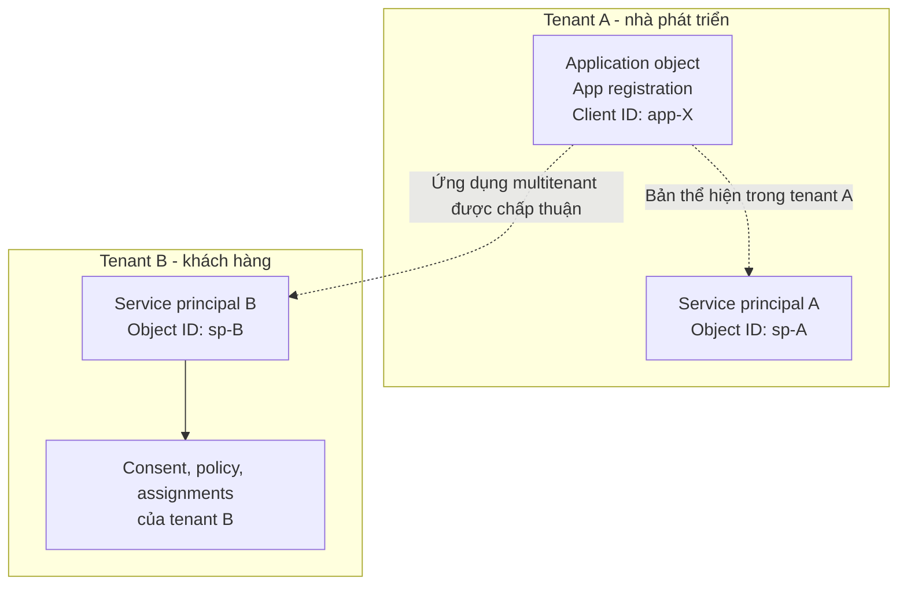
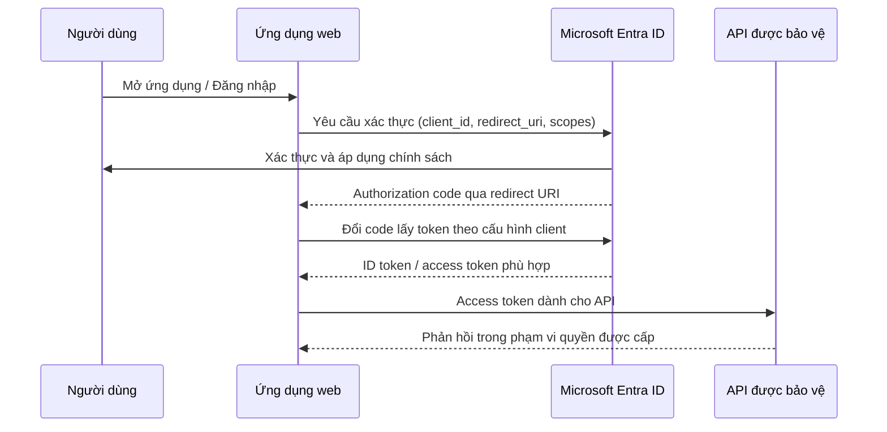

# App registration, service principal và enterprise application

Khi một ứng dụng web cho phép nhân viên đăng nhập bằng tài khoản Microsoft Entra ID, hoặc một tiến trình tự động cần gọi Azure API, Azure phải xác định **ứng dụng nào đang yêu cầu quyền**, **ứng dụng đó tồn tại trong tenant nào** và **nó được phép làm gì**. Ba khái niệm **app registration**, **service principal** và **enterprise application** giúp mô hình hóa các câu hỏi này.

Đây là bài học trong chương **Danh tính với Microsoft Entra ID** của module `CLOUD_PROVIDERS_AZURE`. Trong hành trình tìm hiểu Azure từ subscription, resource group và Entra ID đến mạng, compute, lưu trữ, dữ liệu, vận hành và kiểm soát chi phí, quản lý danh tính ứng dụng là nền tảng để triển khai workload tự động hóa một cách có kiểm soát.

## Mục tiêu học tập

Sau bài này, bạn có thể:

- Phân biệt định nghĩa ứng dụng (*application object/app registration*) với danh tính đại diện ứng dụng trong tenant (*service principal*).
- Giải thích vì sao **Enterprise applications** trên Azure Portal thường là giao diện quản lý các service principal.
- Phân biệt application (client) ID, directory (tenant) ID và object ID; xác định ID nào dùng trong từng thao tác.
- Mô tả quá trình đăng ký ứng dụng, đăng nhập, cấp sự đồng ý (*consent*), tạo service principal và gán quyền.
- So sánh delegated permissions, application permissions, app roles và Azure RBAC.
- Đọc, kiểm tra và quản trị vòng đời danh tính ứng dụng bằng Azure Portal và Azure CLI.
- Chọn cách xác thực phù hợp giữa managed identity, federated credential, certificate và client secret.

## 1. Bối cảnh: người dùng và ứng dụng là hai loại danh tính

Trong Entra ID, **user** thường đại diện cho con người; **service principal** đại diện cho một ứng dụng hoặc workload khi hoạt động trong một tenant. Một ứng dụng có thể đăng nhập thay mặt người dùng (ví dụ cổng nhân sự nội bộ) hoặc tự hoạt động mà không có người dùng đang đăng nhập (ví dụ chương trình đồng bộ dữ liệu chạy theo lịch).

Xét ba tình huống:

1. Cổng nhân sự có nút **Sign in with Microsoft**: ứng dụng cần tham gia quy trình xác thực người dùng và có thể được cấp quyền đọc thông tin hồ sơ cơ bản.
2. Một daemon chạy mỗi giờ để gọi Microsoft Graph: daemon cần danh tính ứng dụng và quyền gọi API không phụ thuộc phiên đăng nhập của người dùng.
3. Một nhà cung cấp SaaS phục vụ nhiều doanh nghiệp: mỗi doanh nghiệp cần quản lý việc sử dụng và cấp quyền cho SaaS trong tenant của chính mình.

Để hiểu các tình huống này, cần tách biệt **bản thiết kế danh tính ứng dụng** với **bản thể hiện của ứng dụng ở từng tenant**.

## 2. App registration: định nghĩa ứng dụng

**App registration** là thao tác tạo một *application object* trong Microsoft Entra ID. Application object mô tả cách ứng dụng tích hợp với nền tảng danh tính Microsoft, chẳng hạn:

- Tên hiển thị của ứng dụng.
- **Application (client) ID**: định danh ứng dụng được sử dụng trong yêu cầu xác thực và lấy token.
- **Supported account types**: ứng dụng chỉ nhận tài khoản từ tenant của mình hay hỗ trợ nhiều tenant hoặc tài khoản Microsoft cá nhân.
- Redirect URI, nền tảng ứng dụng (web, SPA, native/mobile) và cấu hình luồng xác thực.
- API được ứng dụng công bố (*Expose an API*), scopes, app roles và các quyền API ứng dụng yêu cầu.
- Client credentials của ứng dụng bí mật (*confidential client*), ví dụ certificate, federated credential hoặc client secret.
- Owners và metadata phục vụ quản trị vòng đời.

Trong Azure Portal, thao tác thường nằm ở **Microsoft Entra ID → App registrations → New registration**. Application object được tạo trong **home tenant** của ứng dụng. Việc tạo app registration thường đồng thời tạo service principal tương ứng trong home tenant, nhưng hai đối tượng vẫn có vai trò và object ID khác nhau.

**App registration không phải là nơi triển khai mã nguồn.** Việc đăng ký ứng dụng không tự tạo App Service, VM hay container. Ngược lại, tạo tài nguyên Azure App Service cũng không đồng nghĩa đã cấu hình đầy đủ app registration và quyền truy cập API cho phần mềm bên trong.

### Các loại ID cần phân biệt

Giả sử ứng dụng `web-internal-demo` được đăng ký trong tenant A. Azure hiển thị một số ID có tên gần giống nhau:

| ID | Ý nghĩa | Ví dụ dùng |
|---|---|---|
| **Application (client) ID** (`appId`) | Định danh ứng dụng ở cấp application, được dùng để xác định client trong OAuth/OIDC | Tham số `client_id` khi yêu cầu token |
| **Directory (tenant) ID** (`tenantId`) | Định danh tenant Microsoft Entra ID | Xác định authority/token endpoint, ví dụ `https://login.microsoftonline.com/<tenant-id>` |
| **Application object ID** (`id` của application object) | Định danh bản ghi app registration trong home tenant | Quản lý object của app registration bằng Microsoft Graph hoặc Azure CLI |
| **Service principal object ID** (`id` của service principal) | Định danh bản ghi service principal trong một tenant cụ thể | Gán Azure RBAC, quản lý enterprise app, tham chiếu principal trong tenant |

Application object ID và service principal object ID **không giống nhau**, ngay cả khi cả hai cùng thuộc home tenant. Application (client) ID thường được giữ nguyên khi một ứng dụng multitenant xuất hiện trong nhiều tenant; mỗi tenant có **service principal object ID riêng**.

## 3. Service principal: danh tính ứng dụng trong tenant

**Service principal** là đối tượng đại diện cho một ứng dụng hoặc workload trong **một tenant cụ thể**. Nó là danh tính cục bộ mà tenant dùng để áp dụng chính sách và cấp quyền truy cập.

Đối với ứng dụng được đăng ký trong Entra ID:

- Application object là định nghĩa ứng dụng tại home tenant.
- Service principal là bản thể hiện của ứng dụng trong tenant đang sử dụng.
- Một application object có thể tương ứng với **nhiều service principal**, mỗi tenant một đối tượng, khi ứng dụng được cung cấp cho nhiều tenant.
- Một tenant có thể có service principal cho ứng dụng do tổ chức khác phát hành, dù tenant đó không sở hữu app registration.

Sơ đồ sau minh họa ứng dụng SaaS được đăng ký tại tenant A và được khách hàng tenant B cho phép sử dụng:



Trong ví dụ, `sp-A` và `sp-B` có object ID khác nhau, nhưng cả hai cùng tham chiếu application (client) ID `app-X`. Quản trị viên tenant B có thể kiểm soát việc đăng nhập, sự đồng ý, người dùng được phép truy cập hoặc quyền API của ứng dụng tại tenant B mà không sở hữu mã nguồn của nhà cung cấp SaaS.

### Không phải mọi service principal đều đến từ app registration do bạn tạo

Ngoài ứng dụng do tổ chức tự đăng ký, service principal còn có thể đại diện cho:

- Ứng dụng của bên thứ ba hoặc ứng dụng Microsoft được tenant sử dụng.
- **Managed identity** do Azure quản lý cho một tài nguyên hoặc một identity độc lập; đây cũng là một dạng service principal, nhưng có vòng đời và cách quản lý credentials khác.
- Một số ứng dụng thư viện (*gallery applications*) được thêm qua Enterprise applications để cấu hình đăng nhập một lần (SSO) và cấp quyền truy cập.

Vì vậy, không tìm thấy ứng dụng trong danh sách **App registrations** của tenant không có nghĩa ứng dụng đó không có service principal trong tenant.

## 4. Enterprise application là gì?

Trong Azure Portal, **Enterprise applications** là khu vực quản lý các *service principal* và tích hợp ứng dụng ở cấp tenant. Đây thường là **cách nhìn theo phía tổ chức sử dụng ứng dụng**, còn **App registrations** là cách nhìn theo phía tổ chức xây dựng và cấu hình định nghĩa ứng dụng.

| Khía cạnh | App registrations | Enterprise applications |
|---|---|---|
| Đối tượng trọng tâm | Application object | Service principal trong tenant |
| Câu hỏi chính | Ứng dụng được định nghĩa, đăng nhập và gọi API như thế nào? | Tenant này cho phép ứng dụng hoạt động và ai được dùng? |
| Phạm vi | Home tenant của application object | Tenant đang quản trị |
| Cấu hình điển hình | Client ID, redirect URI, supported account types, scopes, app roles, credential, API permissions được yêu cầu | User/group assignments, SSO, sign-in logs, policy và consent/permissions được cấp trong tenant |
| Mối quan hệ | Một ứng dụng multitenant có một định nghĩa tại home tenant | Có thể có một service principal riêng ở mỗi tenant dùng ứng dụng |

Với một ứng dụng nội bộ tự đăng ký, bạn thường thấy **cả app registration lẫn enterprise application** trong cùng tenant. Với ứng dụng SaaS bên ngoài, tenant khách hàng thường chỉ thấy enterprise application; app registration nằm trong home tenant của nhà cung cấp.

Trong Enterprise applications, các mục thường hữu ích là **Properties**, **Users and groups**, **Permissions**, **Single sign-on** và **Sign-in logs**. Một số tính năng phụ thuộc loại ứng dụng, cấu hình và giấy phép Entra của tenant; không phải enterprise app nào cũng có cùng bộ tính năng.

### “Assignment required?” có tác dụng gì?

Với enterprise application hỗ trợ kiểu truy cập tương ứng, quản trị viên có thể bật **Assignment required?** để chỉ người dùng hoặc nhóm được gán mới đăng nhập vào ứng dụng. Thiết lập này là một lớp kiểm soát truy cập ở cấp enterprise app; nó không thay thế việc ứng dụng kiểm tra quyền nghiệp vụ bên trong, và cũng không tự cấp quyền quản lý tài nguyên Azure.

Đối với một số luồng app-only hoặc service principal, việc gán app role có các quy tắc riêng. Vì thế, đừng dựa vào một tùy chọn giao diện như giải pháp duy nhất để chặn mọi dạng cấp token; cần đánh giá luồng xác thực, consent và chính sách liên quan.

## 5. Luồng từ đăng ký đến ứng dụng hoạt động

Một ứng dụng web nội bộ thường đi qua các bước:

1. Nhà phát triển đăng ký ứng dụng trong Entra ID, nhận client ID và tenant ID.
2. Nhà phát triển cấu hình nền tảng, redirect URI, luồng OIDC/OAuth và các API permissions cần thiết.
3. Entra ID tạo hoặc có service principal cho ứng dụng trong tenant sử dụng; với ứng dụng multitenant, service principal được hình thành trong tenant khách hàng khi ứng dụng được thêm hoặc được chấp thuận theo luồng phù hợp.
4. Người dùng hoặc quản trị viên thực hiện consent nếu ứng dụng yêu cầu các quyền API cần được đồng ý.
5. Tenant áp dụng các cấu hình liên quan đến ứng dụng, ví dụ user assignment, Conditional Access, consent policy hoặc các hạn chế khác.
6. Ứng dụng chuyển hướng người dùng đến Entra ID, nhận token theo luồng đã cấu hình và xác thực token khi cần.



Sơ đồ đơn giản hóa **authorization code flow** của một ứng dụng web. Trong thực tế nên dùng thư viện được Microsoft hỗ trợ như **MSAL**, dùng PKCE theo hướng dẫn cho loại client tương ứng và kiểm tra chặt chẽ issuer, audience, thời hạn, chữ ký của token. **ID token** dùng để thể hiện kết quả xác thực danh tính cho client; **access token** được cấp để gọi resource/API có `aud` tương ứng. Không dùng ID token làm access token để gọi API.

### Single-tenant và multitenant

- **Single-tenant**: ứng dụng chấp nhận danh tính thuộc tenant tổ chức của mình theo cấu hình; thích hợp cho ứng dụng nội bộ.
- **Multitenant**: application object có thể được sử dụng bởi nhiều tenant Entra; mỗi tenant sử dụng sẽ quản lý service principal và consent của chính mình.
- **Ứng dụng hỗ trợ tài khoản Microsoft cá nhân**: tùy chọn audience có thể cho phép tài khoản cá nhân bên cạnh tài khoản cơ quan/trường học, phù hợp một số sản phẩm hướng người dùng rộng hơn.

Hỗ trợ multitenant không tự động đồng nghĩa mọi tenant đã chấp thuận ứng dụng. Tenant khách hàng còn phải thỏa chính sách consent, quyền admin và các quy tắc an toàn của mình. Khi xây ứng dụng multitenant, cần kiểm tra tenant của token, định tuyến dữ liệu theo tenant và phòng ngừa rò rỉ dữ liệu giữa khách hàng.

## 6. API permissions, consent, app roles và Azure RBAC

Một trong các nhầm lẫn lớn nhất là coi mọi “permission” trong Azure là cùng một loại. Thực tế, quyền truy cập API do Entra cấp và quyền điều khiển tài nguyên Azure qua RBAC là các cơ chế khác nhau.

### Delegated permissions: ứng dụng hành động thay mặt người dùng

Với **delegated permissions**, ứng dụng gọi API khi có người dùng đăng nhập. Token đại diện cho người dùng và client; quyền thực tế thường bị giới hạn bởi cả quyền delegated mà ứng dụng được cấp lẫn quyền và chính sách của người dùng đối với API.

Ví dụ, ứng dụng lịch cần đọc lịch của người dùng thông qua Microsoft Graph. Ứng dụng có thể yêu cầu delegated permission `Calendars.Read`, sau đó người dùng hoặc quản trị viên thực hiện consent theo chính sách tenant. Quyền này không mặc định cho phép ứng dụng đọc tất cả lịch của mọi nhân viên.

### Application permissions: ứng dụng tự hoạt động

Với **application permissions**, một daemon hoặc background service gọi API bằng **danh tính riêng của ứng dụng** mà không có người dùng tương tác. Quyền thường được cấp thông qua app roles do API tài nguyên công bố và thường cần admin consent. Token app-only không có người dùng đại diện.

Ví dụ, một tác vụ tự động đọc dữ liệu từ API quản lý doanh nghiệp theo lịch có thể dùng client credentials flow và application permission phù hợp. Vì quyền có thể tác động đến tập dữ liệu rộng, nên cần giới hạn theo nhu cầu tối thiểu và áp dụng các biện pháp hạn chế phạm vi mà API đích hỗ trợ.

| Khía cạnh | Delegated permission | Application permission |
|---|---|---|
| Có người dùng đăng nhập | Thông thường có | Không bắt buộc và thường không có |
| Danh nghĩa khi gọi API | Ứng dụng thay mặt người dùng | Danh tính ứng dụng |
| Token thường mang | `scp` (scope) | `roles` (app roles), nếu API sử dụng mô hình đó |
| Consent | Người dùng hoặc admin, theo quyền và chính sách | Thường do admin cấp |
| Trường hợp | Web/mobile gọi API thay mặt người dùng | Daemon, job, backend-to-backend |

**App roles** là các vai trò mà một API hoặc ứng dụng công bố để chỉ rõ quyền của caller. App roles có thể được gán cho users/groups hoặc applications tùy cấu hình; khi được phát hành theo luồng thích hợp, chúng thường xuất hiện trong claim `roles` của token. **Scopes** thường gắn với delegated access. Không nên suy ra user/application đã có quyền chỉ từ tên permission trong giao diện đăng ký: cần xác nhận **consent đã được cấp**, token có claims phù hợp và API đích có thực thi kiểm tra quyền.

### Azure RBAC: quyền quản lý và truy cập tài nguyên Azure

Azure RBAC cấp role tại một scope như management group, subscription, resource group hoặc resource. Ví dụ, service principal dùng để triển khai có thể được gán role **Contributor** tại resource group cụ thể; ứng dụng giám sát có thể được gán **Reader** nếu chỉ cần đọc metadata.

Đây là lớp quyền riêng với Microsoft Graph API permissions:

- Cấp `User.Read` trên Microsoft Graph không cho phép tạo VM trong Azure subscription.
- Cấp role `Reader` trên resource group không tự cho phép ứng dụng đọc mailbox Microsoft 365 qua Graph.
- Có app registration và client ID không có nghĩa ứng dụng tự có quyền trong subscription.
- Một ứng dụng có thể cần đồng thời quyền API (ví dụ Graph) và Azure RBAC cho các tài nguyên mà nó quản lý.

Để gán RBAC cho ứng dụng tại tenant cụ thể, phải xác định đúng **service principal object ID** của tenant đó và đúng scope được phép cấp quyền.

## 7. Bảo vệ danh tính ứng dụng và phương thức xác thực

Một ứng dụng có thể dùng các phương thức khác nhau để chứng minh danh tính với Entra ID. Lựa chọn phụ thuộc nơi workload chạy và cách triển khai:

| Phương thức | Khi nên dùng | Đặc điểm quản lý |
|---|---|---|
| **Managed identity** | Workload chạy trên tài nguyên Azure có hỗ trợ | Azure quản lý danh tính và luân chuyển thông tin xác thực; ứng dụng không cần lưu client secret |
| **Workload identity federation** | Pipeline hoặc workload ngoài Azure có token OIDC từ issuer được tin cậy | Trao đổi token bên ngoài lấy token Entra theo federated credential; không phải giữ client secret dài hạn |
| **Certificate** | Confidential client cần xác thực bằng khóa riêng và có cơ chế quản lý chứng chỉ | Bảo vệ private key, giám sát hạn và luân chuyển chứng chỉ |
| **Client secret** | Tích hợp đơn giản hoặc nhu cầu tạm thời, khi phương án an toàn hơn chưa phù hợp | Phải bảo vệ giá trị secret, hạn sử dụng và vòng đời xoay vòng |

**Ưu tiên managed identity** cho workload chạy trên Azure hỗ trợ tính năng này. Có hai mô hình thường gặp:

- **System-assigned managed identity** gắn với vòng đời của tài nguyên Azure. Khi tài nguyên bị xóa, danh tính tương ứng cũng bị xóa.
- **User-assigned managed identity** là tài nguyên độc lập có thể gắn cho nhiều workload được hỗ trợ; vòng đời không phụ thuộc vào một workload duy nhất.

Managed identity tạo và sử dụng service principal được Entra quản lý theo cơ chế riêng. Không quản lý các loại identity này như app registration bình thường, và không tự tạo client secret cho chúng. Với pipeline CI/CD từ GitHub Actions, Azure DevOps hoặc nền tảng OIDC phù hợp, có thể cân nhắc **federated identity credentials** để tránh lưu secret lâu dài.

Nếu bắt buộc dùng client secret, chỉ đưa giá trị vào hệ thống quản lý bí mật chuyên dụng như **Azure Key Vault** hoặc kho bí mật của nền tảng triển khai. Không commit vào Git, dán vào wiki hay ghi ra build log. Chỉ một số thời điểm tạo mới cho phép xem giá trị secret; cần lập kế hoạch xoay vòng trước ngày hết hạn. Thông tin `client_id` và `tenant_id` thường là metadata định danh, **không phải bí mật**; chính credential mới cần bảo vệ nghiêm ngặt.

### Public client và confidential client

Ứng dụng web backend hoặc daemon có thể vận hành như **confidential client**, có khả năng bảo vệ secret/certificate/federated credential trên server. SPA trong trình duyệt và ứng dụng mobile/desktop phổ thông là **public client**: mã nguồn và môi trường người dùng không thể bảo vệ client secret như backend. Vì vậy, không đặt client secret trong JavaScript chạy trên trình duyệt, mã mobile hoặc tệp cấu hình được phát hành cho người dùng.

## 8. Thực hành qua Azure Portal

Giả sử nhóm triển khai ứng dụng nội bộ `inventory-training` cho nhân viên. Mục tiêu đầu tiên là tạo danh tính để đăng nhập và tìm hiểu các object trước khi cấp bất kỳ quyền quản lý tài nguyên nào.

### Bước 1. Đăng ký ứng dụng

1. Chọn đúng **Microsoft Entra tenant** trên Azure Portal (kiểm tra tenant đang sử dụng ở Directory + subscription filter).
2. Mở **Microsoft Entra ID → App registrations → New registration**.
3. Đặt tên `inventory-training`.
4. Chọn **Accounts in this organizational directory only** nếu ứng dụng chỉ phục vụ nhân viên cùng tổ chức.
5. Khai báo redirect URI phù hợp nếu đã có ứng dụng và biết chính xác endpoint nhận phản hồi. Với bài thực hành chỉ quan sát object, có thể cấu hình sau.
6. Chọn **Register** và ghi lại **Application (client) ID**, **Directory (tenant) ID** và **Object ID** của application object.

### Bước 2. So sánh App registration và Enterprise application

Mở **App registrations → inventory-training → Overview** để quan sát application object. Sau đó mở **Enterprise applications**, tìm `inventory-training` và mở mục tương ứng. So sánh:

- **Application ID** có khớp client ID không?
- **Object ID** trong hai nơi có khác nhau không?
- Enterprise application có những mục dành cho việc gán người dùng, nhật ký đăng nhập và chính sách truy cập nào?

Kết quả mong đợi là cùng một application (client) ID nhưng hai object ID khác nhau: application object và service principal object.

### Bước 3. Xem quyền và thiết lập tối thiểu

Trong **App registrations → API permissions**, kiểm tra các quyền đã được khai báo mặc định hoặc sau khi thêm. Chỉ thêm quyền mà ứng dụng thực sự cần. Việc **Add a permission** mô tả quyền ứng dụng yêu cầu; quyền đó còn phải được cấp consent theo quy trình phù hợp. Không cấp admin consent đại trà trong môi trường production chỉ để vượt lỗi của bài thực hành.

Nếu ứng dụng có người dùng và mô hình đăng nhập phù hợp, có thể vào **Enterprise applications → Users and groups** để xem hoặc thiết lập assignments theo quyền cho phép. Các tính năng nâng cao của Enterprise applications có thể phụ thuộc giấy phép và cấu hình tenant.

## 9. Thực hành Azure CLI: phân biệt application và service principal

Các lệnh dưới đây dùng Azure CLI phiên bản hỗ trợ nhóm `az ad`, chạy bằng danh tính có quyền trên tenant. Tài khoản phải đăng nhập đúng tenant và được phép tạo/đọc application object hoặc service principal theo chính sách tổ chức. Một số tenant giới hạn đăng ký ứng dụng với người dùng thường; khi đó cần quản trị viên hoặc vai trò phù hợp.

### 9.1 Kiểm tra tenant hiện tại

```bash
az login --tenant "<tenant-id>"
az account show \
  --query "{subscription:id,tenantId:tenantId,user:user.name}" \
  --output json
```

Lệnh `az account show` phản ánh subscription hiện được chọn và tenant liên quan; nếu đang quản lý danh tính thuần Entra hoặc có nhiều tenant/subscription, hãy xác minh ngữ cảnh đăng nhập và chọn đúng tenant trước khi tạo object.

### 9.2 Tạo app registration đơn tenant

```bash
az ad app create \
  --display-name "inventory-training" \
  --sign-in-audience AzureADMyOrg \
  --query "{displayName:displayName,clientId:appId,applicationObjectId:id}" \
  --output json
```

Lưu **client ID** (`appId`) từ kết quả. Đây là ID được dùng để xác định application khi cấu hình đăng nhập. Có thể tra cứu lại:

```bash
az ad app list \
  --display-name "inventory-training" \
  --query "[].{name:displayName,clientId:appId,applicationObjectId:id}" \
  --output table
```

Kết quả tra cứu theo tên có thể có nhiều ứng dụng trùng display name; trong môi trường thật, dùng client ID để xác định chính xác object cần quản lý.

### 9.3 Tra cứu hoặc tạo service principal

Một số quy trình tạo app registration có thể tạo sẵn service principal trong home tenant. Để kiểm tra bằng client ID:

```bash
az ad sp show \
  --id "<application-client-id>" \
  --query "{name:displayName,clientId:appId,servicePrincipalObjectId:id}" \
  --output json
```

Nếu chưa tồn tại và bạn có quyền phù hợp, tạo service principal cho application:

```bash
az ad sp create \
  --id "<application-client-id>" \
  --query "{name:displayName,clientId:appId,servicePrincipalObjectId:id}" \
  --output json
```

Lưu ý, thao tác tạo service principal là thay đổi trạng thái tenant; không chạy lệnh tạo nhiều lần chỉ để thử. Sau khi có service principal, so sánh object ID trả về với application object ID: chúng phải là hai định danh khác nhau.

### 9.4 Gán quyền Azure RBAC theo scope cụ thể

Nếu một job chỉ cần **đọc metadata** trong resource group `rg-inventory-dev`, người có quyền cấp role có thể gán `Reader` cho **service principal object ID**:

```bash
az role assignment create \
  --assignee-object-id "<service-principal-object-id>" \
  --assignee-principal-type ServicePrincipal \
  --role Reader \
  --scope "/subscriptions/<subscription-id>/resourceGroups/rg-inventory-dev"
```

Đây là ví dụ về Azure RBAC, **không phải** Microsoft Graph API permission. Người chạy lệnh cần quyền tạo role assignment tại scope tương ứng, ví dụ Owner hoặc User Access Administrator. Cấp role ở resource group có phạm vi hẹp hơn cấp ở subscription; luôn chọn quyền và scope tối thiểu để đáp ứng yêu cầu.

Kiểm tra role assignments của service principal:

```bash
az role assignment list \
  --assignee "<service-principal-object-id>" \
  --all \
  --output table
```

Nếu không đủ quyền quản lý Entra hoặc Azure RBAC, dừng ở bước **quan sát** và trao đổi với quản trị viên; các ví dụ không yêu cầu người học tự nâng quyền cho mình.

## 10. Các tình huống điển hình

### Tình huống A: ứng dụng web nhân viên đăng nhập

Một ứng dụng web nội bộ cần đăng nhập người dùng cùng tenant và đọc hồ sơ người dùng hiện tại. Nhóm phát triển tạo app registration single-tenant, cấu hình redirect URI, sử dụng authorization code flow và MSAL, sau đó xin delegated scopes cần thiết. Tenant có enterprise application để áp dụng assignment và chính sách truy cập. Ứng dụng backend vẫn phải phân quyền nghiệp vụ và chỉ chấp nhận token đúng issuer/audience.

### Tình huống B: ứng dụng triển khai hạ tầng từ pipeline

Một pipeline cần đọc trạng thái tài nguyên và triển khai trong resource group `rg-deploy-dev`. Danh tính workload được liên kết qua workload identity federation hoặc phương thức phù hợp; service principal được gán Azure RBAC tại scope của resource group. Pipeline lấy token theo quy trình được hỗ trợ, sử dụng quyền cần thiết, và không cần quyền Microsoft Graph nếu không gọi Graph.

### Tình huống C: SaaS của nhà cung cấp vào tenant khách hàng

Nhà cung cấp đăng ký application object multitenant ở tenant của mình. Khách hàng B chấp thuận sử dụng theo chính sách tổ chức; service principal được tạo trong tenant B. Quản trị viên B quản lý consent, assignments và nhật ký đăng nhập tại Enterprise applications. Nếu khách hàng C cũng sử dụng dịch vụ, tenant C có service principal khác. Nhà cung cấp phải bảo đảm ứng dụng xử lý đúng tenant và phân tách dữ liệu giữa khách hàng.

### Tình huống D: Azure Function đọc Azure Key Vault

Nếu Azure Function hỗ trợ managed identity, kích hoạt managed identity và cấp role/quyền cần thiết đối với Key Vault. Trường hợp này có service principal do Azure quản lý nhưng không cần phát hành client secret hay tạo app registration thủ công cho chức năng đó. Nhóm quản trị vẫn cần kiểm tra scope phân quyền, hoạt động truy cập và vòng đời của identity.

## 11. Lỗi thường gặp và cách điều tra

| Triệu chứng | Cần xem xét | Hướng xử lý |
|---|---|---|
| `AADSTS700016` — application không tìm thấy trong directory | Sai client ID, sai tenant/authority, app không tồn tại hoặc chưa cấu hình đúng multitenant | Kiểm tra `client_id`, tenant endpoint, app registration và trường hợp enterprise app tại tenant đích |
| `AADSTS7000215` — invalid client secret | Secret sai hoặc client dùng nhầm secret ID thay cho secret **value** | Kiểm tra credential đang dùng và vòng đời secret; dùng cơ chế xác thực được hỗ trợ |
| Lỗi consent / `AADSTS65001` | Chưa có consent phù hợp, tenant chặn user consent hoặc API permission yêu cầu admin | Kiểm tra permission được yêu cầu, chính sách consent và người có quyền cấp admin consent |
| `AADSTS50105` — user chưa được gán | Enterprise app yêu cầu assignment cho user/group | Kiểm tra **Assignment required?** và gán người dùng/nhóm phù hợp |
| API trả `403 Forbidden` | Token không đủ scope/role, RBAC chưa đúng scope, API thực thi quy tắc riêng | Kiểm tra audience, token claims, consent, RBAC và chính sách của API đích |
| Azure RBAC không tìm thấy principal mới | Sai service principal object ID, sai tenant hoặc trễ đồng bộ sau khi tạo | Tra cứu service principal ở tenant đích, dùng object ID đúng và thử lại sau khi đồng bộ |
| Ứng dụng có trong Enterprise applications nhưng không có trong App registrations | Ứng dụng do tenant khác đăng ký hoặc là managed identity/gallery app | Kiểm tra publisher, application ID, service principal type và home tenant thay vì tạo bản đăng ký trùng |

**Quy trình điều tra gợi ý:** xác nhận tenant → xác nhận client ID → tìm application object nếu thuộc home tenant → tìm service principal trong tenant đang xét → kiểm tra sign-in logs hoặc audit logs → kiểm tra consent và token claims → kiểm tra quyền API/Azure RBAC đúng scope. Lỗi `401` thường liên quan xác thực/token, còn `403` thường liên quan ủy quyền, nhưng cần đọc thông báo cụ thể từ dịch vụ.

## 12. Quản trị vòng đời và thu hồi quyền

Với ứng dụng thật, công việc không kết thúc sau khi tạo app registration. Nên xác định người chịu trách nhiệm, mức quyền và thời điểm rà soát định kỳ:

1. **Owner rõ ràng:** gán ít nhất người hoặc nhóm chịu trách nhiệm vận hành app registration/enterprise app; kiểm tra thay đổi người sở hữu khi nhân sự chuyển vai trò.
2. **Quyền tối thiểu:** giảm API permissions, app roles và Azure RBAC đến mức công việc thực sự cần. Xóa quyền không còn dùng.
3. **Credential an toàn:** dùng managed identity hoặc federation khi khả thi; theo dõi expiry của certificate/secret và luân chuyển trước khi hết hạn.
4. **Giám sát:** theo dõi service principal sign-in logs (nếu có), audit logs, consent grants, role assignments và các thay đổi bất thường.
5. **Thu hồi:** khi bỏ ứng dụng, kiểm tra phụ thuộc, thu hồi consent, xóa role assignments và credential không còn dùng; chỉ sau khi đánh giá tác động mới xóa service principal hoặc app registration tương ứng.

Cần phân biệt tác động khi xóa: xóa **enterprise application/service principal** của tenant thường làm mất khả năng sử dụng ứng dụng trong tenant đó, còn xóa **app registration** tại home tenant ảnh hưởng đến định nghĩa ứng dụng và các tích hợp phụ thuộc. Không xóa tùy tiện khi ứng dụng còn phục vụ nhiều tenant hoặc hệ thống sản xuất.

## 13. Bài tập tự kiểm tra

**Câu 1.** Một ứng dụng được đăng ký trong tenant A và khách hàng ở tenant B sử dụng. Application object nằm ở đâu, service principal nằm ở đâu?

**Đáp án:** Application object nằm trong home tenant A. Service principal có thể tồn tại ở tenant A và tenant B; mỗi bản thể hiện có object ID riêng, cùng tham chiếu ứng dụng qua application (client) ID.

**Câu 2.** Vì sao khi gán `Reader` cho ứng dụng, dùng application object ID từ App registrations có thể sai?

**Đáp án:** Azure RBAC gán quyền cho security principal trong tenant. Với ứng dụng đó, cần service principal object ID tại tenant đích, không phải application object ID.

**Câu 3.** Doanh nghiệp thêm một ứng dụng SaaS từ bên ngoài vào Enterprise applications nhưng không thấy app registration tương ứng. Có bất thường không?

**Đáp án:** Không nhất thiết. App registration có thể nằm trong tenant của nhà cung cấp SaaS, còn tenant doanh nghiệp chỉ có service principal để quản trị cách sử dụng ứng dụng.

**Câu 4.** Một ứng dụng muốn đọc lịch của người dùng đang đăng nhập. Nên bắt đầu từ delegated hay application permission?

**Đáp án:** Bắt đầu từ delegated permission phù hợp với API, vì ứng dụng hành động thay mặt người dùng. Quyền cụ thể và consent phụ thuộc nghiệp vụ và chính sách tenant.

**Câu 5.** Một Azure Function cần đọc một secret trong Key Vault. Có nhất thiết phải tạo app registration và client secret không?

**Đáp án:** Không. Nếu môi trường hỗ trợ, có thể bật managed identity và cấp quyền đọc secret phù hợp trên Key Vault, không cần quản lý client secret thủ công.

**Câu 6.** Cấp Graph permission `User.Read` có cho phép service principal tạo virtual machine không?

**Đáp án:** Không. Microsoft Graph permissions và Azure RBAC là hai cơ chế riêng. Tạo VM còn cần quyền quản lý tài nguyên thích hợp tại scope Azure liên quan.

## Tổng kết kiến thức

- **App registration / application object:** định nghĩa ứng dụng tại home tenant, chứa client ID, redirect URI, supported account types, API configuration và credentials.
- **Service principal:** danh tính hoặc bản thể hiện của ứng dụng trong một tenant, được dùng để áp dụng quyền và chính sách tại tenant đó.
- **Enterprise application:** giao diện Entra để quản trị service principal, user assignment, SSO, consent và hoạt động truy cập trong tenant.
- **Application (client) ID** xác định ứng dụng; **tenant ID** xác định thư mục; **application object ID** và **service principal object ID** xác định hai object khác nhau.
- **API permissions/consent** quyết định khả năng gọi API theo quyền được cấp; **Azure RBAC** quyết định quyền đối với tài nguyên Azure ở scope tương ứng.
- **Managed identity** và **workload identity federation** thường giúp tránh lưu client secret lâu dài; mọi workload vẫn cần quyền tối thiểu và quản trị vòng đời.

Hiểu rõ các mối quan hệ này sẽ giúp bạn thiết kế đăng nhập ứng dụng, kết nối API, vận hành pipeline và bảo vệ kiến trúc Azure một cách nhất quán từ lớp danh tính đến lớp tài nguyên.
