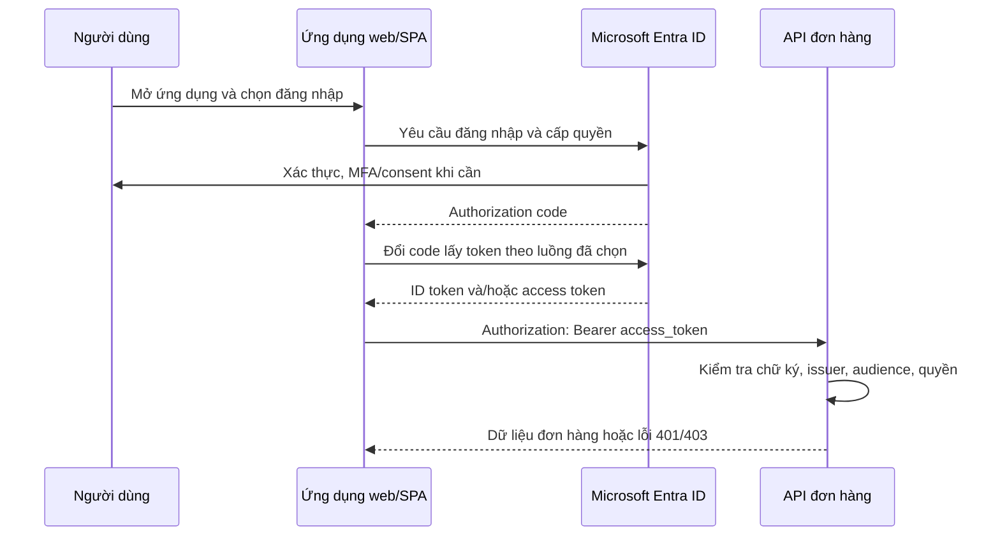
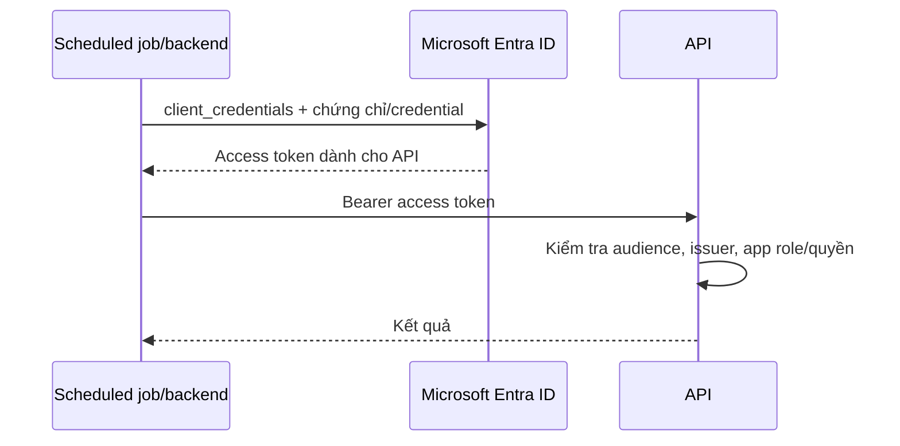
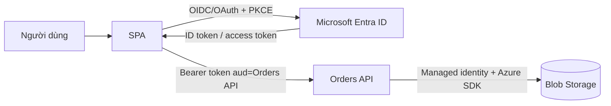

# OAuth 2.0, OpenID Connect và token trong ứng dụng Azure

Khi một người dùng đăng nhập vào ứng dụng web trên Azure, ứng dụng cần biết **ai đang đăng nhập**. Khi ứng dụng gọi một Web API hoặc đọc dữ liệu trong Azure Storage, dịch vụ đích cần biết **ai được phép thực hiện thao tác gì**. Hai yêu cầu này liên quan nhưng khác nhau: **OpenID Connect (OIDC)** hỗ trợ xác thực danh tính, còn **OAuth 2.0** là khuôn khổ ủy quyền để ứng dụng lấy quyền truy cập tài nguyên. Microsoft Entra ID cùng Microsoft identity platform cung cấp các endpoint, token và cơ chế quản lý ứng dụng để triển khai các giao thức này.

Bài học thuộc chương **Danh tính với Microsoft Entra ID** của module **CLOUD_PROVIDERS_AZURE**. Module khám phá hệ sinh thái Microsoft Azure từ subscription, resource group và Entra ID đến mạng ảo, dịch vụ tính toán, lưu trữ và dữ liệu; đồng thời hướng dẫn triển khai, giám sát, bảo vệ và kiểm soát chi phí kiến trúc ứng dụng trên Azure. Việc hiểu token và luồng xác thực là nền tảng để bảo vệ App Service, Azure Functions, API, Storage và các workload sử dụng managed identity.

Sau bài học, bạn sẽ có thể:

- Phân biệt OAuth 2.0, OIDC, đăng nhập và cấp quyền truy cập API.
- Hiểu chức năng của access token, ID token và refresh token.
- Chọn authorization code + PKCE, client credentials hoặc on-behalf-of cho từng kiểu ứng dụng.
- Cấu hình các khái niệm app registration, scope, app role và consent trong Microsoft Entra ID.
- Thiết kế API xác minh token đúng audience, issuer, thời hạn và quyền.
- Nhận diện các lỗi thường gặp khi ứng dụng Azure gọi Microsoft Graph hoặc tài nguyên Azure.

## 1. Các vai trò trong một yêu cầu truy cập

OAuth 2.0 phân biệt một số vai trò:

| Vai trò | Trong hệ sinh thái Azure | Trách nhiệm |
|---|---|---|
| Resource owner | Người dùng hoặc chủ thể sở hữu dữ liệu/quyền | Cho phép truy cập trong mô hình delegated khi phù hợp |
| Client | Web app, SPA, mobile app, ứng dụng dòng lệnh hoặc backend | Yêu cầu token và gọi API |
| Authorization server | Microsoft identity platform của Microsoft Entra ID | Xác thực, xin consent khi cần và phát hành token |
| Resource server | Web API, Microsoft Graph hoặc dịch vụ Azure | Kiểm tra token và quyết định cho phép thao tác |

Ví dụ, người dùng đăng nhập ứng dụng đặt hàng, sau đó ứng dụng cần gọi API đơn hàng:



Trong sơ đồ, phần đổi code lấy token được giản lược để thể hiện ý tưởng. Cách chuyển hướng, PKCE, thông tin xác thực của client và nơi lưu token phụ thuộc loại ứng dụng.

**Nguyên tắc cốt lõi:** ứng dụng dùng token để chứng minh quyền đối với **API đích**; API không nên tin một token chỉ vì token trông giống JWT.

## 2. OAuth 2.0 và OpenID Connect khác nhau thế nào?

### 2.1. OAuth 2.0: ủy quyền

OAuth 2.0 cho phép client nhận access token để gọi một resource server, thường không phải chia sẻ mật khẩu người dùng cho client. Quyền truy cập được giới hạn bởi resource, loại quyền, chủ thể và các điều kiện kiểm soát.

Ví dụ: người dùng đồng ý cho ứng dụng đọc hồ sơ của họ qua Microsoft Graph; ứng dụng nhận access token dành cho Graph với quyền delegated phù hợp. Microsoft Graph kiểm tra token trước khi trả dữ liệu.

OAuth 2.0 **không tự nó xác định một giao thức đăng nhập có ID token**. Việc nhìn thấy access token không đủ để một client tùy ý suy ra phiên đăng nhập hợp lệ của người dùng.

### 2.2. OpenID Connect: lớp xác thực trên OAuth 2.0

OIDC bổ sung cách xác thực người dùng và phát hành **ID token** cho client. Khi client yêu cầu scope `openid` trong một luồng phù hợp, Microsoft identity platform có thể cấp ID token để client xác định phiên đăng nhập.

OIDC còn cung cấp discovery metadata và public signing keys để client xác minh token theo cấu hình của identity provider. Tùy loại ứng dụng, client hoặc thư viện xác thực dùng các claim như `iss`, `aud`, `sub`, `tid` và `nonce` để kiểm tra phiên đăng nhập.

| Câu hỏi | OAuth 2.0 | OpenID Connect |
|---|---|---|
| Mục tiêu chính | Client được phép truy cập tài nguyên nào? | Người dùng đã đăng nhập là ai? |
| Token liên quan | Access token; refresh token tùy luồng | ID token, cùng các token OAuth khi yêu cầu |
| Bên tiếp nhận chính | Resource server/API | Client đã yêu cầu xác thực |
| Ví dụ | API cho phép đọc danh sách đơn hàng | Ứng dụng hiển thị tên tài khoản đã đăng nhập |

Không gửi **ID token** vào header `Authorization` để gọi API. API cần **access token** được phát hành cho chính API đó.

## 3. Ba loại token thường gặp

| Token | Được cấp cho ai, nhằm mục đích gì? | Nơi sử dụng | Lưu ý |
|---|---|---|---|
| **Access token** | Client sử dụng để truy cập một resource server cụ thể | Gửi tới API đích qua HTTPS | API phải tự xác minh token và quyền |
| **ID token** | Client xác nhận kết quả đăng nhập của người dùng | Client/OIDC middleware | `aud` thường là client ID của ứng dụng đăng nhập; không thay access token |
| **Refresh token** | Client dùng theo cơ chế của authorization server để yêu cầu token mới | Thành phần quản lý phiên/token, thường qua MSAL | Là thông tin nhạy cảm; không chuyển cho API tài nguyên |

### 3.1. Access token và audience

**Audience (`aud`)** xác định tài nguyên/API mà token được phát hành cho. Một token dành cho Microsoft Graph không thể được API đơn hàng chấp nhận chỉ vì cả hai cùng dùng Microsoft Entra ID.

Ví dụ về các resource khác nhau:

- Microsoft Graph: API `https://graph.microsoft.com`.
- API nội bộ được đăng ký trong Entra ID: một định danh API riêng, thường có App ID URI dạng `api://<api-client-id>`.
- Azure Resource Manager (control plane): tài nguyên `https://management.azure.com/`.
- Azure Storage (data plane với Entra ID): tài nguyên `https://storage.azure.com/`.

Một token thường chỉ có một audience. Client muốn gọi hai resource server có thể cần **hai access token riêng**.

### 3.2. JWT và claim

Access token do Microsoft Entra ID phát hành cho API thường có dạng JWT, gồm header, payload và signature. Tuy nhiên, **client phải xem access token như dữ liệu opaque**: format và claim dành cho resource server, không phải giao diện ổn định để client tự phân tích. API có thể đọc các claim *sau khi xác minh hợp lệ*.

Payload minh họa (giá trị giả, không phải token thực):

```json
{
  "aud": "11111111-1111-1111-1111-111111111111",
  "iss": "https://login.microsoftonline.com/22222222-2222-2222-2222-222222222222/v2.0",
  "tid": "22222222-2222-2222-2222-222222222222",
  "sub": "subject-identifier",
  "scp": "Orders.Read",
  "exp": 1893456000,
  "nbf": 1893452400,
  "ver": "2.0"
}
```

Các claim hay gặp:

- `iss`: issuer, bên phát hành token; phải phù hợp tenant và phiên bản endpoint kỳ vọng.
- `aud`: audience, API đích phải khớp với đối tượng nhận token.
- `exp`, `nbf`: thời điểm hết hạn và thời điểm token bắt đầu hợp lệ (Unix timestamp).
- `tid`: tenant ID; có thể giúp áp dụng chính sách tenant cho API đa tenant.
- `sub`: định danh subject trong phạm vi token/ứng dụng; không mặc định là email.
- `oid`: object ID của chủ thể trong tenant khi claim này hiện diện; hữu ích để tham chiếu danh tính ổn định trong đúng tenant.
- `scp`: danh sách delegated scopes, thường xuất hiện trong token có ngữ cảnh người dùng.
- `roles`: app roles/application permissions mà principal được cấp cho API.
- `azp` hoặc `appid`: client gọi API, tùy phiên bản token.
- `ver`: phiên bản định dạng token; có thể khác phiên bản endpoint client đã gọi.

Tập claim thực tế phụ thuộc loại token, phiên bản, resource và cấu hình. Không thiết kế bảo mật dựa trên việc một claim tùy chọn luôn tồn tại. Chỉ giải mã Base64 payload **không xác minh được chữ ký** và không đủ để chấp nhận token.

### 3.3. Thời hạn token

Access token chỉ có hiệu lực trong một khoảng thời gian do issuer quy định. Không mặc định thời hạn cố định cho mọi loại token hoặc ứng dụng; hãy dựa trên `exp` và chính sách thực tế. Thư viện như **MSAL** có cơ chế cache và tự lấy lại token khi cần. Ứng dụng không nên tự tính toán bằng cách lưu cứng access token vô thời hạn.

## 4. Các thành phần Entra ID khi đăng ký ứng dụng

Để tích hợp Microsoft identity platform, thường cần một hoặc nhiều **app registration**.

- **Application (app registration)** mô tả cấu hình của ứng dụng: application/client ID, supported account types, redirect URI, các quyền API được khai báo, scope hoặc app role mà API công bố, credential dành cho confidential client.
- **Service principal (enterprise application)** đại diện cho ứng dụng trong một tenant cụ thể; là đối tượng dùng để quản lý consent, assignment và quyền truy cập tại tenant đó.
- **Tenant ID (directory ID)** xác định tenant.
- **Application/client ID** xác định ứng dụng đã đăng ký; khác với **object ID** của application hoặc service principal.
- **App ID URI** định danh resource API khi công bố các scope, thường có dạng `api://<api-client-id>`.

Một hệ thống SPA + API thường dùng **hai app registration**: một client đại diện SPA và một resource app đại diện API. Cách tách này giúp audience và quyền truy cập rõ ràng.

### 4.1. Endpoint và tenant

Microsoft identity platform có các endpoint OAuth 2.0/OIDC thường dùng:

```text
https://login.microsoftonline.com/<tenant-id>/oauth2/v2.0/authorize
https://login.microsoftonline.com/<tenant-id>/oauth2/v2.0/token
https://login.microsoftonline.com/<tenant-id>/v2.0/.well-known/openid-configuration
```

Các authority như `common` hoặc `organizations` có thể dùng trong kịch bản nhiều tenant, nhưng API vẫn phải kiểm tra issuer/tenant được chấp nhận. Với ứng dụng chỉ cho một tổ chức, sử dụng tenant ID cụ thể giúp thiết lập ranh giới rõ ràng hơn.

Lưu ý: gọi endpoint `/v2.0` **không tự động đảm bảo access token có claim `ver=2.0`**. Phiên bản access token do API/resource quyết định thông qua cấu hình hỗ trợ. Với một API tự đăng ký, có thể cấu hình `api.requestedAccessTokenVersion` của app registration khi phù hợp. Middleware API cần xác minh issuer/audience theo **phiên bản token thực tế**.

### 4.2. Delegated permission, application permission và consent

Hai mô hình cấp quyền rất quan trọng:

| Kiểu quyền | Có người dùng đăng nhập? | Claim thường dùng | Tình huống |
|---|---|---|---|
| **Delegated permission** | Có, ứng dụng hành động thay mặt người dùng | `scp` | SPA gọi API đơn hàng cho người dùng đang đăng nhập |
| **Application permission** | Không yêu cầu người dùng tương tác; ứng dụng dùng danh tính của chính mình | `roles` nếu API công bố và gán app role | Job chạy theo lịch đọc dữ liệu được cho phép |

Với delegated permissions, hiệu lực thường phụ thuộc cả quyền ứng dụng được cấp và quyền mà người dùng có trong dịch vụ đích. Với application permissions, ứng dụng phải được cấp quyền cho resource, nhiều quyền yêu cầu admin consent.

**Consent** là việc người dùng hoặc quản trị viên chấp thuận các quyền ứng dụng yêu cầu theo chính sách tenant. Việc khai báo permission trong app registration chưa tự động tạo ra sự chấp thuận hoặc bảo đảm API sẽ chấp nhận token.

Các scope chuẩn của OIDC gồm `openid`, `profile`, `email`; `offline_access` liên quan khả năng nhận refresh token trong những luồng hỗ trợ. Các scope này **không phải** quyền đọc dữ liệu của API đơn hàng. Scope nghiệp vụ của API phải được API công bố riêng.

## 5. Chọn luồng OAuth 2.0 phù hợp

### 5.1. Authorization code flow với PKCE: web, SPA, mobile

Đây là luồng phổ biến cho ứng dụng có người dùng tương tác. **PKCE** (Proof Key for Code Exchange) bảo vệ việc đổi authorization code bằng một cặp `code_verifier` và `code_challenge`; đặc biệt cần thiết cho public clients như SPA hoặc mobile.

Trình tự rút gọn:

1. Client tạo `state` và cặp PKCE. Nếu yêu cầu OIDC, client xử lý `nonce` phù hợp.
2. Client chuyển hướng người dùng tới `/authorize` với client ID, redirect URI, scope, `response_type=code` và `code_challenge`.
3. Entra ID xác thực người dùng, áp dụng MFA/Conditional Access và hiển thị consent nếu cần.
4. Entra ID chuyển authorization code về redirect URI hợp lệ.
5. Client đổi code tại `/token` cùng `code_verifier`; confidential client còn xác thực bằng cơ chế phù hợp của nó.
6. Client/OIDC middleware kiểm tra kết quả đăng nhập; client dùng access token khi gọi API.

Minh họa authorization request (thay các chỗ giữ chỗ bằng giá trị URL-encoded thực tế):

```text
GET https://login.microsoftonline.com/<tenant-id>/oauth2/v2.0/authorize
  ?client_id=<spa-client-id>
  &response_type=code
  &redirect_uri=<url-encoded-registered-redirect-uri>
  &response_mode=query
  &scope=openid%20profile%20api%3A%2F%2F<api-client-id>%2FOrders.Read
  &state=<random-state>
  &code_challenge=<base64url-sha256-code-verifier>
  &code_challenge_method=S256
```

Đây là ví dụ khái niệm để đọc tham số; nên dùng MSAL thay vì tự dựng URL và tự triển khai toàn bộ cơ chế PKCE/OIDC. `state` giúp chống CSRF trong luồng chuyển hướng; `nonce` giúp ràng buộc ID token với yêu cầu đăng nhập. Redirect URI phải được đăng ký chính xác và ứng dụng phải kiểm tra giá trị theo giao thức.

**Không** dùng client secret trong SPA hoặc mã JavaScript tải về trình duyệt. Tránh các luồng implicit grant hoặc thu thập mật khẩu trực tiếp khi đã có luồng authorization code + PKCE hiện đại.

### 5.2. Client credentials flow: dịch vụ chạy không có người dùng

Job xử lý dữ liệu, daemon hoặc service-to-service có thể yêu cầu token bằng danh tính ứng dụng:



Ví dụ tham số request tới token endpoint cho confidential client:

```text
POST /<tenant-id>/oauth2/v2.0/token
Content-Type: application/x-www-form-urlencoded

client_id=<service-client-id>
&scope=api%3A%2F%2F<api-client-id>%2F.default
&grant_type=client_credentials
&client_secret=<server-side-secret-only>
```

`.default` ở đây yêu cầu các application permissions đã được cấu hình/cấp cho resource đó. Ví dụ dùng secret để dễ thấy cấu trúc giao thức; trong production nên ưu tiên **managed identity** trên Azure hoặc credential bất đối xứng/cơ chế liên kết danh tính được hỗ trợ, thay vì lưu secret dài hạn.

Luồng này thường chỉ trả **access token**, không đại diện cho người dùng đăng nhập và không trả ID token cho user. API cần kiểm tra app role hoặc chính sách authorization phù hợp; không giả định mọi app-only token đều có `scp`.

### 5.3. On-behalf-of (OBO): API gọi API tiếp theo

Nếu SPA gọi API A, rồi API A cần gọi Microsoft Graph **thay mặt chính người dùng đó**, API A có thể dùng luồng **on-behalf-of** để đổi token đầu vào lấy access token mới cho Graph. API A phải là confidential client và thực hiện quy trình OBO theo cấu hình Microsoft identity platform.

```text
User -> SPA -> [token aud=API A] -> API A
                                  |
                                  +-> OBO tại Entra ID -> [token aud=Graph] -> Graph
```

API A **không được chuyển tiếp** access token có `aud=API A` trực tiếp tới Graph; Graph yêu cầu token dành cho Graph. OBO sử dụng ngữ cảnh delegated; nếu không có người dùng, hãy xem xét client credentials hoặc managed identity.

### 5.4. Device code và các trường hợp khác

Ứng dụng CLI hoặc thiết bị hạn chế khả năng mở trình duyệt có thể dùng **device authorization grant**. Người dùng xác thực trên thiết bị khác theo chỉ dẫn. Với các ứng dụng mới, ưu tiên các flow chuẩn và thư viện hỗ trợ thay vì tự xây cơ chế nhập mật khẩu hoặc luồng cấp token tùy biến.

## 6. Scopes, app roles và nguyên tắc chọn token đúng API

Giả sử hệ thống gồm ứng dụng front-end, API đơn hàng và Microsoft Graph.

| Mục tiêu | Quyền và token nên yêu cầu | Điều API đích kiểm tra |
|---|---|---|
| Đăng nhập vào front-end | OIDC `openid`, có thể thêm `profile` | Client xác minh ID token |
| Người dùng xem đơn hàng | `api://<api-client-id>/Orders.Read` | API đơn hàng xác minh `aud` và `scp` |
| Người dùng sửa đơn hàng | `api://<api-client-id>/Orders.Write` | API đơn hàng kiểm tra scope ghi |
| Đọc hồ sơ từ Microsoft Graph | `User.Read` của Graph | Graph xác minh access token cho Graph |
| Backend chạy định kỳ gọi API | App role như `Orders.Batch.Read`, yêu cầu token với `api://<api-client-id>/.default` | API kiểm tra `roles`/quyền ứng dụng |

Trong app registration của API, nhóm phát triển có thể tạo scope `Orders.Read`, `Orders.Write` (delegated) và app role `Orders.Batch.Read` cho application access. Client đăng ký yêu cầu các quyền phù hợp; người hoặc quản trị viên cấp consent khi cần.

Khi sử dụng `/.default`, không hiểu đây là quyền “truy cập mọi thứ”. Nó biểu thị tập quyền tĩnh đã được khai báo/cấp consent cho **resource cụ thể** theo loại luồng; token vẫn phải được resource server kiểm tra. Không trộn scope dành cho các resource khác nhau trong cùng một yêu cầu token.

## 7. Thực hành kiến trúc: SPA gọi API đơn hàng được bảo vệ

Xét hệ thống có:

- **SPA** chạy trong trình duyệt và đăng nhập người dùng bằng Microsoft Entra ID.
- **Orders API** chạy trên Azure App Service hoặc Azure Functions, công bố scope `Orders.Read`.
- **Azure Blob Storage** chứa hóa đơn; chỉ backend cần đọc blob bằng managed identity.



### 7.1. Chuẩn bị trong Microsoft Entra admin center

1. Tạo app registration cho **Orders API**. Trong **Expose an API**, thiết lập App ID URI và tạo delegated scope `Orders.Read`. Nếu triển khai API nhận access token v2, cấu hình phiên bản access token tương ứng và dùng middleware xác minh đúng issuer.
2. Tạo app registration cho **Orders SPA**, chọn nền tảng SPA và đăng ký redirect URI HTTPS chính xác của ứng dụng.
3. Trong API permissions của SPA, thêm scope `Orders.Read` của Orders API. Thực hiện consent theo chính sách tenant.
4. Cấu hình SPA với `tenant ID`, `SPA client ID`, redirect URI và scope của API.
5. Cấu hình Orders API kiểm tra access token dành cho **API client ID** và chính sách `Orders.Read`. Không xem việc front-end đăng nhập thành công là bằng chứng đủ để API trả dữ liệu.
6. Bật managed identity cho backend nếu cần đọc Blob Storage; gán `Storage Blob Data Reader` tại scope Storage Account hoặc container phù hợp. Vai trò đọc blob thuộc data plane và tách khỏi quyền gọi Orders API.

### 7.2. Minh họa SPA lấy token bằng MSAL Browser

Ví dụ JavaScript tối giản sau giả sử đã cài `@azure/msal-browser` và môi trường có thể mở popup đăng nhập. Các giá trị trong dấu giữ chỗ là giả định và phải thay bằng thông tin từ app registration.

```javascript
import { PublicClientApplication } from "@azure/msal-browser";

const tenantId = "<tenant-id>";
const apiClientId = "<orders-api-client-id>";
const readScope = "api://" + apiClientId + "/Orders.Read";

const msal = new PublicClientApplication({
  auth: {
    clientId: "<spa-client-id>",
    authority: "https://login.microsoftonline.com/" + tenantId,
    redirectUri: window.location.origin
  }
});

await msal.initialize();

const login = await msal.loginPopup({
  scopes: ["openid", "profile", readScope]
});

const tokenResult = await msal.acquireTokenSilent({
  account: login.account,
  scopes: [readScope]
});

const response = await fetch("https://api.example.com/orders", {
  headers: {
    Authorization: "Bearer " + tokenResult.accessToken
  }
});

if (!response.ok) throw new Error("Orders API HTTP " + response.status);
const orders = await response.json();
```

Ứng dụng thực tế cần xử lý lỗi yêu cầu tương tác (chẳng hạn consent/MFA bổ sung) theo cách MSAL khuyến nghị, quản lý tài khoản và vòng đời phiên đăng nhập, và cấu hình CORS/HTTPS cho API. Khi dùng popup hoặc redirect, hãy đăng ký đúng redirect URI trong Entra ID. MSAL quản lý cache và quy trình cấp token; ứng dụng không cần tự lưu access token vào một kho lâu dài.

### 7.3. Minh họa API xác minh access token

Đoạn mã Node.js sau minh họa một API **single-tenant** nhận **access token v2** cho chính mình. Nó dùng thư viện `jose` để kiểm tra chữ ký qua JWKS, issuer, audience và claim `scp`. Đây là ví dụ về cấu trúc kiểm tra; ứng dụng production có thể dùng middleware chuẩn được Microsoft hỗ trợ và cần thêm logging, phân quyền theo bản ghi và kiểm thử.

```javascript
import express from "express";
import { createRemoteJWKSet, jwtVerify } from "jose";

const tenantId = process.env.AZURE_TENANT_ID;
const apiClientId = process.env.ORDERS_API_CLIENT_ID;
if (!tenantId || !apiClientId) {
  throw new Error("Missing identity configuration");
}

const issuer = "https://login.microsoftonline.com/" + tenantId + "/v2.0";
const jwks = createRemoteJWKSet(
  new URL("https://login.microsoftonline.com/" + tenantId + "/discovery/v2.0/keys")
);
const app = express();

app.get("/orders", async (req, res) => {
  const match = /^Bearer\s+(.+)$/i.exec(req.headers.authorization || "");
  if (!match) return res.sendStatus(401);

  let claims;
  try {
    ({ payload: claims } = await jwtVerify(match[1], jwks, {
      issuer,
      audience: apiClientId
    }));
  } catch {
    return res.sendStatus(401);
  }

  // Ví dụ endpoint chỉ chấp nhận quyền delegated của người dùng.
  const scopes = (claims.scp || "").split(/\s+/);
  if (!scopes.includes("Orders.Read")) {
    return res.sendStatus(403);
  }

  // Tiếp tục áp dụng quyền nghiệp vụ theo người dùng/bản ghi tại đây.
  return res.json([{ id: "order-001", status: "processing" }]);
});

app.listen(3000);
```

Trong access token v2 dành cho API đã cấu hình đúng, `aud` thường là GUID client ID của API. Nếu API được cấu hình phát hành access token v1, issuer và audience có thể có dạng khác, vì vậy không dùng nguyên ví dụ này cho token v1. API đa tenant phải triển khai xác minh issuer và tenant được tin cậy theo quy tắc đa tenant, không chấp nhận tùy ý mọi issuer.

Một API nhận application permissions cần chính sách riêng kiểm tra `roles` (hoặc cơ chế app-only authorization được thiết kế rõ ràng), thay vì chỉ kiểm tra `scp`. Kiểm tra token là bước đầu; API vẫn cần xác định người dùng hoặc ứng dụng có quyền trên **đơn hàng cụ thể** hay không.

### 7.4. Backend đọc Blob Storage bằng managed identity

Khi backend cần đọc hóa đơn, nó có thể lấy token cho Azure Storage qua Azure SDK với `DefaultAzureCredential`. Trên Azure, SDK có thể sử dụng managed identity; khi phát triển cục bộ, nó có thể dùng các nguồn credential của môi trường phát triển tùy cấu hình.

```javascript
import { DefaultAzureCredential } from "@azure/identity";
import { BlobServiceClient } from "@azure/storage-blob";

const credential = new DefaultAzureCredential();
const storage = new BlobServiceClient(
  "https://<storage-account>.blob.core.windows.net",
  credential
);

const blob = storage
  .getContainerClient("invoices")
  .getBlobClient("invoice-001.pdf");

const download = await blob.download();
// Xử lý download.readableStreamBody theo nhu cầu ứng dụng.
```

Orders API phải có quyền `Storage Blob Data Reader` đối với dữ liệu cần đọc và đường mạng phù hợp. Access token mà SPA gửi đến Orders API không phải token để API gọi Storage. Azure SDK sẽ dùng credential của **backend**, lấy token cho resource Azure Storage phù hợp.

## 8. Những kiểm tra bắt buộc ở bên nhận token

Resource server nên sử dụng thư viện xác thực đã được kiểm chứng, dựa trên OIDC discovery metadata hoặc cấu hình của Microsoft identity platform, để thực hiện những kiểm tra sau:

1. **Chữ ký và thuật toán:** xác minh chữ ký bằng khóa ký tin cậy của issuer; không chấp nhận thuật toán bất ngờ hay JWT không chữ ký.
2. **Issuer (`iss`):** đúng tenant/authority được API cho phép; cẩn thận với API đa tenant.
3. **Audience (`aud`):** token phải được phát hành **cho API này**.
4. **Thời gian:** kiểm tra `exp`, `nbf` và sai lệch đồng hồ hợp lý; từ chối token quá hạn.
5. **Loại quyền:** delegated scope trong `scp` hoặc application role trong `roles`, theo loại API và endpoint.
6. **Tenant và client:** áp dụng allowlist hoặc chính sách đối với tenant (`tid`), calling application (`azp`/`appid`) nếu bài toán yêu cầu.
7. **Quyền dữ liệu:** kiểm tra người dùng/ứng dụng có được truy cập đối tượng nghiệp vụ đang được yêu cầu hay không.

Với ứng dụng OIDC, client/OIDC middleware phải kiểm tra ID token theo đúng các điều kiện của luồng đăng nhập, bao gồm `aud`, issuer, thời gian và `nonce` khi áp dụng. Không dùng decode payload để bỏ qua xác minh chữ ký.

**401 Unauthorized** thường biểu thị không có token hoặc xác thực token không thành công. **403 Forbidden** thường biểu thị đã có principal hợp lệ nhưng principal thiếu quyền cho thao tác. Khi thiết kế API, phản hồi không nên làm lộ token hay chi tiết nhạy cảm.

## 9. Bảo vệ token và thông tin xác thực

- Luôn truyền token qua **HTTPS**; không đưa access token, refresh token hoặc authorization code vào log ứng dụng, URL công khai, thông báo lỗi hoặc kho mã nguồn.
- Dùng **MSAL** hoặc thư viện chuẩn để xử lý PKCE, cache, refresh và tương tác đăng nhập. Tránh tự viết giao thức OAuth/OIDC từ đầu.
- Không nhúng client secret, private key hoặc connection string nhạy cảm vào front-end. Với confidential client, lưu và luân chuyển credential an toàn; ưu tiên managed identity trên các workload Azure khi có thể.
- Không đưa ID token vào API như access token và không tái sử dụng token có audience sai.
- Chọn scope/app role theo **least privilege**; chỉ yêu cầu các quyền cần thiết, hạn chế admin consent cho quyền rộng.
- Bảo vệ redirect URI và trạng thái đăng nhập; cấu hình `state`, `nonce` và PKCE theo thư viện, đồng thời chống XSS và CSRF theo mô hình ứng dụng.
- Xem xét Conditional Access, MFA, session controls và chính sách tenant khi triển khai luồng tương tác. Những cơ chế này bổ sung bảo vệ cho việc phát hành token.
- Việc vô hiệu hóa người dùng hoặc thu hồi quyền không đồng nghĩa mọi access token đã phát hành đều lập tức mất hiệu lực trong mọi tình huống. Thiết kế token lifetime, kiểm tra quyền nghiệp vụ và cơ chế thu hồi/phát hiện theo khả năng của dịch vụ.

## 10. Chẩn đoán lỗi OAuth/OIDC thường gặp

| Triệu chứng | Nguyên nhân hay gặp | Hướng kiểm tra |
|---|---|---|
| Redirect URI mismatch | URL trả về không khớp app registration hoặc sai loại nền tảng | Kiểm tra scheme, host, path, port và đăng ký SPA/Web |
| `invalid_scope` hoặc yêu cầu permission thất bại | Sai resource, scope chưa được API công bố hoặc dùng `/.default` sai ngữ cảnh | Xem App ID URI, Expose an API, quyền client và consent |
| `invalid_client` | Confidential client cung cấp credential sai, hết hạn hoặc dùng sai loại client | Kiểm tra client ID, certificate/secret và nơi giữ credential |
| Cần admin consent | Quyền yêu cầu cần quản trị viên chấp thuận hoặc tenant chặn user consent | Kiểm tra permission type và chính sách consent |
| API trả 401 dù đăng nhập thành công | Gửi ID token, token hết hạn, sai issuer/audience, sai tenant hoặc cấu hình ký | Xem header gửi đi và cấu hình xác thực của API |
| API trả 403 | Token hợp lệ nhưng thiếu `scp`/`roles` hoặc quyền nghiệp vụ | Kiểm tra scope/role thực tế và assignment/consent |
| Token dùng được với Graph nhưng API nội bộ từ chối | Token phát hành cho Graph (`aud` khác) | Yêu cầu access token riêng cho API nội bộ |
| Backend không đọc được blob | Thiếu Storage Blob Data role, sai managed identity, hoặc mạng chặn | Kiểm tra principal, scope, Storage endpoint, firewall/private endpoint |
| SPA nhận lỗi yêu cầu tương tác | MFA, consent hoặc session phải xử lý lại | Dùng MSAL interactive fallback phù hợp thay vì lặp acquireTokenSilent |

Khi kiểm tra một lỗi thực tế, hãy xác định rõ **ứng dụng nào yêu cầu token, token dành cho API nào, principal nào nhận quyền, claim gì được cấp và API nào từ chối**. Log correlation ID, request ID và mã lỗi ở mức an toàn; không ghi token nguyên văn.

## 11. Bài tập vận dụng

**Tình huống A:** Một SPA đăng nhập thành công và nhận ID token, nhưng gọi Orders API bị 401. Hãy giải thích vì sao ID token không thay được access token và nêu các yếu tố API phải kiểm tra.

**Tình huống B:** Một Azure Function chạy mỗi đêm, không có người dùng đăng nhập, cần gọi API nội bộ để tổng hợp dữ liệu. Hãy chọn luồng phù hợp, mô hình quyền cần kiểm tra và cách quản lý credential.

**Tình huống C:** API A nhận delegated access token từ SPA, sau đó muốn gọi Microsoft Graph thay mặt người dùng. Tại sao không thể gửi trực tiếp token của API A sang Graph? Luồng nào giải quyết nhu cầu này?

**Tình huống D:** Một lập trình viên giải mã JWT từ Base64 rồi thấy `scp=Orders.Read`. Vì sao việc nhìn thấy claim đó vẫn chưa đủ để cấp quyền đọc đơn hàng?

**Tình huống E:** Orders API gọi Blob Storage bằng managed identity nhưng nhận 403. Hãy phân biệt ba nhóm nguyên nhân: danh tính/role data plane, audience/token và cấu hình mạng.

## Kết luận

OAuth 2.0 giúp ứng dụng lấy quyền truy cập tài nguyên; OpenID Connect bổ sung cơ chế xác thực người dùng và ID token. **Access token dành cho API**, **ID token dành cho client đăng nhập**, còn refresh token phục vụ quy trình cấp lại token theo luồng được hỗ trợ. Trong Microsoft Entra ID, app registration, service principal, scopes, app roles và consent xác định ai yêu cầu quyền và quyền được cấp cho resource nào. Thiết kế Azure an toàn cần chọn đúng flow, dùng MSAL/managed identity khi phù hợp, xác minh token đầy đủ ở API và kiểm tra quyền dữ liệu thực tế trước khi trả kết quả.
