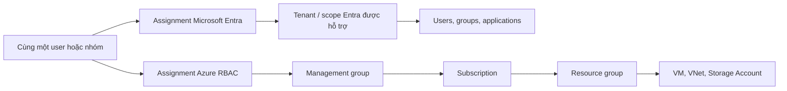

# Phân biệt quyền Microsoft Entra ID và quyền Azure RBAC

Trong chương **Danh tính với Microsoft Entra ID** của module **CLOUD_PROVIDERS_AZURE**, bài này giải thích cách phân biệt quyền quản trị thư mục với quyền quản lý tài nguyên Azure. Sự phân biệt này giúp chọn đúng quyền khi triển khai ứng dụng, vận hành subscription và resource group, quản lý người dùng, bảo vệ dữ liệu và điều tra lỗi truy cập.

Một kỹ sư có thể quản lý máy ảo nhưng không được tạo người dùng trong tenant. Một quản trị viên có thể quản lý người dùng nhưng không xem được một subscription. Cả hai trường hợp đều có thể phù hợp với thiết kế phân quyền.

Điểm xuất phát là xác định **đối tượng đang được quản lý**: đó là user, group, ứng dụng trong thư mục, hay tài nguyên Azure như máy ảo, mạng và Storage Account?

Sau bài học, bạn có thể:

- Phân loại nhu cầu vào hệ quyền Microsoft Entra hoặc Azure RBAC.
- Giải thích principal, role và scope trong từng hệ.
- Phân biệt Global Administrator, Owner và các role quản lý quyền.
- Nhận ra quyền API, quyền dữ liệu và quyền sở hữu đối tượng là những yếu tố cần xét thêm.
- Kiểm tra hai nhóm assignment bằng đúng công cụ và đọc kết quả trong phạm vi của phép kiểm tra.

## 1. Cùng một danh tính có thể nhận hai nhóm quyền khác nhau

**Microsoft Entra roles** dùng để quản trị các đối tượng và chức năng của Microsoft Entra ID, chẳng hạn người dùng, nhóm và ứng dụng. **Azure roles** trong Azure RBAC dùng để kiểm soát truy cập tài nguyên Azure, chẳng hạn máy ảo và Storage Account. Hai hệ đều dùng role definition và role assignment nhưng định nghĩa quyền của chúng không dùng thay thế cho nhau. [Nguồn: Microsoft Entra RBAC overview](https://learn.microsoft.com/en-us/entra/identity/role-based-access-control/custom-overview).

Trong bài này, “quyền Entra” chủ yếu chỉ quyền quản trị thư mục qua Microsoft Entra roles. Các quyền API và quyền sở hữu đối tượng liên quan sẽ được phân biệt riêng ở phần sau.

| Khía cạnh | Microsoft Entra roles | Azure RBAC roles |
| --- | --- | --- |
| Đối tượng quản lý | User, group, application và chức năng thư mục | Subscription, resource group và tài nguyên Azure |
| Ví dụ công việc | Quản lý người dùng hoặc cấu hình ứng dụng | Triển khai máy ảo hoặc quản lý tài nguyên mạng |
| Role minh họa | User Administrator, Application Administrator | Reader, Contributor, Owner |
| Nơi kiểm tra phổ biến | Roles and administrators, Assigned roles của đối tượng Entra | Access control (IAM) tại scope tài nguyên Azure |
| Phạm vi cần xác định | Tenant hoặc scope Entra được hỗ trợ | Management group, subscription, resource group, resource |

Các điểm phân biệt trên được Microsoft mô tả trong tài liệu so sánh Azure roles và Microsoft Entra roles. [Nguồn: Azure roles và Microsoft Entra roles](https://learn.microsoft.com/en-us/azure/role-based-access-control/rbac-and-directory-admin-roles).

Một user có thể có cả hai nhóm quyền, chỉ có một nhóm quyền, hoặc không có role quản trị nào. Việc user tồn tại trong tenant không tự tạo assignment Owner hay Contributor cho user đó.

Ví dụ về hai assignment độc lập cho cùng người dùng Lan:

```text
Assignment A:
  Principal = Lan
  Role      = User Administrator
  Scope     = scope thư mục được giao

Assignment B:
  Principal = Lan
  Role      = Reader
  Scope     = resource group rg-orders-dev
```

Assignment A phục vụ trách nhiệm về danh tính. Assignment B phục vụ việc xem tài nguyên của ứng dụng Orders. Không suy ra một assignment từ assignment còn lại.

## 2. Xác thực không đồng nghĩa đã có quyền thực hiện thao tác

**Xác thực** xác định ai đang gọi. **Phân quyền** xác định chủ thể đó được làm gì với đối tượng cụ thể.

Đăng nhập thành công vào Azure Portal chưa chứng minh có quyền tạo máy ảo. Tương tự, ứng dụng lấy được access token chưa chứng minh được phép quản lý người dùng hay đọc dữ liệu nghiệp vụ.

Access token dùng để gọi một API đích; ID token phục vụ việc xác nhận đăng nhập cho ứng dụng. Không dùng ID token làm bằng chứng cấp quyền gọi API. Client nên lấy token cho API phù hợp và để API đích thực hiện kiểm tra cần thiết. [Nguồn: Access tokens](https://learn.microsoft.com/en-us/entra/identity-platform/access-tokens).

Trong Azure public cloud, hai endpoint quản lý thường gặp là:

```text
Microsoft Graph:
  https://graph.microsoft.com
  Ví dụ đối tượng: users, groups, applications, directory role assignments

Azure Resource Manager:
  https://management.azure.com
  Ví dụ đối tượng: subscriptions, resource groups, virtual machines
```

Microsoft Graph và Azure Resource Manager là hai API có đối tượng và cơ chế kiểm tra quyền tương ứng. Một phiên đăng nhập có thể được công cụ dùng để lấy token cho nhiều API; không nên coi đó là một token chung dùng được cho mọi dịch vụ.

Khi gặp lỗi, hãy mô tả cụ thể: “user Lan gọi API quản lý máy ảo trong resource group Orders” hoặc “ứng dụng đồng bộ gọi Microsoft Graph để đọc thông tin user”. Cách mô tả này giúp tìm đúng nơi cần kiểm tra quyền.

## 3. Hai cây scope phục vụ hai loại đối tượng

### 3.1. Scope trong Microsoft Entra ID

Một Entra role có thể được gán ở tenant scope hoặc scope đối tượng được hỗ trợ, tùy role và loại đối tượng. Chẳng hạn, một số quyền quản trị ứng dụng có thể giới hạn cho một ứng dụng cụ thể. Không nên mặc định mọi role đều hỗ trợ mọi scope. [Nguồn: List Microsoft Entra role assignments](https://learn.microsoft.com/en-us/entra/identity/role-based-access-control/view-assignments).

**Administrative unit**, viết tắt AU, giúp ủy quyền quản trị cho một tập user, group hoặc device trong thư mục. Nó không phải resource group của Azure. Thêm một group vào AU cũng không tự đưa tất cả user thành viên vào scope quản trị user của AU đó. [Nguồn: Administrative units](https://learn.microsoft.com/en-us/entra/identity/role-based-access-control/administrative-units).

Ví dụ, bộ phận hỗ trợ khu vực có thể được giao một Entra role phù hợp tại AU của khu vực. Điều đó không tạo quyền quản lý một mạng ảo hoặc máy ảo có tên khu vực tương tự.

### 3.2. Scope trong Azure RBAC

Azure RBAC dùng cây scope management group → subscription → resource group → resource. Quyền từ scope cha được kế thừa xuống tài nguyên con. Một assignment ở resource group không tự mở rộng sang resource group anh em. [Nguồn: Azure RBAC scope](https://learn.microsoft.com/en-us/azure/role-based-access-control/scope-overview).



Sơ đồ biểu diễn hai đường cấp quyền. Không có đường kế thừa role tự động từ “quản trị tenant” thành “quản trị mọi subscription”.

Ví dụ về scope của Azure:

```text
/subscriptions/<subscription-id>

/subscriptions/<subscription-id>/resourceGroups/rg-orders-dev

/subscriptions/<subscription-id>/resourceGroups/rg-orders-dev/providers/Microsoft.Compute/virtualMachines/vm-orders-dev
```

Trong khi đó, scope của một Entra directory role assignment được thể hiện bằng trường như `directoryScopeId`. Hai hệ có thể cùng dùng ký hiệu `/` cho scope gốc trong ngữ cảnh riêng; cần đọc cùng API và loại assignment, không so sánh chuỗi scope một cách tách rời.

## 4. Những role có tên dễ bị hiểu nhầm

### 4.1. Các role quản trị thư mục

| Microsoft Entra role | Trách nhiệm minh họa |
| --- | --- |
| Global Administrator | Quản trị rộng các chức năng của Microsoft Entra ID |
| User Administrator | Quản lý người dùng và các tác vụ liên quan trong phạm vi cho phép |
| Application Administrator | Quản lý app registrations và enterprise applications theo quyền của role |
| Privileged Role Administrator | Quản lý assignment Microsoft Entra roles và các chức năng liên quan |
| Global Reader | Đọc cấu hình quản trị mà role hỗ trợ |

Mỗi role có giới hạn chi tiết theo thao tác, đối tượng và scope. Ví dụ, không nên suy ra một role quản trị người dùng có thể thay đổi thông tin xác thực của mọi tài khoản đặc quyền. [Nguồn: Microsoft Entra built-in roles](https://learn.microsoft.com/en-us/entra/identity/role-based-access-control/permissions-reference).

### 4.2. Các role quản lý tài nguyên Azure

| Azure RBAC role | Khả năng chính |
| --- | --- |
| Reader | Xem cấu hình tài nguyên quản lý |
| Contributor | Quản lý tài nguyên, không cấp Azure RBAC role bằng quyền của role này |
| Owner | Quản lý tài nguyên và cấp quyền Azure RBAC |
| Role Based Access Control Administrator | Quản lý truy cập Azure RBAC tại scope được giao |
| User Access Administrator | Quản lý truy cập tài nguyên Azure tại scope được giao |

Cần xét các quyền chính xác, scope, condition và giới hạn áp dụng cho assignment. Owner hay Contributor tại một resource group không có cùng phạm vi tác động với cùng role tại subscription. [Nguồn: Azure privileged built-in roles](https://learn.microsoft.com/en-us/azure/role-based-access-control/built-in-roles/privileged).

Ba cặp tên cần nhớ:

- **User Administrator** là Entra role; **User Access Administrator** là Azure role.
- **Privileged Role Administrator** quản lý quyền Entra; **Role Based Access Control Administrator** quản lý quyền Azure RBAC.
- **Global Reader** và **Reader** thuộc hai hệ khác nhau; không suy ra khả năng đọc của hệ này từ hệ kia.

Quyền Owner trong Azure cũng khác việc là owner của một group hoặc app registration. Từ “owner” phải được đọc cùng loại đối tượng và hệ quản lý quyền.

## 5. Global Administrator và Owner không tự thay thế nhau

Một Global Administrator có thể không có quyền truy cập các subscription của tenant. Azure có cơ chế nâng quyền riêng: Global Administrator có thể tự nhận **User Access Administrator ở root scope `/`** qua thiết lập **Access management for Azure resources**. Đây là bước cấp quyền Azure riêng, không phải mặc định có Owner. [Nguồn: Elevate access](https://learn.microsoft.com/en-us/azure/role-based-access-control/elevate-access-global-admin).

Các điểm cần phân biệt trong cơ chế này:

- Thiết lập áp dụng cho user đang thực hiện, không bật quyền cho mọi Global Administrator.
- Sau công việc, cần gỡ quyền nâng ở root scope.
- Việc deactivate Global Administrator trong PIM không tự tắt thiết lập nâng quyền.
- Các assignment khác đã được tạo cần được rà soát riêng.

Do có đường nâng quyền này, không nên xem ranh giới giữa quản trị thư mục và quản trị Azure là hoàn toàn không thể vượt qua. Cần bảo vệ và giám sát các tài khoản đặc quyền theo khả năng thực tế của chúng.

Ở chiều ngược lại, Owner trên một subscription không tự được thêm quyền quản trị người dùng trong thư mục. Người đó vẫn có thể có quyền thư mục từ nguồn khác; phải kiểm tra nguồn ấy riêng trước khi kết luận.

Trong vận hành thông thường, nên cấp role và scope cần thiết cho công việc thay vì dùng Global Administrator hoặc Owner để xử lý mọi lỗi truy cập.

## 6. Phân biệt thêm quyền dữ liệu, quyền API và quyền sở hữu đối tượng

### 6.1. Azure RBAC có cả quyền quản lý và quyền dữ liệu

Trong định nghĩa Azure role, `Actions` mô tả quyền control plane và `DataActions` mô tả các quyền data plane do dịch vụ tích hợp với Azure RBAC. Vì vậy, Reader xem được Storage Account không đồng nghĩa đọc được nội dung blob bằng Entra ID. [Nguồn: Azure role definitions](https://learn.microsoft.com/en-us/azure/role-based-access-control/role-definitions).

Ví dụ, ứng dụng cần đọc tệp có thể cần một data role phù hợp trên container. Không giải quyết nhu cầu ấy bằng cách gán User Administrator cho danh tính ứng dụng.

Cũng cần kiểm tra đường truy cập khác như account key, SAS hoặc khả năng sửa cấu hình cấp quyền. Kết luận về quyền dữ liệu phải dựa trên cách xác thực và dịch vụ cụ thể.

### 6.2. Microsoft Graph permissions khác Azure role assignment

Microsoft Graph có **delegated permissions** khi ứng dụng gọi thay mặt user và **application permissions** khi ứng dụng gọi bằng danh tính riêng. Một số thao tác cần xét cả Graph permissions lẫn Entra role của user. Cấp Azure Contributor không thay cho quyền gọi Graph. [Nguồn: Microsoft Graph permissions](https://learn.microsoft.com/en-us/graph/permissions-overview).

Ví dụ:

| Nhu cầu của ứng dụng | Hệ quyền cần đánh giá |
| --- | --- |
| Pipeline triển khai tài nguyên của Orders | Azure RBAC trên scope tài nguyên |
| Ứng dụng đồng bộ đọc dữ liệu thư mục qua Graph | Graph permissions và yêu cầu authorization tương ứng |
| Workload đọc blob bằng Entra ID | Data role của dịch vụ và scope dữ liệu |
| Người dùng có vai trò nghiệp vụ “Approver” trong ứng dụng | Cơ chế authorization của ứng dụng/API đó |

Một app role mang tên `Approver` trong ứng dụng Orders không tự trở thành Entra administrative role hay Azure RBAC role.

### 6.3. Tồn tại trong Entra không có nghĩa đã được cấp quyền Azure

App registration mô tả cấu hình danh tính của ứng dụng; service principal là biểu diễn của ứng dụng trong tenant. Khi kiểm tra Azure assignment cho ứng dụng, cần xác định đúng principal của tenant đích. Không nhầm application/client ID, object ID của application object và object ID của service principal. [Nguồn: Application objects và service principals](https://learn.microsoft.com/en-us/entra/identity-platform/app-objects-and-service-principals).

Tương tự, tạo managed identity mới chỉ tạo danh tính cho workload. Trong thiết kế ứng dụng, vẫn phải xác định workload được truy cập tài nguyên nào và cấp quyền tương ứng.

### 6.4. Không có admin role vẫn có thể có một số quyền thư mục

Microsoft Entra ID có quyền mặc định cho user, khác nhau giữa member và guest, và có thể chịu ảnh hưởng của cấu hình tenant. Quyền sở hữu một đối tượng cũng là nguồn quyền cần xét. Vì vậy, không có administrative role không đồng nghĩa không đọc được bất kỳ thông tin thư mục nào. [Nguồn: Default user permissions](https://learn.microsoft.com/en-us/entra/fundamentals/users-default-permissions).

Ví dụ, khả năng đăng ký ứng dụng có thể phụ thuộc thiết lập tenant và quyền mặc định. Không nên tự động cấp Application Administrator chỉ vì người phát triển cần tạo một app registration.

## 7. Quyền cấp role và quyền quản lý thành viên nhóm

### 7.1. Người cấp quyền cũng phải có quyền đúng hệ

Đối với Azure RBAC, tạo assignment cần quyền như `Microsoft.Authorization/roleAssignments/write` tại scope thích hợp. Một custom role hoặc built-in role có khả năng này vẫn có thể chịu condition giới hạn role hay principal được phép cấp. [Nguồn: Azure role assignment](https://learn.microsoft.com/en-us/cli/azure/role/assignment?view=azure-cli-latest).

Đối với Entra administrative roles, cần người hoặc ứng dụng được cho phép quản lý assignment Entra tương ứng. Không thể dùng lệnh `az role assignment` để gán User Administrator của Entra cho user. Cũng không gán Azure Owner bằng thao tác thêm Entra administrative role.

Khi xử lý yêu cầu cấp quyền, nên ghi rõ:

```text
Principal: object ID trong tenant nào?
Hệ quyền: Entra role, Azure role, Graph permission hay quyền ứng dụng?
Role/quyền: cho phép thao tác cụ thể nào?
Scope: bao phủ những đối tượng nào?
Thời hạn: thường trực, có ngày hết hạn hay cần kích hoạt?
Nguồn cấp quyền: trực tiếp hay qua nhóm?
```

Các trường này giúp người duyệt hoặc người thực hiện đánh giá đúng yêu cầu. Một yêu cầu chỉ ghi “cấp quyền admin cho Orders” chưa đủ để chọn role.

### 7.2. Group membership có thể nối hai miền quản trị

Azure RBAC có thể cấp role cho group; thành viên nhận quyền qua group đó. Các assignment Azure cộng dồn, nên một Reader ở scope hẹp không làm mất Contributor đã có từ nguồn khác. [Nguồn: Azure RBAC role assignments](https://learn.microsoft.com/en-us/azure/role-based-access-control/overview).

Ví dụ thiết kế:

```text
sg-orders-deploy là security group với membership được quản lý thủ công.
Group có Contributor trên rg-orders-dev.

Người được phép thêm thành viên vào group
  -> có thể làm thành viên mới nhận quyền qua group
  -> ảnh hưởng quyền truy cập tài nguyên Azure
```

Do đó, khi rà soát Azure assignment qua nhóm, cần biết cả ai quản lý membership của nhóm. Hai hệ role khác nhau vẫn có thể tác động gián tiếp đến nhau qua đối tượng danh tính.

Với việc gán **Microsoft Entra roles** cho group, phải dùng **role-assignable group** được tạo với thuộc tính `isAssignableToRole=true`. Loại nhóm này có những hạn chế riêng về membership và quản trị. Không coi mọi security group thông thường là đủ điều kiện nhận Entra administrative role. [Nguồn: Role-assignable groups](https://learn.microsoft.com/en-us/entra/identity/role-based-access-control/groups-concept).

Việc một group nhận Azure RBAC role không tự biến group đó thành role-assignable group của Entra.

### 7.3. Quyền quản lý thông tin xác thực của ứng dụng cũng cần được xét

Xét một service principal dùng để triển khai Orders đã có Contributor trên resource group development. Nếu một người được phép quản lý thông tin xác thực của ứng dụng đó, khả năng sử dụng danh tính ứng dụng cần được đánh giá cùng quyền Azure của service principal.

Đây là suy luận thiết kế từ quan hệ giữa danh tính và assignment: đánh giá đặc quyền không chỉ đếm role gán trực tiếp cho tài khoản cá nhân. Cần nhìn cả nhóm, quyền sở hữu đối tượng và những danh tính mà người đó có thể kiểm soát.

## 8. Ví dụ phân quyền cho một nhóm phát triển ứng dụng

Giả sử ứng dụng Orders có một resource group development, một resource group production và managed identity chạy ứng dụng.

| Chủ thể | Nhu cầu | Hướng phân quyền |
| --- | --- | --- |
| Nhóm hỗ trợ danh tính | Quản lý user theo phạm vi được giao | Entra role phù hợp tại tenant/AU được hỗ trợ |
| Kỹ sư triển khai development | Tạo và cập nhật tài nguyên development | Azure role theo thao tác cần thiết tại resource group development |
| Nhóm quản trị truy cập Azure | Cấp và thu hồi role tài nguyên | Azure role quản lý assignment tại scope được giao |
| Managed identity của Orders | Đọc dữ liệu cần dùng | Data role của dịch vụ trên tài nguyên hoặc phạm vi dữ liệu thích hợp |
| Ứng dụng đồng bộ danh bạ | Đọc thông tin user qua Graph | Graph permissions tối thiểu và cấu hình authorization tương ứng |

Bảng này là phương án minh họa, không phải bộ role bắt buộc cho mọi tổ chức.

### 8.1. Kỹ sư có Contributor nhưng không tạo được user

Nếu kỹ sư chỉ nhận Contributor tại `rg-orders-dev`, việc tạo tài nguyên trong nhóm và việc tạo user trong tenant là hai nhu cầu khác nhau. Trước khi cấp thêm quyền, cần xác định kỹ sư có thực sự cần tạo user hay có thể dùng danh tính đã được quy trình quản trị cung cấp.

### 8.2. Quản trị viên user không triển khai được VM

Nếu một người có User Administrator nhưng không có Azure assignment bao phủ VM hoặc resource group, cần kiểm tra quyền Azure cho nhiệm vụ triển khai. Thêm một Entra role rộng hơn có thể không giải quyết đúng yêu cầu.

### 8.3. Mời guest và cấp quyền làm việc là hai bước riêng

Đối tác được mời vào tenant chưa tự có quyền xem resource group Orders. Sau khi danh tính được thiết lập, cần cấp quyền trên tài nguyên thực sự được phép truy cập. Cũng phải kiểm tra đúng object ID của guest trong tenant đích, thay vì dùng object ID của tài khoản ở tenant gốc.

### 8.4. Tạo app registration và triển khai hạ tầng là hai trách nhiệm

Một pipeline có thể cần danh tính ứng dụng đã tồn tại để triển khai hạ tầng. Không nhất thiết mỗi lần triển khai phải tạo app registration mới. Tách rõ hai trách nhiệm giúp hạn chế quyền thư mục phải đưa vào pipeline hạ tầng.

## 9. PIM quản lý trạng thái đặc quyền trong từng hệ

Privileged Identity Management, viết tắt PIM, hỗ trợ quyền có thời hạn và kích hoạt theo điều kiện cho Microsoft Entra roles và Azure resource roles. Các khả năng như MFA, lý do sử dụng hoặc phê duyệt phụ thuộc cấu hình. Tính năng yêu cầu license phù hợp. [Nguồn: PIM overview](https://learn.microsoft.com/en-us/entra/id-governance/privileged-identity-management/pim-configure).

Cần phân biệt:

| Trạng thái | Cách hiểu khi kiểm tra công việc |
| --- | --- |
| Eligible | Có khả năng kích hoạt theo điều kiện, chưa mặc định đang dùng quyền |
| Active | Assignment đang ở trạng thái cho phép sử dụng trong phạm vi hiệu lực |
| Expired | Thời hạn đã kết thúc; kiểm tra các nguồn quyền khác nếu vẫn truy cập được |

Ví dụ, user eligible cho một Entra role không vì thế active Azure Contributor. Nếu user cần quyền ở cả hai miền cho một công việc, phải kiểm tra role, scope và trạng thái của từng assignment.

Trong quy trình vận hành, nên ghi lại thời điểm cần quyền, điều kiện kích hoạt và lúc kết thúc công việc. Với quyền nâng ở Azure root scope, việc kết thúc role Entra trong PIM vẫn cần được phân biệt với việc gỡ assignment Azure đã được tạo qua cơ chế nâng quyền.

## 10. Thực hành: đọc assignment ở cả hai hệ

Các ví dụ dưới đây dùng **PowerShell**, Azure CLI và Microsoft Graph PowerShell. Chúng minh họa thao tác đọc; không tạo role assignment hay nâng quyền.

Chuẩn bị:

- Biết tenant ID, subscription ID và object ID của principal cần kiểm tra.
- Có một resource group development để xác định scope.
- Công cụ đã được cài trong môi trường thực hành.
- Tài khoản kiểm tra được phép đọc các thông tin tương ứng.

Việc đăng nhập Azure CLI và đăng nhập Microsoft Graph PowerShell tạo ngữ cảnh công cụ riêng. Cần xác nhận tenant và tài khoản ở từng công cụ.

### 10.1. Kiểm tra Azure RBAC bằng Azure CLI

```powershell
$tenantId = "<tenant-id>"
$subscriptionId = "<subscription-id>"
$resourceGroup = "rg-orders-dev"
$principalObjectId = "<principal-object-id-in-target-tenant>"

az login --tenant $tenantId
az account set --subscription $subscriptionId
if ($LASTEXITCODE -ne 0) { throw "Khong chon duoc subscription." }

az account show --query "{tenant:tenantId,subscription:id,account:user.name}" --output json

$resourceGroupScope = "/subscriptions/$subscriptionId/resourceGroups/$resourceGroup"

az role assignment list --assignee-object-id $principalObjectId --scope $resourceGroupScope --include-inherited --all --fill-principal-name false --query "[].{Role:roleDefinitionName,Scope:scope,Principal:principalId}" --output table
```

`--assignee-object-id` xác định principal bằng object ID. `--fill-principal-name false` tránh truy vấn Graph chỉ để điền tên principal. Cách này hữu ích khi người kiểm tra có quyền Azure nhưng không có quyền đọc tên từ thư mục. [Nguồn: Azure CLI role assignment list](https://learn.microsoft.com/en-us/cli/azure/role/assignment?view=azure-cli-latest).

Ví dụ kết quả minh họa:

```text
Role         Scope                                               Principal
-----------  --------------------------------------------------  ---------------------
Reader       /subscriptions/<sub-id>/resourceGroups/rg-orders-dev <principal-object-id>
Contributor  /subscriptions/<sub-id>                             <principal-object-id>
```

Trong ví dụ này, Contributor ở subscription có phạm vi rộng hơn Reader ở resource group. Không thể kết luận principal “chỉ đọc Orders” từ dòng Reader.

Lệnh đang tập trung vào assignment của principal đã chỉ định. Muốn đánh giá quyền qua nhóm, phải bổ sung thông tin group membership và assignment của các nhóm. Azure CLI có tùy chọn `--include-groups` để truy vấn bổ sung trong ngữ cảnh phù hợp; việc đọc membership có thể cần quyền Graph. [Nguồn: List Azure role assignments](https://learn.microsoft.com/en-us/azure/role-based-access-control/role-assignments-list-cli).

### 10.2. Kiểm tra Entra role assignment bằng Microsoft Graph PowerShell

API liệt kê directory role assignments yêu cầu quyền Graph thích hợp, chẳng hạn `RoleManagement.Read.Directory`. Với delegated access, người đăng nhập còn phải đáp ứng yêu cầu Entra role của API; các role được hỗ trợ gồm Directory Readers, Global Reader hoặc role quản trị thích hợp. Consent và quyền của user là những yếu tố cần kiểm tra riêng. [Nguồn: List unifiedRoleAssignments](https://learn.microsoft.com/en-us/graph/api/rbacapplication-list-roleassignments?view=graph-rest-1.0).

Trong môi trường đã có các quyền đọc cần thiết:

```powershell
$tenantId = "<tenant-id>"
$principalObjectId = "<principal-object-id-in-target-tenant>"

Connect-MgGraph -TenantId $tenantId -Scopes "RoleManagement.Read.Directory"

Get-MgContext | Select-Object TenantId, Account, AuthType

$directoryAssignments = Get-MgRoleManagementDirectoryRoleAssignment -Filter "principalId eq '$principalObjectId'" -ExpandProperty "roleDefinition" -All

$directoryAssignments | Select-Object PrincipalId, DirectoryScopeId, @{Name="Role"; Expression={$_.RoleDefinition.DisplayName}}
```

Cmdlet hỗ trợ lọc assignment và mở rộng `roleDefinition` để đọc thông tin role. `DirectoryScopeId` giúp phân biệt scope của assignment với tên role. [Nguồn: Get-MgRoleManagementDirectoryRoleAssignment](https://learn.microsoft.com/en-us/powershell/module/microsoft.graph.identity.governance/get-mgrolemanagementdirectoryroleassignment?view=graph-powershell-1.0).

Phép lọc `principalId` này lấy assignment có principal trực tiếp là ID đã chỉ định. Nó không tự tổng hợp mọi Entra role nhận qua group hoặc mọi eligibility trong PIM. Muốn đánh giá đầy đủ phải bổ sung các nguồn đó.

Có thể dùng Microsoft Entra admin center để xem **Assigned roles** của user hoặc các assignment ở scope ứng dụng/AU tương ứng. Không dùng kết quả của Azure `az role assignment list` để suy ra danh sách Entra roles.

### 10.3. Đọc kết quả trong phạm vi phép thử

| Quan sát | Kết luận phù hợp |
| --- | --- |
| Có Azure assignment nhưng không có dòng Entra trực tiếp | Có quyền Azure từ assignment đó; cần kiểm tra riêng nguồn quyền Entra khác |
| Có Entra role nhưng không có Azure assignment tại phạm vi đang xét | Chưa thấy quyền Azure từ phép kiểm tra này |
| Có assignment ở group nhưng user không xuất hiện trực tiếp | Cần đối chiếu membership và trạng thái hiệu lực |
| API liệt kê trả lỗi authorization | Người kiểm tra chưa đọc được dữ liệu; không đồng nghĩa principal không có quyền |
| Không có assignment active nhưng có eligibility | Cần kiểm tra điều kiện và trạng thái kích hoạt |

Kết quả rỗng chỉ mô tả truy vấn đã chạy. Trước khi kết luận “không có quyền”, cần xác nhận tenant, scope, bộ lọc, quyền đọc và các nguồn cấp quyền gián tiếp.

## 11. Chẩn đoán lỗi truy cập và chọn đúng nguồn bằng chứng

Một hồ sơ lỗi nên ghi rõ:

```text
Principal và tenant thực sự đang gọi
Công cụ/API đích
Thao tác bị từ chối
Đối tượng và scope
Thời điểm, mã lỗi, request ID/correlation ID
Nguồn assignment và trạng thái PIM liên quan
```

Một luồng chẩn đoán thực tế:

1. **Xác định đối tượng.** Lỗi xảy ra với user/group/application hay tài nguyên Azure?
2. **Xác định danh tính.** Công cụ đang dùng user cá nhân, service principal hay managed identity nào?
3. **Xác nhận tenant và API.** Có đang kiểm tra cùng tenant, cùng principal và đúng API đích không?
4. **Kiểm tra role đúng hệ.** Role có chứa thao tác cần thiết và scope có bao phủ đối tượng không?
5. **Bổ sung các nguồn quyền.** Xét group, quyền kế thừa, ownership, consent và trạng thái PIM tùy tình huống.
6. **Phân biệt lỗi dữ liệu hoặc mạng.** Xem được tài nguyên Azure chưa chứng minh có data role hay đường mạng thích hợp.
7. **Thử lại với phiên phù hợp.** Sau thay đổi quyền, xác nhận trạng thái hiệu lực và ngữ cảnh đăng nhập trước khi mở rộng quyền thêm.

Không giải quyết lỗi Graph bằng cách mặc định thêm Azure Owner. Cũng không giải quyết lỗi deployment Azure bằng cách mặc định thêm Global Administrator.

**Microsoft Entra audit logs** hỗ trợ điều tra thay đổi trên user, group và application trong thư mục. Sign-in logs cung cấp bằng chứng về đăng nhập, nhưng đăng nhập thành công không chứng minh mọi thao tác tài nguyên đều được cho phép. [Nguồn: Microsoft Entra audit logs](https://learn.microsoft.com/en-us/entra/identity/monitoring-health/concept-audit-logs).

**Azure Activity Log** phục vụ quan sát các thao tác quản lý tài nguyên Azure. Nó không phải nhật ký hoàn chỉnh cho mọi yêu cầu xác thực/phân quyền bị ARM từ chối trước khi thao tác bắt đầu. Với thao tác dữ liệu, cần nguồn log dịch vụ thích hợp. [Nguồn: Azure Activity Log](https://learn.microsoft.com/en-us/azure/azure-monitor/fundamentals/activity-log).

Ví dụ, khi kiểm tra việc một người nhận quyền Contributor qua group, cần kết hợp thay đổi membership của group với assignment Azure của group. Chỉ xem một phía có thể bỏ sót nguyên nhân quyền thay đổi.

## 12. Áp dụng vào thiết kế và bàn giao quyền

Một hồ sơ phân quyền hữu ích cần thể hiện ít nhất:

| Thông tin | Ví dụ minh họa |
| --- | --- |
| Principal | Object ID của nhóm triển khai Orders trong tenant đích |
| Hệ quyền | Azure RBAC |
| Role/quyền | Các thao tác triển khai cần thiết |
| Scope | `rg-orders-dev` |
| Nguồn cấp | Assignment cho group, membership được quản lý theo quy trình |
| Thời hạn/trạng thái | Thời hạn công việc hoặc trạng thái PIM tương ứng |
| Trách nhiệm | Ai yêu cầu, ai quản lý membership và ai rà soát |
| Cách kiểm chứng | Triển khai được trong development và bị giới hạn ngoài phạm vi |

Nếu cùng người đó còn làm công việc quản trị thư mục, lập bản ghi quyền Entra riêng với role và scope tương ứng. Không gộp hai trách nhiệm thành một nhãn “admin”.

Khi thay đổi công việc hoặc thu hồi quyền, rà soát cả assignment trực tiếp, membership nhóm, trạng thái đặc quyền và quyền đối tượng có liên quan. Gỡ một Azure role không tự gỡ Entra role; gỡ Entra role cũng không tự xóa các Azure assignment đã được cấp riêng.

Thiết kế tốt cho ứng dụng Azure cần nối đúng danh tính với đúng thao tác và đúng phạm vi. Microsoft Entra ID cung cấp danh tính và các quyền quản trị thư mục; Azure RBAC quyết định truy cập tài nguyên Azure theo assignment của nó. Việc đọc rõ hệ quyền, role, scope và nguồn cấp giúp triển khai, vận hành và điều tra quyền truy cập nhất quán hơn.
