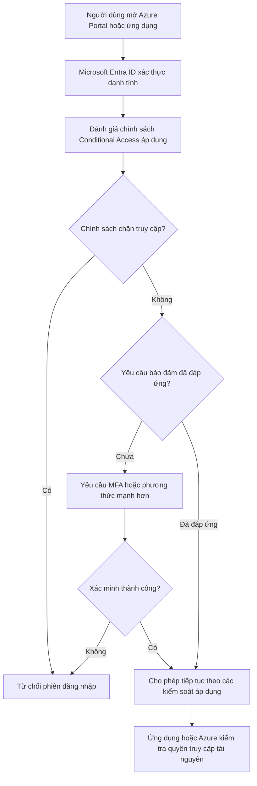

# Xác thực đa yếu tố và Conditional Access

Trong Microsoft Azure, **Microsoft Entra ID** là nền tảng danh tính dùng để xác thực người dùng, nhóm và ứng dụng trước khi họ truy cập Azure Portal, Microsoft 365 hoặc ứng dụng tích hợp. Tên đăng nhập và mật khẩu có thể bị lộ qua lừa đảo hoặc tái sử dụng; vì vậy việc chỉ dựa vào mật khẩu tạo ra rủi ro đáng kể cho các tài nguyên như máy ảo, mạng ảo, kho dữ liệu và subscription.

**Xác thực đa yếu tố (multifactor authentication – MFA)** bổ sung bằng chứng xác thực độc lập. **Conditional Access** (Truy cập có điều kiện) sử dụng tín hiệu từ quá trình đăng nhập để quyết định khi nào phải yêu cầu MFA mạnh hơn, khi nào cần thiết bị đáp ứng chính sách hoặc khi nào phải chặn truy cập. Hai cơ chế kết hợp thành một lớp bảo vệ quan trọng cho kiến trúc ứng dụng trên Azure.

Bài học thuộc chương **Danh tính với Microsoft Entra ID**, tập trung vào cách nhận biết phương thức xác thực, thiết kế chính sách Conditional Access, triển khai có kiểm soát và xử lý sự cố. Các ví dụ dùng tenant và tài khoản giả định; không yêu cầu thay đổi một tenant đang vận hành.

## Mục tiêu học tập

Sau khi hoàn thành bài học, bạn có thể:

- Phân biệt xác thực (authentication), phân quyền (authorization), MFA và các nhóm yếu tố xác thực.
- So sánh Microsoft Authenticator, OTP, SMS, khóa bảo mật FIDO2, passkey và Windows Hello for Business.
- Giải thích vì sao xác thực chống lừa đảo (phishing-resistant) mạnh hơn các phương thức MFA truyền thống.
- Mô tả cách Conditional Access đánh giá đối tượng, ứng dụng, điều kiện đăng nhập và yêu cầu truy cập.
- Thiết kế một chính sách yêu cầu MFA hoặc authentication strength cho quản trị viên và ứng dụng quan trọng.
- Kiểm tra chính sách bằng Report-only, What If và sign-in logs, đồng thời giảm rủi ro khóa nhầm tài khoản.
- Chẩn đoán lỗi đăng nhập liên quan đến đăng ký phương thức, thiết bị, license hoặc chính sách.

## 1. Xác thực khác gì phân quyền?

**Xác thực** trả lời câu hỏi: *Bạn là ai và có bằng chứng gì để chứng minh?* Ví dụ, một nhân viên đăng nhập Azure Portal bằng tài khoản Microsoft Entra ID và hoàn tất bước xác thực bổ sung.

**Phân quyền** trả lời câu hỏi: *Danh tính đã được xác thực được làm gì?* Sau khi đăng nhập, **Azure RBAC** kiểm tra role assignment để quyết định người đó được đọc resource group, triển khai máy ảo hay quản lý subscription.

Một người có thể đăng nhập thành công nhưng vẫn bị từ chối khi tạo tài nguyên vì thiếu quyền RBAC. Ngược lại, một tài khoản có vai trò Owner vẫn có thể không đăng nhập được nếu chưa đáp ứng chính sách Conditional Access.

| Cơ chế | Mục đích | Ví dụ |
|---|---|---|
| Microsoft Entra ID authentication | Xác minh danh tính khi đăng nhập | Mật khẩu, passkey, Microsoft Authenticator |
| MFA | Yêu cầu nhiều yếu tố độc lập để tăng độ tin cậy | Mật khẩu + xác nhận trên thiết bị sở hữu |
| Conditional Access | Quyết định yêu cầu hoặc chặn truy cập theo ngữ cảnh | Quản trị viên phải dùng MFA chống lừa đảo |
| Azure RBAC | Giới hạn thao tác trên tài nguyên Azure | Reader, Contributor, Owner tại resource group |

Conditional Access và Azure RBAC bổ trợ nhau: đáp ứng điều kiện đăng nhập không tự tạo quyền thao tác trên tài nguyên.

## 2. MFA là gì?

MFA yêu cầu **ít nhất hai yếu tố thuộc các nhóm độc lập** để xác minh một danh tính. Ba nhóm yếu tố phổ biến:

1. **Điều bạn biết (knowledge):** mật khẩu, mã PIN.
2. **Điều bạn sở hữu (possession):** khóa bảo mật, thiết bị có private key hoặc ứng dụng xác thực đã đăng ký.
3. **Đặc điểm của bạn (inherence):** vân tay, nhận dạng khuôn mặt hoặc sinh trắc học khác.

Ví dụ, nhập mật khẩu rồi xác nhận yêu cầu trên điện thoại đã đăng ký có thể tạo thành hai yếu tố. Nhập hai mật khẩu khác nhau chỉ sử dụng cùng một loại yếu tố, nên không mặc nhiên trở thành MFA.

Một phương thức **passwordless** vẫn có thể đáp ứng MFA nếu bản thân nó kết hợp yếu tố sở hữu với xác minh người dùng bằng PIN hoặc sinh trắc học. Ví dụ, một khóa bảo mật FIDO2 có cơ chế xác minh người dùng có thể cung cấp bằng chứng đa yếu tố trong một lần đăng nhập mà không cần gõ mật khẩu.

### Ví dụ luồng đăng nhập



Đây là sơ đồ khái niệm. Trong thực tế, quá trình đánh giá chính sách, xác thực ban đầu và xác thực bổ sung có thể diễn ra qua nhiều bước và phiên đăng nhập; một lần đăng nhập có thể đã mang bằng chứng MFA hợp lệ nên không cần hiện thông báo xác nhận mới.

## 3. Các phương thức xác thực trong Microsoft Entra ID

Microsoft Entra ID hỗ trợ nhiều phương thức. Khả năng dùng một phương thức phụ thuộc vào loại tài khoản, thiết bị, cấu hình tenant, chính sách phương thức và yêu cầu của dịch vụ.

| Phương thức | Cách hoạt động | Nhận xét bảo mật và tình huống |
|---|---|---|
| Mật khẩu | Người dùng cung cấp bí mật đã biết | Dễ bị phishing, nhồi thông tin đăng nhập và tái sử dụng |
| Microsoft Authenticator – thông báo đẩy | Ứng dụng trên thiết bị đã đăng ký xác nhận yêu cầu đăng nhập; có thể yêu cầu nhập số khớp | Phổ biến, thuận tiện; người dùng vẫn phải kiểm tra nguồn yêu cầu và ngữ cảnh |
| Mã TOTP trong ứng dụng | Ứng dụng tạo mã dùng một lần theo thời gian | Có thể dùng khi không nhận được push; mã vẫn có thể bị trang giả mạo đánh cắp theo thời gian thực |
| Token OATH phần cứng/phần mềm | Tạo mã xác thực dùng một lần | Có ích trong môi trường có ràng buộc thiết bị; cần quản lý vòng đời token |
| SMS hoặc cuộc gọi thoại | Nhận mã hoặc yêu cầu xác nhận qua số điện thoại | Phụ thuộc mạng viễn thông; rủi ro chuyển SIM, chiếm số và phishing, nên không ưu tiên cho tài khoản đặc quyền |
| Passkey / khóa bảo mật FIDO2 | Khóa mật mã gắn với dịch vụ; người dùng xác minh trên thiết bị hoặc khóa bằng PIN/sinh trắc học | Chống phishing tốt khi được triển khai và cấu hình đúng; phù hợp cho truy cập nhạy cảm |
| Windows Hello for Business | Đăng nhập bằng thông tin xác thực được ràng buộc với thiết bị, mở khóa bằng PIN/sinh trắc học | Hữu ích với thiết bị doanh nghiệp được quản lý, có thể đáp ứng yêu cầu xác thực mạnh |
| Xác thực dựa trên chứng chỉ (CBA) | Dùng chứng chỉ và chính sách ràng buộc xác thực | Phù hợp một số môi trường doanh nghiệp; mức độ MFA phụ thuộc cấu hình và yêu cầu chứng chỉ |
| Temporary Access Pass (TAP) | Mã tạm thời do quản trị viên cấp để đăng ký/khôi phục phương thức | Dùng cho bootstrap hoặc recovery có kiểm soát, không phải giải pháp đăng nhập thường trực |

### MFA chống lừa đảo (phishing-resistant)

MFA truyền thống dựa trên mã OTP hoặc thông báo đẩy giúp giảm rủi ro khi mật khẩu bị lộ. Tuy nhiên, kẻ tấn công vẫn có thể dụ người dùng nhập mã OTP vào trang giả hoặc chấp thuận một yêu cầu đăng nhập do kẻ tấn công khởi tạo.

FIDO2 và các phương thức khóa mật mã phù hợp sử dụng cơ chế ràng buộc mật mã với nguồn đăng nhập hợp lệ. Khi người dùng được dẫn tới một website giả mạo, thông tin xác thực không thể đơn giản được sử dụng như mã OTP trên website thật. Điều này làm giảm đáng kể rủi ro phishing liên quan đến thông tin đăng nhập.

**Number matching** trong Microsoft Authenticator làm rõ yêu cầu xác nhận và hạn chế tình trạng chấp thuận bừa các thông báo MFA, nhưng không biến mọi thông báo đẩy thành phương thức chống phishing ở mức tương đương FIDO2.

Sinh trắc học trên thiết bị thường dùng để mở khóa một khóa mật mã; không nên hiểu rằng máy chủ luôn nhận ảnh vân tay hoặc khuôn mặt của người dùng.

### Chọn phương thức thế nào?

- Với quản trị viên, ứng dụng chứa dữ liệu nhạy cảm và thao tác có tác động lớn: ưu tiên phương thức **phishing-resistant** được tenant hỗ trợ.
- Với người dùng thông thường: sử dụng phương thức mạnh nhất tổ chức có thể triển khai đồng bộ, kèm hướng dẫn nhận diện yêu cầu giả mạo.
- Với môi trường có yêu cầu khôi phục: chuẩn bị nhiều phương thức phù hợp và quy trình xác minh danh tính trước khi cấp lại.
- Với tài khoản máy hoặc ứng dụng: sử dụng **managed identity**, workload identity federation hoặc phương thức xác thực workload thích hợp; không áp dụng quy trình nhập OTP của người dùng cho tác vụ chạy tự động.

## 4. Các lớp chính sách liên quan đến MFA

Để thiết kế đăng nhập an toàn, cần phân biệt **phương thức được phép dùng** với **điều kiện buộc phải sử dụng phương thức đó**.

### Authentication methods policy

Chính sách phương thức xác thực trong Microsoft Entra ID cho biết các nhóm người dùng có thể sử dụng phương thức nào, chẳng hạn Microsoft Authenticator, passkey FIDO2 hoặc Temporary Access Pass.

Ví dụ, chính sách có thể cho phép nhóm quản trị dùng passkey và Microsoft Authenticator, đồng thời hạn chế SMS theo kế hoạch chuyển đổi. Bật một phương thức không có nghĩa mọi lần đăng nhập sẽ tự động yêu cầu dùng phương thức đó.

### Security defaults

Security defaults cung cấp một tập biện pháp bảo vệ cơ bản cho tenant, bao gồm các yêu cầu xác thực mạnh và hạn chế một số luồng xác thực cũ. Đây là lựa chọn đơn giản khi tổ chức chưa cần nhiều quy tắc truy cập tùy chỉnh.

Nếu tổ chức cần thiết kế chính sách Conditional Access riêng, cần xem xét trạng thái Security defaults, license và kế hoạch chuyển đổi, vì các chính sách Conditional Access tùy chỉnh không được cấu hình để hoạt động đồng thời với Security defaults.

### Conditional Access policy

Conditional Access cho phép tổ chức đặt quy tắc theo nhóm người dùng, vai trò, ứng dụng và các tín hiệu như vị trí, nền tảng thiết bị, trạng thái thiết bị hoặc mức rủi ro đăng nhập. Kết quả có thể là chặn, yêu cầu MFA, yêu cầu phương thức đạt một authentication strength cụ thể hoặc yêu cầu thiết bị tuân thủ.

Tạo và sử dụng chính sách Conditional Access thông thường cần **Microsoft Entra ID P1** hoặc gói có quyền tương đương; các chức năng dựa trên rủi ro của **Identity Protection** có thể cần **P2**. Hãy xác minh license và tính năng có trong tenant trước khi triển khai.

### Per-user MFA

Cơ chế bật MFA theo từng người dùng là mô hình cũ. Với tenant cần kiểm soát theo tình huống, ưu tiên chính sách Conditional Access để diễn đạt yêu cầu truy cập tập trung và kiểm thử được. Khi di chuyển từ chính sách cũ, cần đánh giá ảnh hưởng thực tế trước khi bỏ cấu hình hiện hành.

## 5. Conditional Access hoạt động theo nguyên tắc nào?

Một chính sách Conditional Access thường trả lời bốn câu hỏi:

1. **Ai?** Người dùng, nhóm hoặc vai trò directory nào nằm trong phạm vi áp dụng?
2. **Đăng nhập vào đâu?** Ứng dụng đám mây, hành động người dùng hoặc tài nguyên mục tiêu nào?
3. **Trong điều kiện nào?** Vị trí, trạng thái thiết bị, loại client, nền tảng hoặc tín hiệu rủi ro nào?
4. **Cho phép bằng điều kiện gì?** Chặn hoặc yêu cầu MFA, authentication strength, thiết bị tuân thủ hay các kiểm soát hỗ trợ khác?

Ví dụ: mọi thành viên nhóm `Azure-Admins` khi đăng nhập vào ứng dụng quản trị quan trọng cần dùng phương thức đạt **phishing-resistant MFA strength**. Nếu người dùng chưa có phương thức đủ mạnh, họ sẽ cần đăng ký hoặc sử dụng phương thức đáp ứng chính sách trước khi có thể truy cập.

### Các khối cấu hình chính

| Khối | Chức năng | Ví dụ |
|---|---|---|
| Users | Chọn hoặc loại trừ người dùng, nhóm, vai trò | Nhóm Azure-Admins |
| Target resources | Chọn ứng dụng hoặc tài nguyên chịu chính sách | Azure management, ứng dụng tài chính |
| Conditions | Lọc tín hiệu của phiên đăng nhập | Vị trí, client app, device platform, sign-in risk |
| Grant controls | Chặn hoặc yêu cầu điều kiện trước khi cấp truy cập | Require multifactor authentication, Require authentication strength |
| Session controls | Kiểm soát một số khía cạnh phiên đã đăng nhập | Sign-in frequency, persistent browser session |
| Enable policy | Chọn trạng thái kiểm thử hoặc thực thi | Off, Report-only, On |

Tùy tính năng và trường hợp, các điều kiện hoặc kiểm soát hiển thị có thể khác nhau. Không phải tính năng nào cũng áp dụng cho mọi ứng dụng, client hay loại danh tính.

### Nhiều chính sách có thể cùng áp dụng

Conditional Access không chọn duy nhất một chính sách có ưu tiên cao nhất. Một phiên đăng nhập có thể bị đánh giá bởi **nhiều chính sách** và phải đáp ứng các yêu cầu áp dụng. Nếu một chính sách chặn truy cập, việc đáp ứng MFA ở chính sách khác không tự động bỏ qua lệnh chặn.

Vì vậy, kiểm tra từng chính sách riêng lẻ chưa đủ: cần xem tổng hợp chính sách thực sự áp dụng cho người dùng và ứng dụng cụ thể.

## 6. Authentication strengths: yêu cầu phương thức đủ mạnh

**Authentication strength** là cách diễn đạt các kết hợp phương thức xác thực đáp ứng mức bảo đảm nhất định. Các mức tích hợp thường được nhắc tới gồm:

- **Multifactor authentication strength:** chấp nhận những kết hợp đáp ứng yêu cầu đa yếu tố theo định nghĩa của mức đó.
- **Passwordless MFA strength:** yêu cầu kết hợp đủ mạnh thuộc nhóm passwordless được hỗ trợ.
- **Phishing-resistant MFA strength:** yêu cầu các phương thức đáp ứng tiêu chí chống phishing trong danh sách được Microsoft hỗ trợ, ví dụ cấu hình FIDO2 hoặc Windows Hello for Business phù hợp.

Một chính sách chỉ chọn **Require multifactor authentication** có thể chấp nhận nhiều phương thức MFA khác nhau. Nếu mục tiêu là chống phishing cho quản trị viên, hãy cân nhắc **Require authentication strength** với mức chống phishing, thay vì mặc định mọi MFA đều có sức bảo vệ giống nhau.

Việc một người đã đăng ký nhiều phương thức không đồng nghĩa phương thức họ dùng ở phiên hiện tại đáp ứng mức bắt buộc. Cần xem cách phương thức xác thực thực tế được ghi nhận và đánh giá trong quá trình đăng nhập.

## 7. Chuẩn bị người dùng và phương thức xác thực

Trước khi thực thi MFA trên diện rộng, tổ chức cần bảo đảm người dùng có phương thức được cho phép và có thể tự đăng ký hoặc được hỗ trợ.

### Bước 1: Xác định danh sách người dùng và phương thức

Phân nhóm theo nhu cầu: quản trị viên, nhân viên, khách ngoài tổ chức, nhân sự không có điện thoại thông minh và workload không tương tác. Đối chiếu phương thức đáp ứng chính sách tương lai với khả năng thiết bị của từng nhóm.

### Bước 2: Cấu hình phương thức được phép

Trong **Microsoft Entra admin center**, tìm phần **Authentication methods** và xem các chính sách phương thức cùng đối tượng được bật. Nếu định yêu cầu passkey hoặc phương thức mạnh hơn, hãy xác nhận nhóm thí điểm đã được phép sử dụng và đăng ký phương thức đó.

Cấu hình này cần quyền quản trị phù hợp; tên menu hoặc vị trí có thể thay đổi theo phiên bản giao diện.

### Bước 3: Đăng ký phương thức xác thực

Người dùng có thể kiểm tra và đăng ký phương thức được tổ chức cho phép tại:

[https://mysignins.microsoft.com/security-info](https://mysignins.microsoft.com/security-info)

Ví dụ, khi đăng ký Microsoft Authenticator, người dùng đăng nhập vào trang Security info, chọn thêm phương thức, làm theo hướng dẫn kết nối ứng dụng trên thiết bị và hoàn tất xác minh. Các bước cụ thể có thể khác nhau theo chính sách tenant và loại tài khoản.

Với passkey hoặc khóa bảo mật, người dùng cần thiết bị tương thích và hoàn thành quy trình đăng ký do tenant cho phép. Đăng ký thử trước khi bật chính sách bắt buộc để tránh tình trạng không có phương thức nào đáp ứng được yêu cầu.

### Bước 4: Chuẩn bị khôi phục

Một người có thể mất điện thoại, khóa bảo mật hoặc đổi thiết bị. Cần có kênh hỗ trợ xác minh danh tính, gỡ hoặc thay phương thức cũ theo quyền được giao, và sử dụng Temporary Access Pass khi chính sách cho phép. Không nên gửi mã khôi phục hoặc thông tin bí mật qua kênh không được xác minh.

## 8. Thực hành: thiết kế chính sách MFA cho quản trị viên

Tình huống: tổ chức có nhóm `Azure-Admins` quản lý hạ tầng Azure. Mục tiêu là bảo vệ đăng nhập bằng MFA chống phishing, đồng thời vẫn duy trì kênh truy cập khẩn cấp.

### Thiết kế dự kiến

| Thuộc tính | Giá trị minh họa |
|---|---|
| Tên chính sách | `CA-Admins-PhishingResistant` |
| Users | Nhóm quản trị `Azure-Admins` |
| Exclude | Các tài khoản truy cập khẩn cấp được quản lý và giám sát riêng |
| Target resources | Ứng dụng quản trị trong phạm vi đã xác định; có thể mở rộng theo đánh giá |
| Conditions | Chỉ thêm điều kiện nếu có nhu cầu rõ ràng; MFA quản trị không nên phụ thuộc duy nhất vào IP tin cậy |
| Grant | Grant access → Require authentication strength → Phishing-resistant MFA |
| State ban đầu | Report-only |
| State sau thí điểm | On, sau khi kiểm tra và có quy trình khôi phục |

### Thao tác trên Microsoft Entra admin center

1. Đăng nhập bằng tài khoản có quyền quản lý chính sách Conditional Access phù hợp.
2. Mở **Protection → Conditional Access → Policies** trong khu vực Microsoft Entra ID, hoặc tìm Conditional Access bằng thanh tìm kiếm.
3. Chọn tạo chính sách mới và đặt tên rõ mục tiêu, ví dụ `CA-Admins-PhishingResistant`.
4. Trong **Users**, thêm nhóm quản trị. Kiểm tra thành viên nhóm và chuẩn bị danh sách loại trừ tối thiểu theo quy trình tổ chức.
5. Trong phần ứng dụng hoặc target resources, chọn đúng các ứng dụng cần bảo vệ.
6. Trong **Grant**, chọn cho phép truy cập khi đáp ứng **Require authentication strength**, sau đó chọn mức **Phishing-resistant MFA** nếu có sẵn.
7. Đặt chính sách ở trạng thái **Report-only** và lưu.
8. Dùng **What If** và các đăng nhập thí điểm để kiểm tra chính sách sẽ áp dụng cho ai, ứng dụng nào và có xung đột với chính sách khác hay không.
9. Xác minh người dùng thử nghiệm có thể đăng nhập bằng phương thức đáp ứng mức yêu cầu.
10. Sau khi có kế hoạch hỗ trợ, khôi phục và phê duyệt triển khai, chuyển chính sách sang **On**, theo dõi sign-in logs và xử lý các ngoại lệ thực tế.

Các bước trên là hướng dẫn xây dựng chính sách, không phải yêu cầu bật chính sách ngay trên tenant sản xuất. Việc loại trừ tài khoản khẩn cấp cần đi kèm kiểm soát và cảnh báo đăng nhập, không biến thành lối truy cập thông thường cho người dùng.

### Vì sao dùng Report-only trước?

Report-only cho phép kiểm tra tác động dự kiến của chính sách trong quá trình đánh giá mà không thực thi điều kiện chặn hoặc yêu cầu bổ sung của chính chính sách đang thử. Những chính sách khác đã bật vẫn có thể tiếp tục ảnh hưởng đến đăng nhập.

**What If** mô phỏng một tập điều kiện đăng nhập, hữu ích để thấy chính sách dự kiến áp dụng. Nó không thay thế kiểm chứng bằng đăng nhập thực và sign-in logs, đặc biệt với tình huống phức tạp về thiết bị, client hoặc phương thức xác thực.

## 9. Ví dụ chính sách cho các tình huống phổ biến

| Nhu cầu | Hướng chính sách | Điểm cần kiểm tra |
|---|---|---|
| Bảo vệ quản trị viên | Yêu cầu phishing-resistant MFA strength cho nhóm hoặc vai trò quản trị | Mọi quản trị viên đã có phương thức phù hợp; có phương án khẩn cấp |
| Bảo vệ ứng dụng tài chính | Yêu cầu MFA hoặc authentication strength theo mức nhạy cảm của ứng dụng | Tương thích với ứng dụng và các nhóm người dùng liên quan |
| Hạn chế đăng nhập từ client cũ | Chặn những luồng xác thực cũ không hỗ trợ kiểm soát hiện đại | Kiểm tra ứng dụng cũ, thiết bị và sign-in logs trước khi thực thi |
| Chỉ cho thiết bị doanh nghiệp truy cập dữ liệu nhạy cảm | Kết hợp MFA với yêu cầu **compliant device** khi được hỗ trợ | Có chính sách và quy trình quản lý thiết bị, ví dụ qua Intune |
| Đăng nhập có tín hiệu rủi ro cao | Áp dụng điều kiện theo rủi ro và yêu cầu bảo vệ phù hợp | Tính năng rủi ro và license phù hợp, quy trình xử lý cảnh báo |
| Người dùng bên ngoài (guest) | Xem xét chính sách riêng cho B2B/khách, khả năng tin cậy MFA từ tenant nguồn | Cấu hình cross-tenant access và trải nghiệm khách |

Trong một số kịch bản, muốn thỏa mãn truy cập cần đồng thời MFA **và** thiết bị compliant. Khi cấu hình nhiều grant control, hãy xem kỹ tùy chọn kết hợp yêu cầu và kết quả thực tế thay vì dựa vào tên chính sách.

## 10. Tài khoản khẩn cấp, quản trị viên và workload

### Tài khoản truy cập khẩn cấp

Tenant nên có phương án **emergency access** để xử lý khi chính sách, thiết bị, nhà cung cấp xác thực hoặc quy trình quản trị thông thường gặp sự cố. Các tài khoản này cần được bảo vệ theo mô hình riêng và theo dõi chặt chẽ.

Thông lệ thiết kế bao gồm: giới hạn người được phép sử dụng, lưu thông tin truy cập trong cơ chế bảo mật được duyệt, đặt cảnh báo khi đăng nhập, kiểm tra khả năng khôi phục định kỳ và xác định rõ các chính sách Conditional Access có thể ảnh hưởng đến chúng. Những ngoại lệ phải được phê duyệt và kiểm toán.

### Quản trị viên đặc quyền

MFA mạnh là một phần của bảo vệ tài khoản có quyền cao. Có thể kết hợp với **Microsoft Entra Privileged Identity Management (PIM)**, quy trình cấp quyền tạm thời và kiểm tra Azure RBAC để giảm thời gian nắm giữ quyền đặc quyền.

### Ứng dụng và danh tính workload

Ứng dụng chạy tự động không thể trả lời thông báo đẩy hoặc nhập OTP giống người dùng. Hãy thiết kế xác thực bằng managed identity, chứng chỉ hoặc federation phù hợp, đồng thời sử dụng các chính sách và kiểm soát dành cho workload identity khi được hỗ trợ. Chính sách Conditional Access cho người dùng không mặc nhiên bảo vệ mọi luồng đăng nhập của service principal.

## 11. Kiểm tra chính sách và điều tra đăng nhập

Khi một người đăng nhập thành công hoặc bị chặn, **Sign-in logs** của Microsoft Entra ID là điểm bắt đầu để xem:

- Danh tính và ứng dụng đích của phiên đăng nhập.
- Thời điểm, địa chỉ IP, loại client và thông tin thiết bị được ghi nhận.
- Trạng thái thành công, thất bại hoặc bị gián đoạn; mã lỗi và thông tin chẩn đoán.
- Những chính sách Conditional Access được áp dụng, không áp dụng hoặc được đánh giá ở Report-only.
- Chi tiết bước xác thực và yêu cầu MFA đã được đáp ứng hay chưa, theo thông tin log có sẵn.

### Quy trình điều tra

1. Xác nhận đúng tài khoản, tenant, thời điểm và ứng dụng có vấn đề.
2. Tìm sự kiện trong **Monitoring → Sign-in logs** hoặc khu vực Sign-in logs tương ứng của Entra ID.
3. Mở chi tiết sự kiện và xem thẻ **Conditional Access** để xác định chính sách ảnh hưởng.
4. Xem **Authentication details** để hiểu phương thức đã dùng, bước xác thực nào bị yêu cầu hoặc thất bại.
5. Kiểm tra chính sách phương thức xác thực, nhóm người dùng, target resources và ngoại lệ.
6. Dùng **What If** với điều kiện gần giống để kiểm tra dự kiến, sau đó sửa thiết kế và thử lại trên nhóm nhỏ.

Một phiên đăng nhập có thể không hiện yêu cầu MFA mới vì bằng chứng xác thực từ phiên trước hoặc phương thức passwordless đã thỏa mãn chính sách. Điều quan trọng là yêu cầu xác thực được **đáp ứng**, không phải số lần người dùng nhìn thấy hộp thoại MFA.

### Truy vấn minh họa với Log Analytics

Nếu tổ chức đã cấu hình xuất sign-in logs tới Azure Monitor Logs/Log Analytics và có quyền truy vấn, bạn có thể dùng KQL để xem tổng quan:

```kusto
SigninLogs
| where TimeGenerated >= ago(1d)
| project TimeGenerated,
          UserPrincipalName,
          AppDisplayName,
          ResultType,
          ConditionalAccessStatus,
          AuthenticationRequirement
| order by TimeGenerated desc
```

Truy vấn này chỉ có dữ liệu khi log đã được định tuyến đến workspace phù hợp. Các trường hợp bị từ chối hoặc yêu cầu tương tác bổ sung cần được xem chi tiết ở bản ghi gốc để tránh kết luận chỉ từ một cột tổng hợp.

### Kiểm tra ngữ cảnh tenant trên Azure CLI

Nếu đăng nhập Azure bằng Azure CLI, có thể kiểm tra tenant và subscription mà phiên CLI đang sử dụng:

```bash
az account show --query "{tenantId:tenantId, subscriptionId:id, account:user.name}" --output json
```

Lệnh trên **không** cho biết toàn bộ chính sách Conditional Access áp dụng cho phiên; thông tin đó cần được kiểm tra trong Microsoft Entra sign-in logs. Nếu cần đăng nhập tenant khác, xác nhận tenant được ủy quyền rồi sử dụng luồng đăng nhập tương tác được tổ chức hỗ trợ.

## 12. Các lỗi thường gặp

| Hiện tượng | Nguyên nhân khả dĩ | Cách xử lý |
|---|---|---|
| Người dùng không nhận được push MFA | Thiết bị mất mạng, tắt thông báo, đổi điện thoại hoặc chưa đăng ký đúng phương thức | Kiểm tra kết nối, cấu hình ứng dụng, Security info và phương thức dự phòng được phép |
| Đăng nhập yêu cầu phương thức mạnh hơn | Chính sách dùng authentication strength nhưng phương thức hiện tại không đáp ứng | Đăng ký passkey/khóa bảo mật hoặc phương thức thuộc mức được yêu cầu |
| Đã nhập OTP nhưng vẫn bị từ chối | Một chính sách khác chặn truy cập; thiếu điều kiện thiết bị; đăng nhập có rủi ro | Xem chi tiết Conditional Access và Authentication details |
| Chính sách Report-only không chặn người dùng | Report-only chỉ đánh giá tác động của chính sách đó | Kiểm tra kết quả log; chỉ chuyển On sau khi thí điểm và phê duyệt |
| Quản trị viên tự bị khóa khỏi tenant | Chính sách mới áp vào tài khoản quản trị, không có phương thức phù hợp hoặc thiếu kênh khẩn cấp | Dùng quy trình emergency access đã chuẩn bị; điều chỉnh chính sách theo kiểm soát thay đổi |
| Người dùng vẫn được đăng nhập mà không thấy push | Phương thức hiện tại hoặc bằng chứng phiên đã thỏa yêu cầu MFA | Kiểm tra phương thức và bước xác thực thực tế trong sign-in logs |
| Không thấy tùy chọn Conditional Access | License, vai trò quản trị hoặc giao diện tenant không đáp ứng | Kiểm tra license và role phù hợp với quản trị chính sách |
| Một ứng dụng tự động ngừng chạy sau khi bật kiểm soát | Ứng dụng dùng luồng xác thực cũ hoặc workload được thiết kế như người dùng tương tác | Kiểm tra loại client, hướng dẫn nâng cấp và thiết kế workload identity phù hợp |

Khi gặp lỗi, tránh giải pháp tạm thời là tắt MFA toàn tenant hoặc đưa toàn bộ người dùng vào danh sách loại trừ. Hãy xác định chính sách và trường hợp cụ thể trước khi chỉnh sửa.

## 13. Những sai lầm bảo mật cần tránh

**Phê duyệt thông báo MFA bất ngờ:** Người dùng chỉ nên xác nhận khi chính họ vừa khởi tạo đăng nhập và thông tin hiển thị hợp lý. Nhiều thông báo lặp lại có thể là dấu hiệu MFA fatigue; cần từ chối và báo cáo.

**Tin rằng mọi MFA đều chống phishing:** Mã SMS, TOTP và push thông thường có thể bị đánh cắp hoặc lạm dụng qua kỹ thuật xã hội. Nhiệm vụ đặc quyền nên hướng tới phương thức chống phishing.

**Dùng địa chỉ IP tin cậy như bằng chứng duy nhất:** IP văn phòng hoặc VPN không thay thế việc xác minh danh tính mạnh; kẻ tấn công cũng có thể tận dụng thiết bị hoặc mạng đã bị xâm nhập.

**Chỉ tập trung vào MFA mà bỏ qua phiên đăng nhập:** Token, phiên trình duyệt, thiết bị bị xâm nhập và cách khôi phục tài khoản đều có thể ảnh hưởng đến an toàn dù MFA đã bật. Cần kết hợp quản lý thiết bị, phiên và giám sát.

**Bật chính sách quá rộng ngay lập tức:** Luôn xác định phạm vi người dùng và ứng dụng, kiểm tra Report-only, có phương án khẩn cấp và theo dõi sau khi bật.

**Dùng chung tài khoản quản trị:** Làm mất dấu vết trách nhiệm và gây khó khăn cho bảo vệ cá nhân. Ưu tiên danh tính riêng, quyền tối thiểu và cơ chế cấp quyền đặc quyền có kiểm soát.

## 14. Bài thực hành tình huống

Giả sử doanh nghiệp có ba nhóm: `Employees`, `Azure-Admins` và `External-Guests`. Ứng dụng nội bộ chứa tài liệu làm việc, còn Azure Portal dùng để quản lý máy ảo và mạng ảo.

**Yêu cầu:**

- Nhân viên thông thường phải xác thực đa yếu tố khi truy cập ứng dụng nhạy cảm.
- Quản trị viên phải sử dụng MFA chống phishing cho tài nguyên quản trị đã xác định.
- Khách bên ngoài phải đáp ứng yêu cầu đăng nhập theo chính sách dành riêng.
- Cần có tài khoản khẩn cấp được quản lý và theo dõi.
- Trước khi thực thi, mọi chính sách được kiểm tra bằng Report-only hoặc nhóm thí điểm.

**Cách thực hiện trên giấy hoặc tenant thử nghiệm:**

1. Liệt kê đối tượng, ứng dụng và mức bảo vệ cần thiết cho từng nhóm.
2. Kiểm tra authentication methods policy để bảo đảm các phương thức yêu cầu đã được cho phép.
3. Cho người dùng thí điểm đăng ký phương thức tại trang Security info.
4. Thiết kế các chính sách có tên và scope dễ nhận biết; chuẩn bị ngoại lệ tối thiểu.
5. Chạy What If cho một thành viên mỗi nhóm, một quản trị viên chưa đăng ký khóa bảo mật và một khách bên ngoài.
6. Kiểm tra đăng nhập thực trong Sign-in logs, bao gồm các trường hợp đáp ứng và không đáp ứng.
7. Ghi nhận ai được cấp quyền thay đổi chính sách, ai phê duyệt và quy trình xử lý khi người dùng mất thiết bị.
8. Chỉ sau khi có kết quả thí điểm và kế hoạch hỗ trợ, mới xem xét đưa các chính sách đã được duyệt vào trạng thái On.

Bảng kỳ vọng kiểm thử:

| Tình huống | Kết quả mong đợi |
|---|---|
| Nhân viên có phương thức MFA phù hợp truy cập ứng dụng nhạy cảm | Được phép sau khi đáp ứng toàn bộ chính sách áp dụng |
| Quản trị viên dùng phương thức không đạt phishing-resistant strength | Bị yêu cầu dùng phương thức phù hợp hoặc không được cấp quyền truy cập |
| Quản trị viên dùng FIDO2 hợp lệ và có quyền RBAC | Có thể qua bước xác thực; thao tác tài nguyên vẫn do RBAC quyết định |
| Người dùng nằm ngoài đối tượng của chính sách thí điểm | Chính sách thí điểm không áp dụng; các chính sách khác vẫn có thể áp dụng |
| Tài khoản khẩn cấp được kích hoạt | Có quy trình riêng, sự kiện đăng nhập được cảnh báo và điều tra |

## 15. Tự kiểm tra kiến thức

1. Xác thực và Azure RBAC khác nhau ở điểm nào? Vì sao một người qua MFA vẫn có thể bị từ chối tạo máy ảo?
2. Vì sao nhập hai mật khẩu không tự động được coi là MFA?
3. Điểm khác nhau về mức chống phishing giữa TOTP và passkey FIDO2 là gì?
4. Authentication methods policy khác Conditional Access policy như thế nào?
5. Khi nào nên chọn **Require authentication strength** thay vì chỉ **Require multifactor authentication**?
6. Nếu nhiều chính sách Conditional Access áp dụng, việc đáp ứng một chính sách có bảo đảm được truy cập không?
7. Vì sao phải dùng Report-only, What If và sign-in logs trước khi bật chính sách cho toàn tổ chức?
8. Tại sao cần tài khoản emergency access và quy trình hỗ trợ khi mất thiết bị?
9. Một service principal có thể nhận OTP trên điện thoại như người dùng không? Nên thiết kế cách xác thực thế nào?
10. Người dùng không nhìn thấy lời nhắc MFA mới có luôn đồng nghĩa MFA chưa được đáp ứng không?

## Kết luận

MFA tăng độ tin cậy của danh tính bằng các yếu tố xác thực độc lập; các phương thức chống phishing như FIDO2 và Windows Hello for Business thường phù hợp hơn cho truy cập đặc quyền. Conditional Access chuyển yêu cầu bảo mật thành chính sách theo đối tượng, ứng dụng và ngữ cảnh đăng nhập. Một triển khai hiệu quả cần chuẩn bị phương thức, áp dụng chính sách theo từng giai đoạn, kiểm tra log, bảo vệ tài khoản khẩn cấp và phối hợp với Azure RBAC để giới hạn thao tác trên tài nguyên.

Bài học giúp xây dựng nền tảng xác thực cho các kiến trúc Azure sử dụng subscription, resource group, mạng, compute, storage và dữ liệu, nơi quyền truy cập phải được xác minh trước khi bất kỳ thao tác quản trị hay sử dụng dịch vụ nào được cho phép.
