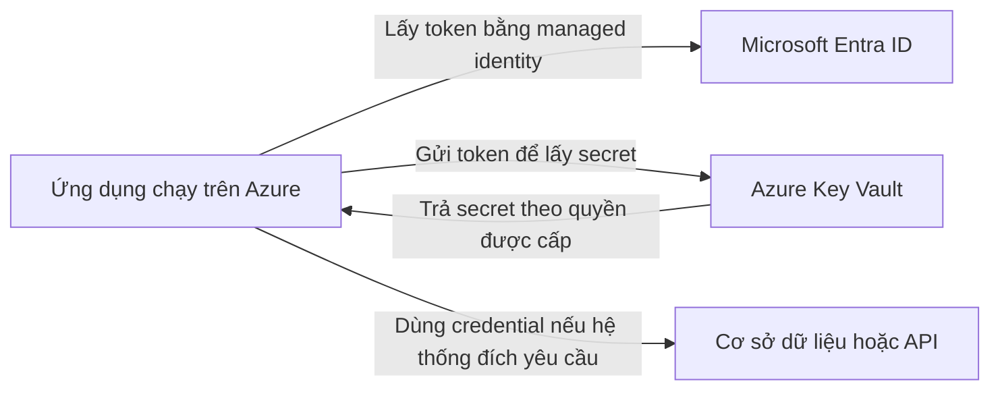
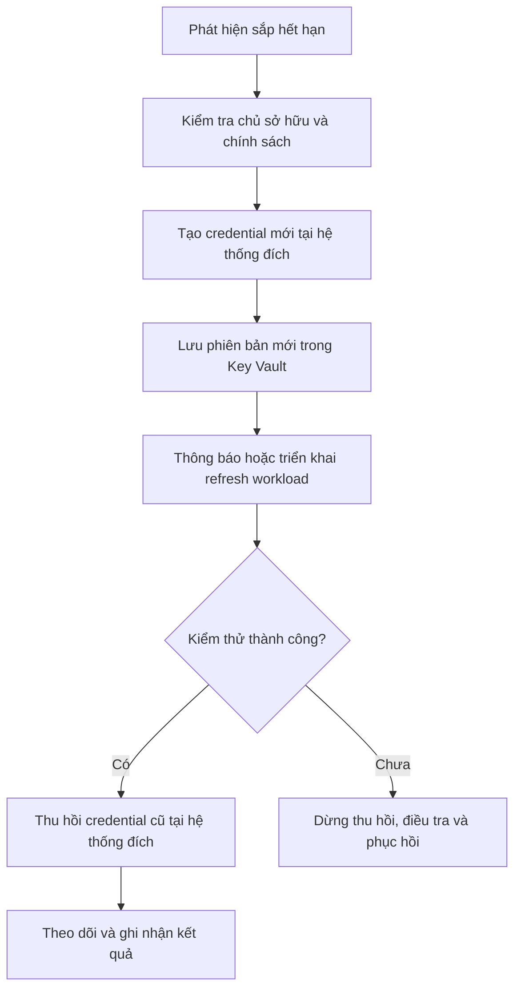

# Bảo vệ thông tin xác thực và luân chuyển credential

Trong Microsoft Azure, ứng dụng và người vận hành thường phải chứng minh danh tính trước khi truy cập tài nguyên: API, cơ sở dữ liệu, storage account, dịch vụ mạng hoặc hệ thống triển khai. Nếu một thông tin xác thực (credential) bị lộ, người khác có thể sử dụng nó để giả mạo danh tính và thực hiện những hành động mà danh tính đó được cấp quyền.

Bảo vệ credential không chỉ là đặt mật khẩu đủ mạnh. Một hệ thống an toàn cần **chọn loại danh tính phù hợp, lưu trữ bí mật đúng chỗ, cấp quyền tối thiểu, giám sát việc sử dụng và luân chuyển credential mà không gây gián đoạn dịch vụ**.

Trong module **CLOUD_PROVIDERS_AZURE**, bài học này kết nối Microsoft Entra ID với Azure Key Vault, Azure RBAC và quy trình triển khai ứng dụng trên Azure. Các kỹ thuật này tiếp tục được dùng khi vận hành máy ảo, App Service, container, dịch vụ dữ liệu và pipeline CI/CD.

## 1. Mục tiêu học tập

Sau bài học, bạn có thể:

- Phân biệt credential của người dùng, ứng dụng và workload; nhận biết thông tin nào cần bảo vệ.
- Chọn giữa managed identity, workload identity federation, chứng chỉ và client secret.
- Dùng Azure Key Vault để quản lý vòng đời secret và hạn chế lộ dữ liệu khi ứng dụng truy cập.
- Thiết kế quy trình **rotation** (luân chuyển thông tin xác thực) với giai đoạn chồng lấp, kiểm thử và thu hồi credential cũ.
- Phát hiện credential sắp hết hạn, xử lý sai lệch sau triển khai và ứng phó khi có dấu hiệu bị lộ.

## 2. Credential là gì và vì sao dễ bị lộ?

Credential là bằng chứng dùng trong quá trình xác thực. Các ví dụ thường gặp:

| Loại credential | Ví dụ | Rủi ro đặc trưng |
|---|---|---|
| Mật khẩu người dùng | Mật khẩu tài khoản Microsoft Entra | Lừa đảo, tái sử dụng mật khẩu, tài khoản bị chiếm quyền |
| Client secret | Secret của app registration hoặc service principal | Lộ trong mã nguồn, cấu hình, pipeline, log |
| Chứng chỉ và private key | Chứng chỉ dùng xác thực ứng dụng | Private key bị sao chép hoặc hết hạn |
| Mật khẩu hệ thống | Mật khẩu kết nối cơ sở dữ liệu, tài khoản kỹ thuật | Bị chèn vào connection string hoặc file cấu hình |
| API key / shared access key | Khóa của dịch vụ hoặc hệ thống bên thứ ba | Quyền truy cập rộng, khó truy vết danh tính người gọi |
| Access token / refresh token | Token do hệ thống định danh cấp | Bị chiếm dụng để truy cập khi còn hiệu lực |

**Client ID, tenant ID và subscription ID không phải là bí mật.** Chúng vẫn cần được quản lý đúng ngữ cảnh nhưng không thay thế được client secret hoặc private key. Ngược lại, access token cần được bảo vệ như thông tin nhạy cảm vì bên nắm giữ token có thể sử dụng nó trong phạm vi quyền và thời hạn tương ứng.

Một secret thường bị lộ qua các đường đi ít được chú ý: commit Git, log ứng dụng, ảnh chụp terminal, lịch sử shell, biến môi trường bị in ra khi gỡ lỗi, file `.env` đưa vào image container, artifact của pipeline, hoặc bản sao lưu thiếu kiểm soát.

Ví dụ không an toàn:

```properties
# MINH HỌA SAI: Không lưu giá trị thật trong repository
database.password=plain-text-password
azure.client.secret=plain-text-client-secret
```

Việc xóa dòng chứa secret khỏi phiên bản Git hiện tại **không làm credential đã lộ trở nên an toàn**. Secret có thể vẫn nằm trong lịch sử commit, bản fork, artifact hoặc log. Nếu nghi ngờ bị lộ, cần thu hồi hoặc thay credential tại **hệ thống xác thực gốc**.

## 3. Nguyên tắc thiết kế: loại bỏ secret khi có thể

Không phải mọi workload đều cần lưu client secret. Thứ tự lựa chọn nên dựa vào nơi workload chạy và cơ chế danh tính được hỗ trợ.

| Phương án | Cách xác thực | Trường hợp phù hợp | Vận hành credential |
|---|---|---|---|
| **Managed identity** | Azure quản lý danh tính của tài nguyên | Ứng dụng chạy trên dịch vụ Azure hỗ trợ managed identity | Nền tảng quản lý credential nền tảng; nhóm vận hành quản lý quyền RBAC |
| **Workload identity federation** | Trao đổi token được tin cậy từ nhà phát hành OIDC | CI/CD hoặc workload có nhà cung cấp token được Entra hỗ trợ | Không cần lưu client secret dài hạn; phải bảo vệ cấu hình trust và nguồn phát token |
| **Chứng chỉ (certificate)** | Ứng dụng chứng minh sở hữu private key | Workload cần xác thực ứng dụng nhưng chưa dùng được hai phương án trên | Bảo vệ private key, giám sát hạn và luân chuyển chứng chỉ |
| **Client secret** | Ứng dụng dùng giá trị bí mật để nhận token | Tích hợp cũ hoặc môi trường không hỗ trợ phương án tốt hơn | Giới hạn thời hạn, lưu trong kho bí mật, luân chuyển và thu hồi |
| **Tài khoản người dùng** | Đăng nhập tương tác, MFA và chính sách truy cập | Nhân viên dùng Azure Portal, CLI và công cụ phát triển | MFA, Conditional Access và quy trình bảo vệ tài khoản |

Đây là hướng ưu tiên cho thiết kế mới, không phải tuyên bố rằng một phương án luôn dùng được trong mọi môi trường. Hãy kiểm tra khả năng hỗ trợ của dịch vụ, quyền truy cập, yêu cầu kiểm toán và chính sách tổ chức.

### Managed identity

Managed identity là danh tính Microsoft Entra gắn với tài nguyên Azure. Ứng dụng có thể dùng Azure SDK để lấy token mà không nhúng secret vào cấu hình. Azure quản lý vòng đời của credential nền tảng.

Có hai dạng chính:

- **System-assigned:** gắn với vòng đời của một tài nguyên Azure cụ thể.
- **User-assigned:** là tài nguyên danh tính độc lập, có thể được gán cho nhiều workload được hỗ trợ.

Ví dụ: một App Service có managed identity truy cập Key Vault. Quản trị viên cấp role `Key Vault Secrets User` tại phạm vi phù hợp. Ứng dụng lấy token bằng SDK, sau đó yêu cầu Key Vault trả về secret cần sử dụng.

Managed identity không miễn trừ việc kiểm soát quyền. Nếu identity được cấp quyền quá rộng hoặc workload bị xâm nhập, kẻ tấn công vẫn có thể lợi dụng quyền của identity. Cần kiểm tra RBAC và giám sát hoạt động của ứng dụng.

### Workload identity federation

Workload identity federation cho phép Microsoft Entra ID tin cậy token do một nhà phát hành ngoài Entra cung cấp, theo điều kiện đã cấu hình như **issuer, subject, audience**. Từ token đó, workload có thể yêu cầu token Entra mà không phải giữ client secret dài hạn.

Ví dụ: pipeline triển khai trên nền tảng CI/CD hỗ trợ OpenID Connect sử dụng liên kết tin cậy tới một app registration trong Entra. Chỉ workload khớp điều kiện đã khai báo mới được trao đổi token theo cấu hình.

Phải quản lý chặt các điều kiện trust. Nếu cho phép subject quá rộng, một workflow không mong muốn có thể dùng danh tính triển khai. Việc không có client secret cần xoay vòng cũng không có nghĩa có thể bỏ qua rà soát quyền và danh tính được tin cậy.

## 4. Bảo vệ tài khoản người dùng trong Entra ID

Với tài khoản của kỹ sư, quản trị viên hoặc người vận hành:

1. Bật và áp dụng **xác thực đa yếu tố (MFA)** theo chính sách tổ chức; ưu tiên phương thức chống phishing như FIDO2 security key hoặc passkey khi phù hợp.
2. Dùng **Conditional Access** để kiểm soát điều kiện đăng nhập theo rủi ro, thiết bị hoặc yêu cầu của tổ chức.
3. Phân tách tài khoản thông thường với tài khoản có đặc quyền và dùng cơ chế cấp quyền đúng thời điểm như Microsoft Entra Privileged Identity Management (nếu tổ chức triển khai).
4. Hạn chế các phương thức xác thực cũ không đáp ứng yêu cầu bảo mật.
5. Theo dõi sign-in logs và xử lý sự kiện xác thực bất thường.

Đổi mật khẩu định kỳ theo lịch cứng không phải biện pháp duy nhất hoặc luôn là biện pháp hiệu quả nhất đối với người dùng. Thực hiện đổi mật khẩu và thu hồi phiên khi có bằng chứng bị lộ, khi chính sách hoặc đánh giá rủi ro yêu cầu; kết hợp MFA và các kiểm soát danh tính thích hợp.

Các bước rotation của **client secret ứng dụng** ở phần tiếp theo khác với việc buộc nhân viên đổi mật khẩu. Không nên dùng tài khoản người dùng có mật khẩu để chạy tác vụ nền dài hạn.

## 5. Azure Key Vault: nơi quản lý secret, key và certificate

Azure Key Vault giúp tập trung quản lý vật liệu nhạy cảm và kiểm soát quyền truy cập.

| Đối tượng | Công dụng |
|---|---|
| **Secret** | Lưu giá trị như password, token của hệ thống bên thứ ba hoặc connection string nhạy cảm |
| **Key** | Quản lý khóa dùng cho các thao tác mật mã; có cơ chế và chính sách vòng đời riêng |
| **Certificate** | Quản lý chứng chỉ và các thành phần liên quan, phục vụ TLS hoặc xác thực tùy mục đích |

Không phải mọi secret trong Key Vault đều được Azure tự động thay đổi ở hệ thống đích. Ví dụ, tạo một phiên bản mới của secret `database-password` **không tự đổi mật khẩu tài khoản trong cơ sở dữ liệu**. Rotation phải phối hợp cả hệ thống sở hữu credential, Key Vault và ứng dụng đang sử dụng.

### Kiến trúc đề xuất



Luồng trên chỉ dùng khi hệ thống đích còn yêu cầu mật khẩu hoặc API key. Nếu cơ sở dữ liệu, storage hay dịch vụ API hỗ trợ xác thực bằng Microsoft Entra, hãy xem xét dùng token trực tiếp và bỏ credential chia sẻ khỏi luồng.

### Phân quyền và cấu hình bảo vệ Key Vault

Ưu tiên mô hình **Azure RBAC cho data plane của Key Vault** khi đáp ứng yêu cầu môi trường:

- `Key Vault Secrets User`: đọc giá trị secret cần thiết cho ứng dụng.
- `Key Vault Secrets Officer`: quản lý vòng đời secret; chỉ cấp cho danh tính vận hành thực sự cần.
- Tách quyền quản trị vault, quyền đọc secret và quyền luân chuyển credential.
- Cấp quyền ở phạm vi nhỏ nhất hợp lý: vault hoặc đối tượng cụ thể khi cần và khi cơ chế hỗ trợ.

Ngoài RBAC, nên cấu hình firewall hoặc private endpoint tùy kiến trúc mạng, bật diagnostic logging phù hợp, sử dụng soft-delete và purge protection, rà soát quyền của pipeline và danh tính vận hành. Không đặt giá trị bí mật trong tên secret, tag, thông báo lỗi hoặc thuộc tính metadata vì metadata thường có phạm vi truy cập khác với nội dung secret.

**Chú ý:** người có quyền đọc Key Vault secret sẽ nhận được giá trị trong ngữ cảnh ứng dụng. Không đưa secret vào log hoặc phản hồi API. Chỉ gọi Key Vault qua TLS và không truyền nội dung secret trong URL.

## 6. Vòng đời credential và kế hoạch luân chuyển

Luân chuyển credential (credential rotation) là việc tạo credential mới, chuyển workload sang sử dụng credential đó, xác minh hoạt động, rồi vô hiệu hóa credential cũ. Mục tiêu là giảm thời gian một credential bị lộ có thể bị lợi dụng, đồng thời giữ dịch vụ hoạt động ổn định.

Một kế hoạch rotation cần trả lời:

| Nội dung | Câu hỏi cần giải quyết |
|---|---|
| Chủ sở hữu | Ai chịu trách nhiệm tạo, triển khai, kiểm thử và thu hồi? |
| Phạm vi | Credential đang được dùng ở ứng dụng, pipeline, máy chủ hoặc môi trường nào? |
| Thời hạn | Credential hết hạn lúc nào? Cần cảnh báo trước bao lâu? |
| Phụ thuộc | Các client có thể dùng đồng thời hai credential trong giai đoạn chuyển đổi không? |
| Phân phối | Credential mới được lưu, cấp quyền và nạp vào runtime bằng cơ chế nào? |
| Xác minh | Kiểm thử nào chứng minh workload đã dùng credential mới? |
| Thu hồi | Khi nào và bằng cách nào vô hiệu hóa credential cũ? |
| Khôi phục | Nếu triển khai lỗi, cách khôi phục an toàn trong giai đoạn chồng lấp là gì? |

### Quy trình chuẩn với giai đoạn chồng lấp

```text
Kiểm kê -> Tạo credential mới -> Lưu và phân phối an toàn
        -> Chuyển workload -> Kiểm thử và quan sát
        -> Thu hồi credential cũ -> Xác nhận, ghi nhận kết quả
```

**Bước 1 — Kiểm kê.** Tìm mọi nơi dùng credential cũ: production, staging, cron job, ứng dụng di động, pipeline, tài khoản tích hợp, bản sao triển khai và các tác vụ dự phòng. Ghi owner, thời hạn và phụ thuộc. Không thể rotation an toàn nếu còn client bị bỏ sót.

**Bước 2 — Tạo credential mới.** Với hệ thống hỗ trợ nhiều credential đồng thời, tạo credential mới và giữ credential cũ hoạt động trong một cửa sổ chuyển đổi ngắn, được kiểm soát. Đây là cách tránh gián đoạn khi triển khai trên nhiều instance.

**Bước 3 — Lưu và phân phối.** Đưa credential mới tới Key Vault hoặc kho bí mật tương ứng bằng kênh có bảo vệ. Giữ quyền đọc tối thiểu; không gửi secret qua email, chat, ticket hay commit mã nguồn.

**Bước 4 — Chuyển workload.** Cập nhật cấu hình tham chiếu, khởi động lại hoặc yêu cầu ứng dụng nạp lại secret theo cơ chế runtime. Kiểm tra các instance trong quá trình rolling deployment và các tác vụ không chạy liên tục.

**Bước 5 — Xác minh.** Thực hiện kiểm thử xác thực mới, kết nối tới hệ thống đích, thao tác nghiệp vụ đại diện và quan sát log lỗi. Xác định chắc chắn rằng workload đang dùng **credential mới**, chứ không chỉ đang hoạt động nhờ phiên hoặc token đã được cache.

**Bước 6 — Thu hồi credential cũ.** Chỉ sau khi kiểm thử và xác nhận các client đã chuyển, vô hiệu hóa hoặc xóa credential cũ tại hệ thống cấp credential. Đừng chỉ xóa phiên bản secret trong Key Vault: giá trị credential cũ có thể vẫn còn hợp lệ ở dịch vụ đích.

**Bước 7 — Kiểm tra sau thu hồi.** Theo dõi lỗi xác thực, cập nhật hồ sơ rotation, người phê duyệt và ngày hết hạn mới. Nếu xảy ra lỗi cần rollback, đánh giá khả năng tạo credential thay thế an toàn thay vì mở lại secret đã bị nghi ngờ lộ.

Cửa sổ chồng lấp giúp duy trì dịch vụ nhưng cũng là giai đoạn cả hai credential còn hiệu lực. Hãy giới hạn thời gian này và theo dõi việc sử dụng credential cũ nếu hệ thống hỗ trợ.

## 7. Luân chuyển client secret của app registration

Trong Microsoft Entra ID, một **app registration** đại diện cho định danh ứng dụng; service principal là đối tượng đại diện ứng dụng trong tenant sử dụng nó. Client secret hoặc chứng chỉ là phương thức để ứng dụng chứng minh danh tính khi yêu cầu token.

Ví dụ: một ứng dụng backend cần token gọi API theo quyền application. Tại thời điểm ban đầu, ứng dụng dùng client secret `secret-A`; công ty muốn chuyển sang `secret-B` trước khi `secret-A` hết hạn.

### Các bước trong Microsoft Entra admin center

1. Mở **Microsoft Entra ID > App registrations**, chọn ứng dụng.
2. Mở **Certificates & secrets** và xem các credential hiện có cùng ngày hết hạn.
3. Thêm client secret mới với thời hạn phù hợp chính sách. Cho phép `secret-A` và `secret-B` cùng tồn tại trong giai đoạn chuyển đổi nếu thiết kế đang dùng hỗ trợ.
4. Sao chép **giá trị** secret mới vào kho bí mật bằng kênh an toàn ngay khi nó được hiển thị. Giá trị này thường chỉ được hiển thị một lần sau khi tạo.
5. Cập nhật cấu hình workload dùng tham chiếu tới credential mới; triển khai và kiểm thử tạo token mới.
6. Kiểm tra các client và lịch trình phụ thuộc, sau đó xóa credential cũ khỏi app registration.
7. Theo dõi lỗi xác thực và cập nhật lịch rotation kế tiếp.

Phải phân biệt **Secret ID / key ID** dùng nhận diện credential với **secret value** dùng xác thực. Không nhầm secret ID là password; cũng không đưa secret value vào log để xác nhận đã chuyển đổi.

### Lệnh kiểm kê metadata bằng Azure CLI

Sau khi đăng nhập bằng danh tính đủ quyền, có thể xem danh sách credential của app registration:

```bash
az ad app credential list \
  --id "<APPLICATION_CLIENT_ID>" \
  --query "[].{keyId:keyId,expires:endDateTime,displayName:displayName}" \
  --output table
```

Lệnh trên phục vụ **kiểm kê metadata**, không phải để lấy lại secret value đã tạo. Quyền xem, thêm hoặc xóa credential của ứng dụng phụ thuộc quyền quản lý app registration được cấp trong Entra.

Để tạo credential mới bằng CLI có lệnh `az ad app credential reset`, nhưng lệnh tạo client secret có thể **trả giá trị bí mật trong kết quả**. Khi tự động hóa, phải thiết kế cách tiếp nhận và lưu trữ an toàn để tránh ghi secret vào terminal, log CI/CD hoặc artifact. Không chạy bừa một lệnh reset trong môi trường production nếu chưa xác định rõ hành vi giữ hay thay credential hiện có.

Khi đã xác nhận mọi workload chuyển thành công, xóa đúng key ID của credential cũ tại nơi quản lý app registration. Việc xóa credential cũ ngăn việc dùng nó để xin token mới; các access token đã cấp trước đó có thể còn hiệu lực đến khi hết hạn hoặc bị vô hiệu hóa theo cơ chế dịch vụ.

### Khi không hỗ trợ hai credential song song

Không phải dịch vụ nào cũng chấp nhận nhiều mật khẩu hoạt động cùng lúc. Với mật khẩu tài khoản database chỉ có một giá trị hiệu lực, thay đổi ở phía server có thể làm client cũ mất kết nối. Khi đó cần một trong các chiến lược được hệ thống hỗ trợ:

- Sử dụng hai user/database principal với quyền tối thiểu và chuyển dần kết nối.
- Dùng credential độc lập cho từng nhóm client.
- Thực hiện cutover có phối hợp, giám sát lỗi và chuẩn bị cửa sổ bảo trì nếu cần.

Không giả định rằng khả năng versioning của Key Vault sẽ tự cung cấp hai mật khẩu hợp lệ cho database.

## 8. Luân chuyển certificate và private key

Chứng chỉ xác thực ứng dụng thường được đăng ký dưới dạng public certificate trong Entra; workload phải bảo vệ **private key** tương ứng để ký hoặc chứng minh danh tính.

Quy trình cơ bản:

1. Kiểm kê certificate và thời hạn, bao gồm mọi nơi private key được sử dụng.
2. Tạo key pair và certificate mới qua quy trình quản lý khóa được phê duyệt.
3. Thêm public certificate mới vào cấu hình xác thực ứng dụng, giữ certificate cũ trong giai đoạn chuyển đổi.
4. Phân phối private key mới qua kênh bảo vệ như Key Vault hoặc dịch vụ quản lý chứng chỉ thích hợp.
5. Cập nhật workload để dùng chứng chỉ mới; kiểm thử việc nhận token và các API phụ thuộc.
6. Xóa certificate cũ khỏi Entra khi đã xác nhận chuyển đổi thành công, đồng thời xử lý các bản sao private key cũ theo chính sách.
7. Theo dõi hạn của chứng chỉ mới và vòng đời key pair.

Certificate có thời hạn và cần rotation ngay cả khi private key chưa từng bị lộ. Việc thay một certificate trong Key Vault không có nghĩa ứng dụng và app registration đã tự đổi cấu hình. Cần kiểm tra cách ứng dụng nạp lại certificate, các instance đang chạy, khả năng lưu cache và cơ chế rollover.

Nếu private key đã bị lộ, coi đó là sự cố: tạo bộ khóa mới, chặn việc dùng khóa cũ và điều tra các phiên xác thực liên quan. Không chỉ cấp lại một certificate dùng chung private key đã bị nghi ngờ.

## 9. Quản lý phiên bản secret trong Azure Key Vault

Key Vault tạo **phiên bản mới** khi bạn đặt giá trị mới cho cùng một tên secret. Các phiên bản giúp theo dõi vòng đời và cho phép ứng dụng tham chiếu một phiên bản cụ thể hoặc phiên bản hiện hành.

Ví dụ:

```text
https://<VAULT_NAME>.vault.azure.net/secrets/payment-api-key
https://<VAULT_NAME>.vault.azure.net/secrets/payment-api-key/<VERSION>
```

Đường dẫn không chứa version thường được dùng để truy cập phiên bản hiện hành phù hợp, còn đường dẫn có version trỏ tới một phiên bản cụ thể. Hai cách tham chiếu có ảnh hưởng khác nhau khi rotation:

- **Không ghim version:** có thể lấy phiên bản mới trong lần truy xuất tiếp theo, nhưng ứng dụng vẫn phải xử lý cache, kết nối đang mở và chu kỳ refresh.
- **Ghim version:** thay đổi secret mặc định không tự chuyển ứng dụng; cần cập nhật tham chiếu tới version mới.

Đừng phụ thuộc vào việc ứng dụng sẽ lập tức thấy secret mới. Azure SDK, Key Vault reference, cache nội bộ, connection pool hoặc container đang chạy có thể giữ giá trị cũ trong một thời gian. Phải xác định chiến lược refresh hoặc restart dựa trên cơ chế triển khai thực tế.

### Kiểm kê qua CLI mà không in giá trị secret

```bash
az keyvault secret list \
  --vault-name "<VAULT_NAME>" \
  --query "[].{name:name,enabled:attributes.enabled,expires:attributes.expires}" \
  --output table
```

Liệt kê metadata các phiên bản của một secret:

```bash
az keyvault secret list-versions \
  --vault-name "<VAULT_NAME>" \
  --name "<SECRET_NAME>" \
  --query "[].{id:id,enabled:attributes.enabled,expires:attributes.expires}" \
  --output table
```

Hai ví dụ hướng đến metadata; không cần in giá trị bí mật ra màn hình. Cũng không bật chế độ debug CLI ở môi trường chứa thông tin nhạy cảm nếu log chưa được kiểm soát.

### Đặt phiên bản secret mới

Khi giá trị mới đã được tạo an toàn ở hệ thống đích, Azure CLI hỗ trợ đặt secret từ file đầu vào được bảo vệ:

```bash
az keyvault secret set \
  --vault-name "<VAULT_NAME>" \
  --name "<SECRET_NAME>" \
  --file "<PROTECTED_FILE_PATH>" \
  --encoding utf-8 \
  --output none
```

Ví dụ này minh họa cú pháp và **không chứa giá trị secret thật**. File đầu vào phải được bảo vệ theo chính sách: hạn chế quyền đọc, tránh thư mục đồng bộ hoặc version control, không giữ bản sao không cần thiết và xử lý xóa sau khi hoàn tất. Với tự động hóa, nên ưu tiên cơ chế tích hợp trực tiếp vào kho bí mật và tránh lưu plaintext tạm thời nếu có thể.

`--output none` giúp tránh in kết quả trả về thông thường; nó không tự giải quyết rủi ro ở file nguồn, log của quy trình tạo secret hoặc cấu hình CI/CD. Nếu secret là mật khẩu của hệ thống bên ngoài, phải xác minh hệ thống đó đã chấp nhận credential mới.

### Phân quyền khi ứng dụng đọc Key Vault

Ứng dụng cần có identity và quyền đọc phù hợp. Ví dụ, với App Service có managed identity và vault sử dụng Azure RBAC, có thể cấp `Key Vault Secrets User` cho identity tại phạm vi vault hoặc phạm vi được hỗ trợ nhỏ hơn.

Một quyền đọc secret đủ để ứng dụng hoạt động; không cần tự động cấp quyền xóa, thay secret hoặc quản trị toàn bộ Key Vault. Nên tách identity của ứng dụng với identity phục vụ rotation.

## 10. Ứng dụng Java lấy secret mà không hard-code credential

Với ứng dụng Java chạy trên Azure, có thể dùng thư viện Azure Identity và Azure Key Vault Secrets. Ví dụ minh họa cách lấy secret thông qua `DefaultAzureCredential`:

```java
import com.azure.identity.DefaultAzureCredentialBuilder;
import com.azure.security.keyvault.secrets.SecretClient;
import com.azure.security.keyvault.secrets.SecretClientBuilder;

public class SecretReader {
    public static void main(String[] args) {
        String vaultUrl = System.getenv("AZURE_KEY_VAULT_URL");
        if (vaultUrl == null || vaultUrl.isBlank()) {
            throw new IllegalStateException("Missing AZURE_KEY_VAULT_URL");
        }

        SecretClient client = new SecretClientBuilder()
                .vaultUrl(vaultUrl)
                .credential(new DefaultAzureCredentialBuilder().build())
                .buildClient();

        // Trả về secret để cấu hình client dịch vụ đích;
        // không in giá trị vào stdout, exception hoặc application log.
        String apiKey = client.getSecret("partner-api-key").getValue();
        useCredentialSafely(apiKey);
    }

    private static void useCredentialSafely(String apiKey) {
        // Ví dụ: truyền apiKey cho SDK/client của dịch vụ đích qua TLS.
        // Tránh log apiKey hoặc gắn apiKey vào URL.
    }
}
```

Để chạy ví dụ, ứng dụng cần các dependency `azure-identity` và `azure-security-keyvault-secrets`, biến `AZURE_KEY_VAULT_URL` trỏ đến vault, và quyền truy cập secret cho danh tính đang chạy.

`DefaultAzureCredential` chọn một cơ chế xác thực có sẵn trong chuỗi credential phù hợp với môi trường. Khi phát triển cục bộ, nhà phát triển có thể đăng nhập qua công cụ hỗ trợ như Azure CLI; trong Azure, ứng dụng nên dùng managed identity nếu dịch vụ hỗ trợ. Các khả năng và thứ tự ưu tiên cụ thể phụ thuộc phiên bản SDK và cấu hình. Không giả định rằng danh tính cục bộ và danh tính production có cùng quyền.

Ví dụ chỉ thể hiện một lần đọc secret. Trong ứng dụng thật, cần thiết kế **refresh và xử lý lỗi**: không gọi Key Vault cho mọi request nếu không cần, đặt chiến lược cache hợp lý, thử lại với backoff khi gặp lỗi tạm thời, và cập nhật kết nối tới hệ thống đích khi credential đổi. Không ghi giá trị secret vào telemetry.

## 11. Rotation tự động: công việc nào có thể tự động hóa?

Một quy trình rotation có thể được kích hoạt theo lịch, ngày sắp hết hạn hoặc sự kiện. Với Azure Key Vault, các dịch vụ như Event Grid và Azure Functions có thể hỗ trợ xây dựng workflow tự động cho secret; cách triển khai phụ thuộc hệ thống phát hành credential.

Ví dụ workflow cho API key:



Cần phân biệt:

- **Rotation policy của Key Vault key:** dành cho vòng đời khóa mật mã và có cơ chế riêng.
- **Rotation của Key Vault secret:** thường cần quy trình hoặc tích hợp để thay giá trị tại hệ thống đích; lưu phiên bản mới trong vault chỉ là một bước.
- **Managed identity:** credential nền tảng được Azure quản lý; không xây cron job tự đổi client secret cho managed identity.
- **Workload identity federation:** không có client secret truyền thống để xoay vòng, nhưng vẫn phải kiểm tra cấu hình trust, issuer, subject và quyền của workload.

Workflow tự động cần có kiểm thử, giới hạn quyền, cơ chế dừng khi lỗi, ghi log **metadata thay vì secret value** và cảnh báo người chịu trách nhiệm. Hệ thống có thể hỗ trợ việc khôi phục an toàn trong cửa sổ chồng lấp; đừng thiết kế rollback bằng cách vô tình tái kích hoạt credential đã xác định bị lộ.

## 12. Giám sát hạn và phát hiện dấu hiệu bất thường

Rotation thất bại thường do thiếu quan sát: một credential hết hạn mà không có ai nhận trách nhiệm, pipeline vẫn dùng secret cũ, hoặc ứng dụng có lỗi xác thực sau khi đổi.

Nên theo dõi đồng thời ba nhóm tín hiệu:

| Nhóm | Tín hiệu và hành động |
|---|---|
| **Tuổi và hạn credential** | Danh sách app credentials, certificate, secret metadata, người sở hữu, hạn còn lại và lịch rotation |
| **Tình trạng workload** | Lỗi cấp token, HTTP 401/403, lỗi kết nối cơ sở dữ liệu, lỗi job chạy theo lịch, thay đổi trong tỷ lệ thất bại sau triển khai |
| **Hoạt động danh tính** | Sign-in logs của người dùng và service principal, audit logs của Entra, log truy cập Key Vault và thay đổi phân quyền |

Đặt cảnh báo trước hạn dựa trên thời gian cần cho kiểm thử và triển khai, thay vì chờ tới ngày hết hạn. Ví dụ, nếu rotation có nhiều nhóm phê duyệt và cần rolling deployment, cảnh báo phải đến đủ sớm để phối hợp.

Trong báo cáo, nên ghi: tên ứng dụng, object ID hoặc app ID, hệ thống sở hữu credential, tên credential, thời hạn, chủ sở hữu, mức độ ảnh hưởng, trạng thái rotation. **Không đưa secret value hoặc private key vào bảng kiểm kê.**

Sau khi thu hồi credential cũ, tiếp tục quan sát. Một tác vụ chạy hằng tháng có thể chưa phát sinh lỗi ngay ở ngày đổi, nên tiêu chí hoàn thành phải bao gồm việc rà soát các luồng sử dụng theo lịch và các môi trường ít hoạt động.

## 13. Xử lý khi credential bị lộ hoặc nghi ngờ bị lộ

Rotation theo lịch và ứng phó sự cố có mục tiêu khác nhau. Khi nghi ngờ bị lộ, ưu tiên giảm khả năng credential tiếp tục bị lợi dụng, đồng thời phối hợp để duy trì dịch vụ quan trọng.

Quy trình ứng phó có thể gồm:

1. **Xác định phạm vi:** loại credential, ứng dụng, tenant, quyền đã cấp, hệ thống đích và thời gian có thể bị lộ.
2. **Khoanh vùng:** hạn chế quyền, chặn hoặc xóa credential bị nghi ngờ tại hệ thống phát hành; xử lý token, session hoặc khóa truy cập theo cơ chế từng dịch vụ.
3. **Cấp credential thay thế:** dùng kênh an toàn, ưu tiên chuyển workload sang managed identity hoặc federation nếu phù hợp và khả thi.
4. **Cập nhật workload:** đổi cấu hình, triển khai và xác minh; nếu sự cố đang diễn ra, quyết định cách xử lý gián đoạn dựa trên mức độ rủi ro và quy trình ứng phó.
5. **Điều tra:** kiểm tra sign-in logs, audit logs, Key Vault logs, thao tác được thực hiện bằng credential, mã nguồn và artifact liên quan.
6. **Loại bỏ nguồn rò rỉ:** xóa secret khỏi code/config/log và điều chỉnh cơ chế phân phối; nhớ rằng xóa dấu vết công khai không thay thế việc thu hồi credential.
7. **Ghi nhận và phòng ngừa:** cập nhật kiểm soát quét secret, cấu hình CI/CD, quyền truy cập, cảnh báo và quy trình rotation.

Với Entra client secret, xóa secret cũ thường ngăn dùng nó để xin access token mới. Tuy nhiên, access token đã cấp có thể còn hiệu lực trong thời gian nhất định. Cần đánh giá cơ chế thu hồi session/token và giới hạn quyền của dịch vụ đích, không mặc định rằng xóa client secret lập tức vô hiệu hóa mọi token hiện có.

Với mật khẩu database hoặc API key của hệ thống bên thứ ba, phải đổi hoặc thu hồi tại **chính hệ thống đó**. Chỉ xóa phiên bản lưu trong Key Vault không vô hiệu hóa giá trị đã bị sao chép.

## 14. Sai lầm thường gặp và cách sửa

| Sai lầm | Hậu quả | Cách làm đúng |
|---|---|---|
| Lưu secret trong `application.properties`, `.env` được commit hoặc pipeline YAML | Dễ lộ qua Git, bản sao và log | Dùng managed identity/federation; secret còn cần thì lưu trong Key Vault hoặc secret store có kiểm soát |
| Ghi secret vào biến môi trường và nghĩ như vậy là hoàn toàn an toàn | Biến vẫn có thể bị đọc bởi tiến trình, debug dump hoặc công cụ vận hành | Giới hạn quyền tiến trình và log; ưu tiên nguồn secret được quản lý tập trung |
| Tạo phiên bản Key Vault mới nhưng không thay credential của hệ thống đích | Ứng dụng vẫn dùng khóa cũ hoặc khóa mới không hợp lệ | Phối hợp hệ thống đích, vault và workload theo kế hoạch |
| Xóa credential cũ trước khi mọi client được cập nhật | Job và ứng dụng mất khả năng xác thực | Có giai đoạn chồng lấp và tiêu chí kiểm thử rõ ràng, trừ khi sự cố yêu cầu thu hồi ngay |
| Để credential cũ hoạt động vô thời hạn sau khi chuyển | Tăng bề mặt tấn công | Đặt thời hạn chuyển đổi và thu hồi; kiểm tra log sau rotation |
| Cấp `Owner` hoặc quyền Key Vault quản trị cho mọi ứng dụng | Gia tăng ảnh hưởng nếu workload bị xâm nhập | Cấp RBAC tối thiểu theo identity và scope |
| Chỉ kiểm tra ứng dụng khởi động thành công | Có thể đang dùng token cache, chưa kiểm tra luồng thực tế | Kiểm thử token mới, kết nối đích, background jobs và giám sát lỗi |
| Coi managed identity không cần quản trị | Identity có thể giữ quyền thừa | Định kỳ rà soát RBAC, danh tính và log sử dụng |
| Rotation theo lịch mà không biết người sở hữu | Credential hết hạn hoặc không ai thu hồi | Kiểm kê, gắn owner, đặt cảnh báo và checklist thực thi |

## 15. Bài thực hành có kiểm soát

**Tình huống:** một dịch vụ Java chạy trên Azure cần gọi API đối tác bằng API key. Ứng dụng hiện đọc key từ cấu hình tĩnh. Bạn được giao chuyển sang lưu trong Key Vault và thiết kế phương án rotation an toàn.

Thực hiện trên môi trường thử nghiệm với **giá trị giả**, không dùng credential production:

1. Liệt kê các vị trí có thể đang chứa API key: repository, biến môi trường, pipeline và cấu hình runtime.
2. Thiết kế danh tính cho ứng dụng: managed identity nếu chạy trên dịch vụ Azure hỗ trợ; mô tả role Key Vault tối thiểu cần cấp.
3. Tạo secret thử nghiệm trong Key Vault theo quy trình bảo vệ của môi trường.
4. Cấu hình ứng dụng Java đọc secret qua Azure SDK với `DefaultAzureCredential`. Xác nhận ứng dụng không log giá trị.
5. Tạo phiên bản secret mới; xác định thời điểm ứng dụng đọc phiên bản mới và cách refresh.
6. Giả lập hệ thống đích chấp nhận credential mới; kiểm thử luồng xác thực và việc thu hồi credential cũ.
7. Mô tả cách phát hiện khi secret sắp hết hạn và khi ứng dụng không thể lấy secret.
8. Viết checklist phản ứng nếu một key thử nghiệm xuất hiện trong repository.

**Câu hỏi tự kiểm tra**

1. Vì sao `clientId` không được xem là secret, trong khi `clientSecret` phải được bảo vệ?
2. Khi nào nên dùng managed identity thay cho client secret?
3. Key Vault tạo phiên bản secret mới có tự thay mật khẩu database không? Vì sao?
4. Nếu ứng dụng vẫn hoạt động sau rotation, làm sao biết nó đang dùng credential mới thay vì token được cache?
5. Tại sao cần thu hồi credential cũ tại hệ thống phát hành và theo dõi lỗi sau thu hồi?
6. Sự khác nhau giữa rotation định kỳ và xử lý credential bị lộ là gì?

**Tiêu chí hoàn thành:** giải thích được cách chọn danh tính, cấp quyền để ứng dụng truy cập secret, thực hiện rotation có kiểm chứng và biết phải làm gì nếu credential bị lộ.

## 16. Kết luận

Bảo vệ thông tin xác thực trong Azure bắt đầu từ việc giảm số lượng secret mà hệ thống phải giữ. Managed identity và workload identity federation giúp nhiều workload không cần client secret dài hạn. Khi credential vẫn cần thiết, Azure Key Vault hỗ trợ lưu trữ và kiểm soát truy cập, còn Microsoft Entra ID và Azure RBAC kiểm soát danh tính và quyền.

Luân chuyển credential là một **quy trình xuyên suốt**: kiểm kê phụ thuộc, cấp mới, phân phối, chuyển workload, xác minh, thu hồi tại hệ thống phát hành và giám sát sau thay đổi. Thực hiện đúng quy trình giúp giảm nguy cơ bị lộ credential, tránh sự cố hết hạn bất ngờ và tạo nền tảng bảo mật vững chắc cho các ứng dụng triển khai trên Azure.

