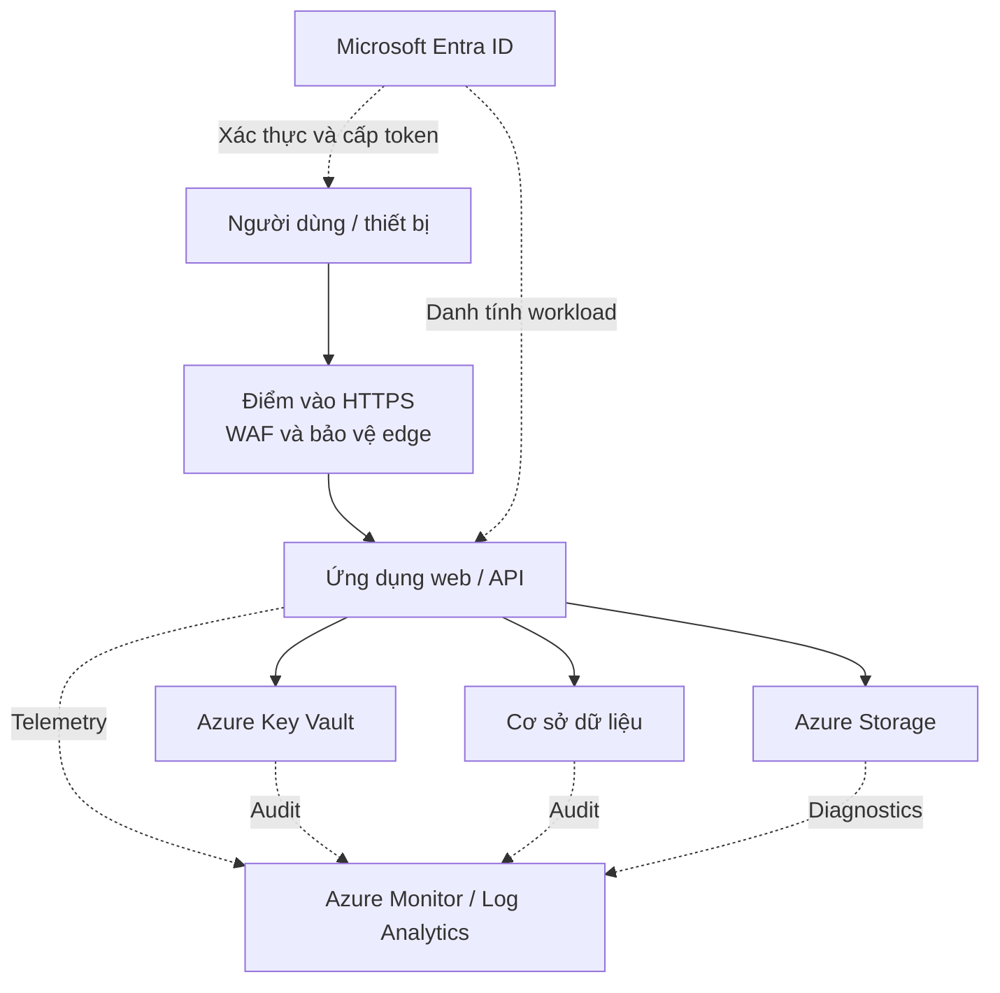
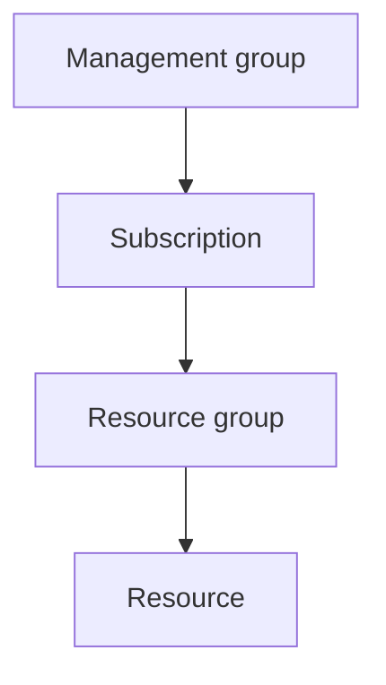
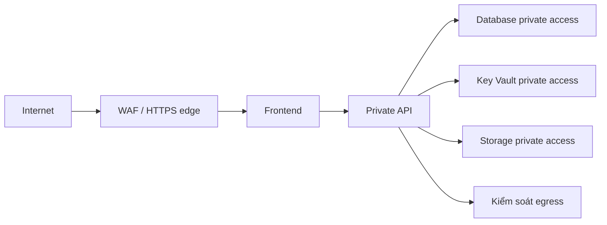
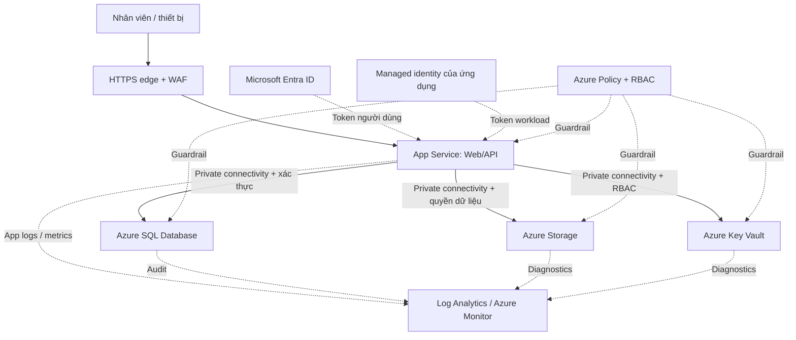

# Áp dụng Zero Trust cho kiến trúc Azure

Một ứng dụng chạy trên Microsoft Azure có thể sử dụng đầy đủ mạng ảo, máy ảo, dịch vụ tính toán, lưu trữ và cơ sở dữ liệu nhưng vẫn bị xâm nhập nếu hệ thống mặc định tin tưởng người dùng đã vào mạng nội bộ, dịch vụ gọi từ subnet được phép hoặc tài khoản có quyền quá rộng. Trong môi trường đám mây, người dùng làm việc từ nhiều nơi, dịch vụ giao tiếp qua API và các danh tính tự động hóa thực hiện thay đổi liên tục. Ranh giới bảo mật vì thế không còn trùng với ranh giới mạng doanh nghiệp.

**Zero Trust** là mô hình bảo mật trong đó mỗi yêu cầu truy cập phải được đánh giá theo danh tính, ngữ cảnh và chính sách phù hợp, bất kể yêu cầu đến từ Internet hay mạng nội bộ. Áp dụng Zero Trust cho Azure nghĩa là kết hợp Microsoft Entra ID, quyền truy cập, bảo mật thiết bị, kiểm soát mạng, danh tính workload, bảo vệ dữ liệu, giám sát và quy trình ứng phó thành nhiều lớp bảo vệ. Không có một sản phẩm hoặc công tắc duy nhất có thể tự động biến toàn bộ kiến trúc thành Zero Trust.

Bài học thuộc chương **Bảo mật và tuân thủ** của module **CLOUD_PROVIDERS_AZURE**. Các ví dụ bám sát hành trình xây dựng ứng dụng Azure: tổ chức subscription và resource group; xác thực bằng Entra ID; triển khai mạng ảo, dịch vụ tính toán, lưu trữ và cơ sở dữ liệu; sau đó giám sát, bảo vệ và kiểm soát chi phí vận hành.

Sau bài học, bạn có thể:

- Giải thích ba nguyên tắc Zero Trust và xác định những ranh giới tin cậy trong kiến trúc Azure.
- Áp dụng kiểm soát danh tính, quyền, thiết bị, mạng, ứng dụng, dữ liệu và hạ tầng theo mức rủi ro.
- Phân biệt kiểm soát truy cập của người dùng, dịch vụ và tài nguyên dữ liệu.
- Thiết kế một ứng dụng Azure có nhiều lớp bảo vệ và hạn chế di chuyển ngang sau sự cố.
- Xây dựng kế hoạch triển khai, bằng chứng kiểm chứng và quy trình giám sát Zero Trust.

## 1. Tư duy Zero Trust: tin cậy phải được xác minh

Trước đây, nhiều hệ thống dựa vào mô hình phòng thủ chu vi: người dùng qua VPN hoặc máy chủ nằm trong mạng nội bộ thường được xem là đáng tin hơn. Cách tiếp cận này không đủ khi kẻ tấn công có thể đánh cắp token, chiếm một endpoint, lợi dụng máy chủ đã bị xâm nhập hoặc dùng danh tính ứng dụng có quyền cao.

Zero Trust sử dụng ba nguyên tắc nền tảng:

| Nguyên tắc | Ý nghĩa | Ví dụ trên Azure |
|---|---|---|
| **Verify explicitly – Xác minh rõ ràng** | Đánh giá yêu cầu truy cập từ nhiều tín hiệu liên quan thay vì chỉ dựa vào vị trí mạng | Microsoft Entra ID xác thực người dùng, Conditional Access đánh giá rủi ro đăng nhập và trạng thái thiết bị theo policy |
| **Use least privilege – Cấp quyền tối thiểu** | Chỉ cấp quyền cần thiết, trong phạm vi và thời gian phù hợp | Azure RBAC theo resource group; Privileged Identity Management (PIM) cho quyền đặc biệt; managed identity chỉ đọc một secret cần thiết |
| **Assume breach – Giả định có thể bị xâm nhập** | Thiết kế để phát hiện, giới hạn và phục hồi khi một thành phần bị chiếm quyền | Cô lập mạng và danh tính workload; giám sát log; cảnh báo; thu hồi quyền; khôi phục từ bản sao lưu |

### Một yêu cầu cần được đánh giá ở nhiều lớp

Giả sử người dùng muốn mở trang quản trị bán hàng. Hệ thống có thể kiểm tra:

1. Người dùng có danh tính hợp lệ và đã hoàn tất phương thức xác thực phù hợp hay không?
2. Đăng nhập có bất thường về vị trí, hành vi hoặc mức rủi ro không?
3. Thiết bị có đáp ứng chính sách bảo mật dành cho tài nguyên này không?
4. Người dùng có đúng vai trò và quyền thực hiện hành động đang yêu cầu không?
5. API có kiểm tra token, quyền và đối tượng dữ liệu ở phía máy chủ không?
6. Hoạt động có được ghi nhận để phát hiện truy cập bất thường không?

Không phải mọi truy cập đều có thể hoặc cần kiểm tra toàn bộ tín hiệu trên. Chính sách phải phù hợp với loại danh tính, loại tài nguyên, mức nhạy cảm và khả năng hỗ trợ của dịch vụ. Điểm cốt lõi là **không xem một tín hiệu riêng lẻ**, chẳng hạn IP nội bộ hoặc việc đăng nhập thành công, là bằng chứng đủ để cấp mọi quyền.

### Zero Trust không đồng nghĩa với một sản phẩm

MFA giảm rủi ro mất mật khẩu nhưng không thay thế phân quyền API. Private Endpoint giảm bề mặt truy cập mạng nhưng không tự cấp quyền truy cập dữ liệu. Mã hóa lưu trữ không ngăn tài khoản có quyền hợp lệ đọc nhầm bản ghi. Azure Firewall không thay thế việc kiểm tra danh tính dịch vụ. Mỗi lớp xử lý một kiểu rủi ro khác nhau; các lớp cần bổ trợ nhau.

## 2. Phạm vi áp dụng trong hệ sinh thái Azure

Một mô hình dễ nhớ là xem Zero Trust theo sáu trụ cột cùng năng lực giám sát và tự động hóa xuyên suốt.

| Trụ cột | Cần bảo vệ | Dịch vụ/cơ chế Azure thường liên quan |
|---|---|---|
| Danh tính | Tài khoản người dùng, quản trị viên, service principal, managed identity | Microsoft Entra ID, MFA, Conditional Access, Azure RBAC, PIM |
| Thiết bị | Laptop, điện thoại, máy trạm quản trị, endpoint | Microsoft Intune, Microsoft Defender for Endpoint, tín hiệu tuân thủ thiết bị |
| Mạng | Kết nối từ Internet, giữa các workload và tới dịch vụ dữ liệu | VNet, subnet, NSG, Azure Firewall, Azure Private Link, WAF, VPN/ExpressRoute |
| Ứng dụng và workload | Web, API, máy ảo, container, pipeline và tài khoản dịch vụ | App Service, API Management, AKS, managed identity, workload identity federation |
| Dữ liệu | Secret, file, database, bản sao lưu, dữ liệu nhạy cảm | Key Vault, Azure Storage, Azure SQL, mã hóa, RBAC dữ liệu, phân loại và audit |
| Hạ tầng | Subscription, resource group, cấu hình tài nguyên, hệ điều hành | Azure Policy, Defender for Cloud, Azure Update Manager, IaC, Azure Monitor |

Đây là mô hình triển khai thực hành, không phải danh sách dịch vụ bắt buộc. Chọn dịch vụ theo loại workload, ngân sách, giấy phép, khu vực hỗ trợ và trách nhiệm vận hành. Với tài nguyên đa đám mây hoặc on-premises, các cơ chế như Azure Arc có thể giúp mở rộng quản lý, nhưng cần đánh giá khả năng hỗ trợ thực tế cho từng loại máy chủ và chính sách.

## 3. Xác định ranh giới tin cậy và mô hình đe dọa

Trước khi chọn dịch vụ bảo mật, hãy xác định dữ liệu đang đi đâu, ai yêu cầu truy cập và điều gì có thể xảy ra nếu một thành phần bị chiếm quyền.

Một kiến trúc tham khảo:



Sơ đồ mô tả quan hệ logic. Khi triển khai thật, kết nối từ ứng dụng tới Key Vault, database và Storage có thể được thiết lập qua Private Endpoint, private DNS, VNet integration hoặc các cơ chế mạng phù hợp. Đường kết nối riêng không tự thay thế việc kiểm tra token và quyền dữ liệu.

| Ranh giới | Nguy cơ giả định | Kiểm soát cần xem xét |
|---|---|---|
| Người dùng → ứng dụng | Đánh cắp mật khẩu/token, thiết bị bị nhiễm mã độc | MFA, Conditional Access, phiên đăng nhập, kiểm tra quyền ở API |
| Edge → ứng dụng | Tấn công web, truy cập trực tiếp origin bỏ qua WAF | WAF, cấu hình origin, TLS, xác thực ứng dụng |
| Ứng dụng → Key Vault | Workload bị chiếm và đọc quá nhiều secret | Managed identity riêng, RBAC tối thiểu, audit, kết nối mạng hạn chế |
| Ứng dụng → database | SQL injection, truy vấn vượt quyền, đánh cắp dữ liệu | Truy vấn tham số hóa, kiểm soát quyền dữ liệu, private access, audit |
| Workload A → Workload B | Di chuyển ngang trong mạng | NSG, firewall, network policy, định danh dịch vụ và xác thực hai phía khi phù hợp |
| Quản trị viên → subscription | Chiếm tài khoản đặc quyền, thay đổi policy hoặc xóa log | PIM, MFA mạnh, RBAC, log hoạt động, phân tách nhiệm vụ |
| Pipeline → Azure | Lộ credential CI/CD, triển khai tài nguyên sai phạm vi | Federation, quyền tối thiểu, review IaC, phê duyệt và log pipeline |

Mỗi khi bổ sung một thành phần vào kiến trúc, hãy cập nhật sơ đồ luồng dữ liệu và đặt câu hỏi: **Nếu thành phần này bị xâm nhập, kẻ tấn công có thể làm gì tiếp?** Câu trả lời giúp chọn ranh giới, quyền và bằng chứng giám sát thực sự cần thiết.

## 4. Danh tính: điểm kiểm soát quan trọng nhất

Microsoft Entra ID cung cấp danh tính và xác thực cho người dùng, nhóm và nhiều ứng dụng Azure. Tuy nhiên, cần phân biệt **xác thực** (ai đang truy cập?) với **ủy quyền** (được phép làm gì?). Một token hợp lệ chứng minh các điều kiện xác thực mà token thể hiện; ứng dụng hoặc dịch vụ nhận token vẫn phải quyết định có cho phép thao tác cụ thể hay không.

### 4.1. Bảo vệ đăng nhập người dùng

Đối với tài khoản nhân viên và quản trị viên:

- Bật MFA theo chính sách phù hợp; ưu tiên các phương thức chống phishing như passkey hoặc khóa bảo mật khi khả thi.
- Dùng **Conditional Access** để đánh giá ứng dụng đích, nhóm người dùng, rủi ro đăng nhập, địa điểm, trạng thái thiết bị và các điều kiện được hỗ trợ.
- Đặt chính sách mạnh hơn cho tác vụ đặc quyền và ứng dụng chứa dữ liệu nhạy cảm.
- Dùng chính sách quản lý phiên, dấu hiệu rủi ro và cơ chế thu hồi phiên/token được hỗ trợ để giảm thời gian kẻ tấn công có thể sử dụng phiên bị chiếm.
- Giới hạn hoặc loại bỏ phương thức xác thực cũ không đáp ứng yêu cầu bảo mật, sau khi kiểm tra các phụ thuộc nghiệp vụ.

Ví dụ chính sách truy cập ứng dụng nhân sự có thể yêu cầu MFA và thiết bị tuân thủ. Chính sách khác đối với quyền quản trị Azure có thể yêu cầu phương thức xác thực mạnh hơn và cấp quyền trong thời gian ngắn. Điều kiện chính xác phụ thuộc giấy phép Microsoft Entra, khả năng của ứng dụng và chính sách thiết bị.

**Lưu ý vận hành:** Trước khi áp dụng Conditional Access diện rộng, hãy thử nghiệm với nhóm nhỏ và chế độ report-only nếu có. Duy trì quy trình tài khoản truy cập khẩn cấp được kiểm soát và theo dõi để tránh tự khóa toàn bộ đội quản trị. Các tài khoản khẩn cấp cần phương án xác thực, lưu giữ và giám sát riêng, không sử dụng cho công việc thường ngày.

### 4.2. Azure RBAC và nguyên tắc quyền tối thiểu

Azure Role-Based Access Control (RBAC) quyết định một principal có thể thực hiện các thao tác quản lý Azure trong phạm vi nào. Phạm vi thường gặp là management group, subscription, resource group và resource.



Role assignment ở phạm vi cha được kế thừa xuống các phạm vi con khi phù hợp. Vì vậy, một vai trò rộng ở subscription có thể tác động đến nhiều resource group. Hãy ưu tiên cấp quyền qua nhóm Entra, chỉ ở phạm vi cần thiết và rà soát định kỳ.

| Vai trò hoặc cơ chế | Phạm vi sử dụng | Cảnh báo |
|---|---|---|
| Reader | Xem cấu hình tài nguyên ở control plane | Không mặc nhiên có quyền đọc dữ liệu trong blob hoặc database |
| Contributor | Quản lý nhiều loại tài nguyên | Không phù hợp cho script chỉ cần đọc; có thể tạo thay đổi gây gián đoạn |
| Owner | Quản lý tài nguyên và phân quyền RBAC | Quyền rất rộng; hạn chế tối đa và kiểm soát đặc biệt |
| Role theo dịch vụ/dữ liệu | Quyền cụ thể cho Key Vault, Storage, SQL hoặc workload | Xác định rõ control plane và data plane |
| PIM | Cấp quyền đặc biệt khi có nhu cầu, theo thời gian và điều kiện | Cần quy trình phê duyệt, ghi log và phương án xử lý khẩn cấp |

**PIM** giúp tổ chức dùng quyền đặc biệt theo nhu cầu (just-in-time) thay vì để tài khoản có quyền cao thường trực. PIM không tự thay thế thiết kế role assignment hợp lý, phân tách trách nhiệm và xem xét định kỳ. Một số tính năng cần giấy phép phù hợp.

### 4.3. Danh tính workload: ứng dụng cũng phải được xác thực

Một web app đọc secret hoặc ghi blob đang thực hiện truy cập bằng danh tính ứng dụng, khác với danh tính người dùng cuối. Azure hỗ trợ nhiều lựa chọn:

- **System-assigned managed identity:** gắn với vòng đời của tài nguyên Azure hỗ trợ tính năng này.
- **User-assigned managed identity:** là tài nguyên danh tính riêng có thể gắn vào nhiều workload được hỗ trợ. Cần cân nhắc phạm vi chia sẻ để tránh quyền lan rộng.
- **Workload identity federation:** dùng token từ nhà cung cấp danh tính tin cậy, chẳng hạn nền tảng CI/CD hoặc Kubernetes có cấu hình phù hợp, để lấy token Entra mà không lưu client secret dài hạn.
- **Service principal với chứng chỉ:** dùng khi cơ chế trên không phù hợp; cần bảo vệ khóa riêng và quản lý vòng đời chứng chỉ.

Ứng dụng nên lấy token bằng thư viện nhận dạng được hỗ trợ như Azure Identity SDK. Không ghi client secret, connection string chứa khóa hoặc access token trực tiếp trong mã nguồn, image container, file cấu hình công khai hoặc log. Khi cần truy cập nhiều dịch vụ, cấp đúng quyền cho từng tài nguyên; managed identity không tự động có quyền đọc dữ liệu.

### 4.4. Xác thực và ủy quyền trong ứng dụng

Nếu API tiếp nhận JWT access token, phải xác thực chữ ký, issuer, audience, thời hạn, và các claim cần thiết theo chuẩn của nhà cung cấp danh tính. API phải kiểm tra scope hoặc role và quyền đối với đối tượng dữ liệu ở mỗi thao tác quan trọng. Không dùng chỉ một `userId` do client gửi để quyết định quyền đọc bản ghi.

Ví dụ, token hợp lệ cho nhân viên bán hàng không có nghĩa nhân viên đó được xem toàn bộ hóa đơn. Ứng dụng còn cần so khớp đơn vị kinh doanh, chủ sở hữu hoặc quyền trên hóa đơn. Nếu ứng dụng gọi API khác dưới quyền người dùng, cần dùng mô hình ủy quyền phù hợp, chẳng hạn OAuth 2.0 on-behalf-of khi được hỗ trợ; không tùy tiện chuyển tiếp token đến dịch vụ không đúng audience.

## 5. Thiết bị: cân nhắc tình trạng đầu cuối khi cho truy cập

Một tài khoản có MFA vẫn có thể bị lợi dụng qua thiết bị không được bảo vệ. Với truy cập quản trị và dữ liệu nhạy cảm, trạng thái thiết bị là tín hiệu hữu ích:

- Microsoft Intune có thể quản lý cấu hình và đánh giá mức tuân thủ của thiết bị được đăng ký/quản lý.
- Microsoft Defender for Endpoint có thể cung cấp tín hiệu rủi ro và phát hiện hành vi bất thường trên endpoint được hỗ trợ.
- Conditional Access có thể dùng trạng thái tuân thủ hoặc các tín hiệu được hỗ trợ để quyết định quyền truy cập.
- Thiết bị quản trị nên có cấu hình bảo vệ riêng: cập nhật bản vá, mã hóa ổ đĩa, chống mã độc, kiểm soát quyền cục bộ và phương thức truy cập đặc quyền.

Ví dụ, kế toán có thể đọc báo cáo nhạy cảm chỉ từ thiết bị đáp ứng policy. Khách hàng bên ngoài dùng thiết bị cá nhân sẽ cần một thiết kế xác thực khác, vì tổ chức không quản lý trực tiếp thiết bị đó. Không nên áp đặt chính sách thiết bị nội bộ lên mọi người dùng Internet mà không đánh giá trải nghiệm và khả năng hỗ trợ.

Trạng thái “compliant” là một tín hiệu tại thời điểm đánh giá, không phải bảo đảm thiết bị không thể bị xâm nhập. Cần kết hợp bảo vệ thiết bị, quyền ứng dụng, giới hạn phiên và giám sát liên tục.

## 6. Mạng: hạn chế đường đi và khả năng di chuyển ngang

Zero Trust không xóa bỏ nhu cầu bảo mật mạng. Mạng vẫn là lớp giảm bề mặt tấn công và cô lập sự cố, nhưng vị trí trong VNet hoặc subnet không đủ để chứng minh một dịch vụ có quyền đọc dữ liệu.

### 6.1. Phân đoạn mạng theo luồng truy cập thực tế

Ví dụ hệ thống có lớp frontend, lớp API và lớp dữ liệu:



Thiết kế các ranh giới tương ứng với luồng nghiệp vụ:

1. Chỉ mở điểm vào công khai thật sự cần thiết, thường là HTTPS ở edge.
2. Giới hạn API nội bộ để chỉ các thành phần được phép kết nối.
3. Không mở trực tiếp database hoặc secret store ra Internet khi workload không cần.
4. Kiểm soát đường ra ngoài của workload; một máy chủ bị chiếm quyền có thể dùng kết nối outbound để gửi dữ liệu đi.
5. Phân tách vùng quản trị, workload sản xuất và môi trường phát triển theo rủi ro.

Với máy ảo hoặc subnet, **Network Security Group (NSG)** lọc lưu lượng dựa trên quy tắc mạng. **Azure Firewall** cung cấp kiểm soát và ghi log lưu lượng tập trung theo các khả năng của dịch vụ. **User Defined Route (UDR)** có thể đưa lưu lượng đi qua thiết bị kiểm soát theo thiết kế. Khi dùng **VNet peering**, các VNet không mặc nhiên trở thành một mạng có khả năng định tuyến transit đầy đủ; cần cấu hình định tuyến và gateway/thiết bị trung gian đúng nhu cầu.

Không phải mọi PaaS đều nằm trực tiếp trong subnet như máy ảo. Kiểm tra mô hình mạng riêng của App Service, Functions, AKS, Azure SQL, Storage hoặc dịch vụ tương ứng trước khi áp dụng một mẫu NSG chung.

### 6.2. Private Endpoint và Azure Private Link

Private Endpoint cung cấp giao diện mạng với IP riêng trong VNet để truy cập một dịch vụ hỗ trợ Azure Private Link. Đây là lựa chọn thường gặp khi muốn hạn chế đường truy cập đến Azure SQL, Storage hoặc Key Vault.

Để triển khai đúng:

- Tạo private endpoint cho đúng dịch vụ và loại subresource được hỗ trợ.
- Cấu hình private DNS để tên dịch vụ phân giải về IP riêng từ các mạng cần truy cập.
- Xác nhận đường định tuyến từ workload đến endpoint; thử nghiệm DNS và kết nối từ đúng môi trường chạy.
- **Cấu hình tắt hoặc giới hạn public network access riêng** khi yêu cầu và dịch vụ hỗ trợ. Tạo private endpoint tự nó không luôn vô hiệu hóa đường truy cập công khai.
- Vẫn thực hiện xác thực và ủy quyền tại dịch vụ đích. Private Endpoint là kiểm soát đường mạng, không phải cơ chế cấp quyền đọc secret, blob hoặc bản ghi SQL.

**Service Endpoint** và **Private Endpoint** khác nhau. Service Endpoint mở rộng danh tính VNet tới dịch vụ Azure qua đường mạng của Azure nhưng không tạo IP riêng cho dịch vụ trong VNet như Private Endpoint. Chọn một trong hai dựa trên khả năng hỗ trợ, yêu cầu public exposure, định tuyến và DNS của kiến trúc.

### 6.3. Kiểm soát lớp ứng dụng và bảo vệ edge

- **Web Application Firewall (WAF):** kiểm tra lưu lượng HTTP/HTTPS và hỗ trợ giảm rủi ro một số kiểu tấn công web; có thể dùng với Azure Front Door hoặc Application Gateway tùy mô hình.
- **Azure Firewall:** kiểm soát lưu lượng mạng tập trung và các luật được hỗ trợ, thường đặt ở hub hoặc đường egress.
- **DDoS Protection:** bổ sung bảo vệ trước tấn công làm cạn kiệt tài nguyên mạng cho các kiến trúc đủ điều kiện; cần phân biệt với WAF vốn tập trung vào lớp ứng dụng.
- **TLS:** mã hóa dữ liệu khi truyền, xác thực máy chủ và bảo vệ tính toàn vẹn kênh. Thiết lập phiên bản TLS được phê duyệt và quản lý chứng chỉ.
- **Bảo vệ origin:** nếu lưu lượng công khai phải đi qua Front Door hoặc WAF, cấu hình origin để hạn chế hoặc xác minh nguồn lưu lượng; tránh để client truy cập origin trực tiếp và bỏ qua lớp bảo vệ.

Đừng kỳ vọng WAF hoặc firewall sửa được lỗi phân quyền trong ứng dụng. Một người dùng đã đăng nhập vẫn có thể truy cập dữ liệu của người khác nếu API không kiểm tra quyền theo đối tượng.

## 7. Bảo vệ ứng dụng, API và tài nguyên tính toán

### 7.1. Web app và API

Một ứng dụng được bảo vệ tốt nên:

- Dùng Microsoft Entra ID hoặc nhà cung cấp danh tính phù hợp cho đăng nhập và cấp token.
- Kiểm tra token tại API, xác nhận scope/role và quyền nghiệp vụ trước khi xử lý yêu cầu.
- Dùng managed identity để truy cập Key Vault, Storage, database hoặc các tài nguyên hỗ trợ xác thực Entra.
- Giới hạn endpoint quản trị và chức năng nội bộ; tách vai trò người dùng cuối với vai trò vận hành.
- Dùng input validation, truy vấn tham số hóa, giới hạn tốc độ, kiểm soát upload và quy trình xử lý lỗi an toàn.
- Ghi log sự kiện bảo mật liên quan nhưng không ghi token, mật khẩu, secret hoặc dữ liệu nhạy cảm quá mức.

API Management có thể giúp kiểm tra JWT, thực thi policy, giới hạn tốc độ hoặc tập trung quản lý API khi kiến trúc cần. Việc gateway kiểm tra token không loại bỏ trách nhiệm kiểm tra quyền nghiệp vụ trong API phía sau.

### 7.2. Máy ảo và container

Với máy ảo, giảm phơi lộ cổng quản trị, dùng kết nối quản trị phù hợp, áp dụng bản vá, chống mã độc, mã hóa và giám sát thay đổi. Azure Bastion hoặc cơ chế truy cập được kiểm soát có thể giảm nhu cầu mở RDP/SSH trực tiếp ra Internet. Hạn chế quyền hệ điều hành của người dùng và tài khoản dịch vụ.

Với AKS hoặc container, áp dụng nguyên tắc tương tự ở nhiều lớp: kiểm soát truy cập Kubernetes, network policy khi được hỗ trợ, image scanning, hạn chế quyền container, bảo vệ secret, cập nhật phiên bản và workload identity. Không coi việc pod chạy trong cluster riêng là đủ để tin cậy. Tách namespace có ích cho tổ chức tài nguyên, nhưng không thay thế cô lập quyền và mạng theo yêu cầu bảo mật.

### 7.3. Pipeline và chuỗi cung ứng phần mềm

CI/CD có thể tạo và sửa nhiều tài nguyên Azure. Vì vậy, pipeline là một danh tính đặc quyền cần kiểm soát:

1. Dùng federation thay cho client secret dài hạn khi nền tảng CI/CD và Azure hỗ trợ.
2. Tách danh tính triển khai dev/test/prod; cấp quyền theo subscription hoặc resource group cần thiết.
3. Yêu cầu review thay đổi IaC, quét dependency và image, kiểm tra secret và policy trước khi triển khai.
4. Bảo vệ nhánh, môi trường triển khai và bước phê duyệt đối với production.
5. Lưu lịch sử ai phê duyệt, artifact nào được triển khai và vào môi trường nào.

Nếu pipeline bị chiếm quyền, RBAC tối thiểu và các guardrail Azure Policy giúp hạn chế phạm vi thiệt hại. Dù vậy, policy không thay thế kiểm soát bảo mật repository và hệ thống build.

## 8. Dữ liệu: bảo vệ nội dung và hạn chế khả năng lạm dụng

Dữ liệu cần được bảo vệ tại các trạng thái lưu trữ, truyền tải và xử lý. Cần biết dữ liệu gì đang được lưu, ai được đọc, có thể chia sẻ với ai và thời gian lưu giữ bao lâu.

### 8.1. Phân loại và xác định chủ sở hữu

Chia dữ liệu theo mức nhạy cảm phù hợp với tổ chức, chẳng hạn công khai, nội bộ, bí mật và dữ liệu chịu yêu cầu pháp lý riêng. Với từng loại dữ liệu, xác định:

- Người hoặc nhóm sở hữu dữ liệu và chịu trách nhiệm cấp quyền.
- Dịch vụ và vùng Azure được phép lưu dữ liệu.
- Quy tắc truy cập, chia sẻ, mã hóa, sao lưu và lưu giữ.
- Yêu cầu log, audit và xóa dữ liệu khi hết thời hạn.

Microsoft Purview và các khả năng phân loại dữ liệu liên quan có thể hỗ trợ kiểm kê và quản trị trong những môi trường phù hợp. Công cụ tự động không thay thế quyết định nghiệp vụ về phân loại và quyền sử dụng dữ liệu.

### 8.2. Mã hóa và quản lý khóa

Nhiều dịch vụ Azure có mã hóa dữ liệu khi lưu trữ theo mặc định, nhưng cần xác nhận phạm vi hỗ trợ và yêu cầu cụ thể của dịch vụ. Dùng HTTPS/TLS khi truyền dữ liệu; với yêu cầu nâng cao có thể cần customer-managed key, chính sách luân chuyển khóa hoặc giải pháp mã hóa phía ứng dụng.

**Azure Key Vault** có thể quản lý secret, key và certificate. Áp dụng managed identity, vai trò phù hợp và chính sách mạng để hạn chế truy cập. Bật logging cần thiết, cân nhắc soft-delete, purge protection và kế hoạch phục hồi. Không dùng Key Vault như lý do để đưa quá nhiều bí mật cho một ứng dụng: mỗi danh tính chỉ nên nhận quyền đối với những đối tượng nó thực sự cần.

### 8.3. Phân biệt quyền quản lý và quyền đọc dữ liệu

Quyền xem hoặc quản lý resource Azure ở control plane không đồng nghĩa với quyền đọc nội dung blob, secret hay bảng dữ liệu. Các dịch vụ có cơ chế data plane riêng, chẳng hạn Azure RBAC role dành cho Storage hoặc Key Vault, và cơ chế xác thực/ủy quyền của database.

Ví dụ, một thành viên platform team có thể cần xem cấu hình storage account nhưng không cần tải file của khách hàng. Ứng dụng xử lý hóa đơn có thể cần đọc một container blob nhất định nhưng không cần quyền sửa network rule của storage account.

### 8.4. Ngăn chặn và phục hồi khi dữ liệu gặp sự cố

Ngoài kiểm soát truy cập, hãy cân nhắc logging truy cập dữ liệu, cảnh báo hành vi tải xuống hàng loạt, private access, versioning, soft delete, immutable storage hoặc backup theo khả năng của từng dịch vụ. Thử phục hồi dữ liệu và xác định RPO/RTO cho workload quan trọng.

Zero Trust giảm xác suất và phạm vi xâm nhập nhưng không bảo đảm mọi cuộc tấn công bị chặn. Bản sao lưu có thể phục hồi và quy trình ứng phó sự cố là một phần của nguyên tắc giả định có xâm nhập.

## 9. Quản trị hạ tầng bằng landing zone, Azure Policy và Defender for Cloud

Khi nhiều ứng dụng cùng chạy trên Azure, Zero Trust cần có các quy tắc nhất quán ở cấp tổ chức. Cấu trúc landing zone giúp gán quyền và policy theo management group, subscription, resource group và tài nguyên.

### 9.1. Đặt guardrail ở đúng phạm vi

Một hệ thống có thể tách các subscription nền tảng cho quản lý, kết nối và danh tính, rồi cấp các subscription riêng cho workload sản xuất và phát triển. Cấu trúc này không tự cung cấp Zero Trust, nhưng giúp giới hạn vai trò, quota, mạng, chi phí và ảnh hưởng từ thay đổi sai.

Các baseline nên được xác định rõ:

| Lớp quản trị | Ví dụ kiểm soát | Điều cần xác minh |
|---|---|---|
| Management group | Policy về vùng triển khai, chuẩn logging hoặc cấu hình bảo mật | Chính sách có áp dụng xuống đúng subscription không? |
| Subscription | Nhóm quản trị, budget, Activity Log và dịch vụ bảo mật | Ai là chủ sở hữu và ai có thể thay đổi role assignment? |
| Resource group | RBAC theo ứng dụng, quy ước đặt tên và tag | Có tài nguyên nào bị gom chung khác chủ sở hữu không? |
| Resource | Managed identity, cấu hình mạng, mã hóa và diagnostic settings | Đường truy cập công khai và quyền dữ liệu có đúng yêu cầu không? |

**Azure Policy** giúp đánh giá và thực thi cấu hình. Một policy có thể dùng effect `Audit` để ghi nhận cấu hình sai, `Deny` để chặn yêu cầu không tuân thủ, hoặc `Modify`/`DeployIfNotExists` để hỗ trợ khắc phục theo khả năng và quyền được cấu hình. Một số hành vi tự động cần managed identity và role assignment tương ứng.

Không nên chuyển một policy sang `Deny` trên toàn doanh nghiệp trước khi kiểm tra tác động đối với các workload hiện hữu. Sử dụng phạm vi thử nghiệm, đánh giá compliance, xác định ngoại lệ có thời hạn và triển khai theo từng giai đoạn.

### 9.2. Microsoft Defender for Cloud

Microsoft Defender for Cloud hỗ trợ quản lý tư thế bảo mật đám mây, đưa ra khuyến nghị và cung cấp các khả năng bảo vệ workload theo những gói và cấu hình được bật. Có thể sử dụng để phát hiện rủi ro cấu hình, ưu tiên khắc phục và theo dõi kết quả. Các khuyến nghị cần được đánh giá theo ngữ cảnh ứng dụng, phạm vi đăng ký và tính sẵn có của tính năng.

Ví dụ, nếu phát hiện storage account có public network access không phù hợp, đội nền tảng có thể xác định workload nào còn phụ thuộc đường truy cập đó, lập kế hoạch chuyển sang private access rồi mới thay đổi policy. Tắt công khai ngay mà chưa kiểm tra DNS và kết nối có thể làm ứng dụng ngừng hoạt động.

### 9.3. Bảo mật tài nguyên từ cấu hình gốc

Đưa baseline vào Infrastructure as Code (Bicep, ARM template hoặc Terraform) và pipeline triển khai. Một cấu hình được kiểm soát bằng mã có thể được review, triển khai lặp lại và so sánh với trạng thái mong muốn. Cần kết hợp:

- Module IaC đã review cho mạng, logging, identity và bảo vệ dữ liệu.
- Cơ chế phát hiện drift hoặc đánh giá compliance định kỳ.
- Kiểm tra chính sách và security scanning trong CI/CD.
- Phân quyền triển khai phù hợp cho từng môi trường.
- Quy trình rollback, nhật ký thay đổi và kiểm tra sau triển khai.

Hạ tầng được cấu hình an toàn tại thời điểm tạo vẫn có thể lệch chuẩn do thao tác thủ công, thay đổi quyền hoặc cập nhật dịch vụ. Vì thế Zero Trust yêu cầu đánh giá liên tục, không chỉ kiểm tra một lần lúc go-live.

## 10. Giám sát, phát hiện và phản ứng sự cố

Nguyên tắc *assume breach* đòi hỏi đội vận hành có đủ dấu vết để biết điều gì đang xảy ra, xác định phạm vi ảnh hưởng và thực hiện cô lập. Không có telemetry, tổ chức có thể có nhiều lớp chặn nhưng thiếu bằng chứng khi một lớp bị vượt qua.

### 10.1. Thu thập log theo câu hỏi điều tra

| Nguồn dữ liệu | Có thể giúp trả lời |
|---|---|
| Microsoft Entra sign-in logs và audit logs | Ai đăng nhập? Từ đâu? MFA/Conditional Access có đáp ứng? Quyền hoặc cấu hình danh tính có thay đổi? |
| Azure Activity Log | Ai tạo, sửa hoặc xóa tài nguyên quản lý Azure? Hoạt động xảy ra ở subscription nào? |
| Diagnostic logs của Key Vault, Storage, database | Có yêu cầu truy cập bất thường, thất bại hoặc thay đổi nhạy cảm nào không? |
| WAF, Azure Firewall và network logs | Lưu lượng bị chặn hoặc bất thường xuất hiện ở đâu? |
| Application logs và tracing | Endpoint, giao dịch hay danh tính ứng dụng nào phát sinh lỗi hoặc hành vi bất thường? |
| Endpoint và workload security alerts | Có dấu hiệu tiến trình độc hại, khai thác lỗ hổng hoặc di chuyển ngang không? |

Azure Monitor và Log Analytics có thể tập trung nhiều loại telemetry. Microsoft Sentinel có thể hỗ trợ tương quan cảnh báo và điều tra khi được triển khai phù hợp. Việc có workspace không đồng nghĩa mọi nguồn log tự động được gửi tới đó: cần cấu hình diagnostic settings, data collection rules, connector hoặc cơ chế ingest tương ứng.

### 10.2. Ví dụ truy vấn hoạt động Azure thất bại

Nếu Activity Log của subscription đã được xuất vào Log Analytics và tạo bảng `AzureActivity`, có thể dùng Kusto Query Language (KQL):

```kusto
AzureActivity
| where TimeGenerated > ago(24h)
| where ActivityStatusValue =~ "Failure"
| summarize FailedOperations = count()
    by Caller, OperationNameValue, ResourceGroup
| order by FailedOperations desc
```

Truy vấn giúp tìm người gọi và thao tác bị lỗi nhiều trong 24 giờ gần nhất. Đây là tín hiệu để điều tra, không tự chứng minh có tấn công. Cần kết hợp nguồn log khác, thay đổi được phê duyệt, khung thời gian, địa chỉ nguồn và hành vi ứng dụng để đánh giá.

### 10.3. Thiết kế cảnh báo có thể hành động

Một số sự kiện đáng cân nhắc:

- Tài khoản đặc quyền kích hoạt quyền ngoài khung hoạt động dự kiến.
- Conditional Access phát hiện đăng nhập bất thường hoặc rủi ro cao.
- Role assignment mới cấp quyền Owner/Contributor ở phạm vi rộng.
- Storage, Key Vault hoặc database được mở lại public network access ngoài quy trình.
- Tăng đột biến số yêu cầu thất bại đến API hoặc lượng tải dữ liệu.
- Diagnostic settings, chính sách bảo vệ hoặc cảnh báo bị tắt.
- Pipeline triển khai tài nguyên ngoài subscription/môi trường cho phép.

Với mỗi cảnh báo, xác định mức độ nghiêm trọng, người nhận, dữ liệu cần thu thập, bước xác minh, thao tác cô lập và điều kiện đóng sự cố. Cảnh báo không có người phản ứng hoặc không có runbook dễ tạo nhiễu và không cải thiện an toàn thực tế.

### 10.4. Phản ứng khi một danh tính hoặc workload bị xâm nhập

Ví dụ ứng dụng bị lộ token dịch vụ và xuất hiện yêu cầu đọc dữ liệu bất thường:

1. **Xác minh:** đối chiếu log ứng dụng, Entra, Key Vault/database và tài nguyên liên quan; xác định token/danh tính nào đã dùng.
2. **Giới hạn ảnh hưởng:** theo quy trình sự cố, vô hiệu hóa hoặc thu hồi khả năng truy cập phù hợp, hạn chế luồng mạng và tạm dừng workload/pipeline bị nghi ngờ nếu cần.
3. **Bảo toàn bằng chứng:** lưu log, mốc thời gian, resource ID và thông tin thay đổi có liên quan; tuân theo yêu cầu pháp lý và nội bộ.
4. **Khắc phục nguyên nhân:** loại bỏ secret bị lộ, sửa quyền quá rộng hoặc cấu hình mạng sai, vá lỗ hổng và kiểm tra các danh tính liên quan.
5. **Phục hồi có kiểm chứng:** chỉ đưa dịch vụ trở lại khi đường truy cập, quyền, dữ liệu và giám sát đã được xác minh.
6. **Rút kinh nghiệm:** cập nhật threat model, policy, alert và bài kiểm tra để ngăn lỗi tương tự.

Việc vô hiệu hóa một managed identity hoặc thu hồi token có thể ảnh hưởng đến ứng dụng phụ thuộc; chọn thao tác cô lập dựa trên mức độ sự cố và phương án duy trì dịch vụ. Không giả định mọi loại token đều bị vô hiệu ngay lập tức chỉ vì thay đổi một cấu hình.

## 11. Ví dụ thực hành: ứng dụng đơn hàng trên Azure

Giả sử công ty vận hành ứng dụng xử lý đơn hàng:

- Người dùng nội bộ quản lý đơn hàng qua giao diện web.
- API chạy trên Azure App Service.
- Dữ liệu đơn hàng lưu trong Azure SQL Database; chứng từ lưu trên Azure Storage.
- Ứng dụng cần đọc một số secret từ Azure Key Vault.
- Nhóm nền tảng sở hữu subscription quản lý và giám sát, còn nhóm sản phẩm sở hữu subscription ứng dụng.

Mục tiêu là để một tài khoản bị lộ, một ứng dụng bị chiếm quyền hoặc một cấu hình mạng sai không dễ dàng dẫn đến toàn bộ dữ liệu và subscription bị xâm nhập.

### 11.1. Kiến trúc mục tiêu



Các mũi tên “private connectivity” là ý định thiết kế, chưa phải bằng chứng đã cấu hình đúng. Khi dùng App Service, cần cấu hình phương thức kết nối outbound đến VNet, private endpoint của từng dịch vụ và DNS phù hợp. Đường vào App Service cũng cần được bảo vệ riêng để người dùng không bỏ qua edge. Nếu workload dùng nền tảng tính toán khác, cách tích hợp mạng sẽ thay đổi.

### 11.2. Ma trận quyết định Zero Trust

| Tài sản | Cơ chế bảo vệ | Nếu một lớp bị vượt qua |
|---|---|---|
| Người dùng quản lý đơn hàng | Entra, MFA, Conditional Access, kiểm tra role tại API | Chặn thao tác trái quyền và phát hiện đăng nhập bất thường |
| App Service | HTTPS, điểm vào được kiểm soát, cấu hình runtime, managed identity | Dịch vụ không được mặc nhiên sở hữu quyền quản lý subscription |
| SQL Database | Private access, xác thực phù hợp, quyền trong database, audit | Workload khác không thể đọc dữ liệu chỉ vì cùng VNet |
| Blob Storage | Private access khi phù hợp, RBAC data plane, versioning/backup | Token ứng dụng chỉ có quyền vào container/đối tượng cần thiết theo khả năng dịch vụ |
| Key Vault | Entra RBAC, quyền tối thiểu, private access, logging | Lộ một workload identity không cho phép truy cập tất cả vault |
| Subscription | Azure RBAC, Policy, Defender for Cloud, Activity Log | Thay đổi nhạy cảm có guardrail và dấu vết điều tra |

### 11.3. Thiết lập managed identity và quyền Key Vault bằng Azure CLI

Đoạn lệnh dưới đây minh họa cách cấp danh tính cho App Service hiện có và gán một vai trò đọc secret cho Key Vault dùng mô hình **Azure RBAC permission**. Đây là ví dụ thực hành có điều kiện: ứng dụng, Key Vault và subscription đã tồn tại; người thực hiện có quyền gán role assignment; tên và ID phải được thay bằng giá trị của môi trường thử nghiệm được phép.

```bash
# 1. Đăng nhập và chọn subscription được giao
az login
az account set --subscription "$SUBSCRIPTION_ID"
az account show --query "{subscription:id, tenant:tenantId, user:user.name}" -o table

# 2. Kích hoạt system-assigned managed identity cho web app
APP_PRINCIPAL_ID=$(az webapp identity assign \
  --resource-group "$APP_RESOURCE_GROUP" \
  --name "$APP_NAME" \
  --query principalId -o tsv)

# 3. Lấy scope của Key Vault hiện có
KEY_VAULT_ID=$(az keyvault show \
  --resource-group "$VAULT_RESOURCE_GROUP" \
  --name "$KEY_VAULT_NAME" \
  --query id -o tsv)

# 4. Gán vai trò cho managed identity ở đúng Key Vault
az role assignment create \
  --assignee-object-id "$APP_PRINCIPAL_ID" \
  --assignee-principal-type ServicePrincipal \
  --role "Key Vault Secrets User" \
  --scope "$KEY_VAULT_ID"
```

**Giải thích:**

- `$SUBSCRIPTION_ID`, `$APP_RESOURCE_GROUP`, `$APP_NAME`, `$VAULT_RESOURCE_GROUP` và `$KEY_VAULT_NAME` là các biến shell phải được cấu hình trước khi chạy.
- Managed identity giúp ứng dụng xin token từ Azure mà không cần giữ client secret trong mã nguồn.
- `Key Vault Secrets User` cho phép đọc giá trị secret theo phạm vi RBAC; vai trò này không phải quyền quản trị toàn bộ subscription.
- Nếu vault đang dùng mô hình access policy thay vì Azure RBAC, cách cấp quyền khác. Không tự ý đổi permission model của vault đang vận hành mà chưa đánh giá tác động.
- Phân quyền không tự thiết lập private endpoint, private DNS hoặc public network access. Những cấu hình mạng phải được triển khai và kiểm chứng riêng.
- Ứng dụng cần dùng Azure Identity SDK hoặc cơ chế phù hợp để lấy token qua managed identity rồi gọi Key Vault.

Với hệ thống quan trọng, nên cấp quyền bằng IaC hoặc pipeline có review thay vì thao tác tay. Khi có thể, giới hạn riêng quyền đối với secret cần dùng và rà soát các role assignment sau thay đổi.

### 11.4. Kiểm tra quyền truy cập từ nhiều phía

Thử nghiệm theo các vai trò và điều kiện thực tế:

1. Nhân viên có quyền xem đơn hàng của nhóm mình phải xem được đúng dữ liệu được phép.
2. Nhân viên không có quyền quản trị phải bị từ chối thao tác sửa quyền, xóa dữ liệu hoặc xem đơn của nhóm khác.
3. Workload identity chỉ có quyền tối thiểu tại Key Vault/Storage/SQL; không có quyền Owner của subscription.
4. Máy không đáp ứng chính sách thiết bị bị xử lý theo Conditional Access đã thiết kế.
5. Truy cập trực tiếp database hoặc vault từ mạng không được phép phải thất bại khi chính sách mạng yêu cầu private access.
6. Truy cập có dấu hiệu bất thường phải tạo log hoặc cảnh báo phù hợp để đội vận hành phân tích.

Kiểm tra từ đúng vị trí mạng, danh tính và môi trường; một kiểm tra thành công từ máy quản trị không chứng minh ứng dụng trong production có đường kết nối và quyền giống hệt.

## 12. Tình huống tấn công và cách các lớp bảo vệ phối hợp

### Tình huống A: mật khẩu nhân viên bị đánh cắp

Kẻ tấn công có tên đăng nhập và mật khẩu. MFA/Conditional Access có thể ngăn hoặc hạn chế đăng nhập tùy chính sách và phương thức xác thực. Nếu token phiên cũng bị đánh cắp, kiểm tra quyền trong API vẫn giới hạn khả năng truy cập dữ liệu. Tín hiệu đăng nhập và hành vi bất thường giúp đội bảo mật điều tra, thu hồi phiên khi phù hợp và xử lý thiết bị bị ảnh hưởng.

**Bài học:** MFA là lớp quan trọng nhưng không phải bằng chứng hệ thống đã an toàn tuyệt đối trước chiếm phiên.

### Tình huống B: một API bị khai thác

Giả sử kẻ tấn công thực thi được mã trong container hoặc App Service. Nếu ứng dụng có quyền Contributor toàn subscription và kết nối tùy ý tới tất cả dịch vụ, sự cố có thể lan rộng. Nếu ứng dụng dùng managed identity riêng, chỉ có quyền đọc một vault cụ thể, network egress bị kiểm soát và các API đích vẫn xác thực, phạm vi tiếp cận sẽ nhỏ hơn.

**Bài học:** Giảm quyền danh tính workload và chặn đường di chuyển ngang tạo ra giá trị ngay cả khi lớp phòng thủ web đã bị vượt qua.

### Tình huống C: storage account bị mở công khai

Một lần thay đổi mạng có thể mở lại public endpoint. Azure Policy và Defender for Cloud có thể phát hiện hoặc ngăn cấu hình không phù hợp theo policy đã triển khai. Data plane authorization tiếp tục kiểm soát ai được đọc dữ liệu; logging giúp phát hiện truy cập bất thường. Đội vận hành cần kiểm tra phụ thuộc trước khi khóa public access để tránh gián đoạn không dự kiến.

**Bài học:** Đường mạng riêng, quyền dữ liệu và giám sát là các lớp bổ trợ nhau.

### Tình huống D: pipeline triển khai bị xâm nhập

Một token của pipeline có quyền quá rộng có thể được dùng để thay đổi firewall, role assignment hoặc xóa log. Federation với điều kiện tin cậy phù hợp, quyền tối thiểu theo môi trường, review workflow, phê duyệt production và Activity Log giúp giảm bề mặt tấn công và tăng khả năng phát hiện.

**Bài học:** Danh tính máy và hệ thống tự động hóa cũng phải được thiết kế theo Zero Trust.

## 13. Lộ trình áp dụng theo giai đoạn

Không cần triển khai mọi khả năng cùng một lúc. Hãy ưu tiên nơi có xác suất và tác động rủi ro cao nhất, kiểm tra hiệu quả sau từng giai đoạn rồi mở rộng.

| Giai đoạn | Công việc trọng tâm | Bằng chứng hoàn thành |
|---|---|---|
| 1. Khảo sát | Kiểm kê danh tính, ứng dụng, dữ liệu, mạng, quyền và luồng truy cập | Sơ đồ kiến trúc, danh sách tài sản/owner, ma trận luồng dữ liệu và rủi ro |
| 2. Danh tính | MFA, Conditional Access phù hợp, quản trị đặc quyền, rà soát role assignment | Chính sách đã kiểm thử, báo cáo quyền, log đăng nhập và quy trình khẩn cấp |
| 3. Workload và mạng | Managed identity, xác thực API, phân đoạn mạng, giảm public exposure | Kiểm tra quyền workload, kết nối riêng, DNS và kiểm thử truy cập trái phép |
| 4. Dữ liệu và hạ tầng | Data plane RBAC, Key Vault, mã hóa, Policy, Defender for Cloud | Compliance report, kiểm tra secret/permission, kết quả bảo vệ và backup |
| 5. Giám sát và cải tiến | Tập trung log, cảnh báo, diễn tập sự cố, đo hiệu quả | Dashboard, runbook, biên bản diễn tập, danh sách cải tiến và owner |

Trong mỗi giai đoạn, cần cân bằng kiểm soát với khả năng vận hành. Đối với production, đánh giá phụ thuộc và chuẩn bị rollback trước khi thay đổi xác thực, mạng hoặc quyền. Đừng chặn toàn bộ public endpoint khi ứng dụng chưa được cấu hình private DNS và VNet connectivity.

### Cách ưu tiên xử lý rủi ro

Một bảng đánh giá đơn giản có thể dùng các câu hỏi:

1. Tài nguyên có dữ liệu nhạy cảm hoặc quyền quản trị rộng không?
2. Tài nguyên có thể truy cập trực tiếp từ Internet không?
3. Nếu bị chiếm, kẻ tấn công có thể đi tiếp tới đâu?
4. Hiện có log và cảnh báo đáng tin để nhận biết sự cố không?
5. Có thể áp dụng kiểm soát ít gây gián đoạn nào ngay trước tiên?

Ví dụ, khóa quyền Owner thường trực, ngừng dùng secret lưu trong pipeline hoặc yêu cầu MFA mạnh cho quản trị viên thường tạo lợi ích rõ ràng. Thứ tự triển khai thực tế phải dựa trên kết quả khảo sát và mức độ sẵn sàng của từng hệ thống.

## 14. Đo lường hiệu quả Zero Trust

Một chương trình Zero Trust cần chỉ số thể hiện mức giảm rủi ro, không chỉ số lượng dịch vụ đã bật.

| Nhóm chỉ số | Ví dụ câu hỏi đo lường |
|---|---|
| Danh tính | Bao nhiêu tài khoản đặc quyền còn quyền thường trực? Tỷ lệ tài khoản cần MFA đã được bảo vệ là bao nhiêu? |
| Quyền | Có bao nhiêu role assignment rộng hoặc không còn chủ sở hữu? Workload nào đang có quyền dư thừa? |
| Mạng | Bao nhiêu endpoint nhạy cảm còn public access? Có đường kết nối không cần thiết giữa các môi trường không? |
| Dữ liệu | Dữ liệu quan trọng đã có kiểm soát data plane, audit và phương án phục hồi chưa? |
| Hạ tầng | Những policy không tuân thủ có mức rủi ro cao nào còn tồn tại? Bao nhiêu ngoại lệ quá hạn? |
| Phát hiện | Sự kiện quan trọng có được thu thập log, gửi cảnh báo và xử lý theo runbook không? |
| Phục hồi | Thời gian phát hiện, cô lập và phục hồi trong các bài diễn tập thay đổi thế nào? |

Trước khi đặt mục tiêu, cần xác định mẫu số và phạm vi đo. Chẳng hạn, “95% tài nguyên đã có log” không nói lên nhiều điều nếu 5% còn lại là những hệ thống chứa dữ liệu nhạy cảm nhất. Nên ưu tiên theo mức độ quan trọng và rủi ro thay vì chỉ tối ưu một tỷ lệ trung bình.

## 15. Lỗi thường gặp khi triển khai Zero Trust

| Sai lầm | Vì sao chưa đủ | Cách cải thiện |
|---|---|---|
| Chỉ bật MFA rồi coi như hoàn tất Zero Trust | Chưa giới hạn quyền, kiểm soát API, mạng hoặc dữ liệu | Kết hợp danh tính, phân quyền, workload và giám sát |
| Tin mọi kết nối từ VNet/VPN | Workload nội bộ vẫn có thể bị chiếm quyền | Xác thực mỗi dịch vụ và giới hạn luồng mạng |
| Có Private Endpoint nhưng vẫn để public access theo mặc định | Đường công khai có thể tiếp tục tồn tại | Kiểm tra cấu hình public network access và DNS riêng |
| Cho ứng dụng quyền Contributor/Owner vì “dễ triển khai” | Một sự cố ứng dụng có thể lan sang tài nguyên khác | Dùng managed identity và vai trò tối thiểu ở phạm vi nhỏ |
| Chỉ kiểm tra token tại gateway | API phía sau có thể thiếu kiểm tra quyền đối tượng | Kiểm tra scope/role và quyền nghiệp vụ trong API |
| Thu thập mọi log nhưng không có quy trình phản ứng | Tốn chi phí, khó tìm tín hiệu và không có hành động | Chọn log theo use case, cảnh báo có owner và runbook |
| Thực thi policy `Deny` ngay trên production | Có thể làm gián đoạn triển khai hoặc cập nhật hợp lệ | Đánh giá tác động, thử nghiệm rồi mở rộng theo giai đoạn |
| Xem thiết bị compliant là an toàn tuyệt đối | Endpoint có thể bị xâm nhập sau thời điểm kiểm tra | Kết hợp bảo vệ thiết bị, giám sát, phiên truy cập và quyền |
| Chỉ kiểm tra an toàn tại ngày go-live | Drift, thay đổi quyền và lỗ hổng mới xuất hiện | Đánh giá liên tục và rà soát ngoại lệ định kỳ |

## 16. Bài thực hành: thiết kế Zero Trust cho ứng dụng Azure

**Bối cảnh:** Một doanh nghiệp có 100 nhân viên sử dụng ứng dụng quản lý đơn hàng. Frontend và API chạy trên Azure App Service, dữ liệu nằm trong Azure SQL Database, tài liệu lưu trong Blob Storage, ứng dụng dùng Key Vault. Nhóm vận hành có quyền quản trị subscription. Doanh nghiệp cần cho nhân viên làm việc từ xa và muốn tránh lộ dữ liệu khi một tài khoản hoặc workload bị chiếm quyền.

**Yêu cầu thực hiện:**

1. Vẽ sơ đồ luồng từ người dùng tới edge, App Service, SQL, Storage và Key Vault; đánh dấu mỗi ranh giới tin cậy.
2. Đề xuất chính sách đăng nhập cho nhân viên và quản trị viên: phương thức xác thực, tín hiệu thiết bị, điều kiện cấp quyền và phương án khẩn cấp.
3. Lập ma trận RBAC cho nhóm vận hành, nhóm phát triển, người dùng và managed identity của ứng dụng. Chỉ rõ quyền control plane và data plane.
4. Thiết kế đường kết nối tới SQL, Storage và Key Vault; giải thích cách xử lý private endpoint, DNS và public network access.
5. Xác định các kiểm tra bắt buộc của API để ngăn nhân viên xem đơn hàng của người khác, ngay cả khi token đăng nhập hợp lệ.
6. Chọn ít nhất năm nguồn log/cảnh báo có thể giúp phát hiện lộ token, sửa quyền hoặc truy cập dữ liệu bất thường.
7. Mô tả một runbook khi phát hiện workload identity đọc secret với tần suất không bình thường.
8. Đề xuất thứ tự triển khai và tối thiểu ba chỉ số để đo cải thiện sau 30 ngày.

### Gợi ý khung trả lời

| Tài sản | Giả định bị xâm nhập | Cách giới hạn thiệt hại | Cách phát hiện | Người chịu trách nhiệm |
|---|---|---|---|---|
| Tài khoản nhân viên | Mất mật khẩu hoặc token | MFA/Conditional Access; API kiểm tra quyền từng đơn | Sign-in logs; log truy cập API | Nhóm danh tính + nhóm ứng dụng |
| App Service | Mã độc chạy dưới danh tính ứng dụng | Managed identity riêng; quyền dữ liệu tối thiểu; mạng hạn chế | App logs; Key Vault/Storage audit | Nhóm ứng dụng + bảo mật |
| SQL Database | Cố gắng truy cập trái phép | Private access, quyền database tối thiểu, truy vấn an toàn | SQL audit và cảnh báo | Nhóm dữ liệu + ứng dụng |
| Subscription | Chiếm quyền quản trị | PIM, RBAC nhỏ nhất, policy guardrail | Activity Log; cảnh báo thay đổi quyền | Nhóm nền tảng + bảo mật |

Bài tập đạt yêu cầu khi mỗi rủi ro quan trọng đều có **ít nhất một kiểm soát phòng ngừa, một phương thức phát hiện và một phương án phản ứng**. Những kiểm soát liên quan đến mạng, quyền và định danh phải được kiểm chứng từ đúng danh tính và môi trường chạy, không chỉ dựa vào sơ đồ thiết kế.

## 17. Ghi nhớ

Zero Trust trên Azure là cách thiết kế và vận hành bảo mật liên tục dựa trên ba nguyên tắc: **xác minh rõ ràng, cấp quyền tối thiểu và giả định có thể bị xâm nhập**. Microsoft Entra ID, Azure RBAC, PIM, Conditional Access, managed identity, NSG, Azure Firewall, Private Link, Key Vault, Azure Policy, Defender for Cloud và Azure Monitor là những thành phần có thể phối hợp theo yêu cầu kiến trúc. Không thành phần nào thay thế hoàn toàn thành phần khác.

Trong mọi ứng dụng, hãy bắt đầu từ tài sản và luồng dữ liệu, xác định các ranh giới tin cậy, thiết kế quyền và mạng ở phạm vi nhỏ, kiểm tra bảo vệ dữ liệu, thu thập telemetry có ích và diễn tập phản ứng sự cố. Mức độ trưởng thành Zero Trust được thể hiện ở khả năng giới hạn thiệt hại, phát hiện bất thường và phục hồi có kiểm chứng khi một lớp phòng thủ thất bại.
