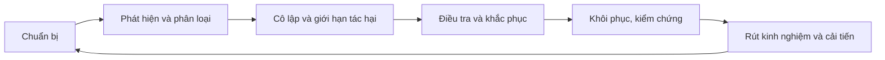

# Thiết lập quyền truy cập khẩn cấp và ứng phó sự cố

Một sự cố bảo mật có thể xuất hiện đúng lúc cơ chế quản trị thông thường không sử dụng được: chính sách Conditional Access vô tình chặn toàn bộ quản trị viên, phương thức xác thực bị gián đoạn, tài khoản đặc quyền bị chiếm quyền, hoặc một đội vận hành cần cô lập tài nguyên Azure để ngăn rò rỉ dữ liệu. Khi đó, tổ chức phải có đường truy cập khẩn cấp đã chuẩn bị sẵn và quy trình hành động được kiểm soát.

Trong module `CLOUD_PROVIDERS_AZURE`, bạn học cách triển khai và quản lý hệ sinh thái Microsoft Azure, từ subscription, resource group và Microsoft Entra ID đến mạng ảo, compute, storage, dữ liệu, giám sát và chi phí. Thuộc chương **Bảo mật và tuân thủ**, bài này hướng dẫn thiết kế *emergency access* (thường gọi là **break-glass access**) và kết nối nó với hoạt động ứng phó sự cố ở cả lớp danh tính lẫn lớp tài nguyên Azure.

> **Phạm vi:** Ví dụ minh họa quy trình bảo vệ hệ thống mà tổ chức sở hữu hoặc được phép quản trị. Không sử dụng tài khoản khẩn cấp để bỏ qua quy trình phê duyệt cho công việc thường ngày.

## 1. Mục tiêu học tập

Sau bài học, bạn có thể:

- Giải thích khi nào cần emergency access và phân biệt với quyền quản trị thường xuyên.
- Thiết kế tài khoản Microsoft Entra ID khẩn cấp độc lập với các điểm lỗi thông thường.
- Phân biệt quyền **Global Administrator** trong Entra ID với quyền **Azure RBAC** đối với subscription và resource.
- Thiết lập bảo vệ xác thực, giám sát, lưu vết và kiểm thử cho đường truy cập khẩn cấp.
- Áp dụng vòng đời ứng phó sự cố: phát hiện, phân loại, cô lập, điều tra, khắc phục, khôi phục và rút kinh nghiệm.
- Xây dựng playbook cho tình huống bị khóa quyền quản trị hoặc phát hiện danh tính bị xâm phạm.

## 2. Emergency access là gì và được sử dụng khi nào?

**Emergency access** là khả năng sử dụng một danh tính hoặc đường quản trị dự phòng đã được bảo vệ để khôi phục quyền kiểm soát khi con đường thông thường không còn hoạt động. Trong Microsoft Entra ID, phương án phổ biến là có các **tài khoản khẩn cấp riêng**, tồn tại từ trước, có quyền cần thiết và có thể đăng nhập mà không phụ thuộc vào cùng điểm lỗi với tài khoản quản trị hằng ngày.

**Incident response (ứng phó sự cố)** là quá trình phát hiện, phân tích, hạn chế tác hại, loại bỏ nguyên nhân, phục hồi dịch vụ và cải thiện phòng vệ. Emergency access chỉ là một năng lực phục vụ ứng phó sự cố; có quyền đăng nhập chưa đồng nghĩa đã biết phải thay đổi gì để xử lý an toàn.

| Tình huống | Có thể cần emergency access? | Hướng ưu tiên |
|---|---|---|
| Chính sách Conditional Access sai làm quản trị viên không đăng nhập được | Có | Dùng đường truy cập dự phòng đã kiểm thử để khôi phục chính sách |
| PIM hoặc quy trình phê duyệt quyền tạm thời không hoạt động | Có, nếu sự cố cần can thiệp gấp | Dùng quyền khẩn cấp độc lập với luồng kích hoạt PIM bị lỗi |
| Một tài khoản Global Administrator bị nghi xâm phạm | Có thể | Cô lập tài khoản bị nghi, kiểm tra lịch sử thao tác, khôi phục quyền kiểm soát |
| Nhân viên cần triển khai một VM dev như mọi ngày | Không | Dùng Azure RBAC thường lệ |
| Ứng dụng production bị tấn công qua credential của workload | Có thể cần quyền xử lý khẩn cấp trên tài nguyên | Bảo toàn chứng cứ, chặn truy cập bị lạm dụng, xoay credential và phục hồi |
| Dịch vụ Microsoft Entra ID hoặc kết nối Internet bị gián đoạn toàn diện | Tài khoản dự phòng cũng có thể không đăng nhập được | Kích hoạt phương án liên lạc, hỗ trợ nhà cung cấp và duy trì hoạt động theo kế hoạch liên tục |

Điểm quan trọng là **break-glass không bảo đảm hoạt động trong mọi sự cố**. Nó giúp tránh các điểm lỗi đã dự liệu, chẳng hạn phụ thuộc vào hệ thống định danh liên kết (federation), thiết bị của một cá nhân hoặc quy trình cấp quyền tạm thời; nó không thay thế khả năng hoạt động của dịch vụ nền tảng.

## 3. Phân biệt quyền Entra ID và quyền Azure trong tình huống khẩn cấp

Microsoft Entra ID thực hiện xác thực danh tính và cung cấp các **directory roles** để quản trị người dùng, nhóm, ứng dụng và cấu hình tenant. Vai trò **Global Administrator** có quyền quản trị rộng trong Microsoft Entra ID, nhưng **không tự động là Owner của mọi Azure subscription**.

Azure Resource Manager sử dụng **Azure Role-Based Access Control (Azure RBAC)** để quyết định một principal được quản lý tài nguyên nào, tại scope nào. Scope thường đi theo cây:

```text
Management group
  └── Subscription
        └── Resource group
              └── Resource
```

| Công việc khẩn cấp | Lớp quyền cần kiểm tra | Ví dụ |
|---|---|---|
| Sửa chính sách Conditional Access làm khóa tài khoản | Microsoft Entra ID | Directory role có quyền quản lý chính sách tương ứng |
| Thu hồi phiên đăng nhập, vô hiệu hóa tài khoản bị chiếm quyền | Microsoft Entra ID | Role quản trị người dùng/bảo mật phù hợp |
| Khôi phục phân quyền trên resource group production | Azure RBAC | Owner hoặc role quản lý role assignment tại scope liên quan |
| Cô lập VM, đổi cấu hình mạng theo playbook | Azure RBAC | Role có các thao tác phù hợp trên VM, NIC, NSG hoặc resource group |
| Đọc secret hoặc dữ liệu phục vụ điều tra | Data plane của dịch vụ | Role dữ liệu hoặc mô hình access policy được dịch vụ hỗ trợ |

Trong một số tình huống đặc biệt, Global Administrator có thể dùng tính năng **elevate access to manage Azure resources** để nhận quyền quản lý truy cập ở root scope Azure của tenant. Đây là **thao tác nâng quyền chủ động**, cần được ghi nhận và thu hồi sau khi giải quyết sự cố. Không nên giả định mọi Global Administrator đã có quyền đó, hoặc sử dụng cách này để thay thế kế hoạch phân quyền Azure RBAC đã chuẩn bị.

Thiết kế tốt nên xác định **đường cứu hộ cho tenant** và **đường cứu hộ cho các subscription quan trọng**. Nếu việc sửa cấu hình resource group phụ thuộc hoàn toàn vào PIM hoặc một nhóm mà hệ thống danh tính đang gặp sự cố, cần có phương án cấp quyền khẩn cấp khác đã được phê duyệt và kiểm thử.

## 4. Thiết kế tài khoản break-glass cho Microsoft Entra ID

### 4.1. Chuẩn bị ít nhất hai tài khoản độc lập

Thông lệ được Microsoft khuyến nghị là duy trì **ít nhất hai tài khoản emergency access** có quyền cần thiết để quản trị tenant, thường là Global Administrator, với các đặc tính:

1. **Tài khoản cloud-only:** tạo trong Microsoft Entra ID và sử dụng miền được tenant quản lý trực tiếp, chẳng hạn `<tenant>.onmicrosoft.com`, để giảm phụ thuộc vào hệ thống federation hoặc đồng bộ danh tính từ hạ tầng nội bộ.
2. **Không gắn với nhân viên cụ thể:** đây là tài khoản khẩn cấp của tổ chức, không phải tài khoản làm việc hằng ngày của một cá nhân. Quy trình bàn giao và truy vết người sử dụng phải được thiết kế riêng.
3. **Quyền sẵn có khi khẩn cấp:** quyền quản trị khẩn cấp cần đủ để sửa sự cố mà không phải phụ thuộc vào chính luồng PIM/kích hoạt đang có khả năng gặp lỗi. Việc duy trì role thường trực là một ngoại lệ được kiểm soát nghiêm ngặt.
4. **Độc lập về phương thức xác thực và lưu trữ:** không để hai tài khoản cùng phụ thuộc vào một điện thoại, một người giữ khóa, một két hoặc một dịch vụ bí mật trực tuyến duy nhất.
5. **Không phục vụ tự động hóa:** tránh sử dụng break-glass account cho script, API, ứng dụng hoặc tác vụ định kỳ. Tự động hóa cần managed identity hoặc service principal riêng.

Ví dụ tên minh họa:

```text
emergency-admin-01@contoso.onmicrosoft.com
emergency-admin-02@contoso.onmicrosoft.com
```

Tên trên chỉ minh họa; không phải tài khoản có thật. Mỗi tài khoản cần có người chịu trách nhiệm quản lý, cơ chế bàn giao khi thay đổi nhân sự và hồ sơ quyền truy cập thực tế.

### 4.2. Bảo vệ xác thực nhưng tránh điểm lỗi chung

Tài khoản khẩn cấp có đặc quyền rất cao và thường được sử dụng hiếm khi, nên phải được bảo vệ chặt. Ưu tiên **phương thức xác thực chống phishing** được tenant hỗ trợ, chẳng hạn security key FIDO2 hoặc phương thức mạnh tương đương. Chuẩn bị phương thức/khóa dự phòng, cất giữ ở nơi bảo mật và kiểm chứng việc đăng nhập trên thiết bị có thể dùng trong sự cố.

Khi cấu hình **Conditional Access (CA)**, cần cân bằng hai yêu cầu: ngăn truy cập trái phép và không để chính một chính sách CA sai vô hiệu hóa tất cả đường khôi phục. Các tổ chức thường **loại trừ một cách có chủ đích** tài khoản khẩn cấp khỏi các chính sách có thể gây khóa đồng loạt, đồng thời có biện pháp bù trừ như khóa xác thực mạnh, giám sát mọi lần sử dụng và quy trình phê duyệt ngoài hệ thống.

Không nên hiểu ngoại lệ CA là giấy phép dùng mật khẩu yếu hoặc bỏ mọi kiểm soát bảo mật. Nếu chính sách CA là nơi duy nhất bắt buộc MFA, việc loại trừ tài khoản khỏi chính sách có thể khiến mật khẩu trở thành đường đăng nhập hợp lệ; phải đánh giá cấu hình xác thực thực tế, credential fallback và nguy cơ này trước khi đưa vào vận hành. Các tính năng như Security Defaults hoặc chính sách bảo vệ khác cũng cần được xét theo cấu hình tenant và khả năng tạo ngoại lệ thực tế.

Một thiết kế an toàn cần trả lời:

- Khi IdP liên kết hoặc hệ thống nội bộ ngừng hoạt động, hai tài khoản còn đăng nhập được không?
- Nếu một security key hỏng hoặc thất lạc, có phương thức dự phòng đã kiểm chứng không?
- Khi người giữ khóa chính vắng mặt, có quy trình hai người chứng kiến và tiếp nhận quyền truy cập không?
- Chính sách Conditional Access thay đổi thì ai kiểm thử đường break-glass?
- Có phát hiện và cảnh báo ngay khi tài khoản được sử dụng hoặc gặp nhiều lần đăng nhập thất bại không?

### 4.3. Kiểm soát sử dụng tài khoản khẩn cấp

Tài khoản emergency access cần có **quy trình kích hoạt nghiệp vụ**. Ví dụ: người chỉ huy sự cố xác nhận mức độ nghiêm trọng, ghi lý do, người thực hiện và người phê duyệt; bộ phận trực tiếp lấy phương thức xác thực từ nơi lưu giữ; mọi hoạt động được ghi nhật ký. Nếu tình huống không cho phép chờ phê duyệt do nguy cơ gây hại tức thời, quy trình phải định nghĩa rõ người có quyền quyết định và yêu cầu bổ sung biên bản sau đó.

Không chia sẻ credential qua email hoặc nhóm chat. Không tạo một phụ thuộc duy nhất vào password manager/Key Vault mà tổ chức có thể mất quyền truy cập trong chính sự cố cần khắc phục. Có thể dùng nơi lưu trữ bảo mật độc lập theo chính sách tổ chức, gắn kiểm soát vật lý và nhật ký bàn giao.

## 5. Chuẩn bị quyền khẩn cấp ở cấp tài nguyên Azure

Một ứng dụng production thường sử dụng nhiều resource: VNet, NSG, VM/App Service, Storage, Key Vault, database, Log Analytics và các tài nguyên giám sát. Khi cần cô lập tài nguyên hoặc sửa role assignment, đội ứng phó cần quyền trên đúng **subscription/resource group/resource**.

Đề xuất phương án trước sự cố:

1. Lập danh sách subscription và resource group quan trọng, cùng owner và người trực ứng phó.
2. Xác định hành động cần thiết trong playbook, chẳng hạn đọc Azure Activity Log, chặn một luồng mạng, dừng credential bị lạm dụng hoặc sửa RBAC.
3. Chuẩn bị role hoặc quyền khẩn cấp thích hợp trên phạm vi cần thiết; dùng nhóm và phân công theo vai trò khi phù hợp.
4. Áp dụng **Privileged Identity Management (PIM)** cho quyền quản trị thường ngày hoặc quyền kích hoạt có thời hạn, phê duyệt và ghi nhận lý do.
5. Nếu playbook cần hành động trong lúc PIM không hoạt động, chuẩn bị đường truy cập đã được phê duyệt **không phụ thuộc hoàn toàn** vào PIM, đồng thời kiểm soát ngoại lệ bằng giám sát và thủ tục kích hoạt.
6. Kiểm tra các quyền **data plane** riêng; có Contributor ở resource group chưa chắc đọc được dữ liệu nếu dịch vụ sử dụng cơ chế phân quyền khác.

Không cấp mặc định Owner toàn tenant cho mọi thành viên đội ứng phó. Chọn quyền theo nhiệm vụ và hạn chế thời gian/đối tượng; quyền quá rộng làm tăng thiệt hại nếu chính tài khoản ứng phó bị xâm phạm.

## 6. Thiết lập giám sát cho emergency access

Vì tài khoản break-glass gần như không được sử dụng trong ngày thường, **bất kỳ sự kiện đăng nhập hoặc thay đổi quyền liên quan nào** cũng cần được xem là tín hiệu đáng kiểm tra. Tổ chức nên giám sát:

- Đăng nhập thành công, thất bại và dấu hiệu bất thường của từng emergency account.
- Thêm/xóa directory role, thay đổi phương thức xác thực, reset credential và thay đổi trạng thái account.
- Thay đổi Conditional Access, cấu hình PIM hoặc Azure RBAC role assignment.
- Sự kiện quản lý tài nguyên được thực hiện trong cửa sổ xử lý sự cố.
- Dấu hiệu tiếp tục truy cập sau khi sự cố được đánh dấu kết thúc.

**Nguồn log** thường gồm Microsoft Entra sign-in logs, Entra audit logs, Azure Activity Log và log của các dịch vụ liên quan. Tùy cấu hình, có thể xuất log về Log Analytics workspace hoặc Microsoft Sentinel để tạo analytics rule/alert và duy trì lịch sử theo chính sách lưu giữ của tổ chức.

### Ví dụ truy vấn đăng nhập khẩn cấp bằng Kusto Query Language

Khi **SigninLogs đã được chuyển vào Log Analytics workspace**, có thể dùng truy vấn KQL sau làm điểm khởi đầu:

```kusto
SigninLogs
| where UserPrincipalName in~ (
    "emergency-admin-01@contoso.onmicrosoft.com",
    "emergency-admin-02@contoso.onmicrosoft.com"
  )
| project TimeGenerated, UserPrincipalName, AppDisplayName,
          IPAddress, ResultType, ResultDescription,
          ConditionalAccessStatus
| order by TimeGenerated desc
```

Đây là truy vấn đọc log, **không tạo alert tự động**. Cần cấu hình alert rule riêng, chọn tần suất phù hợp, kênh trực 24/7 và kiểm thử thông báo. Bảng `SigninLogs` chỉ có dữ liệu khi đường xuất log đã được cấu hình; các sự kiện workload identity có thể nằm ở nguồn log khác.

Một báo động nên có thông tin: tài khoản, thời điểm UTC, kết quả đăng nhập, IP/ứng dụng, người trực nhận cảnh báo, incident ID và cách xác minh tính hợp lệ của yêu cầu khẩn cấp. Người nhận cảnh báo cần có **kênh liên lạc dự phòng** nếu hệ thống email hoặc chat của tenant cũng gặp sự cố.

## 7. Vòng đời ứng phó sự cố trên Azure

Quy trình nên được lập thành playbook có người chịu trách nhiệm và bằng chứng cần lưu. Không phải sự cố nào cũng đòi hỏi đủ mọi bước theo cùng thứ tự; có thể cần lặp lại giữa phân tích và cô lập khi xuất hiện thông tin mới.



### Bước 1. Chuẩn bị trước sự cố

Lập bảng trách nhiệm với ít nhất: incident commander/người chỉ huy, quản trị danh tính, chủ sở hữu ứng dụng, nhóm an ninh, nhóm hạ tầng và đầu mối hỗ trợ Microsoft. Xác định độ nghiêm trọng, tiêu chí gọi khẩn, kênh liên lạc và nơi lưu chứng cứ. Kiểm tra các backup quan trọng, quyền đọc log, thông tin liên hệ và khả năng dùng emergency account.

### Bước 2. Phát hiện, xác minh và phân loại

Ghi nhận: thời gian phát hiện, nguồn cảnh báo, principal, subscription/resource, hành động đáng ngờ, phạm vi ảnh hưởng và điều đã biết/chưa biết. Tìm các chỉ dấu từ Entra sign-in/audit logs, Azure Activity Log và log tài nguyên. Phân loại sự cố là **khóa quản trị do cấu hình sai**, **nghi xâm phạm danh tính**, **rò rỉ credential**, **thay đổi tài nguyên trái phép** hay loại khác.

### Bước 3. Cô lập có kiểm soát

Nếu nghi tài khoản bị xâm phạm, cân nhắc chặn đăng nhập, vô hiệu hóa credential liên quan, thu hồi session/refresh token khi cơ chế hỗ trợ, điều chỉnh role assignments và chặn đường mạng hoặc workload đang bị lạm dụng. Ghi rõ lý do và tác động. Những hành động như xóa resource hoặc xóa log có thể phá hủy chứng cứ, gây downtime hoặc ảnh hưởng khôi phục; ưu tiên biện pháp có thể đảo ngược khi phù hợp.

### Bước 4. Điều tra và loại bỏ nguyên nhân

Xác định điểm xâm nhập ban đầu, phạm vi danh tính/tài nguyên bị ảnh hưởng, quyền đã bị cấp thêm, thay đổi cấu hình và dữ liệu có khả năng bị truy cập. Xoay secret, certificate, password hoặc key bị lộ theo đúng thứ tự phụ thuộc ứng dụng; kiểm tra backdoor/role assignment bất thường; vá lỗ hổng và cập nhật chính sách.

### Bước 5. Khôi phục và xác minh

Phục hồi dịch vụ từ cấu hình hoặc backup đáng tin cậy, kiểm tra quyền tối thiểu và thử truy cập của các danh tính hợp lệ. Theo dõi log và chỉ số hệ thống trong thời gian tăng cường giám sát. Xác nhận các tài khoản bị xâm phạm không còn khả năng tái sử dụng token/credential cũ trong phạm vi cơ chế hỗ trợ.

### Bước 6. Đóng sự cố và cải tiến

Hoàn tất timeline, bằng chứng, nguyên nhân gốc, tác động và các quyết định đã phê duyệt. Thu hồi quyền khẩn cấp tạm thời, hủy phiên đăng nhập, xoay credential của account khẩn cấp nếu có nguy cơ lộ, xác nhận giám sát hoạt động và cập nhật playbook. Rà soát yêu cầu báo cáo tới khách hàng hoặc cơ quan quản lý theo chính sách pháp lý áp dụng.

## 8. Playbook A: Conditional Access khóa toàn bộ quản trị viên

**Bối cảnh:** Người quản trị cập nhật chính sách Conditional Access, sau đó tất cả tài khoản quản trị thường ngày đều không đăng nhập được Microsoft Entra admin center. Đội vận hành cần khôi phục truy cập mà không mở rộng ngoại lệ quá mức.

**Các bước thực hành:**

1. Xác minh lỗi từ nhiều tài khoản hoặc môi trường, ghi mã lỗi và thời gian. Phân biệt khóa do chính sách với gián đoạn dịch vụ Azure hoặc Microsoft Entra.
2. Khai báo incident, thông báo người có trách nhiệm và kích hoạt thủ tục lấy emergency account. Ghi nhận người thực hiện, lý do, phê duyệt và thời điểm.
3. Đăng nhập bằng tài khoản cloud-only đã được kiểm thử cùng phương thức xác thực dự phòng bảo mật.
4. Kiểm tra thay đổi Conditional Access gần nhất và các bản ghi audit có liên quan. Nếu có thể, sửa **đúng chính sách gây lỗi**, thay vì tắt toàn bộ bảo vệ tenant.
5. Thử đăng nhập với một tài khoản quản trị thường ngày trong phạm vi thử nghiệm có kiểm soát, xác nhận MFA và các chính sách bảo vệ mong đợi vẫn hoạt động.
6. Dùng log để kiểm tra mọi thao tác trong khoảng sự cố, ghi lại cấu hình trước/sau và thời điểm hệ thống được khôi phục.
7. Đăng xuất emergency account, đánh giá an toàn của credential đã sử dụng, kiểm tra alert và cập nhật quy trình kiểm thử chính sách.

Nếu account khẩn cấp cũng không đăng nhập được, **không thử các thay đổi không kiểm soát trên hệ thống khác**. Kích hoạt quy trình hỗ trợ đã chuẩn bị, xác minh tình trạng dịch vụ và dùng kênh liên lạc ngoài tenant.

## 9. Playbook B: Phát hiện tài khoản quản trị bị chiếm quyền

**Bối cảnh:** Nhật ký cho thấy một tài khoản có quyền cao đăng nhập từ nguồn bất thường, sau đó có thao tác thêm role assignment hoặc thay đổi ứng dụng. Đây có thể là dấu hiệu xâm phạm danh tính, nhưng cần điều tra trước khi khẳng định.

**Các bước thực hành:**

1. Mở incident, bảo toàn log đăng nhập, audit trail, Azure Activity Log và thông tin thời gian. Gắn các sự kiện với principal ID, resource ID và correlation ID nếu có.
2. Xác minh cảnh báo với chủ tài khoản qua kênh độc lập, đồng thời đánh giá nguy cơ truy cập tiếp diễn. Nếu đủ căn cứ, chặn khả năng đăng nhập và thu hồi session/credential theo playbook.
3. Kiểm tra role assignment và thay đổi credential/app registration; xác định mọi tài nguyên đã bị truy cập hoặc cấu hình bị sửa.
4. Nếu người quản trị hợp lệ mất quyền sau khi cô lập tài khoản, dùng emergency access đã chuẩn bị để phục hồi quyền điều tra tối thiểu.
5. Gỡ các role assignment trái phép, thu hồi secret/certificate bị lộ, kiểm tra dấu hiệu tồn tại dai dẳng và khôi phục cấu hình đúng.
6. Đánh giá ảnh hưởng đến dữ liệu, khách hàng và tính toàn vẹn workload; thực hiện thông báo theo quy trình khi cần.
7. Khôi phục quyền bình thường, kiểm chứng log, kiểm thử hành vi hợp lệ rồi đóng sự cố với biên bản và hành động phòng ngừa tái diễn.

Điều tra nên xem cả **data plane** (chẳng hạn truy cập blob, secret) khi có nguồn log tương ứng. Chỉ có Azure Activity Log control-plane không đủ để kết luận không có dữ liệu bị truy cập.

## 10. Kiểm tra quyền Azure RBAC một cách có kiểm soát

Khi cần kiểm tra liệu đội ứng phó đã có quyền trên subscription hay resource group chưa, có thể dùng Azure CLI để **đọc thông tin**:

```bash
# Đăng nhập bằng tài khoản vận hành hợp lệ
az login

# Kiểm tra tenant và subscription hiện tại
az account show --query "{tenant:tenantId,subscription:id}" --output table

# Chọn subscription cần kiểm tra
az account set --subscription "<subscription-id>"

# Kiểm tra assignment trong một resource group, gồm scope kế thừa
az role assignment list --scope "/subscriptions/<subscription-id>/resourceGroups/<resource-group-name>" --include-inherited --output table
```

Lệnh này đọc Azure RBAC tại scope được chỉ định, không liệt kê đầy đủ Microsoft Entra directory roles. Nếu dùng PIM, role eligible chưa kích hoạt có thể không xuất hiện như assignment active. Khi thiếu kết quả hoặc có lỗi, kiểm tra permission của người đang chạy lệnh, group membership, scope, deny assignment, policy và mô hình truy cập dữ liệu của dịch vụ.

Không đưa mật khẩu, security key PIN, access token, secret hay nội dung credential của emergency account vào script, log tập trung hoặc file báo cáo.

## 11. Bảng bằng chứng và trách nhiệm cần lưu

| Thời điểm/bước | Thông tin cần ghi | Ai chịu trách nhiệm |
|---|---|---|
| Tiếp nhận | Cảnh báo, thời gian UTC, nguồn phát hiện, mức độ, incident ID | Đội giám sát/SOC |
| Kích hoạt emergency access | Lý do, principal, người phê duyệt, người sử dụng, giờ bắt đầu/kết thúc | Incident commander và người giữ quyền |
| Phân tích | Sign-in/audit logs, thay đổi RBAC, resource IDs, dấu hiệu truy cập dữ liệu | Đội danh tính, hạ tầng và an ninh |
| Cô lập | Thao tác đã làm, lý do, tác động dự kiến, kết quả quan sát | Người được phân công xử lý |
| Phục hồi | Cấu hình trước/sau, kết quả test, quyết định mở lại dịch vụ | Chủ hệ thống và incident commander |
| Đóng sự cố | Root cause, tác động, credential/role đã thu hồi, bài học và người theo dõi hành động | Nhóm ứng phó và quản trị rủi ro |

Lưu chứng cứ vào nơi đã kiểm soát quyền, thời hạn lưu giữ và tính toàn vẹn. Ưu tiên timestamp UTC, liên kết ID sự kiện và phiên bản cấu hình trước/sau để nhóm khác có thể kiểm chứng. Hạn chế xuất dữ liệu nhạy cảm; chỉ những người được phép điều tra mới có quyền truy cập chứng cứ.

## 12. Kiểm thử định kỳ và tránh đường khôi phục giả

Một tài khoản khẩn cấp được tạo nhưng chưa từng thử nghiệm có thể không giúp ích khi sự cố xảy ra. Nên có lịch diễn tập định kỳ và sau những thay đổi lớn như áp dụng CA policy mới, đổi tenant configuration, điều chỉnh PIM hoặc thay người giữ security key.

**Bài diễn tập tối thiểu** nên xác minh:

- Cả hai account còn tồn tại, đúng loại cloud-only, có role cần thiết, không bị vô hiệu hóa hoặc hết hiệu lực ngoài dự kiến.
- Mỗi account đăng nhập được bằng phương thức xác thực đã lưu giữ, theo đúng quy trình và trên thiết bị/kết nối dự phòng.
- Người thực hiện có thể đi đến đúng màn hình quản lý Entra ID và xem được cấu hình cần sửa; không cần tạo ra sự cố thật trong production.
- Đường truy cập khẩn cấp Azure RBAC xử lý được những nhiệm vụ đã định trong playbook, nếu có.
- Bất kỳ đăng nhập thử nghiệm nào đều tạo alert và được người trực xác nhận là diễn tập.
- Mọi phiên đăng nhập và quyền tạm thời đều được kết thúc/thu hồi sau khi kiểm thử; biên bản ghi lại điểm cần sửa.

Một lần thử có thể thất bại vì mất key, tài khoản bị CA chặn, account bị vô hiệu hóa, role assignment bị thay đổi hoặc cảnh báo không tới được người trực. Đây là lỗi thiết kế cần được xử lý trước khi coi hệ thống đã sẵn sàng.

## 13. Checklist đưa vào vận hành

### Danh tính và quyền

- [ ] Có ít nhất hai emergency account độc lập và được quản lý bởi tổ chức.
- [ ] Account cloud-only; các phụ thuộc xác thực và các ngoại lệ CA đã được kiểm thử.
- [ ] Dùng phương thức xác thực chống phishing và có bản dự phòng được bảo vệ.
- [ ] Role Entra ID và quyền Azure RBAC khẩn cấp được phân biệt, ghi nhận scope và lý do.
- [ ] Có thủ tục lấy credential/khóa, phê duyệt, bàn giao và thu hồi quyền khẩn cấp.

### Phát hiện và ứng phó

- [ ] Entra sign-in logs, audit logs, Azure Activity Log và log dữ liệu cần thiết được thu thập phù hợp.
- [ ] Có cảnh báo khi emergency account đăng nhập hoặc thay đổi quyền.
- [ ] Có người trực nhận cảnh báo và kênh liên lạc dự phòng.
- [ ] Playbook mô tả rõ người chỉ huy, mức độ sự cố, cô lập, chứng cứ và khôi phục.
- [ ] Có quy trình đóng sự cố, rà soát quyền và xoay credential khi cần.
- [ ] Đã diễn tập và ghi lại kết quả kiểm thử theo lịch.

## 14. Tự kiểm tra kiến thức

**Câu 1.** Một tài khoản Global Administrator không tạo được VM trong resource group production. Vì sao điều này có thể xảy ra?

*Gợi ý:* Global Administrator là directory role. Quyền tạo VM được đánh giá bằng Azure RBAC và các cơ chế kiểm soát liên quan ở scope tài nguyên.

**Câu 2.** Vì sao không nên đặt toàn bộ emergency account phụ thuộc cùng một thiết bị xác thực hoặc chỉ một hệ thống lưu trữ credential?

*Gợi ý:* Khi điểm phụ thuộc chung thất bại, mọi đường khôi phục đều có thể đồng thời bị vô hiệu hóa.

**Câu 3.** Một emergency account được loại trừ khỏi Conditional Access. Vậy tài khoản có chắc chắn được MFA bảo vệ không?

*Gợi ý:* Không thể kết luận nếu chưa xem cấu hình xác thực thực tế, đường đăng nhập dự phòng và cơ chế bắt buộc MFA. Cần biện pháp bù trừ và kiểm thử.

**Câu 4.** Sau khi dùng account khẩn cấp để sửa chính sách CA, nhóm ứng phó nên làm gì trước khi đóng sự cố?

*Gợi ý:* Kiểm thử đăng nhập bình thường, đối chiếu log, chấm dứt phiên khẩn cấp, xem xét rủi ro credential và lưu biên bản thay đổi.

## Kết luận

Quyền truy cập khẩn cấp là một thành phần của khả năng phục hồi bảo mật trên Azure. Một phương án đáng tin cậy cần tài khoản Entra cloud-only độc lập, phương thức xác thực mạnh, quyền khẩn cấp đúng scope, cảnh báo mỗi lần sử dụng và quy trình kích hoạt có trách nhiệm. Khi sự cố xảy ra, đội vận hành phải dùng quyền đó trong playbook có kiểm soát: bảo toàn chứng cứ, giới hạn tác hại, điều tra nguyên nhân, khôi phục hệ thống rồi thu hồi quyền và cải thiện thiết kế. Sức mạnh của emergency access nằm ở việc **đã chuẩn bị và kiểm thử từ trước**, không nằm ở việc cấp quyền cao nhất cho mọi người.
