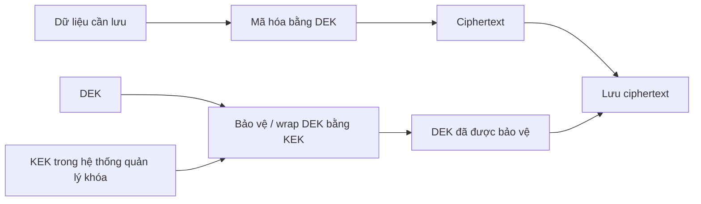
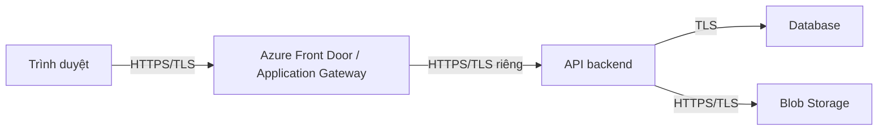
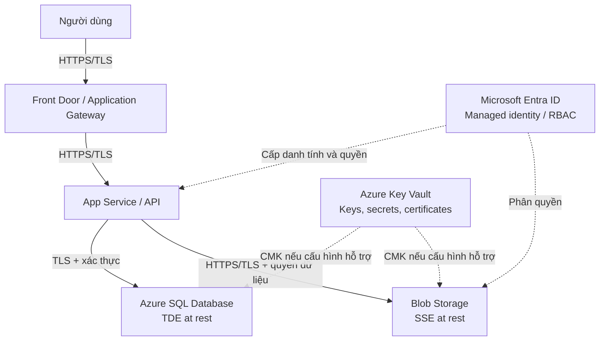

# Mã hóa dữ liệu khi truyền và khi lưu trữ

Trong kiến trúc ứng dụng trên Microsoft Azure, dữ liệu di chuyển giữa trình duyệt, API, cơ sở dữ liệu, hệ thống lưu trữ và các dịch vụ khác. Dữ liệu cũng tồn tại trong ổ đĩa máy ảo, blob, bản sao dữ liệu và bản sao lưu. Nếu chỉ bảo vệ đường truyền mà bỏ quên dữ liệu đã lưu, hoặc chỉ mã hóa ổ đĩa mà để API trao đổi qua HTTP, hệ thống vẫn có nguy cơ lộ thông tin. Vì vậy, thiết kế bảo mật cần bảo vệ **dữ liệu khi truyền (encryption in transit)** và **dữ liệu khi lưu trữ (encryption at rest)** trong toàn bộ vòng đời dữ liệu.

Bài học thuộc chương **Bảo mật và tuân thủ** của lộ trình Microsoft Azure. Nội dung giải thích nguyên tắc mật mã cần thiết, các khả năng của Azure Storage, Azure SQL, Managed Disks, Azure Key Vault, cách lựa chọn khóa mã hóa và phương pháp kiểm tra cấu hình cho một ứng dụng triển khai trên Azure.

## Mục tiêu học tập

Sau bài học, bạn có thể:

1. Phân biệt dữ liệu khi truyền, khi lưu trữ và khi đang được xử lý.
2. Giải thích vai trò của TLS, chứng chỉ số và điểm kết thúc TLS trong kiến trúc Azure.
3. Mô tả cơ chế mã hóa phía dịch vụ cho Storage, Managed Disks và cơ sở dữ liệu.
4. Phân biệt khóa do Microsoft quản lý, khóa do khách hàng quản lý và mã hóa phía ứng dụng.
5. Thiết kế quy trình lưu trữ, luân phiên, giới hạn quyền và khôi phục khóa mã hóa bằng Azure Key Vault.
6. Kiểm tra một số thiết lập mã hóa quan trọng bằng Azure Portal và Azure CLI.

## 1. Xác định dữ liệu cần bảo vệ

Cần phân biệt ba trạng thái của dữ liệu:

| Trạng thái | Ví dụ | Cơ chế bảo vệ liên quan |
|---|---|---|
| **In transit** (đang truyền) | Trình duyệt gọi API, ứng dụng gửi câu lệnh SQL, tải file lên Blob Storage | TLS/HTTPS, xác minh chứng chỉ, đôi khi mTLS hoặc mã hóa kênh riêng |
| **At rest** (đã lưu) | Blob, file, managed disk, dữ liệu và backup của database | Server-side encryption, Transparent Data Encryption, mã hóa ổ đĩa, khóa quản lý tập trung |
| **In use** (đang xử lý) | Dữ liệu đang ở bộ nhớ để ứng dụng tính toán hoặc giải mã | Kiểm soát truy cập, cô lập workload, và trong một số kịch bản dùng confidential computing |

Bài này tập trung vào hai trạng thái đầu. Mã hóa khi truyền và khi lưu trữ giải quyết những nguy cơ khác nhau. Nếu kẻ tấn công lấy được một bản sao dữ liệu mã hóa trên phương tiện lưu trữ mà không có khóa, mã hóa at rest giúp hạn chế khả năng đọc nội dung. Nếu kẻ tấn công quan sát lưu lượng giữa hai hệ thống, TLS bảo vệ tính bí mật và tính toàn vẹn của dữ liệu trên đường truyền khi được cấu hình và xác minh đúng.

**Mã hóa không thay thế phân quyền.** Một ứng dụng có quyền giải mã và đọc dữ liệu vẫn có thể làm lộ dữ liệu nếu bị xâm nhập hoặc cấp quyền quá rộng. Vì vậy, cần kết hợp Microsoft Entra ID, Azure RBAC, quyền data plane, firewall, quản lý secrets, giám sát và backup.

## 2. Các khái niệm mật mã cần biết

**Plaintext** là dữ liệu có thể đọc được trước khi mã hóa. **Ciphertext** là dữ liệu sau khi áp dụng thuật toán mã hóa và khóa. Thuật toán giải mã sử dụng khóa phù hợp để khôi phục nội dung gốc.

```text
Plaintext --[thuật toán + khóa]--> Ciphertext
Ciphertext --[thuật toán + khóa phù hợp]--> Plaintext
```

Có hai họ kỹ thuật thường xuất hiện trong kiến trúc bảo mật:

- **Mã hóa đối xứng (symmetric encryption):** mã hóa và giải mã sử dụng cùng khóa bí mật. AES là thuật toán phổ biến; nhiều dịch vụ Azure dùng AES-256 cho mã hóa dữ liệu khi lưu trữ.
- **Mật mã bất đối xứng (asymmetric cryptography):** sử dụng cặp khóa công khai và khóa riêng. Trong TLS, chứng chỉ số và các cơ chế bắt tay mật mã giúp client xác thực máy chủ và thiết lập khóa phiên. TLS hiện đại thường dùng khóa phiên đối xứng để mã hóa nội dung truyền đi.

**Hash** không đồng nghĩa với mã hóa: giá trị hash một chiều không được thiết kế để giải mã lấy lại dữ liệu gốc. Tương tự, **Base64** chỉ là cách biểu diễn byte bằng ký tự; không tạo tính bí mật.

Trong cơ chế **envelope encryption**, dữ liệu được mã hóa bằng **Data Encryption Key (DEK)**. DEK có thể được bảo vệ bởi **Key Encryption Key (KEK)** hoặc khóa gốc. Mô hình này giúp quản lý số lượng lớn dữ liệu mà không phải dùng khóa bất đối xứng để mã hóa trực tiếp từng byte nội dung.



Chi tiết cách tạo DEK, nơi lưu wrapped DEK và lúc giải mã phụ thuộc từng dịch vụ. Với dịch vụ Azure được quản lý, nhiều thao tác này do nền tảng đảm nhận; khách hàng chủ yếu quyết định chính sách khóa và quyền sử dụng khóa.

## 3. Mã hóa dữ liệu khi truyền: TLS và HTTPS

**Transport Layer Security (TLS)** bảo vệ kết nối giữa client và server. Trong một phiên TLS được thiết lập đúng, dữ liệu ứng dụng được mã hóa và bảo vệ tính toàn vẹn khi đi qua mạng. Client cần xác thực chứng chỉ máy chủ để tránh kết nối nhầm tới một endpoint giả mạo.

Một luồng kết nối HTTPS thường diễn ra như sau:

1. Client mở kết nối đến hostname của dịch vụ, ví dụ `api.example.com`.
2. Client và server thỏa thuận phiên bản TLS và các tham số mật mã được hỗ trợ.
3. Server trình bày chứng chỉ; client xác minh chuỗi tin cậy, hostname và thời hạn hiệu lực.
4. Hai bên thiết lập khóa phiên bảo mật rồi trao đổi dữ liệu HTTP bên trong TLS.
5. Khi phiên kết thúc, khóa phiên không nên bị tái sử dụng trái với cơ chế của giao thức.

Nên ưu tiên **TLS 1.2 trở lên**, sử dụng **TLS 1.3** khi cả hai phía và dịch vụ Azure hỗ trợ. Tránh SSL và các phiên bản TLS đã lỗi thời. Khả năng chọn cipher suite, phiên bản TLS tối thiểu và mTLS không đồng nhất giữa các dịch vụ; cần kiểm tra tùy chọn của endpoint cụ thể.

### 3.1. Những gì HTTPS bảo vệ và không bảo vệ

Giả sử người dùng đăng nhập vào ứng dụng qua mạng công cộng:

```text
Browser -- HTTPS/TLS --> Azure Front Door hoặc Application Gateway
```

HTTPS giúp giảm nguy cơ người quan sát đường truyền đọc được cookie hoặc dữ liệu trao đổi. Tuy nhiên, nếu ứng dụng ghi mật khẩu vào log, hoặc người dùng bị lừa nhập thông tin trên domain giả có chứng chỉ hợp lệ của chính domain đó, TLS không tự giải quyết được các vấn đề ấy. TLS bảo vệ kênh đến **endpoint được xác thực**, nên kiểm tra đúng hostname và chính sách ứng dụng vẫn rất quan trọng.

Không nên dùng các tùy chọn bỏ qua xác minh chứng chỉ như `curl -k`, `--insecure` hoặc `TrustServerCertificate=True` để khắc phục lỗi cấu hình production. Chúng làm suy yếu khả năng xác thực máy chủ, dù nội dung có thể vẫn được mã hóa trên một kết nối.

### 3.2. TLS termination và mã hóa từ đầu đến cuối

Trong kiến trúc thực tế, HTTPS có thể kết thúc tại một thành phần trung gian, chẳng hạn reverse proxy hoặc load balancer lớp ứng dụng. Thành phần này giải mã request để kiểm tra, định tuyến, áp dụng WAF rồi tạo kết nối mới tới backend.



Trong sơ đồ, có **nhiều kết nối TLS riêng**. Khi TLS kết thúc tại proxy, dữ liệu có thể tồn tại ở dạng rõ trong bộ nhớ của proxy để được xử lý; điều này cần nằm trong mô hình tin cậy của hệ thống. Nếu kết nối từ proxy tới backend là HTTP, chặng sau không còn được TLS bảo vệ. Để bảo vệ toàn bộ đường đi, hãy chọn HTTPS cho backend khi dịch vụ hỗ trợ, cấu hình xác minh chứng chỉ và kiểm tra health probe phù hợp.

**TLS termination** không đồng nghĩa với “TLS end-to-end” cho mọi hop. Khi dùng Azure Front Door, Application Gateway, App Service, API Management hoặc ingress của AKS, cần kiểm tra rõ:

- Chứng chỉ nào được trình duyệt nhìn thấy và ai chịu trách nhiệm gia hạn.
- Có bật chuyển hướng HTTP sang HTTPS hay không.
- Chính sách TLS tối thiểu ở frontend và backend.
- Backend protocol là HTTP hay HTTPS; có xác minh tên miền/chứng chỉ backend không.
- Có trường hợp nào lưu lượng nội bộ đến cơ sở dữ liệu, queue hoặc storage vẫn dùng plaintext không.

### 3.3. Private Endpoint, VPN và ExpressRoute không thay thế TLS

**Private Endpoint** đưa lưu lượng tới dịch vụ PaaS qua địa chỉ IP riêng trong virtual network; nó giúp giới hạn đường truy cập mạng, nhưng **không tự nó là thuật toán mã hóa**. Dù đi qua private endpoint, ứng dụng vẫn cần sử dụng TLS theo yêu cầu của dịch vụ và chính sách bảo mật.

Tương tự, kết nối riêng như **ExpressRoute** không mặc định tương đương mã hóa đầu cuối cho toàn bộ dữ liệu ứng dụng. Nếu có yêu cầu mã hóa đường truyền, cần thiết kế TLS, IPsec hoặc khả năng bảo vệ đường kết nối được dịch vụ cụ thể hỗ trợ. Không nên suy luận rằng chỉ vì lưu lượng đi trong mạng riêng thì dữ liệu đã được mã hóa.

### 3.4. Bật bảo vệ đường truyền trên các dịch vụ phổ biến

| Dịch vụ/kết nối | Cách tiếp cận | Điểm cần kiểm tra |
|---|---|---|
| **Azure Storage** | Dùng endpoint `https://...`, bật **Secure transfer required** và chọn mức TLS tối thiểu được hỗ trợ. | Các client cũ dùng HTTP hoặc TLS lỗi thời có thể bị từ chối. |
| **Azure SQL Database** | Sử dụng driver hỗ trợ mã hóa TLS và kiểm tra chứng chỉ máy chủ. | Cấu hình connection string, hostname và yêu cầu TLS của phiên bản driver. |
| **Azure App Service/API** | Chỉ cho truy cập HTTPS và cấu hình TLS tối thiểu phù hợp. | Chứng chỉ tên miền tùy chỉnh, redirect HTTPS và kết nối outbound. |
| **Azure Front Door/Application Gateway** | Thiết lập HTTPS frontend và HTTPS tới backend nếu cần. | TLS ở từng chặng, certificate validation và cấu hình listener/routing. |
| **AKS hoặc VM tự quản** | Bật TLS tại ingress/reverse proxy hoặc ứng dụng và bảo vệ các kết nối downstream. | Chứng chỉ, tự động gia hạn, TLS giữa các dịch vụ, không mở cổng plaintext không cần thiết. |

**Mutual TLS (mTLS)** là mô hình cả server và client đều trình bày chứng chỉ để xác thực lẫn nhau. mTLS hữu ích ở một số kết nối dịch vụ nội bộ hoặc B2B, nhưng cần có quy trình cấp, gia hạn và thu hồi chứng chỉ. Khả năng triển khai mTLS phụ thuộc vào sản phẩm và vị trí trong kiến trúc; không phải mọi endpoint Azure đều có một công tắc mTLS chung.

## 4. Mã hóa dữ liệu khi lưu trữ: server-side encryption

**Encryption at rest** nhằm bảo vệ dữ liệu đã ghi vào phương tiện lưu trữ hoặc các lớp dữ liệu bền vững khác. Nhiều dịch vụ Azure hỗ trợ hoặc bật sẵn **server-side encryption (SSE)**, tức dịch vụ mã hóa trước khi ghi và giải mã cho các yêu cầu truy cập đã được ủy quyền. Cách bảo vệ khóa và phạm vi các thành phần được mã hóa tùy thuộc loại dịch vụ.

Mã hóa at rest thường trong suốt với ứng dụng: client gửi dữ liệu theo giao thức dịch vụ, dịch vụ xử lý mã hóa và giải mã ở phía server. Điều này thuận tiện, nhưng không ngăn ứng dụng có quyền đọc dữ liệu nhận được plaintext khi thực hiện một yêu cầu hợp lệ.

### 4.1. Azure Blob Storage và các loại Azure Storage

Azure Storage mã hóa dữ liệu lưu trữ bằng **Storage Service Encryption**; nhiều loại dữ liệu trong storage account được bảo vệ tự động khi ghi. Với cấu hình mặc định, Azure quản lý khóa mã hóa. Tùy dịch vụ và loại storage, bạn có thể lựa chọn customer-managed keys và các khả năng nâng cao.

Đối với Blob Storage, cần phân biệt:

- **Storage Service Encryption (SSE):** mã hóa dữ liệu at rest ở phía Azure Storage.
- **Service-managed keys / Microsoft-managed keys:** Microsoft tạo, lưu và quản lý vòng đời khóa theo cơ chế của dịch vụ.
- **Customer-managed keys (CMK):** tổ chức quản lý khóa được dịch vụ sử dụng để bảo vệ khóa mã hóa dữ liệu, thường thông qua Azure Key Vault hoặc Managed HSM theo khả năng hỗ trợ.
- **Encryption scope:** cho phép áp dụng phạm vi khóa mã hóa riêng đối với các blob hoặc container được hỗ trợ, thay vì mặc định toàn storage account.
- **Infrastructure encryption:** ở các cấu hình hỗ trợ, bổ sung lớp mã hóa độc lập tại tầng hạ tầng bên dưới lớp mã hóa dịch vụ.

**Replication** như LRS, ZRS, GRS hoặc GZRS giải quyết độ bền và tính sẵn sàng của dữ liệu, khác với mục đích của mã hóa. Có thể cần cả replication để chống lỗi hạ tầng và encryption để bảo vệ tính bí mật. Sao chép không tự thay thế backup hoặc kiểm soát quyền.

### 4.2. Azure Managed Disks và ổ đĩa máy ảo

**Azure Managed Disks** cung cấp mã hóa ở tầng lưu trữ, với khóa do nền tảng quản lý hoặc khóa do khách hàng quản lý ở cấu hình được hỗ trợ. Cần xem xét thêm trường hợp dữ liệu được xử lý tại host VM, dữ liệu tạm thời và cache của máy ảo. Một số dòng VM và cấu hình hỗ trợ **encryption at host**, bổ sung mã hóa đối với dữ liệu tại host theo khả năng được công bố.

Không nên nhầm **server-side encryption của managed disks** với **mã hóa trong guest operating system** như BitLocker hoặc dm-crypt. Mỗi cách hoạt động ở tầng khác nhau và có yêu cầu vận hành, khóa, tương thích khác nhau. Khi cần bảo vệ dữ liệu trên OS disk, data disk và temporary disk, hãy kiểm tra từng loại đĩa cùng tùy chọn mã hóa phù hợp với VM size, region và hệ điều hành.

Ngoài đĩa đang gắn VM, cần đánh giá các **snapshot, image, backup và bản sao phục hồi**. Việc hệ thống chính có mã hóa không có nghĩa mọi dữ liệu được xuất hoặc sao chép sang dịch vụ khác đã được áp dụng cùng chính sách khóa.

### 4.3. Azure SQL và các dịch vụ cơ sở dữ liệu

**Transparent Data Encryption (TDE)** bảo vệ dữ liệu at rest tại tầng database. Với Azure SQL Database, TDE được bật mặc định cho cơ sở dữ liệu mới theo cấu hình dịch vụ hiện hành; tổ chức có thể kiểm tra trạng thái và chọn mô hình khóa được hỗ trợ. TDE hướng tới bảo vệ file dữ liệu, log và những thành phần lưu trữ liên quan; ứng dụng vẫn nhận dữ liệu đã giải mã khi truy vấn hợp lệ.

**Always Encrypted** là một cơ chế khác của hệ sinh thái Azure SQL/SQL Server: dữ liệu trong những cột được cấu hình có thể được mã hóa và giải mã tại phía client/driver, giúp hạn chế việc database engine nhìn thấy plaintext của các cột đó trong mô hình phù hợp. Cơ chế này yêu cầu thay đổi schema, driver và cách xử lý truy vấn; không phải tất cả phép toán SQL đều áp dụng được như khi dùng cột plaintext. Không nên xem Always Encrypted là một công tắc thay thế cho TDE.

Với PostgreSQL, MySQL, Cosmos DB và các dịch vụ dữ liệu khác trên Azure, hãy đọc tài liệu chính thức theo đúng dịch vụ, tier và loại deployment để xác định mặc định mã hóa, hỗ trợ CMK, cơ chế truyền dữ liệu qua TLS và giới hạn của từng lựa chọn. Tránh giả định mọi sản phẩm dữ liệu dùng chung một chính sách khóa hay cấu hình TDE.

### 4.4. Bảng so sánh một số giải pháp at rest

| Dữ liệu | Bảo vệ at rest thường áp dụng | Việc khách hàng cần quyết định |
|---|---|---|
| Blob và file trong Azure Storage | Storage Service Encryption | Quyền truy cập dữ liệu, khóa do ai quản lý, encryption scope khi cần |
| OS/data disk của VM | Server-side encryption của Managed Disks | Disk Encryption Set/CMK khi cần, encryption at host và cấu hình VM |
| Azure SQL Database | Transparent Data Encryption | TDE protector, CMK khi có yêu cầu, quyền database và backup |
| Cột SQL nhạy cảm | Always Encrypted (khi phù hợp) | Cột nào phải bảo vệ, key store, hỗ trợ driver và giới hạn truy vấn |
| Dữ liệu do ứng dụng tự mã hóa | Client-side/application-level encryption | Thuật toán, key management, chia sẻ và phục hồi khóa, khả năng tìm kiếm |

## 5. Microsoft-managed keys, customer-managed keys và khóa của ứng dụng

Một lựa chọn thiết kế quan trọng là **ai kiểm soát khóa**. Azure cung cấp các mức kiểm soát khác nhau để đáp ứng mức độ nhạy cảm, yêu cầu kiểm toán và trách nhiệm vận hành.

| Mô hình | Ai vận hành khóa? | Ưu điểm | Trách nhiệm và giới hạn |
|---|---|---|---|
| **Microsoft-managed keys (MMK)** | Azure quản lý khóa theo cơ chế dịch vụ. | Triển khai đơn giản, ít công việc vận hành. | Khả năng điều khiển vòng đời khóa cụ thể hạn chế hơn CMK. |
| **Customer-managed keys (CMK)** | Khách hàng quản lý khóa trong Key Vault/Managed HSM; dịch vụ Azure sử dụng khóa theo cơ chế hỗ trợ. | Tăng kiểm soát truy cập, luân phiên, thu hồi quyền và đáp ứng một số yêu cầu tuân thủ. | Phải duy trì quyền truy cập khóa, tính sẵn sàng, khôi phục, giám sát và vòng đời khóa. |
| **Client-side/application-level encryption** | Ứng dụng quản lý việc mã hóa trước khi gửi dữ liệu đến Azure. | Có thể hạn chế việc dịch vụ lưu trữ nhìn thấy plaintext trong các mô hình phù hợp. | Ứng dụng chịu trách nhiệm giải mã, khóa, hiệu năng và giới hạn xử lý dữ liệu. |

**CMK không có nghĩa khách hàng tự mã hóa từng bản ghi**. Trong nhiều dịch vụ, Azure vẫn mã hóa dữ liệu bằng DEK phía dịch vụ; khóa do khách hàng quản lý bảo vệ một khóa ở cấp cao hơn. Tắt hoặc mất quyền truy cập CMK có thể khiến dịch vụ không đọc/ghi được dữ liệu tùy cách triển khai. Vì vậy, thu hồi khóa là thay đổi vận hành có thể ảnh hưởng tới tính sẵn sàng, cần có quy trình được kiểm soát.

**Client-side encryption** có ý nghĩa đặc biệt khi yêu cầu giảm khả năng hệ thống lưu trữ hoặc dịch vụ trung gian thấy được plaintext, nhưng nó không phải lựa chọn miễn phí về độ phức tạp: tìm kiếm, lập chỉ mục, xử lý nội dung và khôi phục dữ liệu có thể bị hạn chế nếu dịch vụ chỉ nhìn thấy ciphertext.

## 6. Quản lý khóa và bí mật với Azure Key Vault

**Azure Key Vault** giúp quản lý các đối tượng bảo mật như secrets, keys và certificates. Chúng có mục đích khác nhau:

- **Secret:** chuỗi hoặc dữ liệu bí mật như password, API key hoặc connection string; không nên xem secret là khóa mật mã có đầy đủ tính năng quản lý crypto key.
- **Key:** đối tượng khóa dùng cho những thao tác mật mã được Key Vault hỗ trợ; có thể phục vụ mô hình CMK của các dịch vụ tích hợp.
- **Certificate:** quản lý thông tin chứng chỉ và vòng đời chứng chỉ trong các kịch bản được hỗ trợ. Chứng chỉ TLS cần được triển khai vào đúng endpoint của ứng dụng hoặc dịch vụ.

**Azure Key Vault Managed HSM** là dịch vụ chuyên biệt cho khóa được bảo vệ bằng phần cứng và những yêu cầu mật mã cao hơn. Key Vault và Managed HSM có tập tính năng, mô hình quyền và chi phí khác nhau; chọn theo yêu cầu của dịch vụ tích hợp và chính sách tổ chức.

### 6.1. Quyền truy cập khóa

Một dịch vụ Azure tích hợp CMK thường sử dụng **managed identity** hoặc danh tính dịch vụ theo mô hình được hỗ trợ để truy cập khóa trong Key Vault. Danh tính đó phải có những quyền thao tác khóa cần thiết, ví dụ `get`, `wrapKey`, `unwrapKey` trong mô hình thường gặp, hoặc quyền tương ứng thông qua Azure RBAC dành cho data plane.

Cần phân biệt:

1. **Quyền quản lý vault (management plane):** tạo hoặc cấu hình tài nguyên Key Vault.
2. **Quyền sử dụng key/secret/certificate (data plane):** truy xuất hoặc thực hiện thao tác được cho phép đối với đối tượng bên trong vault.

Có Azure RBAC Contributor trên resource group chứa vault không mặc nhiên cho phép đọc secret hay dùng khóa bên trong. Nên sử dụng mô hình quyền được tổ chức chuẩn hóa, cấp đúng role và scope cho từng danh tính, tránh gán quyền toàn quyền data plane không cần thiết.

### 6.2. Vòng đời khóa và khả năng khôi phục

Quản trị khóa cần trả lời được những câu hỏi:

- **Tạo và lưu ở đâu?** Khóa được tạo hoặc nhập vào Key Vault/Managed HSM, thuộc region và subscription nào, có yêu cầu bảo vệ phần cứng không?
- **Ai có thể dùng và thay đổi?** Ứng dụng hoặc dịch vụ có quyền crypto tối thiểu; người vận hành có quyền quản trị riêng và được kiểm toán.
- **Luân phiên thế nào?** Có lịch rotation, cơ chế thông báo và kiểm thử rằng dịch vụ đang sử dụng phiên bản khóa mong muốn.
- **Khi xóa nhầm thì sao?** Bật và kiểm tra **soft delete**, **purge protection** theo yêu cầu và khả năng của dịch vụ; có bản sao lưu/chiến lược phục hồi khóa khi được hỗ trợ.
- **Khi vault/khóa không sẵn sàng thì sao?** Đã đánh giá phụ thuộc runtime của dịch vụ vào key operations, thời gian mất khả năng truy cập và phương án phục hồi.
- **Khi thu hồi quyền thì sao?** Có quy trình thay đổi, giám sát và phương án quay lui để tránh gián đoạn ngoài ý muốn.

**Rotation không đồng nghĩa với ngay lập tức mã hóa lại toàn bộ dữ liệu cũ.** Khả năng dùng phiên bản khóa mới, bọc lại DEK hoặc tái mã hóa dữ liệu phụ thuộc vào dịch vụ và cách tích hợp. Cần kiểm thử thao tác rotation và thời gian lan truyền phiên bản khóa thay vì chỉ thay đổi key version rồi kết luận mọi bản sao đã được mã hóa lại.

### 6.3. Kiểm toán và cảnh báo

Theo dõi hoạt động truy cập và quản trị khóa bằng các cơ chế logging, monitoring phù hợp với Key Vault, Azure Monitor và chính sách lưu trữ log của tổ chức. Nên có cảnh báo cho các sự kiện như khóa sắp hết hạn, xóa hoặc thay đổi chính sách quyền, lỗi truy xuất khóa tăng đột biến và thất bại trong rotation. Bảo vệ hệ thống log để người không có thẩm quyền không thể đọc secrets hoặc làm mất dấu vết kiểm toán.

## 7. Ví dụ kiến trúc bảo vệ dữ liệu trên Azure

Giả sử một ứng dụng nhận hồ sơ khách hàng, lưu file đính kèm trong Blob Storage và lưu metadata trong Azure SQL Database. Người dùng truy cập qua trình duyệt; ứng dụng triển khai trên Azure App Service. Thiết kế tham khảo:



Các quyết định cần ghi rõ trong tài liệu kiến trúc:

1. **Trình duyệt đến điểm vào:** HTTPS, chứng chỉ hợp lệ cho domain của ứng dụng, TLS tối thiểu phù hợp và chuyển hướng HTTP sang HTTPS.
2. **Gateway đến API:** HTTPS riêng cho backend; biết rõ điểm kết thúc TLS, cách kiểm tra chứng chỉ và các dịch vụ trung gian có thể xem plaintext.
3. **API đến SQL và Blob:** kết nối được mã hóa; private networking hoặc firewall giới hạn đường đi nhưng không thay cho TLS.
4. **Dữ liệu trong SQL:** TDE bảo vệ dữ liệu at rest; nếu có cột đặc biệt nhạy cảm, đánh giá Always Encrypted cùng yêu cầu chức năng.
5. **Dữ liệu trong Storage:** SSE theo cấu hình; quyền truy cập blob tách với quyền quản trị storage account.
6. **Quản lý khóa:** chọn MMK hoặc CMK theo yêu cầu; nếu dùng CMK thì phải cấu hình managed identity, quyền Key Vault, rotation và quy trình khôi phục.
7. **Backup và log:** đảm bảo bản sao lưu, bản xuất dữ liệu và log không vô tình chứa plaintext hoặc secrets vượt phạm vi cho phép.

Trong ví dụ này, mã hóa bảo vệ dữ liệu trên các kênh và phương tiện lưu trữ được thiết kế. Nó không thay thế kiểm tra danh tính người dùng, authorization ở API, bảo vệ khỏi SQL injection hoặc giới hạn quyền của ứng dụng.

## 8. Thực hành kiểm tra cấu hình bằng Azure CLI

Phần này dùng ví dụ **đọc cấu hình hiện có** để người học nhận biết các trường quan trọng mà không tạo tài nguyên mới. Bạn cần Azure CLI, tài khoản có quyền đọc resource và một storage account trong subscription thực hành.

### 8.1. Đăng nhập và chọn subscription

```bash
az login
az account list --output table
az account set --subscription "<subscription-id>"
```

Thay các placeholder trong lệnh bên dưới bằng tên có thật. Không đưa secret hoặc access token vào shell history và log được chia sẻ.

### 8.2. Kiểm tra HTTPS-only, TLS tối thiểu và nguồn khóa Storage

```bash
az storage account show \
  --resource-group "<resource-group>" \
  --name "<storage-account-name>" \
  --query "{httpsOnly:enableHttpsTrafficOnly,minTlsVersion:minimumTlsVersion,keySource:encryption.keySource}" \
  --output json
```

Ví dụ kết quả minh họa (giá trị thực phụ thuộc storage account):

```json
{
  "httpsOnly": true,
  "minTlsVersion": "TLS1_2",
  "keySource": "Microsoft.Storage"
}
```

Đọc kết quả:

- `httpsOnly: true` thể hiện yêu cầu secure transfer đối với các endpoint và loại thao tác chịu sự điều khiển của thiết lập đó.
- `minTlsVersion: "TLS1_2"` cho biết yêu cầu TLS tối thiểu đã đặt cho những request thuộc phạm vi áp dụng của thiết lập.
- `keySource: "Microsoft.Storage"` cho biết đang dùng khóa do Microsoft quản lý cho cơ chế mã hóa tương ứng; nếu dùng CMK, trường này có thể phản ánh nguồn khóa Key Vault tùy schema dịch vụ.

Nếu cần đổi cấu hình TLS/HTTPS, nên **kiểm thử khả năng tương thích của client trước** vì client cũ có thể mất kết nối. Ví dụ lệnh tham khảo để người quản trị thực hiện trong môi trường thử nghiệm khi có thẩm quyền:

```bash
az storage account update \
  --resource-group "<resource-group>" \
  --name "<storage-account-name>" \
  --https-only true \
  --min-tls-version TLS1_2
```

Lệnh thay đổi cấu hình storage account, nên không chạy trên production nếu chưa kiểm tra ảnh hưởng. TLS và HTTPS yêu cầu bảo vệ đường truyền; chúng **không** tự chứng minh CMK, logging hay data-plane RBAC đã được cấu hình đúng.

### 8.3. Kiểm tra thiết lập Key Vault

Nếu tổ chức sử dụng Key Vault để quản lý khóa, có thể đọc thông tin cấu hình quản lý bằng lệnh:

```bash
az keyvault show \
  --name "<key-vault-name>" \
  --query "{name:name,rbac:properties.enableRbacAuthorization,softDelete:properties.enableSoftDelete,purgeProtection:properties.enablePurgeProtection}" \
  --output json
```

Lệnh đọc metadata của vault; nó không chứng minh caller có quyền sử dụng key/secret bên trong. Muốn xác nhận CMK đang được một storage account hoặc database sử dụng, cần kiểm tra thêm cấu hình mã hóa của chính dịch vụ đó, danh tính truy cập khóa và các log liên quan.

### 8.4. Kiểm tra chứng chỉ và TLS của một endpoint

Có thể dùng một công cụ kiểm thử TLS trên máy có kết nối mạng, ví dụ OpenSSL:

```bash
openssl s_client \
  -connect "<hostname>:443" \
  -servername "<hostname>" \
  -tls1_2
```

Kết quả giúp xem chứng chỉ server, phiên TLS và khả năng kết nối với TLS 1.2. Chỉ một lần kết nối thành công **không chứng minh** tất cả phiên bản TLS cũ đã bị từ chối, chứng chỉ được quản lý tự động hay mọi kết nối backend đều được mã hóa. Cần thêm kiểm thử cấu hình server, chính sách TLS và các hop nội bộ.

## 9. Mã hóa và các yêu cầu tuân thủ

Nhiều tổ chức cần chứng minh dữ liệu nhạy cảm được bảo vệ để đáp ứng chính sách nội bộ hoặc các tiêu chuẩn như ISO 27001, PCI DSS hay yêu cầu bảo vệ dữ liệu cá nhân. Tuy nhiên, **việc bật mã hóa không tự động tạo ra chứng nhận tuân thủ**. Cần kết hợp phạm vi dữ liệu, kiểm soát truy cập, lưu giữ, khả năng khôi phục, báo cáo và bằng chứng vận hành phù hợp với yêu cầu cụ thể.

Một hồ sơ bằng chứng có thể bao gồm:

| Nội dung kiểm soát | Bằng chứng nên lưu |
|---|---|
| TLS tại điểm vào và kết nối backend | Cấu hình endpoint, phiên bản TLS tối thiểu, trạng thái chứng chỉ, kết quả kiểm tra kết nối |
| Encryption at rest | Cấu hình SSE/TDE/disk encryption, danh sách tài nguyên và ngoại lệ đã phê duyệt |
| CMK | Danh sách key protector, chính sách rotation, quyền managed identity, kết quả thử rotation/khôi phục |
| Quản lý quyền | Azure RBAC/data-plane roles, Entra ID roles, lịch rà soát đặc quyền |
| Giám sát | Cấu hình log, retention, cảnh báo và bằng chứng xử lý sự cố |
| Backup và phục hồi | Chính sách backup, mã hóa bản sao, kết quả thử restore và kiểm soát quyền đọc bản sao |

Có thể dùng **Azure Policy** để áp đặt hoặc kiểm tra một số cấu hình an toàn khi resource provider hỗ trợ, ví dụ yêu cầu secure transfer hoặc một thuộc tính mã hóa. **Microsoft Defender for Cloud** có thể đưa ra khuyến nghị về trạng thái bảo mật. Tuy nhiên, policy compliance hoặc điểm đánh giá bảo mật là tín hiệu cấu hình, không thay thế thử nghiệm thực tế và đánh giá tuân thủ của tổ chức.

## 10. Sai lầm thường gặp và cách khắc phục

| Sai lầm | Hệ quả | Cách xử lý |
|---|---|---|
| Cho rằng mạng riêng đã mã hóa dữ liệu | Lưu lượng có thể vẫn là plaintext | Bảo vệ bằng TLS hoặc cơ chế mã hóa đường truyền được hỗ trợ |
| Chỉ bật TLS ở frontend | Proxy đến API hoặc API đến database có thể không được bảo vệ | Kiểm tra từng hop; bật HTTPS/TLS và xác minh certificate ở backend |
| Tắt xác minh chứng chỉ để hết lỗi | Dễ chấp nhận endpoint giả mạo | Sửa hostname, chứng chỉ và chuỗi tin cậy; không dùng tùy chọn bỏ qua xác minh |
| Xem SSE là bảo vệ mọi truy cập dữ liệu | Tài khoản có quyền vẫn có thể đọc nội dung đã được giải mã | Giới hạn IAM/RBAC và data-plane permissions; giám sát truy cập |
| Dùng CMK nhưng không có kế hoạch quản lý khóa | Mất hoặc thu hồi khóa có thể gây gián đoạn truy cập dữ liệu | Thiết lập owner, quyền tối thiểu, soft delete, purge protection, rotation và recovery |
| Tin rằng rotation mã hóa lại toàn bộ dữ liệu ngay | Đánh giá sai trạng thái bảo vệ của bản sao cũ | Xác minh cơ chế rotation, key version và hành vi mã hóa lại của từng dịch vụ |
| Chỉ xét dữ liệu chính, bỏ qua log và backup | Dữ liệu nhạy cảm xuất hiện ở nơi khác | Lập data flow, phân loại và áp dụng kiểm soát cho bản sao, log, export |
| Dùng cùng một khóa hoặc quyền quản trị cho mọi môi trường | Mở rộng phạm vi ảnh hưởng khi có sự cố | Tách môi trường và khóa/quyền theo yêu cầu bảo mật, đánh giá blast radius |

## 11. Checklist trước khi đưa ứng dụng lên production

- [ ] Đã lập sơ đồ đường đi của dữ liệu từ người dùng qua các dịch vụ Azure và nơi dữ liệu được lưu.
- [ ] Mọi endpoint yêu cầu bảo mật đều dùng HTTPS/TLS phù hợp; chứng chỉ được xác minh và có quy trình gia hạn.
- [ ] Đã kiểm tra TLS từ gateway đến backend, API đến database, storage và các hệ thống tích hợp.
- [ ] Đã xác nhận secure transfer, mức TLS tối thiểu và loại client được hỗ trợ trên Storage.
- [ ] Đã kiểm tra encryption at rest của Blob Storage, Managed Disks, database, snapshots và backup liên quan.
- [ ] Đã lựa chọn MMK hay CMK theo yêu cầu dữ liệu, mức kiểm soát, tính sẵn sàng và trách nhiệm vận hành.
- [ ] Nếu dùng CMK, đã cấu hình quyền khóa tối thiểu, bảo vệ xóa nhầm, rotation, giám sát và phương án phục hồi.
- [ ] Đã kiểm tra riêng data-plane authorization, Azure RBAC và quyền truy cập secrets.
- [ ] Đã kiểm tra khả năng xử lý sự cố mất khóa, hết hạn chứng chỉ, TLS client không tương thích và thử khôi phục backup.
- [ ] Đã lưu bằng chứng cấu hình và quy trình rà soát phù hợp với chính sách bảo mật, tuân thủ.

## Kết luận

Mã hóa dữ liệu khi truyền và khi lưu trữ là hai lớp bảo vệ bổ sung cho nhau trong Microsoft Azure. TLS bảo vệ những kết nối giữa client, gateway, API và các dịch vụ; SSE, TDE và các cơ chế mã hóa ổ đĩa bảo vệ dữ liệu đã lưu. Azure Key Vault cùng các lựa chọn MMK/CMK giúp tổ chức kiểm soát vòng đời khóa theo nhu cầu, nhưng cũng tạo trách nhiệm về quyền, rotation và khôi phục. Thiết kế an toàn cần kiểm tra từng hop và từng bản sao dữ liệu, đồng thời kết hợp mã hóa với quản lý danh tính, phân quyền, giám sát và thực hành khôi phục có kiểm chứng.
