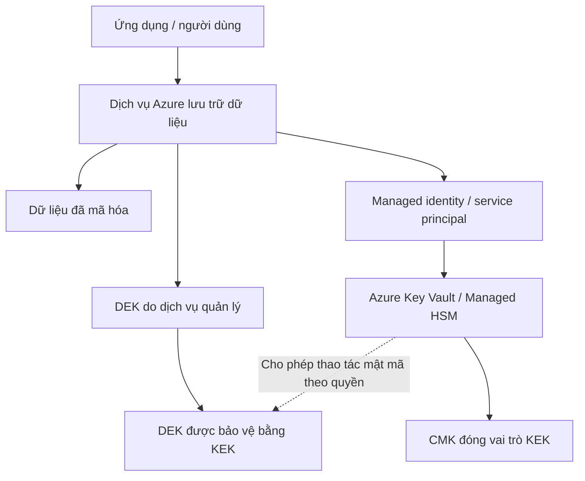
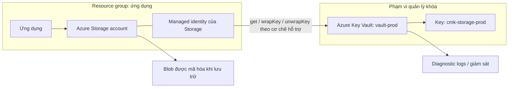
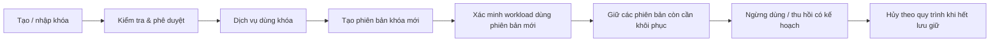

# Customer-managed key và yêu cầu kiểm soát khóa

Khi đưa dữ liệu nghiệp vụ lên Azure, nhiều hệ thống được mã hóa khi lưu trữ (*encryption at rest*) mà người vận hành không phải cấu hình thêm. Tuy nhiên, một tổ chức xử lý dữ liệu tài chính, hồ sơ khách hàng hoặc dữ liệu chịu kiểm toán có thể cần **quyết định ai được sử dụng khóa mã hóa, khi nào phải xoay vòng khóa, cách thu hồi quyền dùng khóa và cách chứng minh các biện pháp kiểm soát đó**. Đây là những tình huống thường dẫn đến yêu cầu sử dụng **customer-managed key (CMK)**.

Bài học thuộc chương **Bảo mật và tuân thủ** của module `CLOUD_PROVIDERS_AZURE`. Trong hành trình tìm hiểu Azure từ subscription, resource group, Microsoft Entra ID đến mạng, tính toán, lưu trữ, dữ liệu, giám sát và chi phí, CMK nối lớp bảo vệ dữ liệu với quản lý danh tính, quyền truy cập, tự động hóa triển khai và khả năng khôi phục.

## Mục tiêu học tập

Sau bài học, bạn có thể:

- Giải thích CMK khác gì với khóa do Microsoft quản lý (*Microsoft-managed key*) và hiểu mô hình mã hóa bằng khóa nhiều lớp.
- Biết vai trò của **Azure Key Vault**, **Azure Key Vault Managed HSM**, key version và managed identity trong quy trình CMK.
- Xác định các điều kiện thường cần trước khi bật CMK: dịch vụ phải hỗ trợ, khóa phù hợp, quyền truy cập, mạng, khả năng phục hồi và ghi nhật ký.
- Thiết kế vòng đời **tạo – sử dụng – xoay vòng – thu hồi – khôi phục – hủy khóa**, không làm dữ liệu mất khả năng truy cập ngoài ý muốn.
- Phân biệt mục tiêu tuân thủ, phạm vi kiểm soát thực tế, chi phí phát sinh và các rủi ro vận hành khi dùng CMK.
- Đề xuất kiến trúc CMK cho một ứng dụng Azure và đưa ra bằng chứng kiểm soát có thể kiểm toán.

## 1. Vì sao doanh nghiệp cần kiểm soát khóa?

Trong Azure, nhiều dịch vụ tự mã hóa dữ liệu lưu trữ bằng cơ chế do nền tảng quản lý. Với mô hình này, nhà cung cấp xử lý phần lớn vòng đời của khóa mã hóa cấp dịch vụ. Khách hàng thường tập trung vào việc cấu hình tài nguyên, cấp quyền, bảo vệ danh tính và dữ liệu.

Khi có thêm yêu cầu quản trị, tổ chức có thể muốn:

1. **Quản lý vòng đời khóa:** chủ động tạo, nhập khóa khi dịch vụ hỗ trợ, đặt hạn dùng, lên lịch xoay vòng và lưu dấu vết.
2. **Kiểm soát quyền sử dụng khóa:** chỉ danh tính dịch vụ được chỉ định mới có thể thực hiện các thao tác mật mã cần thiết.
3. **Phân tách trách nhiệm:** nhóm quản lý dữ liệu không mặc nhiên được quản trị khóa; nhóm quản trị khóa không mặc nhiên đọc được dữ liệu nghiệp vụ.
4. **Thu hồi có kiểm soát:** có khả năng ngừng cho dịch vụ dùng khóa theo một quy trình được phê duyệt, đồng thời hiểu rõ hệ quả đối với ứng dụng.
5. **Cung cấp bằng chứng kiểm toán:** chứng minh trạng thái khóa, quyền, lịch sử thay đổi, chính sách bảo vệ xóa và sự kiện truy cập khóa.

CMK là một **lựa chọn kiến trúc và quản trị** đáp ứng một phần các yêu cầu trên. Nó không mặc định là yêu cầu bắt buộc cho mọi ứng dụng, và cũng không tự làm ứng dụng tuân thủ một tiêu chuẩn pháp lý hay ngành nghề cụ thể. Việc có cần CMK hay không phải xuất phát từ phân loại dữ liệu, mô hình đe dọa và yêu cầu kiểm toán của tổ chức.

## 2. Microsoft-managed key, customer-managed key và BYOK

| Khái niệm | Ai chủ yếu quản lý vòng đời khóa? | Khi nào phù hợp? | Trách nhiệm chính |
|---|---|---|---|
| **Microsoft-managed key (MMK)** | Dịch vụ Azure | Workload thông thường, ít yêu cầu quản trị khóa riêng | Chọn dịch vụ, cấu hình bảo mật, IAM, bảo vệ dữ liệu và tuân thủ chung |
| **Customer-managed key (CMK)** | Khách hàng quản lý khóa được dịch vụ hỗ trợ sử dụng; dịch vụ vẫn xử lý hoạt động mã hóa dữ liệu | Yêu cầu kiểm soát khóa, xoay vòng, audit và quản trị quyền chi tiết | Vận hành kho khóa, truy cập khóa, rotation, backup/recovery, giám sát |
| **Bring Your Own Key (BYOK)** | Khách hàng tạo/nhập khóa từ môi trường khác nếu kịch bản hỗ trợ | Chính sách đòi hỏi nguồn tạo hoặc quá trình nạp khóa do khách hàng kiểm soát | Cả kiểm soát nguồn khóa và vòng đời khóa sau khi nhập |

**BYOK không đồng nghĩa với CMK.** BYOK mô tả **nguồn và cách đưa vật liệu khóa vào hệ thống**; CMK mô tả **mô hình khách hàng quản lý khóa được dịch vụ dùng để bảo vệ dữ liệu**. Không phải mọi dịch vụ hay loại khóa đều hỗ trợ nhập từ hệ thống ngoài.

Các khái niệm khác cần phân biệt:

- **SSE (*server-side encryption*)**: dịch vụ mã hóa dữ liệu ở phía máy chủ. Một số dịch vụ SSE hỗ trợ cả Microsoft-managed key lẫn CMK.
- **TDE (*transparent data encryption*)**: cơ chế mã hóa dữ liệu ở mức cơ sở dữ liệu; ví dụ một số dịch vụ Azure SQL hỗ trợ khóa bảo vệ TDE do khách hàng quản lý.
- **Client-side encryption**: ứng dụng tự mã hóa trước khi gửi dữ liệu lên dịch vụ. Đây là mô hình trách nhiệm khác; không thay thế hoặc đồng nghĩa với CMK ở phía dịch vụ.
- **Encryption in transit**: bảo vệ dữ liệu trên đường truyền, thường qua TLS. CMK dành cho mã hóa dữ liệu lưu trữ không thay thế TLS, kiểm tra chứng chỉ hay xác thực API.

### Khóa mã hóa dữ liệu và khóa bảo vệ khóa

Một mô hình phổ biến là **envelope encryption** (mã hóa bao):

- **Data Encryption Key (DEK)** dùng để mã hóa nội dung dữ liệu hoặc một lớp dữ liệu trung gian.
- **Key Encryption Key (KEK)** dùng để bảo vệ (wrap) DEK.
- Trong nhiều tích hợp CMK, khóa lưu tại Azure Key Vault hoặc Managed HSM đóng vai trò **KEK**. Dịch vụ Azure giữ trách nhiệm xử lý các DEK và hoạt động mã hóa dữ liệu theo thiết kế riêng.



Sơ đồ thể hiện **nguyên lý**, không phải trình tự API cố định cho mọi dịch vụ. Azure Storage, Managed Disks, SQL và các dịch vụ khác có cấu trúc khóa, bộ nhớ đệm và yêu cầu vận hành riêng. Điểm cốt lõi là khách hàng điều khiển khóa bảo vệ được dịch vụ tham chiếu, còn dịch vụ vẫn có thể xử lý dữ liệu khi được cấp quyền.

Vì vậy, **CMK không có nghĩa chỉ khách hàng mới có thể nhìn thấy dữ liệu dưới dạng rõ**. Dịch vụ Azure được ủy quyền vẫn cần khả năng giải mã trong quá trình phục vụ yêu cầu hợp lệ. Nếu yêu cầu mô hình mà nhà cung cấp không có khả năng truy cập bản rõ, cần đánh giá kỹ hơn các thiết kế mã hóa phía khách hàng hoặc confidential computing.

## 3. Nơi lưu và bảo vệ CMK trong Azure

### Azure Key Vault

**Azure Key Vault** cung cấp khả năng quản lý keys, secrets và certificates. Với CMK, ứng dụng thường làm việc với đối tượng **key**, không phải secret tùy ý. Các khả năng quan trọng gồm:

- Tạo hoặc nhập khóa theo loại khóa được hỗ trợ.
- Quản lý trạng thái, thời hạn, phiên bản và chính sách xoay vòng.
- Phân quyền thao tác mật mã bằng Azure RBAC cho Key Vault hoặc mô hình access policies trong các hệ thống còn sử dụng cách cũ.
- Ghi nhận hoạt động qua diagnostic logs khi được cấu hình.
- Bảo vệ việc xóa bằng **soft delete** và **purge protection**.
- Tùy SKU và loại khóa, hỗ trợ khóa được bảo vệ bằng phần mềm hoặc bằng HSM.

**Key Vault Standard** và **Key Vault Premium** khác nhau về khả năng và hình thức bảo vệ khóa; Premium hỗ trợ các loại khóa được bảo vệ bằng HSM tương ứng. Không nên giả định tất cả loại khóa hay thuật toán đều được mọi dịch vụ CMK chấp nhận.

### Azure Key Vault Managed HSM

**Managed HSM** là dịch vụ HSM được quản lý, phục vụ tổ chức có yêu cầu cao hơn về ranh giới bảo vệ khóa, quản trị mật mã và tính năng HSM. Managed HSM có mô hình cấp quyền và vận hành khác Key Vault thông thường.

Việc chọn Managed HSM cần kiểm tra **dịch vụ tiêu thụ khóa có hỗ trợ đúng tích hợp đó hay không**. Không thể chỉ đổi URI từ Key Vault sang Managed HSM rồi kỳ vọng mọi dịch vụ Azure tiếp tục hoạt động. Ngoài khả năng hỗ trợ kỹ thuật, cần đánh giá chi phí, quy trình khôi phục và vai trò quản trị HSM.

### Chọn nơi lưu khóa

| Tiêu chí | Câu hỏi cần trả lời |
|---|---|
| Tương thích | Dịch vụ và tính năng CMK có hỗ trợ Key Vault, Managed HSM hay cả hai? |
| Bảo vệ vật liệu khóa | Chính sách yêu cầu khóa được bảo vệ bằng phần mềm, HSM hay phải được nhập từ nguồn riêng? |
| Loại khóa | Thuật toán, độ dài, thao tác `wrapKey`/`unwrapKey` có tương thích không? |
| Phạm vi | Key store và dịch vụ phải ở tenant, subscription, region nào theo tài liệu tính năng? |
| Truy cập mạng | Firewall, private endpoint hoặc cơ chế trusted services có hỗ trợ đường truy cập của dịch vụ không? |
| Khôi phục | Ai giữ bản sao lưu hợp lệ, thời gian khôi phục, phương án khi key store bị sự cố? |
| Chi phí | Chi phí kho khóa, HSM, thao tác mật mã, logging, networking và vận hành là bao nhiêu? |

## 4. CMK trên những loại tài nguyên nào?

CMK **không phải công tắc chung** bật một lần cho toàn subscription. Từng dịch vụ quy định loại tài nguyên, phiên bản tính năng, điều kiện và cách tham chiếu khóa.

| Dịch vụ / tính năng Azure | Cách tích hợp thường gặp | Điều cần kiểm tra |
|---|---|---|
| **Azure Storage** | Server-side encryption với khóa do khách hàng quản lý trong Key Vault hoặc kho khóa được hỗ trợ | Loại storage account, quyền identity, key URI và cơ chế cập nhật phiên bản |
| **Azure Managed Disks** | `Disk Encryption Set` tham chiếu CMK để bảo vệ khóa mã hóa managed disk | Loại disk, vùng triển khai, identity của Disk Encryption Set và hỗ trợ disk/SKU |
| **Azure SQL Database / SQL Managed Instance** | TDE protector sử dụng khóa do khách hàng quản lý khi được hỗ trợ | Cấu hình TDE, quyền key store, phụ thuộc tính sẵn sàng và phương án phục hồi |
| **Một số dịch vụ dữ liệu khác** | Tích hợp CMK theo cơ chế riêng của dịch vụ | Khả năng hỗ trợ thực tế, tier, phạm vi áp dụng và hạn chế theo khu vực |

**Ví dụ phân biệt:** Disk Encryption Set dùng cho CMK của Azure Managed Disks không đồng nghĩa với việc cài **Azure Disk Encryption** trong hệ điều hành máy ảo. TDE của cơ sở dữ liệu cũng có các yêu cầu khác SSE của Storage. Hãy đọc đúng tài liệu của tính năng đang triển khai và xác định dữ liệu, bản sao, snapshot, backup nào thực sự được bảo vệ bởi cấu hình CMK đó.

## 5. Kiến trúc tham chiếu: Storage account dùng CMK

Giả sử một ứng dụng lưu báo cáo khách hàng trong Azure Blob Storage. Nhóm bảo mật yêu cầu:

- Kho khóa do nhóm bảo mật sở hữu, tách khỏi nhóm vận hành ứng dụng.
- Khóa không được xóa vĩnh viễn bởi một thao tác nhầm.
- Chỉ danh tính của tài khoản lưu trữ được phép thực hiện thao tác mật mã phục vụ SSE.
- Hoạt động với khóa phải được ghi nhật ký và có quy trình giám sát.
- Phải có phương án phục hồi khi vô tình vô hiệu hóa khóa hoặc thu hồi quyền.

Thiết kế tham chiếu:



Lưu ý cách thiết kế: Azure Storage thực hiện mã hóa phía dịch vụ; **managed identity của dịch vụ** cần được ủy quyền sử dụng CMK tại Key Vault. Ứng dụng upload/download blob vẫn cần xác thực và phân quyền theo cơ chế truy cập dữ liệu Storage riêng. **Quyền dùng khóa không phải quyền đọc blob.**

### Các bước triển khai ở mức kiến trúc

1. Xác nhận tier, region, tenant, subscription, loại khóa và cách triển khai CMK được Azure Storage hỗ trợ cho tài khoản đích.
2. Tạo kho khóa hoặc sử dụng kho khóa đã được quản trị, bật soft delete và purge protection phù hợp yêu cầu dịch vụ.
3. Tạo/import key với loại và các thao tác mật mã tương thích; quy định owners và rotation policy.
4. Cấu hình managed identity mà tính năng CMK của Storage hỗ trợ, xác định đúng **principal ID** của identity đó.
5. Cấp quyền tối thiểu để identity thực hiện thao tác cần thiết với key tại scope Key Vault/key theo mô hình cấp quyền được chọn.
6. Cấu hình Storage encryption tham chiếu key theo hướng dẫn của tính năng; chọn chiến lược cập nhật key version.
7. Kiểm tra đọc/ghi dữ liệu, log truy cập khóa, quy trình xoay vòng và giả lập sự cố trên môi trường không sản xuất.
8. Bật monitoring, alert, kiểm soát cấu hình và tài liệu hóa recovery runbook trước khi dùng với dữ liệu quan trọng.

Nên ưu tiên **managed identity** thay cho việc lưu client secret cho một service principal tùy chỉnh khi dịch vụ hỗ trợ. Cần phân biệt identity của Storage, Disk Encryption Set và các tài nguyên khác: mỗi tính năng có thể yêu cầu một principal khác nhau.

## 6. Phân quyền khóa: control plane và data plane

Hai lớp quyền liên quan nhưng có mục đích riêng:

- **Control plane**: quyền tạo/sửa Key Vault, cấu hình mạng, bật diagnostic settings, thay đổi tài nguyên quản trị.
- **Data plane**: quyền làm việc với đối tượng key như đọc metadata và thực hiện `wrapKey`/`unwrapKey`. Với Azure Key Vault dùng mô hình Azure RBAC, đây là các **data-plane roles**, không phải role Reader hoặc Contributor của resource group.

Một ứng dụng có role **Contributor** trên resource group lưu trữ **không đương nhiên** được dùng khóa trong Key Vault. Ngược lại, identity có quyền `wrapKey` với một khóa cũng không đương nhiên có quyền đọc Blob Storage, truy cập database hay xóa vault.

Ở Key Vault sử dụng Azure RBAC, một role tích hợp thường liên quan đến tích hợp mã hóa dịch vụ là **Key Vault Crypto Service Encryption User**. Vai trò cụ thể và các thao tác phải đối chiếu với dịch vụ tiêu thụ khóa và phạm vi được cấp. Nếu vault còn sử dụng mô hình **access policy**, quyền tương đương cần được cấu hình theo cách đó; không trộn lẫn hai mô hình khi chưa hiểu cơ chế đang được áp dụng.

| Vai trò trong quy trình | Ví dụ trách nhiệm | Điều nên tránh |
|---|---|---|
| Nhóm quản trị khóa | Tạo, phê duyệt rotation, phục hồi khóa, giám sát vault | Đồng thời giữ quyền đọc toàn bộ dữ liệu nghiệp vụ nếu không cần |
| Identity của dịch vụ Azure | Gọi các thao tác mật mã cần cho CMK | Được cấp quyền quản lý/xóa key không cần thiết |
| Nhóm ứng dụng | Triển khai dịch vụ, kiểm tra mã hóa và truy cập dữ liệu | Được tự ý vô hiệu hóa hoặc purge khóa |
| Nhóm bảo mật/kiểm toán | Xem cấu hình và bằng chứng, theo dõi thay đổi | Sử dụng tài khoản quản trị thường trực cho mọi tác vụ |

### Những yêu cầu quyền thường gặp

Tùy dịch vụ, identity tiêu thụ CMK có thể cần khả năng:

- **Get**: đọc metadata và tham chiếu key phù hợp.
- **Wrap key**: mã hóa lớp DEK/khóa trung gian bằng CMK.
- **Unwrap key**: giải mã lớp DEK/khóa trung gian bằng CMK.

Không nên cấp `Key Vault Administrator` hoặc quyền xóa/purge chỉ để đáp ứng ba thao tác trên. Hãy dùng role sẵn có theo hướng dẫn của dịch vụ hoặc một role được thiết kế với quyền vừa đủ khi tổ chức cho phép. Đặc biệt chú ý đúng **principal object ID** trong đúng tenant khi gán Azure RBAC.

## 7. Vòng đời khóa và cơ chế rotation

Thiết kế CMK phải bắt đầu từ vòng đời khóa, không chỉ từ thao tác tạo một key:



### Key version và key identifier

Một key có thể có nhiều phiên bản. URI ví dụ:

```text
Key Vault:
  https://kv-prod-example.vault.azure.net/keys/cmk-storage-prod

Một phiên bản cụ thể:
  https://kv-prod-example.vault.azure.net/keys/cmk-storage-prod/<key-version>
```

URI **không kèm phiên bản** (versionless key URI) và URI **có phiên bản** có cách sử dụng khác nhau. Một số tích hợp CMK cho phép dịch vụ tự cập nhật khi key có phiên bản mới và tham chiếu theo kiểu được hỗ trợ; trường hợp khác cần cập nhật cấu hình tài nguyên để trỏ đến phiên bản mới. **Việc đặt rotation policy trên Key Vault không tự bảo đảm tất cả dịch vụ sẽ chuyển sang key version mới.**

Một quy trình rotation an toàn:

1. Tạo phiên bản mới theo lịch hoặc sự kiện an ninh được phê duyệt.
2. Xác minh trạng thái key, thuật toán, kích thước và quyền của identity không thay đổi ngoài chủ đích.
3. Xác minh dịch vụ đã chuyển sang phiên bản mới theo cơ chế tích hợp thực tế, hoặc cập nhật thủ công nếu tính năng yêu cầu.
4. Kiểm tra thao tác đọc/ghi mới, dữ liệu cũ và khôi phục/snapshot nếu nằm trong phạm vi bảo vệ.
5. Chỉ lên lịch vô hiệu hóa hoặc hủy **phiên bản cũ** sau khi chứng minh không còn cần để giải mã, truy cập lịch sử hay restore.
6. Ghi nhận thay đổi, người phê duyệt, kết quả thử nghiệm và kế hoạch quay lui.

Không nhầm **tạo version mới** với **thay đổi key name**, **đổi key vault** hoặc **xóa key cũ**. Các thao tác đó có tác động khác nhau đối với những tài nguyên đã tham chiếu tới key.

### Expiration, disable, delete và purge khác nhau

| Thao tác | Ý nghĩa | Rủi ro vận hành |
|---|---|---|
| Đặt `notBefore` / `expires` | Kiểm soát thời gian hợp lệ của key version | Nếu dịch vụ cần thực hiện mật mã khi key không hợp lệ, việc truy cập dữ liệu có thể lỗi |
| **Disable** key/version | Ngừng cho phép các thao tác mật mã với key theo trạng thái có hiệu lực | Tài nguyên CMK có thể bị gián đoạn khi dịch vụ cần sử dụng lại khóa |
| **Delete** khi bật soft delete | Chuyển đối tượng sang trạng thái đã xóa có thể khôi phục trong thời gian lưu giữ | Tài nguyên phụ thuộc không thể dùng key bình thường trong thời gian bị xóa |
| **Purge** | Xóa vĩnh viễn theo cơ chế và chính sách của Key Vault | Có nguy cơ không còn khả năng giải mã dữ liệu phụ thuộc nếu không có phương án khả thi |
| **Revoke access** | Thu hồi quyền dùng key của identity | Có thể gây lỗi dữ liệu sau khi thay đổi có hiệu lực; không bảo đảm xóa tức thì mọi bản dữ liệu đã được truy cập |

**Soft delete** giúp khôi phục đối tượng bị xóa trong thời gian lưu giữ. **Purge protection** ngăn xóa vĩnh viễn trước khi hết thời gian bảo vệ theo cấu hình hỗ trợ. Với nhiều tích hợp CMK, đây là điều kiện hoặc khuyến nghị quan trọng trước khi bật tính năng. Đừng chỉ xem chúng là tùy chọn trang trí.

### Thu hồi quyền không đồng nghĩa với “cryptographic erasure” tức thì

Một số dịch vụ có bộ nhớ đệm khóa và quy trình truy cập dữ liệu riêng. Vô hiệu hóa khóa hoặc thu hồi quyền có thể ảnh hưởng đến hoạt động sau một khoảng thời gian và có thể gây mất khả năng phục vụ. Nó **không bảo đảm bản rõ đã được xử lý trước đó biến mất**, không thu hồi dữ liệu đã xuất ra bên ngoài và không thay thế quy trình xóa dữ liệu theo yêu cầu pháp lý. Nếu mục tiêu là *crypto-shredding*, phải đánh giá chính xác tính năng dịch vụ, các bản sao, backup, cache và yêu cầu lưu giữ.

## 8. Tính sẵn sàng, bảo vệ xóa và khôi phục

CMK tạo thêm một **phụ thuộc vận hành**: nếu dịch vụ không sử dụng được khóa bảo vệ, khả năng đọc/ghi dữ liệu có thể bị gián đoạn. Do vậy, khi tăng quyền kiểm soát khóa, doanh nghiệp cũng nhận thêm trách nhiệm duy trì tính sẵn sàng và khả năng khôi phục.

Những câu hỏi cần trả lời trước khi bật CMK ở production:

- Nếu khóa bị **disable** hoặc quyền identity bị thu hồi nhầm, ai được phép khôi phục và trong thời gian bao lâu?
- Nếu kho khóa bị xóa mềm, có thể **recover** trong retention period hay không? Ai có quyền thực hiện?
- Nếu mất hoàn toàn key material hoặc kho khóa không thể khôi phục, dữ liệu nào có nguy cơ vĩnh viễn không thể truy cập?
- Restore dữ liệu từ bản sao lưu cũ có cần **key version cũ** hay không?
- Tính năng CMK có yêu cầu Key Vault cùng tenant, region, subscription, cùng ranh giới mạng hay có ngoại lệ hỗ trợ?
- Trong failover/DR sang region khác, dịch vụ sẽ tham chiếu khóa ở đâu và quyền nào phải tồn tại?
- Nếu Key Vault có firewall/private endpoint, đường gọi từ dịch vụ Azure đến key store có được hỗ trợ và cho phép không?

### Chính sách bảo vệ xóa

Để tránh mất khóa ngoài ý muốn:

1. Bật và xác minh **soft delete** cùng **purge protection** theo yêu cầu dịch vụ.
2. Hạn chế quyền xóa/purge; phân tách quản trị người dùng, tài nguyên và khóa.
3. Duy trì kiểm kê tài nguyên nào đang phụ thuộc vào key, key version và vault nào.
4. Áp dụng quy trình thay đổi có phê duyệt khi disable hoặc thu hồi khóa; thử trên môi trường tương đương trước.
5. Chuẩn bị và thử nghiệm phương án sao lưu/khôi phục key **nếu loại khóa và dịch vụ hỗ trợ**; bảo vệ bản sao lưu cùng cấp độ nhạy cảm.
6. Kiểm tra retention, recovery objectives và quy trình DR phù hợp với dữ liệu và dịch vụ thực tế.

Không giả định có thể sao chép key HSM hoặc backup/restore tùy ý giữa mọi vùng, tenant hay loại key store. Phải tuân theo giới hạn của Key Vault/Managed HSM và tính năng dịch vụ.

### Runbook khi ứng dụng mất truy cập CMK

Ví dụ khi Storage hoặc SQL báo lỗi liên quan khóa:

1. **Xác định mức độ ảnh hưởng:** người dùng có đọc/ghi được không, dịch vụ nào bị lỗi, lỗi bắt đầu khi nào.
2. **Kiểm tra trạng thái khóa:** key còn tồn tại, enabled, chưa hết hạn, version đúng không.
3. **Kiểm tra danh tính và quyền:** managed identity/service principal có còn hoạt động và được cấp quyền cần thiết không.
4. **Kiểm tra kết nối và chính sách:** vault firewall, private endpoint, DNS, network policy, Azure Policy và thay đổi tenant/scope.
5. **Đối chiếu nhật ký:** Key Vault audit, Azure Activity Log, sự kiện phân quyền, lịch sử rotation và lỗi từ dịch vụ.
6. **Khôi phục theo quy trình được phê duyệt:** hoàn nguyên permission, bật lại key hoặc recover đối tượng bị xóa nếu phù hợp; tránh hành động phá hủy bằng cách tạo key mới không liên quan.
7. **Xác minh lại:** đọc/ghi dữ liệu, tính toàn vẹn và tác vụ backup/restore; ghi nhận nguyên nhân và biện pháp ngăn tái diễn.

## 9. Triển khai và kiểm tra bằng Azure CLI

Các lệnh dưới đây minh họa thao tác trên một môi trường thử nghiệm. Đăng nhập đúng tenant/subscription, có quyền phù hợp và thay toàn bộ giá trị `<...>` bằng dữ liệu của môi trường. Các lệnh tạo tài nguyên hoặc gán quyền chỉ được thực hiện trong sandbox có kiểm soát; kho khóa, thao tác khóa và logging có thể phát sinh chi phí.

### Bước 1. Xác nhận Azure context

```bash
az login --tenant "<tenant-id>"
az account set --subscription "<subscription-id>"
az account show --query "{subscription:id,tenant:tenantId,name:name}" -o json
```

### Bước 2. Tạo resource group và Key Vault dùng Azure RBAC

Trong sandbox trống đã có quyền, có thể tạo tài nguyên như sau:

```bash
az group create \
  --name "rg-cmk-lab" \
  --location "southeastasia"

az keyvault create \
  --name "<globally-unique-vault-name>" \
  --resource-group "rg-cmk-lab" \
  --location "southeastasia" \
  --enable-rbac-authorization true \
  --enable-purge-protection true
```

Tên vault phải thỏa quy tắc đặt tên và duy nhất toàn cục. Ví dụ bật purge protection có chủ đích: tính năng này hạn chế khả năng xóa vĩnh viễn kho khóa trong thời gian bảo vệ. Nên xác nhận cấu hình soft delete, thời gian retention và khả năng hỗ trợ tại môi trường trước khi triển khai.

### Bước 3. Tạo key và kiểm tra metadata

Người vận hành phải có **data-plane permission** phù hợp với cơ chế phân quyền của vault để tạo key. Ví dụ tạo khóa RSA để thực hành nguyên lý:

```bash
az keyvault key create \
  --vault-name "<vault-name>" \
  --name "cmk-lab" \
  --kty RSA \
  --size 3072

az keyvault key show \
  --vault-name "<vault-name>" \
  --name "cmk-lab" \
  --query "{id:key.kid,enabled:attributes.enabled,expires:attributes.expires}" \
  -o json
```

Lệnh trên **chỉ tạo key**; chưa có dịch vụ dữ liệu nào được cấu hình CMK. Trong một hệ thống thật, cần kiểm tra loại khóa, kích thước và các key operations được **dịch vụ đích chấp nhận** trước khi tạo/import. Key identifier và public metadata có thể được tra cứu; private key material không được xuất ra bằng thao tác `key show` thông thường.

### Bước 4. Tra cứu vault, key version và rotation policy

```bash
az keyvault show \
  --name "<vault-name>" \
  --query "{id:id,tenantId:properties.tenantId,rbacEnabled:properties.enableRbacAuthorization,purgeProtection:properties.enablePurgeProtection}" \
  -o json

az keyvault key list-versions \
  --vault-name "<vault-name>" \
  --name "cmk-lab" \
  -o table

az keyvault key rotation-policy show \
  --vault-name "<vault-name>" \
  --name "cmk-lab" \
  -o json
```

Nếu phiên bản Azure CLI, SKU hoặc quyền hiện tại không hỗ trợ một thao tác, kiểm tra trợ giúp lệnh và cấu hình vault thay vì thay đổi quyền tùy tiện. Quyền đọc metadata/rotation policy cũng phụ thuộc chính sách và vai trò được cấp.

### Bước 5. Cấp quyền cho identity tiêu thụ CMK

Khi đã tạo **managed identity của dịch vụ Azure tiêu thụ khóa**, xác định **principal object ID** của identity. Với Key Vault ở chế độ RBAC và dịch vụ hỗ trợ role này, có thể cấp role dữ liệu chuyên dùng tại scope vault:

```bash
az role assignment create \
  --assignee-object-id "<service-managed-identity-principal-id>" \
  --assignee-principal-type ServicePrincipal \
  --role "Key Vault Crypto Service Encryption User" \
  --scope "<key-vault-resource-id>"
```

Đây là ví dụ về **Azure RBAC cho data plane của Key Vault**. Người gán role phải có quyền quản lý role assignments. Role thích hợp và scope nhỏ nhất còn phụ thuộc dịch vụ; nếu tổ chức dùng access policies thay cho RBAC, phải sử dụng quy trình khác. Không gán role ở cấp subscription chỉ vì thao tác cấp quyền tại vault chưa thành công.

### Bước 6. Bật CMK cho dịch vụ đích và xác minh

Thao tác cuối phụ thuộc dịch vụ: Storage cấu hình nguồn khóa mã hóa, Managed Disks thường qua Disk Encryption Set, SQL qua cấu hình TDE protector. Trong bài thực hành tổng hợp:

1. Chọn tài nguyên và xác nhận hỗ trợ CMK.
2. Gán identity và kiểm tra quyền truy cập key.
3. Cấu hình tham chiếu key theo chính sách version/rotation của dịch vụ.
4. Kiểm tra trạng thái encryption, thực hiện đọc/ghi dữ liệu thử nghiệm và đối chiếu audit logs.
5. Lập kế hoạch khôi phục trước khi thử nghiệm vô hiệu hóa/thu hồi khóa trong môi trường lab.

Không tắt khóa production để “xem CMK có chạy không”. Phép thử thu hồi có thể làm gián đoạn dịch vụ và cần được thiết kế như một bài diễn tập có thời điểm, giám sát và phương án hoàn nguyên.

## 10. Giám sát, audit và bằng chứng tuân thủ

Một cấu hình CMK chỉ có giá trị vận hành khi tổ chức **biết khóa đang được dùng ở đâu, ai thay đổi khóa và có thể phục hồi sau sự cố**.

| Mục tiêu kiểm soát | Cấu hình / bằng chứng có thể thu thập |
|---|---|
| Dịch vụ đang dùng CMK | Cấu hình encryption của tài nguyên, key identifier, identity liên kết |
| Quyền tối thiểu | Role assignments/access policies, principal ID, kết quả rà soát định kỳ |
| Chống xóa nhầm | Soft delete, purge protection, retention settings, người có quyền purge |
| Rotation | Rotation policy, key versions, bằng chứng dịch vụ đã chuyển sang version mới |
| Nhật ký truy cập | Diagnostic settings của Key Vault/Managed HSM, sự kiện sử dụng/đổi khóa, log truy cập dịch vụ |
| Theo dõi thay đổi | Azure Activity Log, thay đổi IAM, thay đổi network/firewall, cảnh báo bất thường |
| Khả năng phục hồi | Runbook, kết quả diễn tập, kiểm kê dependency, phương án restore dữ liệu/khóa |
| Kiểm soát chi phí | Phân bổ chi phí Key Vault/HSM, hoạt động mật mã, lưu trữ logs và các dịch vụ liên quan |

**Azure Monitor** và **Log Analytics** có thể hỗ trợ thu thập, truy vấn và cảnh báo nếu diagnostic settings đã được bật phù hợp. Cần lựa chọn danh mục log khả dụng tại loại key store, nơi lưu log, chính sách giữ log và quyền người xem. Log và cấu hình role có thể mang thông tin nhạy cảm về hệ thống; nên bảo vệ theo quy tắc truy cập phù hợp.

Ví dụ các tín hiệu cần cảnh báo:

- Có thao tác **disable/delete/purge** key hoặc thay đổi purge protection theo cơ chế được hỗ trợ.
- Quyền dùng key của identity bị thu hồi, principal thay đổi hoặc key vault firewall chặn dịch vụ.
- Xuất hiện nhiều lỗi `Forbidden`, `KeyNotFound` hoặc lỗi mật mã tại dịch vụ tiêu thụ.
- Key sắp hết hạn, rotation bị trễ, dịch vụ chưa chuyển sang phiên bản được phê duyệt.
- Diagnostic logs ngừng đổ về nơi giám sát, hoặc lượng lỗi/latency tăng bất thường.

Nên kết hợp **Azure Policy** để kiểm kê hoặc ràng buộc các cấu hình mã hóa và bảo vệ kho khóa ở những tài nguyên có policy definition phù hợp. Không mặc định mọi dịch vụ đều có sẵn chính sách kiểm tra CMK ở cùng mức chi tiết.

## 11. Chi phí và đánh đổi vận hành

CMK có thể tăng chi phí tài chính và chi phí quản trị:

- Kho khóa, SKU/HSM và số lượng thao tác mật mã có thể có mức phí khác nhau.
- Một số dịch vụ hoặc tính năng tích hợp CMK áp dụng điều kiện SKU/tier hoặc chi phí riêng.
- Private networking, log ingestion, retention và hệ thống cảnh báo cũng tiêu thụ tài nguyên.
- Rotation, kiểm soát thay đổi, phân tách quyền và diễn tập khôi phục đòi hỏi nhân lực.
- Nếu cấu hình khóa sai làm dừng truy cập dữ liệu, thiệt hại vận hành có thể vượt xa phí dịch vụ khóa.

Khi so sánh MMK với CMK, nên lập một bảng đánh giá theo **mức nhạy cảm dữ liệu – nghĩa vụ kiểm toán – quyền kiểm soát cần thiết – khả năng khôi phục – tổng chi phí**. Không nên áp dụng CMK cho mọi dịch vụ chỉ vì “nhiều quyền quản lý hơn là tốt hơn”; mỗi thay đổi trong ranh giới trách nhiệm cần có người sở hữu và quy trình vận hành tương ứng.

## 12. Tình huống thực tế: nền tảng phân tích dữ liệu khách hàng

Một doanh nghiệp chạy ứng dụng trên Azure App Service, nhận dữ liệu qua API và lưu báo cáo lên Blob Storage. Dữ liệu được phân loại **mật**, bộ phận kiểm toán yêu cầu khóa mã hóa có người quản trị riêng và được xoay vòng theo chu kỳ nội bộ.

### Thiết kế đề xuất

1. **Phân loại dữ liệu và phạm vi:** xác định báo cáo nào nằm trong Storage, bản sao, backup và dịch vụ khác có lưu dữ liệu nhạy cảm.
2. **Kiểm tra hỗ trợ:** xác định storage account và tính năng CMK cần dùng; nếu database cũng chứa dữ liệu mật, đánh giá tích hợp riêng cho SQL hoặc dịch vụ dữ liệu đó.
3. **Kho khóa chuyên trách:** triển khai Key Vault theo policy tổ chức, bật soft delete, purge protection, diagnostic logs và kiểm soát truy cập mạng theo hỗ trợ dịch vụ.
4. **Danh tính dịch vụ:** dùng managed identity được tính năng Storage CMK hỗ trợ; cấp quyền mật mã giới hạn trên key store.
5. **Phân tách quyền:** đội ứng dụng quản lý App Service và Storage theo quyền nghiệp vụ; đội an ninh quản lý vòng đời key; kiểm toán có quyền đọc bằng chứng phù hợp.
6. **Rotation và monitoring:** quy định lịch tạo key version mới, kiểm chứng khả năng dùng version mới và duy trì version cũ khi vẫn cần cho restore.
7. **Diễn tập sự cố:** mô phỏng mất quyền `unwrapKey` trong sandbox, xác nhận cảnh báo và thực hành khôi phục quyền; không thực hiện diễn tập trên tài nguyên sản xuất.
8. **Bàn giao vận hành:** lưu inventory của key ID, identity, tài nguyên phụ thuộc, owner, thời gian lưu giữ, runbook và các bằng chứng kiểm thử.

### Những câu hỏi kiến trúc sư cần hỏi

- Nếu người quản trị Key Vault nghỉ việc, có ít nhất một con đường khôi phục quyền hợp lệ, được kiểm soát hay không?
- Nếu backup phải được khôi phục sau một năm, các key version cần thiết còn được lưu giữ đến lúc đó không?
- Nếu tổ chức thu hồi key để xử lý sự cố, các dịch vụ nào sẽ ngừng hoạt động và thời gian tác động dự kiến dựa trên thử nghiệm thực tế là bao lâu?
- Nếu Storage ở region dự phòng, tích hợp CMK và key store có hoạt động trong kịch bản failover không?
- Bằng chứng nào cho thấy CMK đang thực sự được cấu hình cho dữ liệu cần bảo vệ, thay vì chỉ có key nằm trong vault?

## 13. Những hiểu nhầm phổ biến

**“Bật CMK nghĩa là dữ liệu không bao giờ được Azure giải mã.”** Sai. Dịch vụ Azure được ủy quyền vẫn phải xử lý dữ liệu để phục vụ nghiệp vụ trong giới hạn thiết kế.

**“Có Azure Key Vault là mọi dữ liệu trong subscription đều được mã hóa bằng CMK.”** Sai. Key Vault chỉ lưu và quản lý khóa; mỗi tài nguyên phải được cấu hình tích hợp CMK theo khả năng hỗ trợ.

**“Tạo key version mới tức là tất cả resource đã dùng version mới.”** Không chắc. Cần xác minh cơ chế rotation, tham chiếu versionless/versioned và trạng thái của từng dịch vụ.

**“Đổi quyền IAM không có nguy cơ gây downtime.”** Sai. Nếu dịch vụ mất quyền dùng key hoặc mất đường kết nối đến vault, khả năng truy cập dữ liệu có thể bị ảnh hưởng.

**“Purge protection là backup.”** Sai. Purge protection ngăn xóa vĩnh viễn trước thời điểm được phép; kế hoạch backup/recovery còn phải xét loại khóa, giới hạn dịch vụ và vòng đời dữ liệu.

**“Chỉ cần cấp Contributor trên Key Vault là dùng được key.”** Không chính xác trong mô hình Azure RBAC data plane. Cần kiểm tra vai trò và quyền thao tác mật mã thực tế.

**“CMK giúp vượt qua mọi yêu cầu tuân thủ.”** Sai. CMK hỗ trợ một nhóm mục tiêu kiểm soát nhưng không thay thế quản lý dữ liệu, IAM, network, logging, incident response hay đánh giá pháp lý.

## 14. Câu hỏi tự kiểm tra

**Câu 1.** CMK khác Microsoft-managed key ở điểm trọng tâm nào?

**Đáp án:** Khách hàng quản lý khóa bảo vệ được dịch vụ hỗ trợ sử dụng, bao gồm quyền, rotation và vòng đời; dịch vụ Azure vẫn thực hiện mã hóa dữ liệu theo thiết kế.

**Câu 2.** Nếu một storage account dùng CMK tại Key Vault thì ứng dụng cần được gán quyền đọc blob hay quyền `wrapKey` để tải tệp?

**Đáp án:** Ứng dụng cần quyền truy cập dữ liệu Blob theo cơ chế của Storage. Identity của Storage dùng CMK mới cần quyền mật mã phù hợp tại Key Vault; hai loại quyền có mục đích khác nhau.

**Câu 3.** Vì sao không nên xóa key version cũ ngay sau rotation?

**Đáp án:** Dữ liệu hoặc bản sao lưu cũ có thể còn phụ thuộc vào phiên bản cũ để giải mã hay khôi phục. Phải xác minh cơ chế dịch vụ và yêu cầu lưu giữ trước khi ngừng key version.

**Câu 4.** Soft delete và purge protection có mục đích gì?

**Đáp án:** Soft delete hỗ trợ khôi phục key/vault bị xóa trong thời gian lưu giữ; purge protection ngăn xóa vĩnh viễn trước khi hết thời gian bảo vệ.

**Câu 5.** Tại sao role Contributor trên resource group chưa đủ để dịch vụ dùng key trong Key Vault?

**Đáp án:** Quyền quản trị tài nguyên (control plane) khác quyền thực hiện thao tác mật mã trên key (data plane). Identity cần các key operations đúng với mô hình phân quyền được sử dụng.

**Câu 6.** Rotation policy tại Key Vault được bật nhưng dịch vụ vẫn hiển thị key version cũ. Nên làm gì?

**Đáp án:** Kiểm tra dịch vụ có hỗ trợ tự động cập nhật version hay không, key URI đang versioned hay versionless, yêu cầu cập nhật thủ công và thời gian đồng bộ; sau đó kiểm thử và ghi nhận kết quả.

**Câu 7.** Thu hồi quyền truy cập CMK có chắc chắn xóa ngay dữ liệu đã được người dùng tải xuống không?

**Đáp án:** Không. Thu hồi quyền khóa tác động đến các thao tác mật mã của dịch vụ khi có hiệu lực; không xóa các bản rõ hoặc bản sao đã tồn tại ngoài phạm vi kiểm soát đó.

**Câu 8.** Ba bằng chứng nào có thể dùng để chứng minh kiểm soát CMK với kiểm toán viên?

**Đáp án:** Ví dụ gồm cấu hình encryption hiện tại và key ID của tài nguyên; quyền identity đối với key; lịch sử rotation và log sử dụng/đổi khóa. Cần thêm bằng chứng về khôi phục, bảo vệ xóa và quy trình phê duyệt tùy yêu cầu kiểm toán.

## Tổng kết

CMK giúp tổ chức tăng khả năng **quản lý khóa bảo vệ dữ liệu được mã hóa ở phía dịch vụ**: xác định nơi lưu khóa, ai được dùng, khi nào xoay vòng, cách theo dõi và xử lý khi có sự cố. Azure Key Vault hoặc Managed HSM là những thành phần trung tâm, còn managed identity, RBAC, network, monitoring và quy trình phục hồi quyết định hệ thống có vận hành an toàn hay không.

Khi đưa CMK vào kiến trúc Azure, hãy bắt đầu bằng **yêu cầu kiểm soát có thể kiểm chứng**, sau đó xác minh hỗ trợ của từng dịch vụ, cấp quyền tối thiểu, thiết kế rotation và recovery trước khi chuyển sang production. Như vậy, việc kiểm soát khóa mới thực sự hỗ trợ bảo mật, tuân thủ và tính liên tục của ứng dụng.
