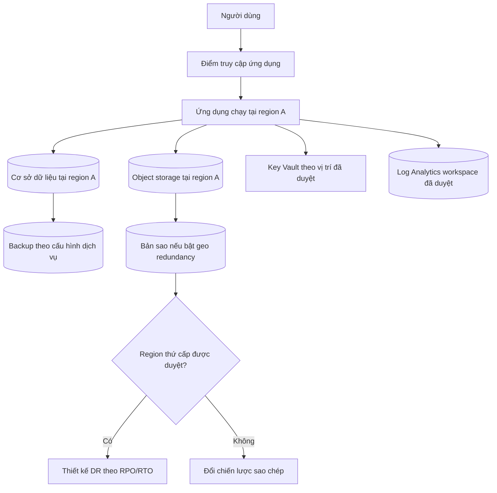

# Kiểm soát vị trí dữ liệu và yêu cầu tuân thủ

Trong Microsoft Azure, việc chọn một vùng triển khai (**region**) chỉ là bước đầu của kiểm soát vị trí dữ liệu. Một ứng dụng có thể chạy ở một region nhưng tạo ra bản sao dự phòng, log, bản sao khôi phục, dữ liệu xác thực hoặc luồng truyền tới dịch vụ khác ở những vị trí khác nhau. Vì vậy, để đáp ứng yêu cầu về lưu trú dữ liệu (*data residency*) và tuân thủ, nhóm triển khai phải hiểu **dữ liệu nào nằm ở đâu, đi qua đâu, ai được truy cập và bằng chứng nào chứng minh điều đó**.

Bài học thuộc chương **Bảo mật và tuân thủ** của module Azure, nối kiến thức về subscription, resource group, Microsoft Entra ID và quản trị với các dịch vụ mạng, tính toán, lưu trữ, cơ sở dữ liệu, giám sát và khôi phục thảm họa. Mục tiêu là xây dựng một cách ra quyết định có thể kiểm tra và lặp lại khi thiết kế kiến trúc ứng dụng trên Azure.

> **Phạm vi:** Đây là bài học kỹ thuật về lựa chọn region và kiểm soát tuân thủ. Kết luận pháp lý cho một tổ chức cụ thể cần dựa trên hợp đồng, tài liệu dịch vụ hiện hành, loại dữ liệu, nơi người dùng cư trú và ý kiến bộ phận pháp chế/tuân thủ có thẩm quyền.

## Mục tiêu học tập

Sau bài học, bạn có thể:

- Phân biệt region, geography, availability zone, data residency, data sovereignty và yêu cầu nội địa hóa dữ liệu.
- Phân loại và lập bản đồ vị trí của dữ liệu chính, bản sao, sao lưu, log, metadata và luồng xử lý.
- Chọn region Azure theo yêu cầu kinh doanh, tuân thủ, độ trễ, tính sẵn sàng và khả năng triển khai dịch vụ.
- Giải thích tác động của các kiểu sao chép Azure Storage và phương án disaster recovery tới vị trí dữ liệu.
- Áp dụng Azure Policy, RBAC, tag và quy trình phê duyệt để giới hạn vùng triển khai.
- Thu thập bằng chứng kỹ thuật, đọc trạng thái tuân thủ và phát hiện sai lệch cấu hình.
- Xây dựng checklist kiểm tra trước khi đưa một workload Azure vào sản xuất.

## 1. Hiểu đúng các khái niệm về vị trí dữ liệu

### Region, geography và availability zone

**Azure region** là vị trí địa lý nơi Azure cung cấp một nhóm trung tâm dữ liệu và dịch vụ, ví dụ `southeastasia` hoặc `eastasia`. Một tài nguyên *regional* thường được tạo trong một region nhất định.

**Azure geography** là tập hợp các region liên quan tới thị trường hoặc ranh giới địa lý theo cách Microsoft tổ chức hạ tầng. Một số dịch vụ và lựa chọn sao chép có cam kết về geography, nhưng phạm vi dữ liệu thực tế vẫn phải xác minh ở **từng dịch vụ**.

**Availability zone** là vùng lỗi độc lập trong một region có hỗ trợ vùng sẵn sàng. Khi triển khai ứng dụng hoặc sao chép dữ liệu giữa các zone trong **cùng region**, mục tiêu chủ yếu là tăng tính sẵn sàng trước sự cố một vùng lỗi.

**Region pair** là cặp region được Azure chỉ định cho nhiều tình huống phục hồi. Không phải mọi dịch vụ đều dùng region pair, và không được suy luận rằng mọi dữ liệu luôn được sao chép sang region ghép cặp.

```text
Azure geography
├── Region A
│   ├── Availability zone 1
│   ├── Availability zone 2
│   └── Availability zone 3
└── Region B
    ├── Availability zone 1 (nếu có hỗ trợ)
    └── ...
```

Một region có thể không hỗ trợ availability zone cho tất cả dịch vụ. Region và zone cũng không đồng nghĩa với việc toàn bộ dữ liệu, log và bản sao lưu của một workload đều ở vị trí đó.

### Data residency, data sovereignty và data localization

| Khái niệm | Câu hỏi cần trả lời | Ví dụ |
|---|---|---|
| **Data residency** – nơi dữ liệu lưu trú | Dữ liệu được lưu ở quốc gia, khu vực hoặc geography nào? | Bản ghi giao dịch lưu ở region được phê duyệt |
| **Data sovereignty** – chủ quyền dữ liệu | Những quy định pháp lý và quyền tài phán nào áp dụng cho dữ liệu và hoạt động xử lý? | Cần đánh giá luật áp dụng, bên xử lý dữ liệu, hợp đồng |
| **Data localization** – nội địa hóa dữ liệu | Quy định có bắt buộc một số dữ liệu phải được lưu hoặc xử lý trong phạm vi lãnh thổ cụ thể không? | Một tập dữ liệu có yêu cầu lưu trữ trong nước theo phạm vi pháp luật áp dụng |
| **Data transfer** – chuyển dữ liệu | Dữ liệu có được chuyển, sao chép hoặc truy cập xuyên biên giới không? | Dịch vụ phân tích ở khu vực khác nhận sự kiện người dùng |
| **Data processing location** – nơi xử lý | Quá trình xử lý hoặc hỗ trợ dịch vụ có diễn ra ở ngoài khu vực đã chọn không? | Dịch vụ toàn cục xử lý yêu cầu hoặc metadata |

**Lưu ở một region** không tự động đồng nghĩa với **tuân thủ đầy đủ**. Một quy định có thể quan tâm đến vị trí lưu trữ, việc truyền dữ liệu, chủ thể có quyền truy cập, thời gian lưu giữ, quy trình xóa, thông báo sự cố và cơ sở pháp lý xử lý dữ liệu.

## 2. Xác định dữ liệu cần kiểm soát trước khi chọn region

Đầu tiên, hãy lập một **data inventory** cho từng hệ thống và luồng dữ liệu. Không nên bắt đầu bằng cách chỉ đếm máy ảo hoặc resource group.

Các loại dữ liệu thường gặp:

1. **Dữ liệu nghiệp vụ chính:** hồ sơ người dùng, đơn hàng, hồ sơ nhân sự, tài liệu hoặc bản ghi giao dịch.
2. **Dữ liệu nhạy cảm:** thông tin định danh, thông tin tài chính, dữ liệu sức khỏe hoặc bí mật nghiệp vụ, tùy trường hợp sử dụng và quy định áp dụng.
3. **Dữ liệu vận hành:** log ứng dụng, địa chỉ IP, telemetry, trace, sự kiện bảo mật và nhật ký truy cập.
4. **Bản sao và bản sao lưu:** snapshot, backup, replica phục vụ HA/DR, bản xuất dữ liệu và tệp tạm.
5. **Metadata và danh tính:** thông tin tài khoản, tenant, cấu hình, khóa định danh, audit trail.
6. **Dữ liệu được truyền hoặc xử lý:** hàng đợi, thông điệp, cache, dữ liệu phân tích, luồng tới API đối tác.

Một bảng kiểm kê có thể có dạng:

| Nhóm dữ liệu | Dịch vụ Azure dự kiến | Vị trí chính | Bản sao/log/backup | Chủ sở hữu và yêu cầu |
|---|---|---|---|---|
| Đơn hàng | Azure SQL Database | Region được duyệt A | Backup và geo-replication cần xác minh | Nhóm dữ liệu; giới hạn nơi lưu và thời gian giữ |
| Tài liệu | Azure Blob Storage | Region được duyệt A | Phụ thuộc redundancy và lifecycle | Nhóm ứng dụng; phân loại tài liệu |
| Sự kiện hệ thống | Azure Monitor Logs | Workspace region B | Retention, export, liên kết workspace | Nhóm vận hành; tránh ghi dữ liệu cá nhân dư thừa |
| Bí mật ứng dụng | Azure Key Vault | Region được duyệt A | Chính sách backup/restore, phụ thuộc dịch vụ | Nhóm bảo mật; quyền tối thiểu |
| Dữ liệu định danh | Microsoft Entra ID | Theo điều khoản và phạm vi dịch vụ | Có thể có đặc tính toàn cục | Nhóm danh tính; kiểm tra tài liệu riêng |

Cột **“bản sao/log/backup”** rất quan trọng: quyết định vị trí dữ liệu không hoàn chỉnh nếu chỉ có region của tài nguyên chính.

### Câu hỏi phân loại dữ liệu

Với mỗi tập dữ liệu, cần xác định:

- Có dữ liệu cá nhân, dữ liệu nhạy cảm, bí mật hoặc dữ liệu phải lưu giữ theo luật/hợp đồng không?
- Chính sách có giới hạn việc **lưu trữ**, **xử lý**, **truy cập từ xa**, **chuyển xuyên biên giới**, hay kết hợp các yếu tố đó?
- Dữ liệu có được ẩn danh, giả danh hoặc mã hóa không? Những biện pháp này thay đổi rủi ro, nhưng không tự thay thế nghĩa vụ pháp lý.
- Ai là chủ sở hữu nghiệp vụ, ai quyết định thời hạn lưu giữ và ai có quyền phê duyệt ngoại lệ?
- Có tài liệu chứng minh vị trí và quy trình xóa dữ liệu khi hết thời hạn không?

## 3. Chọn region Azure một cách có căn cứ

Việc chọn region là bài toán nhiều tiêu chí:

| Tiêu chí | Kiểm tra cụ thể | Hệ quả |
|---|---|---|
| Yêu cầu lưu trú/tuân thủ | Region và geography có phù hợp giới hạn được duyệt không? | Có thể loại một số region dù chi phí thấp |
| Khả dụng dịch vụ | Compute, database, storage, networking và SKU có hỗ trợ ở region đó không? | Có thể phải đổi dịch vụ hoặc kiến trúc |
| Độ trễ | Người dùng và hệ thống kết nối ở đâu? | Ảnh hưởng trải nghiệm và độ trễ API |
| Tính sẵn sàng | Có zone và phương án dự phòng phù hợp không? | Ảnh hưởng mục tiêu RTO/RPO |
| Kết nối | Mạng riêng, ExpressRoute/VPN, DNS và điểm vào dịch vụ hoạt động ra sao? | Ảnh hưởng lưu lượng và bảo mật |
| Khả năng mở rộng và quota | Có đủ quota, SKU và công suất cho workload không? | Ảnh hưởng triển khai và tăng trưởng |
| Chi phí | Giá dịch vụ, băng thông, backup, lưu trữ và DR | Chi phí tổng thể thay đổi theo kiến trúc |

Không nên lấy region của resource group làm bằng chứng duy nhất. **Location của resource group chủ yếu xác định nơi lưu metadata của nhóm**; các tài nguyên nằm trong resource group đó có thể có region khác nhau.

Ví dụ, resource group có location `southeastasia` vẫn có thể chứa một tài nguyên đặt tại `eastasia` nếu loại tài nguyên và chính sách cho phép. Cần kiểm tra thuộc tính `location` của từng tài nguyên cùng vị trí dữ liệu thực tế theo từng dịch vụ.

### Regional, global và non-regional

Không phải mọi tài nguyên Azure đều mô hình hóa vị trí giống máy ảo. Một số tài nguyên được hiển thị với location `global`; một số dịch vụ có control plane toàn cục, điểm biên toàn cục hoặc quy tắc lưu metadata riêng. Các dịch vụ nhận dạng, phân phối nội dung, bảo mật, DNS và giám sát cần được xem theo tài liệu **data residency** của chính dịch vụ.

**Quy tắc quan trọng:** trước khi cam kết “mọi dữ liệu ở region X”, hãy lập danh sách dịch vụ, xác minh phạm vi cam kết dữ liệu của từng dịch vụ, kiểm tra bản sao và ngoại lệ. Không tự suy ra điều đó từ tên region trong Portal.

## 4. Sao chép dữ liệu và phục hồi thảm họa ảnh hưởng đến vị trí thế nào?

Sao chép để tăng độ bền và khả năng phục hồi có thể thay đổi nơi dữ liệu được lưu.

### Ví dụ: Azure Storage redundancy

| Tùy chọn | Ý nghĩa khái quát | Câu hỏi tuân thủ |
|---|---|---|
| **LRS** – Locally-redundant storage | Sao chép dữ liệu trong một vùng hạ tầng ở region chính | Có đáp ứng nhu cầu chịu lỗi và vị trí lưu trữ không? |
| **ZRS** – Zone-redundant storage | Sao chép đồng bộ qua các availability zone trong region chính nếu hỗ trợ | Region đó hỗ trợ ZRS cho account/workload không? |
| **GRS** – Geo-redundant storage | Sao chép trong region chính và sao chép bất đồng bộ tới region thứ cấp | Region thứ cấp là đâu? Có được phê duyệt không? |
| **GZRS** – Geo-zone-redundant storage | Kết hợp sao chép theo zone ở region chính với bản sao địa lý thứ cấp | Những vị trí nào chứa bản sao? |
| **RA-GRS / RA-GZRS** | Biến thể có thể đọc từ region thứ cấp theo đặc tính dịch vụ | Truy cập read-only từ vị trí thứ cấp có phù hợp yêu cầu không? |

Khả năng hỗ trợ phụ thuộc loại storage account, region và dịch vụ. Với GRS hoặc GZRS, Azure lựa chọn secondary region theo cơ chế ghép cặp áp dụng; không được coi như một cấu hình chọn tùy ý region thứ cấp. Hãy xem **primary location**, **secondary location** và chế độ replication thực tế của account.

Một cấu hình đặt dữ liệu chính tại region được phép nhưng bản sao địa lý ở một địa bàn không được phép có thể không phù hợp với yêu cầu. Kế hoạch DR cần được xem xét với nhóm tuân thủ trước khi triển khai.

### Database, backup và khôi phục

Với Azure SQL Database, PostgreSQL, Cosmos DB hoặc dịch vụ dữ liệu khác, khả năng sao chép và vị trí backup không giống hệt Azure Storage. Cần kiểm tra từng đặc tính: geo-replication, failover group, multi-region write, backup redundancy, point-in-time restore, long-term retention và dịch vụ khôi phục hỗ trợ.

Khi thiết kế, hãy ghi rõ:

- **Primary region:** nơi ghi dữ liệu chủ yếu.
- **Replica/secondary region:** nơi sao chép và nơi ứng dụng có thể đọc/ghi sau failover.
- **Backup region/location:** nơi lưu bản sao dự phòng và nơi có thể khôi phục.
- **RPO:** mức mất dữ liệu tối đa có thể chấp nhận theo thời gian.
- **RTO:** thời gian tối đa dự kiến để khôi phục dịch vụ.
- **Quy trình failover:** ai ra quyết định và những yêu cầu pháp lý/địa lý phải kiểm tra trước khi chuyển vùng.

**Khôi phục ngoài region không phải lúc nào cũng được phép.** Nếu chính sách yêu cầu ở trong ranh giới nhất định, cần tìm thiết kế dự phòng trong phạm vi cho phép hoặc có phê duyệt pháp lý phù hợp.

## 5. Dữ liệu nào dễ bị bỏ sót?

Một kiến trúc thường có “vùng rò rỉ vị trí” ngoài database chính:

### Log, telemetry và giám sát

Ứng dụng có thể gửi log tới **Azure Monitor Logs / Log Analytics workspace** hoặc dịch vụ phân tích ở region khác. Log có thể chứa tên người dùng, địa chỉ IP, mã định danh, URL hoặc dữ liệu nghiệp vụ nếu mã ứng dụng ghi quá nhiều.

Hãy cấu hình vị trí workspace, retention, export, quyền truy cập, collection rule và quy trình xóa phù hợp. Không coi log là “không phải dữ liệu cá nhân” khi chưa phân loại.

### Cache, message queue và tích hợp

Queue, cache, event stream và các dịch vụ tích hợp có thể lưu payload trong thời gian ngắn hoặc dài. Nếu dữ liệu nhạy cảm được truyền qua pipeline hoặc API của bên thứ ba, cần kiểm tra vị trí xử lý và điều khoản dữ liệu của toàn bộ các điểm trung gian.

### Snapshot, export và bản sao thủ công

Dữ liệu xuất về máy cá nhân, object storage phụ, hệ thống phân tích, công cụ BI hoặc dịch vụ backup của bên thứ ba có thể vượt khỏi ranh giới đã phê duyệt. Snapshot và soft-delete có thể tiếp tục giữ bản ghi sau khi dữ liệu chính đã bị xóa.

### Danh tính, metadata và dịch vụ toàn cục

Microsoft Entra ID và các dịch vụ toàn cục có quy tắc vị trí dữ liệu và phạm vi xử lý riêng. Vị trí một subscription không chứng minh vị trí lưu toàn bộ dữ liệu danh tính. Tương tự, một tài nguyên có location `global` cần được đánh giá theo tài liệu dịch vụ, không được coi là “không chứa dữ liệu”.

### Truy cập từ xa và hỗ trợ vận hành

Dù dữ liệu lưu ở một region, nhân viên hoặc bên xử lý phụ ở khu vực khác có thể có quyền truy cập từ xa. Phải kiểm tra yêu cầu về truy cập xuyên biên giới, hợp đồng, phân quyền, ghi log, mã hóa và chính sách hỗ trợ của nhà cung cấp.

## 6. Yêu cầu tuân thủ: bắt đầu từ đâu?

Yêu cầu tuân thủ không chỉ là danh sách chứng chỉ. Cần phân biệt **nghĩa vụ áp dụng cho tổ chức** với **chứng cứ kiểm soát mà nhà cung cấp đám mây cung cấp**.

Một số khung pháp lý và tiêu chuẩn có thể liên quan, tùy ngành và thị trường:

| Khung / nguồn yêu cầu | Điều cần làm ở mức triển khai |
|---|---|
| **GDPR** (khi có phạm vi áp dụng) | Xác định cơ sở pháp lý, vai trò controller/processor, xử lý dữ liệu cá nhân và cơ chế chuyển dữ liệu theo quy định |
| **Quy định bảo vệ dữ liệu cá nhân tại Việt Nam** | Xác định văn bản và nghĩa vụ đang có hiệu lực cho tổ chức; đánh giá việc lưu, xử lý và chuyển dữ liệu ra nước ngoài theo trường hợp cụ thể |
| **Hợp đồng khách hàng / yêu cầu ngành** | Chuyển điều khoản “dữ liệu phải ở phạm vi X” thành ràng buộc dịch vụ, bản sao, nhà thầu phụ và vận hành |
| **ISO/IEC 27001** | Xây dựng hệ thống quản lý an toàn thông tin, đánh giá rủi ro, vận hành kiểm soát và lưu bằng chứng |
| **SOC reports / đánh giá độc lập** | Sử dụng báo cáo của nhà cung cấp để hỗ trợ thẩm định một số kiểm soát, trong phạm vi báo cáo áp dụng |
| **Chính sách nội bộ** | Quy định region được phép, thời gian lưu dữ liệu, quyền truy cập, lưu log, thay đổi cấu hình và xử lý sự cố |

**Không có một “region tuân thủ mọi quy định”.** Luật có thể khác theo loại thông tin, loại tổ chức, chủ thể dữ liệu, mục đích xử lý và thời điểm áp dụng. Nếu dữ liệu chịu yêu cầu nội địa hóa tại Việt Nam, không được tự động kết luận một Azure region ở quốc gia khác đáp ứng nghĩa vụ đó. Cần xác định cơ sở pháp lý hoặc lựa chọn triển khai phù hợp trước.

### Bằng chứng từ Microsoft

Khi đánh giá Azure, có thể tham khảo:

- Tài liệu **Azure geographies and regions** và khả năng triển khai dịch vụ theo region.
- Tài liệu **data residency** và **data protection** cho từng dịch vụ.
- Hợp đồng và điều khoản bảo vệ dữ liệu, bao gồm **Microsoft Products and Services Data Protection Addendum (DPA)** khi phù hợp.
- **Service Trust Portal** hoặc các trang tài liệu tuân thủ của Microsoft để tìm báo cáo và chứng nhận trong phạm vi được cung cấp.
- Mô tả ranh giới dữ liệu của dịch vụ, khả năng chuyển vùng, backup, xử lý metadata và những ngoại lệ công bố.

Bằng chứng tuân thủ của Microsoft không chứng minh rằng **cấu hình riêng của khách hàng** đã tuân thủ. Ví dụ, báo cáo hạ tầng đạt chuẩn không xác nhận ứng dụng không xuất dữ liệu sang API khác hoặc không ghi thông tin nhạy cảm vào log sai region.

## 7. Trách nhiệm chia sẻ trong Azure

Trong mô hình shared responsibility, Microsoft bảo vệ và vận hành các lớp hạ tầng/dịch vụ mà Microsoft quản lý; khách hàng vẫn chịu trách nhiệm đối với dữ liệu, danh tính, cấu hình, quyền truy cập, quy trình và nghĩa vụ tuân thủ thuộc phạm vi của mình.

| Công việc | Trách nhiệm trọng tâm |
|---|---|
| Cơ sở hạ tầng vật lý và vận hành của Azure | Microsoft theo mô hình dịch vụ và cam kết tương ứng |
| Chọn region, loại dịch vụ, redundancy, replica | Nhóm kiến trúc/khách hàng |
| Phân loại dữ liệu và xác định ràng buộc pháp lý | Chủ dữ liệu, bảo mật, pháp chế/tuân thủ của tổ chức |
| Cấu hình Azure Policy và RBAC | Nhóm quản trị Azure, theo phân quyền |
| Quyền truy cập dữ liệu, mã hóa, vòng đời và xóa | Khách hàng, kết hợp các tính năng dịch vụ được cung cấp |
| Thu thập bằng chứng, kiểm toán và xử lý ngoại lệ | Khách hàng và những bên có trách nhiệm trong hợp đồng |

Mã hóa khi lưu và khi truyền, customer-managed key, private endpoint và RBAC giúp giảm rủi ro truy cập hoặc rò rỉ; **chúng không tự động quyết định vị trí lưu dữ liệu**. Hai nhóm yêu cầu này cần được kiểm tra độc lập.

## 8. Kiến trúc mẫu: ứng dụng web có ràng buộc vị trí dữ liệu

Giả sử một hệ thống xử lý đơn hàng yêu cầu mọi dữ liệu nghiệp vụ và backup phải được lưu trong **tập region đã được bộ phận tuân thủ phê duyệt**. Ví dụ minh họa chọn region chính A; region dự phòng B chỉ được dùng nếu cũng đã được phê duyệt.



Sơ đồ không ngụ ý các dịch vụ đều có cùng mô hình lưu hoặc sao chép. Để sử dụng thật, mỗi mũi tên phải có thông tin về vị trí xử lý, phân loại payload, truyền dữ liệu, retention và quyền truy cập.

### Quy trình thiết kế

1. Chọn tập region được phép và ghi rõ lý do phê duyệt.
2. Xác định **từng dịch vụ** có hỗ trợ region, SKU và tính năng yêu cầu.
3. Chọn vị trí log, backup, replica và cơ chế DR, không chỉ region của app.
4. Giới hạn luồng mạng và quyền truy cập; đánh giá các kết nối tới bên thứ ba.
5. Áp chính sách ngăn triển khai sai vị trí, giám sát tài nguyên hiện có.
6. Thu bằng chứng từ cấu hình và tài liệu dịch vụ để phục vụ kiểm toán.

## 9. Dùng Azure Policy để hạn chế region triển khai

**Azure Policy** cho phép đánh giá hoặc thực thi quy tắc cấu hình tài nguyên trên các phạm vi như management group, subscription hoặc resource group.

Hai chính sách tích hợp thường được cân nhắc:

- **Allowed locations:** giới hạn location cho những loại tài nguyên mà định nghĩa chính sách áp dụng.
- **Allowed locations for resource groups:** giới hạn location của resource group.

Cả hai cần được đánh giá cùng nhau, bởi location của resource group và location của tài nguyên là hai thuộc tính khác nhau. Một số loại tài nguyên toàn cục hoặc không mang location theo cách thông thường có thể có ngoại lệ trong định nghĩa tích hợp.

### Các hiệu ứng thường gặp

| Effect | Ý nghĩa | Cách dùng |
|---|---|---|
| **Audit** | Đánh dấu cấu hình không đáp ứng chính sách | Đánh giá hiện trạng trước khi thực thi |
| **Deny** | Từ chối yêu cầu tạo hoặc cập nhật không phù hợp | Chặn triển khai sai region trong phạm vi chính sách |
| **Disabled** | Tắt đánh giá hiệu ứng trong tình huống áp dụng | Quản lý vòng đời hoặc thử nghiệm có kiểm soát |
| **DoNotEnforce** (enforcement mode của assignment) | Vẫn đánh giá chính sách nhưng không thực thi hiệu ứng chặn/sửa đổi của assignment đó | Kiểm thử tác động trước khi bật thực thi |

Không phải mọi effect đều được một policy definition hỗ trợ. **Policy assignment** còn có scope, tham số, loại trừ và enforcement mode; cần kiểm tra định nghĩa cụ thể để hiểu kết quả.

### Các bước triển khai trong Azure Portal

1. Mở **Azure Portal → Policy**.
2. Xác định scope ban đầu ở subscription thử nghiệm hoặc resource group được ủy quyền.
3. Tìm định nghĩa **Allowed locations** và đọc chi tiết rule, tham số, ngoại lệ.
4. Tạo assignment với danh sách region được phê duyệt, chọn chế độ kiểm thử **DoNotEnforce** nếu phù hợp.
5. Kiểm tra trạng thái tuân thủ và thử những kịch bản tạo tài nguyên trong/ngoài tập region cho phép tại môi trường thử nghiệm.
6. Chọn cách xử lý tài nguyên vốn đã có trước khi áp chính sách. Một policy mới không có nghĩa tài nguyên cũ tự động được di chuyển.
7. Sau khi rà soát tác động, chuyển assignment sang thực thi theo quy trình thay đổi.
8. Áp dụng bổ sung **Allowed locations for resource groups** khi cần ràng buộc vị trí metadata của nhóm.

**Lưu ý:** Azure Policy chặn một số thao tác ở **control plane** nhưng không thể thay thế kiểm tra vị trí xử lý nội bộ dịch vụ, lưu lượng egress, bản sao DR hoặc dịch vụ ngoài Azure.

### Ngoại lệ và kế thừa

Assignment tại management group có thể ảnh hưởng đến nhiều subscription bên dưới. Khi một hệ thống thật sự cần ngoại lệ, tổ chức nên ghi rõ lý do, phạm vi, chủ sở hữu, hạn dùng hoặc lịch rà soát, đồng thời sử dụng cơ chế exemption phù hợp. Không nên tắt toàn bộ chính sách chỉ vì một workload đặc biệt.

## 10. Kiểm tra vị trí tài nguyên bằng Azure CLI

Ví dụ bên dưới tập trung vào lệnh **đọc dữ liệu cấu hình**. Chạy trong Azure Cloud Shell hoặc môi trường đã có Azure CLI, với quyền đọc cần thiết.

### Bước 1: Xem subscription hiện tại

```bash
az account show --query "{subscriptionId:id, name:name, tenantId:tenantId}" --output table
```

Nếu subscription chưa đúng, lựa chọn subscription đã được cấp quyền:

```bash
az account set --subscription "<SUBSCRIPTION_ID>"
```

### Bước 2: Liệt kê location khai báo của tài nguyên

```bash
az resource list \
  --subscription "<SUBSCRIPTION_ID>" \
  --query "[].{name:name,type:type,resourceGroup:resourceGroup,location:location}" \
  --output table
```

Lệnh giúp tìm tài nguyên có location khác danh sách cho phép. Tuy vậy, thông tin này chỉ thể hiện thuộc tính resource theo Azure Resource Manager và **không bao phủ mọi nơi lưu dữ liệu nội bộ**, bản sao hoặc dịch vụ ngoài subscription.

### Bước 3: Kiểm tra location của resource group

```bash
az group list \
  --subscription "<SUBSCRIPTION_ID>" \
  --query "[].{name:name,location:location}" \
  --output table
```

Nếu location của resource group hợp lệ, vẫn phải kiểm tra location của tài nguyên bên trong.

### Bước 4: Xem redundancy của storage account

```bash
az storage account show \
  --subscription "<SUBSCRIPTION_ID>" \
  --resource-group "<RESOURCE_GROUP>" \
  --name "<STORAGE_ACCOUNT>" \
  --query "{name:name,location:location,replication:sku.name,primary:primaryLocation,secondary:secondaryLocation}" \
  --output json
```

Các trường như `secondaryLocation` có thể không có giá trị nếu chế độ lưu trữ không sao chép địa lý. Nếu có secondary region, đối chiếu ngay với danh sách địa điểm được phép. Các đặc tính khác của storage account và từng dịch vụ dữ liệu cần được kiểm tra riêng.

### Bước 5: Liệt kê policy assignment tại scope

```bash
az policy assignment list \
  --scope "/subscriptions/<SUBSCRIPTION_ID>" \
  --output table
```

Danh sách này hữu ích để bắt đầu kiểm tra chính sách tại scope. Để hiểu đầy đủ **các chính sách có hiệu lực**, cần kiểm tra thêm assignment được kế thừa từ các scope cha, policy exemption, initiative và đánh giá tuân thủ trong Azure Policy. Không kết luận “không có chính sách” chỉ từ một truy vấn thiếu ngữ cảnh.

### Checklist sau truy vấn

- Mọi tài nguyên có location khai báo hợp lệ?
- Có tài nguyên `global` hoặc dịch vụ không hiện location cần xác minh tài liệu riêng?
- Storage, database và backup có secondary region không?
- Workspace log, key management, tích hợp và DR có nằm trong kiến trúc đã duyệt?
- Có policy exception nào đang áp dụng và ai phê duyệt?

## 11. Giám sát liên tục và thu bằng chứng

Tuân thủ vị trí dữ liệu không phải phép kiểm tra một lần. Sau khi hệ thống hoạt động, môi trường vẫn có thể thay đổi vì cập nhật ứng dụng, mở rộng dịch vụ, bản sao dự phòng, thay đổi SKU hoặc triển khai thủ công.

### Nguồn bằng chứng hữu ích

| Bằng chứng | Mục đích | Giới hạn |
|---|---|---|
| Inventory tài nguyên, region và SKU | Biết nơi triển khai tài nguyên được khai báo | Không đủ để chứng minh mọi dữ liệu đều ở đó |
| Cấu hình replication, backup, failover | Xác định vị trí và cách sử dụng bản sao | Phải đối chiếu tính năng và hành vi dịch vụ |
| Azure Policy compliance results | Phát hiện sai lệch so với định nghĩa chính sách | Phạm vi kiểm tra phụ thuộc rule và assignment |
| Azure Activity log | Theo dõi thay đổi control plane và người thực hiện | Không thay thế log dữ liệu hay nhật ký ứng dụng |
| Sign-in logs và Azure RBAC | Kiểm tra danh tính/quyền quản trị | Không thay thế bằng chứng lưu trú dữ liệu |
| Data-flow diagram và data inventory | Thể hiện luồng dữ liệu và mục đích xử lý | Cần cập nhật khi hệ thống thay đổi |
| Tài liệu sản phẩm/hợp đồng/báo cáo tuân thủ | Giải thích trách nhiệm và phạm vi cam kết của nhà cung cấp | Cần kiểm tra phiên bản và dịch vụ áp dụng |

Nên lưu ảnh chụp cấu hình hoặc bản xuất trạng thái theo mốc thời gian, mã thay đổi, kết quả đánh giá chính sách, phê duyệt ngoại lệ và biên bản kiểm thử khôi phục. Với tài liệu kiểm toán, ghi rõ **thời điểm thu thập** và **phạm vi dịch vụ** vì cấu hình có thể thay đổi.

### Quản trị thay đổi

Khi thêm dịch vụ, đổi vùng, chuyển chế độ sao chép hoặc đưa dữ liệu sang hệ thống phân tích mới, cần đánh giá lại:

1. Loại dữ liệu và mục đích sử dụng.
2. Region lưu trữ và nơi xử lý mới.
3. Luồng truyền tới hệ thống hoặc bên xử lý khác.
4. Backup, log, retention và quy trình xóa.
5. Điều khoản hợp đồng, phê duyệt và bằng chứng cập nhật.

## 12. Kiểm soát chi phí mà vẫn đáp ứng tuân thủ

Chi phí chịu ảnh hưởng bởi vùng triển khai, loại lưu trữ, replication, lượng dữ liệu chuyển giữa region và dịch vụ giám sát. Quyết định chỉ dựa trên giá thấp nhất có thể làm phát sinh rủi ro tuân thủ; quyết định chỉ dựa trên sao chép tối đa có thể gây chi phí không cần thiết.

Một số cân nhắc:

- ZRS và GRS/GZRS có đặc tính độ bền, khả dụng và chi phí khác nhau; lựa chọn phải đồng thời đáp ứng yêu cầu vị trí.
- Phục hồi liên vùng có thể tạo thêm chi phí truyền dữ liệu, bản sao chạy thường trực và kiểm thử DR.
- Retention log hoặc backup quá dài làm tăng dung lượng và rủi ro lưu dữ liệu quá thời hạn cần thiết.
- Dùng Azure Cost Management, tags và budget alerts để theo dõi chi phí của kiến trúc được phê duyệt.
- Budget alert giúp giám sát; không mặc nhiên ngăn mọi dịch vụ phát sinh chi phí vượt ngưỡng.

Khi có xung đột giữa chi phí và yêu cầu pháp lý hoặc hợp đồng, cần báo cáo để người có thẩm quyền quyết định thiết kế phù hợp.

## 13. Tình huống thực hành: đánh giá một kiến trúc bị lệch region

Một nhóm triển khai hệ thống đơn hàng với giả định:

- Ứng dụng web và database đặt ở region A.
- Resource group cũng đặt ở region A.
- Object storage bật GRS, có region thứ cấp B.
- Log Analytics workspace nằm ở region C.
- Dữ liệu đơn hàng được gửi qua API cho một nền tảng phân tích bên ngoài.
- Chính sách doanh nghiệp chỉ phê duyệt **region A** cho một số loại dữ liệu nghiệp vụ nhạy cảm.

### Phân tích

**Bước 1 – Xác nhận phạm vi:** yêu cầu chỉ nói về “một số dữ liệu nhạy cảm”. Phải chỉ rõ dữ liệu nào, bao gồm dữ liệu chính, backup, log và trường dữ liệu trong API.

**Bước 2 – Kiểm tra storage:** nếu bản sao GRS chứa dữ liệu bị giới hạn, region B cần được phê duyệt; nếu không, cân nhắc redundancy trong region được phép hoặc kiến trúc khác đáp ứng độ bền.

**Bước 3 – Kiểm tra telemetry:** nếu log có dữ liệu nhạy cảm, region C có thể là sai lệch. Cần giảm dữ liệu nhạy cảm trong log, chọn workspace phù hợp và xem lại các luồng export.

**Bước 4 – Đánh giá API bên ngoài:** phải biết vị trí xử lý/lưu dữ liệu của đối tác, điều khoản hợp đồng và cơ sở chuyển dữ liệu. Azure Policy không nhìn thấy đầy đủ luồng này.

**Bước 5 – Thiết kế kiểm soát:** chọn region hợp lệ, chính sách Allowed locations, kiểm soát mạng/danh tính, quy trình phê duyệt backup/DR và kiểm toán định kỳ.

**Bước 6 – Thu bằng chứng:** lưu inventory cấu hình, xác nhận của chủ dữ liệu, tài liệu dịch vụ, dữ liệu policy compliance và kết quả kiểm tra luồng dữ liệu.

### Bảng quyết định minh họa

| Thành phần | Phát hiện | Hướng xử lý |
|---|---|---|
| App và database | Region A theo cấu hình | Xác minh backup, replica và đặc tính dịch vụ |
| Resource group | Metadata tại region A | Không dùng làm bằng chứng duy nhất |
| Blob Storage GRS | Có thể sao chép sang B | Xem secondaryLocation và phê duyệt hoặc đổi redundancy |
| Log Analytics | Workspace ở C | Kiểm tra dữ liệu log, retention và tính hợp lệ của C |
| API phân tích ngoài Azure | Không rõ vị trí dữ liệu | Đánh giá data flow, đối tác và điều khoản |
| Azure Policy | Chưa có ràng buộc vị trí | Thử Allowed locations và chính sách bổ sung, theo dõi ngoại lệ |

Tình huống minh họa một nguyên tắc quan trọng: **việc tất cả tài nguyên chính đặt ở region A không chứng minh rằng toàn bộ dữ liệu liên quan đều ở region A**.

## 14. Sai lầm thường gặp và cách xử lý

| Sai lầm | Vì sao nguy hiểm | Cách khắc phục |
|---|---|---|
| Nhìn location của resource group rồi kết luận toàn hệ thống cùng vị trí | Tài nguyên và dữ liệu có thể ở region khác | Kiểm tra từng tài nguyên và đặc tính dịch vụ |
| Tin rằng “dữ liệu lưu ở region X” bao phủ cả log, metadata và support access | Mỗi dịch vụ có phạm vi xử lý khác nhau | Đọc tài liệu dịch vụ và data-flow inventory |
| Bật GRS mà không xem secondary region | Bản sao có thể ra ngoài phạm vi được phép | Xác minh secondary location và phê duyệt |
| Dùng Azure Policy thay cho kiểm tra pháp lý | Policy chỉ đánh giá các thuộc tính và rule kỹ thuật | Kết hợp hợp đồng, phân loại dữ liệu và kiểm toán |
| Coi chứng chỉ Azure là chứng chỉ tuân thủ của ứng dụng | Nhà cung cấp và khách hàng có trách nhiệm khác nhau | Thu bằng chứng về cấu hình, truy cập và vòng đời dữ liệu |
| Không kiểm tra log và dữ liệu tạm | Thông tin nhạy cảm có thể xuất hiện ngoài database chính | Hạn chế ghi log, chọn workspace và retention phù hợp |
| Chặn tất cả region ngay trên production | Có thể làm hỏng triển khai hoặc dịch vụ có ngoại lệ | Thử ở scope hẹp, DoNotEnforce, đánh giá và phê duyệt |
| Không rà soát khi chuyển vùng/DR | Failover có thể chuyển dữ liệu sang vùng chưa được duyệt | Đưa DR và region thứ cấp vào quy trình kiểm soát thay đổi |

## 15. Checklist triển khai sản xuất

Trước khi phát hành workload Azure, nhóm dự án nên hoàn thành checklist sau:

- [ ] Xác định chủ sở hữu dữ liệu, loại dữ liệu và yêu cầu pháp lý/hợp đồng áp dụng.
- [ ] Lập bản đồ data flow, gồm dữ liệu chính, backup, replica, log, metadata và đối tác.
- [ ] Chọn tập region được phép và ghi nhận quyết định phê duyệt.
- [ ] Kiểm tra hỗ trợ dịch vụ/SKU, cách lưu trú và ngoại lệ theo tài liệu sản phẩm.
- [ ] Xác minh loại redundancy và secondary region của storage/database/backup.
- [ ] Kiểm tra địa điểm Log Analytics, công cụ giám sát và export.
- [ ] Cấu hình Azure Policy ở scope phù hợp, thử nghiệm trước khi thực thi.
- [ ] Phân quyền Azure RBAC tối thiểu, sử dụng danh tính phù hợp và ghi nhận thay đổi.
- [ ] Thiết kế retention, xóa dữ liệu, khôi phục và phương án DR trong giới hạn được duyệt.
- [ ] Kiểm tra dữ liệu xuất ra ngoài Azure và quyền truy cập của bên thứ ba.
- [ ] Thu bằng chứng kiểm toán với thời điểm, nguồn và phạm vi rõ ràng.
- [ ] Xác lập lịch rà soát và cơ chế xử lý ngoại lệ, sai lệch cấu hình.

## 16. Câu hỏi tự kiểm tra

1. Region, geography và availability zone khác nhau như thế nào?
2. Vì sao không thể dùng location của resource group để chứng minh toàn bộ dữ liệu ở một region?
3. Phân biệt data residency, data sovereignty và data localization.
4. GRS và ZRS khác nhau thế nào về vị trí bản sao? Vì sao cần kiểm tra secondary location?
5. Có những dữ liệu nào ngoài database chính cần đưa vào data inventory?
6. Azure Policy Allowed locations có thể kiểm soát điều gì? Vì sao chưa đủ để bảo đảm tuân thủ?
7. Khi chọn Log Analytics workspace, cần kiểm tra những thông tin nào?
8. Vì sao chứng nhận tuân thủ của nhà cung cấp không tự chứng minh cấu hình ứng dụng của khách hàng tuân thủ?
9. Nếu yêu cầu nội địa hóa dữ liệu chỉ cho phép một phạm vi địa lý cụ thể, cần làm gì trước khi chọn region và chiến lược DR?
10. Khi một đội nhóm bổ sung hệ thống phân tích bên ngoài, những bằng chứng và phê duyệt nào cần cập nhật?

## Kết luận

Kiểm soát vị trí dữ liệu trong Azure là quản trị **toàn bộ vòng đời và luồng di chuyển dữ liệu**, không chỉ là thao tác chọn region lúc tạo tài nguyên. Cần kết hợp phân loại dữ liệu, tài liệu từng dịch vụ, lựa chọn sao chép và DR, Azure Policy, RBAC, kiểm soát log/backup và bằng chứng kiểm toán. Cách tiếp cận này giúp tổ chức triển khai kiến trúc Azure đáp ứng nhu cầu sẵn sàng, bảo mật, chi phí và những nghĩa vụ tuân thủ đã được xác định.
