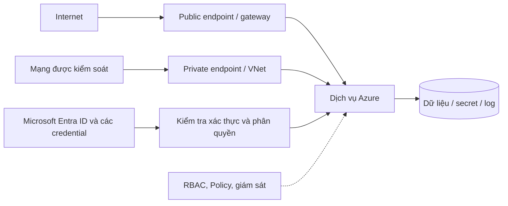
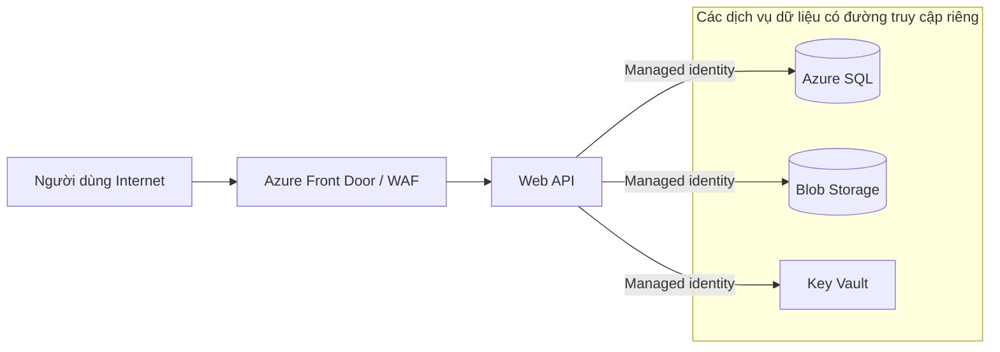

# Rà soát quyền, public endpoint và nguy cơ lộ dữ liệu

Một ứng dụng có thể chạy ổn định trên Microsoft Azure nhưng vẫn để lộ dữ liệu vì ba nguyên nhân kết hợp: **danh tính được cấp quá nhiều quyền**, **dịch vụ có đường truy cập công khai ngoài dự kiến** và **dữ liệu hoặc thông tin xác thực bị xuất bản qua cấu hình, log, mã nguồn hay URL**. Để đánh giá bảo mật, cần nhìn cả quyền truy cập lẫn đường mạng và cách xử lý dữ liệu; chỉ kiểm tra một nút cấu hình “public” là chưa đủ.

Bài học thuộc chương **Bảo mật và tuân thủ**, trong module **CLOUD_PROVIDERS_AZURE**. Phạm vi module bao gồm subscription, resource group, Microsoft Entra ID, mạng ảo, tính toán, lưu trữ, dữ liệu, triển khai, giám sát, bảo vệ và kiểm soát chi phí kiến trúc ứng dụng Azure. Bài này ghép các thành phần đó thành một quy trình rà soát thực tế, có thể áp dụng trước khi đưa hệ thống lên production và định kỳ trong vận hành.

Sau bài học, bạn có thể:

- Phân biệt **public endpoint**, **khả năng kết nối qua mạng** và **quyền đọc dữ liệu**.
- Kiểm tra các quyền Azure RBAC, data plane, managed identity và đường leo thang qua key/secret.
- Xác định dịch vụ nào cần Internet, dịch vụ nào nên dùng private endpoint hoặc giới hạn mạng.
- Rà soát nguy cơ lộ blob, cơ sở dữ liệu, secret, log, token và file cấu hình.
- Thu thập bằng chứng bằng Azure Portal/Azure CLI, ưu tiên thao tác chỉ đọc.
- Xếp mức độ rủi ro, đề xuất khắc phục và xác minh lại sau thay đổi.

## 1. Mô hình đánh giá: ai, từ đâu, làm gì, với dữ liệu nào?

Khi đánh giá một tài nguyên, hãy trả lời bốn câu hỏi:

1. **Ai?** Người dùng, nhóm, service principal hoặc managed identity nào có thể truy cập?
2. **Từ đâu?** Yêu cầu có thể đi từ Internet, mạng nội bộ, Azure VNet, private endpoint hay qua proxy/API gateway?
3. **Làm gì?** Có thể xem cấu hình, thay đổi tài nguyên, đọc/ghi dữ liệu, lấy khóa hay cấp quyền cho người khác?
4. **Dữ liệu nào?** Thông tin công khai, dữ liệu nội bộ, thông tin cá nhân, dữ liệu tài chính, bản sao lưu hay secret?

Một cách diễn tả trực quan:



Sơ đồ minh họa các lớp bảo vệ, không có nghĩa mọi đường mạng đều được phép. Một request chỉ thành công khi các điều kiện kết nối, xác thực, phân quyền và chính sách của dịch vụ liên quan đều đáp ứng.

### 1.1. Những khái niệm rất dễ nhầm

| Khái niệm | Nghĩa thực tế | Điều **không** thể suy ra |
|---|---|---|
| Public endpoint | Dịch vụ có địa chỉ/đường vào có thể được định tuyến từ mạng công cộng | Không khẳng định người lạ đọc được dữ liệu |
| Public network access = Enabled | Đường truy cập công cộng của dịch vụ được cho phép theo cấu hình dịch vụ | Không khẳng định firewall cho phép mọi IP hoặc không cần xác thực |
| Public IP | Địa chỉ IP công khai có thể gắn với một số tài nguyên mạng | Không chứng minh có cổng mở hoặc dịch vụ đang lắng nghe |
| Private endpoint | Giao diện mạng riêng để truy cập dịch vụ Azure qua Private Link | Không tự tắt public endpoint và không thay thế authorization |
| Azure RBAC Reader | Có thể xem metadata/cấu hình theo role và scope | Không tự động được đọc blob, secret hoặc truy vấn database |
| Contributor/Owner | Quyền quản lý tài nguyên theo role và scope | Cần kiểm tra cả khả năng lấy key/đổi cấu hình để truy cập dữ liệu gián tiếp |
| Resource lock | Ngăn một số thao tác quản lý như xóa/sửa tài nguyên | Không phải cơ chế giới hạn đọc dữ liệu hoặc thay thế RBAC |

**Kết luận vận hành:** Một website có thể cần public endpoint để khách hàng truy cập. Điều phải được kiểm soát là **endpoint nào công khai, endpoint đó cho phép thao tác gì, dữ liệu có được bảo vệ không và những đường vào khác có còn tồn tại không**.

## 2. Bắt đầu từ phạm vi và phân loại dữ liệu

Rà soát thiếu tài nguyên sẽ tạo cảm giác an toàn giả. Trước khi kiểm tra từng cấu hình, xác định phạm vi:

- **Tenant/management group/subscription**: ranh giới quản trị và nơi có Azure RBAC/Azure Policy kế thừa.
- **Resource group**: nơi tập hợp các thành phần ứng dụng, mạng và dữ liệu.
- **Workload**: App Service, Azure Functions, VM, AKS, API Management, Storage, SQL, Key Vault, Service Bus, Log Analytics hoặc dịch vụ khác.
- **Danh tính**: user, group, service principal, managed identity của app, pipeline CI/CD và tài khoản break-glass có đặc quyền.
- **Dòng dữ liệu**: người dùng → frontend → API → database/storage → log/backup; những điểm xuất hoặc chia sẻ dữ liệu ra ngoài.

Lập bảng kiểm kê tối thiểu:

| Trường | Ví dụ |
|---|---|
| Subscription, resource group | `sub-commerce-prod` / `rg-orders-prod` |
| Tên, loại, region của tài nguyên | `stordersprod` / Storage Account / Southeast Asia |
| Chủ sở hữu và môi trường | Đội Orders / Production |
| Dữ liệu xử lý | Hóa đơn có thông tin cá nhân |
| Đường truy cập dự kiến | Backend riêng trong Azure VNet |
| Đường truy cập hiện tại | Public endpoint đang bật, có firewall rule |
| Danh tính và quyền | Managed identity có Storage Blob Data Reader |
| Bằng chứng và người xử lý | Kết quả truy vấn/cấu hình, ticket, người phụ trách |

Đánh dấu dữ liệu theo mức độ nhạy cảm trước khi xếp hạng rủi ro. Một URL công khai chứa ảnh giới thiệu sản phẩm có thể hoàn toàn hợp lệ; một URL tương tự chứa bản sao lưu khách hàng là sự cố nghiêm trọng.

## 3. Rà soát quyền: quản lý tài nguyên và truy cập dữ liệu

### 3.1. Xem quyền hiệu lực, không chỉ role gán trực tiếp

Azure RBAC liên kết **security principal**, **role definition** và **scope**. Quyền gán tại management group, subscription hoặc resource group có thể kế thừa đến tài nguyên bên dưới. Khi rà soát, cần kiểm tra assignment trực tiếp lẫn kế thừa và thành viên của nhóm được gán role.

Ưu tiên phát hiện:

- Assignment rộng ở management group hoặc toàn subscription, đặc biệt `Owner`, `Contributor`, `User Access Administrator` hoặc các role có quyền quản lý role assignment.
- Quyền cấp cho nhóm đông thành viên, tài khoản không còn phục vụ công việc, service principal/managed identity không còn hoạt động.
- Quyền của pipeline triển khai kéo dài sang tài nguyên dữ liệu production không liên quan.
- Role có `DataActions` vượt nhu cầu như đọc, ghi, xóa dữ liệu; các quyền đọc hoặc sửa secret.
- Quyền tạo role assignment, sửa access policy, cấp credential hoặc thay đổi cấu hình mạng.

Một assignment ở scope nhỏ không bù trừ được một assignment rộng ở scope cha. Và `NotActions` trong một role definition không phải quy tắc deny áp dụng cho mọi role khác.

### 3.2. Dấu hiệu quyền rộng và đường truy cập gián tiếp

Với Azure Storage, `Storage Blob Data Reader` cho phép đọc blob bằng cơ chế data plane được hỗ trợ; trong khi `Reader` của control plane không tự động có quyền đó. Tuy nhiên, một principal có quyền gọi thao tác **listKeys** của Storage Account có thể lấy account key. Nếu Shared Key authorization đang được bật, account key có thể cho phép truy cập dữ liệu mà không cần role Blob Data Reader.

Tương tự:

- Ở Key Vault, cần kiểm tra vault đang dùng **Azure RBAC permission model** hay **vault access policy**. Quyền thay đổi access policy trong mô hình access policy có thể mở đường cấp quyền đọc secret cho chủ thể khác hoặc chính mình.
- Ở Azure SQL, quyền Azure RBAC trên resource và quyền đăng nhập/truy vấn **bên trong database** là hai lớp khác nhau.
- Ở ứng dụng, quyền xem/cập nhật cấu hình có thể dẫn đến việc đọc connection string, secret được lưu trong setting hoặc làm thay đổi identity thực thi. Cần đánh giá theo loại tài nguyên và quyền cụ thể.
- Với service principal, chứng chỉ, client secret và federated credential phải được kiểm soát vì ai sở hữu credential hợp lệ có thể mạo danh workload trong giới hạn được cấp.

Vì vậy, câu hỏi đúng là **principal có thể đạt đến dữ liệu bằng những con đường nào**, kể cả lấy key, SAS, đổi access policy hoặc thay đổi cấu hình ứng dụng.

### 3.3. Nguyên tắc xử lý quyền

1. Dùng **least privilege**: cấp role nhỏ nhất đủ làm việc ở scope hẹp nhất.
2. Tách role vận hành hạ tầng khỏi role truy cập dữ liệu production.
3. Dùng **managed identity** cho workload Azure khi phù hợp, tránh secret dài hạn trong code.
4. Rà soát quyền đặc quyền và dùng **Microsoft Entra Privileged Identity Management (PIM)** khi tổ chức có khả năng sử dụng, để giới hạn thời gian kích hoạt.
5. Rà soát **Entra directory roles** riêng với **Azure RBAC roles**; Global Administrator của Entra ID không đồng nghĩa có Owner trực tiếp trên mọi subscription.
6. Kiểm tra consent của ứng dụng đối với Microsoft Graph và API nội bộ, đặc biệt application permissions có phạm vi rộng.
7. Ghi lại lý do kinh doanh, chủ sở hữu, thời hạn và phương án thu hồi cho quyền ngoại lệ.

## 4. Rà soát public endpoint và đường mạng

Public endpoint không nhất thiết là lỗi. Website phục vụ khách hàng thường phải truy cập được qua Internet; database, secret store và nguồn lưu trữ nội bộ thường không cần mở trực tiếp cho người dùng bên ngoài.

### 4.1. Các bề mặt truy cập phổ biến

| Dịch vụ | Điểm cần xem | Hướng thiết kế thường phù hợp |
|---|---|---|
| VM / Azure Network | Public IP, NSG inbound, cổng quản trị, load balancer | Không mở RDP/SSH cho toàn Internet; dùng Bastion/VPN/JIT khi cần |
| App Service / Azure Functions | Public network access, access restrictions, authentication, endpoint quản trị/triển khai | Có thể public với HTTPS, auth/API gateway/WAF; giới hạn đường vào quản trị |
| Azure Storage | Public network access, firewall, anonymous blob access, Shared Key, SAS | Giới hạn public access theo nhu cầu; dùng Entra ID/data roles, private endpoint nếu thích hợp |
| Azure Key Vault | Public network access, network ACL, private endpoint, permission model | Giới hạn mạng và chỉ cấp quyền đọc secret cho workload thực sự cần |
| Azure SQL | Public network access, firewall rules, private endpoint, quyền DB | Chỉ mở cho mạng/địa chỉ cần thiết hoặc dùng Private Link |
| Azure API Management | Gateway public/internal, API authentication, subscription policies, routes | Công khai API được thiết kế cho khách hàng; bảo vệ backend riêng |
| Azure Kubernetes Service | API server exposure, ingress/load balancer, node/namespace policy | Tách đường quản trị cluster và đường phục vụ ứng dụng |

**Cẩn thận:** Một dịch vụ bật `publicNetworkAccess` chưa chắc được mọi nguồn Internet truy cập, vì firewall hoặc access restriction có thể chặn. Ngược lại, tạo private endpoint không mặc nhiên tắt public endpoint. Cần kiểm tra cả cấu hình **đường công khai**, **đường riêng** và **DNS** mà client thực tế sử dụng.

### 4.2. Bài kiểm tra “từ Internet có tới được không?”

Với mỗi endpoint:

1. Xác định hostname, giao thức và cổng: HTTPS 443, RDP 3389, SSH 22, SQL 1433, v.v.
2. Xác định public IP/FQDN hoặc front door/load balancer/API gateway phục vụ request.
3. Kiểm tra NSG, firewall, access restriction, service-level network ACL, route và private endpoint.
4. Xác minh người ngoài tổ chức có thể **kết nối** đến endpoint hay không.
5. Đánh giá tiếp xem có cần **đăng nhập**, token, role, database permission hoặc key hay không.
6. Nếu endpoint chủ đích công khai, đánh giá HTTPS, WAF, authentication, rate limiting, kiểm soát bot và log theo nhu cầu.

Kết nối mạng thành công chỉ chứng minh endpoint có thể tiếp nhận request. Nó **không chứng minh dữ liệu bị lộ**. Ngược lại, lỗi mạng không khẳng định không có đường truy cập khác, chẳng hạn SAS URL được dùng từ một mạng được phép.

### 4.3. Ví dụ kiến trúc cho ứng dụng web



Trong một thiết kế phù hợp, Front Door/gateway là điểm vào công khai có kiểm soát; backend được giới hạn chỉ nhận luồng hợp lệ; các dịch vụ dữ liệu truy cập qua private endpoint hoặc cấu hình mạng được bảo vệ. **Vẫn phải cấp đúng quyền** cho managed identity của API: private endpoint không thay cho Azure RBAC, database permissions hoặc Key Vault authorization.

## 5. Rủi ro lộ dữ liệu thường gặp

### 5.1. Blob Storage và chia sẻ bằng URL

Một Storage Account có thể chứa ảnh công khai bên cạnh dữ liệu nhạy cảm. Cần phân biệt:

- **Anonymous blob access**: Storage Account có thể cho phép hoặc chặn khả năng truy cập ẩn danh; tại container còn có mức độ public access riêng. Không suy từ một cài đặt duy nhất rằng mọi blob đều công khai.
- **Shared Access Signature (SAS)**: URL chứa token ủy quyền theo thời hạn, phạm vi tài nguyên, quyền và các giới hạn khác nếu được cấu hình. Người có URL có thể dùng quyền SAS trong giới hạn còn hiệu lực. SAS không có nghĩa là truy cập ẩn danh không cần credential; **SAS chính là bearer credential**.
- **Account key / Shared Key**: khóa truy cập có thể trao quyền rộng. Nếu `allowSharedKeyAccess` được cho phép và key bị lộ, tác động có thể nghiêm trọng.
- **Public network access / firewall**: giới hạn đường mạng nhưng không thay thế permission và chính sách quản lý SAS/key.

Ví dụ: hệ thống xuất tệp sao lưu dưới tên dễ đoán vào một container cấu hình public hoặc phát tán SAS URL có thời hạn quá dài. Người nhận đường dẫn có thể đọc dữ liệu ngoài mục đích ban đầu.

Biện pháp: tắt anonymous blob access nếu không cần; ưu tiên Microsoft Entra ID và data roles; hạn chế Shared Key khi ứng dụng tương thích; dùng user delegation SAS khi phù hợp, giới hạn quyền/phạm vi/thời hạn và bảo vệ URL; tránh ghi SAS vào log.

### 5.2. Database, backup và bản xuất dữ liệu

Rủi ro không chỉ nằm ở firewall của SQL hoặc Cosmos DB. Một bản sao lưu database có thể nằm trong Storage Account khác, ở resource group khác hoặc được tải về môi trường CI/CD. Hãy kiểm tra:

- Tài khoản và database user có quyền đọc toàn bộ bảng nhạy cảm.
- Export, snapshot, backup, data warehouse và tài khoản phân tích nhận dữ liệu.
- Firewall quá rộng, công tắc cho phép truy cập từ dịch vụ Azure khác và private endpoint.
- Credential trong connection string, script triển khai hoặc biến môi trường có thể đọc bởi người không cần thiết.
- Thời hạn lưu giữ và quyền đọc bản sao lưu/bản xuất; dữ liệu bản sao có cần kiểm soát tương đương nguồn hay không.

Các hệ thống có chính sách riêng như Azure SQL cần kiểm tra **Azure RBAC + quyền database**. Chỉ nhìn role ở resource group là thiếu.

### 5.3. Key Vault, token, logs và cấu hình ứng dụng

- **Key Vault** bảo vệ secret, key và certificate, nhưng quyền truy cập vault cần được kiểm tra theo mô hình RBAC/access policy và mạng.
- **App settings, pipeline variables, build logs, deployment artifacts** có thể chứa secret hoặc token nếu người phát triển ghi hoặc in giá trị ra.
- **Application Insights / Log Analytics** có thể lưu request body, URL, header hoặc exception chứa dữ liệu khách hàng nếu instrumentation không được thiết kế cẩn thận.
- **Public Git repository, image container và IaC template** có thể chứa credential vô tình commit hoặc nhúng khi build.
- **SAS URL, API key và refresh token** có thể lan truyền qua email, lịch sử trình duyệt, hệ thống ticket hoặc log gateway.

Cần kiểm tra cả **nguồn dữ liệu ban đầu**, **bản sao**, **đầu ra quan sát hệ thống** và **credential gián tiếp**. Không đưa secret nguyên văn vào báo cáo rà soát để “làm bằng chứng”; lưu loại vấn đề, vị trí, thời điểm và dấu vết đã che giá trị nhạy cảm.

## 6. Quy trình rà soát theo từng bước

### Bước 1: Xác định phạm vi và chủ sở hữu

Ghi rõ subscription, resource group, workload, môi trường, business owner, technical owner và loại dữ liệu. Kiểm tra cả dependency nằm ngoài resource group chính: hub network, Key Vault dùng chung, Storage chứa backup, logging workspace và pipeline triển khai.

### Bước 2: Lập danh mục đường vào

Liệt kê endpoint HTTP, public IP, NSG inbound, SQL/Storage/Key Vault public network access, private endpoint, DNS và gateway/WAF. Với endpoint chủ đích public, ghi rõ mục đích và biện pháp auth/rate limiting.

### Bước 3: Tìm quyền hiệu lực

Kiểm tra Azure RBAC tại management group → subscription → resource group → resource, bao gồm quyền qua group và role kế thừa. Kiểm tra quyền data plane của Storage, Key Vault, database và API; với mỗi principal, xác định quyền thật sự cần cho công việc.

### Bước 4: Tìm đường lộ dữ liệu gián tiếp

Rà soát SAS, account key, connection string, secret, token và quyền sửa cấu hình. Kiểm tra bản sao dữ liệu, log và build artifacts. Xác minh đường truy cập dùng private endpoint có thực sự đi qua DNS và route dự kiến hay không.

### Bước 5: Xếp mức ưu tiên

Ưu tiên theo tổ hợp: **mức độ nhạy cảm của dữ liệu × khả năng truy cập thực tế × quyền có thể thực hiện × phạm vi ảnh hưởng × khả năng phát hiện/khắc phục**. Không dùng duy nhất nhãn “public endpoint” để quyết định mức độ nghiêm trọng.

| Tình huống | Đánh giá ban đầu | Việc ưu tiên |
|---|---|---|
| Container có dữ liệu cá nhân bị cho phép đọc ẩn danh | Rất cao | Chặn truy cập không chủ đích, đánh giá phạm vi lộ và theo quy trình ứng phó |
| Account key production xuất hiện trong log mà nhiều người đọc được | Rất cao | Hạn chế truy cập, xoay vòng key theo kế hoạch, kiểm tra nơi sử dụng và dấu vết truy cập |
| Nhóm cộng tác viên có Owner toàn subscription không có lý do | Cao | Rà soát quyền kế thừa, thu hẹp role/scope và kiểm tra đường cấp quyền |
| Database có public endpoint nhưng firewall giới hạn chặt và auth mạnh | Tùy ngữ cảnh | Xác minh nhu cầu public, kiểm tra rule thực tế và cân nhắc private endpoint |
| Website giới thiệu sản phẩm public qua HTTPS có WAF và auth phù hợp | Có thể chấp nhận | Theo dõi cấu hình và chứng minh endpoint công khai có chủ đích |

Đây chỉ là phân loại minh họa; mức độ cuối cùng phụ thuộc dữ liệu, khả năng khai thác và chính sách tổ chức.

### Bước 6: Khắc phục và kiểm tra lại

Thay đổi quyền hoặc cấu hình mạng có thể làm gián đoạn hệ thống. Thống nhất owner, kế hoạch triển khai và phương án rollback. Sau mỗi thay đổi, xác minh cả **tác vụ được phép vẫn hoạt động** và **tác vụ không được phép đã bị chặn**; cập nhật bằng chứng, thời điểm, người phê duyệt và vấn đề còn tồn tại.

## 7. Ví dụ thao tác chỉ đọc bằng Azure CLI

Các lệnh dưới đây để **kiểm tra**, không tạo hay xóa tài nguyên. Thay placeholder bằng giá trị đúng; cần có quyền đọc tại scope tương ứng. Các truy vấn data plane có thể cần thêm role dữ liệu, dù bạn đã có `Reader` trên tài nguyên. Ví dụ dùng cú pháp Bash:

Kiểm tra ngữ cảnh trước khi rà soát:

```bash
az account show --query "{name:name,id:id,tenantId:tenantId}" -o table
az group list --query "[].{name:name,location:location}" -o table
```

Lấy ID Storage Account và xem các role assignment áp dụng ở scope tài nguyên:

```bash
RESOURCE_ID=$(az storage account show \
  --resource-group <resource-group> \
  --name <storage-account> \
  --query id -o tsv)

az role assignment list \
  --scope "$RESOURCE_ID" \
  --include-inherited \
  --all \
  -o table
```

Kết quả này hỗ trợ xem role assignment trực tiếp/kế thừa theo scope mà caller có thể truy vấn; quyền hiệu lực còn phụ thuộc thành viên nhóm, điều kiện role, mô hình authorization của dịch vụ và những credential bên ngoài Azure RBAC. Không xem danh sách assignment là phép kiểm duy nhất.

Kiểm tra cài đặt mạng và cơ chế public/Shared Key của Storage Account:

```bash
az storage account show \
  --resource-group <resource-group> \
  --name <storage-account> \
  --query "{name:name,publicNetworkAccess:publicNetworkAccess,allowBlobPublicAccess:allowBlobPublicAccess,allowSharedKeyAccess:allowSharedKeyAccess,networkRules:networkRuleSet}" \
  -o json
```

Nếu được cấp quyền Blob data plane, xem mức public access của container:

```bash
az storage container show \
  --account-name <storage-account> \
  --name <container-name> \
  --auth-mode login \
  --query "{name:name,publicAccess:properties.publicAccess}" \
  -o json
```

Không nhầm lỗi thiếu permission khi chạy `--auth-mode login` với kết luận container có hoặc không có anonymous access. Cần xác minh mô hình xác thực của Storage Account và quyền thực tế của danh tính đang dùng.

Kiểm tra cấu hình Key Vault bằng control plane:

```bash
az keyvault show \
  --name <vault-name> \
  --query "{name:name,publicNetworkAccess:properties.publicNetworkAccess,networkAcls:properties.networkAcls,enableRbacAuthorization:properties.enableRbacAuthorization}" \
  -o json
```

Liệt kê Public IP trong subscription hiện tại:

```bash
az network public-ip list \
  --query "[].{name:name,resourceGroup:resourceGroup,ipAddress:ipAddress,sku:sku.name}" \
  -o table
```

Xem các inbound rules của một Network Security Group (NSG):

```bash
az network nsg rule list \
  --resource-group <resource-group> \
  --nsg-name <nsg-name> \
  --query "[?direction=='Inbound'].{name:name,priority:priority,access:access,protocol:protocol,source:sourceAddressPrefix,destinationPort:destinationPortRange}" \
  -o table
```

Đây mới là các **rule tùy chỉnh** trong NSG được chỉ định. Khi đánh giá đường mạng hiệu lực, phải tính cả default rules, NSG ở subnet/NIC, route, Azure Firewall, load balancer, dịch vụ đích và các policy liên quan. Danh sách Public IP cũng không xác nhận cổng nào thật sự mở.

## 8. Cơ chế hỗ trợ rà soát liên tục

Rà soát thủ công hữu ích khi điều tra, nhưng production cần cơ chế duy trì cấu hình:

- **Azure Policy**: giám sát hoặc áp đặt cấu hình theo scope, chẳng hạn allowed regions, HTTPS, cấu hình network access và yêu cầu tag, tùy policy definition hỗ trợ.
- **Microsoft Defender for Cloud**: cung cấp khuyến nghị về cấu hình bảo mật, bề mặt tấn công và một số rủi ro liên quan đến dữ liệu theo khả năng gói dịch vụ đã bật.
- **Microsoft Entra ID và PIM**: kiểm soát quyền danh tính, quyền đặc quyền, điều kiện truy cập và các đợt access review khi triển khai.
- **Azure Activity Log**: quan sát hoạt động control plane như thay đổi tài nguyên và role assignment.
- **Resource logs / diagnostic settings**: ghi nhận hoạt động data plane của các dịch vụ hỗ trợ. Phải chủ động cấu hình và cân nhắc chi phí, lưu giữ, quyền truy cập log.
- **Microsoft Sentinel/SIEM**: tổng hợp, phân tích và cảnh báo sự kiện khi tổ chức triển khai.
- **CI/CD và Infrastructure as Code**: kiểm tra cấu hình mạng, policy, secret scan và role assignment trước khi đưa thay đổi lên production.

Không công cụ đơn lẻ nào chứng minh chắc chắn dữ liệu không bị lộ. Một recommendation “healthy” trong một sản phẩm giám sát không thay cho việc xác minh endpoint, permission và các đường chia sẻ dữ liệu thực tế.

## 9. Tình huống hoàn chỉnh: API hóa đơn trên Azure

Giả sử hệ thống có một API phục vụ hóa đơn cho khách hàng đã đăng nhập, triển khai trên App Service. API đọc blob chứa PDF hóa đơn và kết nối Azure SQL để lấy thông tin đơn hàng. Hệ thống dùng Key Vault lưu secret cho một hệ thống bên thứ ba.

**Yêu cầu truy cập hợp lệ:**

- Khách hàng đi qua HTTPS và chỉ được đọc hóa đơn của chính tài khoản mình.
- API dùng managed identity để đọc blob có liên quan; không cần quyền xóa blob.
- SQL và Key Vault không cần người dùng Internet truy cập trực tiếp.
- Đội triển khai được quản lý App Service; chỉ nhóm quản trị dữ liệu mới được thay đổi permission của Storage và SQL.

**Kết quả rà soát minh họa:**

| Phát hiện | Vì sao cần xử lý? | Khắc phục dự kiến |
|---|---|---|
| App Service công khai | Đây là nhu cầu hợp lệ nhưng cần xác thực và chặn truy cập trái phép | HTTPS, Entra/token validation, authorization từng hóa đơn, WAF/rate limiting phù hợp |
| Blob container chứa PDF bật truy cập ẩn danh | Tệp có thể đọc không qua API và bỏ qua kiểm tra quyền hóa đơn | Chặn anonymous access; dùng data role tối thiểu và mạng phù hợp |
| Managed identity được `Storage Blob Data Contributor` dù chỉ đọc | Cấp thêm quyền ghi/xóa ngoài nhu cầu | Giảm xuống `Storage Blob Data Reader` ở scope nhỏ nhất phù hợp |
| Azure SQL cho phép mạng rộng hơn yêu cầu | Mở thêm đường kết nối đến database | Thu hẹp firewall hoặc dùng private endpoint, kiểm tra quyền database |
| Log chứa URL có SAS token | Ai đọc log có thể dùng SAS trong thời hạn hiệu lực | Loại bỏ token khỏi log, hạn chế quyền log, xem xét thu hồi/đổi credential theo khả năng của loại SAS |
| Quyền của đội triển khai có thể sửa access policy Key Vault | Có thể tạo đường đọc secret gián tiếp | Xem lại permission model, tách vai trò triển khai và quản lý secret |

**Đánh giá sau khắc phục** cần chứng minh: API vẫn phục vụ khách hàng hợp lệ; truy cập blob trực tiếp trái phép bị từ chối; principal không có quyền không thể đọc/xóa dữ liệu; credential không xuất hiện trong log; và những thay đổi cấu hình quan trọng có thể được truy vết.

## 10. Khi nghi ngờ dữ liệu đã bị lộ

Đối với phát hiện có khả năng gây ảnh hưởng thực tế, chuyển sang quy trình ứng phó sự cố được tổ chức phê duyệt:

1. **Khoanh vùng** endpoint, tài nguyên, thông tin bị lộ, khoảng thời gian và principal liên quan.
2. **Hạn chế đường truy cập nguy hiểm** theo trình tự không làm mất bằng chứng cần thiết: chặn public access không chủ đích, điều chỉnh permission, vô hiệu hoặc xoay vòng credential phù hợp.
3. **Bảo toàn bằng chứng**: log truy cập, Activity Log, thay đổi role, diagnostic data, bằng chứng cấu hình; giới hạn ai được xem dữ liệu nhạy cảm.
4. **Đánh giá tác động**: dữ liệu nào có thể đã bị đọc, có khả năng bị sửa/xóa không, có bản sao hoặc credential nào bị ảnh hưởng.
5. **Thông báo và tuân thủ** theo quy trình của tổ chức và các nghĩa vụ pháp lý hoặc hợp đồng áp dụng.
6. **Khôi phục có kiểm chứng** và bổ sung guardrail để ngăn tái diễn: Policy, quyền tối thiểu, scan, cảnh báo và quy trình kiểm tra định kỳ.

Không công bố token, key, URL có SAS hoặc mẫu dữ liệu khách hàng nguyên vẹn trong ticket chung hoặc báo cáo công khai.

## 11. Câu hỏi tự kiểm tra

1. Vì sao một Storage Account bật public network access chưa đủ để kết luận blob có thể bị đọc ẩn danh?
2. Một managed identity có `Storage Blob Data Reader` ở container hóa đơn. Những thành phần nào khác vẫn có thể ngăn API đọc blob?
3. Vì sao quyền `listKeys` trên Storage Account có thể khiến mô hình phân quyền dự kiến bị vượt qua khi Shared Key còn hoạt động?
4. Một hệ thống có private endpoint tới Key Vault nhưng public network access vẫn bật. Bạn cần xác minh thêm điều gì?
5. Hai subscription cùng tenant có chắc chắn tách biệt quyền quản lý không? Quyền kế thừa từ management group ảnh hưởng ra sao?
6. Một API hợp lệ cần được Internet truy cập. Bạn sẽ kiểm soát đầu vào và authorization thế nào thay vì đơn giản đóng tất cả public endpoint?
7. Một SAS URL xuất hiện trong application log. Bạn sẽ đánh giá phạm vi ảnh hưởng và kế hoạch xử lý ra sao?
8. Rà soát RBAC cho Azure SQL đã đủ để xác nhận không ai đọc được bảng dữ liệu nhạy cảm chưa? Vì sao?

## Kết luận

Rà soát bảo mật Azure cần kết hợp **danh tính và quyền hiệu lực**, **đường truy cập mạng**, **cơ chế authorization riêng của dịch vụ** và **dòng đời của dữ liệu/credential**. Public endpoint có thể là nhu cầu chính đáng; rủi ro xuất hiện khi endpoint, permission, key hoặc dữ liệu được mở ngoài mục đích. Bắt đầu từ kiểm kê và phân loại dữ liệu, kiểm tra đường vào cùng quyền quản lý và data plane, thu thập bằng chứng chỉ đọc, xử lý theo mức rủi ro và xác minh lại. Kết hợp Azure RBAC, Microsoft Entra ID, private connectivity, Azure Policy và giám sát để duy trì trạng thái an toàn trong suốt vòng đời ứng dụng.
