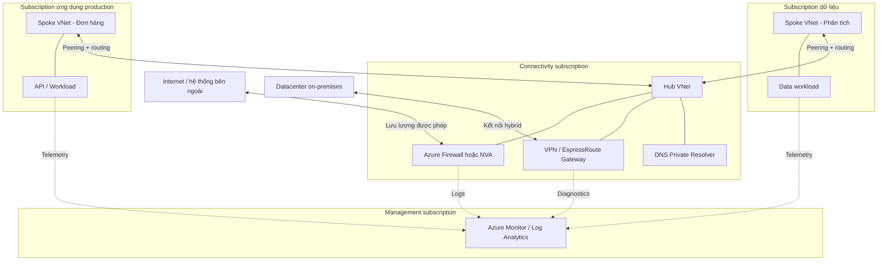
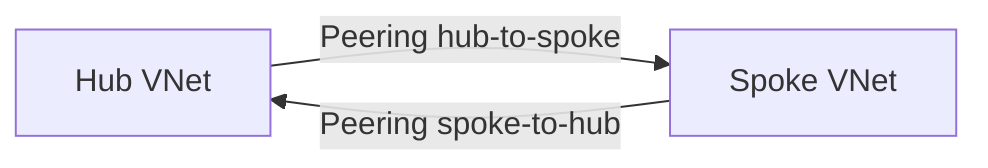
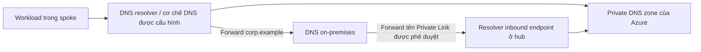

# Thiết kế mạng hub-spoke

Khi mới triển khai Azure, một ứng dụng thường chỉ cần một virtual network (VNet) chứa vài subnet để chạy máy ảo, container hoặc dịch vụ tích hợp mạng. Nhưng khi doanh nghiệp có nhiều nhóm sản phẩm, subscription và môi trường dev/test/prod, việc cho mọi ứng dụng tự quản lý VPN, firewall, DNS và đường ra Internet sẽ làm mạng khó kiểm soát. Mỗi ứng dụng có thể dùng một dải địa chỉ khác nhau, kết nối đến datacenter theo cách riêng hoặc mở luồng truy cập ngoài dự kiến.

**Hub-spoke** là kiểu kiến trúc mạng Azure trong đó một hoặc nhiều **hub VNet** cung cấp điểm kết nối và dịch vụ mạng dùng chung, còn các **spoke VNet** chứa workload của từng ứng dụng hoặc nhóm nghiệp vụ. Kết nối từ spoke về hub thường sử dụng **VNet peering**; định tuyến và chính sách bảo mật quyết định lưu lượng được đi tới đâu. Hub-spoke đặc biệt hữu ích khi tổ chức cần kết nối hybrid với on-premises, kiểm soát lưu lượng tập trung, phân chia quyền vận hành và mở rộng số lượng workload.

Bài học thuộc chương **Mạng ảo và phân giải tên** của module **CLOUD_PROVIDERS_AZURE**. Kiến thức này nối tiếp các khái niệm subscription, resource group và Microsoft Entra ID để thiết kế mạng cho máy ảo, ứng dụng, lưu trữ và dữ liệu; đồng thời xem xét triển khai, giám sát, bảo mật và chi phí của toàn kiến trúc Azure.

Sau bài học, bạn có thể:

- Phân biệt hub, spoke, peering, subnet, route table, Network Security Group và firewall.
- Lập kế hoạch địa chỉ IP, subscription và quyền sở hữu cho một hệ thống nhiều workload.
- Xác định đường đi của lưu lượng **north-south** (vào/ra hệ thống), **east-west** (giữa các workload) và hybrid (Azure ↔ on-premises).
- Giải thích vì sao VNet peering không tự tạo kết nối transit giữa các spoke, và khi nào cần UDR hoặc gateway transit.
- Thiết kế DNS/Private Endpoint để ứng dụng truy cập dịch vụ PaaS qua đường riêng.
- Áp dụng quy trình triển khai, kiểm thử, giám sát, dự phòng và tối ưu chi phí cho hub-spoke.

## 1. Hub-spoke giải quyết vấn đề gì?

Giả sử công ty có ba workload: hệ thống đơn hàng, hệ thống phân tích dữ liệu và cổng nhân sự nội bộ. Cả ba cần truy cập dịch vụ dùng chung hoặc hệ thống tại datacenter. Nếu mỗi workload tự tạo gateway, DNS server và firewall, tổ chức phải vận hành ba bộ hạ tầng lặp lại, khó đảm bảo cấu hình nhất quán và khó điều tra lưu lượng giữa các hệ thống.

Trong hub-spoke, nhóm nền tảng có thể vận hành các dịch vụ dùng chung ở hub; từng nhóm ứng dụng quản lý spoke của mình. Việc kết nối mới trở thành một quyết định có chủ đích: ứng dụng nào được nói chuyện với ứng dụng nào, qua đường gì, với chính sách nào.

| Thành phần | Trách nhiệm thường gặp | Ai thường quản lý? |
|---|---|---|
| **Hub VNet** | Kết nối mạng trung tâm, firewall, VPN/ExpressRoute gateway, DNS resolver, công cụ quản trị | Nhóm platform/network |
| **Spoke VNet** | Subnet và tài nguyên mạng của ứng dụng, máy ảo, AKS hoặc điểm tích hợp PaaS | Nhóm ứng dụng trong phạm vi được cấp |
| **VNet peering** | Kết nối giữa các VNet qua hạ tầng Azure | Cần phối hợp quyền ở cả hai phía |
| **Route table / UDR** | Chỉ định next hop cho một số loại lưu lượng | Nhóm mạng, phối hợp nhóm workload |
| **NSG** | Lọc lưu lượng vào/ra subnet hoặc network interface theo quy tắc | Nhóm sở hữu mạng hoặc workload |
| **Azure Firewall/NVA** | Kiểm soát, ghi log và có thể kiểm tra lưu lượng đi qua một điểm tập trung | Nhóm platform/security |

**Lợi ích:** tái sử dụng hạ tầng kết nối, phân tách trách nhiệm, dễ áp dụng chính sách bảo mật, quản lý địa chỉ IP và giám sát tập trung. **Đổi lại:** cần thiết kế kỹ đường định tuyến, DNS và phụ thuộc vào hub; firewall hoặc gateway trung tâm có thể tạo chi phí lớn hoặc trở thành điểm ảnh hưởng diện rộng nếu thiếu phương án sẵn sàng.

Hub-spoke là một lựa chọn kiến trúc. Các hệ thống nhỏ chỉ có hai VNet có thể dùng peering trực tiếp. Mạng quy mô toàn cầu với nhiều chi nhánh có thể phù hợp hơn với Azure Virtual WAN. Quyết định dựa trên số lượng mạng, mô hình kết nối, yêu cầu kiểm tra lưu lượng và năng lực vận hành.

## 2. Sơ đồ tham chiếu và vai trò từng luồng

Ví dụ dưới đây đặt các tài nguyên dùng chung trong **Connectivity subscription**, còn hai ứng dụng nằm trong các subscription riêng. Management subscription có thể nhận log/cảnh báo; nó không bắt buộc chứa hub VNet.



Sơ đồ là hình logic, không khẳng định mọi gói tin đều đi qua firewall. **Peering chỉ cung cấp khả năng kết nối mạng**; để ép các luồng nhất định đi qua firewall, phải cấu hình routing ở subnet phù hợp và bảo đảm chính sách firewall cho phép luồng đó. Internet ingress thực tế có thể đi qua Azure Front Door, Application Gateway/WAF hoặc endpoint ứng dụng riêng, chứ không nhất thiết đi qua Azure Firewall. Cần vẽ rõ đường vào và đường ra của từng ứng dụng thay vì dùng một mũi tên chung để suy luận tính an toàn.

### Ba nhóm luồng cần thiết kế

| Luồng | Ví dụ | Điểm phải quyết định |
|---|---|---|
| **North-south** | API gọi Internet, người dùng truy cập web app | Điểm công khai, WAF, TLS, egress, NAT, log và route |
| **East-west** | API spoke A gọi dịch vụ spoke B | Spoke có được kết nối không? Có phải qua firewall không? Có kiểm tra quyền ở API không? |
| **Hybrid** | Ứng dụng Azure truy cập database on-premises | VPN/ExpressRoute, gateway transit, BGP/UDR, DNS hai chiều, đường trở về |

Hãy ghi rõ **source, destination, protocol, port, next hop, kiểm soát truy cập và người sở hữu** cho mỗi luồng nghiệp vụ. Một sơ đồ hub-spoke đẹp vẫn chưa đủ nếu không trả lời được các câu hỏi đó.

## 3. Tổ chức subscription và quyền quản lý

Một cách tổ chức thường gặp trong Azure landing zone:

- **Platform / Connectivity:** chứa hub VNet, gateway, firewall, DNS resolver và các tài nguyên mạng dùng chung. Nhóm mạng kiểm soát thay đổi ở đây.
- **Landing zones / Corp hoặc Online:** chứa spoke VNet và workload ứng dụng; nhóm sản phẩm được cấp quyền giới hạn ở subscription hoặc resource group của mình.
- **Platform / Management:** chứa tài nguyên giám sát dùng chung nếu tổ chức chọn mô hình thu log tập trung.

VNet peering có thể kết nối VNet ở hai subscription khác nhau khi cấu hình và quyền được đáp ứng. Nếu hai subscription thuộc hai tenant khác nhau, cần quy trình xác thực/quyền phối hợp tương ứng; không nên coi cross-tenant giống hệt trường hợp cùng tenant. Mỗi peering là một tài nguyên cấu hình ở phía VNet sở hữu nó.

Phân quyền theo nguyên tắc tối thiểu: nhóm ứng dụng có thể tạo subnet hoặc network interface trong phạm vi được duyệt, nhưng không cần quyền chỉnh sửa firewall/gateway trung tâm. Nhóm mạng cần quyền phù hợp ở các VNet liên quan để tạo peering, gắn route table và cấu hình chính sách. Quản lý role assignment bằng nhóm Microsoft Entra và ghi log thay đổi qua Azure Activity Log.

Tách subscription là một ranh giới quản trị và phân bổ chi phí hữu ích; nó không tự cô lập lưu lượng mạng nếu bạn đã tạo peering và mở các đường kết nối. Kiểm soát thực tế vẫn nằm ở tuyến đường, NSG/firewall và xác thực của ứng dụng.

## 4. Quy hoạch địa chỉ IP trước khi tạo VNet

**Các dải địa chỉ không được chồng lấn** giữa những VNet dự định peering và các mạng on-premises cần kết nối. Đây là quyết định khó sửa khi môi trường đã có database, máy ảo và private endpoint. Hãy dùng một sổ đăng ký IP/CIDR tập trung, dự trù số spoke sẽ tăng trong tương lai và chọn địa chỉ theo ranh giới môi trường, vùng, ứng dụng.

Ví dụ kế hoạch cho một khu vực triển khai:

| Phạm vi | CIDR minh họa | Mục đích |
|---|---|---|
| Hub VNet | `10.40.0.0/16` | Mạng nền tảng, có chỗ cho gateway/firewall/DNS |
| Spoke đơn hàng production | `10.41.0.0/16` | Ứng dụng và dữ liệu production |
| Spoke phân tích | `10.42.0.0/16` | Dịch vụ dữ liệu riêng |
| Spoke phát triển | `10.43.0.0/16` | Môi trường phát triển, chính sách riêng |
| Datacenter on-premises | `172.20.0.0/16` | Mạng doanh nghiệp, cần phối hợp đội mạng hiện hữu |

Một cách chia subnet trong hub:

| Subnet trong `10.40.0.0/16` | CIDR minh họa | Ghi chú |
|---|---|---|
| `GatewaySubnet` | `10.40.0.0/27` | Tên dành riêng cho virtual network gateway; chọn kích thước theo yêu cầu gateway và kế hoạch mở rộng |
| `AzureFirewallSubnet` | `10.40.0.64/26` | Tên subnet bắt buộc và tối thiểu `/26` khi triển khai Azure Firewall dạng VNet hub |
| `AzureBastionSubnet` | `10.40.0.128/26` | Subnet dành cho Azure Bastion nếu sử dụng, theo yêu cầu SKU/triển khai |
| `snet-dns-in` | `10.40.1.0/28` | Subnet dành cho inbound endpoint của DNS Private Resolver, cần delegation tương ứng |
| `snet-dns-out` | `10.40.1.16/28` | Subnet riêng cho outbound endpoint, cần delegation tương ứng |
| `snet-shared` | `10.40.2.0/24` | Tài nguyên dùng chung không thuộc subnet chuyên dụng |

Một spoke production có thể có `snet-web=10.41.0.0/24`, `snet-api=10.41.1.0/24`, `snet-private-endpoint=10.41.2.0/27` và subnet khác được cấp theo yêu cầu. Nếu App Service dùng regional VNet integration, hãy dành subnet được ủy quyền riêng theo yêu cầu dịch vụ; không đặt private endpoint vào subnet tích hợp outbound của App Service. Nếu AKS dùng Azure CNI hoặc một mô hình IP cụ thể, ước tính IP cho node, pod và tăng trưởng theo cấu hình mạng đã chọn.

Những lưu ý khi cấp IP:

1. Azure giữ lại một số IP trong mỗi subnet cho chức năng nền tảng; không tính toàn bộ số IP theo CIDR là IP cấp được cho workload.
2. Một số dịch vụ yêu cầu tên subnet, kích thước tối thiểu hoặc subnet được **delegate** riêng. Kiểm tra yêu cầu của phiên bản dịch vụ trước khi chốt sơ đồ.
3. Không gán dải địa chỉ chỉ theo thói quen `10.0.0.0/16`; phải so với toàn bộ on-premises, các cloud/VNet khác và kế hoạch mở rộng.
4. Không sử dụng không gian IP của spoke để mở rộng hub ngẫu hứng; hãy quản lý cấp phát như một tài nguyên hữu hạn.
5. Xác định vùng (region) cho từng VNet, vì độ trễ, chi phí truyền dữ liệu, khả năng hỗ trợ dịch vụ và chiến lược khôi phục sẽ phụ thuộc vào địa lý.

## 5. Kết nối VNet bằng peering

**VNet peering** cho phép các VNet giao tiếp qua hạ tầng mạng Azure mà không cần triển khai gateway VPN cho riêng đường kết nối đó. Peering có thể áp dụng cho VNet cùng vùng hoặc khác vùng theo các khả năng được hỗ trợ. Quy tắc địa chỉ không chồng lấn vẫn quan trọng.

Với một hub và một spoke, cần cấu hình hai phía tương ứng:



Một số cài đặt peering cần hiểu:

| Cài đặt | Tác dụng | Khi nào dùng |
|---|---|---|
| `Allow virtual network access` | Cho phép kết nối giữa không gian địa chỉ của các VNet theo peering | Thường bật khi cần trao đổi lưu lượng |
| `Allow forwarded traffic` | Cho phép chấp nhận lưu lượng được chuyển tiếp từ nguồn ngoài VNet peer qua thiết bị định tuyến/ảo hóa phù hợp | Khi firewall/NVA trong hub làm trung gian chuyển tiếp lưu lượng giữa spoke hoặc mạng khác |
| `Allow gateway transit` | Cho VNet peer sử dụng gateway của VNet hiện tại khi điều kiện hỗ trợ được đáp ứng | Ở phía hub có gateway mà spoke cần dùng |
| `Use remote gateways` | Cho VNet hiện tại sử dụng gateway của VNet peer | Ở phía spoke, trong mô hình gateway transit hợp lệ |

**Peering không tự động truyền tiếp qua mạng thứ ba.** Nếu Spoke A peering với Hub và Spoke B cũng peering với Hub, A không tự động kết nối với B qua hub. Muốn lưu lượng A ↔ B đi qua hub, cần thiết bị chuyển tiếp như Azure Firewall/NVA và định tuyến ở cả hai phía. Các cài đặt `Allow forwarded traffic` hỗ trợ mô hình này nhưng không tự sinh route hoặc quy tắc firewall. Nếu muốn A kết nối trực tiếp B, có thể xem xét peering riêng giữa hai spoke, kèm đánh giá nhu cầu kiểm tra lưu lượng và số kết nối phải quản lý.

Đối với hybrid, **gateway transit** có thể cho spoke sử dụng VPN/ExpressRoute gateway đặt ở hub khi cấu hình peering, gateway và thiết kế định tuyến thỏa điều kiện. `Use remote gateways` có các ràng buộc, trong đó một VNet không thể tùy ý dùng nhiều remote gateway cùng lúc và phải xét xem VNet đã có gateway riêng hay chưa. Hãy xác minh điều kiện thực tế cho region, SKU và mô hình kết nối trước khi cấu hình.

Peering không thay thế bảo mật tầng ứng dụng: hai máy ảo có đường mạng tới nhau vẫn cần xác thực dịch vụ và quyền truy cập dữ liệu phù hợp. Khi cần đánh giá kết nối, kiểm tra cả **peering state**, route và NSG/firewall thay vì chỉ nhìn vào danh sách peering.

## 6. Thiết kế định tuyến: lưu lượng thực sự đi qua đâu?

Một kiến trúc hub-spoke thường thất bại vì sơ đồ mô tả “qua firewall” nhưng bảng định tuyến thật lại đi trực tiếp tới nơi đích. Azure chọn tuyến đường dựa trên prefix và nguồn route, gồm system routes, routes từ BGP và user-defined routes (UDR). Với các route có cùng độ dài prefix, quy tắc ưu tiên áp dụng theo loại route; prefix cụ thể hơn thường thắng prefix bao quát hơn.

**UDR** nằm trong route table gắn vào subnet. Một route có thể chỉ định `VirtualAppliance` và IP riêng của firewall/NVA làm next hop. Azure Firewall chỉ kiểm tra các luồng thực tế được định tuyến qua nó; chính sách firewall quyết định được phép hay bị chặn. Luôn thiết kế **đường đi và đường trả lời** để tránh bất đối xứng, đặc biệt với thiết bị kiểm tra stateful.

### 6.1. Spoke đi Internet qua firewall

Nếu yêu cầu mọi lưu lượng IPv4 đi Internet từ subnet ứng dụng phải được kiểm soát tập trung, có thể tạo route `0.0.0.0/0` tới private IP của Azure Firewall. Kiểm tra firewall policy, DNS, SNAT, public IP, lưu lượng nền tảng và các ngoại lệ cần thiết. Với PaaS hoặc AKS, lưu lượng qua VNet/route table phụ thuộc loại tích hợp mạng; cần kiểm tra cách dịch vụ xử lý outbound thực tế.

```text
API trong Spoke → UDR mặc định → Azure Firewall ở Hub → Internet
                          ↑                    ↓
                Route table gắn subnet   Policy / NAT / Log
```

Route mặc định không nhất thiết khiến **mọi** gói tin đi qua firewall: route cụ thể hơn (như đường tới mạng peered hoặc private endpoint) có thể được chọn trước. Hãy kiểm tra các hiệu lực thực tế thay vì suy từ một dòng `0.0.0.0/0`.

### 6.2. Spoke A liên lạc Spoke B qua firewall

Giả sử A dùng `10.41.0.0/16` và B dùng `10.42.0.0/16`, firewall hub có IP riêng được định tuyến đến từ hai spoke:

| Subnet nguồn | Prefix đích | Next hop kỳ vọng |
|---|---|---|
| Subnet ứng dụng trong A | `10.42.0.0/16` | IP riêng của firewall/NVA ở hub |
| Subnet ứng dụng trong B | `10.41.0.0/16` | IP riêng của firewall/NVA ở hub |

Peering A ↔ Hub và B ↔ Hub phải cho phép forwarded traffic theo thiết kế, firewall có luật phù hợp và hub phải có tuyến đến cả hai spoke. Định tuyến chiều B → A cần nhất quán với chiều A → B để stateful firewall nhìn thấy luồng trả lời. Nếu đã cấu hình peering trực tiếp A ↔ B, phải kiểm tra route hiệu lực để biết lưu lượng có bỏ qua firewall không.

### 6.3. Spoke liên lạc on-premises

Mô hình thường dùng gateway tập trung trong hub. Spoke có thể học tuyến mạng on-premises qua gateway transit/BGP; hoặc tổ chức có thể áp dụng UDR để ép một số luồng hybrid qua firewall trước khi tới gateway, tùy thiết kế. Phải phối hợp tuyến quay lại từ on-premises tới CIDR của spoke, các quy tắc firewall, NAT nếu có và khả năng chuyển tiếp của gateway.

Ví dụ: đường từ API trong `10.41.1.0/24` tới database on-premises `172.20.10.10` phải có tuyến đi, tuyến trả lời, DNS phân giải và quyền truy cập port database; chỉ có kết nối VPN ở hub chưa đủ để khẳng định API truy cập được database.

### 6.4. Chọn nơi áp dụng route và kiểm tra route hiệu lực

- Gắn route table vào đúng **subnet nguồn** của workload, không chỉ tạo route table trong subscription rồi để đó.
- Xem **effective routes** của network interface máy ảo phù hợp và dùng công cụ phân tích kết nối để kiểm chứng next hop. Với PaaS, kiểm tra đường đi theo đặc điểm tích hợp của dịch vụ.
- Đặc biệt cẩn trọng khi chỉnh route của `GatewaySubnet`, subnet firewall và các subnet chuyên dụng khác; dịch vụ có thể áp đặt ràng buộc. Không áp dụng UDR chung cho mọi subnet.
- Xác minh ảnh hưởng của BGP route propagation, longest-prefix match và các route có sẵn từ peering.
- Kiểm tra hai chiều và lưu lượng phản hồi, kể cả tình huống thiết bị mạng hoặc gateway chuyển vùng/sự cố.

## 7. Thiết kế lớp bảo mật mạng

Hub-spoke giúp tạo ranh giới, nhưng không tự động thực thi chính sách. Thiết kế bảo mật cần nhiều lớp:

### 7.1. NSG ở subnet/workload

Network Security Group lọc các luồng mạng được hỗ trợ dựa trên nguồn, đích, cổng, giao thức và hướng. Dùng NSG để giảm khả năng kết nối không cần thiết trong và giữa các subnet. Một subnet application có thể chỉ nhận HTTPS từ tầng frontend và chỉ mở outbound đến database hoặc dịch vụ được phép, tùy yêu cầu thật.

Không dựa hoàn toàn vào việc subnet nằm trong spoke để cho phép mọi traffic. Hãy mô tả rõ từng luồng cho phép, dùng network security rule phù hợp và xem xét service tag/application security group khi có ích. Cần hiểu default rules của NSG để tránh mở các kết nối ngoài dự kiến.

### 7.2. Firewall trung tâm

Azure Firewall hoặc thiết bị mạng ảo (NVA) có thể cung cấp chính sách tập trung cho egress, spoke-to-spoke và hybrid transit. Azure Firewall có các SKU/khả năng khác nhau; lựa chọn phụ thuộc nhu cầu như kiểm tra lớp ứng dụng, threat intelligence, logging, hiệu năng và chi phí.

Quy tắc firewall cần bám vào luồng mạng cụ thể. Ví dụ:

- `spoke-orders → dịch vụ API đối tác`: chỉ giao thức/đích cần thiết.
- `spoke-orders → spoke-data`: chỉ cổng của API dữ liệu đã được phê duyệt.
- `spoke-orders → on-premises`: chỉ CIDR và cổng ứng dụng cụ thể.
- Những luồng không có nhu cầu nghiệp vụ rõ ràng phải được xem xét và hạn chế.

Firewall stateful cần định tuyến hai chiều phù hợp. NAT có thể thay đổi địa chỉ nguồn quan sát được ở nơi đích; vì vậy phải kiểm tra việc ghi log và allowlist của đối tác. Không giả định firewall tự kiểm tra mọi lưu lượng chỉ vì nó tồn tại trong hub.

### 7.3. Bảo vệ điểm vào và PaaS

Với ứng dụng web công khai, dùng HTTPS, cơ chế xác thực và cân nhắc WAF tại Azure Front Door hoặc Application Gateway theo kiến trúc. Nếu lưu lượng phải đi qua WAF, cần ngăn đường truy cập trực tiếp tới origin khi dịch vụ hỗ trợ. DDoS Protection, NSG và firewall giải quyết các lớp vấn đề khác nhau; không nên coi chúng thay thế cho nhau.

Azure SQL, Storage và Key Vault có thể được cấu hình với **Private Endpoint**, private DNS và public network access phù hợp. Tạo private endpoint không mặc nhiên tắt public endpoint. Vẫn phải cấp quyền dữ liệu bằng Microsoft Entra ID, Azure RBAC hoặc cơ chế xác thực tương ứng của từng dịch vụ. Một IP riêng không chứng minh người gọi có quyền đọc dữ liệu.

### 7.4. Quản trị từ xa

Tránh mở trực tiếp RDP/SSH của máy ảo ra Internet. Nếu cần, Azure Bastion hoặc phương án truy cập quản trị được kiểm soát có thể cung cấp đường truy cập tập trung. Hãy bảo vệ tài khoản đặc quyền bằng MFA/PIM và log, kiểm tra cả quyền Azure RBAC lẫn quyền trong hệ điều hành.

## 8. DNS trong hub-spoke: tên đúng mới tới được IP đúng

DNS thường là nguyên nhân khiến mạng đã có peering và route nhưng ứng dụng vẫn không kết nối được. Đặc biệt với Private Endpoint, tên dịch vụ có thể phải phân giải về địa chỉ riêng trong VNet thay vì một địa chỉ công khai.

### 8.1. Mục tiêu phân giải tên

Thiết kế DNS phải đáp ứng các hướng truy vấn:

1. Workload trong spoke cần phân giải tên công khai bình thường.
2. Workload trong spoke cần phân giải tên dịch vụ PaaS dùng Private Endpoint về IP riêng.
3. Azure workload cần phân giải tên máy chủ hoặc dịch vụ trong mạng on-premises khi có kết nối hybrid.
4. Máy on-premises cần phân giải tên Private Endpoint trong Azure nếu chính sách cho phép truy cập dịch vụ đó.
5. Workload ở hai spoke có thể cần phân giải tên nội bộ của nhau, nhưng chỉ truy cập được sau khi route và chính sách mạng cũng cho phép.

**VNet peering không tự động chia sẻ mọi bản ghi DNS.** Liên kết private DNS zone với VNet hoặc cấu hình forwarder/resolver mới quyết định mạng nào truy vấn được vùng tên. Việc DNS trả đúng IP cũng không đồng nghĩa kết nối TCP hay quyền truy cập ứng dụng đã được cấp.

### 8.2. Azure Private DNS và Private Endpoint

Một số ví dụ tên private DNS zone thường dùng:

| Dịch vụ | Private DNS zone thường gặp | Điểm cần chú ý |
|---|---|---|
| Azure Blob Storage | `privatelink.blob.core.windows.net` | Storage có nhiều subresource; blob, file, queue có zone/endpoint riêng |
| Azure SQL Database | `privatelink.database.windows.net` | Cần dùng tên máy chủ database đúng chuẩn khi kết nối |
| Azure Key Vault | `privatelink.vaultcore.azure.net` | Tên vault phải phân giải về IP của private endpoint được phép |

Tên zone phụ thuộc dịch vụ, cloud environment và subresource; hãy dùng hướng dẫn tương ứng với dịch vụ thực tế. Khi thiết lập Private Endpoint, có thể dùng **private DNS zone group** để hỗ trợ quản lý bản ghi DNS theo cấu hình hỗ trợ. Vẫn cần kiểm tra zone link và hành vi DNS của tất cả mạng gọi đến dịch vụ.

Trong mô hình một vùng đơn giản, tổ chức có thể đặt private DNS zone tại subscription nền tảng, rồi liên kết zone với VNet của spoke cần truy vấn. Trong mô hình hybrid phức tạp, một bộ resolver và conditional forwarding tập trung thường dễ kiểm soát hơn. Tránh tạo nhiều zone trùng tên nhưng chứa bản ghi không nhất quán làm client nhận IP sai.

### 8.3. Azure DNS Private Resolver

Azure DNS Private Resolver là dịch vụ quản lý hỗ trợ giải quyết nhu cầu DNS hybrid mà không nhất thiết tự vận hành DNS forwarder trên máy ảo. Tùy trường hợp có thể dùng:

- **Inbound endpoint:** cung cấp địa chỉ IP riêng để DNS phía on-premises hoặc mạng liên quan gửi truy vấn tới Azure theo quy tắc định tuyến.
- **Outbound endpoint:** phục vụ cơ chế chuyển tiếp truy vấn DNS từ Azure tới các DNS server đích thông qua DNS forwarding ruleset.
- **DNS forwarding ruleset:** chứa quy tắc hậu tố tên miền và DNS server đích; có thể liên kết tới các VNet được hỗ trợ.

Inbound và outbound endpoint cần subnet phù hợp và tách biệt theo yêu cầu dịch vụ. Địa chỉ endpoint, định tuyến, firewall, UDP/TCP 53 và quyền quản trị DNS cần được xem xét cùng nhau.

Ví dụ các luồng DNS:



Đây là mô hình logic: một DNS query có thể đi qua Azure-provided DNS, DNS server tự quản lý hoặc Private Resolver tùy VNet DNS settings. Không cấu hình forwarding vòng tròn, ví dụ DNS on-premises chuyển `corp.example` tới Azure rồi Azure lại chuyển chính tên miền ấy về on-premises. Với private DNS zone, luôn kiểm tra hành vi của link và resolver thay vì suy từ vị trí đặt tài nguyên.

### 8.4. Quy trình xử lý lỗi DNS

Khi ứng dụng không truy cập được `myvault.vault.azure.net` hoặc cơ sở dữ liệu:

1. Kiểm tra tên đầy đủ mà ứng dụng sử dụng; đừng thay bằng IP riêng cố định trong connection string.
2. Từ đúng môi trường chạy workload, kiểm tra `nslookup`/công cụ tương đương để xem IP trả về.
3. Xác định resolver được client dùng và có điều kiện forward/zone link tương ứng không.
4. Kiểm tra A record, private endpoint và trạng thái kết nối private link.
5. Kiểm tra route, NSG/firewall, TLS và xác thực dịch vụ; DNS đúng chỉ giải quyết bước tìm địa chỉ.

## 9. Kết nối hybrid qua VPN hoặc ExpressRoute

Để workload Azure giao tiếp với hệ thống tại datacenter, hub thường là nơi kết thúc kết nối hybrid. Hai lựa chọn phổ biến:

- **Site-to-site VPN:** đường hầm IPsec qua kết nối Internet, phù hợp nhiều kịch bản kết nối doanh nghiệp với chi phí và yêu cầu vận hành tương ứng.
- **ExpressRoute:** kết nối riêng thông qua nhà cung cấp kết nối được hỗ trợ, dùng khi cần mô hình kết nối doanh nghiệp, hiệu năng và độ tin cậy theo yêu cầu. ExpressRoute không có nghĩa dữ liệu tự động được mã hóa end-to-end; cần xem xét mã hóa ở tầng ứng dụng hoặc các cơ chế phù hợp.

Trước khi chọn gateway, xác định băng thông, số kết nối, độ trễ, yêu cầu SLA, vùng, redundancy, chi phí và đối tác mạng. Gateway trong hub không tự làm mọi spoke có thể giao tiếp với on-premises. Cần kiểm tra gateway transit, BGP advertisement, route table, allow forwarded traffic khi có NVA/firewall và đường return.

### Checklist định tuyến hybrid

| Câu hỏi | Vì sao quan trọng? |
|---|---|
| CIDR on-premises có chồng lấn CIDR Azure không? | Chồng lấn làm đường đi mơ hồ và thường ngăn kiến trúc kết nối trực tiếp |
| On-premises có route về từng spoke không? | Có tuyến đi mà thiếu tuyến về sẽ khiến phiên kết nối thất bại |
| Firewall có nhìn thấy cả hai chiều lưu lượng không? | Firewall stateful cần dòng kết nối nhất quán |
| DNS hai chiều được thiết kế chưa? | Tên nội bộ hoặc Private Endpoint có thể không phân giải |
| Có đủ băng thông và phương án dự phòng không? | Tránh một đường kết nối trở thành điểm gián đoạn chung |
| Ai phê duyệt các port được phép? | Kết nối hybrid mở rộng bề mặt tấn công đến cả hai môi trường |

Với kiến trúc dùng cả ExpressRoute và VPN làm dự phòng hoặc kết nối đến nhiều site, thiết kế ưu tiên đường, BGP và tình huống failover cần được thử nghiệm. Không nên đánh giá chỉ bằng một lần ping thành công; ICMP có thể bị chặn ngay cả khi ứng dụng chạy tốt, hoặc ping thành công nhưng ứng dụng bị từ chối ở tầng cao hơn.

## 10. Classic hub-spoke hay Azure Virtual WAN?

Azure hỗ trợ nhiều cách xây dựng kết nối tập trung. Nên cân nhắc từ đầu để tránh tổ chức mạng lớn trên cấu trúc không phù hợp.

| Tiêu chí | Hub-spoke VNet truyền thống | Azure Virtual WAN |
|---|---|---|
| Thành phần trung tâm | Hub VNet do tổ chức thiết kế, vận hành gateway/firewall/NVA | Virtual WAN và virtual hub được dịch vụ quản lý theo mô hình tương ứng |
| Kiểm soát định tuyến | Peering, route table, gateway và thiết bị trung gian do đội mạng cấu hình | Các đối tượng kết nối, bảng định tuyến và chính sách của virtual hub |
| Phù hợp | Ít đến vừa số hub, cần tùy biến hạ tầng mạng | Nhiều chi nhánh/vùng, cần quản lý kết nối diện rộng theo mô hình Virtual WAN |
| Bảo mật | Kiểm soát qua firewall/NVA, NSG, UDR và WAF tùy luồng | Có thể dùng secured virtual hub theo khả năng của dịch vụ |
| Chi phí và vận hành | Chi phí tài nguyên hub, peering và lưu lượng; đội mạng quản lý nhiều chi tiết | Chi phí hub/connection/data processing và vận hành theo mô hình dịch vụ; cần đánh giá tổng chi phí |

Azure Virtual WAN không phải chỉ là một hub VNet đổi tên. Khi chọn dịch vụ, hãy kiểm tra chi tiết khả năng định tuyến, dịch vụ bảo mật, kết nối ExpressRoute/VPN, các hạn chế và yêu cầu của workload. Không áp dụng nguyên xi lệnh peering/UDR dành cho classic hub-spoke vào Virtual WAN.

## 11. Khả năng mở rộng, tính sẵn sàng và đa vùng

Hub là điểm phục vụ nhiều spoke nên có thể trở thành **shared failure domain**. Việc một firewall bị cấu hình sai, dịch vụ DNS bị lỗi hoặc gateway mất kết nối có thể ảnh hưởng đồng thời nhiều ứng dụng.

Những yếu tố nên thiết kế:

1. **Tính sẵn sàng theo vùng (Availability Zones):** chọn SKU và cấu hình zone redundancy phù hợp với dịch vụ và region. Không mặc định mọi SKU đều hỗ trợ cùng một cách phân vùng.
2. **Khả năng chịu tải:** ước tính throughput firewall, số phiên, lưu lượng east-west, hybrid và egress. Theo dõi băng thông gateway và dung lượng IP của subnet.
3. **Đa vùng địa lý (multi-region):** cân nhắc mỗi region có một hub và spoke cục bộ, kết nối giữa các hub theo thiết kế. Một hub duy nhất cho mọi khu vực có thể tăng độ trễ và tạo phụ thuộc vùng.
4. **DNS dự phòng:** hiểu sự phụ thuộc vào resolver, forwarder, private DNS và kết nối on-premises; thử tình huống một đường DNS mất khả dụng.
5. **Quy trình thay đổi:** kiểm tra route/firewall trước khi áp dụng diện rộng; có kế hoạch rollback và cửa sổ triển khai phù hợp.
6. **Diễn tập phục hồi:** kiểm tra thực tế khi gateway, firewall hoặc một region không sẵn sàng. Đo thời gian phát hiện, chuyển tuyến và khôi phục workload.

Với multi-region, có thể có `hub-sea` và `hub-ea` cùng các spoke tương ứng. Không tự ý peering toàn bộ các hub/spoke thành một đồ thị đầy đủ; cần rõ luồng nào phải đi xuyên region, next hop của nó và chi phí dữ liệu qua vùng.

## 12. Ví dụ triển khai cơ bản bằng Azure CLI

Phần này dựng bộ khung **một hub VNet và một spoke VNet ở hai subscription**, rồi tạo peering hai chiều. Chưa triển khai Azure Firewall, gateway, DNS Private Resolver hay Private Endpoint. Nhờ vậy, bạn có thể kiểm tra kết nối VNet trước khi bổ sung định tuyến nâng cao.

**Điều kiện thực hành:** đã có hai subscription thử nghiệm, tài khoản có quyền tạo resource group/VNet và peering tương ứng ở cả hai subscription, Azure CLI được cài đặt; các CIDR trong ví dụ chưa bị sử dụng trong mạng cần kết nối. Tạo VNet, peering và các dịch vụ bổ sung có thể phát sinh chi phí theo cấu hình/lưu lượng. Chạy lệnh trong môi trường thử nghiệm được phép; các giá trị mẫu phải được thay bằng subscription ID thực tế.

### 12.1. Khai báo biến

Ví dụ dùng Bash hoặc Azure Cloud Shell ở chế độ Bash:

```bash
az login

HUB_SUBSCRIPTION_ID="11111111-1111-1111-1111-111111111111"
APP_SUBSCRIPTION_ID="22222222-2222-2222-2222-222222222222"
LOCATION="southeastasia"

HUB_RG="rg-network-hub-demo"
HUB_VNET="vnet-hub-demo"
SPOKE_RG="rg-orders-spoke-demo"
SPOKE_VNET="vnet-orders-demo"

# Các ID trên chỉ minh họa định dạng; thay trước khi chạy.
```

### 12.2. Tạo hub VNet

```bash
az account set --subscription "$HUB_SUBSCRIPTION_ID"

az group create \
  --name "$HUB_RG" \
  --location "$LOCATION"

az network vnet create \
  --resource-group "$HUB_RG" \
  --name "$HUB_VNET" \
  --location "$LOCATION" \
  --address-prefixes "10.40.0.0/16" \
  --subnet-name "snet-shared" \
  --subnet-prefixes "10.40.2.0/24"

HUB_ID=$(az network vnet show \
  --resource-group "$HUB_RG" \
  --name "$HUB_VNET" \
  --query id -o tsv)
```

Chỉ tạo subnet `snet-shared` để kiểm tra peering; các subnet chuyên dụng như `AzureFirewallSubnet` phải được tạo riêng khi thực sự triển khai dịch vụ tương ứng và đã kiểm tra ràng buộc của dịch vụ đó.

### 12.3. Tạo spoke VNet

```bash
az account set --subscription "$APP_SUBSCRIPTION_ID"

az group create \
  --name "$SPOKE_RG" \
  --location "$LOCATION"

az network vnet create \
  --resource-group "$SPOKE_RG" \
  --name "$SPOKE_VNET" \
  --location "$LOCATION" \
  --address-prefixes "10.41.0.0/16" \
  --subnet-name "snet-app" \
  --subnet-prefixes "10.41.1.0/24"

SPOKE_ID=$(az network vnet show \
  --resource-group "$SPOKE_RG" \
  --name "$SPOKE_VNET" \
  --query id -o tsv)
```

### 12.4. Tạo peering cả hai chiều

```bash
# Peering từ hub tới spoke
az account set --subscription "$HUB_SUBSCRIPTION_ID"

az network vnet peering create \
  --resource-group "$HUB_RG" \
  --vnet-name "$HUB_VNET" \
  --name "hub-to-orders" \
  --remote-vnet "$SPOKE_ID" \
  --allow-vnet-access

# Peering từ spoke về hub
az account set --subscription "$APP_SUBSCRIPTION_ID"

az network vnet peering create \
  --resource-group "$SPOKE_RG" \
  --vnet-name "$SPOKE_VNET" \
  --name "orders-to-hub" \
  --remote-vnet "$HUB_ID" \
  --allow-vnet-access
```

Các lệnh này **không** bật gateway transit hay ép lưu lượng qua firewall, vì demo chưa có gateway/firewall. Khi thêm firewall làm trung gian cho lưu lượng forwarded, cần chỉnh cài đặt peering và định tuyến theo mục tiêu; tránh sao chép `--allow-forwarded-traffic` vào mọi kết nối mà chưa xác định luồng chuyển tiếp.

### 12.5. Xem trạng thái peering

```bash
az account set --subscription "$HUB_SUBSCRIPTION_ID"
az network vnet peering list \
  --resource-group "$HUB_RG" \
  --vnet-name "$HUB_VNET" \
  --query "[].{name:name, state:peeringState, remote:remoteVirtualNetwork.id}" \
  --output table

az account set --subscription "$APP_SUBSCRIPTION_ID"
az network vnet peering list \
  --resource-group "$SPOKE_RG" \
  --vnet-name "$SPOKE_VNET" \
  --query "[].{name:name, state:peeringState, remote:remoteVirtualNetwork.id}" \
  --output table
```

Khi hai phía được cấu hình đúng, trạng thái thường sẽ là `Connected`. Đây là bằng chứng peering đã thiết lập, nhưng **chưa chứng minh mọi kết nối ứng dụng đều thành công**. Để xác minh thực tế, cần có endpoint/VM kiểm thử, route và quy tắc mạng tương ứng. Ví dụ chưa tạo VM để tránh phát sinh thêm chi phí và cấu hình ngoài mục tiêu.

### 12.6. Ví dụ route qua Azure Firewall (chỉ khi đã có firewall)

Đoạn sau là một bước **riêng** sau khi Azure Firewall ở hub đã được triển khai, có private IP và đã cấu hình policy cùng đường trả lời. Không dùng placeholder làm IP thật.

```bash
az account set --subscription "$APP_SUBSCRIPTION_ID"
FW_PRIVATE_IP="10.40.0.68"  # Giá trị minh họa, phải thay bằng IP thật

az network route-table create \
  --resource-group "$SPOKE_RG" \
  --name "rt-orders-egress" \
  --location "$LOCATION"

az network route-table route create \
  --resource-group "$SPOKE_RG" \
  --route-table-name "rt-orders-egress" \
  --name "default-via-firewall" \
  --address-prefix "0.0.0.0/0" \
  --next-hop-type VirtualAppliance \
  --next-hop-ip-address "$FW_PRIVATE_IP"

# Chỉ gắn cho subnet ứng dụng đã kiểm tra phù hợp
az network vnet subnet update \
  --resource-group "$SPOKE_RG" \
  --vnet-name "$SPOKE_VNET" \
  --name "snet-app" \
  --route-table "rt-orders-egress"
```

Trước khi gắn route table, phải đảm bảo firewall có khả năng chuyển tiếp lưu lượng và trả lời về spoke, policy cho phép đúng đích, DNS hoạt động và các luồng quản lý của workload không bị ảnh hưởng. Route mặc định có thể làm thay đổi đường egress và IP nguồn mà dịch vụ bên ngoài nhìn thấy; hãy thử nghiệm từ môi trường phù hợp và chuẩn bị rollback.

## 13. Kiểm thử kết nối và xử lý sự cố

Không nên coi triển khai thành công là kiểm thử hoàn tất. Một bảng xác minh nên bao gồm cả kết nối **được phép** lẫn kết nối **phải bị chặn**.

| Bài kiểm thử | Kỳ vọng | Nếu thất bại, kiểm tra |
|---|---|---|
| VM/API ở spoke kết nối tới tài nguyên trong hub được cho phép | Kết nối thành công qua peering | Peering hai phía, CIDR, route, NSG, host firewall |
| Spoke A gọi API ở spoke B qua firewall | Chỉ cổng/đích được phép đi qua | UDR hai phía, forwarded traffic, firewall policy, đường return |
| Spoke truy cập dịch vụ on-premises | Kết nối đúng cổng theo đường hybrid | Gateway/BGP, UDR, firewall, route về spoke, DNS |
| Workload dùng Private Endpoint tới Storage/SQL/Key Vault | Tên dịch vụ phân giải IP riêng, xác thực hợp lệ | Zone link, resolver, endpoint, public access, quyền data plane |
| Máy không được phép truy cập cổng quản trị của VM | Bị từ chối | NSG rule, public IP, Bastion, route, host firewall |
| API từ spoke truy cập Internet qua egress firewall | IP nguồn và log đúng thiết kế | Route hiệu lực, NAT, firewall policy, DNS, cấu hình outbound PaaS |

Quy trình điều tra một lỗi kết nối:

1. **Xác định điểm xuất phát và đích:** tên dịch vụ, IP, port/protocol, subscription, VNet, subnet và thời điểm lỗi.
2. **Kiểm tra DNS:** tên có phân giải về IP dự kiến không? Private Endpoint có bị phân giải sang public IP không?
3. **Kiểm tra next hop:** ở nguồn có route đến đích không; gói tin thực tế đi trực tiếp hay qua firewall/gateway?
4. **Kiểm tra chính sách:** NSG, Azure Firewall/NVA, host firewall, WAF hoặc quyền dịch vụ có đang chặn không?
5. **Kiểm tra chiều trả lời:** từ đích có route về nguồn không? Có phát sinh NAT hoặc routing bất đối xứng không?
6. **Kiểm tra danh tính:** nếu mạng kết nối được mà API trả `401/403`, cần xem token, RBAC, database permission hoặc quyền ứng dụng.
7. **Đối chiếu log:** kết hợp network logs, Activity Log, application logs và các phép thử từ đúng workload để xác định nguyên nhân.

Các công cụ Azure hữu ích có thể gồm **Network Watcher**, Connection troubleshoot, effective security rules/route table (khi hỗ trợ), Azure Firewall logs, Azure Monitor và Log Analytics. Không giả định một công cụ hoạt động giống hệt cho VM, AKS và mọi PaaS: chọn công cụ theo mô hình kết nối của tài nguyên cần kiểm tra.

## 14. Giám sát, governance và quản lý chi phí

### 14.1. Quan sát mạng

Tài nguyên tập trung cần giám sát thường xuyên: gateway, firewall, DNS resolver, hub peering, network interface, workload và các endpoint nhạy cảm. Một số tín hiệu nên theo dõi:

- Tình trạng và lượng lưu lượng trên gateway/đường hybrid; sự kiện chuyển tuyến hoặc mất kết nối.
- Thống kê lưu lượng firewall, đích bị chặn, số phiên và cảnh báo liên quan.
- Thay đổi route table, peering, NSG, private endpoint và DNS zone/forwarding ruleset.
- Độ trễ, lỗi kết nối và tỉ lệ request thất bại của ứng dụng sau thay đổi mạng.
- Dung lượng IP subnet còn khả dụng và khả năng mở rộng của hub/spoke.

Activity Log giúp theo dõi thay đổi tài nguyên ở control plane; Azure Monitor/Log Analytics có thể thu thập metric và log chẩn đoán tương ứng khi đã cấu hình. Lưu log ở phạm vi phù hợp, kiểm soát quyền đọc, thời gian lưu giữ và chi phí ingest; không gửi dữ liệu nhạy cảm vào log nếu không cần thiết.

### 14.2. Kiểm soát cấu hình bằng Azure Policy và IaC

Với nhiều subscription, nên quản lý các thành phần chung bằng Bicep, ARM template hoặc Terraform và review thay đổi trước triển khai. Azure Policy có thể hỗ trợ kiểm tra region cho phép, network exposure, gắn thẻ hoặc diagnostic setting theo khả năng của từng policy. Một thiết kế chuẩn hóa nên tài liệu hóa:

- CIDR đã cấp, người sở hữu và reservation cho workload mới.
- Quy ước đặt tên VNet/subnet/peering/route table.
- Chính sách tạo peering mới, mở cổng firewall và truy cập on-premises.
- Luồng áp dụng UDR và điều kiện miễn trừ cần phê duyệt.
- Cách tạo Private Endpoint và cập nhật private DNS không xung đột.
- Chỉ số monitoring, runbook và đội phản ứng khi có sự cố.

Không chuyển chính sách từ `Audit` sang `Deny` ở phạm vi rộng khi chưa thử nghiệm tác động đến workload hiện tại. Chính sách bị gán ở management group có thể ảnh hưởng xuống nhiều subscription; nên kiểm soát thay đổi ở cấp phù hợp.

### 14.3. Chi phí của mạng hub-spoke

Các nguồn chi phí thường thấy:

| Nhóm chi phí | Điều cần dự toán |
|---|---|
| Firewall/NVA | Phí tài nguyên, xử lý dữ liệu, quy mô và tính năng được chọn |
| VPN/ExpressRoute | Gateway, kết nối/circuit và lưu lượng theo mô hình tính phí |
| VNet peering | Lưu lượng qua peering và chênh lệch theo vị trí/khu vực theo bảng giá áp dụng |
| Azure Private Link | Private endpoint và dữ liệu xử lý theo khả năng tính phí của dịch vụ |
| DNS Private Resolver | Endpoint và lưu lượng/truy vấn theo cấu hình sử dụng |
| Giám sát | Log ingest, thời gian lưu, alert và công cụ phân tích |

Việc tạo một hub trung tâm không tự động làm tổng chi phí thấp hơn. Nếu ép tất cả luồng spoke-to-spoke qua firewall, có thể tăng dữ liệu xử lý, độ trễ và phụ thuộc vào hub. Tính chi phí theo đường đi thực tế và dung lượng, không chỉ đếm số VNet. Với lưu lượng lớn giữa hai ứng dụng, đánh giá trade-off giữa peering trực tiếp có kiểm soát và kiểm tra tập trung qua firewall.

Nên gắn tag như `owner`, `environment`, `application`, `costCenter`; xác định cách phân bổ chi phí hub giữa các nhóm; dùng Azure Cost Management để theo dõi xu hướng và cấu hình budget alerts. **Budget là cảnh báo, không phải giới hạn chi phí cứng.** Khi làm lab, xóa đúng các tài nguyên thử nghiệm không còn dùng và kiểm tra thêm những thành phần vẫn tính phí như gateway, firewall hoặc public IP.

## 15. Những lỗi thiết kế phổ biến

| Lỗi | Hệ quả | Cách khắc phục |
|---|---|---|
| CIDR hub, spoke hoặc on-premises bị chồng lấn | Peering hoặc routing không hoạt động như mong đợi | Quy hoạch IP tập trung trước khi tạo mạng |
| Nghĩ peering hub tự nối mọi spoke với nhau | Spoke A không có đường transit tới B | Thiết kế NVA/firewall + UDR hai phía hoặc peering trực tiếp có kiểm soát |
| Chỉ tạo UDR `0.0.0.0/0` và cho rằng mọi traffic qua firewall | Route cụ thể hơn có thể đi đường khác | Xem effective routes theo từng đích và lớp dịch vụ |
| Quên đường trả lời từ spoke B/on-premises | Kết nối bị timeout hoặc stateful firewall chặn | Kiểm tra định tuyến hai chiều và NAT |
| Bật forwarded traffic nhưng không tạo route/firewall rule | Không có đường đi hay quyền kết nối tương ứng | Cấu hình đầy đủ route, peering và policy |
| Tạo Private Endpoint nhưng DNS vẫn phân giải IP công khai | Ứng dụng đi sai đích hoặc không kết nối được | Thiết kế private DNS zone, link và conditional forwarding |
| Tạo Private Endpoint rồi mặc định public access đã bị tắt | Dịch vụ vẫn có thể lộ đường vào công khai | Xác minh public network access của từng dịch vụ |
| Đặt gateway/firewall trong subnet thiếu kích thước hoặc sai tên | Triển khai thất bại/khó mở rộng | Theo yêu cầu tên và CIDR tối thiểu của dịch vụ |
| Ép firewall vào mọi đường đi mà không tính lưu lượng | Tăng chi phí, độ trễ, nghẽn và phạm vi sự cố | Xác định luồng bắt buộc kiểm tra và đo tải thực tế |
| Chỉ đo ping giữa hai máy | Bỏ sót lỗi DNS, TLS, quyền ứng dụng hoặc cổng | Kiểm thử luồng nghiệp vụ end-to-end |

## 16. Tình huống thiết kế: doanh nghiệp có hai ứng dụng và datacenter

**Đề bài:** Doanh nghiệp triển khai API đặt hàng ở Azure, nền tảng phân tích dữ liệu tại subscription khác và vẫn giữ hệ thống ERP trong datacenter. Yêu cầu:

- Nhân viên truy cập ứng dụng qua HTTPS, API có thể cần kết nối ERP.
- Nền tảng phân tích chỉ lấy dữ liệu từ API/nguồn đã phê duyệt.
- Không cho spoke phát triển tự do truy cập cơ sở dữ liệu production.
- Kiểm soát egress Internet, giảm công khai hóa SQL/Storage/Key Vault và thu thập log tập trung.

**Phương án tham khảo:**

1. Tạo **hub VNet** trong Connectivity subscription và cấp CIDR riêng `10.40.0.0/16`.
2. Tạo **spoke-orders** `10.41.0.0/16`, **spoke-data** `10.42.0.0/16` và **spoke-dev** `10.43.0.0/16`, mỗi spoke có chủ sở hữu và nhóm quản trị riêng.
3. Peering hai chiều từng spoke với hub; cấu hình forwarded traffic nếu thiết bị trung gian thực sự cần chuyển tiếp lưu lượng.
4. Đặt VPN/ExpressRoute gateway ở hub. Chọn cơ chế gateway transit/định tuyến để API có thể truy cập ERP; phối hợp route trở về từ datacenter.
5. Đặt Azure Firewall/NVA ở hub và UDR phù hợp cho egress và luồng giữa orders/data cần kiểm tra tập trung. Luồng từ dev sang production mặc định bị hạn chế, chỉ mở khi có nhu cầu được phê duyệt.
6. Tạo Private Endpoint cho dịch vụ PaaS phù hợp, quản lý DNS zone và Private Resolver theo nhu cầu truy vấn trong Azure và on-premises.
7. Dùng HTTPS/WAF cho điểm vào ứng dụng công khai, managed identity cho kết nối đến dịch vụ dữ liệu, RBAC theo quyền tối thiểu.
8. Gửi log firewall/gateway và thay đổi cấu hình đến hệ thống giám sát tập trung; đặt cảnh báo lỗi DNS, mạng hybrid và thay đổi route nhạy cảm.

**Ví dụ ma trận luồng mạng** (port chỉ là minh họa, phải xác nhận theo ứng dụng):

| Nguồn | Đích | Port/Protocol | Quyết định |
|---|---|---|---|
| Người dùng Internet | Edge của website orders | TCP 443 | Cho phép qua HTTPS/WAF và xác thực ứng dụng |
| API orders | ERP on-premises | TCP 443 | Cho phép qua hybrid theo chính sách firewall; cần route về |
| Data workload | API orders | TCP 443 | Chỉ cho phép định danh/endpoint đã phê duyệt |
| Dev workload | SQL production | TCP 1433 | Mặc định chặn nếu không có nhu cầu đặc biệt |
| API orders | Key Vault private endpoint | TCP 443 | Cho phép đường mạng và xác thực/ủy quyền dữ liệu |
| Workload chưa được phê duyệt | Cổng quản trị VM production | TCP 22/3389 | Chặn; sử dụng kênh quản trị riêng khi cần |

**Câu hỏi đánh giá:** Nếu firewall trung tâm không khả dụng, những luồng nào bị ngừng? Nếu ERP thay đổi IP, cần sửa DNS, route hay cả hai? Nếu một spoke tạo peering trực tiếp với spoke khác, có vi phạm yêu cầu inspection không? Những câu hỏi này phải được trả lời trước khi vận hành production.

## 17. Bài thực hành tự thiết kế

Hãy thiết kế hub-spoke cho ba workload: web sản xuất, hệ thống nội bộ và môi trường phát triển; mỗi workload có một subscription và phải dùng dịch vụ DNS, giám sát chung. Công ty còn có datacenter dùng `172.20.0.0/16`.

1. Vẽ sơ đồ hub, ba spoke, firewall, gateway, DNS và đường đi của ba loại lưu lượng.
2. Cấp CIDR riêng cho hub/spoke, chia các subnet cần thiết; chứng minh các dải không chồng lấn.
3. Chỉ ra các peering cần tạo **cả hai phía** và các cờ được bật theo từng nhu cầu.
4. Lập bảng UDR cho egress, spoke-to-spoke có kiểm tra và truy cập ERP; giải thích đường trả lời.
5. Thiết kế DNS cho một Key Vault private endpoint và hostname `erp.corp.example` trên on-premises.
6. Đề xuất quy tắc NSG/firewall cho các luồng được phép và luồng phải bị chặn.
7. Lập bảng kiểm thử ít nhất sáu luồng, bao gồm một trường hợp cần bị từ chối và một trường hợp DNS sai.
8. Đánh giá điểm ảnh hưởng diện rộng ở hub, cách quan sát lỗi và các khoản chi phí chính.

**Tiêu chí hoàn thành:** Người học có thể giải thích vì sao một gói tin đi theo route đã chọn, firewall có thực sự nhìn thấy cả hai chiều không, DNS trả IP nào, ai có quyền chỉnh sửa hạ tầng dùng chung, và kiểm tra nào chứng minh luồng truy cập đáp ứng yêu cầu. Tài liệu thiết kế nên đủ rõ để một thành viên khác triển khai thử nghiệm và kiểm chứng độc lập.

## 18. Ghi nhớ

Thiết kế mạng hub-spoke trên Azure bắt đầu bằng **phân chia trách nhiệm và quy hoạch địa chỉ**, sau đó xác định peering, routing, bảo mật và DNS theo từng luồng nghiệp vụ. **Peering không có tính transit tự động**: kết nối spoke-to-spoke hoặc spoke-to-on-premises cần cấu hình chuyển tiếp/gateway, tuyến đường và bảo mật phù hợp. **Azure Firewall chỉ kiểm tra lưu lượng đi qua nó**; UDR phải được gắn đúng subnet và đường trả lời phải nhất quán. **Private Endpoint không tự thay thế DNS, quyền dữ liệu hay cấu hình chặn public access**. Cuối cùng, cần kiểm chứng kết nối cả hai chiều, theo dõi chi phí và thiết kế khả năng sẵn sàng của hub vì đó là hạ tầng dùng chung cho nhiều ứng dụng.
