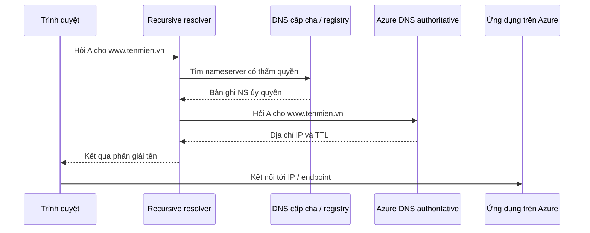

# Azure DNS và quản lý vùng DNS công cộng

Một website có thể chạy ổn định trên Azure App Service, một API có thể được triển khai trên máy ảo, và một ứng dụng có thể được bảo vệ bởi Azure Front Door. Tuy nhiên, người dùng chỉ truy cập được những dịch vụ ấy qua tên miền riêng khi hệ thống DNS được cấu hình đúng. Bản ghi sai, thiếu bước ủy quyền nameserver hoặc thay đổi DNS chưa có kế hoạch có thể khiến website hay email ngừng hoạt động dù máy chủ và ứng dụng vẫn khỏe mạnh.

Trong module `CLOUD_PROVIDERS_AZURE`, bạn tìm hiểu Microsoft Azure từ subscription, resource group, Microsoft Entra ID đến mạng ảo, compute, lưu trữ, dữ liệu, giám sát, bảo mật và chi phí. Bài học thuộc chương **Mạng ảo và phân giải tên**, tập trung vào **Azure DNS** như một dịch vụ quản lý DNS công cộng, cách tạo vùng DNS (DNS zone), quản lý bản ghi, ủy quyền tên miền và kiểm tra đường phân giải tên trong vận hành thực tế.

## 1. Mục tiêu học tập

Sau khi học, bạn có thể:

- Giải thích vai trò của DNS authoritative, DNS recursive resolver và vùng DNS công cộng.
- Phân biệt việc đăng ký tên miền với việc lưu trữ DNS trên Azure.
- Tạo và quản lý public DNS zone cùng các record set bằng Azure portal và Azure CLI.
- Ủy quyền tên miền từ nhà đăng ký bằng nameserver mà Azure DNS cung cấp.
- Chọn đúng loại bản ghi A, AAAA, CNAME, MX, TXT, CAA, NS và hiểu TTL.
- Thiết kế quy trình chuyển DNS an toàn, xử lý lỗi phân giải tên và kiểm soát quyền thay đổi.
- Nhận biết khi nào cần Azure Private DNS thay vì public DNS.

## 2. DNS giải quyết vấn đề gì?

**Domain Name System (DNS)** ánh xạ tên dễ đọc như `www.example.com` sang thông tin mà ứng dụng, trình duyệt hoặc dịch vụ cần sử dụng, thường là địa chỉ IPv4/IPv6 hoặc tên đích khác. DNS được tổ chức theo hệ thống phân cấp và sử dụng các bản ghi có kiểu dữ liệu cụ thể.

Khi người dùng truy cập website:

1. Ứng dụng hỏi **recursive resolver** (DNS resolver của hệ điều hành, nhà mạng hoặc nhà cung cấp DNS).
2. Nếu không có kết quả phù hợp trong cache, resolver tìm các máy chủ có thẩm quyền cho tên miền qua hệ thống DNS phân cấp.
3. **Authoritative nameserver** của vùng DNS chứa bản ghi được yêu cầu và trả lời resolver.
4. Resolver cache kết quả theo TTL và trả thông tin cho ứng dụng; trình duyệt sau đó kết nối đến endpoint được chỉ định.



Sơ đồ minh họa việc resolver cần truy vấn khi **chưa có dữ liệu cache**; trên thực tế, resolver có thể nhận thông tin ủy quyền qua nhiều cấp hoặc dùng kết quả đã lưu.

### Azure DNS cung cấp gì?

**Azure DNS** lưu trữ các vùng DNS và trả lời truy vấn DNS có thẩm quyền trên hạ tầng phân tán của Azure. Bạn quản lý zone và record set qua Azure Resource Manager, Azure portal, Azure CLI, PowerShell hoặc API; quyền cấu hình được kiểm soát bằng Azure RBAC.

Điều cần phân biệt:

- **Nhà đăng ký tên miền (registrar):** nơi tổ chức đăng ký, gia hạn, quản lý quyền sở hữu và thay đổi nameserver của tên miền.
- **Azure DNS public zone:** nơi lưu bản ghi DNS có thẩm quyền cho tên miền được ủy quyền sang Azure.
- **Recursive resolver:** hệ thống đi truy vấn và cache kết quả thay mặt ứng dụng; Azure DNS public là dịch vụ authoritative, không phải một recursive DNS resolver công cộng để bạn cấu hình cho client.
- **Dịch vụ đích:** App Service, VM, Azure Front Door hoặc dịch vụ khác thực sự phục vụ HTTP, API, email, v.v.

Azure DNS **không tự đăng ký tên miền cho bạn**, không triển khai website và không cấp chứng chỉ HTTPS chỉ vì đã tạo bản ghi DNS. Một tên miền phải được đăng ký và quản lý hợp lệ tại registrar; muốn lưu trữ DNS bằng Azure, bạn còn phải cập nhật bước ủy quyền.

## 3. Public DNS zone và cấu trúc bản ghi

Một **DNS zone** là tập các bản ghi có thẩm quyền trong một nhánh không gian tên. Ví dụ, zone `example.com` có thể chứa `www.example.com`, `api.example.com`, `mail.example.com` và các tên con khác. Public zone được thiết kế để trả lời các truy vấn DNS từ Internet.

Trong Azure, zone là một tài nguyên của subscription và resource group, được quản lý qua Azure Resource Manager. Dữ liệu DNS công cộng được các nameserver toàn cầu của Azure phục vụ; đừng hiểu rằng một public zone chỉ trả lời truy vấn ở region đặt resource group.

### Tên tương đối và tên đầy đủ

Trong giao diện hoặc lệnh quản lý zone `example.com`:

| Record-set name | FQDN tương ứng | Ý nghĩa |
|---|---|---|
| `@` | `example.com` | Zone apex / tên miền gốc |
| `www` | `www.example.com` | Website |
| `api` | `api.example.com` | API |
| `_acme-challenge.www` | `_acme-challenge.www.example.com` | Ví dụ tên dùng để xác thực tên miền |

`FQDN` là *fully qualified domain name*, tức tên đầy đủ. Trong DNS wire format và công cụ như `dig`, dấu chấm cuối `www.example.com.` biểu thị tên tuyệt đối; một số công cụ/giao diện tự thêm hậu tố zone nếu bạn nhập tên tương đối.

### Record set là gì?

**Record set** là nhóm một hoặc nhiều bản ghi cùng **tên** và **loại** trong zone. Ví dụ, `www` có thể có một record set loại `A` chứa nhiều địa chỉ IPv4. TTL được đặt ở **cấp record set** trong Azure DNS, nên các bản ghi cùng record set dùng chung TTL. Việc có nhiều giá trị A giúp resolver nhận nhiều địa chỉ, nhưng **không đồng nghĩa có health check hoặc cân bằng tải dựa trên tình trạng máy chủ**.

## 4. Các loại DNS record thường dùng

| Loại | Mục đích | Ví dụ minh họa |
|---|---|---|
| **A** | Ánh xạ tên sang IPv4 | `www.example.com → 203.0.113.10` |
| **AAAA** | Ánh xạ tên sang IPv6 | `api.example.com → 2001:db8::10` |
| **CNAME** | Tên bí danh trỏ tới tên DNS khác | `app.example.com → www.example.com` |
| **MX** | Chỉ định máy chủ nhận email, có mức ưu tiên | `example.com → mail.example.com` |
| **TXT** | Dữ liệu văn bản: xác minh miền, SPF, DKIM, DMARC, v.v. | `_dmarc.example.com` chứa chính sách DMARC |
| **CAA** | Công bố CA được phép cấp chứng chỉ cho miền theo chính sách | CAA cho một nhà cấp chứng chỉ được chọn |
| **NS** | Ủy quyền tên miền hoặc subdomain cho nhóm nameserver | NS được cấp cho zone công cộng |
| **SOA** | Thông tin quản trị zone: primary NS, thông số và tham số cache âm | SOA tại apex của zone |
| **SRV** | Chỉ định dịch vụ qua host, port và độ ưu tiên | Tra cứu endpoint của một dịch vụ hỗ trợ SRV |

Các địa chỉ `203.0.113.10` và `2001:db8::10` là địa chỉ **dành cho tài liệu hướng dẫn**, không phải endpoint có thể sử dụng để triển khai ứng dụng thật.

### Các quy tắc dễ nhầm

**CNAME không được đặt cùng tên với các bản ghi loại khác.** Đặc biệt, tại apex `example.com` thường đã có `NS` và `SOA`, nên không thể tạo CNAME thông thường tại `@`. Nếu cần trỏ tên miền gốc tới một dịch vụ Azure, hãy xem xét `A/AAAA`, **Azure DNS alias record set** cho loại tài nguyên hỗ trợ, hoặc kiến trúc phù hợp với dịch vụ đích.

**Azure DNS alias record set** cho phép một số record set tham chiếu trực tiếp tài nguyên Azure hoặc loại đích được hỗ trợ, hạn chế việc phải tự cập nhật địa chỉ IP khi đích thay đổi. Alias không phải một loại DNS record tùy ý và không hỗ trợ mọi tài nguyên hay mọi kiểu bản ghi; cần kiểm tra khả năng hỗ trợ của dịch vụ đích.

**MX trỏ tới tên máy chủ, không trỏ trực tiếp tới IP.** Tên máy chủ đó cần có bản ghi A/AAAA phù hợp. Khi thiết lập email, bảo đảm MX, SPF, DKIM và DMARC được cấu hình theo yêu cầu thực tế của nhà cung cấp email; cấu hình sai có thể gây mất thư hoặc giảm khả năng gửi thư.

**TXT phục vụ nhiều mục đích,** nhưng không có một “TXT mặc định” đúng cho mọi dịch vụ. Chỉ nhập giá trị xác thực hoặc chính sách do hệ thống cần tích hợp cung cấp; không đưa secret không được phép công khai vào DNS.

## 5. TTL, cache và thời gian thay đổi DNS

**Time to Live (TTL)** là thời gian tối đa, tính bằng giây, mà resolver được phép cache một bản ghi theo giá trị TTL nhận được. Ví dụ, TTL `300` tương ứng 5 phút. Trên thực tế, cache có thể bị chi phối thêm bởi chính sách resolver, ứng dụng, hệ điều hành và các lớp trung gian.

Phân biệt ba thời điểm:

1. **Bản ghi trên authoritative DNS được cập nhật:** Azure có thể phản ánh thay đổi tại nameserver của mình sau khi thao tác cấu hình thành công và được phân phối.
2. **Cache của recursive resolver cũ hết hạn:** truy vấn có thể tiếp tục trả giá trị cũ cho đến khi TTL còn lại hết.
3. **Ủy quyền NS tại registrar/registry thay đổi:** thay nameserver ở cấp cha là thao tác riêng, với cache riêng. Sửa record set trong zone Azure **không tự làm thay đổi delegation** tại registrar.

Khi chuẩn bị chuyển IP hoặc dịch vụ, thông lệ là **hạ TTL đủ sớm trước thời điểm chuyển**, đợi các cache cũ hết hiệu lực, thực hiện chuyển, giám sát rồi nâng TTL về mức phù hợp. Hạ TTL ngay lúc chuyển không buộc resolver đang giữ bản ghi cũ phải cập nhật tức thời.

DNS cũng có **negative caching**: resolver có thể cache câu trả lời `NXDOMAIN` hoặc một số câu trả lời không có bản ghi dựa trên tham số SOA. Vì vậy, vừa tạo bản ghi mới nhưng client vẫn nhận kết quả cũ không nhất thiết là lỗi của Azure DNS.

## 6. Chuẩn bị tạo public zone trên Azure

Ví dụ xuyên suốt sử dụng:

| Thành phần | Giá trị minh họa |
|---|---|
| Subscription | Subscription lab/được phép quản trị |
| Resource group | `rg-dns-demo` |
| Public DNS zone | `example.com` |
| Host website | `www.example.com` |
| IP minh họa | `203.0.113.10` |
| TTL thực hành | `300` giây |

**Lưu ý:** `example.com` là tên miền dành cho tài liệu. Bạn không thể tự ý ủy quyền nó tại registrar. Muốn làm thực hành từ Internet đầu đến cuối, hãy thay bằng **tên miền mà bạn sở hữu hoặc được ủy quyền quản trị**, và thay IP ví dụ bằng IP public thực tế của ứng dụng.

Điều kiện chuẩn bị:

- Tài khoản có quyền thích hợp để tạo resource group/zone/record set trong subscription, và biết scope mình đang làm việc.
- Nếu muốn truy cập qua tên miền thật: có quyền quản lý nameserver tại registrar, hoặc phối hợp với người quản trị tên miền.
- Có danh sách bản ghi hiện tại trước khi chuyển dịch vụ DNS: website, API, email, xác minh miền, CAA và các subdomain liên quan.
- Hiểu rằng Azure DNS có chi phí theo mô hình dịch vụ; cần kiểm tra giá hiện hành, quota và ngân sách trong subscription.

### Tạo zone qua Azure portal

1. Mở [Azure portal](https://portal.azure.com/), xác nhận tenant và subscription.
2. Tìm **DNS zones** và chọn tạo mới.
3. Chọn resource group, nhập tên zone là tên miền gốc cần quản lý (ví dụ `example.com`).
4. Kiểm tra cấu hình, tạo zone và mở tài nguyên vừa tạo.
5. Ghi lại **Name servers** Azure hiển thị. Đây là danh sách thực tế sẽ dùng khi ủy quyền tại registrar.
6. Xem các record set mặc định của zone, đặc biệt `NS` và `SOA` tại apex.

Tạo zone xong **chưa có nghĩa truy vấn Internet sẽ đi đến Azure DNS**. Cần bước ủy quyền ở phần sau.

## 7. Tạo zone và record set bằng Azure CLI

Đoạn lệnh sau dùng trong Bash hoặc Azure Cloud Shell sau khi đăng nhập. Những lệnh tạo tài nguyên sẽ phát sinh cấu hình trong subscription; chỉ chạy trên môi trường được phép. Đổi toàn bộ ví dụ thành tên miền và địa chỉ thật trước khi triển khai production.

### Bước 1. Kiểm tra subscription và tạo zone

```bash
az login
az account show --query "{subscription:id,tenant:tenantId}" --output table
az account set --subscription "<subscription-id>"

# Region ở đây là metadata của resource group.
# Public DNS zone được phục vụ bởi hạ tầng DNS phân tán.
az group create --name rg-dns-demo --location southeastasia

az network dns zone create \
  --resource-group rg-dns-demo \
  --name example.com

# Nhận danh sách nameserver do Azure cấp cho zone
az network dns zone show \
  --resource-group rg-dns-demo \
  --name example.com \
  --query nameServers \
  --output tsv
```

Phải lấy **đúng danh sách nameserver của zone vừa tạo**, không sao chép tên server từ ảnh chụp màn hình, tài liệu hoặc từ zone khác. Tên nameserver được Azure cấp là thông tin dùng để đặt delegation, không phải địa chỉ IP ứng dụng.

### Bước 2. Tạo bản ghi A cho website

```bash
# Tạo record set A có TTL 300 giây
az network dns record-set a create \
  --resource-group rg-dns-demo \
  --zone-name example.com \
  --name www \
  --ttl 300

# Thêm một địa chỉ IPv4 vào record set
az network dns record-set a add-record \
  --resource-group rg-dns-demo \
  --zone-name example.com \
  --record-set-name www \
  --ipv4-address 203.0.113.10

# Đọc lại record set vừa khai báo
az network dns record-set a show \
  --resource-group rg-dns-demo \
  --zone-name example.com \
  --name www \
  --output json
```

Địa chỉ `203.0.113.10` chỉ dành cho tài liệu, không cho phép client truy cập ứng dụng thực. Để website hoạt động, hãy dùng địa chỉ public thật hoặc kiểu record được dịch vụ Azure đích khuyến nghị.

### Bước 3. Tạo CNAME cho một hostname khác

```bash
az network dns record-set cname create \
  --resource-group rg-dns-demo \
  --zone-name example.com \
  --name app \
  --ttl 300

az network dns record-set cname set-record \
  --resource-group rg-dns-demo \
  --zone-name example.com \
  --record-set-name app \
  --cname www.example.com
```

Kết quả mong đợi: `app.example.com` là bí danh của `www.example.com`. Tránh tạo vòng CNAME (A → B → A), và không thêm CNAME vào tên vốn đã có bản ghi A/TXT/MX/NS hoặc loại khác.

### Bước 4. Tạo bản ghi TXT minh họa và liệt kê cấu hình

```bash
# Giá trị minh họa, không phải token xác minh thật
az network dns record-set txt add-record \
  --resource-group rg-dns-demo \
  --zone-name example.com \
  --record-set-name _verification \
  --value "training-token-only"

# Xem các record set hiện có trong zone
az network dns record-set list \
  --resource-group rg-dns-demo \
  --zone-name example.com \
  --output table
```

Azure có thể tạo record set khi bạn thêm bản ghi bằng lệnh tương ứng; nếu muốn TTL khác mặc định, hãy tạo hoặc cập nhật record set với TTL rõ ràng. TXT thật (SPF, DKIM, domain verification...) phải tuân theo cấu trúc mà dịch vụ liên quan yêu cầu.

### Bước 5. Kiểm tra SOA và NS trong zone

Trong portal, mở các record set `NS` và `SOA` tại apex. `NS` khai báo nameserver có thẩm quyền; `SOA` chứa thông tin quản lý và tham số cache. Azure tạo sẵn những record set này khi tạo public zone. Không tùy tiện xóa/sửa chúng để “chuyển DNS” vì **delegation ở zone cha** mới là bước quyết định resolver Internet hỏi nameserver nào.

## 8. Ủy quyền tên miền (delegation) tại registrar

Khi đăng ký `tenmien.vn`, registrar lưu thông tin cần thiết để registry quản lý miền. Để dùng Azure DNS làm dịch vụ authoritative cho tên miền:

1. Tạo public zone trên Azure với đúng tên miền định quản lý.
2. Chuẩn bị và kiểm tra **mọi record set cần thiết** trong zone Azure trước khi thay nameserver. Đặc biệt quan tâm MX, TXT của email, các tên xác minh domain và dịch vụ sản xuất.
3. Lấy danh sách **Name servers** trực tiếp từ zone Azure.
4. Đăng nhập portal của **registrar** hoặc gửi yêu cầu cho đơn vị quản lý tên miền, tìm phần quản lý nameserver/delegation.
5. Thay nameserver hiện tại bằng **đầy đủ nameserver Azure cung cấp**, lưu và xác nhận thay đổi.
6. Kiểm tra kết quả ủy quyền ở DNS cấp cha, sau đó kiểm tra bản ghi qua authoritative nameserver và recursive resolver.
7. Theo dõi website, API, email, xác thực domain và các endpoint quan trọng trong thời gian chuyển.

```text
Trước chuyển:
example.com -> NS của nhà cung cấp DNS cũ

Sau chuyển:
example.com -> NS do public zone Azure DNS cung cấp

Resolver Internet -> delegation tại cấp cha -> Azure DNS -> record set
```

**Chỉ tạo NS record trong zone Azure không tự cập nhật nameserver tại registrar.** Ngược lại, đổi nameserver ở registrar khi zone Azure chưa chứa đủ bản ghi có thể khiến dịch vụ ngừng hoạt động. Nếu đang dùng DNSSEC trên miền hiện tại, cần lập kế hoạch **khóa ký và DS record ở zone cha** theo tài liệu hỗ trợ của nhà cung cấp hiện tại, registrar và Azure; sai chuỗi tin cậy DNSSEC có thể gây `SERVFAIL` dù A/MX đúng.

### Ủy quyền subdomain cho một zone riêng

Nếu chỉ muốn Azure DNS quản lý `app.example.com` trong khi `example.com` vẫn nằm ở nhà cung cấp khác, bạn có thể tạo zone riêng `app.example.com` trên Azure rồi thêm **NS delegation cho subdomain** tại zone cha `example.com`. Cách làm này cho phép các đội hoặc môi trường quản lý độc lập từng nhánh DNS khi có lý do vận hành rõ ràng.

Cần phân biệt **zone riêng của subdomain** với một bản ghi `app` đơn lẻ trong zone cha. Một record A/CNAME cho `app` không phải delegation.

## 9. Kiểm tra DNS sau cấu hình

Kiểm tra ở hai tầng giúp phân biệt sai bản ghi Azure với sai delegation hoặc cache. Các lệnh dưới đây là ví dụ; thay tên miền và nameserver bằng giá trị thật của tổ chức.

### Kiểm tra bản ghi trên nameserver authoritative

```bash
# Thay host nameserver bằng một tên thực tế trong Name servers của zone
dig @<azure-authoritative-nameserver> www.<ten-mien-cua-ban> A +noall +answer
```

Truy vấn trực tiếp authoritative server thường dùng để xác nhận record set đã được cung cấp từ zone Azure, kể cả trước khi registrar đổi NS. Lưu ý không phải mọi công cụ `dig` đều có sẵn trong Windows mặc định.

### Kiểm tra delegation và kết quả qua recursive resolver

```bash
# Kiểm tra bộ NS được công bố cho tên miền
dig NS <ten-mien-cua-ban> +short

# Theo dõi chuỗi phân giải tên từ DNS cấp cao xuống
dig +trace www.<ten-mien-cua-ban> A

# Kiểm tra một recursive resolver cụ thể
dig @1.1.1.1 www.<ten-mien-cua-ban> A +short

# Đối chiếu cả CNAME nếu hostname dùng bí danh
dig app.<ten-mien-cua-ban> CNAME +noall +answer
```

Trên Windows có thể sử dụng `nslookup`:

```powershell
nslookup -type=ns <ten-mien-cua-ban>
nslookup www.<ten-mien-cua-ban>
```

**Cách đọc kết quả:**

- **Authoritative trả đúng, recursive trả cũ:** có thể do cache TTL còn hiệu lực; kiểm tra lại delegation và các resolver khác.
- **Authoritative không tìm thấy record:** kiểm tra tên record, record type, zone và subscription đã thao tác.
- **Resolver đang hỏi NS cũ:** kiểm tra thay đổi tại registrar/registry và thời gian cache của NS delegation.
- **Trả `NXDOMAIN`:** tên truy vấn không tồn tại theo authoritative mà resolver đang dùng, hoặc cache âm vẫn còn.
- **Trả `SERVFAIL`:** có thể là sự cố trả lời từ authoritative, chuỗi ủy quyền hoặc lỗi DNSSEC validation; cần kiểm tra sâu hơn, không nên kết luận ngay bản ghi A sai.
- **Trả đúng IP nhưng website lỗi:** tiếp tục kiểm tra kết nối mạng, TLS/HTTPS, port, host header, cấu hình custom domain, firewall và tình trạng ứng dụng. DNS không phải toàn bộ đường truy cập.

## 10. Tình huống thực tế: đưa ứng dụng Azure lên tên miền riêng

Giả sử một công ty triển khai ứng dụng trên Azure App Service và muốn phục vụ tại `www.tenmien.vn`. Công ty đang quản lý tên miền ở registrar bên ngoài và muốn chuyển quản lý DNS sang Azure.

Quy trình:

1. Tạo zone `tenmien.vn` trong Azure DNS và ghi lại các NS Azure cấp.
2. Nhập đầy đủ các bản ghi đang hoạt động của miền từ nhà cung cấp DNS cũ (MX/TXT/CAA/subdomain...), kiểm tra tránh mất email hoặc cơ chế xác minh.
3. Làm theo quy trình **custom domain validation** của App Service để chứng minh quyền quản lý tên miền. Giá trị TXT xác minh và hostname đích phải lấy từ **App Service thực tế**, không sao chép giá trị ví dụ.
4. Tạo `CNAME` cho `www` trỏ về hostname được App Service chỉ định, nếu đó là kiểu cấu hình phù hợp; dùng giải pháp khác cho apex nếu cần.
5. Kiểm tra record set ngay trên nameserver Azure và xác minh ứng dụng chấp nhận host name riêng.
6. Ủy quyền tên miền sang Azure nameserver tại registrar và kiểm tra qua recursive resolver.
7. Cấu hình chứng chỉ TLS và bật HTTPS đúng với custom domain; DNS chỉ giúp phân giải tên chứ **không tự đảm bảo HTTPS**.
8. Theo dõi lỗi truy cập, chứng chỉ, email và chi phí trong thời gian chuyển đổi.

### Tên miền gốc và tên `www`

| Nhu cầu | Lưu ý thiết kế |
|---|---|
| `www.tenmien.vn` | CNAME tới hostname đích thường phù hợp nếu dịch vụ hỗ trợ |
| `tenmien.vn` (apex) | Không tạo CNAME thông thường tại apex; cân nhắc A/AAAA hoặc alias record set được Azure hỗ trợ |
| Cả apex và `www` | Quyết định hostname chính, cấu hình redirect tại tầng web/application khi cần |
| Endpoint có IP thay đổi | Ưu tiên cách tích hợp DNS mà dịch vụ Azure đích khuyến nghị, tránh hard-code IP không ổn định |
| Website nhiều vùng hoặc cần kiểm tra sức khỏe | Xem xét Azure Front Door hoặc Traffic Manager theo nhu cầu; Azure DNS đơn thuần không thay thế các tính năng routing/health check đó |

## 11. Bảo mật và quản trị public DNS

DNS là thành phần hạ tầng trọng yếu: kẻ tấn công có quyền sửa bản ghi có thể chuyển hướng khách truy cập, phá email hoặc thay đổi quy trình xác minh miền. Bảo mật cần bao gồm cả Azure và registrar.

### Quyền truy cập theo vai trò

- Dùng **Azure RBAC** để cấp quyền quản lý zone và record set theo scope cụ thể. **DNS Zone Contributor** có thể phù hợp với người vận hành DNS, nhưng cần đọc các quyền thực tế của role trước khi cấp.
- Dùng **Reader** cho người chỉ cần tra cứu cấu hình.
- Hạn chế role **Owner** và quyền tạo role assignment; áp dụng Microsoft Entra PIM và phê duyệt thay đổi nếu có khả năng hỗ trợ.
- Tách quyền **quản lý registrar** khỏi quyền **sửa record set trên Azure** khi tổ chức cần kiểm soát hai người.
- Tránh dùng chung tài khoản quản trị, dùng nhóm theo trách nhiệm và rà soát thành viên.

### Bảo vệ cấu hình và truy vết thay đổi

- Bật bảo vệ MFA/Conditional Access phù hợp với danh tính quản trị.
- Theo dõi các thao tác tạo, cập nhật, xóa DNS zone và record set qua **Azure Activity Log** và cơ chế giám sát hỗ trợ.
- Quản lý bản ghi dưới dạng hạ tầng khai báo (ARM/Bicep/Terraform) nếu phù hợp, lưu thay đổi qua code review và có kế hoạch rollback.
- Bảo vệ tên miền ở registrar bằng tài khoản mạnh, domain lock và cơ chế xác nhận thay đổi NS nếu nhà đăng ký cung cấp.
- Xem xét **CAA** để kiểm soát CA có thể cấp chứng chỉ và **DNSSEC** khi được hỗ trợ trong cấu hình thực tế; đặc biệt lưu ý DS record ở parent zone.
- Kiểm tra bản ghi TXT và thông tin công khai. Public DNS có thể bị truy vấn bởi bên ngoài; không đặt mật khẩu, private key hoặc secret vào record set.
- Giám sát trạng thái dịch vụ và biến động lượng truy vấn qua các metric được cung cấp. Không mặc định Azure DNS cung cấp chi tiết **mọi truy vấn của từng client**; tính năng logging/diagnostic cụ thể cần kiểm tra theo dịch vụ và gói đang dùng.

## 12. Quản lý chi phí, vòng đời và thay đổi an toàn

Azure DNS công cộng có thể tính phí theo **số zone được lưu trữ và lưu lượng truy vấn DNS**, với biểu giá và đơn vị tính theo chính sách hiện hành. Chi phí của IP, App Service, Front Door và dịch vụ đích thường là các khoản riêng. Hãy kiểm tra [Azure DNS pricing](https://azure.microsoft.com/pricing/details/dns/) thay vì suy đoán một mức phí cố định.

Trước khi thay đổi record quan trọng:

1. Xác định owner, mức ảnh hưởng và cửa sổ triển khai.
2. Sao lưu hoặc xuất cấu hình hiện có; đặc biệt ghi lại TTL, tên record, type, value và thông tin ủy quyền.
3. Hạ TTL sớm nếu chuẩn bị thay endpoint có thay đổi địa chỉ; có kế hoạch dự phòng nếu cache vẫn còn.
4. Triển khai theo thay đổi nhỏ, kiểm tra authoritative và các recursive resolver.
5. Theo dõi ứng dụng, chứng chỉ và email sau khi thay.
6. Ghi lại phiên bản cuối cùng, nâng TTL phù hợp khi hệ thống ổn định.

**Không xóa public zone khi miền còn ủy quyền tới nó.** Nếu cần chuyển khỏi Azure DNS, hãy chuẩn bị cấu hình đầy đủ tại nhà cung cấp mới, cập nhật NS delegation tại registrar, chờ các cache phù hợp rồi mới quyết định hủy zone cũ. Xóa zone trước khi đổi delegation có thể làm ngừng toàn bộ phân giải tên.

## 13. Phân biệt Azure DNS công cộng và DNS riêng

Azure cung cấp các lựa chọn DNS khác nhau cho những bài toán khác nhau:

| Bài toán | Giải pháp phù hợp | Ghi chú |
|---|---|---|
| Công bố `www.example.com` để người dùng Internet tìm được website | **Azure DNS public zones** | Cần ủy quyền từ registrar/parent nếu là tên miền sở hữu |
| Phân giải tên nội bộ giữa VM và ứng dụng trong mạng ảo | **Azure Private DNS zones** | Dùng liên kết với VNet để phân giải nội bộ, không công bố như public zone |
| Phân giải kết hợp giữa on-premises và Azure VNet | **Azure DNS Private Resolver** hoặc DNS forwarding phù hợp | Thiết kế đường resolver và forwarding riêng |
| Chọn endpoint theo chính sách/health check, định tuyến người dùng | **Azure Traffic Manager / Azure Front Door** tùy nhu cầu | Azure DNS public chỉ giữ bản ghi, không phải nền tảng điều phối ứng dụng toàn diện |

Một public zone có thể chứa bản ghi trỏ đến IP private về mặt kỹ thuật, nhưng điều đó **không làm IP private có thể truy cập từ Internet**. Không dùng public DNS làm cách thay thế kiến trúc private name resolution hoặc tự động cho rằng thông tin nội bộ an toàn khi công bố ra DNS.

## 14. Bài tập thực hành và tự kiểm tra

### Bài tập A: Tạo và kiểm tra một public zone

Trong subscription được phép sử dụng, hãy:

1. Tạo một zone thử nghiệm với tên miền do bạn kiểm soát, hoặc chỉ dựng zone minh họa chưa ủy quyền để thực hành thao tác.
2. Tạo record set `A` tên `www`, TTL 300 giây, và một `CNAME` tên `app` trỏ tới `www`.
3. Kiểm tra records trong portal và bằng `az network dns record-set list`.
4. Truy vấn trực tiếp nameserver Azure để đối chiếu kết quả.
5. Giải thích vì sao truy vấn Internet qua resolver thông thường có thể chưa thấy zone khi registrar chưa ủy quyền.

### Bài tập B: Phân tích sự cố

Ứng dụng đã được chuyển IP sang địa chỉ mới. Trong portal, record `A` hiển thị IP mới; người dùng A truy cập được, người dùng B vẫn đi tới IP cũ. Hãy giải thích ít nhất hai nguyên nhân có thể xảy ra.

**Gợi ý:** B kiểm tra cache còn TTL, DNS resolver đang sử dụng, việc thay delegation tại registrar nếu có, cấu hình nhiều record A và dữ liệu local DNS cache. So sánh câu trả lời từ authoritative NS và resolver của B trước khi sửa tiếp.

### Bài tập C: Chọn loại record

Bạn cần (a) trỏ tên `api` tới IPv4, (b) trỏ tên `app` tới hostname khác, (c) khai báo mail exchanger, (d) xác minh quyền sở hữu domain, (e) quản lý domain apex. Mỗi trường hợp nên dùng record gì?

**Gợi ý:** (a) A; (b) CNAME nếu tên đích không có record xung đột; (c) MX; (d) TXT theo yêu cầu xác minh; (e) A/AAAA hoặc alias được hỗ trợ, không đặt CNAME thông thường tại apex.

## 15. Checklist trước khi đưa public DNS vào production

- [ ] Tên miền đã đăng ký hợp lệ; có người chịu trách nhiệm tại registrar.
- [ ] Azure subscription, resource group và public zone được đặt tên, phân quyền và ghi nhận rõ.
- [ ] Đã kiểm kê đầy đủ bản ghi website, email, TXT xác minh, CAA và các subdomain.
- [ ] Tên record, type, value, FQDN và TTL được đối chiếu với cấu hình của dịch vụ đích.
- [ ] Không dùng CNAME thông thường tại apex và không tạo xung đột record type.
- [ ] Đã lấy nameserver chính xác từ zone Azure và cấu hình delegation tại registrar/parent.
- [ ] Đã kiểm tra authoritative DNS và recursive resolver; có kế hoạch xử lý cache.
- [ ] TLS/HTTPS, custom domain, email và endpoint ứng dụng được kiểm tra độc lập với DNS.
- [ ] Đã phân quyền Azure RBAC tối thiểu và bảo vệ tài khoản quản lý registrar.
- [ ] Có cảnh báo thay đổi, phương án rollback, người trực sự cố và dự báo chi phí.
- [ ] Nếu dùng DNSSEC, chuỗi tin cậy/DS tại parent đã được xác minh trong quá trình chuyển đổi.

## Kết luận

Azure DNS public là lớp **authoritative DNS** giúp bạn quản lý tên miền công cộng bằng các tài nguyên Azure và Azure RBAC. Vận hành đúng đòi hỏi hiểu rõ sự khác nhau giữa zone và registrar, dùng record type phù hợp, cập nhật NS delegation ở cấp cha, kiểm soát TTL/cache và kiểm tra cả đường truy vấn lẫn dịch vụ đích. Khi chuyển DNS cho ứng dụng production, hãy chuẩn bị đủ bản ghi, bảo vệ quyền thay đổi, giám sát ảnh hưởng và luôn giữ một phương án khôi phục đã được kiểm chứng.
