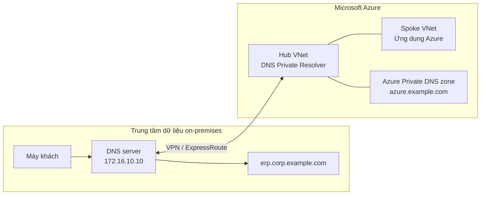
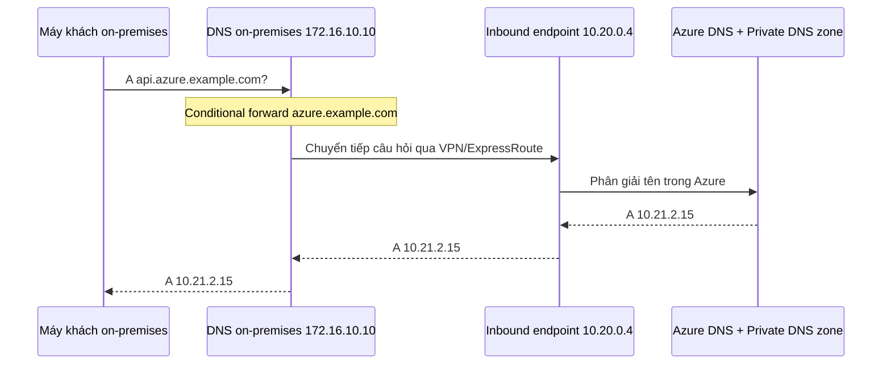
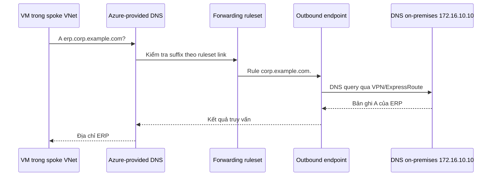
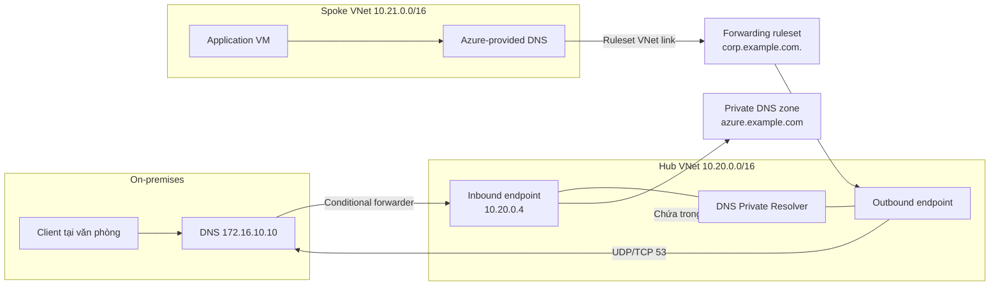

# Azure DNS Private Resolver cho môi trường hybrid

Một ứng dụng triển khai trên Microsoft Azure thường phải trao đổi dữ liệu với những hệ thống vẫn nằm trong trung tâm dữ liệu của doanh nghiệp. Máy ảo ở Azure cần tìm máy chủ Active Directory, API hoặc cơ sở dữ liệu tại on-premises; ngược lại, nhân viên tại văn phòng cần truy cập một dịch vụ Azure thông qua **Private Endpoint** mà không sử dụng địa chỉ IP công khai. Kết nối VPN hoặc ExpressRoute giải quyết đường đi của gói tin, nhưng ứng dụng chỉ hoạt động ổn định khi **tên DNS được phân giải đúng ở cả hai phía**.

**Azure DNS Private Resolver** là dịch vụ phân giải và chuyển tiếp truy vấn DNS do Azure quản lý. Dịch vụ giúp kết nối hệ thống DNS tại chỗ với cơ chế DNS riêng trong Azure mà không bắt buộc phải duy trì một cụm máy ảo DNS forwarder. Bài học thuộc chương **Mạng ảo và phân giải tên**, tập trung vào thiết kế hybrid với virtual network, Azure Private DNS zone, VPN/ExpressRoute, các endpoint của resolver, forwarding ruleset, giám sát và tối ưu vận hành.

## Mục tiêu học tập

Sau bài học, bạn có thể:

1. Mô tả sự khác nhau giữa DNS công khai, Azure-provided DNS, Azure Private DNS và Azure DNS Private Resolver.
2. Giải thích vai trò của **inbound endpoint**, **outbound endpoint**, **DNS forwarding ruleset** và **virtual network link**.
3. Thiết kế luồng phân giải tên hai chiều giữa on-premises và Azure.
4. Liên kết Azure Private DNS zone với virtual network để phân giải tài nguyên dùng Private Endpoint.
5. Kiểm tra những điều kiện về subnet, định tuyến, UDP/TCP 53, DNS suffix và DNS server của máy khách.
6. Chẩn đoán lỗi phân giải tên, phát hiện vòng lặp chuyển tiếp và đánh giá chi phí, tính sẵn sàng của giải pháp.

## 1. Bài toán DNS trong kiến trúc hybrid

Xét một tổ chức có hai môi trường:

- **On-premises**: mạng `172.16.0.0/16`, DNS server `172.16.10.10`, có bản ghi `dc01.corp.example.com` và `erp.corp.example.com`.
- **Azure**: hub VNet `10.20.0.0/16`, spoke VNet `10.21.0.0/16`, ứng dụng trong Azure dùng tên `api.azure.example.com`, dữ liệu có thể nằm sau một Azure Private Endpoint.

Yêu cầu là máy chủ trong spoke VNet truy vấn được `erp.corp.example.com`, còn thiết bị tại văn phòng truy vấn được `api.azure.example.com` và nhận IP riêng. Nếu cấu hình DNS riêng biệt ở hai phía, máy Azure thường không biết zone nội bộ của on-premises và DNS server on-premises không biết những private DNS zone liên kết với VNet trong Azure.



Điểm cần phân biệt là **đường truyền IP** và **phân giải tên DNS** là hai phần của bài toán. VPN/ExpressRoute có thể cho phép ping hoặc kết nối TCP đến một IP riêng, nhưng DNS vẫn có thể trả `NXDOMAIN`, trả địa chỉ public không mong muốn hoặc hết thời gian chờ.

## 2. Azure-provided DNS, Private DNS zone và Private Resolver

Các dịch vụ sau liên quan đến DNS nhưng thực hiện nhiệm vụ khác nhau:

| Thành phần | Vai trò | Điều cần hiểu |
|---|---|---|
| **Azure DNS (public)** | Lưu trữ bản ghi của các public DNS zone. | Phục vụ truy vấn tên miền công khai theo cơ chế DNS thông thường. |
| **Azure-provided DNS** | Dịch vụ phân giải DNS sẵn có cho các VM sử dụng cấu hình DNS mặc định của VNet. | Địa chỉ nền tảng quen thuộc là `168.63.129.16` trong Azure; không phải DNS server on-premises có thể gọi trực tiếp qua Internet. |
| **Azure Private DNS zone** | Lưu bản ghi DNS riêng và phân giải trong những VNet được liên kết thích hợp. | Zone không tự biến thành một DNS server để hệ thống on-premises truy vấn trực tiếp. |
| **Azure DNS Private Resolver** | Nhận và chuyển tiếp truy vấn DNS giữa các mạng theo thiết kế. | Giúp kết hợp DNS riêng trên Azure với DNS server tại chỗ qua kết nối mạng riêng. |
| **Custom DNS server trên VM** | Máy chủ DNS do doanh nghiệp tự cài và quản lý. | Linh hoạt nhưng cần tự chịu trách nhiệm về hệ điều hành, cập nhật, backup, HA và vận hành. |

**Private Resolver không phải nơi tạo bản ghi của một private zone.** Bản ghi của `api.azure.example.com` nằm trong Azure Private DNS zone hoặc hệ thống authoritative DNS tương ứng. Resolver nhận truy vấn và làm việc với hạ tầng phân giải của Azure hoặc chuyển tiếp tới DNS server khác theo quy tắc.

Khi VNet sử dụng Azure-provided DNS, các máy ảo trong VNet có thể dùng cơ chế phân giải DNS tích hợp. Một private DNS zone muốn được nhìn thấy từ VNet cần có **virtual network link** tới VNet đó, trực tiếp hoặc theo thiết kế cho luồng truy vấn. Không nên suy luận rằng VNet peering tự động làm các private DNS zone của VNet khác trở nên phân giải được.

## 3. Các thành phần của Azure DNS Private Resolver

Một kiến trúc Private Resolver thường có các đối tượng sau.

### 3.1. DNS Private Resolver resource

Đây là tài nguyên quản lý ở phạm vi một Azure region, liên kết với một virtual network. Bạn tạo một resolver trong VNet phù hợp, thường là **hub VNet** của mô hình hub-and-spoke. Resolver có thể cung cấp một hoặc nhiều endpoint theo cấu hình và giới hạn của dịch vụ.

VNet chứa resolver cần có kết nối và định tuyến phù hợp tới các hệ thống DNS khác. Khi triển khai nhiều region, phải thiết kế riêng mối liên hệ giữa các resolver, VNet, zone link và mạng doanh nghiệp ở từng region; không mặc định rằng một resolver tại region A sẽ tự phục vụ region B trong mọi tình huống.

### 3.2. Inbound endpoint: nhận truy vấn từ bên ngoài VNet

**Inbound endpoint** nhận DNS query tại một **IP riêng** được cấp từ subnet dành riêng cho endpoint. DNS server tại on-premises hoặc một mạng được định tuyến tới IP này có thể gửi truy vấn vào Azure qua UDP/TCP cổng 53.

Ví dụ: DNS server ở văn phòng chuyển tiếp câu hỏi `api.azure.example.com` tới inbound endpoint `10.20.0.4`; resolver dùng khả năng phân giải của Azure, bao gồm các Azure Private DNS zone được liên kết với VNet thích hợp, để trả kết quả.

Inbound endpoint không tự chứa bản ghi DNS. Nếu tên chưa có bản ghi trong zone được truy cập, zone chưa được liên kết đúng hoặc cấu hình DNS bị sai, truy vấn có thể không trả về IP riêng như kỳ vọng.

### 3.3. Outbound endpoint: chuyển truy vấn tới DNS server đích

**Outbound endpoint** là điểm xuất phát cho các truy vấn DNS mà Azure cần chuyển tiếp ra các DNS server được chỉ định, chẳng hạn `172.16.10.10` trên mạng on-premises. Endpoint này thuộc một subnet chuyên dụng riêng với inbound endpoint.

Outbound endpoint không tự động nhận tất cả truy vấn của mọi VM. Cần một **DNS forwarding ruleset** tham chiếu outbound endpoint và có những **virtual network link** phù hợp để máy khách trong các VNet đó sử dụng quy tắc chuyển tiếp.

### 3.4. DNS forwarding ruleset và forwarding rule

**DNS forwarding ruleset** chứa các forwarding rule. Mỗi rule có một **domain suffix** và một hoặc nhiều **target DNS server** kèm IP, port. Khi một truy vấn thỏa điều kiện, hệ thống sẽ chuyển tiếp truy vấn theo rule tương ứng qua outbound endpoint đã gắn vào ruleset.

Ví dụ:

| Thành phần | Giá trị minh họa | Mục đích |
|---|---|---|
| Domain suffix | `corp.example.com.` | Các tên thuộc miền nội bộ của doanh nghiệp |
| Target DNS server | `172.16.10.10:53` | DNS server on-premises |
| Outbound endpoint | `outbound-hub` | Đường chuyển tiếp truy vấn tới target |
| Ruleset link | `vnet-spoke-app` | Áp dụng rule cho client trong spoke VNet |

Một số giao diện yêu cầu domain suffix ở dạng tên đầy đủ có dấu chấm cuối, ví dụ `corp.example.com.`. Cần kiểm tra cú pháp khi tạo rule; rule `corp.example.com.` có thể khớp những tên con như `erp.corp.example.com` nhưng không có nghĩa là khớp mọi tên miền Internet.

Lưu ý: **virtual network link của DNS forwarding ruleset** và **virtual network link của Azure Private DNS zone** là hai loại liên kết khác nhau. Ruleset link quyết định VNet nào áp dụng quy tắc chuyển tiếp. Private DNS zone link quyết định VNet nào có thể phân giải những bản ghi trong zone qua cơ chế của Azure.

## 4. Thiết kế luồng phân giải hai chiều

Hai hướng phân giải tên trong môi trường hybrid có thể được thiết kế độc lập, sau đó kết hợp trong cùng kiến trúc.

### 4.1. Từ on-premises tới tài nguyên Azure

Giả sử ứng dụng Azure có bản ghi trong private zone `azure.example.com`:

```text
Private DNS zone: azure.example.com
Record:           api.azure.example.com
Type:             A
Value:            10.21.2.15
```

Để máy văn phòng tìm được địa chỉ này:

1. Tạo private DNS zone và bản ghi cần thiết.
2. Liên kết private DNS zone với VNet chứa inbound endpoint của resolver.
3. Tạo inbound endpoint, ví dụ IP `10.20.0.4`.
4. Bảo đảm DNS server on-premises có đường mạng tới IP đó qua VPN hoặc ExpressRoute và cổng DNS được phép.
5. Cấu hình **conditional forwarder** trên DNS server on-premises: các truy vấn cho `azure.example.com` được chuyển tới `10.20.0.4`.
6. Từ máy văn phòng, truy vấn `api.azure.example.com` qua DNS server thông thường của máy và xác nhận kết quả là `10.21.2.15`.



Trả được bản ghi IP chỉ xác nhận **DNS hoạt động**. Muốn kết nối tới API còn phải có route, NSG/firewall cho cổng ứng dụng, xác thực và các chính sách bảo mật khác. Nếu DNS trả đúng `10.21.2.15` nhưng HTTPS tới đó thất bại, hãy kiểm tra đường mạng và backend thay vì tiếp tục sửa forwarding rule.

### 4.2. Từ Azure tới hệ thống on-premises

Giả sử VM trong `vnet-spoke-app` cần gọi `erp.corp.example.com`, bản ghi nằm trên DNS server on-premises `172.16.10.10`:

1. Tạo outbound endpoint trong hub VNet.
2. Tạo DNS forwarding ruleset, liên kết ruleset với outbound endpoint.
3. Thêm rule cho suffix `corp.example.com.` với target `172.16.10.10`, port 53.
4. Liên kết ruleset với spoke VNet cần sử dụng, ví dụ `vnet-spoke-app`.
5. Bảo đảm mạng từ outbound endpoint có thể tới DNS on-premises qua VPN/ExpressRoute và cho phép DNS query/response.
6. Từ VM sử dụng Azure-provided DNS trong spoke, truy vấn `erp.corp.example.com` rồi xác minh IP nhận được và khả năng kết nối dịch vụ.



**Điều kiện quan trọng:** VM phải thực sự sử dụng luồng DNS chịu sự điều khiển của ruleset. Nếu VNet hoặc hệ điều hành dùng **custom DNS server** thay cho Azure-provided DNS, chỉ liên kết ruleset với VNet thường chưa đủ; custom DNS server phải được cấu hình chuyển tiếp tương ứng hoặc thay đổi cách phân giải tên theo kiến trúc mong muốn. Hãy kiểm tra DNS server thực tế của máy thay vì chỉ nhìn VNet link trong Portal.

### 4.3. Kết hợp hai hướng trong mô hình hub-and-spoke

Một thiết kế tham khảo:



Sơ đồ mô tả đường đi logic của DNS. Trong triển khai thật, **private DNS zone link** phải trỏ tới VNet thích hợp và **ruleset link** phải trỏ tới VNet phát sinh truy vấn. VNet peering chỉ thiết lập khả năng kết nối theo cấu hình, không thay thế hai loại DNS link này.

## 5. Chuẩn bị mạng và subnet trước khi triển khai

DNS Private Resolver là dịch vụ được Azure quản lý nhưng endpoint vẫn gắn với subnet trong VNet. Cần chuẩn bị hạ tầng mạng trước khi tạo tài nguyên:

| Điều kiện | Vì sao cần? |
|---|---|
| Region và subscription phù hợp | Resolver, endpoint và tài nguyên liên quan phải nằm trong phạm vi dịch vụ hỗ trợ. |
| Hub VNet có không gian IP đủ | Để dành subnet riêng và kết nối với spoke/on-premises. |
| Subnet chuyên dụng cho inbound | Chứa IP riêng để nhận DNS query từ mạng khác. |
| Subnet chuyên dụng cho outbound | Làm điểm xuất phát cho DNS query tới target DNS server. |
| Delegation của subnet theo yêu cầu dịch vụ | Cho Azure quản lý endpoint trong subnet được cấp riêng. |
| VPN hoặc ExpressRoute hoạt động | Bảo đảm kết nối hai chiều giữa IP của endpoint và on-premises DNS. |
| Quy tắc mạng cho UDP và TCP 53 | DNS thường dùng UDP, nhưng TCP cần thiết cho một số truy vấn/response và trường hợp fallback. |
| Vai trò Azure RBAC phù hợp | Người triển khai cần quyền tạo resolver, endpoint, ruleset và network links. |

Subnet inbound và outbound phải được dành riêng theo yêu cầu dịch vụ, không dùng chung cho VM hoặc Private Endpoint và không dùng cùng một subnet cho hai kiểu endpoint. Hãy kiểm tra yêu cầu **subnet size** và **delegation** hiện hành của Azure DNS Private Resolver trong region trước khi cấp địa chỉ. Nên giữ một kế hoạch địa chỉ rõ ràng để tránh chồng lấn CIDR với các mạng on-premises.

Với hệ thống kết nối qua network virtual appliance hoặc firewall trung gian, cần kiểm tra **route table, NSG, firewall policy và đường trả về**. Có thể phân giải đúng chỉ khi truy vấn đi được từ DNS client tới server và phản hồi quay về qua tuyến hợp lệ.

Vì inbound endpoint có địa chỉ IP riêng, DNS server ở văn phòng phải gửi gói tin tới **IP của inbound endpoint**, không gửi trực tiếp tới `168.63.129.16`. Địa chỉ Azure-provided DNS là địa chỉ nền tảng được sử dụng trong Azure, không phải một máy chủ DNS ở bên ngoài có thể truy cập tùy ý qua VPN.

## 6. Triển khai theo từng bước trong Azure Portal

Ví dụ triển khai dùng các tên và địa chỉ minh họa; hãy thay bằng thiết kế mạng thực tế.

| Tài nguyên | Giá trị ví dụ |
|---|---|
| Resource group | `rg-hybrid-dns` |
| Region | Một region hỗ trợ Azure DNS Private Resolver |
| Resolver VNet | `vnet-hub`, `10.20.0.0/16` |
| Inbound subnet | `snet-dns-inbound`, không gian IP riêng trong hub |
| Outbound subnet | `snet-dns-outbound`, không gian IP riêng khác |
| Resolver | `dnspr-hub` |
| Inbound endpoint | `inbound-hub`, IP ví dụ `10.20.0.4` |
| Outbound endpoint | `outbound-hub` |
| Forwarding ruleset | `ruleset-to-onprem` |
| Rule | `corp.example.com.` → `172.16.10.10:53` |
| Ruleset link | `vnet-spoke-app` |
| Private DNS zone | `azure.example.com` |

### Bước 1. Tạo hub VNet và các subnet chuyên dụng

Trong Azure Portal, chuẩn bị hub VNet có kết nối VPN/ExpressRoute tới trung tâm dữ liệu. Tạo hai subnet khác nhau, một cho inbound và một cho outbound. Áp dụng subnet delegation đúng loại `Microsoft.Network/dnsResolvers` theo yêu cầu cấu hình endpoint. Không triển khai workload thông thường vào những subnet này.

### Bước 2. Tạo Azure DNS Private Resolver

Tìm **DNS Private Resolver** trong Azure Portal, tạo resolver `dnspr-hub`, chọn subscription, resource group, region và `vnet-hub`. Cấu hình **inbound endpoint** trỏ tới subnet inbound. Ghi lại private IP thực tế của inbound endpoint; nếu cần địa chỉ ổn định cho conditional forwarder, sử dụng phương án cấp phát IP phù hợp với khả năng của dịch vụ.

Thêm **outbound endpoint** trỏ tới subnet outbound. Việc có outbound endpoint là điều kiện để sử dụng forwarding ruleset chuyển truy vấn tới DNS server đích; tạo endpoint chưa tự sinh forwarding rule.

### Bước 3. Liên kết Azure Private DNS zone cho hướng inbound

Tạo hoặc chọn private DNS zone `azure.example.com`. Thêm bản ghi `A` cho `api` trỏ tới IP riêng `10.21.2.15`, rồi tạo **virtual network link** tới `vnet-hub`, nơi có inbound endpoint. Kiểm tra trạng thái liên kết trước khi thử truy vấn từ on-premises.

Nếu tên thuộc hệ thống **Private Endpoint**, hãy sử dụng private DNS zone đúng loại dịch vụ (chẳng hạn `privatelink.blob.core.windows.net` cho một kịch bản Blob Storage phù hợp) và quản lý bản ghi thông qua **Private DNS zone group** nếu dùng cơ chế tích hợp. Không dùng một tên zone tùy ý để thay thế zone mà dịch vụ Private Link mong đợi.

### Bước 4. Cấu hình DNS forwarding ruleset cho hướng outbound

Tạo ruleset `ruleset-to-onprem`, tham chiếu outbound endpoint `outbound-hub`. Tạo forwarding rule có domain suffix `corp.example.com.` và target `172.16.10.10`, port 53. Liên kết ruleset với `vnet-spoke-app` là nơi chứa client cần truy vấn tên on-premises.

Khi có nhiều DNS server on-premises, có thể cấu hình các target phù hợp với chính sách vận hành và giới hạn của dịch vụ. Không giả định thứ tự target luôn tương đương failover ứng dụng; hãy thử cả trường hợp một DNS server không phản hồi.

### Bước 5. Cấu hình conditional forwarding ở DNS on-premises

Trên DNS server nội bộ, tạo conditional forwarder cho suffix của các zone Azure cần phân giải, ví dụ `azure.example.com`, tới private IP `10.20.0.4`. Cách cấu hình cụ thể phụ thuộc hệ thống đang dùng: Windows Server DNS, BIND, Infoblox hoặc giải pháp DNS khác.

Với Windows Server DNS, thao tác logic là: mở **DNS Manager**, đến **Conditional Forwarders**, tạo forwarder cho `azure.example.com` rồi thêm `10.20.0.4` làm master server. Trước khi chọn tính năng đồng bộ cấu hình qua Active Directory, xem xét phạm vi các DNS server nhận được forwarder và khả năng định tuyến từ những vị trí đó tới Azure.

### Bước 6. Kiểm thử cả hai chiều

Kiểm tra từ một máy văn phòng và một VM trong spoke VNet. Tên phải phân giải được qua **DNS server mặc định của từng máy**, thay vì chỉ thành công khi chỉ định thủ công một DNS server khác. Sau đó kiểm tra kết nối thực tế tới IP được phân giải.

## 7. Private Endpoint và cách xử lý chuỗi CNAME

Trong một kịch bản Azure Storage dùng Private Endpoint, ứng dụng thường truy vấn tên dịch vụ thông thường, ví dụ:

```text
storage-demo.blob.core.windows.net
```

Cơ chế DNS của Private Link có thể sử dụng một bước **CNAME** trỏ tới tên ở vùng `privatelink.blob.core.windows.net`, sau đó phân giải thành **private IP** nếu private zone được cấu hình và liên kết đúng. Vì vậy, chỉ nhìn bản ghi trong private zone chưa đủ; cần kiểm tra toàn bộ chuỗi truy vấn mà client thực hiện.

```text
Client query: storage-demo.blob.core.windows.net
             |
             v
        CNAME tới tên Private Link (tùy dịch vụ)
             |
             v
        A record từ Azure Private DNS zone
             |
             v
        Private Endpoint IP, ví dụ 10.21.3.8
```

Với máy on-premises, conditional forwarder cần bao phủ **tên mà ứng dụng thực sự truy vấn**, bao gồm chuỗi CNAME khi cần. Trong nhiều kịch bản Private Endpoint, tài liệu thiết kế DNS yêu cầu chuyển tiếp **public service suffix** như `blob.core.windows.net` tới resolver inbound, để Azure thực hiện phân giải thích hợp tới private zone. Chỉ forward `privatelink.blob.core.windows.net` có thể chưa đủ nếu on-premises DNS không đưa các bước trong chuỗi CNAME đến đúng nơi phân giải.

Khi thiết kế, hãy kiểm tra khuyến nghị DNS của từng loại Private Endpoint thay vì sử dụng chung một forwarding rule cho mọi dịch vụ. Đồng thời nhớ rằng **Private Endpoint kiểm soát đường truy cập mạng**, còn Azure RBAC, identity và quyền dữ liệu vẫn quyết định client được phép làm gì sau khi kết nối.

## 8. Kiểm tra cấu hình bằng Azure CLI và công cụ DNS

Các lệnh sau chủ yếu dùng để **đọc và kiểm tra**, không tạo hoặc thay đổi tài nguyên. Thay placeholder bằng giá trị của môi trường thực hành.

### 8.1. Xem DNS Private Resolver trong subscription

```bash
az login
az account set --subscription "<subscription-id>"

az resource list \
  --resource-type "Microsoft.Network/dnsResolvers" \
  --query "[].{name:name,resourceGroup:resourceGroup,location:location,id:id}" \
  --output table
```

Lệnh này giúp tìm resource của Private Resolver và phạm vi triển khai. Khi kiểm tra các endpoint hoặc forwarding ruleset, có thể dùng Azure Portal hoặc tài nguyên tương ứng trong Azure Resource Manager. Cần chọn đúng subscription và region trước khi kết luận một resolver không tồn tại.

### 8.2. Xác minh subnet được dành riêng và có delegation

```bash
az network vnet subnet show \
  --resource-group "rg-hybrid-dns" \
  --vnet-name "vnet-hub" \
  --name "snet-dns-inbound" \
  --query "{addressPrefix:addressPrefix,delegations:delegations[].serviceName}" \
  --output json
```

Làm tương tự cho `snet-dns-outbound`. Đối chiếu CIDR, delegation và việc subnet có tài nguyên khác đang sử dụng hay không. Nếu subnet chưa đáp ứng yêu cầu của dịch vụ, sửa subnet trước khi triển khai endpoint.

### 8.3. Kiểm tra private DNS zone và VNet link

```bash
az network private-dns link vnet list \
  --resource-group "rg-hybrid-dns" \
  --zone-name "azure.example.com" \
  --output table

az network private-dns record-set a list \
  --resource-group "rg-hybrid-dns" \
  --zone-name "azure.example.com" \
  --output table
```

Kiểm tra zone có link tới `vnet-hub`, bản ghi có đúng tên và IP hay không. Nếu tên được tự động tạo bởi Private DNS zone group của Private Endpoint, nên kiểm tra cấu hình zone group và bản ghi do dịch vụ quản lý.

### 8.4. Gửi truy vấn DNS từ on-premises

Với Windows:

```powershell
# Kiểm tra trực tiếp inbound endpoint để cô lập vấn đề
Resolve-DnsName -Name "api.azure.example.com" -Type A -Server "10.20.0.4"

# Kiểm tra DNS server on-premises cùng conditional forwarder
Resolve-DnsName -Name "api.azure.example.com" -Type A -Server "172.16.10.10"
```

Với Linux/macOS có `dig`:

```bash
dig @10.20.0.4 api.azure.example.com A
dig @172.16.10.10 api.azure.example.com A
```

Nếu truy vấn tới inbound IP thành công nhưng truy vấn qua DNS on-premises thất bại, khả năng cao vấn đề nằm ở conditional forwarder, rule ưu tiên, firewall hoặc cache phía DNS on-premises. Nếu cả hai đều thất bại, kiểm tra đường mạng, inbound endpoint, private zone link và bản ghi.

### 8.5. Gửi truy vấn từ VM trong Azure

Trên VM trong `vnet-spoke-app`, kiểm tra DNS server thực tế rồi thử:

```powershell
ipconfig /all
Resolve-DnsName -Name "erp.corp.example.com" -Type A
```

Hoặc với Linux:

```bash
cat /etc/resolv.conf
dig erp.corp.example.com A
```

Máy có thể sử dụng DNS stub resolver hoặc cơ chế DNS của hệ điều hành nên tệp `resolv.conf` không luôn thể hiện DNS upstream cuối cùng. Khi cần, xem thêm trạng thái DNS của NetworkManager hoặc systemd-resolved. Kiểm tra VM/VNet có dùng Azure-provided DNS hay custom DNS và link ruleset đã áp dụng đúng VNet.

### 8.6. DNS thành công chưa có nghĩa dịch vụ kết nối được

Sau khi nhận IP, kiểm tra dịch vụ qua giao thức cần thiết:

```powershell
Test-NetConnection -ComputerName "erp.corp.example.com" -Port 443
```

Nếu DNS trả đúng IP nhưng TCP 443 thất bại, hãy kiểm tra route, VPN/ExpressRoute, NSG, firewall, service listener và chứng chỉ TLS. Nếu DNS timeout, kiểm tra UDP/TCP 53 và đường đến các DNS server trước khi điều tra cổng ứng dụng.

## 9. Quy trình chẩn đoán lỗi thường gặp

Khi DNS không hoạt động, cách nhanh nhất là tìm **bước đầu tiên trong chuỗi truy vấn trả kết quả không đúng**.

| Triệu chứng | Nguyên nhân có thể | Hướng kiểm tra |
|---|---|---|
| On-premises không phân giải được tên trong Azure | Chưa có conditional forwarder, sai inbound IP, không có route hoặc zone chưa link hub | Thử trực tiếp inbound IP, xem conditional forwarder, kiểm tra VNet link và UDP/TCP 53 |
| Azure VM không phân giải được tên on-premises | Ruleset chưa link spoke, sai suffix, outbound target không tới được, VM dùng custom DNS | Xem DNS server trên VM, ruleset link, forwarding rule, route tới target DNS |
| DNS trả IP public thay vì private | Private DNS zone hoặc CNAME chain chưa khớp, zone link sai, query đi qua resolver khác | Kiểm tra tên client hỏi, CNAME, bản ghi private zone và nơi thực hiện từng bước phân giải |
| Truy vấn chậm hoặc lúc được lúc không | Một target DNS server lỗi, packet loss, DNS timeout, cache không đồng nhất | Kiểm tra từng target, mạng VPN/ExpressRoute, log DNS server, TTL và các lần retry |
| `NXDOMAIN` dù bản ghi vừa tạo | Sai zone, sai record hoặc negative caching | Xem authoritative record, thử query trực tiếp, chờ TTL cache hoặc xóa cache trong phạm vi kiểm soát |
| Truy vấn lặp lại hoặc timeout kéo dài | Vòng lặp forwarding, ví dụ hai phía cùng chuyển suffix về nhau | Vẽ lại đường chuyển tiếp từng suffix; bảo đảm có nguồn trả lời authoritative hoặc endpoint phân giải cuối cùng |
| DNS đúng nhưng không truy cập ứng dụng | Firewall, NSG, route, TLS, ứng dụng hoặc quyền truy cập | Kiểm tra kết nối IP/port, xác thực và logs của ứng dụng |

### 9.1. Tránh forwarding loop

Một lỗi khó phát hiện là chuyển tiếp vòng tròn: DNS on-premises forward `corp.example.com` tới inbound endpoint, trong khi Azure lại có outbound rule chuyển chính suffix đó ngược về DNS on-premises. Truy vấn không gặp server có câu trả lời cuối cùng, dẫn tới timeout hoặc lỗi.

Để tránh vòng lặp:

- Phân định rõ zone nào được quản lý bởi DNS on-premises và zone nào do Azure Private DNS quản lý.
- Chỉ định forwarding rule theo suffix cần thiết, không sử dụng rule tổng quát nếu chưa phân tích tác động.
- Tránh liên kết một forwarding ruleset khiến truy vấn từ inbound endpoint bị trả ngược chính nó, đặc biệt khi hub VNet cũng chứa outbound endpoint.
- Kiểm tra cả luồng của truy vấn con và chuỗi CNAME, không chỉ truy vấn tên đầu tiên.

### 9.2. Cache và TTL

DNS cache giúp giảm độ trễ nhưng làm thay đổi cấu hình không xuất hiện tức thì. Sau khi đổi A record hoặc conditional forwarder, một client có thể vẫn giữ kết quả cũ cho đến khi hết TTL; câu trả lời phủ định cũng có thể được cache. Khi điều tra, ghi lại thời gian truy vấn, DNS server đã trả lời và TTL của bản ghi. Chỉ xóa cache khi có lý do kiểm thử rõ ràng, tránh biến việc xóa cache thành giải pháp thay cho sửa rule sai.

## 10. Bảo mật, tính sẵn sàng và vận hành

### 10.1. Giới hạn nơi được phép gửi truy vấn DNS

Inbound endpoint là IP riêng phục vụ truy vấn DNS qua mạng có khả năng định tuyến tới nó. DNS thường sử dụng UDP và TCP cổng 53; đây **không mặc nhiên là kênh DNS-over-HTTPS hoặc DNS-over-TLS**. Nếu tổ chức yêu cầu bảo mật mạnh trên đường truyền, cần kết hợp giải pháp đường truyền mạng phù hợp, kiểm soát nơi gửi truy vấn và cơ chế an toàn được các thành phần hỗ trợ.

Nguyên tắc thực hành:

1. Giới hạn truy vấn tới inbound endpoint từ mạng hoặc DNS server được phép, theo khả năng NSG và network policy của thiết kế.
2. Chỉ cho phép outbound endpoint giao tiếp với DNS target đã phê duyệt.
3. Bảo vệ VPN/ExpressRoute, route và firewall; không đưa DNS nội bộ ra Internet công cộng.
4. Phân quyền Azure RBAC tối thiểu cho người tạo/sửa endpoint, forwarding rule và private zone.
5. Không dùng bản ghi DNS để thay thế kiểm soát xác thực hoặc phân quyền của ứng dụng.

### 10.2. HA và xử lý lỗi

Private Resolver là dịch vụ do Azure quản lý, nhưng thiết kế hybrid vẫn phụ thuộc vào **kết nối WAN/VPN/ExpressRoute, DNS server on-premises, private zone link, rule, và ứng dụng**. Cần đánh giá các điểm lỗi đơn:

- Một DNS server on-premises duy nhất có thể khiến mọi rule trỏ tới nó bị ảnh hưởng.
- Mất đường VPN hoặc ExpressRoute có thể khiến cả inbound và outbound query không đi được.
- Một cấu hình sai ở DNS server hoặc ruleset có thể ảnh hưởng nhiều VNet cùng lúc.
- Một resolver chỉ tồn tại trong một region không tự tạo sẵn phương án phục hồi DNS liên region.

Khi yêu cầu phục hồi cao, xem xét nhiều target DNS server, kết nối mạng dự phòng, thiết kế DNS ở region dự phòng và quy trình thay đổi conditional forwarder khi failover. Khả năng nhiều endpoint, vùng sẵn sàng và SLA cần được kiểm tra theo region và phiên bản dịch vụ đang sử dụng; đừng tự giả định cấu hình hub một region bảo vệ được sự cố toàn region.

### 10.3. Monitoring và kiểm toán

Theo dõi sức khỏe DNS bằng các phép thử định kỳ từ đúng nguồn khách hàng: máy on-premises hỏi tên Azure, VM trong spoke hỏi tên on-premises. Ghi nhận kết quả DNS, thời gian phản hồi, địa chỉ trả về và thử kết nối ứng dụng sau khi phân giải.

Kết hợp log từ DNS server on-premises, metrics/diagnostic settings được DNS Private Resolver và các tài nguyên mạng hỗ trợ, Azure Monitor và tín hiệu trạng thái VPN/ExpressRoute. Khả năng log trực tiếp từng DNS query phụ thuộc tính năng hiện có của dịch vụ; cần kiểm tra khả năng quan sát thực tế thay vì giả định mọi query tự động có trong Azure Activity Log. **Activity Log chủ yếu ghi thay đổi management plane**, không phải log nội dung mọi truy vấn DNS.

### 10.4. Kiểm soát chi phí

Khi tính chi phí, cần xem mô hình tính phí hiện hành của Azure DNS Private Resolver đối với inbound/outbound endpoint, DNS forwarding ruleset và các thành phần liên quan trong region. Cộng thêm chi phí VPN/ExpressRoute, private network, monitoring và DNS server on-premises còn phải vận hành. Không tạo endpoint ở nhiều môi trường hoặc region theo mặc định nếu chưa đánh giá nhu cầu, vì tài nguyên có thể phát sinh chi phí ngay cả khi số truy vấn thấp.

Lập kế hoạch tagging, tài nguyên dùng chung ở hub, phân vùng trách nhiệm quản trị và kiểm tra chi phí định kỳ. Cần cân đối giữa dùng chung resolver để giảm công vận hành với nguy cơ tăng blast radius khi sửa một ruleset phục vụ quá nhiều workload.

## 11. So sánh với DNS forwarder chạy trên máy ảo

| Tiêu chí | Azure DNS Private Resolver | DNS forwarder trên VM |
|---|---|---|
| Vận hành hệ điều hành | Azure quản lý lớp dịch vụ | Đội ngũ tự quản lý OS, patch, bảo mật, backup |
| Phân giải Private DNS zone | Tích hợp với cơ chế DNS của Azure qua cấu hình VNet/zone | Phải tự cấu hình forwarder tới DNS của Azure và mạng phù hợp |
| Chuyển tiếp DNS hybrid | Inbound/outbound endpoint và forwarding ruleset | Tùy cấu hình BIND, Windows DNS, Infoblox hoặc phần mềm khác |
| Tùy biến ứng dụng DNS | Theo tính năng do dịch vụ cung cấp | Có thể cài plugin, policy hoặc phần mềm đặc thù nếu được hỗ trợ |
| Tính sẵn sàng | Dịch vụ managed; vẫn cần thiết kế WAN và DNS phụ thuộc | Phải tự thiết kế nhiều VM, cân bằng tải và failover |
| Chi phí | Phí dịch vụ/endpoint/ruleset theo bảng giá | VM, disk, license, network, monitoring và công vận hành |

Nếu yêu cầu chỉ là chuyển tiếp DNS hai chiều giữa Azure và on-premises, Private Resolver thường giúp đơn giản hóa vận hành. Nếu tổ chức cần chức năng DNS chuyên biệt mà dịch vụ không cung cấp, máy chủ DNS riêng hoặc giải pháp DNS doanh nghiệp có thể vẫn cần thiết. Có thể kết hợp hai giải pháp: Azure Private Resolver chuyển truy vấn tới DNS on-premises đang quản lý các zone đặc thù.

## 12. Bài tập tình huống

Một doanh nghiệp có ứng dụng web trong Azure `vnet-spoke-app` và hệ thống ERP tại chỗ. Đồng thời, ERP on-premises cần gọi API của ứng dụng Azure qua IP riêng. DNS on-premises quản lý `corp.example.com`, còn Azure Private DNS quản lý `azure.example.com`.

**Yêu cầu:**

- `vm-app` trong Azure phải phân giải được `erp.corp.example.com`.
- Máy văn phòng phải phân giải được `api.azure.example.com` thành `10.21.2.15`.
- Không tạo thêm VM chỉ để làm DNS forwarder.
- Cần xác định cách phát hiện sự cố DNS so với sự cố kết nối ứng dụng.

**Phương án đề xuất:** triển khai DNS Private Resolver trong hub; inbound endpoint cho truy vấn từ on-premises; private DNS zone `azure.example.com` liên kết hub; DNS on-premises conditional forward zone Azure về inbound IP; outbound endpoint và forwarding ruleset `corp.example.com.` tới `172.16.10.10:53`, liên kết ruleset với spoke VNet. Cho phép UDP/TCP 53 và định tuyến hai chiều trên kết nối hybrid. Cuối cùng, kiểm thử DNS từ hai nguồn và kết nối tới các dịch vụ sau khi phân giải.

**Câu hỏi tự kiểm tra:**

1. Vì sao chỉ bật VNet peering giữa hub và spoke chưa đủ để mọi VM phân giải Azure Private DNS zone của hub?
2. Điều gì xảy ra nếu VM trong spoke sử dụng custom DNS server nhưng bạn chỉ tạo ruleset link?
3. Tại sao cần thiết lập conditional forwarder trên DNS on-premises dù đã có VPN?
4. Vì sao `api.azure.example.com` trả đúng IP nhưng kết nối HTTPS vẫn có thể thất bại?
5. Nếu cả on-premises và Azure cùng forward `corp.example.com` về phía còn lại, lỗi nào có thể xuất hiện và khắc phục bằng cách nào?

## 13. Checklist triển khai production

- [ ] Đã xác định rõ các zone authoritative và domain suffix cần chuyển tiếp theo từng hướng.
- [ ] Hub VNet, spoke VNet, VPN/ExpressRoute và các route hai chiều hoạt động đúng.
- [ ] Inbound/outbound endpoint nằm trong subnet chuyên dụng, có delegation và kích thước subnet phù hợp.
- [ ] Private DNS zone link tới VNet cần phân giải, đặc biệt VNet chứa inbound endpoint.
- [ ] DNS forwarding ruleset có outbound endpoint, rule, target IP/port và spoke VNet link đúng.
- [ ] DNS on-premises có conditional forwarder trỏ về inbound IP, không có forwarding loop.
- [ ] Firewall/NSG cho phép lưu lượng DNS UDP/TCP 53 cần thiết; không mở rộng quyền truy vấn quá phạm vi thiết kế.
- [ ] VM Azure và máy on-premises dùng đúng DNS server; đã kiểm tra từ client thực tế ở cả hai phía.
- [ ] Chuỗi CNAME/Private Endpoint cho tên dịch vụ được kiểm thử, không chỉ kiểm tra một A record đơn lẻ.
- [ ] Có kế hoạch HA cho DNS server, kết nối hybrid, region dự phòng và xử lý lỗi cấu hình.
- [ ] Có monitoring truy vấn thử, logs phù hợp, tagging và kiểm soát chi phí.
- [ ] Có tài liệu rollback khi thay đổi forwarding rules, zone links hoặc conditional forwarders.

## Kết luận

Azure DNS Private Resolver giúp hệ thống Azure và on-premises trao đổi truy vấn DNS riêng thông qua dịch vụ managed. **Inbound endpoint** nhận truy vấn từ mạng ngoài VNet vào Azure; **outbound endpoint** cùng **DNS forwarding ruleset** chuyển các truy vấn thuộc suffix được chỉ định tới DNS server đích. Muốn giải pháp hoạt động, cần kết hợp đúng **private DNS zone links**, **ruleset VNet links**, định tuyến qua VPN/ExpressRoute và chính sách mạng cho UDP/TCP 53. Đánh giá cả chuỗi phân giải, Private Endpoint, quyền truy cập, HA và giám sát sẽ giúp môi trường hybrid hoạt động ổn định khi triển khai và vận hành ứng dụng trên Microsoft Azure.
