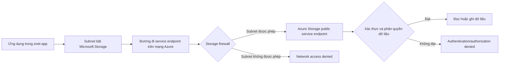
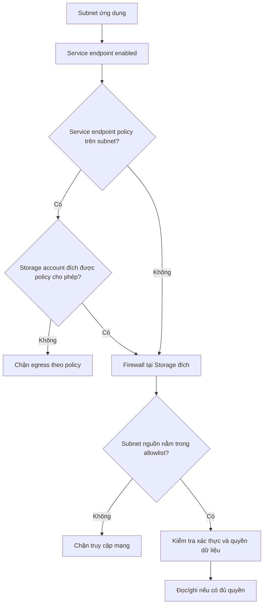

# Service endpoint và giới hạn phạm vi truy cập dịch vụ

Trong Azure, một ứng dụng chạy trên máy ảo hoặc dịch vụ được tích hợp với **Virtual Network (VNet)** thường cần truy cập dịch vụ nền tảng (**PaaS**) như Azure Storage, Azure SQL Database hay Azure Key Vault. Nếu dịch vụ đích cho phép kết nối từ mọi mạng, việc một người có được thông tin xác thực phù hợp hoặc một tài khoản bị lộ có thể khiến dữ liệu bị truy cập từ nơi không mong muốn.

**Virtual Network service endpoint** là một cơ chế kết nối giúp xác định **subnet Azure nào** được phép truy cập một dịch vụ Azure có hỗ trợ cơ chế này. Khi kết hợp service endpoint ở subnet với **virtual network rule** hoặc firewall của tài nguyên đích, nhóm vận hành có thể thu hẹp đường truy cập từ “mọi nguồn trên mạng công cộng” xuống “những subnet đã được phê duyệt”.

Bài học thuộc chương **Mạng ảo và phân giải tên** trong module Microsoft Azure. Nội dung liên hệ đến subscription, resource group, Microsoft Entra ID, Azure RBAC, dịch vụ lưu trữ và dữ liệu, giúp thiết kế một kiến trúc ứng dụng trên Azure có kết nối được kiểm soát, giám sát được và có thể vận hành an toàn.

## Mục tiêu học tập

Sau bài học, bạn có thể:

- Giải thích bản chất, luồng định tuyến và phạm vi bảo vệ của Azure VNet service endpoint.
- Phân biệt **bật service endpoint trên subnet** với **cho phép subnet truy cập tài nguyên đích**.
- Hiểu tác động của service endpoint tới IP nguồn, DNS và khả năng truy cập từ mạng ngoài Azure.
- So sánh service endpoint, **Private Endpoint/Private Link**, IP firewall rule và Network Security Group (NSG).
- Thiết lập minh họa kết nối từ một subnet đến Azure Storage bằng Azure Portal và Azure CLI.
- Hiểu cách giới hạn nguồn truy cập ở tài nguyên đích và giới hạn đích truy cập bằng service endpoint policy khi được hỗ trợ.
- Xác minh quyền mạng và quyền dữ liệu, kiểm thử từ vị trí được phép và không được phép, khắc phục lỗi thường gặp.

## 1. Bài toán: subnet ứng dụng cần truy cập dữ liệu nhưng không mở cho mọi nguồn

Giả sử một ứng dụng quản lý đơn hàng chạy trên máy ảo trong subnet `snet-app` của VNet `vnet-shop`. Ứng dụng lưu tệp hóa đơn vào một Azure Storage account. Yêu cầu của tổ chức:

1. Chỉ workload nằm trong subnet ứng dụng được phép gửi yêu cầu tới Storage account.
2. Danh tính ứng dụng vẫn phải xác thực và được cấp quyền dữ liệu phù hợp.
3. Máy cá nhân, subnet thử nghiệm hoặc workload ngoài mạng được duyệt không thể đọc tệp dù biết địa chỉ Storage account.
4. Nhóm vận hành có thể kiểm tra cấu hình và ghi nhận thay đổi.

Giải pháp service endpoint gồm **hai vế**:

- **Vế nguồn:** bật endpoint `Microsoft.Storage` cho subnet ứng dụng.
- **Vế đích:** cấu hình firewall/network rule của Storage account chỉ cho phép subnet đã chọn, cùng các ngoại lệ thật sự cần thiết.

Nếu chỉ bật endpoint tại subnet nhưng Storage account vẫn cho phép truy cập công cộng từ mọi mạng, mục tiêu giới hạn nguồn chưa đạt. Nếu chỉ thêm rule cho subnet nhưng endpoint chưa được thiết lập phù hợp, kết nối có thể thất bại hoặc không được nhận diện theo subnet.

## 2. Azure service endpoint là gì?

**Service endpoint** là tính năng của Azure Virtual Network mở rộng nhận diện mạng của một subnet tới dịch vụ Azure được hỗ trợ. Khi bật endpoint cho dịch vụ trên subnet:

- Azure thêm đường định tuyến được tối ưu cho lưu lượng tới tiền tố địa chỉ công cộng của dịch vụ đó.
- Lưu lượng đi trong hạ tầng mạng Microsoft Azure theo cơ chế dịch vụ hỗ trợ.
- Dịch vụ đích có thể nhận diện subnet/VNet là nguồn hợp lệ để đánh giá **virtual network rule**.
- Ứng dụng tiếp tục sử dụng **địa chỉ DNS công khai thông thường** của dịch vụ, ví dụ `https://<storage-account>.blob.core.windows.net`.

Service endpoint **không tạo một địa chỉ IP riêng (private IP) cho dịch vụ PaaS** nằm bên trong subnet. Địa chỉ dịch vụ đích vẫn là endpoint công khai của Azure; đây là khác biệt quan trọng với **Private Endpoint**.

### Luồng truy cập minh họa



Sơ đồ tách riêng hai loại kiểm soát: **network access** và **data access**. Network rule cho phép một đường kết nối không đồng nghĩa với việc tự cấp quyền đọc blob.

### Hai điều cần ghi nhớ

**Thứ nhất:** service endpoint được bật trên **subnet**, không phải bật ở toàn bộ VNet chỉ bằng một nút duy nhất. Nếu VNet có ba subnet, bật endpoint tại một subnet không tự động đưa hai subnet còn lại vào danh sách được phép.

**Thứ hai:** service endpoint là cấu hình hỗ trợ **kiểm soát phạm vi mạng**, còn quyền truy cập tài nguyên vẫn phụ thuộc vào firewall, Microsoft Entra ID, Azure RBAC, khóa truy cập hoặc cơ chế xác thực mà dịch vụ đích hỗ trợ.

## 3. Service endpoint hoạt động cùng DNS và định tuyến như thế nào?

### DNS không chuyển thành private DNS

Khi workload truy vấn tên `<storage-account>.blob.core.windows.net`, DNS thông thường vẫn có thể trả về **địa chỉ IP công khai**. Điều đó là đúng với service endpoint. Không nên coi kết quả `nslookup` trả public IP là bằng chứng endpoint hỏng.

Đường định tuyến đến những tiền tố IP dịch vụ được hỗ trợ thay đổi khi endpoint bật trên subnet. Azure sử dụng tuyến dành cho service endpoint đối với lưu lượng phù hợp. Bạn có thể kiểm tra **effective routes** của giao diện mạng máy ảo để hỗ trợ chẩn đoán.

Với **Private Endpoint**, tình hình khác: dịch vụ có **private IP** trong VNet và thông thường cần cấu hình phân giải tên phù hợp (ví dụ private DNS zone) để ứng dụng truy cập private IP đó bằng tên dịch vụ quen thuộc.

### IP nguồn và quy tắc firewall

Khi service endpoint được dùng, dịch vụ Azure nhận diện nguồn theo subnet/VNet đã cấu hình. Vì vậy, cách dựa thuần vào một IP công cộng/NAT để cho phép subnet truy cập có thể không còn phù hợp với đường đi mới.

Hãy sử dụng **virtual network rule** ở dịch vụ đích để chấp thuận subnet, đồng thời đánh giá lại các IP firewall rule đã có khi bật endpoint. Khi thay đổi đường mạng trên hệ thống đang chạy, có thể xảy ra gián đoạn nếu thứ tự thiết lập rule không đúng.

### Mạng ngoài Azure có tự dùng được endpoint không?

Không. Máy tính ở văn phòng hoặc hệ thống on-premises đi qua Internet, VPN hay ExpressRoute **không tự nhiên nhận danh tính subnet** chỉ vì có đường kết nối vào Azure. Nếu cần cung cấp đường truy cập riêng cho khách hàng tại văn phòng hoặc datacenter, nên xem xét **Private Endpoint** với DNS và định tuyến thích hợp, hoặc giải pháp mạng được thiết kế rõ ràng khác.

Không nên dùng service endpoint như một cơ chế thay thế VPN, ExpressRoute, routing và DNS cho mọi tình huống hybrid.

## 4. Phân biệt các lớp kiểm soát mạng

| Cơ chế | Đặt ở đâu? | Giải quyết vấn đề gì? | Giới hạn cần hiểu |
|---|---|---|---|
| **Service endpoint** | Subnet VNet | Định tuyến/nhận diện subnet khi truy cập dịch vụ Azure được hỗ trợ | Không cấp private IP cho dịch vụ; một mình không khóa public access |
| **Virtual network rule** | Firewall/networking của dịch vụ đích | Chỉ cho phép subnet đã được duyệt | Yêu cầu cấu hình tương thích với service endpoint và chế độ public access |
| **IP firewall rule** | Firewall của dịch vụ đích | Cho phép IP nguồn công khai theo phạm vi được hỗ trợ | Không mô tả được đầy đủ danh tính subnet; chịu giới hạn từng dịch vụ |
| **NSG** | Subnet hoặc NIC | Cho phép/từ chối lưu lượng vào/ra theo IP, port, protocol và service tag | Không thay thế authentication hay firewall dịch vụ đích |
| **Service endpoint policy** | Subnet, với dịch vụ được hỗ trợ | Giới hạn **tài nguyên đích** nào có thể truy cập qua service endpoint | Hỗ trợ có phạm vi, chủ yếu cho Azure Storage; không phải firewall egress tổng quát |
| **Private Endpoint** | Giao diện mạng/private IP trong subnet | Truy cập dịch vụ đích qua địa chỉ riêng, với DNS thích hợp | Cần quản lý DNS, kết nối endpoint, NSG/routing và cấu hình dịch vụ |
| **Azure RBAC / data-plane role** | Danh tính và phạm vi tài nguyên | Quyết định thao tác nào được phép sau xác thực | Không tự chặn đường mạng từ các nguồn khác |

Lưu ý: **service endpoint** và **Private Endpoint** đều giúp giảm mức phơi bày dịch vụ nhưng phục vụ các kiến trúc khác nhau. Việc chọn cái nào phụ thuộc yêu cầu về địa chỉ IP riêng, truy cập on-premises, DNS, khả năng hỗ trợ dịch vụ, chi phí và khả năng quản trị.

## 5. Khi nào nên chọn service endpoint?

Service endpoint thường phù hợp khi:

- Workload nằm trong một subnet Azure rõ ràng và cần kết nối đến một dịch vụ Azure có hỗ trợ.
- Đích vẫn có thể sử dụng endpoint công khai của dịch vụ nhưng bị giới hạn bởi firewall theo subnet.
- Không cần cung cấp private IP tới PaaS hoặc truy cập trực tiếp từ on-premises.
- Nhóm quản trị muốn áp dụng quy tắc theo subnet mà không phải xây dựng toàn bộ hệ thống private DNS.

Private Endpoint thường phù hợp hơn khi:

- Yêu cầu dịch vụ chỉ được truy cập qua **private IP** và cần tắt public network access ở dịch vụ đích khi hỗ trợ.
- Hệ thống hybrid/on-premises phải truy cập dịch vụ qua mạng riêng.
- Cần thiết kế kết nối riêng cho từng tài nguyên dịch vụ, với kiểm soát DNS và phân vùng mạng chặt chẽ.
- Kiến trúc yêu cầu mô hình Private Link do sản phẩm và hệ thống liên quan hỗ trợ.

### Ma trận quyết định

| Tiêu chí | Service endpoint | Private Endpoint |
|---|---|---|
| IP đích của PaaS | Public service endpoint | Private IP trong VNet |
| Cần thay DNS ứng dụng | Thông thường không | Thường cần kiểm tra và cấu hình private DNS |
| Phạm vi nhận diện | Subnet nguồn | Kết nối riêng đến tài nguyên PaaS cụ thể |
| Kết nối trực tiếp từ on-premises qua private network | Không phải mục đích chính | Có thể thiết kế qua VPN/ExpressRoute và DNS |
| Tắt public network access của tài nguyên đích | Có thể khiến đường service endpoint không sử dụng được | Thường là lựa chọn để chỉ sử dụng đường riêng, nếu dịch vụ hỗ trợ |
| Cấu hình giới hạn nguồn | Endpoint + firewall/VNet rule | Private endpoint + cấu hình public access, NSG/routing và quyền |
| Chi phí riêng cho kết nối | Thường không có phí riêng cho tính năng endpoint | Có thể có phí Private Link/traffic theo biểu giá hiện hành |

Một storage account đặt `publicNetworkAccess: Disabled` không được mở lại bằng cách chỉ cấu hình service endpoint và virtual network rule. Với nhu cầu chỉ cho phép private network, hãy dùng Private Endpoint hoặc cơ chế hỗ trợ tương ứng.

## 6. Dịch vụ nào hỗ trợ service endpoint?

Azure service endpoint không áp dụng đồng nhất cho mọi dịch vụ. Một số nhóm hỗ trợ thường gặp gồm:

- **Azure Storage:** thường sử dụng tên service `Microsoft.Storage`; có khả năng mở rộng theo phạm vi region trong một số cấu hình.
- **Azure SQL:** sử dụng service `Microsoft.Sql` cho các tình huống hỗ trợ virtual network rule.
- **Azure Key Vault:** có thể sử dụng `Microsoft.KeyVault` khi cấu hình network access thích hợp.
- **Một số dịch vụ dữ liệu và messaging khác:** phụ thuộc sản phẩm, region và loại tài nguyên, cần kiểm tra danh sách hỗ trợ tại thời điểm triển khai.

Khi thiết kế một dịch vụ mới, không được suy đoán tên endpoint từ tên sản phẩm. Hãy kiểm tra tài liệu **Virtual Network service endpoints** và tab Networking của dịch vụ đích.

Một số dịch vụ hỗ trợ cả service endpoint lẫn Private Endpoint, nhưng quy tắc, trường hợp ngoại lệ, phạm vi region và tùy chọn network firewall của mỗi dịch vụ có thể khác nhau.

### Lưu ý về vùng địa lý của Storage

Các cấu hình `Microsoft.Storage` và `Microsoft.Storage.Global` có phạm vi hỗ trợ khác nhau đối với Storage ở các region. Không nên mặc định subnet được phép truy cập bất kỳ Storage account ở bất kỳ region nào chỉ vì đã bật `Microsoft.Storage`. Đặc biệt khi workload và Storage account nằm ở những region khác nhau, hãy kiểm tra hỗ trợ regional/global và quy tắc mạng của từng trường hợp.

Hãy xem các khả năng hiện hành và điều kiện kết hợp của hai lựa chọn trước khi thay đổi subnet. Một số lựa chọn không thể cấu hình song song trên cùng subnet.

## 7. Cấu hình hai phía: subnet nguồn và firewall tài nguyên đích

Để bảo vệ một Storage account bằng service endpoint, luồng thao tác chuẩn gồm:

1. Xác định subscription, VNet, subnet và Storage account chính xác.
2. Xác minh dịch vụ và vùng được hỗ trợ.
3. Kiểm tra trạng thái endpoint, route, NSG và bất kỳ rule hiện có nào trên subnet.
4. Bật `Microsoft.Storage` service endpoint cho subnet được duyệt.
5. Thêm **virtual network rule** trên Storage account trỏ đến subnet đó.
6. Chuyển quy tắc truy cập mạng công khai của Storage account sang chỉ cho phép những mạng/nguồn đã chọn, với ngoại lệ được rà soát.
7. Kiểm thử từ subnet được phép và từ subnet/nguồn không được phép.
8. Kiểm tra cả xác thực và quyền dữ liệu, ghi nhận kết quả và cấu hình để giám sát sau này.

**Trình tự quan trọng:** trước khi áp lệnh Deny mặc định ở tài nguyên đích, hãy xác nhận subnet hợp lệ đã được đưa vào allow list và có đường truy cập khẩn cấp theo quy trình vận hành. Nếu thay đổi trên workload đang sử dụng, nên thử nghiệm trong môi trường riêng để tránh khóa nhầm ứng dụng.

### Cấu hình qua Azure Portal

Giả sử có:

- Subscription thí nghiệm được phê duyệt.
- VNet `vnet-shop` với subnet `snet-app`.
- Storage account `stshoplabdemo` nằm trong resource group riêng.

**Tại subnet nguồn:**

1. Mở **Azure Portal → Virtual networks** và chọn `vnet-shop`.
2. Mở **Subnets**, chọn `snet-app`.
3. Tìm phần **Service endpoints**.
4. Chọn dịch vụ `Microsoft.Storage`, kiểm tra region/phạm vi nếu giao diện yêu cầu.
5. Lưu cấu hình, đợi cập nhật hoàn tất và kiểm tra lại subnet.

**Tại Storage account đích:**

1. Mở **Storage accounts** và chọn đúng account.
2. Mở **Networking** hoặc mục mạng tương ứng.
3. Chọn chế độ cho phép truy cập từ những virtual network/IP được chọn nếu giao diện hỗ trợ kiểu cấu hình đó.
4. Trong danh sách virtual networks, thêm `vnet-shop/snet-app`.
5. Kiểm tra ngoại lệ như trusted Azure services và IP allowlist đang có; chỉ giữ những ngoại lệ cần thiết.
6. Lưu, xác minh các virtual network rule sau khi cập nhật.
7. Kiểm thử luồng dữ liệu với danh tính ứng dụng phù hợp trước khi công bố hoàn tất.

Các mục trên Portal có thể thay đổi theo phiên bản. Nếu không thể thêm subnet hoặc lưu rule, cần kiểm tra quyền quản trị ở cả tài nguyên mạng lẫn Storage account, khả năng hỗ trợ endpoint và trạng thái mạng đang có.

## 8. Thực hành với Azure CLI: cấu hình và xác minh Storage service endpoint

Ví dụ chạy trong **Bash** của Azure Cloud Shell hoặc môi trường Azure CLI đã đăng nhập. Các lệnh thay đổi cấu hình chỉ nên thực hiện trên tài nguyên dùng để học tập hoặc đã được phê duyệt. Không có lệnh nào dưới đây tự được chạy trong subscription của bạn.

### Bước 1: Xác định ngữ cảnh chính xác

```bash
az account show --output table
az account list --output table
```

Nếu cần, chọn subscription đã được phê duyệt:

```bash
az account set --subscription "<SUBSCRIPTION_ID>"
```

Khai báo biến ví dụ (thay mọi placeholder trước khi chạy):

```bash
SUBSCRIPTION_ID="<SUBSCRIPTION_ID>"
NETWORK_RG="rg-network-lab"
VNET_NAME="vnet-shop"
SUBNET_NAME="snet-app"
STORAGE_RG="rg-data-lab"
STORAGE_NAME="<STORAGE_ACCOUNT_NAME>"

SUBNET_ID="/subscriptions/$SUBSCRIPTION_ID/resourceGroups/$NETWORK_RG/providers/Microsoft.Network/virtualNetworks/$VNET_NAME/subnets/$SUBNET_NAME"
```

Tên Storage account phải tồn tại và hợp lệ; đoạn lệnh này không tạo mới tài nguyên.

### Bước 2: Kiểm tra subnet trước khi thay đổi

```bash
az network vnet subnet show \
  --ids "$SUBNET_ID" \
  --query "{name:name,addressPrefix:addressPrefix,serviceEndpoints:serviceEndpoints[].service}" \
  --output json
```

Kiểm tra danh sách các endpoint đã bật. Khi cập nhật tham số `--service-endpoints`, cần **bảo toàn những endpoint hiện có vẫn cần thiết**; không được thay bằng một danh sách mới khiến kết nối các dịch vụ khác bị gián đoạn.

### Bước 3: Bật service endpoint

Với một subnet thí nghiệm chưa bật service endpoint nào khác:

```bash
az network vnet subnet update \
  --ids "$SUBNET_ID" \
  --service-endpoints Microsoft.Storage
```

Nếu subnet đã có endpoint khác, cần thiết kế lệnh cập nhật giữ lại toàn bộ danh sách cần sử dụng. Không sao chép nguyên lệnh một dịch vụ vào subnet production mà chưa kiểm tra hiện trạng.

Đọc lại:

```bash
az network vnet subnet show \
  --ids "$SUBNET_ID" \
  --query "serviceEndpoints[].{service:service,locations:locations}" \
  --output table
```

Kết quả dự kiến có `Microsoft.Storage` trong danh sách service endpoints.

### Bước 4: Xem firewall của Storage account

```bash
az storage account show \
  --resource-group "$STORAGE_RG" \
  --name "$STORAGE_NAME" \
  --query "{publicNetworkAccess:publicNetworkAccess,defaultAction:networkRuleSet.defaultAction,virtualNetworks:networkRuleSet.virtualNetworkRules}" \
  --output json
```

Xác nhận account đang sử dụng kiểu public network access có hỗ trợ selected networks và VNet rules. Nếu public network access đang **Disabled**, luồng truy cập chỉ dùng service endpoint sẽ không thay thế được Private Endpoint; cần thiết kế lại đường kết nối thay vì mở public access một cách tùy tiện.

### Bước 5: Thêm subnet vào danh sách được phép

```bash
az storage account network-rule add \
  --resource-group "$STORAGE_RG" \
  --account-name "$STORAGE_NAME" \
  --subnet "$SUBNET_ID"
```

Đối chiếu lại:

```bash
az storage account network-rule list \
  --resource-group "$STORAGE_RG" \
  --account-name "$STORAGE_NAME" \
  --output json
```

Đảm bảo `virtualNetworkRules` có subnet đúng resource ID và trạng thái cấu hình phù hợp.

### Bước 6: Giới hạn nguồn truy cập bằng default deny

Sau khi kiểm tra allowlist và có phương án quản trị, đặt mặc định từ chối những mạng không được cho phép:

```bash
az storage account update \
  --resource-group "$STORAGE_RG" \
  --name "$STORAGE_NAME" \
  --default-action Deny
```

Lệnh trên chỉ minh họa bước cuối của cấu hình firewall. Trước khi thực thi thật, phải kiểm tra cả `publicNetworkAccess`, IP rules, resource instance rules và các ngoại lệ `bypass` đang có. Thiết lập `defaultAction: Deny` không đồng nghĩa không còn ngoại lệ.

### Bước 7: Kiểm tra lại kết quả

```bash
az storage account show \
  --resource-group "$STORAGE_RG" \
  --name "$STORAGE_NAME" \
  --query "{name:name,publicNetworkAccess:publicNetworkAccess,defaultAction:networkRuleSet.defaultAction,virtualNetworkRules:networkRuleSet.virtualNetworkRules,bypass:networkRuleSet.bypass}" \
  --output json
```

Kỳ vọng: nguồn subnet hợp lệ xuất hiện trong danh sách được phép, cấu hình mặc định hạn chế truy cập theo thiết kế và không có ngoại lệ không chủ ý.

**Quan trọng:** đừng kiểm thử quyền truy cập dữ liệu từ chính Azure Cloud Shell rồi coi đó là kiểm thử service endpoint. Cloud Shell không tự động nằm trong subnet `snet-app` của VNet do bạn quản lý. Cần chạy bài kiểm thử từ một VM hoặc workload **thực sự nằm trong subnet nguồn**.

## 9. Kiểm thử network access và data access

Một bài thử tốt tách kiểm tra mạng khỏi xác thực/phân quyền:

| Vị trí thử | Cấu hình mạng | Danh tính có quyền dữ liệu? | Kết quả kỳ vọng |
|---|---|---|---|
| VM trong `snet-app` | Có endpoint và subnet được Storage firewall cho phép | Có | Truy cập dữ liệu thành công |
| VM trong `snet-app` | Được phép qua firewall | Không | Bị từ chối ở bước xác thực/phân quyền |
| VM trong subnet khác | Không có subnet allowlist | Có | Bị từ chối ở lớp network, trừ khi có ngoại lệ khác |
| Máy ngoài Azure | Không thuộc mạng được cho phép | Có | Bị từ chối ở lớp network, trừ khi có IP rule hoặc ngoại lệ khác |
| Ứng dụng sau khi chuyển subnet | Subnet mới chưa được cho phép | Có | Có thể mất kết nối cho đến khi rule được cập nhật |

### Ví dụ kiểm thử truy cập blob

Trên máy ảo đã được cấp **managed identity** và vai trò dữ liệu phù hợp, có thể đăng nhập bằng danh tính máy:

```bash
az login --identity
```

Sau đó truy vấn một container được phép đọc:

```bash
az storage blob list \
  --account-name "<STORAGE_ACCOUNT_NAME>" \
  --container-name "<CONTAINER_NAME>" \
  --auth-mode login \
  --output table
```

Để thực hiện phép thử, managed identity cần được cấp quyền như **Storage Blob Data Reader** ở phạm vi phù hợp. Không nên sử dụng account key làm phương tiện kiểm thử chính vì account key có thể cho quyền rộng và làm khó phân biệt vấn đề mạng với vấn đề phân quyền.

Từ một máy ngoài allowlist, cùng loại quyền dữ liệu **không nên đủ** để vượt firewall. Nếu bên ngoài vẫn truy cập được, cần điều tra IP rule, trusted services exception, resource instance exception, public access configuration và đường đi kết nối thực tế.

### Kiểm tra hiệu quả của service endpoint

- Đọc lại cấu hình endpoint trên subnet.
- Đọc lại virtual network rules trên dịch vụ đích.
- Kiểm tra NSG outbound và effective route table của NIC dùng để thử nghiệm.
- Phân biệt lỗi mạng với lỗi `403` do thiếu quyền; một số dịch vụ dùng mã HTTP tương tự cho nhiều nguyên nhân, nên cần đọc chi tiết lỗi và log liên quan.
- Xác nhận workload có DNS và route phù hợp, không sử dụng proxy hoặc đường đi trung gian khác ngoài thiết kế.

Không chỉ dựa vào `ping`: nhiều dịch vụ PaaS không phản hồi ICMP theo cách giúp chứng minh một request ứng dụng có thể hoàn tất.

## 10. Giới hạn phạm vi truy cập: phía nguồn và phía đích

Cụm “giới hạn phạm vi truy cập dịch vụ” có thể chỉ **hai hướng** khác nhau. Cần xác định rõ mục tiêu để chọn đúng kiểm soát.

### A. Giới hạn những subnet nào *được phép truy cập một tài nguyên*

Đây là mô hình:

- Bật service endpoint ở một số subnet đã chọn.
- Cấu hình firewall của **tài nguyên đích** với virtual network rules cho những subnet đó.
- Từ chối nguồn khác theo cấu hình truy cập công cộng và ngoại lệ của dịch vụ.

Ví dụ: chỉ subnet `snet-orders` được phép truy cập Storage account chứa hóa đơn; `snet-test` không có allowlist thì không thể truy cập qua đường này.

### B. Giới hạn những *tài nguyên dịch vụ đích* mà một subnet được phép gửi dữ liệu tới

Khi bật service endpoint, về mặt định tuyến subnet có thể gửi lưu lượng tới tập dịch vụ PaaS rộng hơn một tài nguyên cụ thể. Nếu chính sách tổ chức yêu cầu ứng dụng chỉ gửi dữ liệu tới **những Storage account được phê duyệt**, virtual network rule ở Storage account đích **không đủ** để kiểm soát mọi Storage account khác mà workload có thể truy cập.

Trong các trường hợp được hỗ trợ, **service endpoint policy** giúp đặt danh sách tài nguyên Azure Storage đích được phép sử dụng từ subnet khi lưu lượng đi qua storage service endpoint.

Ví dụ: subnet `snet-orders` được phép kết nối tới `st-orders-prod` và `st-archive-prod`, nhưng cần ngăn ứng dụng gửi dữ liệu sang một Storage account do người dùng tự tạo ở nơi khác.

Điều kiện cần chú ý:

- Service endpoint policy có phạm vi hỗ trợ dịch vụ cụ thể; không phải cách chung để lọc mọi Azure PaaS endpoint.
- Với Storage, policy thường tham chiếu các tài nguyên được cho phép theo Azure resource ID hoặc scope được hỗ trợ.
- Không coi policy là DLP hoàn chỉnh hoặc network firewall egress thay thế cho NSG, Azure Firewall hay kiểm soát ứng dụng.
- Cần thử nghiệm trước vì policy có thể ảnh hưởng cả đường truy cập tới Storage account phục vụ vận hành hoặc ứng dụng phụ.

### Mối quan hệ các lớp kiểm soát



Với nhiều lớp kiểm soát, một request chỉ thành công khi các điều kiện áp dụng đều được đáp ứng. Không được hiểu rằng “được service endpoint policy cho phép” sẽ tự động vượt qua firewall ở Storage account.

## 11. NSG, route table và service tag đi cùng service endpoint

### Network Security Group

NSG có thể giới hạn traffic từ subnet hoặc NIC bằng IP, port, protocol và service tag. Khi kiểm soát traffic tới Azure Storage, service tag như `Storage` hoặc biến thể theo region có thể giúp mô tả **nhóm dịch vụ đích**, thay vì liệt kê nhiều IP bằng tay.

Tuy nhiên, service tag thường bao phủ nhiều tài nguyên, không đại diện cho một Storage account riêng lẻ. Muốn chỉ cho phép một Storage account cụ thể, cần đánh giá service endpoint policy hoặc Private Endpoint và firewall phù hợp.

### Route table và forced tunneling

Service endpoint thay đổi cách lưu lượng tới dịch vụ được định tuyến. Nếu mạng dùng **user-defined route (UDR)** để đưa traffic qua firewall/NVA hoặc về on-premises, cần kiểm tra effective routes sau khi bật endpoint. Không được mặc định mọi gói tin vẫn qua thiết bị kiểm tra egress như trước.

Thay đổi đường đi có thể tác động tới yêu cầu giám sát luồng dữ liệu, lưu lượng qua firewall và phạm vi kiểm soát. Trong kiến trúc yêu cầu mọi egress đi qua thiết bị kiểm tra tập trung, hãy đánh giá Private Endpoint, Azure Firewall hoặc giải pháp khác phù hợp mục tiêu đó.

### DNS

Vì service endpoint vẫn dùng endpoint công khai, **private DNS zone** không phải yêu cầu nền tảng để service endpoint hoạt động. Nếu đang dùng custom DNS, proxy, split-horizon DNS hoặc cấu hình Private Endpoint song song, cần phân tích kết quả phân giải thực tế của từng client.

## 12. Bảo mật nhiều lớp: Endpoint không thay thế danh tính

Network allowlist giúp giảm đường truy cập, nhưng không quyết định người hoặc ứng dụng được đọc dữ liệu gì.

Với ứng dụng lưu blob:

- Dùng **managed identity** của workload khi có thể.
- Gán vai trò dữ liệu như **Storage Blob Data Reader** hoặc **Storage Blob Data Contributor** ở phạm vi nhỏ nhất phù hợp.
- Chỉ cấp quyền control plane cho người cần quản lý Storage account.
- Tránh phát tán storage account key; rà soát cơ chế truy cập dùng Shared Key hoặc SAS theo quy định tổ chức.
- Bật mã hóa và theo dõi truy cập phù hợp loại dữ liệu.
- Sử dụng Azure Policy, Defender for Cloud và log giám sát khi phù hợp để phát hiện sai lệch cấu hình.

Một service endpoint không mã hóa thêm dữ liệu ở tầng ứng dụng. Hãy tiếp tục dùng HTTPS/TLS và cơ chế xác thực của dịch vụ; việc lưu lượng được định tuyến qua hạ tầng Microsoft không thay thế các kiểm soát mật mã.

## 13. Quyền quản trị cần thiết và vận hành nhiều nhóm

Bật service endpoint và thêm VNet rule thường liên quan hai phạm vi quyền khác nhau:

| Hoạt động | Phạm vi cần kiểm tra | Nhóm chịu trách nhiệm thường gặp |
|---|---|---|
| Cấu hình endpoint trên subnet | Resource group/VNet/subnet nguồn | Nhóm mạng |
| Thêm subnet vào firewall Storage | Storage account đích và quyền tham chiếu subnet cần thiết | Nhóm nền tảng hoặc dữ liệu |
| Cấu hình service endpoint policy | Subnet và policy resource | Nhóm mạng/bảo mật |
| Gán vai trò đọc/ghi blob | Data-plane role assignment phù hợp | Nhóm danh tính/dữ liệu |
| Kiểm tra route, NSG và log | Tài nguyên mạng, giám sát | Nhóm vận hành |

Azure RBAC có thể đòi hỏi các quyền truy cập như thay đổi subnet, thay đổi firewall của dịch vụ và quyền *join* subnet vào service endpoint theo cách từng dịch vụ hỗ trợ. Nếu subnet và dịch vụ nằm trong những resource group hoặc subscription khác nhau, cần kiểm tra quyền của **cả hai phía**; quyền Contributor chỉ ở Storage account có thể không đủ cho thao tác liên quan đến subnet.

Luồng làm việc nên có phê duyệt thay đổi, kiểm tra cảnh báo mất kết nối, người phụ trách rollback và nhật ký cấu hình trước/sau.

## 14. Lỗi thường gặp và cách xử lý

| Hiện tượng | Nguyên nhân có thể | Hướng xác minh |
|---|---|---|
| Bật endpoint nhưng Storage vẫn truy cập được từ mạng khác | Firewall vẫn cho phép public access rộng, IP rule hoặc ngoại lệ còn tồn tại | Kiểm tra `publicNetworkAccess`, `defaultAction`, `virtualNetworkRules` và `bypass` |
| Workload không truy cập được sau khi bật endpoint | VNet rule chưa có, service chưa hỗ trợ, endpoint chưa áp dụng xong hoặc NSG/route gây chặn | Kiểm tra subnet, firewall đích, effective routes, loại dịch vụ |
| DNS vẫn trả public IP | Đây là hành vi bình thường của service endpoint | Không coi là lỗi; kiểm tra route và network rule |
| Cloud Shell truy cập Storage thất bại | Cloud Shell không tự nằm trong subnet cho phép | Kiểm thử từ VM/workload nằm trong subnet đích |
| Client trong subnet đúng nhận 403 | Firewall, network rule, quyền dữ liệu hoặc authentication chưa đáp ứng | Xem lỗi chi tiết, storage diagnostic logs và phân biệt network với RBAC |
| Thêm subnet vào allowlist bị từ chối | Thiếu quyền trên subnet hoặc account, sai resource ID, cấu hình không hỗ trợ | Xác minh Azure RBAC và thông số subnet dịch vụ |
| VNet ở region khác không hoạt động như kỳ vọng | Giới hạn regional/global service endpoint của dịch vụ | Kiểm tra khả năng hỗ trợ region và endpoint loại phù hợp |
| Đã thêm service endpoint policy nhưng traffic tới Storage cần thiết bị chặn | Account đích không nằm trong policy hoặc policy cấu hình thiếu scope | Đối chiếu danh sách tài nguyên đích, endpoint và effective routes |
| Đã tắt public network access nhưng app dùng service endpoint mất kết nối | Service endpoint dựa vào public service endpoint | Chuyển sang Private Endpoint nếu mục tiêu là truy cập bằng private IP |
| Ứng dụng mất kết nối tới dịch vụ khác sau khi cập nhật subnet | Danh sách `--service-endpoints` đã thay thế một endpoint đang dùng | Đọc lại cấu hình subnet và khôi phục các service endpoint cần thiết |

Không nên “chữa lỗi” bằng cách mở truy cập công cộng cho mọi mạng rồi giữ nguyên cấu hình đó. Hãy điều tra theo thứ tự **DNS → route/NSG → network rule → authentication → data authorization**.

## 15. Vận hành, giám sát và chi phí

Sau khi triển khai, nhóm vận hành nên có cách trả lời các câu hỏi:

- Những subnet nào đang bật endpoint cho dịch vụ nào?
- Storage account nào cho phép subnet này? Có exception không?
- Những ứng dụng nào dùng các subnet đó? Ai là chủ sở hữu?
- Khi một subnet bị di chuyển hoặc đổi địa chỉ, có cần cập nhật network rule không?
- Khi tạo Storage account mới, có được dùng như nơi nhận dữ liệu từ subnet không?
- Những thay đổi endpoint, firewall hoặc policy có được ghi nhận, rà soát và thử nghiệm không?

### Công cụ hữu ích

- **Azure Portal / Azure CLI:** kiểm tra cấu hình hiện tại của subnet, Storage account và policy.
- **Azure Activity Log:** tìm thao tác thay đổi ở control plane.
- **Azure Monitor / diagnostic logs:** thu thập sự kiện truy cập và lỗi mạng/dữ liệu theo khả năng của dịch vụ.
- **Azure Policy:** kiểm soát và kiểm toán cấu hình phù hợp bằng định nghĩa policy khả dụng hoặc custom definition được kiểm tra.
- **Azure Cost Management:** đánh giá chi phí tài nguyên nguồn, đích, lưu lượng và các phương án kết nối khi thiết kế.

Service endpoint thường không có một khoản phí kết nối riêng như Private Endpoint, nhưng **không có nghĩa toàn bộ lưu lượng và dịch vụ đều miễn phí**. Chi phí Azure Storage, thao tác dữ liệu, compute, truyền dữ liệu và giải pháp giám sát vẫn phụ thuộc biểu giá thực tế.

## 16. Thực hành phân tích kiến trúc

Một doanh nghiệp chạy ba ứng dụng trong cùng subscription:

- `snet-web` chứa máy chủ giao diện.
- `snet-api` chứa ứng dụng API ghi đơn hàng.
- `snet-test` chứa công cụ thử nghiệm.
- Storage account `st-orders-prod` lưu hóa đơn và tệp nghiệp vụ.
- Một số nhân viên cần truy cập Storage qua ứng dụng, nhưng không được truy cập trực tiếp từ máy cá nhân.
- Đội bảo mật muốn hạn chế nguy cơ dữ liệu bị đưa sang một Storage account khác.

**Yêu cầu đề xuất:**

1. Chỉ subnet `snet-api` cần quyền kết nối tới `st-orders-prod`.
2. Ứng dụng API dùng managed identity và được cấp quyền ghi dữ liệu trong phạm vi phù hợp.
3. `snet-web` gọi API, không cần trực tiếp truy cập Storage.
4. `snet-test` không nằm trong allowlist của `st-orders-prod`.
5. Đội bảo mật muốn kiểm soát cả các Storage account đích mà `snet-api` có thể gửi dữ liệu tới.

### Hướng thiết kế

- Bật `Microsoft.Storage` service endpoint cho `snet-api` sau khi kiểm tra mạng hiện hữu.
- Cấu hình virtual network rule ở `st-orders-prod` cho phép `snet-api`, đồng thời giới hạn public network access theo chế độ selected networks và ngoại lệ tối thiểu.
- Không thêm `snet-web` hoặc `snet-test` vào allowlist nếu không có nhu cầu thực tế.
- Dùng managed identity cho ứng dụng API, gán **Storage Blob Data Contributor** nếu ứng dụng thực sự cần tạo/cập nhật/xóa blob; nếu chỉ đọc thì chọn **Storage Blob Data Reader**.
- Đánh giá **service endpoint policy** cho subnet API khi cần hạn chế các Storage account đích được phép nhận lưu lượng qua endpoint.
- Kiểm thử từ cả ba subnet và từ một nguồn ngoài Azure, sau đó đọc lại cấu hình firewall và quyền dữ liệu.
- Ghi nhận thiết kế, giới hạn ngoại lệ và quy trình phê duyệt để thay đổi sau này.

### Bảng kiểm thử dự kiến

| Thao tác | Vị trí/danh tính | Kỳ vọng |
|---|---|---|
| Ghi hóa đơn vào `st-orders-prod` | API trong `snet-api` có đủ quyền | Thành công |
| Đọc blob trực tiếp | Máy ở `snet-web` không nằm trong allowlist | Bị từ chối do network rule nếu không có ngoại lệ |
| Đọc blob trực tiếp | Máy ở `snet-test` có thông tin xác thực nhưng không được allowlist | Bị từ chối ở lớp mạng |
| Gửi blob sang Storage account ngoài danh sách service endpoint policy | Ứng dụng trong `snet-api` | Bị giới hạn nếu service endpoint policy được cấu hình và áp dụng đúng |
| Ghi blob khi không có data role | Ứng dụng trong `snet-api`, network được phép | Bị từ chối do thiếu quyền dữ liệu |

Bài toán cho thấy có thể áp dụng **giới hạn nguồn**, **giới hạn đích** và **quyền dữ liệu** thành những lớp độc lập nhưng bổ trợ cho nhau.

## 17. Checklist trước khi áp dụng vào sản xuất

- [ ] Đã xác định subnet nguồn, đích PaaS và lý do cần kết nối.
- [ ] Đã xác minh dịch vụ hỗ trợ service endpoint và giới hạn theo region/loại tài nguyên.
- [ ] Đã xem cấu hình endpoint, NSG, UDR, route và proxy hiện tại của subnet.
- [ ] Đã lập danh sách endpoint hiện có để không vô tình thay thế.
- [ ] Đã cấu hình virtual network rule hoặc firewall đích với subnet đúng resource ID.
- [ ] Đã kiểm tra public network access, IP rules, trusted services và các exception.
- [ ] Đã có kế hoạch kiểm thử từ subnet được phép và không được phép.
- [ ] Đã xác minh quyền dữ liệu và danh tính workload riêng với quyền mạng.
- [ ] Đã đánh giá nhu cầu Private Endpoint nếu yêu cầu private IP hoặc hybrid access.
- [ ] Đã đánh giá service endpoint policy nếu cần giới hạn Storage account đích.
- [ ] Đã có giám sát, người phụ trách rollback và phê duyệt thay đổi.
- [ ] Đã lưu lại kết quả kiểm thử và trạng thái cấu hình sau triển khai.

## 18. Câu hỏi tự kiểm tra

1. Service endpoint được bật trên subnet hay trực tiếp trên Storage account?
2. Vì sao bật service endpoint chưa đủ để giới hạn ai có thể truy cập một Storage account?
3. Service endpoint có làm DNS của Storage account trả private IP không?
4. Sự khác nhau giữa service endpoint và Private Endpoint quan trọng nhất với kết nối hybrid là gì?
5. Vì sao một VM ở subnet được phép vẫn có thể không đọc được blob?
6. Virtual network rule ở Storage account và service endpoint policy trên subnet giải quyết hai hướng kiểm soát nào?
7. Khi cập nhật `--service-endpoints` của một subnet đã hoạt động, rủi ro nào cần tránh?
8. Vì sao kiểm thử từ Cloud Shell chưa chứng minh được đường service endpoint của subnet ứng dụng?
9. Nếu bật `publicNetworkAccess: Disabled` trên Storage account, cấu hình service endpoint còn phù hợp không?
10. Khi một ứng dụng cần chỉ cho phép một Storage account đích, NSG service tag `Storage` có đủ giới hạn không?

## Kết luận

Azure Virtual Network service endpoint giúp nhận diện và tối ưu đường kết nối từ **subnet được chọn** tới **dịch vụ Azure được hỗ trợ**, trong khi virtual network rule tại dịch vụ đích quyết định subnet nào được phép truy cập tài nguyên đó. Khi cần giới hạn dữ liệu có thể đi tới những Storage account nào, service endpoint policy bổ sung một lớp kiểm soát outbound trong phạm vi được hỗ trợ.

Để thiết kế kết nối an toàn, luôn xác minh **subnet nguồn, mạng đích, DNS, route, public network access, ngoại lệ firewall và quyền dữ liệu**. Nếu kiến trúc yêu cầu private IP, truy cập từ on-premises hoặc tắt public service endpoint, cần cân nhắc Private Endpoint. Việc tách bạch các cơ chế này giúp triển khai, giám sát và bảo vệ ứng dụng Azure theo đúng phạm vi truy cập đã được phê duyệt.
