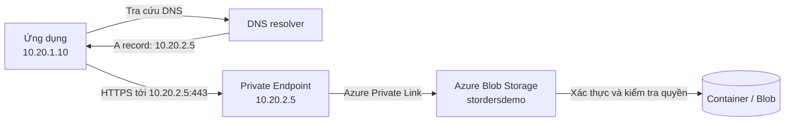
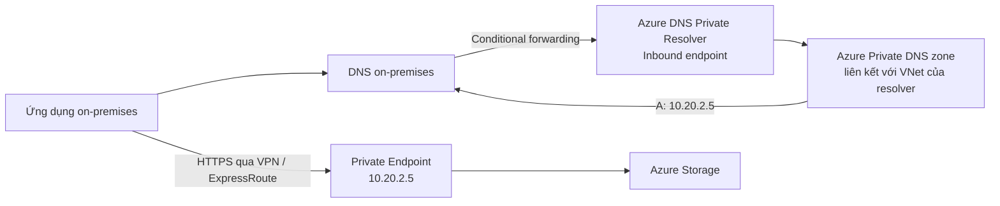

# Private Endpoint, Private Link và luồng phân giải DNS

Một ứng dụng chạy trong Azure Virtual Network (VNet) thường phải truy cập các dịch vụ như Azure Storage, Azure SQL Database hoặc Azure Key Vault. Các dịch vụ này có tên miền quen thuộc và có thể cung cấp endpoint công khai, nhưng nhiều kiến trúc yêu cầu lưu lượng đến dữ liệu đi qua **địa chỉ IP riêng**. Azure Private Link và Private Endpoint giúp tạo đường kết nối đó; **DNS** quyết định ứng dụng có thực sự sử dụng đường riêng hay vẫn phân giải tên miền sang địa chỉ công khai.

Bài học thuộc chương **Mạng ảo và phân giải tên** của module **CLOUD_PROVIDERS_AZURE**. Module khám phá hệ sinh thái Microsoft Azure từ subscription, resource group và Microsoft Entra ID đến mạng ảo, tính toán, lưu trữ, dữ liệu, triển khai, giám sát, bảo vệ và kiểm soát chi phí. Trong kiến trúc ứng dụng Azure, Private Endpoint, DNS và phân quyền dịch vụ phải được thiết kế cùng nhau để kết nối riêng tư hoạt động đúng như dự kiến.

Sau bài học, bạn có thể:

- Phân biệt Azure Private Link, Private Endpoint, Private Link Service và Service Endpoint.
- Mô tả luồng kết nối từ ứng dụng qua địa chỉ riêng đến một dịch vụ Azure.
- Giải thích vì sao tên miền dịch vụ gốc thường được giữ nguyên và DNS trả về private IP.
- Cấu hình Private DNS zone, VNet link và DNS zone group theo ví dụ Blob Storage.
- Thiết kế phân giải DNS từ VNet khác, mạng on-premises và môi trường hybrid.
- Kiểm tra lỗi kết nối do approval, routing, firewall, DNS hoặc authorization.

## 1. Vấn đề: dịch vụ PaaS có tên miền công khai

Giả sử một API trên Azure App Service hoặc một máy ảo trong VNet đọc hóa đơn tại Storage Account `stordersdemo`. Tên truy cập dữ liệu blob có dạng:

```text
https://stordersdemo.blob.core.windows.net/invoices/invoice-001.pdf
```

Đây là **tên miền dịch vụ chuẩn**. Trong cách triển khai mặc định, DNS của dịch vụ có thể dẫn client đến một địa chỉ công cộng của Azure. Dù lưu lượng có thể đi trên hạ tầng Microsoft, địa chỉ công cộng chưa đáp ứng yêu cầu “dịch vụ được truy cập bằng private IP nằm trong VNet của tổ chức”.

Tổ chức có thể cần:

- Chỉ cho phép workload trong các mạng được kiểm soát truy cập dữ liệu.
- Giảm bề mặt tấn công bằng cách không nhận request qua đường public của dịch vụ.
- Kết nối từ các VNet và mạng on-premises qua VPN hoặc ExpressRoute.
- Giữ nguyên URL/SDK của ứng dụng, không viết lại code để gọi một địa chỉ IP cố định.

Giải pháp cần **hai lớp phối hợp**: tạo đường mạng riêng bằng Private Endpoint và cung cấp bản ghi DNS thích hợp để ứng dụng đi theo đường đó.

## 2. Phân biệt các khái niệm dễ nhầm

### 2.1. Azure Private Link

**Azure Private Link** là khả năng kết nối đến dịch vụ được hỗ trợ thông qua endpoint riêng trong mạng Azure. Đường kết nối đến dịch vụ đi qua hạ tầng mạng Microsoft thay vì yêu cầu client kết nối bằng địa chỉ công cộng của dịch vụ. Azure hỗ trợ Private Link cho nhiều dịch vụ PaaS của Microsoft, một số dịch vụ đối tác và dịch vụ do doanh nghiệp xuất bản qua Private Link Service.

Private Link là **cơ chế kết nối**. Nó không tự tạo quyền đọc blob, truy vấn SQL hay đọc secret; các lớp xác thực và phân quyền của dịch vụ vẫn cần được cấu hình.

### 2.2. Private Endpoint

**Private Endpoint (PE)** là một network interface được tạo trong subnet của VNet, có **private IP** và trỏ đến một tài nguyên/dịch vụ Private Link cụ thể. Client kết nối tới private IP này để sử dụng dịch vụ đích.

Ví dụ:

```text
VNet: vnet-orders-prod
Subnet dành cho Private Endpoint: snet-private-endpoints
Private Endpoint: pe-blob-orders-prod
Private IP minh họa: 10.20.2.5
Đích: Storage Account stordersdemo, subresource blob
```

Private Endpoint có kết nối được dịch vụ đích chấp thuận. Trạng thái kết nối có thể là `Pending`, `Approved`, `Rejected` hoặc `Disconnected` tùy quy trình. Private IP tồn tại không đủ để khẳng định request sẽ thành công; phải kiểm tra connection state, routing, DNS và authorization.

### 2.3. Private Link Service

**Private Link Service** là thành phần dành cho **bên cung cấp dịch vụ riêng** muốn công bố ứng dụng của mình để các mạng tiêu thụ dịch vụ có thể tạo Private Endpoint đến đó. Ví dụ, một đội nền tảng đặt ứng dụng phía sau Standard Load Balancer rồi dùng Private Link Service để cho subscription khác kết nối riêng.

Đối với Azure Storage, Azure SQL hay Key Vault, người học thường chỉ cần tạo **Private Endpoint trỏ tới dịch vụ PaaS**; không phải tự tạo Private Link Service.

### 2.4. Service Endpoint khác Private Endpoint thế nào?

| Tiêu chí | VNet Service Endpoint | Private Endpoint / Private Link |
|---|---|---|
| Địa chỉ dịch vụ mà client kết nối | Vẫn dùng endpoint/IP công cộng của dịch vụ | Client dùng private IP của PE trong VNet |
| Mô hình kiểm soát | Cho phép subnet/VNet được chọn tại tài nguyên dịch vụ hỗ trợ | Đường kết nối riêng đến tài nguyên/subresource được chỉ định |
| DNS | Thường không yêu cầu private DNS zone để chuyển sang private IP | Cần cấu hình DNS để hostname dịch vụ trả về private IP |
| Mạng on-premises | Không được mở rộng trực tiếp như một private IP trong VNet | Có thể kết nối qua mạng hybrid và phân giải DNS phù hợp |
| Phạm vi dịch vụ | Chỉ các dịch vụ hỗ trợ Service Endpoint | Các dịch vụ hỗ trợ Azure Private Link |
| Lưu ý bảo mật | Vẫn phải cấu hình firewall và quyền dữ liệu | Vẫn phải cấu hình quyền dữ liệu và chặn public access nếu cần |

Cả hai là cơ chế hỗ trợ bảo vệ kết nối; lựa chọn phụ thuộc dịch vụ, yêu cầu mạng và kiến trúc. Chúng không thay thế Azure RBAC, database permission hoặc cơ chế xác thực của ứng dụng.

## 3. Đường đi của request qua Private Endpoint

Xét API chạy trên VM trong VNet có thể truy cập subnet `10.20.2.0/24`. Storage Account có một Private Endpoint cho subresource `blob` tại `10.20.2.5`.



Trình tự mạng và ứng dụng:

1. API gọi URL quen thuộc `https://stordersdemo.blob.core.windows.net`.
2. DNS resolver trả về địa chỉ private IP của Private Endpoint trong ngữ cảnh mạng được cấu hình.
3. Client mở kết nối TCP/TLS tới `10.20.2.5:443` qua route phù hợp trong Azure VNet hoặc mạng hybrid.
4. Private Endpoint đưa lưu lượng tới tài nguyên Blob Storage được liên kết qua Private Link.
5. Storage vẫn kiểm tra token Microsoft Entra ID, SAS, Shared Key hoặc cơ chế xác thực được cho phép, cùng quyền data plane tương ứng.
6. Dịch vụ trả về kết quả qua kết nối.

**Quan trọng:** client nên tiếp tục dùng **hostname dịch vụ gốc**. Đừng đổi ứng dụng để gọi `https://10.20.2.5` hoặc tự gắn hostname `privatelink.*` vào URL. TLS certificate, hostname verification và giao thức của dịch vụ được thiết kế cho tên dịch vụ chuẩn; DNS sẽ chịu trách nhiệm chuyển kết nối sang private IP.

## 4. DNS là chìa khóa để đi đúng đường

Private Endpoint mới tạo không có nghĩa mọi ứng dụng đều tự động truy vấn được private IP. Nếu client tiếp tục nhận public IP khi hỏi DNS, request vẫn chọn đường công khai theo kết quả phân giải và có thể bị chặn nếu public network access của dịch vụ đã tắt.

### 4.1. Luồng DNS điển hình với Azure Blob Storage

Khi Private Endpoint dành cho Blob Storage và DNS được cấu hình đúng, một cách phân giải điển hình là:

```text
Client hỏi:       stordersdemo.blob.core.windows.net
DNS public:       CNAME stordersdemo.privatelink.blob.core.windows.net
DNS private zone: A     10.20.2.5
Client kết nối:   10.20.2.5:443
TLS hostname:     stordersdemo.blob.core.windows.net
```

CNAME ở trên là mô hình minh họa chuỗi phân giải thường gặp. Bản ghi/chuỗi CNAME cụ thể có thể thay đổi theo dịch vụ và cấu hình, nhưng ý tưởng chính là **tên công khai chuẩn được ánh xạ sang private IP cho những client dùng DNS liên kết với VNet**.

Một client ngoài mạng riêng, không dùng hệ thống DNS private, có thể tiếp tục nhận địa chỉ công cộng khi phân giải tên. Nếu public network access đã bị vô hiệu hóa thì đường public sẽ bị dịch vụ từ chối; việc có Private Endpoint **không tự động tắt** đường public.

### 4.2. Azure Private DNS zone và VNet link

Với ví dụ Blob Storage, zone chuẩn thường dùng là:

```text
privatelink.blob.core.windows.net
```

Trong zone có A record cho Storage Account:

```text
stordersdemo  IN A  10.20.2.5
```

Để một VNet sử dụng bản ghi riêng của zone:

1. Tạo Azure Private DNS zone `privatelink.blob.core.windows.net`.
2. **Liên kết zone với VNet** cần phân giải tên qua tính năng virtual network link.
3. Tạo **Private DNS zone group** cho Private Endpoint trỏ tới zone thích hợp, để Azure có thể quản lý bản ghi DNS của Private Endpoint.
4. Xác minh A record, VNet link và kết quả phân giải trên client thực tế.

Private DNS zone và VNet link là các đối tượng khác nhau. Zone chứa record; **VNet link** cho phép môi trường phân giải của VNet đó thấy zone. Một VNet nằm cùng subscription hoặc peering với VNet có Private Endpoint **không tự động** có kết quả DNS đúng nếu chưa được gắn với hệ thống DNS phù hợp.

**DNS zone group** giúp tích hợp Private Endpoint với zone để tạo/cập nhật các bản ghi cần thiết. Nếu dùng tự quản lý DNS hoặc mô hình DNS khác, cần có quy trình cập nhật bản ghi đúng khi IP/endpoint thay đổi.

### 4.3. Private DNS zone phổ biến theo dịch vụ

| Azure service / subresource | Private DNS zone điển hình |
|---|---|
| Azure Storage Blob (`blob`) | `privatelink.blob.core.windows.net` |
| Azure Data Lake Storage Gen2 DFS (`dfs`) | `privatelink.dfs.core.windows.net` |
| Azure Storage File (`file`) | `privatelink.file.core.windows.net` |
| Azure Storage Queue (`queue`) | `privatelink.queue.core.windows.net` |
| Azure Storage Table (`table`) | `privatelink.table.core.windows.net` |
| Azure SQL Database | `privatelink.database.windows.net` |
| Azure Key Vault | `privatelink.vaultcore.azure.net` |
| Azure App Service (websites) | `privatelink.azurewebsites.net` |

Mỗi loại dịch vụ/subresource có thể cần một Private Endpoint và zone riêng. Với Azure Data Lake Storage Gen2, các ứng dụng có thể sử dụng cả endpoint **blob** và **dfs**; chỉ cấu hình một loại có thể khiến một số thao tác thất bại hoặc phải đi đường khác. Đối với App Service, luồng truy cập đến endpoint triển khai `scm` có thể cần bản ghi DNS riêng. Hãy kiểm tra danh sách subresource và DNS zone mà dịch vụ hỗ trợ trước khi triển khai.

## 5. Luồng DNS trong VNet mặc định, VNet peering và DNS tùy chỉnh

### 5.1. Client trong VNet dùng DNS do Azure cung cấp

Nếu VNet dùng resolver mặc định của Azure, liên kết Private DNS zone phù hợp với VNet sẽ giúp máy ảo/ứng dụng trong VNet phân giải tên theo các record private. Azure cung cấp dịch vụ DNS nền tảng tại địa chỉ đặc biệt `168.63.129.16` cho các ngữ cảnh mạng Azure hỗ trợ.

Không nên cấu hình máy on-premises hỏi trực tiếp `168.63.129.16`. Địa chỉ này dùng trong môi trường mạng Azure và không phải một DNS resolver công khai có thể truy vấn tùy ý từ Internet.

### 5.2. Client ở VNet khác có peering

VNet peering có thể cung cấp **đường mạng** giữa VNet ứng dụng và VNet chứa Private Endpoint, nhưng peering không tự sao chép Private DNS zone link.

Ví dụ:

```text
vnet-app       10.10.0.0/16  ---> client API
vnet-services  10.20.0.0/16  ---> Private Endpoint 10.20.2.5
```

Để ứng dụng trong `vnet-app` hoạt động:

- Hai mạng phải có routing/kết nối cho phép tới private IP của PE.
- DNS resolver được dùng bởi `vnet-app` phải trả về `10.20.2.5` cho hostname gốc của Storage.
- Có thể liên kết cùng Private DNS zone với cả hai VNet, hoặc dùng một hệ thống DNS trung tâm có forwarder phù hợp.
- Kiểm tra NSG, UDR, Azure Firewall và chính sách mạng Private Endpoint khi các thành phần này được sử dụng.

Khi một ứng dụng trong VNet đã tích hợp với App Service/Functions, cần kiểm tra đường DNS và outbound VNet integration của chính workload đó; việc chỉ tạo PE cho dịch vụ dữ liệu chưa bảo đảm App Service dùng được private IP.

### 5.3. Client sử dụng DNS tùy chỉnh

Nếu VNet khai báo custom DNS server, các client thường hỏi DNS server này thay vì tự động truy vấn Azure-provided DNS. DNS tùy chỉnh phải có khả năng giải quyết hostname dịch vụ thành private IP.

Mô hình thường dùng là DNS server/forwarder trong Azure:

```text
Client VNet -> DNS tùy chỉnh -> conditional forwarder
                                 |
                                 +-> Azure-provided DNS (168.63.129.16)
                                     trong ngữ cảnh VNet đã liên kết private zone
```

Không cấu hình tùy tiện một zone authoritative `blob.core.windows.net` chỉ chứa vài record nội bộ, vì có thể làm mất phân giải tên của những Storage Account khác. Nên dùng zone `privatelink.blob.core.windows.net` theo thiết kế Azure, kết hợp forwarder cho suffix tương ứng và kiểm tra cả tên chuẩn lẫn CNAME.

## 6. Luồng phân giải tên từ on-premises qua VPN hoặc ExpressRoute

Private Endpoint có thể được truy cập từ mạng on-premises nếu doanh nghiệp đã có **kết nối mạng riêng** (VPN site-to-site, ExpressRoute hoặc giải pháp kết nối được hỗ trợ) và hệ thống DNS hỗ trợ phân giải tên private.

Một kiến trúc phổ biến sử dụng **Azure DNS Private Resolver**:



Trình tự:

1. On-premises DNS nhận truy vấn `stordersdemo.blob.core.windows.net`.
2. Theo conditional forwarding rule thích hợp, DNS on-premises chuyển yêu cầu tới **inbound endpoint** của Azure DNS Private Resolver qua kết nối mạng riêng.
3. Resolver trong Azure phân giải theo Azure Private DNS zone đã được liên kết với VNet phù hợp, trả về private IP của PE.
4. Client on-premises kết nối tới private IP qua VPN/ExpressRoute, không phải qua Internet công cộng.
5. Storage kiểm tra xác thực và quyền dữ liệu như bình thường.

Theo mô hình DNS của Microsoft, khi cấu hình DNS on-premises, thường nên forward **suffix công khai của dịch vụ** như `blob.core.windows.net` tới inbound endpoint, để toàn bộ chuỗi CNAME được phân giải trong ngữ cảnh Azure đúng. Quy tắc cụ thể phụ thuộc hạ tầng DNS hiện hữu; cần kiểm tra tránh xung đột với những zone tổ chức tự quản lý.

Ngoài Azure DNS Private Resolver, tổ chức có thể triển khai DNS forwarder trên VM trong VNet. Khi đó phải tự quản lý sẵn sàng, cập nhật và bảo mật của DNS server. Dù dùng phương án nào, cần lưu ý:

- Inbound endpoint phải được on-premises DNS server truy cập qua mạng.
- Private DNS zone phải được liên kết với VNet mà Azure resolver dùng để phân giải.
- Tuyến đến IP của Private Endpoint phải tồn tại hai chiều theo thiết kế mạng và không bị policy/firewall cản trở.
- Không trỏ on-premises thẳng vào Azure-provided DNS `168.63.129.16` qua Internet/VPN như thể đó là resolver thông thường.
- Kiểm tra trả lời DNS từ **máy on-premises thực**, không chỉ từ một VM trong Azure.

## 7. Thực hành: Private Endpoint cho Azure Blob Storage

Ví dụ sau giả sử đã có một subscription, Storage Account, VNet và subnet phù hợp. Các câu lệnh Azure CLI minh họa một triển khai thực; **không chạy trên production trước khi rà soát tác động mạng, quyền, DNS và chi phí**. Private Endpoint, Private DNS zone và DNS Private Resolver (nếu dùng) có thể phát sinh chi phí riêng.

### 7.1. Chuẩn bị thông tin

Giả sử:

| Thành phần | Giá trị minh họa |
|---|---|
| Resource group mạng | `rg-network-lab` |
| Resource group dữ liệu | `rg-data-lab` |
| VNet | `vnet-app-lab` |
| Subnet dành cho PE | `snet-private-endpoints` |
| Storage Account | `stordersdemo` |
| PE | `pe-storders-blob` |
| DNS zone | `privatelink.blob.core.windows.net` |
| Region | `southeastasia` |

Hãy đảm bảo subnet còn đủ địa chỉ riêng, caller có quyền tạo network resources/Private Endpoint và tài nguyên đích hỗ trợ subresource `blob`. Nếu chủ thể tạo PE không có quyền phê duyệt bên dịch vụ đích, kết nối có thể cần chủ sở hữu Storage Account **Approve**.

### 7.2. Lấy resource ID và tạo Private Endpoint

```bash
RG_NET="rg-network-lab"
RG_DATA="rg-data-lab"
VNET="vnet-app-lab"
SUBNET="snet-private-endpoints"
STORAGE="stordersdemo"
PE_NAME="pe-storders-blob"
LOCATION="southeastasia"

STORAGE_ID=$(az storage account show \
  --resource-group "$RG_DATA" \
  --name "$STORAGE" \
  --query id -o tsv)

VNET_ID=$(az network vnet show \
  --resource-group "$RG_NET" \
  --name "$VNET" \
  --query id -o tsv)

az network private-endpoint create \
  --resource-group "$RG_NET" \
  --name "$PE_NAME" \
  --location "$LOCATION" \
  --vnet-name "$VNET" \
  --subnet "$SUBNET" \
  --private-connection-resource-id "$STORAGE_ID" \
  --group-id blob \
  --connection-name "plsc-storders-blob"
```

Endpoint được tạo trong subnet đã chỉ định và có network interface/private IP. Đừng mặc định IP là `10.20.2.5` vì Azure sẽ cấp địa chỉ theo subnet/cấu hình thực tế.

Kiểm tra trạng thái:

```bash
az network private-endpoint show \
  --resource-group "$RG_NET" \
  --name "$PE_NAME" \
  --query "{name:name,connections:privateLinkServiceConnections,customDnsConfigs:customDnsConfigs}" \
  -o json
```

Trong kết quả, kiểm tra `privateLinkServiceConnectionState.status` và thông tin DNS/địa chỉ. Nếu `Pending`, cần phê duyệt kết nối ở phía tài nguyên đích theo quy trình của tổ chức trước khi kiểm thử.

### 7.3. Tạo Private DNS zone, VNet link và DNS zone group

```bash
ZONE="privatelink.blob.core.windows.net"

az network private-dns zone create \
  --resource-group "$RG_NET" \
  --name "$ZONE"

az network private-dns link vnet create \
  --resource-group "$RG_NET" \
  --zone-name "$ZONE" \
  --name "link-vnet-app-lab" \
  --virtual-network "$VNET_ID" \
  --registration-enabled false

ZONE_ID=$(az network private-dns zone show \
  --resource-group "$RG_NET" \
  --name "$ZONE" \
  --query id -o tsv)

az network private-endpoint dns-zone-group create \
  --resource-group "$RG_NET" \
  --endpoint-name "$PE_NAME" \
  --name "default" \
  --private-dns-zone "$ZONE_ID" \
  --zone-name "blob"
```

Sau khi tích hợp:

```bash
az network private-dns record-set a list \
  --resource-group "$RG_NET" \
  --zone-name "$ZONE" \
  -o table

az network private-dns link vnet list \
  --resource-group "$RG_NET" \
  --zone-name "$ZONE" \
  -o table
```

Bạn sẽ thấy A record tương ứng với Storage Account trong zone và VNet link đã tạo. Nếu DNS zone group hoặc Private Endpoint sử dụng nhiều zone/subresource, kiểm tra từng record cần thiết thay vì chỉ nhìn một zone.

### 7.4. Kiểm thử từ bên trong VNet

Từ một VM hoặc workload trong VNet có đường truy cập phù hợp:

```bash
nslookup stordersdemo.blob.core.windows.net
```

Kết quả mong đợi là hostname gốc (có thể qua CNAME) phân giải đến **private IP của PE**. Sau đó kiểm tra kết nối TCP/TLS:

```bash
curl -v --connect-timeout 5 https://stordersdemo.blob.core.windows.net/
```

Lệnh `curl` có thể nhận `400` hoặc `403` do yêu cầu thiếu tham số/xác thực Blob Storage. Các mã này **không tự động chứng minh Private Link lỗi**; hãy tách kiểm tra DNS, TCP/TLS và authorization của Storage thành các bước riêng. Muốn kiểm tra đọc blob thực sự cần sử dụng credential hợp lệ và quyền data plane tương ứng.

Với máy Windows có PowerShell:

```powershell
Resolve-DnsName stordersdemo.blob.core.windows.net
Test-NetConnection stordersdemo.blob.core.windows.net -Port 443
```

Không dùng kết quả từ máy quản trị nằm ngoài VNet làm bằng chứng rằng ứng dụng trong VNet sẽ nhận cùng private IP: kết quả DNS có thể khác nhau tùy nơi truy vấn.

## 8. Bảo mật: Private Endpoint giải quyết điều gì và không giải quyết điều gì?

### 8.1. Tắt đường công khai nếu yêu cầu cô lập

Sau khi đã xác minh ứng dụng đi qua Private Endpoint và các workload phụ thuộc đều hoạt động, có thể cấu hình dịch vụ để **vô hiệu hóa public network access** nếu phù hợp. Cấu hình cụ thể tùy Storage, SQL, Key Vault hoặc dịch vụ khác.

Thứ tự thay đổi nên là:

1. Thiết kế đường mạng, quyền và DNS, bao gồm ứng dụng, agent triển khai, job sao lưu và giám sát.
2. Tạo Private Endpoint; đợi connection state được Approved.
3. Cấu hình private DNS và kiểm thử từ các mạng cần sử dụng.
4. Xác minh ứng dụng thật sự truy cập dữ liệu thành công qua private IP.
5. Chuyển cấu hình public network access theo chính sách, có kế hoạch rollback.
6. Kiểm thử đường public không còn hoạt động ngoài ý muốn và đường private vẫn dùng được.

Tắt public access quá sớm có thể làm đứt đường truy cập từ CI/CD, Azure-hosted agent, người quản trị hoặc dịch vụ sao lưu vốn đang sử dụng endpoint công khai.

### 8.2. Private Endpoint không thay cho quyền truy cập

Một ứng dụng kết nối được đến Private Endpoint **vẫn phải được ủy quyền** bởi dịch vụ. Ví dụ:

- Blob Storage: Azure RBAC data role, SAS hoặc Shared Key nếu cơ chế tương ứng còn được cho phép.
- Azure SQL: cơ chế xác thực và quyền bên trong database.
- Key Vault: Azure RBAC hoặc vault access policy tùy permission model.
- API riêng qua Private Link Service: xác thực/authorization của ứng dụng.

Private Endpoint cũng không đồng nghĩa dữ liệu được mã hóa đầu cuối tự động bởi ứng dụng; hãy dùng TLS và các cơ chế mã hóa phù hợp dịch vụ. Cần kiểm tra cả quyền lấy key/secret có thể tạo đường truy cập dữ liệu gián tiếp.

### 8.3. NSG, UDR và chính sách mạng trên subnet của PE

Private Endpoint có đặc điểm xử lý network policy riêng. Việc áp dụng **NSG** hoặc **user-defined route** (UDR) cho lưu lượng đến PE phụ thuộc cấu hình **private endpoint network policies** của subnet và khả năng được hỗ trợ.

Không giả định chỉ cần thêm một NSG rule trên subnet là lưu lượng đến PE chắc chắn bị lọc. Khi thiết kế inspe​ction qua firewall hoặc route tùy chỉnh, kiểm tra các chính sách mạng của subnet, route thực tế, giới hạn prefix/longest-prefix-match và hướng dẫn riêng của dịch vụ. Đặt quy tắc rõ ràng, sau đó kiểm chứng bằng thực nghiệm và công cụ Network Watcher phù hợp.

## 9. Những lỗi DNS và kết nối thường gặp

| Triệu chứng | Nguyên nhân có thể xảy ra | Hướng xác minh |
|---|---|---|
| Máy trong VNet vẫn nhận public IP | Thiếu Private DNS zone/link, zone group; custom DNS không forward đúng | Truy vấn từ chính workload; kiểm tra CNAME, A record, VNet link và DNS server |
| Trả `NXDOMAIN` khi hỏi dịch vụ | Zone private hoặc DNS tùy chỉnh thiếu record; split-horizon DNS cấu hình sai | Kiểm tra zone authoritative, record, conditional forwarder và cache |
| VM trong một VNet dùng được, VNet peering không dùng được | VNet thứ hai thiếu DNS link/forwarder hoặc route/NSG | Kiểm tra riêng DNS và routing của VNet thứ hai |
| Azure VM dùng được, on-premises không dùng được | On-premises DNS chưa forward về Azure; thiếu route tới PE | Kiểm tra inbound endpoint, DNS forwarding, VPN/ExpressRoute và route |
| DNS trả private IP nhưng TCP timeout | Connection state chưa Approved, route/firewall/NSG/UDR hoặc dịch vụ chưa sẵn sàng | Kiểm tra PE state, TCP 443, policy mạng và health |
| TCP/TLS thành công nhưng dịch vụ trả `403` | Thiếu quyền data plane, token sai audience, SAS hết hạn hoặc access policy | Kiểm tra principal, authorization của dịch vụ và credential |
| Các thao tác ADLS Gen2 hoạt động không đồng đều | Có PE/zone cho `blob` nhưng thiếu `dfs` hoặc ngược lại | Xem các subresource thực tế được SDK/ứng dụng sử dụng |
| Trỏ trực tiếp IP thì lỗi certificate | Hostname không khớp TLS certificate/SNI | Dùng FQDN gốc của dịch vụ và sửa DNS |
| Phân giải khác nhau giữa các máy | DNS resolver/cache/VNet link khác nhau | So sánh resolver, TTL, cache, route và cấu hình workload |

### 9.1. Quy trình chẩn đoán từng lớp

Khi ứng dụng không truy cập được:

1. **Hostname**: xác nhận ứng dụng gọi đúng URL gốc, ví dụ `stordersdemo.blob.core.windows.net`.
2. **DNS**: truy vấn từ đúng nơi chạy ứng dụng. Ghi lại CNAME, IP trả về và DNS server được hỏi.
3. **Kết nối mạng**: kiểm tra route tới IP, NSG/UDR/firewall, peering, VPN/ExpressRoute, TCP/TLS.
4. **Private Endpoint**: xác minh đích/subresource và connection state `Approved`.
5. **Dịch vụ đích**: kiểm tra public network access, private connection được phép, firewall/network ACL.
6. **Danh tính và quyền**: kiểm tra managed identity/service principal, token audience, Azure RBAC data role hoặc quyền đặc thù của dịch vụ.
7. **Ứng dụng**: xem log theo correlation ID và cấu hình SDK nhưng không đưa token/secret nguyên văn vào log.

Đừng đổi đồng thời DNS, role và firewall khi chưa phân biệt nguyên nhân. Mỗi lần sửa một lớp và kiểm tra lại kết quả giúp xác định thay đổi có tác dụng.

## 10. Các tình huống cần thiết kế cẩn thận

### 10.1. Nhiều Private Endpoint cho cùng một tài nguyên

Một tài nguyên có thể có nhiều Private Endpoint trong các mạng hoặc khu vực khác nhau. Nếu cùng hostname/subresource được ánh xạ thành nhiều A record trong một Private DNS zone dùng chung, client có thể nhận IP không phù hợp với route hoặc vùng mạng của nó. Đặc biệt cẩn trọng khi liên kết cùng một zone với nhiều VNet và nhiều PE cho cùng một tên.

Thiết kế DNS phải xét **vùng mạng nào cần nhận IP nào**, tránh việc một DNS zone group cập nhật record và ảnh hưởng tới workload khác. Với kiến trúc đa vùng, phân tích mô hình DNS, khả năng truy cập chéo vùng, failover và vòng đời của endpoint trước khi chọn zone dùng chung hay tách zone theo miền phân giải.

### 10.2. Private Endpoint ở một subscription, dịch vụ ở subscription khác

Private Endpoint và tài nguyên đích có thể nằm ở các subscription khác nhau trong kịch bản được hỗ trợ. Cần xác định chính xác **resource ID của đích**, quyền tạo endpoint và quyền phê duyệt của chủ sở hữu dịch vụ. Lưu ý VNet, private DNS zone và resource đích không nhất thiết nằm trong cùng resource group hay subscription.

### 10.3. Ứng dụng serverless và nền tảng PaaS

App Service, Azure Functions hoặc workload nền tảng khác có thể cần cấu hình **outbound VNet integration** để đi tới Private Endpoint của Storage/Key Vault. Private Endpoint dành cho **inbound truy cập ứng dụng** là chủ đề khác với VNet integration phục vụ **outbound từ ứng dụng**. Cần xác định hướng lưu lượng trước khi tạo endpoint.

### 10.4. Chi phí và vận hành DNS

Private Endpoint có thể có phí theo thời gian sử dụng và dữ liệu xử lý; Private DNS zone, truy vấn DNS và Azure DNS Private Resolver cũng có mô hình phí riêng. Cần theo dõi chi phí theo subscription/resource group, tag ownership và dự báo cho số lượng endpoint, resolver, mạng hybrid. Trong vận hành, theo dõi thay đổi IP, connection state, DNS record, cảnh báo kết nối và cấu hình mạng.

## 11. Bài tập vận dụng

**Bài 1 — Đọc luồng DNS.** Một VM trong `vnet-app` gọi `https://stordersdemo.blob.core.windows.net` và nhận CNAME `stordersdemo.privatelink.blob.core.windows.net`, sau đó A record `10.20.2.5`. Hãy xác định đích TCP/TLS, vai trò của VNet link và vì sao URL ứng dụng không phải đổi sang `privatelink.*`.

**Bài 2 — Xác định lỗi.** Storage đã có Private Endpoint trạng thái Approved nhưng ứng dụng trong VNet khác nhận public IP và bị `403` khi public network access của Storage đã tắt. Hãy liệt kê các kiểm tra về DNS, mạng và cấu hình public/private access theo thứ tự.

**Bài 3 — Hybrid DNS.** Một ứng dụng on-premises phải đọc Blob Storage qua ExpressRoute. Hãy vẽ luồng từ DNS on-premises tới Azure DNS Private Resolver inbound endpoint, tới Private DNS zone rồi tới PE. Vì sao không nên trỏ on-premises thẳng đến `168.63.129.16`?

**Bài 4 — Phân quyền.** VM có route đến Private Endpoint của Key Vault và tên vault phân giải thành private IP, nhưng nhận lỗi permission. Private Endpoint có giải quyết được lỗi này không? Cần kiểm tra lớp nào?

**Bài 5 — Chọn dịch vụ.** Một doanh nghiệp tự vận hành API sau Standard Load Balancer và muốn cho khách hàng từ các VNet khác kết nối riêng. Trường hợp nào cần Private Link Service, trường hợp nào tạo Private Endpoint?

**Bài 6 — Nhiều mạng.** Có hai VNet ở hai khu vực, mỗi mạng có Private Endpoint đến cùng Storage Account. Nêu những nguy cơ khi cả hai A record được quản lý trong cùng một zone private dùng chung và cách kiểm tra thiết kế DNS.

## Kết luận

Azure Private Link cung cấp cơ chế kết nối riêng đến dịch vụ hỗ trợ, còn **Private Endpoint là địa chỉ private IP trong VNet** mà client sử dụng. **DNS quyết định client có thực sự đi tới private IP đó hay không**: tên dịch vụ chuẩn thường trải qua CNAME và được ánh xạ bằng Azure Private DNS zone, VNet link hoặc DNS forwarding thích hợp. Với mô hình hybrid, Azure DNS Private Resolver hoặc DNS forwarder giúp đưa truy vấn từ on-premises vào ngữ cảnh private zone của Azure. Một kết nối hoàn chỉnh luôn cần đúng **Private Endpoint approval, DNS, routing, network security và quyền truy cập dữ liệu**; sau khi xác minh đường private, có thể khóa đường public theo chính sách của workload.
